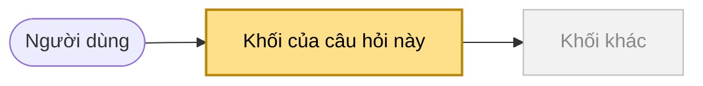

## Context

**Milestone:** mvp
**Build:** {build name in words} (UC-XXX)
**Block of the map:** {block name}
**Related items:** {behavior in words} (FR-NNN)
**Answer by:** `có sẵn` / `thử nhỏ` / `anh quyết`
**Flow tracker:** #N (when the build has one)

## Map

<!-- Copy the map from section 1 of the build's research checklist. Give class `here` only to the block this question comes from.
     The reader sees WHERE in the product this question sits before reading the question itself. -->

## Question

<!-- The specific question to answer. One question per ticket. -->

## Why this matters

<!-- What goes wrong if it is skipped, and which requirement or later build depends on the answer. Restate it from the checklist; no other file should be needed. -->

## What we already know

<!-- Evidence with links: reference code at its commit, other products, docs. -->

## Options (if technical)

<!-- Fill this table when the question is a technology choice. Remove if not applicable. -->

| Option | Description | Fits requirements | Tradeoffs |
|---|---|---|---|
| Option A | | | |
| Option B | | | |

## Deliverable

<!-- What closing this ticket produces, as a clickable link:

     **Research answer:** [dev/mvp/research/topic.md](https://github.com/{owner}/{repo}/blob/main/dev/mvp/research/topic.md), new item N
     **Decision record:** [dev/mvp/decisions/DEC-NNN-topic.md](https://github.com/{owner}/{repo}/blob/main/dev/mvp/decisions/DEC-NNN-topic.md)
     **Spec change:** the spec file to change (the PO approves it)

     The PO writes the answer and the decision's Choice / Why. The agent supplies the evidence and the options only (dev/mvp/WORKFLOW.md "Roles"). -->

## Acceptance

- [ ] Question **answered with evidence or reasoning**
- [ ] **Deliverable file created or updated**
- [ ] **Reviewed**

## Blocked by

<!-- List prerequisite tickets. Remove if none. -->
