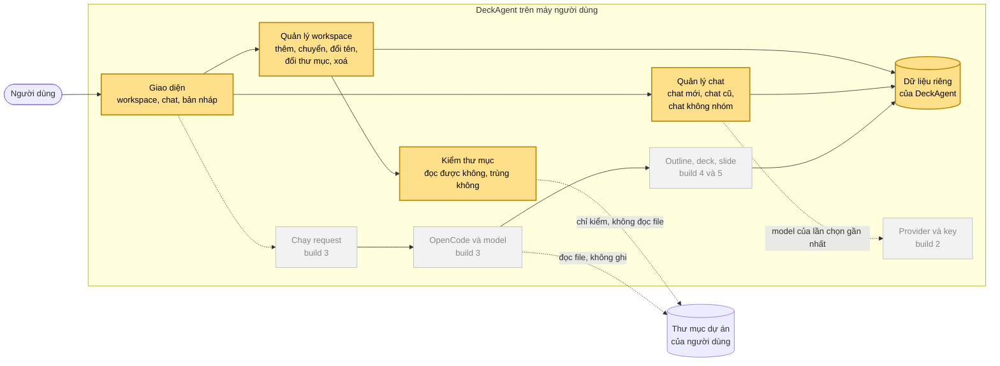

# Research checklist — workspace theo thư mục và chat mới

## At a glance

- **Build:** build đầu tiên: **workspace theo thư mục** (UC-013) và **bắt đầu chat mới** (UC-012), **mọi bước và mọi luồng phụ**. **11 mục** của spec: bảng ở mục 4.
- **Runtime:** build này **không gọi OpenCode**, **không gọi model**, **không đọc file nào** của thư mục dự án. **Ticket code đầu tiên** của build là **walking skeleton** đã hoãn ở Phase 0.
- **Status:** **15 câu**: **3 không cần research**, **1 để build sau**, **1 có sẵn**, **2 thử nhỏ**, **8 anh quyết** (**3** trong đó là **chỗ spec còn thiếu**).
- **Spine:** [traceability-matrix.md](./traceability-matrix.md)

## Cách đọc

Đọc **sơ đồ** (mục 1) → **ranh giới của phần đang xây** (mục 2) → **câu hỏi theo từng khối** trên sơ đồ (mục 3). Mỗi câu ghi **vì sao phải bận tâm**, **đã biết gì**, **trả lời bằng gì** và **chặn bước nào**. "Trả lời bằng" có 5 loại:
- `không cần research`: **chuyện thường**, implementation plan **tự chọn**; **không có ticket**;
- `có sẵn`: **bằng chứng đã có** (code mẫu, sản phẩm khác, docs), anh **chỉ cần gật**;
- `thử nhỏ`: **vài phép thử trên máy**, dưới một giờ;
- `anh quyết`: **lựa chọn sản phẩm hoặc công nghệ**; nếu là **hành vi mới** thì **vào spec trước** khi build dùng;
- `để build sau`: thuộc **build khác**, **không chặn** build này; **không có ticket**.

## 1. Bản đồ: build này nằm ở đâu

- **Khối vàng**: **build này làm**. **Khối xám**: **build sau**. **Nét đứt**: **chưa chạy** trong build này, nhưng **build này phải chừa chỗ**.
- **Ta đang ở đây:** build này dựng **phần khung dữ liệu** mà **mọi build sau đứng lên**: **workspace, chat, nơi lưu, kiểm thư mục** và **giao diện** để người dùng chọn.

## 2. Phần đang xây: vào gì, ra gì, ai dựa vào

1. **Vào:** người dùng **chọn thư mục**, **chuyển workspace**, **đổi tên**, **đổi thư mục**, **xoá workspace**, **bắt đầu chat mới**, **xem chat cũ**. **Chưa có request nào** trong build này.
2. **Ra:** **danh sách workspace** (tên, cái đang dùng, thư mục đọc được không); **chat mới rỗng**; **danh sách chat cũ** và **chat không nhóm**.
3. **Build sau dựa vào gì** (đổi muộn ở đây là **đắt nhất**):
   - **ID của chat và workspace** **không phụ thuộc đường dẫn thư mục**: request (build 3), deck (build 5), mở lại chat (build 6) **đều trỏ vào** chúng;
   - **"chat này dùng thư mục nào"**: agent ở build 3 **đọc đúng thư mục đó** và **không thư mục nào khác** (yêu cầu "phạm vi của agent", FR-077);
   - **nơi lưu** và **cách đổi cấu trúc dữ liệu**: build 3 **thêm hội thoại**, build 5 **thêm deck**;
   - **"workspace có request đang chạy không"**: dùng để **chặn xoá và đổi thư mục**, nhưng **request chỉ có từ build 3**.
4. **Không làm:** **không gọi OpenCode**, **không gọi model**, **không đọc file** trong thư mục dự án; chỉ **kiểm thư mục có đọc được không**.

## 3. Câu hỏi theo từng khối

### Khối A · DeckAgent chạy dưới dạng gì, dữ liệu nằm đâu

1. **RQ-1 · DeckAgent là server trên máy cộng trình duyệt, hay là app desktop?**
   - **Vì sao:** glossary của spec nói **tải lại hay đóng giao diện không dừng DeckAgent**, tức **giao diện tách khỏi chương trình**. Nhưng **trình duyệt không đưa được đường dẫn thư mục** cho server: nó chỉ trả một **handle**, không trả đường dẫn. Build này **mang ticket skeleton**; chọn sai dạng app thì **mọi build sau làm lại giao diện**.
   - **Đã biết:** code mẫu là **server Node cộng trình duyệt**, người dùng **gõ đường dẫn thư mục bằng tay** ([workspace-view.ts:137](https://github.com/Luke23127006/DeckAgent/blob/5bd9c17/packages/client/runtime/src/workspace-view.ts#L137)). open-design bản desktop **mở hộp chọn thư mục của hệ điều hành** ở tiến trình chính rồi **cấp token** cho daemon ([open-design-earlier-work.md](../../research/open-design-earlier-work.md) item 8).
   - **Trả lời bằng:** `anh quyết`, dựa trên hai bằng chứng trên. **Chặn:** implementation plan.

2. **RQ-2 · Dữ liệu lưu bằng gì: SQLite hay file JSON?**
   - **Vì sao:** build 3, 5, 6 **xây trên nơi lưu này**; đổi muộn là **phải chuyển dữ liệu**.
   - **Đã biết:** code mẫu dùng **SQLite qua `node:sqlite`** cho cả workspace và chat; open-design cũng dùng **SQLite**. **Chưa kiểm**: `node:sqlite` ở **Node 22** đã **ổn định** hay còn **thử nghiệm** (đọc docs Node, vài phút).
   - **Trả lời bằng:** `anh quyết` (công nghệ là quyền PO). **Chặn:** implementation plan.

3. **RQ-3 · DeckAgent từ chối những thư mục nào?** **Spec chưa có** luồng này.
   - **Trường hợp 1, thư mục chứa dữ liệu của DeckAgent:** người dùng chọn `C:\Users\<tên>`, mà dữ liệu DeckAgent nằm bên trong → **mỗi lần lưu chat** là **ghi file vào thư mục dự án**, trái yêu cầu **không đổi file nào trong thư mục dự án** (FR-084). Code mẫu **từ chối** trường hợp này, báo "**Thư mục dự án phải tách biệt với dữ liệu nội bộ của DeckAgent**" ([workspace-view.ts:10](https://github.com/Luke23127006/DeckAgent/blob/5bd9c17/packages/client/runtime/src/workspace-view.ts#L10)).
   - **Trường hợp 2, thư mục quá rộng** như `C:\` hay cả thư mục người dùng: agent **đọc mọi file của thư mục dự án mà không hỏi** và **gửi nội dung cho provider** (FR-077) → ở build 3, chọn `C:\` là **agent đọc được cả máy**. Code mẫu **không chặn**.
   - **Trả lời bằng:** `anh quyết`: **từ chối**, **cảnh báo** hay **cho phép**; rồi **vào spec trước**. **Chặn:** testing plan.

### Khối B · Kiểm thư mục

4. **RQ-4 · "Cùng một thư mục" nghĩa là gì trên Windows?** Chữ **hoa và thường**, dấu `\` ở cuối, **junction và symlink**, **ổ mạng gán chữ** (`Z:\`) so với **đường dẫn mạng** (`\\server\share`), thư mục **OneDrive**.
   - **Vì sao:** so sai thì **một thư mục thành hai workspace**, trái glossary "**không hai workspace cùng một thư mục**". Testing plan cũng cần **định nghĩa "cùng thư mục"** mới viết được tiêu chí.
   - **Đã biết:** code mẫu **chuẩn hoá bằng `realpath`** rồi so đường dẫn ([workspace-registry.ts](https://github.com/Luke23127006/DeckAgent/blob/5bd9c17/apps/local-web/src/workspace-registry.ts)).
   - **Trả lời bằng:** `thử nhỏ`: vài ca trong một unit test. **Chặn:** testing plan.

5. **RQ-5 · Thư mục bị dời đi, rồi một thư mục khác được đặt đúng chỗ cũ: cùng thư mục hay không?** Spec ghi đây là **research của build đầu tiên** (ghi chú của yêu cầu "báo thư mục không đọc được", FR-074).
   - **Đã biết:** code mẫu lưu **mã định danh thư mục trên ổ đĩa** (`dev` cộng `ino`); mã lệch thì coi là **thư mục không còn**.
   - **Chưa biết:** trên Windows, Node trả mã này **ổn định** không với **ổ NTFS**, **USB (exFAT)** và **ổ mạng**.
   - **Trả lời bằng:** `thử nhỏ` (một ổ NTFS, một USB), rồi `anh quyết` **người dùng thấy gì** trong trường hợp này. **Chặn:** testing plan.

6. **RQ-6 · Khi nào kiểm "đọc được"**: lúc khởi động, lúc hiện danh sách hay lúc chuyển workspace? **Ổ mạng chậm** làm danh sách chậm.
   - **Trả lời bằng:** `không cần research`; implementation plan chọn. Code mẫu **kiểm mỗi lần đọc một workspace**.

### Khối C · Workspace

7. **RQ-7 · Tên nào bị từ chối khi đổi tên?** Câu này đang nằm ở mục **Undecided** của yêu cầu đổi tên (FR-141).
   - **Đã biết:** code mẫu **cắt khoảng trắng hai đầu**, **từ chối tên rỗng**, **tối đa 100 ký tự** ([workspace-registry.ts](https://github.com/Luke23127006/DeckAgent/blob/5bd9c17/apps/local-web/src/workspace-registry.ts)).
   - **Trả lời bằng:** `có sẵn`; anh **gật khi viết testing plan**. **Độ dài tối đa là một giá trị**, nên theo luật spec nó vào **một luật nghiệp vụ mới**. **Chặn:** testing plan.

8. **RQ-8 · Tắt rồi mở lại DeckAgent, workspace nào đang dùng?** Spec chỉ nói **lần chạy đầu tiên** dùng **workspace mặc định**.
   - **Vì sao:** để trống thì **hai dev viết hai kiểu**, và test **không biết kiểm gì**.
   - **Trả lời bằng:** `anh quyết`, rồi **vào spec trước**. Đề xuất: **workspace dùng lần cuối**, nếu nó **còn**. **Chặn:** testing plan.

9. **RQ-9 · Hai giao diện mở cùng lúc** (hai tab): một tab **chuyển workspace** thì tab kia **có chuyển theo** không?
   - **Đã biết:** câu hỏi mở 19 đã ghi **nhiều giao diện cùng lúc** là việc của **implementation plan**. Glossary nói **chỉ có một** workspace đang dùng.
   - **Trả lời bằng:** `anh quyết`. **Chặn:** implementation plan.

10. **RQ-10 · Xoá workspace bị ngắt giữa chừng** (máy tắt giữa lúc **đánh dấu xoá** và lúc **chuyển chats thành chat không nhóm**): chats **trỏ vào workspace đã xoá**.
    - **Đã biết:** code mẫu làm **hai bước riêng** rồi **dọn lại lúc khởi động** ([web-state.ts:154-156](https://github.com/Luke23127006/DeckAgent/blob/5bd9c17/apps/local-web/src/web-state.ts#L154-L156)). **Một transaction** của SQLite cũng giải được.
    - **Trả lời bằng:** `không cần research`; implementation plan **ghi một transaction**.

### Khối D · Chat

11. **RQ-11 · Chat mới chưa gửi gì có được lưu không?** Luật "chat nào được giữ" (BR-004) **không bắt** chat **chưa gửi request** phải hiện lại.
    - **Đã biết:** code mẫu **lưu ngay**, nhưng **ẩn chat rỗng** khỏi danh sách ([boot.ts:328](https://github.com/Luke23127006/DeckAgent/blob/5bd9c17/packages/client/runtime/src/boot.ts#L328)).
    - **Trả lời bằng:** `không cần research`; implementation plan chọn.

12. **RQ-12 · Tải lại hay đóng giao diện thì bản nháp còn không?** Spec: bản nháp **được giữ** khi người dùng **ở chỗ khác trong sản phẩm**, và **không giữ sau khi DeckAgent dừng** (FR-038). Nhưng **tải lại giao diện không dừng DeckAgent**, và spec **không nói** trường hợp này.
    - **Đã biết:** code mẫu giữ bản nháp **trong bộ nhớ trang** và trong `sessionStorage` của tab → **còn khi tải lại**, **mất khi đóng tab** ([boot.ts:155-165](https://github.com/Luke23127006/DeckAgent/blob/5bd9c17/packages/client/runtime/src/boot.ts#L155-L165)).
    - **Trả lời bằng:** `anh quyết`, rồi **vào spec trước**. **Chặn:** testing plan.

13. **RQ-13 · "Đặt tên chat theo nội dung": code hay model đặt tên?** (yêu cầu "hiện các chat cũ", FR-048)
    - **Vì sao:** đây là **ranh giới model và code** mà WORKFLOW bắt **mỗi plan phải ghi**; **mặc định là code**, ví dụ **vài chữ đầu của request đầu tiên**. Gọi model thì **tốn tiền** và **cần provider** (build 2).
    - **Thêm:** build này **chưa có request**, nên **chưa có nội dung để đặt tên**. Test dùng **dữ liệu dựng sẵn**, hoặc phần đặt tên **để build 3**.
    - **Trả lời bằng:** `anh quyết`. **Chặn:** testing plan và implementation plan.

14. **RQ-14 · Chat mới có tạo session của OpenCode không?**
    - **Trả lời bằng:** `để build sau` (build 3; câu hỏi mở 3 hỏi **OpenCode giữ session thế nào**). Build này chỉ cần **ID chat của riêng DeckAgent**. Code mẫu cũng vậy: **mỗi lần gửi một session mới**, **DeckAgent giữ lịch sử**.

### Khối E · Phần trong scope mà build này chưa test được

15. **RQ-15 · Ba hành vi cần thứ build này chưa có:**
    - **chặn xoá và đổi thư mục** khi workspace có **request đang chạy** (luồng phụ A5 của use case workspace);
    - **request vẫn chạy** khi người dùng **chuyển workspace** hay **tạo chat mới**;
    - chat mới **lấy model của lần chọn gần nhất** (cần provider, build 2).

    **Trả lời bằng:** `anh quyết`: test bằng **request giả** ngay build này, hay **chuyển các tiêu chí đó sang build 2 và 3** và **ghi trong ma trận**. Đề xuất: **chuyển**, đúng quy tắc của proposal thứ tự build: **mỗi hành vi được test ở build đầu tiên test được nó**. **Chặn:** testing plan.

### Không hỏi, và vì sao

- **OpenCode có chạy trên Windows không:** code mẫu **đã chạy** trên Windows, và build này **không gọi OpenCode**.
- **SQLite có đáng tin không:** **dùng rộng rãi**; open-design và code mẫu **đều dùng**.
- **Workspace mặc định tên gì:** là **nhãn giao diện**, để **thiết kế UI** quyết.
- **Lưu chat trong dữ liệu riêng hay trong thư mục dự án:** **đã chốt hướng dữ liệu riêng** (quyết định "nơi giữ công việc của chat", DEC-006, phương án A). **Việc còn lại của anh:** **viết Choice và Why** cho quyết định đó.

## 4. Code mẫu khớp spec tới đâu

Đọc ở `feat/v2-opencode` @ `5bd9c17`. Cột **PO phán** để trống cho anh: **bug thì không mang theo**; **hành vi muốn giữ mà spec chưa có** thì **vào spec trước**; **spec thắng code**.

| Việc (theo spec) | ID | File code mẫu | Khớp | Khác gì | PO phán |
|---|---|---|---|---|---|
| Thêm workspace, chuyển workspace đang dùng | FR-071 | [workspace-registry.ts](https://github.com/Luke23127006/DeckAgent/blob/5bd9c17/apps/local-web/src/workspace-registry.ts) | match | Tên **lấy từ tên thư mục**; còn **nhận thêm tên tuỳ chọn** lúc thêm. Người dùng **gõ đường dẫn** (RQ-1) | |
| Workspace mặc định từ lần chạy đầu | FR-072 | workspace-registry.ts | match | Tên cố định "Default Workspace" | |
| Xoá workspace | FR-073 | [web-state.ts:175-178](https://github.com/Luke23127006/DeckAgent/blob/5bd9c17/apps/local-web/src/web-state.ts#L175-L178), [workspace-view.ts:94-104](https://github.com/Luke23127006/DeckAgent/blob/5bd9c17/packages/client/runtime/src/workspace-view.ts#L94-L104) | match | **Hỏi xác nhận**, nói **thư mục và file giữ nguyên**; chats vào **nhóm "Ungrouped"**; **chặn khi có request chạy** (`WORKSPACE_BUSY`) | |
| Báo thư mục không đọc được | FR-074 | workspace-registry.ts, [workspace-view.ts:189](https://github.com/Luke23127006/DeckAgent/blob/5bd9c17/packages/client/runtime/src/workspace-view.ts#L189) | differ | Chỉ ghi "**Không thể đọc thư mục**" cạnh tên; **không nói người dùng làm gì tiếp** (spec yêu cầu) | |
| Chọn thư mục khác cho workspace | FR-083 | workspace-registry.ts | match | **Giữ tên**; **từ chối thư mục của workspace khác** và **workspace mặc định** | |
| Không đổi file trong thư mục dự án | FR-084 | [ADR 0001](https://github.com/Luke23127006/DeckAgent/blob/5bd9c17/docs/adr/0001-application-storage-and-workspace-boundary.md) | match | **Thêm**: từ chối thư mục **chồng lên dữ liệu** (spec chưa có, RQ-3) | |
| Đổi tên workspace | FR-141 | — | missing | **Không có** chức năng đổi tên | |
| Bắt đầu chat mới | FR-053 | [web-state.ts:128-145](https://github.com/Luke23127006/DeckAgent/blob/5bd9c17/apps/local-web/src/web-state.ts#L128-L145), boot.ts | differ | Model lấy từ `sessionStorage` của tab, **mất khi đóng tab**; spec: **lần chọn gần nhất ở mọi chat** | |
| Hiện các chat cũ | FR-048 | [boot.ts:328-359](https://github.com/Luke23127006/DeckAgent/blob/5bd9c17/packages/client/runtime/src/boot.ts#L328-L359) | differ | Hiện **chats của mọi workspace**, chia nhóm, **cộng nhóm "Ungrouped"**; spec: **chỉ workspace đang dùng** cộng **chat không nhóm**. **Mở một chat không nhóm** thì **đổi workspace đang dùng** ([boot.ts:476](https://github.com/Luke23127006/DeckAgent/blob/5bd9c17/packages/client/runtime/src/boot.ts#L476)); spec: **giữ nguyên** | |
| Giữ bản nháp của chat | FR-038 | [boot.ts:155-165](https://github.com/Luke23127006/DeckAgent/blob/5bd9c17/packages/client/runtime/src/boot.ts#L155-L165) | match | Giữ theo từng chat khi chuyển chat; **còn khi tải lại tab** (RQ-12) | |
| Chat nào được giữ làm việc cũ | BR-004 | [persistence](https://github.com/Luke23127006/DeckAgent/blob/5bd9c17/packages/session/persistence/src/index.ts) | match | **Không xoá chat theo thời gian**; chat không nhóm **giữ nguyên tin nhắn**; **ẩn chat rỗng** | |

## 5. Ticket và nơi ghi câu trả lời

**Issue theo dõi build:** [#48](https://github.com/Luke23127006/DeckAgent/issues/48). **8 ticket**: **ba chỗ spec còn thiếu** gộp **một ticket** (cùng cách trả lời, cùng nơi ghi); câu **tên bị từ chối** (`có sẵn`) **không có ticket**, anh **gật khi viết testing plan**.

| RQ | Ticket | Nơi ghi câu trả lời | Trạng thái |
|---|---|---|---|
| RQ-1 · dạng app | [#49](https://github.com/Luke23127006/DeckAgent/issues/49) | [DEC-010](../../decisions/DEC-010-how-deckagent-runs.md) | open |
| RQ-2 · nơi lưu | [#50](https://github.com/Luke23127006/DeckAgent/issues/50) | [DEC-011](../../decisions/DEC-011-how-deckagent-data-is-stored.md) | open |
| RQ-3, RQ-8, RQ-12 · ba chỗ spec còn thiếu | [#51](https://github.com/Luke23127006/DeckAgent/issues/51) | spec: use case workspace, yêu cầu "giữ bản nháp" | open |
| RQ-4 · cùng thư mục | [#52](https://github.com/Luke23127006/DeckAgent/issues/52) | [windows-folders.md](../../research/windows-folders.md) | open |
| RQ-5 · thư mục khác ở chỗ cũ | [#53](https://github.com/Luke23127006/DeckAgent/issues/53) | [windows-folders.md](../../research/windows-folders.md); spec nếu đổi hành vi | open |
| RQ-7 · tên bị từ chối | — | spec: yêu cầu đổi tên và một luật mới, ở testing plan | open |
| RQ-9 · hai giao diện | [#54](https://github.com/Luke23127006/DeckAgent/issues/54) | [DEC-012](../../decisions/DEC-012-several-open-interfaces.md) | open |
| RQ-13 · ai đặt tên chat | [#55](https://github.com/Luke23127006/DeckAgent/issues/55) | implementation plan (ranh giới model và code) | open |
| RQ-15 · phần chưa test được | [#56](https://github.com/Luke23127006/DeckAgent/issues/56) | ma trận và testing plan | open |

Trạng thái: `open`, `researching`, `answered` (ghi trong research), `decided` (ghi trong một decision), `in spec` (đã vào spec).
