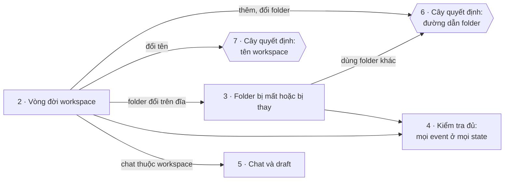
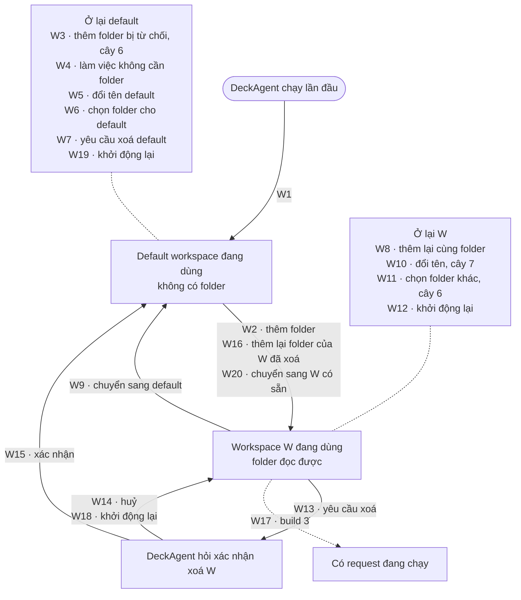
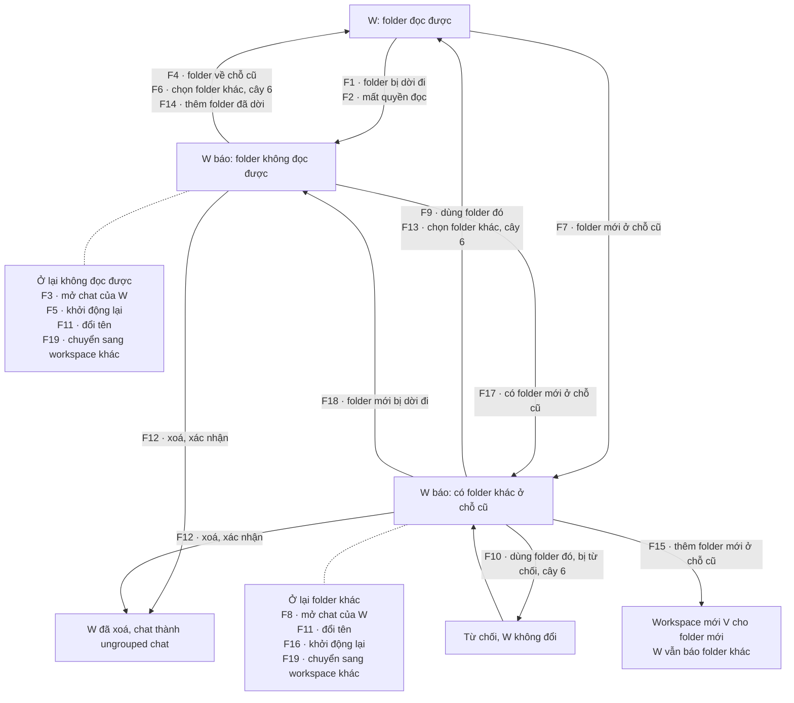
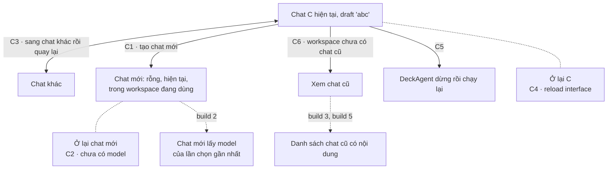
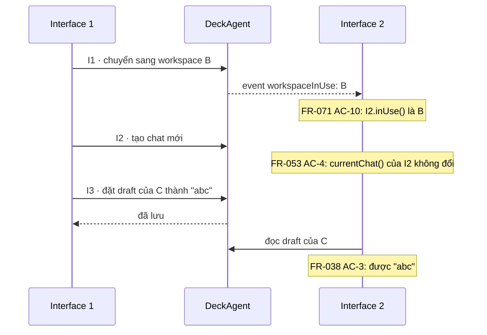
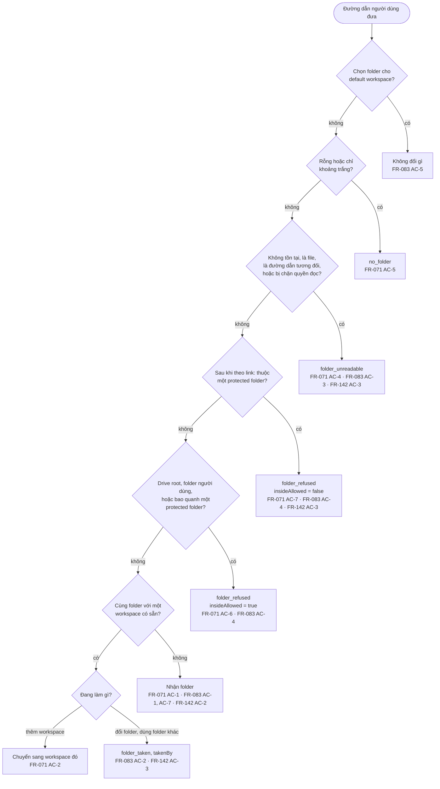
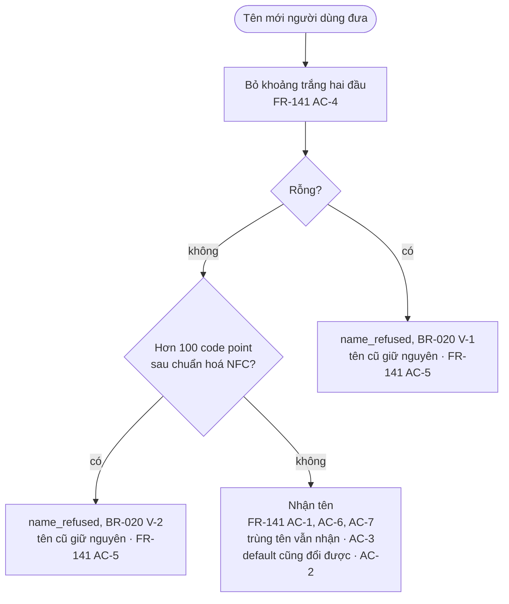

# Test design — workspace theo thư mục và chat mới

## At a glance

- **Dùng để làm gì:** đây là **Test Design Specification** của build ([test-strategy.md](../../../development/test-strategy.md) mục "Test design specification"), record của **Gate 2**. PO kiểm ở đây **technique nào được áp dụng và vì sao**, **cách áp dụng**, các **condition** suy ra từ **basis item** nào, các **coverage item** và tiêu chí đủ, **liên kết** từ condition tới **AC và test case**, và các **gap, deviation và design ruling**. **Scope ruling** nằm ở [test-analysis.md](./test-analysis.md); **AC** nằm ở [testing-plan.md](./testing-plan.md).
- **Gate 2:** _Not started_. Nội dung dưới đây là **phần thiết kế đã viết trước khi đổi artifact**; nó **chưa đủ** trách nhiệm mới. Các việc còn lại ghi ở [mục 8](#8-gaps-deviations-và-rulings), phần "**Gate 2 pending**".
- **Cách đọc một chủ đề:** đọc **sơ đồ** trước; mỗi mũi tên có **một mã** (W1, F1, C1). Sau đó đọc khung **Luôn đúng**: các điều DeckAgent phải giữ **ở mọi mũi tên**. Cuối cùng đọc **bảng mũi tên**: mỗi mũi tên một dòng, ghi **khi nào** nó xảy ra, **DeckAgent phải làm gì**, và **lỗi nào** của DeckAgent mà test bắt được.
- **Ký hiệu:** mũi tên **nét đứt** là **dời sang build sau**. Các event **giữ nguyên state** gom vào **một ô "Ở lại …"** nối bằng **nét chấm**, thay cho mũi tên vòng về chính nó. Một mũi tên **chưa có AC** trỏ vào ô **"Z-n · chưa có AC"** (một gap ở mục 8).
- **Status:** planned coverage (AC đã viết / mục cần phủ) **112 / 112**, tính trên **AC và coverage cũ** (Z-21); **3 mục PO ruling không test hoặc dời** (Z-9, Z-10, Z-12). Các ruling Z-1 đến Z-17 đã có; **Z-18 đến Z-25 pending**. Checklist C1–C8: **8 / 8 pass** trên bản cũ.

## 1. Kỹ thuật đã áp dụng và tổng quan

<!-- Bảng ghi technique đã có section trong file này. Cột basis item và số coverage item chưa điền: đó là việc của Gate 2 (Z-23). -->

| Technique | Áp dụng cho | Vì sao | Coverage criterion | Coverage items | Section |
|---|---|---|---|---|---|
| State transition | FR-071, FR-072, FR-073, FR-074, FR-083, FR-141, FR-142 (vòng đời workspace, folder); FR-053, FR-038 (chat, draft) | Vòng đời của workspace và folder; risk high | Mọi event ở mọi state, kể cả event bị từ chối | Gate 2 pending | 2, 3, 4, 5 |
| Decision table | FR-071, FR-083, FR-142 với BR-019 (đường dẫn folder); FR-141 với BR-020 (tên workspace) | Luật nhiều điều kiện; risk high | Mỗi leaf một outcome và ít nhất một test | Gate 2 pending | 6, 7 |
| EP + BVA | Đường dẫn folder; tên workspace (BR-020) | Đầu vào có format và giới hạn | Mọi partition; mỗi biên ở ba giá trị | Gate 2 pending | 6, 7 |
| Invariant check | FR-084, FR-071, FR-074, FR-083, FR-142 | Câu "không đọc file", "không đổi folder", "giữ chat" | Assert sau mọi hành động của vùng, có positive control | Gate 2 pending | Khung "Luôn đúng" ở 2, 3 |
| Use case testing | Flow của UC-013 và UC-012 | Testing plan chọn cho mọi FR | Mọi step và alternative có end state khác | Gate 2 pending | **Chưa có section** (Z-25) |
| Threat-based | Security: confidentiality, integrity, authorization (FR-143) | Test type đã chọn ở Gate 1 | Mỗi threat scenario được giữ có test | Gate 2 pending | **Chưa có section** (Z-25) |
| Fault injection | NFR-008 M-1 | Reliability; risk high | Điểm chèn lỗi × failure mode đã chọn | Gate 2 pending | **Chưa có section** (Z-25) |

## 2. Vòng đời workspace

**Luôn đúng** ở mọi mũi tên:
- **FR-084 AC-1:** sau mỗi hành động, project folder **không đổi**: mọi file và folder bên trong **giống hệt** lúc đầu.
- **FR-071 AC-8:** khi thêm workspace, DeckAgent **không mở và không đọc file nào** bên trong folder.
- **FR-071 AC-9:** khi người dùng thêm hoặc chuyển workspace, **chat hiện tại** vẫn là chat cũ, và **draft** của nó **không đổi**.

| Mũi tên | AC | Khi | DeckAgent phải | Lỗi test bắt được |
|---|---|---|---|---|
| W1 | FR-072 AC-1 | DeckAgent **khởi động lần đầu**, data folder **rỗng**. | Tạo **đúng một workspace**, là **default workspace**. Default workspace **không có project folder**. Nó **có tên**. Nó là **workspace đang dùng**. | DeckAgent **bắt người dùng chọn folder** ở lần chạy đầu. DeckAgent cho default workspace **project folder là folder chạy server**. |
| W2 | FR-071 AC-1 | Người dùng **thêm folder `Proj`**; folder này đọc được và chưa workspace nào giữ. | Tạo **một workspace mới** có project folder là `Proj`. Đặt **tên workspace là `Proj`**. Chuyển nó thành **workspace đang dùng**. | DeckAgent đặt tên workspace theo **cả đường dẫn**. DeckAgent thêm xong nhưng **không chuyển** workspace đang dùng. |
| W3 | cây 6 | Người dùng thêm một folder mà DeckAgent **phải từ chối**. | **Không tạo workspace**. Báo **lý do** theo nhánh của cây 6. | Xem từng nhánh ở mục 6. |
| W4 | FR-072 AC-4 | Ở lần chạy đầu, người dùng **tạo một chat và viết draft**, **chưa chọn folder nào**. | Đặt chat vào **default workspace**. Giữ **draft** đó trong chat. | DeckAgent **báo lỗi khi tạo chat**, vì default workspace **không có folder**. |
| W5 | FR-141 AC-2 | Người dùng **đổi tên default workspace** thành `Mine`. | Đổi tên thành `Mine`. Workspace đó **vẫn là default workspace**. | DeckAgent **không cho đổi tên** default workspace. |
| W6 | FR-083 AC-5 | Người dùng **chọn một folder** cho default workspace. | Giữ default workspace **không có project folder**. | DeckAgent **gán project folder** cho default workspace. |
| W7 | FR-072 AC-3 | Người dùng **yêu cầu xoá default workspace**, rồi xác nhận. | **Giữ** default workspace. **Không đổi** chat của nó, workspace đang dùng và danh sách workspace. | DeckAgent **cho xoá** default workspace. DeckAgent từ chối xoá nhưng **đã lỡ đổi** workspace đang dùng. |
| W8 | FR-071 AC-2 | Người dùng **thêm lại `Proj`** bằng **7 dạng đường dẫn khác** của cùng folder (khác hoa thường, `\` ở cuối, `/`, `\\?\`, 8.3, junction, ổ `subst`). | **Không tạo workspace mới**. Chuyển `W` thành **workspace đang dùng**. | DeckAgent **so đường dẫn như chuỗi**, nên một dạng đường dẫn tạo ra **workspace thứ hai**. |
| W9, W20 | FR-071 AC-3 | Người dùng **chuyển sang một workspace có sẵn**, không đưa folder nào. | Chuyển workspace đó thành **workspace đang dùng**. **Không đổi** danh sách workspace. | DeckAgent **bắt chọn lại folder** khi chuyển. DeckAgent **tạo workspace mới** khi chuyển. |
| W10 | FR-141 AC-1, AC-3, AC-4 | Người dùng **đổi tên `W`**: thành `New`; thành tên **trùng** một workspace khác; thành `"  New  "`. | Đổi tên `W`. **Giữ** project folder và chat của `W`. **Nhận** tên trùng. **Bỏ khoảng trắng** ở hai đầu tên. | DeckAgent đổi tên làm **mất liên kết** với folder hoặc chat. DeckAgent **từ chối tên trùng**. DeckAgent **lưu nguyên khoảng trắng**. |
| W11 | FR-083 AC-1 | Người dùng **chọn folder khác `Proj2`** cho `W`. | Đổi project folder của `W` thành `Proj2`. **Giữ tên** và **chat** của `W`. **Không đọc file nào** trong `Proj2`. | DeckAgent **đổi luôn tên** theo folder mới. DeckAgent **tạo workspace mới** thay vì sửa `W`. |
| W12, W19 | FR-072 AC-2 | DeckAgent **dừng rồi khởi động lại**: lần đầu khi `W` đang dùng, lần sau khi default workspace đang dùng. | Giữ **workspace đang dùng** như trước khi dừng, ở cả hai lần. | DeckAgent **luôn quay về default workspace** khi khởi động lại. |
| W13 | FR-073 AC-1 | Người dùng **yêu cầu xoá `W`**. | **Hỏi xác nhận** trước. Câu hỏi nói rằng **project folder vẫn còn** và **chat vẫn còn**. **Chưa xoá** `W`. | DeckAgent **xoá ngay**, không hỏi. |
| W14 | FR-073 AC-4 | Người dùng **huỷ** việc xoá. | **Không đổi** `W`. Chat vẫn **nằm trong `W`**. | DeckAgent **vẫn xoá** dù người dùng huỷ. DeckAgent làm chat **rời khỏi `W`**. |
| W15 | FR-073 AC-2, AC-3 | Người dùng **xác nhận** việc xoá. | **Xoá** `W`. Chuyển mỗi chat của `W` thành **ungrouped chat**, giữ **draft** của nó. Nếu `W` đang dùng, chuyển **default workspace** thành workspace đang dùng. | DeckAgent **xoá luôn các chat**. DeckAgent để workspace đang dùng **trỏ vào workspace đã xoá**. |
| W16 | FR-073 AC-5 | Người dùng **thêm lại folder** của `W` đã xoá. | Tạo **một workspace mới**, **không có chat nào**. Các chat cũ **vẫn là ungrouped chat**. | DeckAgent **hồi sinh `W`** và **kéo chat cũ về**. |
| W18 | FR-073 AC-7 | DeckAgent **dừng rồi khởi động lại** khi người dùng **chưa xác nhận** việc xoá. | **Giữ `W`** và chat của nó. | DeckAgent **xoá trước rồi mới hỏi**, nên dừng giữa chừng làm **mất `W`**. |
| W17 | — | Một **request đang chạy** trong chat của `W`. | Build 3 test phần này. | — |

## 3. Folder bị mất hoặc bị thay

**Luôn đúng** ở mọi mũi tên:
- **FR-084 AC-1, AC-2:** project folder **không đổi**, và folder mới ở chỗ cũ **cũng không đổi**.
- **FR-074 AC-1, AC-2, FR-083 AC-1, FR-142 AC-1:** DeckAgent **không mở và không đọc file nào** của folder, **kể cả khi** đang báo folder lỗi.

| Mũi tên | AC | Khi | DeckAgent phải | Lỗi test bắt được |
|---|---|---|---|---|
| F1 | FR-074 AC-1 | Project folder của `W` **bị dời đi**, rồi người dùng **xem danh sách workspace**. | Báo `W` **không đọc được** (`status` là `unreadable`). Đưa **ít nhất một việc người dùng làm tiếp**, và mỗi việc thuộc `restore`, `grantAccess` hoặc `chooseFolder`. **Không nêu nguyên nhân** (không có field `cause`). **Không đọc file nào** ở chỗ cũ và chỗ mới. | DeckAgent báo **"folder đã bị xoá"** dù không biết nguyên nhân. DeckAgent báo lỗi mà **không kèm việc làm tiếp**. |
| F2 | FR-074 AC-2 | Project folder của `W` **mất quyền đọc**, rồi người dùng xem danh sách workspace. | Báo **giống F1**. | DeckAgent chỉ phát hiện folder **bị mất**, **không phát hiện** folder **mất quyền đọc**. |
| F3 | FR-074 AC-3 | `W` đang **không đọc được**; người dùng **chuyển sang `W`** và **mở chat** của nó. | **Giữ** `W` trong danh sách. **Mở chat** với **draft** của nó. | DeckAgent **gỡ** workspace không đọc được. DeckAgent **không mở được** chat của nó. |
| F4 | FR-074 AC-4 | Folder **được dời về chỗ cũ**. | Báo `W` **đọc được** (`status` là `readable`). | DeckAgent **đánh dấu lỗi mãi**, kể cả khi folder đã về. |
| F5 | FR-083 AC-6 | DeckAgent **khởi động lại** khi folder của `W` **đã bị dời đi**. | Giữ **đúng đường dẫn cũ** làm project folder của `W`. Vẫn báo `W` **không đọc được**. | DeckAgent **tự đổi project folder** sang chỗ mới của folder. |
| F6, F13 | FR-083 AC-7 | `W` đang **không đọc được** (F6) hoặc **có folder khác ở chỗ cũ** (F13); người dùng **chọn folder `Proj3`** cho `W`. | Đổi project folder của `W` thành `Proj3`. Báo `W` **đọc được**. **Giữ chat** trong `W`. | DeckAgent **chỉ cho đổi folder** khi folder cũ **còn đọc được**, nên người dùng **không sửa được** workspace lỗi. |
| F7, F16 | FR-142 AC-1 | Folder của `W` bị dời đi, rồi **một folder mới được tạo ở cùng đường dẫn**; sau đó DeckAgent **khởi động lại** (F16). | Báo `W` **có folder khác ở chỗ cũ** (`status` là `differentFolder`), **trước và sau** khi khởi động lại. **Không đọc file nào** của folder mới. | DeckAgent **coi folder mới là folder cũ** vì chỉ so đường dẫn. DeckAgent báo nó là **"không đọc được"**. DeckAgent **tự nhận** folder mới sau khi khởi động lại. |
| F8 | FR-142 AC-4 | `W` đang **có folder khác ở chỗ cũ**; người dùng **mở chat** của `W`. | **Giữ** `W`. **Mở chat** với **draft** của nó. | DeckAgent **khoá** workspace hoặc chat. |
| F9 | FR-142 AC-2, FR-084 AC-2 | Người dùng chọn **dùng folder mới** cho `W`, rồi DeckAgent **khởi động lại**. | Báo `W` **đọc được**, **trước và sau** khi khởi động lại. **Không đổi** file nào trong folder mới. | DeckAgent **không lưu ID** của folder mới, nên sau khi khởi động lại **lại báo folder khác**. DeckAgent **ghi marker** vào folder mới. |
| F10 | FR-142 AC-3 | Người dùng chọn **dùng folder mới**, nhưng folder đó là: **junction tới folder của workspace khác**; folder **bị chặn quyền đọc**; **junction tới `.ssh`**. | **Không đổi** `W`. Trả lỗi lần lượt là `folder_taken`, `folder_unreadable`, `folder_refused`. | DeckAgent cho "dùng folder này" **bỏ qua các kiểm tra** của việc chọn folder. |
| F11 | FR-141 AC-8 | `W` đang **không đọc được** hoặc **có folder khác ở chỗ cũ**; người dùng **đổi tên `W`**. | **Đổi tên** `W`. **Giữ nguyên** `status` của `W`. **Giữ chat** trong `W`. | DeckAgent **khoá mọi thao tác** trên workspace lỗi. DeckAgent đổi tên thì **xoá trạng thái lỗi**. |
| F12 | FR-073 AC-6 | `W` đang **không đọc được** hoặc **có folder khác ở chỗ cũ**; người dùng **yêu cầu xoá `W`**, rồi xác nhận. | **Hỏi xác nhận** trước. Sau khi xác nhận, **xoá** `W` và chuyển chat thành **ungrouped chat**. **Không đổi** folder nào trên đĩa. | DeckAgent **không cho xoá** workspace lỗi. DeckAgent **dọn folder** khi xoá. |
| F14 | FR-071 AC-13 | `W` đang **không đọc được** vì folder bị dời; người dùng **thêm folder ở chỗ mới**. | **Không tạo workspace mới**. Chuyển `W` thành **workspace đang dùng**. Đổi project folder của `W` sang **chỗ mới**, và báo `W` **đọc được**. **Giữ chat** trong `W`. | DeckAgent **so đường dẫn thay vì ID folder**, nên tạo **workspace thứ hai**. DeckAgent chuyển sang `W` nhưng **giữ đường dẫn cũ**. |
| F15 | FR-071 AC-14 | `W` đang **có folder khác ở chỗ cũ**; người dùng **thêm đường dẫn đó** làm workspace. | Tạo **một workspace mới** cho folder mới và chuyển nó thành workspace đang dùng. `W` **vẫn báo** có folder khác ở chỗ cũ. | DeckAgent **chuyển sang `W`** và **gắn folder mới vào `W`** mà người dùng **không chọn**. |
| F17 | FR-142 AC-5 | `W` đang báo **không đọc được**, và người dùng **đã thấy** điều đó trong danh sách; rồi **một folder mới được tạo** ở chỗ cũ. | Báo `W` **có folder khác ở chỗ cũ** (`status` là `differentFolder`). **Không đọc file nào** của folder mới. | DeckAgent **giữ `status` đã báo** lần trước, **không kiểm lại** chỗ cũ. |
| F18 | FR-074 AC-5 | `W` đang báo **có folder khác ở chỗ cũ**, và người dùng **đã thấy** điều đó; rồi **folder mới đó bị dời đi**. | Báo `W` **không đọc được** (`status` là `unreadable`). **Không đọc file nào** ở chỗ cũ và chỗ mới. | DeckAgent **giữ `status` đã báo** lần trước, **không kiểm lại** chỗ cũ. |
| F19 | FR-071 AC-3 | `W` đang **không đọc được** hoặc **có folder khác ở chỗ cũ**; người dùng **chuyển sang workspace khác**. | Chuyển workspace kia thành **workspace đang dùng**. **Giữ nguyên** `status` của `W`. | DeckAgent **không cho rời** workspace lỗi. DeckAgent chuyển xong thì `W` **mất `status` lỗi**. |

## 4. Kiểm tra đủ: mọi event ở mọi state

**Dùng để làm gì:** sơ đồ ở mục 2 và 3 chỉ vẽ **những mũi tên đã có**, nên một **mũi tên bị thiếu không hiện ra** trên sơ đồ. Bảng này đặt **mọi event** theo hàng và **mọi state** theo cột, để **mỗi ô phải có câu trả lời**. Kỹ thuật **state transition** đòi đúng điều này.

**Cách đọc một ô:**
- **Mã và vài chữ** (ví dụ "W12 · giữ W đang dùng"): event này **đã có AC**; mã trỏ về **bảng mũi tên** ở mục 2 hoặc 3.
- **"—" kèm lý do:** event này **không thể xảy ra** ở state đó.
- **Z-n in đậm:** ô **chưa có AC**. Mục 8 ghi **đề xuất** và **ruling của PO** cho ô đó.

State là **state của workspace `W`**. Cột "chờ xác nhận xoá" là lúc DeckAgent **đang hỏi xác nhận xoá `W`**, khi `W` **đọc được**. Với `W` đang lỗi, việc **yêu cầu xoá rồi xác nhận** nằm chung trong một mũi tên (F12).

| Event | Default workspace | `W` đọc được | `W` không đọc được | `W` có folder khác ở chỗ cũ | Chờ xác nhận xoá `W` |
|---|---|---|---|---|---|
| **Mở chat** của workspace | W4 · tạo chat, giữ draft | C1, C3 · chat mới vào `W`, giữ draft | F3 · mở chat, giữ draft | F8 · mở chat, giữ draft | **Z-9** |
| **Chuyển sang workspace khác** | W20 · `W` thành đang dùng | W9 · default thành đang dùng | F19 · giữ `status` của `W` | F19 · giữ `status` của `W` | **Z-9** |
| **Thêm lại folder** của chính workspace | — · default không có folder | W8 · không tạo workspace mới | F14 · `W` nhận chỗ mới | F15 · tạo workspace mới | **Z-9** |
| **Đổi tên** | W5 · vẫn là default | W10 · giữ folder và chat | F11 · giữ `status` | F11 · giữ `status` | **Z-9** |
| **Chọn folder khác** | W6 · vẫn không có folder | W11 · giữ tên và chat | F6 · `W` đọc được | F13 · `W` đọc được | **Z-9** |
| **Dùng folder đang ở chỗ cũ** | — · không có chỗ cũ | — · chỗ cũ là folder của `W` | — · chỗ cũ không có folder | F9 · `W` đọc được; F10 · bị từ chối | — · chỗ cũ là folder của `W` |
| **Yêu cầu xoá** | W7 · giữ default | W13 · hỏi xác nhận | F12 · hỏi, rồi xoá | F12 · hỏi, rồi xoá | — · đang hỏi |
| **Xác nhận xoá** | — · chưa hỏi | — · chưa hỏi | — · nằm trong F12 | — · nằm trong F12 | W15 · xoá `W`, chat thành ungrouped |
| **Huỷ xoá** | — · chưa hỏi | — · chưa hỏi | — · chưa hỏi | — · chưa hỏi | W14 · giữ `W` |
| **Khởi động lại** | W19 · giữ default đang dùng | W12 · giữ `W` đang dùng | F5 · giữ đường dẫn cũ | F16 · vẫn báo folder khác | W18 · giữ `W` |
| **Folder trên đĩa thay đổi** | — · default không có folder | F1 · bị dời đi; F2 · mất quyền đọc; F7 · có folder mới ở chỗ cũ | F4 · folder về chỗ cũ; F17 · có folder mới ở chỗ cũ | F18 · folder mới bị dời đi | **Z-9** |

## 5. Chat và draft

| Mũi tên | AC | Khi | DeckAgent phải | Lỗi test bắt được |
|---|---|---|---|---|
| C1 | FR-053 AC-1, AC-2, AC-3 | Chat `C` có draft `"abc"`; người dùng **tạo chat mới**. | Chuyển chat mới thành **chat hiện tại**. Để draft của chat mới **rỗng**. Đặt chat mới vào **workspace đang dùng**. Giữ draft của `C` là `"abc"`. | DeckAgent cho chat mới **mang theo draft** của `C`. DeckAgent **làm mất draft** của `C`. DeckAgent đặt chat mới vào **default workspace** thay vì workspace đang dùng. |
| C2 | FR-053 AC-5 | **Chưa model nào từng được chọn**; người dùng tạo chat mới. | Để chat mới **không có model** (`model` là null). **Báo** rằng chưa có model (`notice` là `noModel`). | DeckAgent **tự chọn một model mặc định**. DeckAgent để trống mà **không báo**. |
| C3 | FR-038 AC-1 | Người dùng **sang chat khác**, rồi **quay lại `C`**. | Giữ draft của `C` là `"abc"`. | DeckAgent **xoá draft** khi người dùng chuyển chat. |
| C4 | FR-038 AC-2 | Interface **bị đóng rồi mở lại**, trong lúc DeckAgent vẫn chạy. | Giữ draft của `C` là `"abc"`. | DeckAgent chỉ giữ draft **trong bộ nhớ của trang**, nên reload **làm mất draft**. |
| C5 | FR-038 AC-4 | DeckAgent **dừng rồi khởi động lại**. | Để draft của `C` **rỗng**. | DeckAgent **lưu draft vào database**, nên draft **còn lại** sau khi khởi động lại. |
| C6 | FR-048 AC-2 | Workspace đang dùng **chưa có chat cũ nào**; người dùng **xem chat cũ**. | Trả về **danh sách rỗng**. **Báo** rằng không có chat cũ (`notice` là `noEarlierChats`). **Giữ** chat hiện tại và draft của nó. | DeckAgent trả danh sách rỗng mà **không báo gì**. DeckAgent **đổi chat hiện tại** khi người dùng xem chat cũ. |

### 5b. Nhiều interface

| Bước | AC | Khi | DeckAgent phải | Lỗi test bắt được |
|---|---|---|---|---|
| I1 | FR-071 AC-10 | Hai interface `I1`, `I2` đang mở; `I1` **chuyển sang workspace `B`**. | **Báo cho `I2`** rằng `B` là workspace đang dùng (event `workspaceInUse`), **không cần reload**. | DeckAgent chỉ cập nhật **interface gây ra thay đổi**; `I2` **vẫn hiện workspace cũ** đến khi reload. |
| I2 | FR-053 AC-4 | Cả hai interface ở chat `C`; `I1` **tạo chat mới**. | Đặt chat mới vào workspace đang dùng. **Giữ** chat hiện tại của `I2` là `C`. | DeckAgent **kéo `I2` sang** chat mới mà `I1` vừa tạo. |
| I3 | FR-038 AC-3 | `I1` **đặt draft** của `C` thành `"abc"`, và DeckAgent **xác nhận đã lưu**. | Trả draft `"abc"` khi `I2` **đọc draft** của `C`. | DeckAgent giữ draft **riêng cho từng interface**, nên `I2` **không thấy** draft của `I1`. |

## 6. Cây quyết định: đường dẫn folder

Dùng cho **thêm workspace** (FR-071), **chọn folder khác** (FR-083) và **dùng folder khác ở chỗ cũ** (FR-142). Thứ tự câu hỏi **từ trên xuống** chỉ để **vẽ**, **không phải hành vi bắt buộc** (Z-4).

**Đọc cây:**
- **Protected folder** là system folder (BR-019 V-2), key folder (V-4) và DeckAgent data folder (V-5). **Refused folder** là folder DeckAgent **không nhận làm project folder**.
- **"Thuộc"**: chính nó là protected folder, hoặc nằm bên trong một protected folder. DeckAgent **không gợi ý** chọn folder bên trong. Ví dụ `C:\Windows`, `C:\Users\<tên>\.ssh`.
- **"Bao quanh"**: bản thân nó không thuộc protected folder nào, nhưng **có một protected folder bên trong**; **drive root** (V-1) và **folder của người dùng** (V-3) cũng vậy. DeckAgent **có gợi ý** chọn folder bên trong. Ví dụ `C:\`, `C:\Users\<tên>`.
- Khi từ chối, DeckAgent **liệt kê mọi value của BR-019** mà folder vi phạm, không chỉ value đầu tiên.
- **"Cùng folder"**: hai đường dẫn là cùng folder khi chúng có **cùng ID folder** (`dev:ino`). Khi DeckAgent **không đọc được ID**, hai đường dẫn là cùng folder khi chúng **trỏ tới cùng đường dẫn thật** (`realpathSync.native`).
- Một đường dẫn **trỏ vào file** được coi là **folder không đọc được**. Một **đường dẫn tương đối** cũng được coi là **folder không đọc được** (FR-071, DEC-010).
- Một folder có thể **rơi vào hai nhánh** cùng lúc; khi đó kết quả **tuỳ thứ tự kiểm**, mà **spec không nói thứ tự**. Vì vậy mỗi test **chỉ dùng folder rơi vào đúng một nhánh** (Z-4).

**Phân lớp đường dẫn** (kỹ thuật EP + BVA). Các lớp này **chỉ được test qua thao tác thêm workspace**. Thao tác đổi folder và dùng folder khác **đi qua các nhánh lá** của cây, nên vẫn được test ở mỗi nhánh (Z-15).

| Lớp đường dẫn | Ví dụ | DeckAgent phải | AC |
|---|---|---|---|
| Đường dẫn tuyệt đối thường | `C:\...\Proj` | **Nhận** folder. | FR-071 AC-1 |
| Đường dẫn **khác dạng** tới **cùng một folder** | khác hoa thường; `\` ở cuối; `/` thay `\`; tiền tố `\\?\`; tên 8.3; junction; ổ `subst` | Nhận ra đó là **cùng folder**, **không tạo workspace thứ hai**. | FR-071 AC-2 |
| Đường dẫn **khác dạng** tới **`.ssh`** | junction; ổ `subst`; tiền tố `\\?\` | **Từ chối**, như với chính `.ssh`. | FR-071 AC-7 |
| Đường dẫn **không đọc được** | tương đối; trỏ vào file; không tồn tại; bị chặn quyền đọc | **Từ chối** với lỗi `folder_unreadable`. | FR-071 AC-4 |
| Đường dẫn **rỗng** | rỗng; chỉ có khoảng trắng | **Từ chối** với lỗi `no_folder`. | FR-071 AC-5 |
| Đường dẫn **dài** quanh giới hạn 260 ký tự của Windows | 259, 260, 261 và 300 ký tự | **Nhận** folder. | FR-071 AC-11 |
| Đường dẫn **mạng UNC** | `\\server\share` | Chưa test: **dời lại** (Z-10, open-questions.md item 20). | — |

## 7. Cây quyết định: tên workspace

**Phân lớp tên** (kỹ thuật EP + BVA). Tên hợp lệ dài **từ 1 đến 100 ký tự**, đếm sau khi **bỏ khoảng trắng hai đầu** và **chuẩn hoá NFC** (BR-020).

| Lớp tên | Ví dụ | DeckAgent phải | AC |
|---|---|---|---|
| **Dưới biên dưới**: rỗng sau khi bỏ khoảng trắng | `"   "` | **Từ chối** đổi tên, **giữ tên cũ**, báo lý do BR-020 V-1. | FR-141 AC-5 |
| **Đúng biên dưới**: 1 ký tự | `"x"`, `" x "` | **Nhận** tên `x`. | FR-141 AC-7 |
| **Đúng biên trên**: 100 ký tự sau NFC | tên tiếng Việt dạng NFD, hơn 100 code point **trước** NFC | **Nhận** tên. | FR-141 AC-6 |
| **Trên biên trên**: 101 ký tự | tên 101 ký tự | **Từ chối** đổi tên, **giữ tên cũ**, báo lý do BR-020 V-2. | FR-141 AC-5 |
| Tên **lấy từ folder**, hai dạng Unicode | hai folder `Việt`, một NFC và một NFD | Tạo **hai workspace**; tên mỗi workspace **giống từng byte** tên folder của nó. | FR-071 AC-12 |
| Tên **lấy từ folder**, quanh biên trên | folder tên 150 ký tự; folder tên đúng 100 ký tự | **Cắt** tên 150 ký tự **còn 100**. **Giữ nguyên** tên 100 ký tự. | FR-071 AC-15 |

## 8. Gaps, deviations và rulings

**Kind:** **gap** (spec không trả lời), **deviation** (không áp dụng một kỹ thuật hoặc coverage criterion mà risk level đòi), **checklist** (lỗi C1–C8), **infra** (lựa chọn về hạ tầng test). Kết quả của một ruling được ghi vào [testing-plan.md](./testing-plan.md) **như sự thật hiện tại**.

### Gate 2 pending

Các vấn đề này **đã được nhận diện** khi đóng Gate 1 và đổi artifact. **Chưa có đề xuất**; Test Design của Gate 2 xử lý chúng. **Không sửa AC** và **không thêm test case** trước bước đó.

| ID | Kind | What | PO ruling |
|---|---|---|---|
| Z-18 | checklist | **FR-071 AC-12** đòi tên workspace **giống từng byte** tên folder NFD, **mâu thuẫn** với quy tắc **NFC** của ruling AM-2 (FR-071, BR-020 đã sửa). | pending |
| Z-19 | deviation | **FR-143** (từ chối thay đổi workspace và chat từ client không được phép) **chưa có AC** và **chưa có dòng** trong [traceability-matrix.md](./traceability-matrix.md). | pending |
| Z-20 | infra | Mục "Test driver and fixtures" của [testing-plan.md](./testing-plan.md) **vẫn ghi `stat`** là positive control của `fsAudit`, **trái ruling M3** ở [test-analysis.md](./test-analysis.md). | pending |
| Z-21 | deviation | **Planned coverage** ở At a glance của testing-plan.md **vẫn tính trên AC và coverage cũ**, chưa trên coverage item của file này. | pending |
| Z-22 | deviation | Một AC **chứa nhiều biến thể độc lập** (ví dụ FR-071 AC-2 có 7 dạng đường dẫn). Mỗi biến thể phải là **một test case riêng**, có **kết quả riêng**. | pending |
| Z-23 | deviation | Condition của file này **có mã** nhưng **chưa liên kết** tới **basis item** của test-analysis.md và tới **test case**; bảng ở mục 1 **chưa có số coverage item**. | pending |
| Z-24 | gap | Candidate gap **CG-1 đến CG-10** (BR-019, BR-020) ở test-analysis.md là **đầu vào** của Test Design: kiểm từng cái **bằng technique** đã ghi, **không tự chuyển** thành test case. | pending |
| Z-25 | deviation | **Use case testing**, **threat-based** (security, gồm FR-143) và **fault injection** (NFR-008 M-1) **chưa có section** trong file này. | pending |

### Ruling ngày 09-11-2026

PO **duyệt mọi đề xuất** dưới đây. Z-16 và Z-17 do **bảng kiểm tra đủ ở mục 4** tìm ra.

| ID | Kind | What, đề xuất | PO ruling |
|---|---|---|---|
| Z-7 | gap | **Thêm folder đã bị dời đi** khi `W` đang không đọc được. Theo luật "cùng folder" (`dev:ino`), folder đã dời **là folder của `W`**, nên FR-071 **chuyển sang `W`**; spec **không nói** `W` có nhận **đường dẫn mới** không. **A.** chuyển sang `W`, `W` **giữ đường dẫn cũ**, người dùng sửa bằng chọn folder khác. **B.** chuyển sang `W` và **`W` nhận đường dẫn mới**, vì người dùng **vừa chỉ ra folder**. **Đề xuất B**; cần **một câu trong FR-071** | Theo đề xuất |
| Z-8 | gap | **Thêm folder mới ở chỗ cũ** khi `W` đang báo folder khác. Folder mới **có ID khác**, nên theo luật là **folder khác**: thêm nó tạo **workspace mới cùng đường dẫn** với `W`. **A.** tạo workspace mới, theo luật có sẵn. **B.** từ chối và **chỉ người dùng tới** "dùng folder đó cho `W`". **Đề xuất A**: **không cần luật mới**; ghi một note ở FR-142 | Theo đề xuất |
| Z-9 | gap | **Event khác khi đang chờ xác nhận xoá** (đổi tên, chọn folder, chuyển workspace). Spec **không nói**. **Đề xuất: không test**; interface quyết cách hỏi | Theo đề xuất |
| Z-10 | gap | **Đường dẫn mạng UNC** (`\\server\share`). Spec **không nói** folder mạng có được làm project folder không; test cần **share SMB hoặc quyền admin**, trái checklist C7. **Đề xuất: dời**, thêm vào `open-questions.md`; tiền tố `\\?\` **đã test** | Theo đề xuất |
| Z-11 | gap | **Tên folder dài hơn 100 ký tự** khi thêm workspace: FR-071 đặt tên theo folder, BR-020 V-2 giới hạn 100. **A.** **cắt còn 100 code point** sau NFC. **B.** **nhận nguyên tên**. **C.** **từ chối thêm**. **Đề xuất A**, vì lý do của BR-020 là tên dài **làm vỡ danh sách**; cần sửa **FR-071 hoặc BR-020** | Theo đề xuất |
| Z-12 | deviation | FR-071 "**không gửi gì tới model**" và "**không dừng request**": build này **chưa có model và request**, nên assert **luôn pass**. **Đề xuất: dời sang build 3**, ghi trong matrix | Theo đề xuất |
| Z-13 | deviation | **FR-048 AC-1** ("chỉ chat của workspace đang dùng") **luôn pass** trước build 3. **Đề xuất: dời sang build 3**; plan đã bỏ AC-1, **build 3 viết AC-1** | Theo đề xuất |
| Z-14 | gap | **NFR-008 trong scope** (PO đã duyệt risk high): chỉ phần **chat**, đo bằng **M-1** (kill khi xác nhận xoá và khi tạo chat mới). Vế "**nhận request mới**" **dời sang build 3**. **Workspace nửa chừng** khi thêm, đổi tên hay chọn folder: NFR-008 **không nói**, nên **chỉ có unit test chèn lỗi** của transaction xoá. **Đề xuất: duyệt như trên** | Theo đề xuất |
| Z-15 | deviation | **Lớp đường dẫn chỉ test qua thêm workspace**; đổi folder và dùng folder khác **đi qua các nhánh lá** của cây 6, nên lỗi "**chỉ kiểm ở một entry point**" vẫn bị bắt. **Đề xuất: chấp nhận** | Theo đề xuất |
| Z-16 | deviation | **Folder trên đĩa thay đổi khi `W` đang lỗi.** Spec **đã trả lời**, nhưng hai ô **chưa có AC**. **Ô 1:** `W` đang **không đọc được**, rồi **có folder mới ở chỗ cũ**; theo FR-142, DeckAgent phải chuyển sang báo **folder khác**. **Ô 2:** `W` đang **có folder khác ở chỗ cũ**, rồi **folder mới đó bị dời đi**; theo FR-074, DeckAgent phải chuyển sang báo **không đọc được**. Lỗi mà hai ô này bắt: DeckAgent **giữ `status` cũ** sau khi đã báo một lần. **Đề xuất:** thêm **FR-142 AC-5** (F17) và **FR-074 AC-5** (F18). Hai AC vào **T5**: chúng là **thay đổi trên đĩa**, cùng concern với T5 (T9 là **hành động của người dùng**) | Theo đề xuất |
| Z-17 | deviation | **Chuyển từ `W` đang lỗi sang workspace khác.** FR-071 AC-3 chỉ test việc chuyển từ một workspace **đọc được**. Lỗi bị bỏ sót: DeckAgent **không cho rời** workspace lỗi, hoặc chuyển xong thì `W` **mất `status`**. **Đề xuất:** thêm vào FR-071 AC-3 hai trường hợp, khi `A` **không đọc được** và khi `A` **có folder khác ở chỗ cũ**; Then thêm: `status` của `A` **không đổi** (F19). T1 thêm fixture `move` | Theo đề xuất |
| G-3 | infra | **Đỏ đúng lý do.** Lần chạy ngay sau khi nối driver **không chứng minh được**, vì API chưa có thì test fail vì `DriverContractError`. **Đề xuất A:** **commit đầu** của mỗi implementation PR chạy test của nó và cho thấy chúng **fail vì assertion** (API đã có, behavior chưa), rồi mới đổi `it.fails` thành `it`. Phase 6 **không còn `it.fails`** (đã có ở strategy). Cần **sửa bullet "Not wired yet"** của test-strategy.md | Theo đề xuất |
| C-1 | checklist | Các sửa từ lần review kỹ thuật thứ hai, **đã áp dụng** vào plan: `cwd` cho FR-083 AC-3; FR-083 AC-6 so với **chuỗi đã ghi**; `fsAudit` **chuẩn hoá hai vế** và `AuditNotEnabledError`; `systemDirs` **thay thế** danh sách, test `C:\Windows` thật **riêng**; root trên **ổ `C:`**; global setup **chỉ dọn theo registry**, **dưới lock**; tên event `workspaceInUse` và `currentChat()`; Phase 4 có **ticket nối driver** và **ticket preload**; `Catches` của FR-053 AC-1 và FR-038 AC-1 **bỏ phần không bắt được**. **Đề xuất: PO xác nhận** | Theo đề xuất |
| C-2 | checklist | Lần chạy checklist trên bản này tìm ra 4 lỗi; cả 4 **đã sửa** trong plan. **C1:** FR-084 AC-1 và AC-2 **pass cả khi hành động lỗi**, vì folder vẫn giống hệt; plan thêm Then "**hành động thành công**". **C1:** FR-074 AC-1 chỉ audit **đường dẫn cũ**, mà chỗ đó **đã rỗng**, nên test **luôn pass**; plan audit thêm **chỗ mới `Moved`**. **C2:** dòng `Catches` của FR-141 AC-7 nêu một lỗi mà test **không bắt được**; plan sửa lại dòng đó. **C6:** các test **dùng chung một folder gốc**; plan cho **mỗi test một folder con**. **Rủi ro còn lại (C7):** runner **tắt tên 8.3**; xem testing-plan.md, mục "Testing risks", R1. **Đề xuất: PO xác nhận** | Theo đề xuất |

### Đã có ruling

| ID | Kind | What | PO ruling (08-11-2026) |
|---|---|---|---|
| P-1 | gap | Tên bị từ chối khi đổi tên | Các tên bị từ chối nằm ở **BR-020**. Khi từ chối, FR-141 **giữ tên cũ**. UC-013 có luồng **A13** cho trường hợp này. |
| P-2 | deviation | FR-048 chỉ có phần test được ngay | Phần còn lại của FR-048 **dời sang build 3 và build 5**, ghi trong matrix. |
| P-3, P-4, D-5 | infra | Test driver, fs audit, folder thay thế | Ba thứ này theo mục "Test driver and fixtures" của plan. **Contract phía test** được quyết **khi PO duyệt plan**. Phase 3 **chỉ quyết cách nối** driver vào DeckAgent. |
| P-5 | infra | CI | Test chạy qua **một step `test:acceptance` mới**. Step đó là **một thay đổi riêng**, PO duyệt. |
| P-6 | gap | Chat chưa có model | Plan **giữ FR-053 AC-5**. Build 2 thêm các AC về "**lần chọn model gần nhất**". |
| D-1 | gap | Chat hiện tại khi nhiều interface | Mỗi interface **giữ chat hiện tại riêng** (DEC-012). |
| D-2 | gap | Gợi ý chọn folder bên trong refused folder | Luật chia theo **vị trí** so với protected folder: **"thuộc"** hoặc **"bao quanh"** (mục 6). |
| D-4 | gap | Đếm ký tự của tên | DeckAgent đếm **code point**, **sau khi chuẩn hoá NFC** (BR-020 V-2). |
| D-7 | deviation | Không có resilience test riêng | Ruling này **được thay bằng Z-14**. |
| E-1 | gap | File và đường dẫn tương đối | Cả hai được coi là **folder không đọc được**. Spec **không cần sửa**. |
| Z-1 | deviation | "Không đọc file" ở mọi đường | FR-074 AC-1, AC-2, FR-083 AC-1 và FR-142 AC-1 có thêm **một dòng `fsAudit`**. |
| Z-2 | deviation | "Dùng folder khác" chưa đi đủ nhánh cây 6 | FR-142 AC-3 thêm hai trường hợp: folder **bị chặn quyền đọc**, và **junction tới `.ssh`**. |
| Z-3 | deviation | Attachment giữ nguyên | Phần này **dời sang build 3**, ghi trong matrix. |
| Z-4 | gap | Folder rơi vào hai nhánh cây 6 | Mỗi test **chỉ dùng folder rơi vào đúng một nhánh**. Spec **không cần sửa**. |
| Z-5 | deviation | FR-072 "otherwise the default workspace" | **Không test**, vì người dùng **không làm cho nó xảy ra được**. |
| Z-6 | deviation | BR-004 V-2 "không giới hạn thời gian" | **Không test**, vì một lần chạy test **không quan sát được** điều này. |
| G-1, G-2 | infra | `it.fails`; tách T0 | Test viết bằng `it.fails` theo WORKFLOW và test-strategy.md. Ticket T0 tách thành **T0a** (driver) và **T0b** (fixture). |
