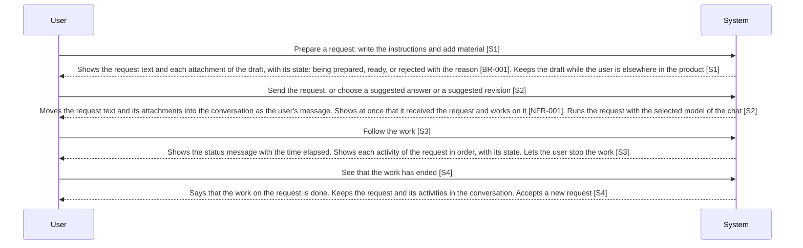

<!-- A use case models product behavior for one user goal reached in a single sitting (UCG-01).
     Write per dev/mvp/spec/_STYLE.md. Write intent and response, not interface (rule 11, UCG-09).
     The interaction diagram is a view generated from the Steps table and Alternative flows; do not hand-edit it (MG-02). -->

## Interaction diagram

<!-- Generated from the Steps table and Alternative flows. Do not edit between the markers. -->

<!-- BEGIN generated: use-case-sequence -->

*Not drawn (alternative flows): A6 (Back to S1), A8 (Same step), A11 (End), A13 (Continue at S3), A14 (Same step), A17 (Back to S1), A31 (End), A43 (Continue at S3), A50 (Same step), A51 (Continue at S3), A52 (Continue at S3).*
<!-- END generated: use-case-sequence -->

## Steps

| Step | User | System | FR | Evidence |
|---|---|---|---|---|
| S1 | Prepare a request: write the instructions and add material | **Shows the request text and each attachment** of the draft, **with its state**: being prepared, ready, or rejected with the reason [BR-001]. **Keeps the draft** while the user is **elsewhere in the product** | FR-015, FR-016, FR-038 |  |
| S2 | Send the request, or choose a suggested answer or a suggested revision | **Moves the request text and its attachments into the conversation** as the user's message. **Shows at once that it received the request** and works on it [NFR-001]. **Runs the request with the selected model** of the chat | FR-012, FR-013, FR-042 |  |
| S3 | Follow the work | **Shows the status message** with the **time elapsed**. **Shows each activity** of the request **in order, with its state**. **Lets the user stop the work** | FR-012, FR-070 |  |
| S4 | See that the work has ended | Says that the **work on the request is done**. **Keeps the request and its activities** in the conversation. **Accepts a new request** | FR-012 |  |

## Alternative flows

### A6 · Request not ready to send

- **At:** S2
- **Ends:** Back to S1
- **When:** The draft has **no request text and no attachment**, an attachment is **still being prepared or is rejected**, or the request text is **longer than the maximum** [BR-002].
- **System:** **Sends nothing**. Says that the **text is too long**, when it is. **Keeps the draft**.
- **FR:** FR-015

### A8 · Attached file rejected

- **At:** S1
- **Ends:** Same step
- **When:** An added file **breaks the attachment rule** [BR-001], or is **protected, damaged or unreadable**.
- **System:** **Shows the reason on the attachment at once** [NFR-010]. **Keeps the rest of the draft**. **Sends nothing while the rejected attachment stays**.
- **FR:** FR-017

### A11 · Work does not finish

- **At:** S3
- **Ends:** End
- **When:** A **step of the work fails** and the **request does not finish**, for example the provider is unreachable, refuses the key or the model, or a usage limit is reached. Or **DeckAgent stops while the request is active**.
- **System:** Says that the **work did not finish**, and **why when it knows**. **Keeps the request, its activities and the finished work**. **Starts nothing again by itself**. After DeckAgent **stops and starts again**, **shows the request as not finished**.
- **FR:** FR-019

### A13 · Interface reloaded, closed or disconnected

- **At:** S3
- **Ends:** Continue at S3
- **When:** While DeckAgent runs, the user **reloads or closes its interface**, the interface **loses its connection** to DeckAgent, or the user **goes to another chat**.
- **System:** **Keeps working on the request**. **On return**: shows the conversation, the activities and **what the system is doing now**.
- **FR:** FR-068

### A14 · Prepare the next request while the work runs

- **At:** S3
- **Ends:** Same step
- **When:** The user **writes request text or adds material** while a **request is active**.
- **System:** **Keeps it as the draft**. **Sends no new request until the active request ends**. **Changes no material of the active request**.
- **FR:** FR-014, FR-038

### A17 · No model to run the request

- **At:** S2
- **Ends:** Back to S1
- **When:** The chat has **no selected model that is selectable** [BR-005].
- **System:** **Sends nothing** and **keeps the draft**. **Says why**: no provider is set up, no model is added, or the chat has no selected model. **Chooses no model by itself**.
- **FR:** FR-046

### A31 · Stop the work

- **At:** S3
- **Ends:** End
- **When:** The user **stops the work** on the active request.
- **System:** **Stops the work** [NFR-011]. Shows that the work was **stopped, not that it failed**. **Keeps the request and the finished work**. Shows **each activity still running as stopped**. **Sends nothing again** by itself.
- **FR:** FR-018

### A43 · Material used only in part

- **At:** S3
- **Ends:** Continue at S3
- **When:** The system **uses only part of the material** of the request, or material **stops being readable** during the work.
- **System:** **Names the material and the part it did not use**, when it knows them. **Reads no other file in its place**. **Asks for the missing part** when it **changes the result a lot**.
- **FR:** FR-067

### A50 · Work of the chat not saved

- **At:** S3
- **Ends:** Same step
- **When:** The system **cannot save the state of the chat**, such as a change to the deck or the request just sent.
- **System:** Says that the **work was not saved** and **which change it cannot keep**. **Keeps the last saved state**. **Starts nothing again** by itself.
- **FR:** FR-087

### A51 · A step needs the user's approval

- **At:** S3
- **Ends:** Continue at S3
- **When:** A step of the work **goes beyond what the agent of the chat reaches without asking** [NFR-003], such as reading a file outside the project folder.
- **System:** **Names the step, what it touches and why**, and **asks to allow it once or to refuse it**. **Keeps the request active** and **does nothing past the step** while it waits. **Allowed**: **does the step once**. **Refused**: **does the rest of the work**, and the **closing message names what it did not do**.
- **FR:** FR-076, FR-077

### A52 · Conversation outgrows the context of the model

- **At:** S3
- **Ends:** Continue at S3
- **When:** The conversation of the chat **no longer fits the context** of the selected model.
- **System:** **Writes a conversation summary** in place of the earlier conversation and **goes on with the work**. **Says so in the conversation**, and **where the summary starts**. **Keeps the whole conversation readable** and the **brief, outline, deck and attachments whole**. **On failure**: as A11.
- **FR:** FR-079

## Situation and goal

The user wants the system to **do work for them**, such as drafting or changing a deck. After sending, they want to know that the **system received the request** and **what it is doing**. They want to **stop it when it goes the wrong way**. They **do not want to lose what they gave** or **what the system already finished**.

## Trigger and precondition

- **Trigger:** The user **sends a request** in a chat.
- **Precondition:** The chat has **no active request**.

## Outcome and minimal guarantee

- **Outcome:** The **request and its material are in the conversation**, with its activities. The **work on it has ended**, and the **system said so**. The chat **accepts a new request**.
- **Minimal guarantee:** The **request text and the material are kept**: in the conversation once sent, in the draft if not. The user **enters nothing again**. **Finished work stays**, and an **unfinished result never replaces the last finished one**.

## Product evidence

### open-design (nexu-io/open-design)

- **Coverage:** unverified
- **Research link:** [dev/mvp/research/agent-permissions.md](../../research/agent-permissions.md) item 5 (approval of tool steps only).
- **Differences:** A **local program runs a coding agent** and **shows its tool calls** in the conversation as it works. The user **chooses the agent and the model**, **attaches files to the project**, and **stops the work**. The **agent chooses which skills to use**; the **user does not insert them**. The agent runs in the project folder with **every tool step approved in advance**, so the **user approves no step**.
- **Evidence:** [observed: open-design docs/agent-adapters.md (every tool step approved in advance)] [assumed: the rest from the open-design README and the team meeting of 23-10-2026 (`dev/meetings/Transcript - 231026 - Họp để thêm các req và các hướng sửa đổi sau V1.txt`)]

### OpenCode (runtime)

- **Coverage:** unverified
- **Research link:** [dev/mvp/research/agent-permissions.md](../../research/agent-permissions.md) items 2 to 4 (approval of tool steps only); [dev/mvp/research/context-compaction.md](../../research/context-compaction.md) items 2 and 3 (compaction).
- **Differences:** A **session runs in the OpenCode server**, **not in its client**, so a **client that reloads connects again** and the **work goes on**. **Each kind of tool step is allowed, asked for or refused by configuration**; an **asked step offers once, always for the rest of the session, or reject**, and a **path outside the working folder is asked for by default**. A session is **compacted by itself when its context is full**, and **also on command**; whether **earlier messages stay readable is not documented**.
- **Evidence:** [observed: opencode.ai/docs/permissions and /docs/agents (approval answers, outside paths)] [observed: opencode.ai/docs/config, /docs/tui and /docs/server (compaction)] [assumed: server and client; runtime research of the first build of this case checks it]

## Notes

- This case holds **what every request shares**. Other use cases **cite its FRs** and **add only what their own work produces**.
- **Where the work of a request runs**, so that **leaving the interface stops nothing**: [DEC-004](../../decisions/DEC-004-work-runs-in-deckagent.md).
- There is **no waiting within a request for an answer**. A **question the system asks ends its request**, and the **reply is a new request** (FR-014). A request that **waits for the user's approval of a step stays active** (A51).
- **Choosing the selected model and its reasoning level**, and a **selected model that was removed**: UC-005 A16, A17. The **project folder of the chat comes from its workspace** (UC-013).
- The **reach of the agent is fixed by code** (FR-077): the user **chooses no permission level**, and a **step beyond it is A51**.
- The system **summarizes the conversation by itself** when it outgrows the context (A52); the user has **no compact command**. **Showing the context usage** of a chat is **in the backlog** (FR-078).
- **Who starts the summary** of a conversation: [DEC-008](../../decisions/DEC-008-who-starts-a-conversation-summary.md).
- **Voice input, inserted skill shortcuts, connectors and links** to other places of the product are **not flows of this case**. The **system chooses the skills** of a request; the **user does not install or choose one**.
- **Material from a connected outside service**, such as a cloud drive, is **not in the spec**.
- **Next free flow ID: A53**. A number below it that this file does not hold is **not used**.
