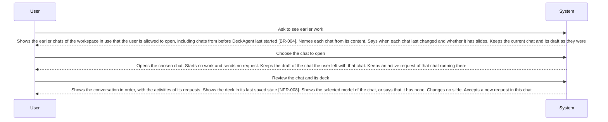

<!-- A use case models product behavior for one user goal reached in a single sitting (UCG-01).
     Write per dev/mvp/spec/_STYLE.md. Write intent and response, not interface (rule 11, UCG-09).
     The interaction diagram is a view generated from the Steps table and Alternative flows; do not hand-edit it (MG-02). -->

## Interaction diagram

<!-- Generated from the Steps table and Alternative flows. Do not edit between the markers. -->

<!-- BEGIN generated: use-case-sequence -->

*Not drawn (alternative flows): A1 (End), A2 (Same step), A3 (Back to S1), A4 (Same step), A5 (Same step), A6 (Same step).*
<!-- END generated: use-case-sequence -->

## Steps

| Step | User | System | FR | Evidence |
|---|---|---|---|---|
| S1 | Ask to see earlier work | Shows the earlier chats of the workspace in use that the user is allowed to open, including chats from before DeckAgent last started [BR-004]. Names each chat from its content. Says when each chat last changed and whether it has slides. Keeps the current chat and its draft as they were | FR-048, FR-038 |  |
| S2 | Choose the chat to open | Opens the chosen chat. Starts no work and sends no request. Keeps the draft of the chat the user left with that chat. Keeps an active request of that chat running there | FR-049, FR-038, FR-068 |  |
| S3 | Review the chat and its deck | Shows the conversation in order, with the activities of its requests. Shows the deck in its last saved state [NFR-008]. Shows the selected model of the chat, or says that it has none. Changes no slide. Accepts a new request in this chat | FR-049, FR-070, FR-065 |  |

## Alternative flows

### A1 · No earlier chat

- **At:** S1
- **Ends:** End
- **When:** There is no earlier chat of the workspace in use that the user is allowed to open [BR-004].
- **System:** Says that there is no earlier chat. Keeps the current chat as it was.
- **FR:** FR-048

### A2 · Look for a chat by its words

- **At:** S1
- **Ends:** Same step
- **When:** The user looks for an earlier chat by words it holds.
- **System:** Shows only the earlier chats whose name or conversation holds the words, or says that none does. Keeps the words.
- **FR:** FR-134

### A3 · Chat cannot be opened

- **At:** S2
- **Ends:** Back to S1
- **When:** The saved work of the chosen chat cannot be read.
- **System:** Says that it cannot open the chat, and why when it knows. Shows no empty chat in its place and removes no chat. Keeps the chat among the earlier chats as one it cannot open. Keeps the current chat as it was.
- **FR:** FR-050

### A4 · Chat has no slides yet

- **At:** S3
- **Ends:** Same step
- **When:** The chosen chat has no slides yet.
- **System:** Shows the conversation in order. Says that the chat has no slides yet. Keeps an outline that waits for confirmation as the current outline.
- **FR:** FR-049

### A5 · Work still running in the chat

- **At:** S3
- **Ends:** Same step
- **When:** The chosen chat has an active request.
- **System:** Shows the chat as it is now, with the activities and what the system is doing now, as in UC-003 A13. Accepts no new request in this chat until the active request ends.
- **FR:** FR-068, FR-014

### A6 · Last request did not finish

- **At:** S3
- **Ends:** Same step
- **When:** The last request of the chosen chat did not finish, for example DeckAgent stopped during the work.
- **System:** Shows the request as not finished, with its activities and the finished work [NFR-008], as in UC-003 A11. Starts nothing again by itself. Accepts a new request in this chat.
- **FR:** FR-019

## Situation and goal

The user worked on a deck in an earlier chat, on another day or before DeckAgent stopped.
They want to see that chat and its deck again, then change the deck or get it as a file,
without starting over.

## Trigger and precondition

- **Trigger:** The user asks to see earlier work.
- **Precondition:** DeckAgent runs on the user's computer.

## Outcome and minimal guarantee

- **Outcome:** The chosen chat is open, with its conversation, its activities and its deck as the chat kept them. No slide changed and no request was sent.
- **Minimal guarantee:** Opening a chat changes no chat and no deck. The chat the user left keeps its draft, and its active request keeps running.

## Product evidence

### open-design (nexu-io/open-design)

- **Coverage:** observed
- **Research link:** [dev/mvp/research/open-design-earlier-work.md](../../research/open-design-earlier-work.md) items 2 to 6.
- **Differences:** Earlier work is a project that holds its conversations and files, found among all projects and kept by a local program. Search, rename, delete, and what happens to a run when the user leaves a project or the program restarts are not documented.
- **Evidence:** [observed: open-design README, QUICKSTART and docs/architecture.md (all projects, project and conversation persistence, SQLite state)]

### OpenCode (runtime)

- **Coverage:** unverified
- **Research link:** none yet.
- **Differences:** The runtime keeps each session with its messages. Whether a chat of DeckAgent maps to one session, and where its deck is kept, is not known.
- **Evidence:** [assumed: no research item yet; runtime research of the first build of this case checks it]

## Notes

- Coming back to work still running is UC-003 A13; a request that did not finish is UC-003 A11. A5 and A6 cite them and add nothing.
- After S3 the user changes the deck (UC-002). Getting the deck as a file is in the backlog (UC-004).
- A save that fails while the user works is UC-003 A50.
- The chat stays the unit of earlier work. Workspaces, the chats of a removed workspace and a project folder that cannot be read are UC-013.
- Renaming or deleting a chat is not a flow of this case. It is in the backlog (UC-018).
- How DeckAgent keeps chats and decks is runtime research of the first build of this case.
- Next free flow ID: A9. A number below it that this file does not hold is not used.
