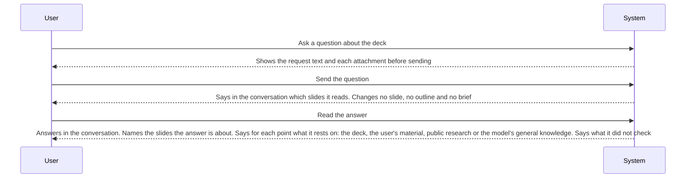

<!-- A use case models product behavior for one user goal reached in a single sitting (UCG-01).
     Write per dev/mvp/spec/_STYLE.md. Write intent and response, not interface (rule 11, UCG-09).
     The interaction diagram is a view generated from the Steps table and Alternative flows; do not hand-edit it (MG-02). -->

## Interaction diagram

<!-- Generated from the Steps table and Alternative flows. Do not edit between the markers. -->

<!-- BEGIN generated: use-case-sequence -->

*Not drawn (alternative flows): A1 (End), A2 (To UC-002), A3 (Continue at S3), A4 (Continue at S3), A6 (Continue at S3), A8 (End).*
<!-- END generated: use-case-sequence -->

## Steps

| Step | User | System | FR | Evidence |
|---|---|---|---|---|
| S1 | Ask a question about the deck | Shows the request text and each attachment before sending | FR-016 |  |
| S2 | Send the question | Says in the conversation which slides it reads. Changes no slide, no outline and no brief | FR-070, FR-128 |  |
| S3 | Read the answer | Answers in the conversation. Names the slides the answer is about. Says for each point what it rests on: the deck, the user's material, public research or the model's general knowledge. Says what it did not check | FR-137 |  |

## Alternative flows

### A1 · Question does not say which part

- **At:** S2
- **Ends:** End
- **When:** The question does not say which slides or which part of the deck it is about, and the deck and the conversation do not tell.
- **System:** Changes nothing. Asks which part, with suggested answers taken from the deck. The reply is a new request.
- **FR:** FR-140, FR-014

### A2 · Question also asks for a change

- **At:** S2
- **Ends:** To UC-002
- **When:** The message asks a question and also asks for a change of the deck.
- **System:** Takes the message as a follow-up request, and answers the question in its closing message.
- **FR:** FR-128

### A3 · Ask where content comes from

- **At:** S3
- **Ends:** Continue at S3
- **When:** The question asks where a figure, a claim or other content of the deck comes from.
- **System:** Names the source kept for the content: the file and the place in the user's material, the public research result, or the model's general knowledge. Says that it does not know the source when none was kept. Says that a named source does not make the content true.
- **FR:** FR-138

### A4 · Check the deck for disagreements

- **At:** S3
- **Ends:** Continue at S3
- **When:** The user asks whether the deck agrees with itself or with the user's material.
- **System:** Names each pair of points that disagree, where each one is and what each one says. Says which one is right only when the user's material settles it. Says that the check covers only what it found.
- **FR:** FR-139

### A6 · Not enough to answer

- **At:** S3
- **Ends:** Continue at S3
- **When:** The deck, the user's material and the sources of the brief do not hold what the answer needs.
- **System:** Says what is missing. Marks each content of a kind that needs a source [BR-015] that rests on the model's general knowledge alone as not checked. Uses public research only when the question asks for it, and says which outside service is missing when it is not set up.
- **FR:** FR-137, FR-129

### A8 · Message reads both as a question and as a change

- **At:** S2
- **Ends:** End
- **When:** The message reads both as a question about the deck and as a request to change it.
- **System:** Asks which one the user means, and changes nothing. The reply is a new request.
- **FR:** FR-128, FR-014

## Situation and goal

The user has a deck and needs to understand it or trust it before they use it: where a
figure comes from, whether two slides disagree, what the deck leaves out, or what a
passage means. The user wants an answer and does not want the deck changed.

## Trigger and precondition

- **Trigger:** The user sends a question about the deck.
- **Precondition:** The deck has at least one slide. The chat has no active request.

## Outcome and minimal guarantee

- **Outcome:** The conversation holds the question and the answer. Every slide, the outline and the brief are as they were before the question.
- **Minimal guarantee:** The question stays in the conversation. No slide, outline or brief changes, also when the work stops or fails.

## Product evidence

### open-design (nexu-io/open-design)

- **Coverage:** unverified
- **Research link:** none yet.
- **Differences:** Every message goes to the same coding agent, which decides by itself whether to answer or to change the files of the deck. No flow of its own for a question about the deck, and no record of where content comes from, is documented.
- **Evidence:** [assumed: from the open-design README and docs read in earlier spec reviews; no research item]

## Notes

- Sending a question, waiting for it, and a stop or a failure are shared by every request (UC-003). This case adds only what is specific to an answer about the deck.
- This case is not UC-002: a message that asks for no change is answered here, and a message that also asks for a change is a follow-up request (A2), and a message that reads both ways gets a question (A8). A question about the current outline before the slides is UC-001 A54.
- Where an answer finds the source of content in the deck: [DEC-009](../../decisions/DEC-009-where-an-answer-finds-the-source-of-content.md).
- A change that fixes what an answer found is a follow-up request (UC-002), which reads the conversation. What the deck leaves out is an ordinary question (S3).
- Next free flow ID: A9. A number below it that this file does not hold is not used.
