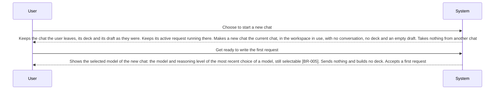

<!-- A use case models product behavior for one user goal reached in a single sitting (UCG-01).
     Write per dev/mvp/spec/_STYLE.md. Write intent and response, not interface (rule 11, UCG-09).
     The interaction diagram is a view generated from the Steps table and Alternative flows; do not hand-edit it (MG-02). -->

## Interaction diagram

<!-- Generated from the Steps table and Alternative flows. Do not edit between the markers. -->

<!-- BEGIN generated: use-case-sequence -->

*Not drawn (alternative flows): A1 (Same step).*
<!-- END generated: use-case-sequence -->

## Steps

| Step | User | System | FR | Evidence |
|---|---|---|---|---|
| S1 | Choose to start a new chat | Keeps the chat the user leaves, its deck and its draft as they were. Keeps its active request running there. Makes a new chat the current chat, in the workspace in use, with no conversation, no deck and an empty draft. Takes nothing from another chat | FR-053, FR-038, FR-068 |  |
| S2 | Get ready to write the first request | Shows the selected model of the new chat: the model and reasoning level of the most recent choice of a model, still selectable [BR-005]. Sends nothing and builds no deck. Accepts a first request | FR-053, FR-065 |  |

## Alternative flows

### A1 · No model to carry on with

- **At:** S2
- **Ends:** Same step
- **When:** No model was ever chosen, or the model of the most recent choice is no longer selectable [BR-005].
- **System:** Leaves the new chat with no selected model and says so. Chooses no other model by itself.
- **FR:** FR-053, FR-065

## Situation and goal

The user worked on one deck, or left it unfinished, and now wants to make another one.
They want the new work free of the earlier conversation, material and deck, and want to
start at once with the model they were using, without setting anything up again.

## Trigger and precondition

- **Trigger:** The user chooses to start a new chat.
- **Precondition:** DeckAgent runs on the user's computer.

## Outcome and minimal guarantee

- **Outcome:** A new, empty chat of the workspace in use is the current chat, with a selected model or a statement that it has none. Every other chat is as it was.
- **Minimal guarantee:** Every other chat, its deck and its draft are as they were, and no request stopped.

## Product evidence

### open-design (nexu-io/open-design)

- **Coverage:** unverified
- **Research link:** [dev/mvp/research/open-design-earlier-work.md](../../research/open-design-earlier-work.md) item 3.
- **Differences:** Work is grouped in projects that hold conversations and files. Whether a project holds several conversations, and which model a new conversation uses, is not documented.
- **Evidence:** [observed: open-design docs/architecture.md (projects, conversations)] [assumed: model of a new conversation not checked]

### OpenCode (runtime)

- **Coverage:** unverified
- **Research link:** none yet.
- **Differences:** The runtime keeps each session with its messages. Whether a new chat starts a new session, and how the selected model and reasoning level reach it, is not known.
- **Evidence:** [assumed: no research item yet; runtime research of the first build of this case checks it]

## Notes

- Drafting the first deck in the new chat is UC-001; going back to an earlier chat is UC-006; the workspace a new chat joins is UC-013.
- Sending a request in a chat with no selected model is UC-003 A17; choosing another model for the chat is UC-005 A16.
- A chat holds at most one deck, so another deck starts in a new chat.
- An exported source archive attached in a new chat is material like any attachment; nothing is imported as a deck to change. Carrying on with an exported deck is in the backlog (UC-019).
