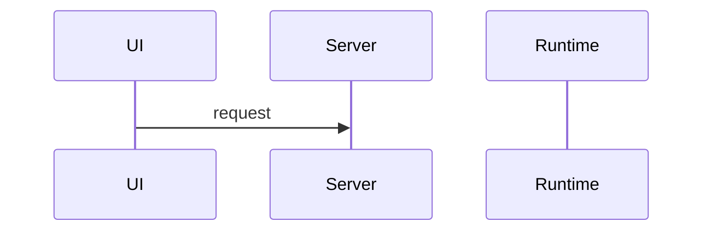

# As-built — {scope}

<!-- Phase 6 (dev/mvp/WORKFLOW.md "As-built layer"). Keep within one page.
     Order matters: the PO writes "Prediction" BEFORE reading anything the agent wrote.
     Then the agent fills "Actual flow" and "Drift" from the merged code. -->

## At a glance

- **Use case:** UC-XXX
- **Value flows covered:** S1-S6 (the flows in the Phase 3 LLM boundary table)
- **Drift found:** _none / N items_
- **Spine:** [traceability-matrix.md](./traceability-matrix.md)

## Prediction

<!-- Written by the PO, from memory, in a few lines. Example:
     "Request → interview module asks audience/duration → model drafts outline → confirm → theme applied by code → model writes slide content per slide." -->

## Actual flow

<!-- Written by the agent from the merged code. Value flows only. A short sequence diagram through the real components (UI → server → runtime → tools → renderer). -->

## Model calls

<!-- As-built LLM boundary for this build. Compare with the implementation plan. -->

| Step | Model or code (plan) | Model or code (actual) | Match |
|---|---|---|---|
| S1 | code | code | yes |

## Drift

<!-- Report only drift on value parts (dev/mvp/WORKFLOW.md "As-built layer"): a model call where the plan says code or the reverse; a prebuilt asset bypassed; a module boundary crossed. Each item: what, where (file), effect, proposed action. Omit renames. -->

## Prediction vs actual

<!-- Written by the agent: where the PO's prediction differed from the actual flow.
     These are the parts of the system worth reading next. -->

## Sign-off

- [ ] PO has read the drift and the prediction differences
- [ ] `docs/architecture/llm-boundary.md` and `docs/architecture/modules.md` updated
