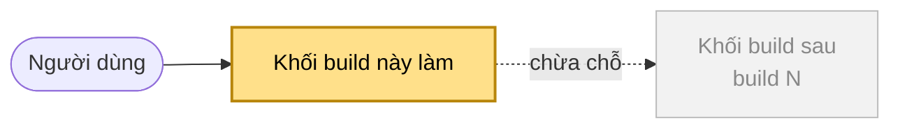

# Research checklist — {scope}

<!-- Format "map first, questions after". Written by skill `research-questions`. Prose in Vietnamese with English technical terms (the PO's choice); no bare ID: say what it is in words first, the ID in parentheses. Keep the section order below. Every #N and file path is a clickable link (dev/mvp/WORKFLOW.md "Linking convention"). The questions (section 3) do not count toward the one-page budget. -->

## At a glance

- **Build:** {build name in words} ({UC-XXX}), **steps and alternatives** in scope ("all" or the list). **N items** of the spec: table in section 4.
- **Runtime:** {touches OpenCode or not, and which part}.
- **Status:** **N questions**: _N không cần research · N để build sau · N có sẵn · N thử nhỏ · N anh quyết_ (_N of them spec gaps_).
- **Spine:** [traceability-matrix.md](../testing/traceability-matrix.md)

## Cách đọc

Đọc **sơ đồ** (mục 1) → **ranh giới của phần đang xây** (mục 2) → **câu hỏi theo từng khối** trên sơ đồ (mục 3). Mỗi câu ghi **vì sao phải bận tâm**, **đã biết gì**, **trả lời bằng gì** và **chặn bước nào**. "Trả lời bằng" có 5 loại:
- `không cần research`: **chuyện thường**, implementation plan **tự chọn**; **không có ticket**;
- `có sẵn`: **bằng chứng đã có** (code mẫu, sản phẩm khác, docs), anh **chỉ cần gật**;
- `thử nhỏ`: **vài phép thử trên máy**, dưới một giờ;
- `anh quyết`: **lựa chọn sản phẩm hoặc công nghệ**; nếu là **hành vi mới** thì **vào spec trước** khi build dùng;
- `để build sau`: thuộc **build khác**, **không chặn** build này; **không có ticket**.

## 1. Bản đồ: build này nằm ở đâu

<!-- One Mermaid flowchart of the WHOLE product along the build order: every block a build makes, the user's folder, DeckAgent's own data, OpenCode and the model. Blocks this build makes: class `here`. Blocks of later builds: class `later`, with the build named in the label. Dotted edges: paths this build does not run but must leave room for. Labels in words. -->

- **Khối vàng**: **build này làm**. **Khối xám**: **build sau**. **Nét đứt**: **chưa chạy** trong build này, nhưng **build này phải chừa chỗ**.
- **Ta đang ở đây:** {one sentence: what this build adds to the product, in words}.

## 2. Phần đang xây: vào gì, ra gì, ai dựa vào

1. **Vào:** {what the user or another block gives it}.
2. **Ra:** {what it shows, keeps or creates}.
3. **Build sau dựa vào gì** (đổi muộn ở đây là **đắt nhất**): {each contract, with the build that uses it}.
4. **Không làm:** {what this build does not do, such as calling the model}.

## 3. Câu hỏi theo từng khối

<!-- One `###` per block of the map. Each question: `N. **RQ-N · question**`, then the fields below, one line each. Lenses to walk at each block: contract, data and its lifetime, failure midway, two at once, runtime, model or code, security and reach, testability, traps in the reference code, spec gaps, behavior this build cannot test yet. Before asking, triage: already answered by evidence we have → `có sẵn`; common, low risk or cheap to change → `không cần research`; only questions nobody else can answer cost time. -->

### Khối A · {block name}

1. **RQ-1 · {question}**
   - **Vì sao:** {what goes wrong if it is skipped}.
   - **Đã biết:** {evidence with links: reference code at its commit, other products, docs}.
   - **Trả lời bằng:** `{kind}`. **Chặn:** {testing plan / implementation plan / nothing}.

### Không hỏi, và vì sao

- **{Topic}:** {why it needs no question}.

## 4. Code mẫu khớp spec tới đâu

<!-- Drift inventory (dev/mvp/WORKFLOW.md "Reference code" rule 2). One row per in-scope item. Read at `{branch}` @ `{commit}`. The PO rules each row; the spec wins over the code. Kết quả: the outcome as current fact (carried, dropped, or "vào spec trước"), or "pending"; never who decided or when. -->

Đọc ở `{branch}` @ `{commit}`.

| Việc (theo spec) | ID | File code mẫu | Khớp | Khác gì | Kết quả |
|---|---|---|---|---|---|
| {behavior in words} | FR-NNN | [file](https://github.com/{owner}/{repo}/blob/{commit}/path) | match / differ / missing | | |

## 5. Ticket và nơi ghi câu trả lời

<!-- One row per question with a ticket (`có sẵn`, `thử nhỏ`, `anh quyết`). Deliverable: a research file section, a decision record (options only; the PO writes Choice and Why), or a spec change (spec first, the PO approves). -->

| RQ | Ticket | Nơi ghi câu trả lời | Trạng thái |
|---|---|---|---|
| RQ-1 | [#N](https://github.com/{owner}/{repo}/issues/N) | [dev/mvp/research/topic.md](https://github.com/{owner}/{repo}/blob/main/dev/mvp/research/topic.md) | open |

Trạng thái: `open`, `researching`, `answered` (ghi trong research), `decided` (ghi trong một decision), `in spec` (đã vào spec).
