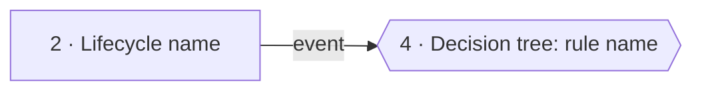
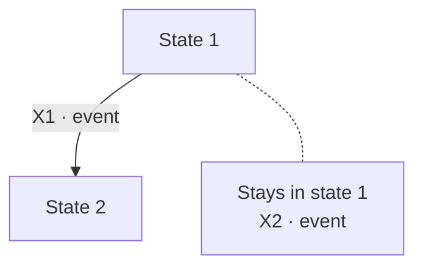
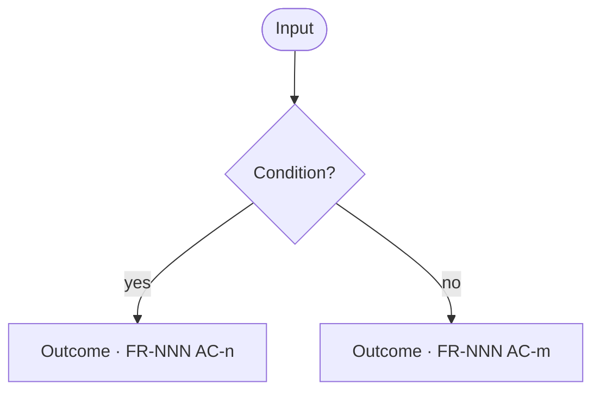

# Review flows — {scope}

<!-- The PO's review view of testing-plan.md (dev/development/test-strategy.md "Review-flows view"). It is where the coverage criteria are checked, and the one home of gaps, deviations and the PO's rulings.
     Build files are written in Vietnamese prose with English terms (dev/mvp/builds/_STYLE.md). Diagrams are Mermaid. Keep the section order below.
     Mermaid: no arrow from a node back to itself (several stack on one side and their labels get cut); no classDef or fixed colors (they break the dark theme). Use the notation in "At a glance". -->

## At a glance

- **Purpose:** the PO checks [testing-plan.md](./testing-plan.md) **by product flow**: each diagram shows **where the criteria sit** and **where a gap is**.
- **How to read a topic:** read the **diagram** first; each arrow has **one code**. Then read the **always-true box**: what DeckAgent must keep **on every arrow**. Last, read the **arrow table**: one row per arrow, saying **when** it happens, what **DeckAgent must** do, and which **defect** of DeckAgent the test catches.
- **Notation:** a **dashed** arrow is **moved to a later build**. Events that **keep the state** go into **one "Stays …" node** joined by a **dotted line**, instead of an arrow back to the same node. An arrow **without a criterion** points to a **"Z-n · no criterion"** node (a gap in section 5).
- **Status:** _N gaps · N ruled_; checklist: _N of 8 pass_.

## 1. Overview

<!-- One node per topic below, edges show how they connect. -->

## 2. Lifecycle or flow name

<!-- One section per lifecycle (state transition testing: every event in every state, refused events included) or use case flow (every step and alternative). Number every arrow. -->

**Always true** on every arrow of this diagram:
- **FR-NNN AC-n**: invariant

| Arrow | AC | When | DeckAgent must | Defect the test catches |
|---|---|---|---|---|
| X1 | FR-NNN AC-n | The situation and the action, as a sentence. | One sentence per check. | One sentence per defect, starting with "DeckAgent". |

## 3. Completeness check: every event in every state

<!-- One table per build, after the lifecycle diagrams it checks. A diagram shows only the arrows that exist, so a missing arrow does not show; this table makes every cell need an answer (state transition coverage). Rows: every event. Columns: every state of the lifecycles above. -->

**What it is for:** the diagrams show **only the arrows that exist**, so a **missing arrow does not show**. This table puts **every event** in a row and **every state** in a column, so **every cell needs an answer**.

**How to read a cell:**
- **A code and a few words** ("X1 · keeps W in use"): the event **has a criterion**; the code points to an **arrow table** above.
- **"—" with a reason:** the event **cannot happen** in that state.
- **A bold Z-n:** the cell **has no criterion**; section 5 holds the **proposal** and the **PO's ruling**.

| Event | State 1 | State 2 |
|---|---|---|
| **Event name** | X1 · what DeckAgent does | — · why it cannot happen |

## 4. Decision tree: rule name

<!-- One section per multi-condition rule (decision table: every leaf has one outcome and at least one criterion; a test input falls in exactly one leaf). -->

**Reading the tree:** define each term the conditions use.

## 5. Gaps, deviations and rulings

<!-- Kind: gap (the spec does not answer), deviation (a technique or coverage criterion the risk level requires is not applied), checklist (a C1–C8 failure), infra (a test-infrastructure choice). Ruling: the PO's, with the date. A ruled item's result is written into testing-plan.md as current fact. -->

| ID | Kind | What | PO ruling (DD-MM-YYYY) |
|---|---|---|---|
| Z-1 | gap | | |
