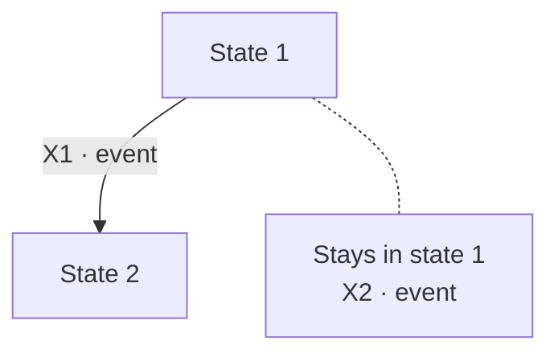

# Dn · technique: topic

<!-- The evidence of ONE technique applied to one design input (testing-plan.md section 2.3, row Dn). Name the file techniques/Dn-topic.md. Keep ONLY the form of the technique this file applies and delete the others; a design input that applies two techniques (for example EP + BVA and a decision table on the same variables) keeps both forms.
     Method: test-strategy.md "How a technique is applied", or the capability skill of the technique where one exists. One sub-heading per step, in step order. Each step uses only the basis items, the plan and the outputs of earlier steps, cites them, and gives the reason for each choice. Do not read drafted AC, drafted test cases or pre-STLC design until the reconciliation step.
     A step's output is reviewable before the next step exists: stop where the PO must check it (for EP + BVA, after the coverage items) when the design input says so.
     Each test case has its input, preconditions, actions, expected result and the coverage items it exercises; how coverage items combine in one case is set by the technique's method (its capability skill); a coverage item may have several cases.
     Build files are written in Vietnamese prose with English terms (dev/mvp/builds/_STYLE.md). Diagrams are optional; when used they are Mermaid, with no arrow from a node back to itself and no classDef or fixed colors. -->

- **Design input:** [testing-plan.md](../../planning/testing-plan.md) section 2.3, row **Dn**
- **Status:** _steps 1–N written · stopped for PO review at step N · reconciliation done_

## Use case testing: flow name

<!-- One row per flow: the main flow, then each alternative reaching a different end state (combinations of alternatives only at high risk). -->

| Code | Flow | Steps and alternatives | Basis items | End state | AC · test cases |
|---|---|---|---|---|---|
| U1 | Main flow | S1–S4 | UC-NNN.S1–S4 | | FR-NNN AC-n |

## State transition: object name

<!-- States and events come from the spec, each with its basis item. Give each transition a code and one table row, then the state × event matrix, which is required: it gives every cell an answer. The diagram is optional; draw it only when it helps the PO read the lifecycle, and put events that keep the state into one "Stays …" node joined by a dotted line. -->

**States:** _State 1_ (basis FR-NNN.1), _State 2_. **Events:** _event_ (basis FR-NNN.2).

**Always true** on every transition (invariant codes of the invariant check): _I1_.

| Code | Basis items | AC · test cases | When | DeckAgent must | Defect the test catches |
|---|---|---|---|---|---|
| X1 | FR-NNN.2 | FR-NNN AC-n | The situation and the action, as a sentence. | One sentence per check. | One sentence per defect, starting with "DeckAgent". |

**State × event matrix.** A transition list or a diagram shows **only the transitions that exist**, so a **missing one does not show**; here **every cell needs an answer**: a **code** (the event has an AC), **"—" with the reason** it cannot happen, or a **bold Z-n** (no AC; see the last section).

| Event | State 1 | State 2 |
|---|---|---|
| **Event name** | X1 · what DeckAgent does | — · why it cannot happen |

**Coverage:** _N_ state-event pairs; _N_ with a test case; _N_ ruled (Z-n).

## Equivalence partitioning

<!-- Method: skill equivalence-partitioning (EP-1 to EP-6, checks EP-C1 to EP-C9). This form owns the variables (V, O), dimensions (DM), classes (EC) and representatives; BVA and decision table reference these codes and do not copy them. -->

**EP-1 · Variables**

| Code | Variable | Input or output | Rules acting on it | Basis items |
|---|---|---|---|---|
| V1 | | input | | BR-NNN.V-2 |
| O1 | | output | | FR-NNN.1 |

Out of this design input: _effect, design input that owns it_.

**EP-2 · Domains, dimensions, relations.** Domain of each input per mode or source (platform limits marked, with an assumption AS-n).

| Code | Dimension | Applies to | Why it matters | Basis or fault hypothesis |
|---|---|---|---|---|
| DM1 | | | | |

Relations: _RL1 · a variable that decides which rule applies; a relation that changes no outcome, with its argument_.

**EP-3 · Equivalence classes.** Cover argument per dimension: _DM1 is {..} ∪ [..]_.

| Code | Dim. | Class | Valid | Expected behavior (spec) | Basis items | Why the class exists |
|---|---|---|---|---|---|---|
| EC1 | DM1 | | no | | | |

Mark "base" classes, "observable at a limit" classes (handed to BVA), infeasible classes with their fact, and "gap Z-n" where the spec is silent.

**EP-4 · Representatives**

| Class | Representative (exact, code points) | Measured | Why it represents the class |
|---|---|---|---|
| EC1 | | | |

**EP-5 · Coverage items:** _N_ feasible classes; not covered: _class, reason_; handed to BVA: _classes_.

## Boundary value analysis

<!-- Method: skill boundary-value-analysis (BVA-1 to BVA-4, checks BVA-C1 to BVA-C7). References EP classes; owns boundaries (BD), the variant matrix and the boundary values. -->

**BVA-1 · Boundaries.** Measured quantity and order of transformations: _..._

| Code | Boundary | Adjacent classes | Boundary point and the spec's wording | Basis items |
|---|---|---|---|---|
| BD1 | | EC1 / EC2 | | |

**BVA-2 · Variant matrix.** Every boundary is a row; every transformation the plan names, and every class EP hands over, is a column; every cell is a variant or "none" with its reason.

| Boundary | Transformation 1 | Transformation 2 |
|---|---|---|
| BD1 | BD1-X | none: _reason_ |

**Boundary values**

| Boundary | Just below | At | Just above | How built |
|---|---|---|---|---|
| BD1 | | | | |

**BVA-3 · Coverage items:** _N_ boundary values; not covered: _value, reason_.

## Decision table

<!-- Method: skill decision-table-testing (DT-1 to DT-7, checks DT-C1 to DT-C8). Conditions on an input value reference EP classes. -->

**DT-1 · Conditions and actions.** Conditions: _C1 · question (basis; EP classes)_. Actions: _A1 · effect (basis)_. Terms: _definitions_.

**DT-2 · All combinations**

| Combination | C1 | C2 | Conclusion |
|---|---|---|---|
| CB1 | | | rule DR1 / infeasible / gap |

**DT-3 · Infeasible:** _combination, statement or fact that excludes it_. **DT-4 · Merges:** _combinations, spec argument that every action is the same_, or "none".

**DT-5 · Rules and actions**

| Rule | C1 | C2 | A1 | A2 | Basis items |
|---|---|---|---|---|---|
| DR1 | | | done / not done / Z-n | | |

**DT-6 · Coverage items:** _N_ rules; rules waiting for a gap: _rule, Z-n_.
## Invariant check

| Code | Invariant ("never" statement) | Basis items | Asserted after | Positive control | AC · test cases |
|---|---|---|---|---|---|
| I1 | | FR-NNN.5 | every action of the area | The audit sees a forbidden action its self-test performs. | FR-NNN AC-n |

## Threat-based

<!-- Assets, trust boundaries, entry points that cross a boundary, then threat scenarios. Screen each scenario: kept, or not feasible with the reason. -->

| Asset | Trust boundary | Entry point |
|---|---|---|
| | | |

| Code | Threat scenario | Entry point | Basis items | Screening | AC · test cases |
|---|---|---|---|---|---|
| T1 | | | FR-NNN.6 | kept | FR-NNN AC-n |

## Fault injection

<!-- The points where a failure changes what the requirement protects, and the failure modes that can really occur there. A requirement that names them fixes them; otherwise record the reason (architecture, risk) for each. -->

| Code | Injection point | Failure mode | Why this point and mode | State checked after restart or retry | Basis items | Measure · test cases |
|---|---|---|---|---|---|---|
| FI1 | | kill the process | named by NFR-NNN | | NFR-NNN.1 | NFR-NNN M-n |

## Performance

<!-- Only when performance is a selected type. A target the PO has not set reads "not set": the measure is recorded, not asserted. -->

| Code | Operation | Workload conditions | Metric | Target | Basis items | Measure |
|---|---|---|---|---|---|---|
| P1 | | | | not set | NFR-NNN.1 | NFR-NNN M-n |

## Test cases

<!-- Every technique ends with its test cases, written only after its coverage items are fixed (and reviewed by the PO when the design input asks for a stop). Each case has its input, preconditions, actions, expected result (with its source) and the coverage items it exercises; how coverage items combine in one case follows the technique's method; a coverage item may have several cases. The case ID is the AC or measure ID plus a variant label, assigned in acceptance-criteria.md; "new" when no AC exists yet. -->

Shared preconditions and actions of a group: _..._ (written once; a row states only what differs).

| Test case | Input (exact, or one data row) | Coverage items | Expected result | Source | Status |
|---|---|---|---|---|---|
| TC1 | | EC1, BD1.at | | BR-NNN.V-2 | Ready / Blocked (Z-n) |

**Coverage status:** _N_ Covered (a Ready test case) · _N_ Blocked (gap) · _N_ Uncovered · _N_ Infeasible, per technique. One row per test case ID; never several IDs in a row.

## Completion checks

<!-- One row per check of each skill applied (EP-C, BVA-C, DT-C), with pass or fail and the row it concerns. Record a first-run failure and its fix; it is evidence that the check works. State what the checks cannot detect. -->

| Check | Result | Evidence kind | Note |
|---|---|---|---|
| EP-C1 | pass / fail (first run, final) | design-checked / computed / assumed / awaiting execution | |

## Reconciliation

<!-- The last step, and the first time this file reads the drafted AC and pre-STLC design. Match: the drafted AC checks the item with the same expected result. Missing: no AC checks it. Conflict: the AC's expected result disagrees with the spec. Unsupported: an AC or a variant no coverage item needs. A final check, not the measure of the design's quality. -->

| Coverage item | Drafted AC · variant | Result | Note |
|---|---|---|---|
| K1 | FR-NNN AC-n | match / missing / conflict | |
| — | FR-NNN AC-m | unsupported | |

## Assumptions

| Code | Assumption | What would make it false | Where it gets confirmed |
|---|---|---|---|
| AS-1 | | | |
