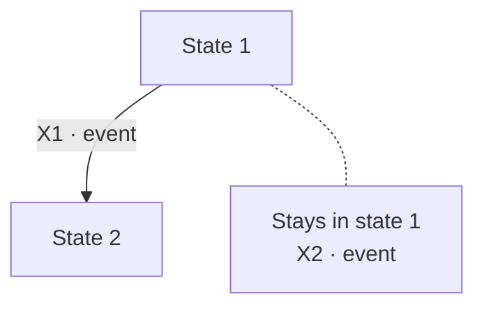

# Test design — {scope}

<!-- The Test Design Specification of the build (dev/development/test-strategy.md "Test design specification"), the record of Gate 2. It shows which techniques were applied and why, how each one was applied, which conditions it derived from which basis items, the coverage items and the criterion that makes them enough, how each condition links to its AC and test cases, and the gaps, deviations and design rulings.
     Homes: the basis items and the scope rulings (excluded, deferred) and the rulings on ambiguities live in test-analysis.md; the AC and measures live in testing-plan.md. This file cites them by ID and does not restate them.
     Keep only the technique sections the build applies, in the order below, and number them in the order kept. Each section takes the form of its technique: not every technique is a flow diagram.
     Build files are written in Vietnamese prose with English terms (dev/mvp/builds/_STYLE.md). Diagrams are Mermaid: no arrow from a node back to itself (several stack on one side and their labels get cut); no classDef or fixed colors (they break the dark theme). -->

## At a glance

- **Purpose:** the PO checks at **Gate 2** that the **conditions are complete** and that **each technique was applied as the strategy says**. Every arrow, cell, rule, partition, boundary, invariant, threat scenario and injection point here is a **condition with its own code**.
- **Basis:** [test-analysis.md](./test-analysis.md) (basis items, scope rulings) · **Criteria:** [testing-plan.md](./testing-plan.md) (AC, measures) · **Spine:** [traceability-matrix.md](./traceability-matrix.md)
- **Links of a condition:** each condition row names its **basis items** and its **AC with the test cases** that check it. A **test case** is one **independent variant** of an AC: `FR-NNN AC-n` when the AC has one case, `FR-NNN AC-n/a–c` when it has several.
- **Notation:** a **dashed** arrow is **moved to a later build**. A condition **without an AC** points to a **"Z-n · no AC"** node: a gap in the last section.
- **Status:** _N conditions · coverage items N / N with a test case · N gaps, N ruled, N pending_; checklist: _N of 8 pass_; **Gate 2:** _not started_

## 1. Techniques applied

<!-- One row per technique the build applies (test-strategy.md "Technique per requirement"). Why: the kind of requirement and the risk level that select it. Coverage items: the count the criterion requires, from the section's own table; a shortfall is a deviation in the last section. Error guessing has no section: it lives in the Catches line of each AC. -->

| Technique | Applied to (basis items) | Why | Coverage criterion | Coverage items (with a test case / required) | Section |
|---|---|---|---|---|---|
| State transition | FR-NNN.1–4 | Lifecycle of X; high risk | Every event in every state, refused events included | 0 / 0 | 3 |

## 2. Use case testing: flow name

<!-- One row per flow: the main flow, then each alternative reaching a different end state (combinations of alternatives only at high risk). -->

| Code | Flow | Steps and alternatives | Basis items | End state | AC · test cases |
|---|---|---|---|---|---|
| U1 | Main flow | S1–S4 | UC-NNN.S1–S4 | | FR-NNN AC-n |

## 3. State transition: object name

<!-- States and events come from the spec, each with its basis item. Draw the diagram, give each arrow a code, then one table row per arrow, then the state × event matrix. Events that keep the state go into one "Stays …" node joined by a dotted line. -->

**States:** _State 1_ (basis FR-NNN.1), _State 2_. **Events:** _event_ (basis FR-NNN.2).

**Always true** on every arrow (invariant codes of the invariant section): _I1_.

| Code | Basis items | AC · test cases | When | DeckAgent must | Defect the test catches |
|---|---|---|---|---|---|
| X1 | FR-NNN.2 | FR-NNN AC-n | The situation and the action, as a sentence. | One sentence per check. | One sentence per defect, starting with "DeckAgent". |

**State × event matrix.** The diagram shows **only the arrows that exist**, so a **missing arrow does not show**; here **every cell needs an answer**: a **code** (the event has an AC), **"—" with the reason** it cannot happen, or a **bold Z-n** (no AC; see the last section).

| Event | State 1 | State 2 |
|---|---|---|
| **Event name** | X1 · what DeckAgent does | — · why it cannot happen |

**Coverage:** _N_ state-event pairs; _N_ with a test case; _N_ ruled (Z-n).

## 4. Decision table: rule name

<!-- One section per rule with several conditions. List the conditions and actions with their basis items, every combination, the infeasible ones with the spec statement that excludes them, and each merge with its argument from the spec. A tree may replace the rules table when it is easier to read; every leaf keeps one outcome and one code. -->

**Conditions:** _C1 · condition_ (basis BR-NNN.V-1). **Actions:** _outcome_. **Terms:** define each term a condition uses.

| Code | C1 | C2 | Outcome | Basis items | AC · test cases |
|---|---|---|---|---|---|
| R1 | yes | — | | BR-NNN.V-1 | FR-NNN AC-n |

- **Infeasible:** _combination_, excluded by _spec statement_.
- **Merged:** _R2 and R3_, because _argument from the spec that the outcome is the same_.

**Coverage:** _N_ rules; _N_ with a test case. A test input **falls in exactly one rule**.

## 5. Equivalence partitioning and boundary values: variable name

<!-- One section per input with a range or a format (test-strategy.md "How a technique is applied"). Members of a closed list are test data of one partition; the criterion (every member, or one member plus one non-member) follows the risk level. -->

**Variable:** the quantity or format the rule limits. **Sub-variables:** counting unit, encoding, normalization, trimming.

| Code | Partition | Valid | Example | Basis items | AC · test cases |
|---|---|---|---|---|---|
| K1 | | no | | BR-NNN.V-2 | FR-NNN AC-n |

| Code | Boundary | Just below | At | Just above | AC · test cases |
|---|---|---|---|---|---|
| B1 | | | | | FR-NNN AC-n/a–c |

**Coverage:** _N_ partitions and _N_ boundary values; _N_ with a test case.

## 6. Invariant check

| Code | Invariant ("never" statement) | Basis items | Asserted after | Positive control | AC · test cases |
|---|---|---|---|---|---|
| I1 | | FR-NNN.5 | every action of the area | The audit sees a forbidden action its self-test performs. | FR-NNN AC-n |

## 7. Threat-based

<!-- Assets, trust boundaries, entry points that cross a boundary, then threat scenarios. Screen each scenario: kept, or not feasible with the reason. -->

| Asset | Trust boundary | Entry point |
|---|---|---|
| | | |

| Code | Threat scenario | Entry point | Basis items | Screening | AC · test cases |
|---|---|---|---|---|---|
| T1 | | | FR-NNN.6 | kept | FR-NNN AC-n |

## 8. Fault injection

<!-- The points where a failure changes what the requirement protects, and the failure modes that can really occur there. A requirement that names them fixes them; otherwise record the reason (architecture, risk) for each. -->

| Code | Injection point | Failure mode | Why this point and mode | State checked after restart or retry | Basis items | Measure · test cases |
|---|---|---|---|---|---|---|
| FI1 | | kill the process | named by NFR-NNN | | NFR-NNN.1 | NFR-NNN M-n |

## 9. Performance

<!-- Only when performance is a selected type. A target the PO has not set reads "not set": the measure is recorded, not asserted. -->

| Code | Operation | Workload conditions | Metric | Target | Basis items | Measure |
|---|---|---|---|---|---|---|
| P1 | | | | not set | NFR-NNN.1 | NFR-NNN M-n |

## 10. Gaps, deviations and design rulings

<!-- Kind: gap (the spec does not answer), deviation (a technique or coverage criterion the risk level requires is not applied), checklist (a C1–C8 failure), infra (a test-infrastructure choice). Ruling: the PO's, with the date, or "pending". A ruled item's result is written into testing-plan.md as current fact. Scope rulings and rulings on ambiguities stay in test-analysis.md. -->

| ID | Kind | What, proposal | PO ruling (DD-MM-YYYY) |
|---|---|---|---|
| Z-1 | gap | | pending |
