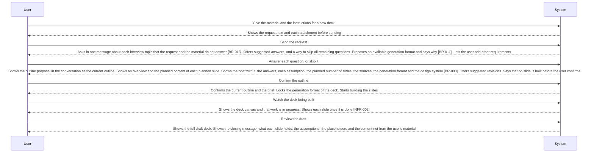

<!-- A use case models product behavior for one user goal reached in a single sitting (UCG-01).
     Write per dev/spec/_STYLE.md. Write intent and response, not interface (rule 11, UCG-09).
     The interaction diagram is a view generated from the Steps table and Alternative flows; do not hand-edit it (MG-02). -->

## Interaction diagram

<!-- Generated from the Steps table and Alternative flows. Do not edit between the markers. -->

<!-- BEGIN generated: use-case-sequence -->

*Not drawn (alternative flows): A9 (Continue at S3), A10 (End), A23 (Back to S3), A32 (Same step), A33 (Continue at S3), A34 (Continue at S3), A37 (Continue at S5), A42 (Continue at S5), A51 (Back to S2), A52 (Continue at S3), A53 (Continue at S3), A54 (Same step).*
<!-- END generated: use-case-sequence -->

## Steps

| Step | User | System | FR | Evidence |
|---|---|---|---|---|
| S1 | Give the material and the instructions for a new deck | Shows the request text and each attachment before sending | FR-016 |  |
| S2 | Send the request | Asks in one message about each interview topic that the request and the material do not answer [BR-013]. Offers suggested answers, and a way to skip all remaining questions. Proposes an available generation format and says why [BR-011]. Lets the user add other requirements | FR-021, FR-113, FR-117, FR-124, FR-129 |  |
| S3 | Answer each question, or skip it | Shows the outline proposal in the conversation as the current outline. Shows an overview and the planned content of each planned slide. Shows the brief with it: the answers, each assumption, the planned number of slides, the sources, the generation format and the design system [BR-003]. Offers suggested revisions. Says that no slide is built before the user confirms | FR-001, FR-008, FR-021, FR-069, FR-088, FR-090, FR-093, FR-126 |  |
| S4 | Confirm the outline | Confirms the current outline and the brief. Locks the generation format of the deck. Starts building the slides | FR-003, FR-022, FR-116 |  |
| S5 | Watch the deck being built | Shows the deck canvas and that work is in progress. Shows each slide once it is done [NFR-002] | FR-022, FR-023, FR-091, FR-092 |  |
| S6 | Review the draft | Shows the full draft deck. Shows the closing message: what each slide holds, the assumptions, the placeholders and the content not from the user's material | FR-024 |  |

## Alternative flows

### A9 · File with nothing usable

- **At:** S3
- **Ends:** Continue at S3
- **When:** An accepted file in the material holds nothing usable.
- **System:** Uses nothing from the file. Names the file and the reason with the outline.
- **FR:** FR-009

### A10 · Slide building ends early

- **At:** S5
- **Ends:** End
- **When:** The user stops the work, or the work fails, before every slide is done.
- **System:** Keeps the confirmed outline and each finished slide. Says how many slides are finished. Keeps the generation format locked.
- **FR:** FR-018, FR-019, FR-025, FR-116

### A23 · Change the outline or the brief

- **At:** S4
- **Ends:** Back to S3
- **When:** The user asks to change the current outline or the brief, chooses a suggested revision, asks for an earlier proposal again, or sends a message about the outline whose meanings differ a lot.
- **System:** Asks one focused question first when the meaning is unclear. Shows the result as the new current outline with its brief, and names what changed. Keeps each earlier proposal unchanged.
- **FR:** FR-005, FR-007, FR-113, FR-126, FR-127

### A32 · Topic still unknown

- **At:** S3
- **Ends:** Same step
- **When:** The user skips the question about the topic, and the request and the material do not give it.
- **System:** Drafts no outline. Says that it needs the topic. Asks for it again.
- **FR:** FR-021

### A33 · Material does not agree with itself

- **At:** S3
- **Ends:** Continue at S3
- **When:** Two parts of the material disagree on a point the outline needs.
- **System:** Names both parts and where each one is. Asks the user to choose when the point changes the plan a lot. Otherwise marks the point as open in the outline.
- **FR:** FR-011, FR-037

### A34 · Material lacks a needed fact

- **At:** S3
- **Ends:** Continue at S3
- **When:** The outline needs content of a kind that needs a source [BR-015], and no source gives it.
- **System:** Writes a placeholder instead. Names each missing item with the outline.
- **FR:** FR-010

### A37 · Presenter notes

- **At:** S5
- **Ends:** Continue at S5
- **When:** The request or an interview answer asks for presenter notes.
- **System:** Builds the notes of each slide with that slide. Names the slides with notes in the closing message.
- **FR:** FR-130

### A42 · Images on the slides

- **At:** S5
- **Ends:** Continue at S5
- **When:** A slide needs an image, from the interview answer, the request or the content of the slide.
- **System:** Uses an attached image, a new image, or an image found by public research [BR-014]. Names the source, the author and the licence of each image found by public research in the closing message.
- **FR:** FR-066, FR-088, FR-090, FR-125

### A51 · Generation format unavailable

- **At:** S3
- **Ends:** Back to S2
- **When:** The format the user named or chose is not available, or the request names two formats for one deck.
- **System:** Says which need it cannot meet. Shows the available generation formats. Puts no other format in its place by itself.
- **FR:** FR-113, FR-117

### A52 · Public research cannot give what the outline needs

- **At:** S3
- **Ends:** Continue at S3
- **When:** The user chose public research as a source, and it does not give information the outline needs.
- **System:** Says which information it did not obtain. Asks the user when the gap changes the outline a lot. Otherwise goes on with the other sources.
- **FR:** FR-089

### A53 · No material given

- **At:** S2
- **Ends:** Continue at S3
- **When:** The request has no material and names no source [BR-013].
- **System:** Asks which sources to use. Uses only the model's general knowledge after the user confirms it.
- **FR:** FR-124

### A54 · Question about the outline

- **At:** S4
- **Ends:** Same step
- **When:** The user asks a question about the current outline and asks for no change.
- **System:** Answers the question. Changes no outline and no brief. Asks which one the user means when the message has both readings.
- **FR:** FR-007, FR-128

## Situation and goal

The user has material for a presentation, such as rough ideas, notes or a document. The
deck is empty. The user wants a first draft of the slides made for them. They do not want
to build the deck slide by slide. They want the system to understand who the talk is for
and how long it runs before it plans anything.

## Trigger and precondition

- **Trigger:** The user sends a request in a chat that has no deck yet.
- **Precondition:** The chat has no outline and no slides.

## Outcome and minimal guarantee

- **Outcome:** The chat holds the confirmed outline. The deck has slides made from it, in the generation format of the deck, which is locked. The slides use the chosen design system, or the default design system [BR-003]. The deck canvas shows the slides, and the conversation shows the closing message.
- **Minimal guarantee:** The request text and the material stay in the conversation. Each outline proposal already shown stays in the conversation. A confirmed outline stays confirmed. Each finished slide stays in the deck. A locked generation format stays the format of the deck.

## Product evidence

### open-design (nexu-io/open-design)

- **Coverage:** unverified
- **Research link:** none yet. The README and the description of its deck template were read on 04-11-2026 and are not yet recorded in `dev/research/`.
- **Differences:** Before it builds a deck, the product asks about the audience, the duration, the source material, images, the theme and hard constraints. It shows no outline for the user to confirm. It builds the deck from a prebuilt template and theme, mainly in HTML, and exports other formats afterwards.
- **Evidence:** [assumed: read from the open-design README and deck template description on 04-11-2026; no research item yet]

### Napkin AI

- **Coverage:** observed
- **Research link:** `dev/legacy/research/use-cases/napkin-ai/napkin-ai-deck-generation-behavior.md` (legacy research, read-only)
- **Differences:** The first answer is an outline with a one-sentence summary and one row per slide; each row opens to show its points. Under each outline it offers suggested revisions written for that content, and accepting is always one of them. A revision sometimes changes more slides than it says. It asks questions before the outline only when the request has no text, and it shows no brief or assumptions. It treats an attached deck as material and asks for the style after the outline.

## Notes

- Sending a request, waiting for it, and a stop or a failure before the outline are shared by every request. They are in UC-003. This case adds only what is specific to the first draft. A request after A10 is a follow-up request (legacy UC-002, under review).
- Who decides how a slide looks: [DEC-002](../../decisions/DEC-002-model-writes-content-code-applies-design.md). A visual style, design options before the slides and conflicts between design rules are reviewed with legacy UC-010 and UC-017.
- How many confirmations come before the first slide: [DEC-001](../../decisions/DEC-001-outline-only-checkpoint.md).
- The number of slides follows the duration by the judgment of the model, not by a rule value. The outline states it as an assumption, and a number the user asks for is exact.
- There is no cancellation of an outline. An outline that is not confirmed stays as it is, and the next message about it is a revision (A23).
- An attached deck is material. A new deck that follows the structure of an earlier deck, only when the user asks for it, is reviewed with legacy UC-011.
- Flow IDs A1 to A51 that this file does not hold are retired and never reused.
