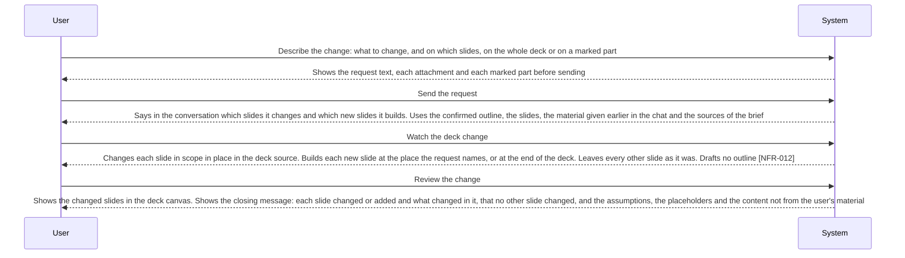

<!-- A use case models product behavior for one user goal reached in a single sitting (UCG-01).
     Write per dev/spec/_STYLE.md. Write intent and response, not interface (rule 11, UCG-09).
     The interaction diagram is a view generated from the Steps table and Alternative flows; do not hand-edit it (MG-02). -->

## Interaction diagram

<!-- Generated from the Steps table and Alternative flows. Do not edit between the markers. -->

<!-- BEGIN generated: use-case-sequence -->

*Not drawn (alternative flows): A1 (End), A5 (End), A8 (Continue at S3), A9 (Continue at S3), A10 (End), A11 (End), A12 (Continue at S3), A16 (End), A17 (Continue at S3), A18 (Continue at S3), A19 (Continue at S3), A20 (Continue at S3), A21 (Continue at S3).*
<!-- END generated: use-case-sequence -->

## Steps

| Step | User | System | FR | Evidence |
|---|---|---|---|---|
| S1 | Describe the change: what to change, and on which slides, on the whole deck or on a marked part | Shows the request text, each attachment and each marked part before sending | FR-016, FR-131 |  |
| S2 | Send the request | Says in the conversation which slides it changes and which new slides it builds. Uses the confirmed outline, the slides, the material given earlier in the chat and the sources of the brief | FR-027, FR-029, FR-132 |  |
| S3 | Watch the deck change | Changes each slide in scope in place in the deck source. Builds each new slide at the place the request names, or at the end of the deck. Leaves every other slide as it was. Drafts no outline [NFR-012] | FR-027, FR-091, FR-092 |  |
| S4 | Review the change | Shows the changed slides in the deck canvas. Shows the closing message: each slide changed or added and what changed in it, that no other slide changed, and the assumptions, the placeholders and the content not from the user's material | FR-029 |  |

## Alternative flows

### A1 · Scope of the change unclear

- **At:** S2
- **Ends:** End
- **When:** The request does not make clear which slides the change reaches.
- **System:** Changes no slide. Asks which slides, with suggested answers such as every slide, the named slides or new slides only. The reply is a new follow-up request.
- **FR:** FR-031

### A5 · Slide reference does not match the deck

- **At:** S2
- **Ends:** End
- **When:** The request names a slide that is not in the deck, or a slide number and a slide title that point to different slides.
- **System:** Changes no slide. Says which part of the request does not match and how many slides the deck has. Sends nothing again by itself.
- **FR:** FR-036

### A8 · Change the design

- **At:** S3
- **Ends:** Continue at S3
- **When:** The request asks to change the look of slides.
- **System:** Changes the size, the spacing, the position or the layout of what the request names. Takes each colour and font it chooses itself from the theme. Keeps the content, the slide count and the order. A rule in words of the design system that the request sets aside is set aside on the named slides only, and named in the closing message.
- **FR:** FR-107, FR-136

### A9 · Presenter notes

- **At:** S3
- **Ends:** Continue at S3
- **When:** The request asks to add or change the presenter notes of named slides.
- **System:** Writes the notes of each named slide only. Changes nothing the audience sees. Names the slides with new notes in the closing message.
- **FR:** FR-130

### A10 · Change unclear

- **At:** S2
- **Ends:** End
- **When:** The request says that something is wrong, with or without a slide named, and does not say what to change.
- **System:** Changes no slide. Offers directions taken from the deck and the conversation as suggested answers. Asks what to change when it has no direction to offer. The reply is a new follow-up request.
- **FR:** FR-031

### A11 · Change ends early

- **At:** S3
- **Ends:** End
- **When:** The user stops the work, or the work fails, before every slide in scope is done.
- **System:** Keeps each slide it finished changing. Each other slide keeps its last finished state. Says how many slides it changed or added, or that it does not know. Says that the finished slides were not made to agree with each other.
- **FR:** FR-018, FR-019, FR-025

### A12 · Images on the changed slides

- **At:** S3
- **Ends:** Continue at S3
- **When:** A changed or new slide needs an image, from the request or the content of the slide.
- **System:** Uses an attached image, a new image, or an image found by public research [BR-014]. Names the source, the author and the licence of each image found by public research in the closing message. When the outside service for it is not set up, says which one is missing and makes the rest of the change.
- **FR:** FR-066, FR-088, FR-125, FR-129

### A16 · Another generation format

- **At:** S2
- **Ends:** End
- **When:** The request asks to change the generation format of the deck.
- **System:** Says that the generation format of the deck is locked. Changes no slide. Converts nothing by itself.
- **FR:** FR-116

### A17 · Carry on a first draft that ended early

- **At:** S2
- **Ends:** Continue at S3
- **When:** The first draft stopped or failed before every planned slide was done.
- **System:** Uses the confirmed outline and the finished slides, also when no slide was finished. Shows no second outline.
- **FR:** FR-028

### A18 · Change a marked part

- **At:** S3
- **Ends:** Continue at S3
- **When:** The request comes with one or more marked parts.
- **System:** Takes the marked parts as the scope of the change. Changes nothing else on those slides unless the request asks for it.
- **FR:** FR-131, FR-027

### A19 · Colour or font not in the theme

- **At:** S3
- **Ends:** Continue at S3
- **When:** The request asks for a colour or a font that the theme of the deck does not hold.
- **System:** Makes the rest of the change. Says that the theme does not hold the colour or font, and asks whether to use it only where the request names it or to put it in the theme of the deck in place of the theme value whose role it fits best, naming that role, with both as suggested answers. The question ends the request.
- **FR:** FR-107, FR-014

### A20 · Change needs a fact no source gives

- **At:** S3
- **Ends:** Continue at S3
- **When:** The change needs content of a kind that needs a source [BR-015], and no source of the brief or of the request gives it.
- **System:** Writes a placeholder instead. Names it in the closing message.
- **FR:** FR-132, FR-029

### A21 · Use another design system

- **At:** S3
- **Ends:** Continue at S3
- **When:** The request asks to use another design system for the deck.
- **System:** Changes the theme of the whole deck. Keeps the content, the design changes of each slide and each colour or font the user chose for a part of a slide. Names each colour or font the user had put in the theme that the new design system replaces. Checks each slide again.
- **FR:** FR-093

## Situation and goal

The user has a draft deck and sees something to change: one slide, a part of a slide, the
look of the deck, or a missing slide. Or the first draft stopped before it was done. The
user wants to say what to change in their own words, or point at it, and get only that
changed. They do not want the deck built again, and they do not want to check slides they
did not ask about.

## Trigger and precondition

- **Trigger:** The user sends a follow-up request.
- **Precondition:** The chat has a confirmed outline, a deck with at least one slide, or both. The chat has no active request.

## Outcome and minimal guarantee

- **Outcome:** The slides in scope show the change, in the generation format of the deck. Every other slide is as it was. The deck uses one design system. The conversation holds the request and the closing message.
- **Minimal guarantee:** The request text and its marked parts stay in the conversation. Each slide is either as it was before the request or fully changed. A slide outside the scope never changes. The generation format of the deck stays locked.

## Product evidence

### open-design (nexu-io/open-design)

- **Coverage:** unverified
- **Research link:** `dev/research/open-design-design-systems.md`
- **Differences:** A follow-up message makes the agent patch the deck file with the smallest useful change. Sizes and spacing change freely; a colour outside the theme presets is refused. An optional set of a few named values changes the look without the agent. A selection or comment on the preview exists, but what the agent receives from it is not documented. It shows no outline for a change.

### Claude slide design

- **Coverage:** unverified
- **Research link:** `dev/legacy/research/use-cases/claude-slides-design/claude-deck-generation-behavior.md` (legacy research, read-only; it records the first draft only)
- **Differences:** The user marks a part of a slide, and the mark goes with the next request.
- **Evidence:** [assumed: PO report of 04-11-2026; not recorded in a research item]

## Notes

- Sending a request, waiting for it, and a stop or a failure are shared by every request (UC-003). This case adds only what is specific to a change of the deck.
- Who writes the deck source and how the theme bounds a design change: [DEC-005](../../decisions/DEC-005-model-writes-source-within-template.md). The role of the template and a colour or font the user asks for: [DEC-007](../../decisions/DEC-007-how-a-design-system-bounds-the-deck.md).
- A question the system asks ends its request, and the reply is a new follow-up request (FR-014).
- A request that changes the topic, the structure or the language changes this deck, with no outline. A second deck for another use starts in a new chat (UC-012) as a first draft (UC-001); legacy UC-011 is retired (05-11-2026).
- The project folder stays unchanged (FR-084, UC-013). Changes by hand, going back to an earlier state and export of the deck are in the backlog (UC-007, UC-008, UC-004). A source archive attached to a request is material (UC-012).
- Legacy UC-017 is retired (05-11-2026): no visual style (legacy FR-094); a request that sets aside a rule in words of the design system is FR-136 (legacy FR-105). Setting up a design system is UC-010.
- Flow IDs A2, A3, A4, A6 (merged into A10), A7 (merged into A11), A13, A14 and A15 are retired and never reused.
