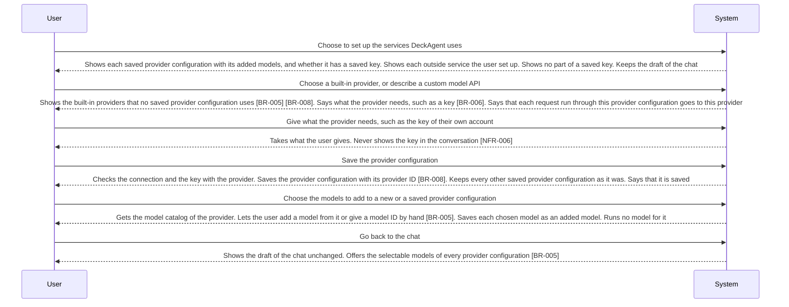

<!-- A use case models product behavior for one user goal reached in a single sitting (UCG-01).
     Write per dev/spec/_STYLE.md. Write intent and response, not interface (rule 11, UCG-09).
     The interaction diagram is a view generated from the Steps table and Alternative flows; do not hand-edit it (MG-02). -->

## Interaction diagram

<!-- Generated from the Steps table and Alternative flows. Do not edit between the markers. -->

<!-- BEGIN generated: use-case-sequence -->

*Not drawn (alternative flows): A1 (Back to S1), A2 (Back to S1), A4 (End), A5 (Back to S3), A6 (Back to S3), A7 (Same step), A9 (Back to S3), A11 (Back to S1), A15 (Back to S1), A16 (End), A17 (End).*
<!-- END generated: use-case-sequence -->

## Steps

| Step | User | System | FR | Evidence |
|---|---|---|---|---|
| S1 | Choose to set up the services DeckAgent uses | Shows each saved provider configuration with its added models, and whether it has a saved key. Shows each outside service the user set up. Shows no part of a saved key. Keeps the draft of the chat | FR-039, FR-040, FR-038 |  |
| S2 | Choose a built-in provider, or describe a custom model API | Shows the built-in providers that no saved provider configuration uses [BR-005] [BR-008]. Says what the provider needs, such as a key [BR-006]. Says that each request run through this provider configuration goes to this provider | FR-039 |  |
| S3 | Give what the provider needs, such as the key of their own account | Takes what the user gives. Never shows the key in the conversation [NFR-006] | FR-040 |  |
| S4 | Save the provider configuration | Checks the connection and the key with the provider. Saves the provider configuration with its provider ID [BR-008]. Keeps every other saved provider configuration as it was. Says that it is saved | FR-041 |  |
| S5 | Choose the models to add to a new or a saved provider configuration | Gets the model catalog of the provider. Lets the user add a model from it or give a model ID by hand [BR-005]. Saves each chosen model as an added model. Runs no model for it | FR-058 |  |
| S6 | Go back to the chat | Shows the draft of the chat unchanged. Offers the selectable models of every provider configuration [BR-005] | FR-038 |  |

## Alternative flows

### A1 · Change a provider configuration

- **At:** S1
- **Ends:** Back to S1
- **When:** The user changes the key or the base URL of a saved provider configuration [BR-006], and saves.
- **System:** Replaces what changed and keeps the provider ID and the added models. Checks a new key with the provider before it saves. When the provider refuses it, saves nothing and keeps the saved key. Applies the change only to requests that start later.
- **FR:** FR-043, FR-041, FR-042

### A2 · Remove an added model

- **At:** S1
- **Ends:** Back to S1
- **When:** The user removes an added model from a provider configuration.
- **System:** Removes it from DeckAgent only, and changes nothing at the provider. A chat that selected it has no selected model. An active request that uses it keeps running to its end.
- **FR:** FR-059, FR-065, FR-042

### A4 · Leave the setup

- **At:** S1, S2, S3, S5
- **Ends:** End
- **When:** The user leaves the setup with changes not saved.
- **System:** Applies no unsaved change and keeps every saved one. Shows the draft of the chat unchanged.
- **FR:** FR-044, FR-038

### A5 · Required setup missing

- **At:** S4
- **Ends:** Back to S3
- **When:** Something the provider needs is missing, such as the key [BR-006].
- **System:** Saves nothing. Says what is missing and keeps what the user gave.
- **FR:** FR-045

### A6 · Key or provider not accepted at setup

- **At:** S4
- **Ends:** Back to S3
- **When:** The provider refuses the key, or does not answer, when the system checks them.
- **System:** Saves nothing. Says that the provider refused the key or did not answer, and why when it knows. Keeps the rest of what the user gave.
- **FR:** FR-041

### A7 · Model catalog not available

- **At:** S5
- **Ends:** Same step
- **When:** The system does not get the model catalog, or the provider returns none.
- **System:** Says that it did not get the model catalog, and why when it knows. Lets the user give a model ID by hand. Changes no added model.
- **FR:** FR-058

### A9 · Provider ID taken

- **At:** S4
- **Ends:** Back to S3
- **When:** The provider ID of a custom model API is the provider ID of a saved provider configuration or of a built-in provider [BR-008].
- **System:** Saves nothing. Says which saved provider configuration or built-in provider has the provider ID. Keeps what the user gave.
- **FR:** FR-041

### A11 · Delete a provider configuration

- **At:** S1
- **Ends:** Back to S1
- **When:** The user deletes a saved provider configuration.
- **System:** Deletes the provider configuration and its added models from DeckAgent only. Changes nothing at the provider. An active request that uses it keeps running to its end. A chat whose selected model belonged to it has no selected model.
- **FR:** FR-063, FR-042, FR-065

### A15 · Set up an outside service

- **At:** S1
- **Ends:** Back to S1
- **When:** The user sets up, changes or removes an outside service of a kind DeckAgent uses [BR-016], with the key of their own account.
- **System:** Checks the key with the service and saves it, as for a provider configuration. When the service refuses the key, saves nothing and says so. Says that requests that use this kind of service send to it. Shows no part of the key.
- **FR:** FR-133, FR-040

### A16 · Choose the model for a chat

- **At:** S6
- **Ends:** End
- **When:** The user chooses a selectable model [BR-005] for the chat, and a reasoning level that the model has.
- **System:** Makes it the selected model of the chat with that reasoning level. When the system knows no reasoning level of the model, offers none, and requests run at the default level of the provider. Applies it from the next request.
- **FR:** FR-055, FR-042

### A17 · Selected model removed

- **At:** S6
- **Ends:** End
- **When:** The selected model of the chat was removed or its provider configuration was deleted.
- **System:** Says that the chat has no selected model. Chooses no other model by itself.
- **FR:** FR-065

## Situation and goal

The user wants DeckAgent to make decks with the models and services they choose, paid by
their own accounts. They have no model ready yet, want another provider or model, want
web search or images, or a key no longer works. They want the services ready without
losing the request they were preparing.

## Trigger and precondition

- **Trigger:** The user chooses to set up services, for example at the first start, or after a request found no model to run it (UC-003 A17).
- **Precondition:** DeckAgent runs on the user's computer.

## Outcome and minimal guarantee

- **Outcome:** A provider configuration is saved with the key it needs and its added models. The user chooses among them for a chat. The draft of the chat is unchanged.
- **Minimal guarantee:** What the user saved stays saved, except what they removed or deleted. A failed save saves nothing. No part of a saved key is shown again. A failed request removes no provider configuration and no added model.

## Product evidence

### open-design (nexu-io/open-design)

- **Coverage:** observed
- **Research link:** [dev/research/outside-services.md](../../research/outside-services.md) items 2, 3 and 10.
- **Differences:** The user gives a protocol, a base URL, a key and a model ID, from more presets, including local model services. A wrong key shows only when a run fails; no check at save is documented. The model is a typed ID; no model catalog of a BYOK provider is documented. A coding-agent CLI with its own login is a second way to run a model. Web search setup is not documented.
- **Evidence:** [observed: open-design README, QUICKSTART, docs/headless-byok.md and docs/agent-adapters.md (BYOK fields, run-time key failure, typed model ID, local CLI runtimes)]

### OpenCode (runtime)

- **Coverage:** unverified
- **Research link:** none yet.
- **Differences:** The runtime keeps provider keys and reads a model catalog that holds context window, reasoning and input kinds of each model.
- **Evidence:** [assumed: no research item yet; runtime research of the first build that touches models checks it]

## Notes

- The user chooses each outside service: [DEC-003](../../decisions/DEC-003-user-sets-up-outside-services.md).
- How and where a key is kept, and how much of providers and models the runtime already owns, are runtime research of the first build that touches models, not a decision of this case.
- Running a model through a coding-agent program already on the user's computer, with that program's own login, is not in the target spec. It is reconsidered after the runtime research.
- Restoring default models and editing the model settings of an added model by hand are not flows of this case. They are reconsidered if the runtime research finds no model catalog.
- Flow IDs A1 to A14 that this file does not hold are retired and never reused.
