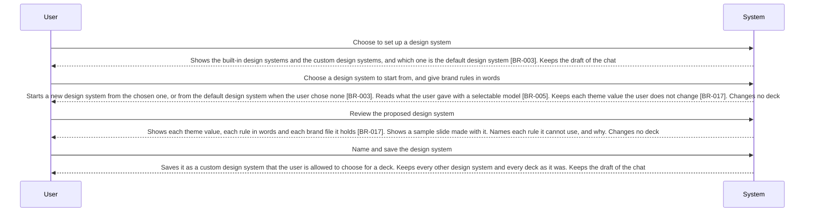

<!-- A use case models product behavior for one user goal reached in a single sitting (UCG-01).
     Write per dev/spec/_STYLE.md. Write intent and response, not interface (rule 11, UCG-09).
     The interaction diagram is a view generated from the Steps table and Alternative flows; do not hand-edit it (MG-02). -->

## Interaction diagram

<!-- Generated from the Steps table and Alternative flows. Do not edit between the markers. -->

<!-- BEGIN generated: use-case-sequence -->

*Not drawn (alternative flows): A2 (Continue at S3), A3 (Back to S1), A4 (Continue at S3), A5 (End), A7 (Back to S2), A8 (Same step), A9 (Same step), A10 (Same step).*
<!-- END generated: use-case-sequence -->

## Steps

| Step | User | System | FR | Evidence |
|---|---|---|---|---|
| S1 | Choose to set up a design system | Shows the built-in design systems and the custom design systems, and which one is the default design system [BR-003]. Keeps the draft of the chat | FR-097, FR-038 |  |
| S2 | Choose a design system to start from, and give brand rules in words | Starts a new design system from the chosen one, or from the default design system when the user chose none [BR-003]. Reads what the user gave with a selectable model [BR-005]. Keeps each theme value the user does not change [BR-017]. Changes no deck | FR-097, FR-135 |  |
| S3 | Review the proposed design system | Shows each theme value, each rule in words and each brand file it holds [BR-017]. Shows a sample slide made with it. Names each rule it cannot use, and why. Changes no deck | FR-096 |  |
| S4 | Name and save the design system | Saves it as a custom design system that the user is allowed to choose for a deck. Keeps every other design system and every deck as it was. Keeps the draft of the chat | FR-097, FR-038 |  |

## Alternative flows

### A2 · Change a custom design system

- **At:** S1
- **Ends:** Continue at S3
- **When:** The user chooses to change a custom design system and gives new brand rules.
- **System:** Reads the new rules with a selectable model, as in S2. Proposes the changed design system under its name. Each deck that uses it keeps its theme.
- **FR:** FR-097, FR-135, FR-106

### A3 · Remove a custom design system

- **At:** S1
- **Ends:** Back to S1
- **When:** The user removes a custom design system.
- **System:** Removes it from the design systems the user is allowed to choose. Each deck that used it keeps its theme and stays changeable.
- **FR:** FR-098, FR-106

### A4 · Brand files given

- **At:** S2
- **Ends:** Continue at S3
- **When:** The user gives brand files, such as a brand guide, a logo, a font file or a design system package of another product.
- **System:** Takes the theme values, rules in words and brand files it finds [BR-017]. Names the file each came from, and each file or part it cannot use, with the reason. Never says it found every rule.
- **FR:** FR-099

### A5 · Leave without saving

- **At:** S2, S3, S4
- **Ends:** End
- **When:** The user leaves the setup before saving.
- **System:** Saves no design system and changes none. Shows the draft of the chat unchanged.
- **FR:** FR-044, FR-038

### A7 · Rules do not agree

- **At:** S3
- **Ends:** Back to S2
- **When:** Two rules the user gave do not agree, such as two different main colours.
- **System:** Names both rules and where each came from. Chooses neither. Saves nothing. Keeps what the user gave.
- **FR:** FR-096

### A8 · Change or remove a built-in design system

- **At:** S1
- **Ends:** Same step
- **When:** The user asks to change or to remove a built-in design system.
- **System:** Changes and removes nothing. For a change: offers to start a new design system from it. For a removal: says that a built-in design system is never removed.
- **FR:** FR-112

### A9 · No model reads the brand rules

- **At:** S2
- **Ends:** Same step
- **When:** No model is selectable, or the model does not answer.
- **System:** Makes no proposal and saves nothing. Keeps what the user gave. Says why.
- **FR:** FR-135

### A10 · Name taken

- **At:** S4
- **Ends:** Same step
- **When:** The name the user gives is the name of another design system.
- **System:** Saves nothing. Says which design system has the name. Keeps the proposed design system.
- **FR:** FR-097

## Situation and goal

The user makes decks that must follow the same brand, such as the brand of their company
or of a client, or a look they liked in an earlier deck. They want the colours, fonts and
rules of that brand set up once, so they choose it for any deck and never describe it
again in a request.

## Trigger and precondition

- **Trigger:** The user chooses to set up, change or remove a design system.
- **Precondition:** DeckAgent runs on the user's computer.

## Outcome and minimal guarantee

- **Outcome:** The custom design system the user saved is among the design systems the user is allowed to choose for a deck, with every theme value [BR-017]. Every deck is as it was.
- **Minimal guarantee:** No deck changes. Every design system is as it was, except a custom design system the user saved or removed. The draft of the chat is as it was.

## Product evidence

### open-design (nexu-io/open-design)

- **Coverage:** observed
- **Research link:** [dev/research/open-design-design-systems.md](../../research/open-design-design-systems.md) items 2, 4 and 7.
- **Differences:** A design system is a package of files that the user imports from a folder, GitHub or shadcn. Making one from words or a brand guide, changing or removing one in the product, a default design system and rules that do not agree are not documented. A package holds named values, rules in words, and optional fonts and assets, like a design system here.
- **Evidence:** [observed: open-design docs/design-systems.md and design-systems/README.md (package contract, import flows)]

## Notes

- Choosing a design system for a deck is the interview of UC-001 and UC-002 A21. This case sets design systems up and builds no deck.
- Who writes the theme and how a design system bounds the deck: [DEC-005](../../decisions/DEC-005-model-writes-source-within-template.md).
- The need to keep a look the user liked for later decks comes from the teacher feedback of 23-10-2026 (`dev/meetings/Transcript - 231026 - Họp để thêm các req và các hướng sửa đổi sau V1.txt`, at 13:02 to 13:52). The look of an earlier deck is the design system it used, which the user chooses again for a new deck. Making a design system from the theme of a deck is reviewed with legacy UC-017.
- A visual style (legacy FR-104, the visual style part of FR-106) is reviewed with legacy UC-017.
- Flow IDs A1 (merged into S2) and A6 (a design system always starts complete from another one) are retired and never reused.
