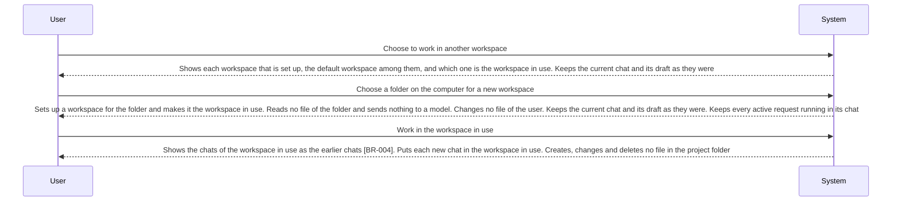

<!-- A use case models product behavior for one user goal reached in a single sitting (UCG-01).
     Write per dev/spec/_STYLE.md. Write intent and response, not interface (rule 11, UCG-09).
     The interaction diagram is a view generated from the Steps table and Alternative flows; do not hand-edit it (MG-02). -->

## Interaction diagram

<!-- Generated from the Steps table and Alternative flows. Do not edit between the markers. -->

<!-- BEGIN generated: use-case-sequence -->

*Not drawn (alternative flows): A1 (Continue at S3), A2 (Same step), A3 (Same step), A5 (Same step), A6 (Same step), A7 (Continue at S3), A8 (Same step), A9 (Back to S1), A10 (Continue at S3).*
<!-- END generated: use-case-sequence -->

## Steps

| Step | User | System | FR | Evidence |
|---|---|---|---|---|
| S1 | Choose to work in another workspace | Shows each workspace that is set up, the default workspace among them, and which one is the workspace in use. Keeps the current chat and its draft as they were | FR-071, FR-072, FR-038 |  |
| S2 | Choose a folder on the computer for a new workspace | Sets up a workspace for the folder and makes it the workspace in use. Reads no file of the folder and sends nothing to a model. Changes no file of the user. Keeps the current chat and its draft as they were. Keeps every active request running in its chat | FR-071, FR-068, FR-038 |  |
| S3 | Work in the workspace in use | Shows the chats of the workspace in use as the earlier chats [BR-004]. Puts each new chat in the workspace in use. Creates, changes and deletes no file in the project folder | FR-048, FR-071, FR-084 |  |

## Alternative flows

### A1 · Folder already has a workspace

- **At:** S2
- **Ends:** Continue at S3
- **When:** The chosen folder is the project folder of a workspace that is set up.
- **System:** Makes that workspace the workspace in use. Sets up no second workspace for the folder.
- **FR:** FR-071

### A2 · Remove a workspace

- **At:** S3
- **Ends:** Same step
- **When:** The user removes a workspace other than the default workspace, and no request in its chats is active.
- **System:** Says that its project folder and its chats stay, and asks the user to confirm. On confirm: removes the workspace and changes no file of the user. Puts its chats in the default workspace with their conversations, decks and selected models [BR-004]. When it was the workspace in use, makes the default workspace the workspace in use. On cancel: removes nothing.
- **FR:** FR-073

### A3 · Project folder cannot be read

- **At:** S3
- **Ends:** Same step
- **When:** The project folder of a workspace cannot be read, for example it was moved or access was taken away.
- **System:** Says that the files of the folder cannot be read, and names the workspace. Says what the user does next, such as put the folder back or choose another folder (A6). Names no cause it does not know. Keeps the workspace set up and every chat of it readable.
- **FR:** FR-074

### A5 · Request active in a chat of the workspace

- **At:** S3
- **Ends:** Same step
- **When:** The user removes a workspace, or chooses another folder for it, while a request in one of its chats is active.
- **System:** Changes no workspace. Says that the request must end first. Stops no request.
- **FR:** FR-073, FR-083

### A6 · Choose another folder for a workspace

- **At:** S3
- **Ends:** Same step
- **When:** For a workspace other than the default workspace, the user chooses another readable folder that no workspace has, and no request in its chats is active.
- **System:** Makes the chosen folder the project folder of that workspace. Keeps the workspace and its chats. Reads no file of the folder and sends nothing to a model.
- **FR:** FR-083

### A7 · Switch to a workspace that is set up

- **At:** S1
- **Ends:** Continue at S3
- **When:** The user chooses a workspace that is set up.
- **System:** Makes it the workspace in use. Asks for no folder and changes no file of the user. Keeps the current chat and its draft as they were. Keeps every active request running in its chat.
- **FR:** FR-071, FR-068, FR-038

### A8 · Another folder refused

- **At:** S3
- **Ends:** Same step
- **When:** The folder the user chooses for a workspace is the project folder of another workspace, or cannot be read.
- **System:** Changes neither workspace. Says which workspace has the folder, or that the folder cannot be read.
- **FR:** FR-083

### A9 · No workspace set up

- **At:** S2
- **Ends:** Back to S1
- **When:** The user chooses no folder, or the chosen folder cannot be read.
- **System:** Sets up no workspace. Keeps the workspace in use as it was. For a folder that cannot be read: says so.
- **FR:** FR-071

### A10 · First start

- **At:** S1
- **Ends:** Continue at S3
- **When:** DeckAgent starts on the computer for the first time.
- **System:** Makes the default workspace the workspace in use. Asks for no folder.
- **FR:** FR-072

## Situation and goal

The user keeps the files of each project in its own folder on their computer. They want the
chats of a project grouped with that folder, so that the work on a deck reads the files of
that project and they find its chats again. They also want to start before choosing any
folder.

## Trigger and precondition

- **Trigger:** The user chooses to work in another workspace, to choose another folder for a workspace or to remove a workspace; or DeckAgent starts on the computer for the first time (A10).
- **Precondition:** DeckAgent runs on the user's computer.

## Outcome and minimal guarantee

- **Outcome:** The workspace in use is the one the user chose, with its chats. Every file of the user in its project folder is as it was.
- **Minimal guarantee:** No file of the user is changed, moved or deleted. No chat, conversation or deck is deleted. No active request stops.

## Product evidence

### open-design (nexu-io/open-design)

- **Coverage:** observed
- **Research link:** [dev/research/open-design-earlier-work.md](../../research/open-design-earlier-work.md) items 8 to 10.
- **Differences:** A project, not a group of chats, uses one folder that the user imports, and its agent works in that folder. Grouping projects, removing a project and a folder that is gone are not documented.
- **Evidence:** [observed: open-design docs/architecture.md (import of a user-selected folder, agent working directory) and README (no grouping of projects)]

### OpenCode (runtime)

- **Coverage:** unverified
- **Research link:** none yet.
- **Differences:** The runtime keeps its sessions per project directory. Whether a workspace maps to one project of the runtime, and which directory the default workspace and the work of a chat use, is not known.
- **Evidence:** [assumed: no research item yet; runtime research of the first build of this case checks it]

## Notes

- Where the deck source and the work of a chat are kept: [DEC-006](../../decisions/DEC-006-where-chat-work-is-kept.md) (open).
- What the work of a chat is allowed to reach in the project folder (legacy FR-077, NFR-003) is reviewed with legacy UC-014. Starting a new chat (legacy FR-053) is reviewed with legacy UC-012.
- A file of the project folder is named in the request text; there is no named reference (legacy FR-082 dropped). A file that cannot be read is UC-003 A43.
- Opening an earlier chat of the workspace in use is UC-006.
- Renaming or deleting a chat is a candidate use case, not a flow of this case.
- Flow ID A4 is retired and never reused.
