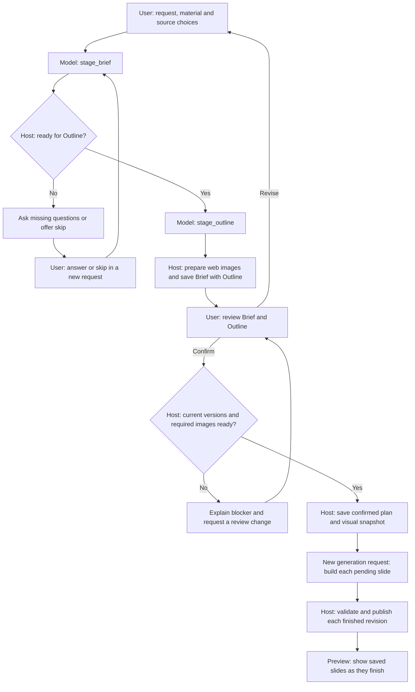

# Generation confirmation and artifact publication

The [review/generation decision](../adr/0005-outline-generation-contracts.md) and [artifact decision](../adr/0006-generated-artifact-publication.md) define the contracts. [Interview and Outline review](interview-and-outline.md) describes the preceding stage. The [portable content reference](portable-slide-content.md) describes versioned executable templates, prepared-image confirmation and independent native adapters. The production app connects confirmation, the isolated OpenCode runtime, request-scoped generation tools and sandboxed Preview.

## Request to Preview

This flow shows new HTML Basic version 3 decks. The Host supplies the catalog and admitted source choices during review, then supplies the confirmed plan during generation. The [per-slide template sequence](portable-slide-content.md#per-slide-template-sequence) expands the generation step.

`stage_brief` and `stage_outline` hold proposals in memory until the request succeeds. An incomplete interview saves its Brief and returns questions without an Outline. The ready path saves the Brief, Outline and prepared-image records together. Missing required images leave the proposal available for review and block confirmation. Schema errors are repaired within the request's bound; they do not require the user to answer the interview again.

Confirmation binds the reviewed Brief and Outline versions. Generation uses the saved template version and theme; it does not choose them again. Stop or failure keeps published revisions. An explicit continuation starts a new request for missing slides in the same Deck; restart does not resume generation automatically.

## Confirmation and request lifecycle

`POST /api/sessions/:id/deck/confirm` accepts exactly `confirmationId`, `outlineId`, `outlineVersion`, `briefId` and `briefVersion`. It rejects message text, mixed change fields, stale or foreign targets. Authentication and origin checks apply. `ConfirmationClient` validates receipts and their linked requests; `DeckClient` retains generation state and the effective visual snapshot.

The Host checks the Chat, known source receipts, busy state and configured generation runtime before confirmation. Source receipts do not prove external bytes remain readable: source tools must still check integrity and each-step access when reading. Confirmation, pending Deck and GenerationIntent commit together in Deck storage. Per-Chat serialization and unique request IDs prevent duplicate scheduling. An identical confirmation returns the same receipt. If Session admission fails, confirmation remains pending and an explicit retry uses the same request ID; it does not confirm again. A saved failed or interrupted request is not replayed by retry or startup.

The Host records admission and immediately before model work records generation start. Format and the exact effective theme/template snapshot then stay locked, including after Stop with zero published slides. Snapshot changes send Deck invalidations. Startup interrupts old Session work and reconciles pending/admitted/generating linkage without running a model. Completed domain results survive a failed Session terminal write; after restart the request reports interruption while saved slides remain readable. There is no transaction across the two databases.

Production uses the existing OpenCode runtime through `GenerationWorkflow`; tests can replace the generation runtime through the composition seam. Missing runtime/model/source access fails preflight before confirmation. Generic Chat and collecting/reviewing requests receive no generation capability.

## Generation tools and controls

Prompt version `b05-generation-v2` supplies the exact confirmed Brief/Outline, visual snapshot, template capacities, compatible layout candidates and selected source receipts. The frozen phase/context and source capability hash participate in native-session resume checks. Each run still opens a fresh authenticated MCP bridge. Generation does not use the interview's eight-step runtime guard: each planned slide needs multiple tool calls, and the request retains its timeout and Stop boundary.

The generation catalog exposes `read_generation_plan`, `begin_slide`, `append_slide`, `attach_slide_image`, `record_slide_provenance`, `discard_slide` and `publish_slide`. Pinned version 1 plans add `find_slide_image` under an explicit public-image choice. Version 2 instead exposes `read_slide_draft`, `record_slide_content` and `validate_slide`, with local images prepared before confirmation. Arguments use validated JSON strings inside the existing bridge envelope. Selected material/research reads coexist with generation; file paths, attachment IDs and saved excerpts are restricted to confirmed source identities and versions. External file reads retain each-step approval. New public text research requires the confirmed source flag and the existing free-only request budget. No model tool confirms, cancels, revises the Outline or writes general files.

Choose **Tạo deck** in the conversation mode control, select source permissions, describe the request and send. Missing questions show suggestions and skip; skip does not grant sources. The current Brief and historical proposals show requirements, assumptions, content, source versions and changes. Review requests can revise, ask a pure question or clarify. The explicit confirmation button requires an empty composer and binds the displayed Outline/Brief. A duplicate click or retry reuses the confirmation identity. An admission failure exposes an explicit scheduling retry for the stored pending intent; failed or stopped execution is not rerun.

Welcome text and composer guidance follow the selected Chat or Create deck mode. During Brief preparation and Outline review, the source choice above the conversation is the only visible research control; generic Chat keeps its own request choice and does not inherit the Brief's permission. Unconfigured research cannot be newly selected. Resolved interview questions disappear during review, while unresolved blockers remain visible. The confirmation area names the exact Outline version, slide count and bound Brief version, and can return focus to that proposal. Choosing revision explicitly selects the revision action and keeps the unsent draft. Brief details use readable field names; source identities and theme values remain available in disclosures.

Live and saved assistant replies use the same limited text formatter for paragraphs, headings, lists, bold text, code and HTTP(S) links. Raw HTML, images and unsupported link schemes stay text. This is not a full Markdown renderer. User messages remain literal text.

Preview shows published revisions, pending slides, progress and the locked visual selection. Publication does not change the selected slide. Reload keeps the current Chat; after Host restart, open it from history. Stop keeps published slides and reports an incomplete deck. The Host appends a closing report from committed metadata: saved count, planned content, actual origins and locations, assumptions, placeholders and image omissions. Partial results warn that saved slides have not been checked for consistency. These checks do not prove every fact or real-provider visual quality.

An incomplete Deck exposes an explicit continuation action. It sends a new request with `continueDeck: true`, retaining the same Deck, confirmed Outline, confirmation receipt, first-start time and visual selection. The plan lists only missing slides. A synthetic continuation message does not consume the empty Composer draft. Published slides cannot be reopened through this continuation capability. Startup and confirmation retries never replay generation. Public text research permission comes from the confirmed Brief, independently of generic Chat permissions.

Content origins are immutable revision metadata. Facts need a request-local evidence ID and an exact quote returned by an admitted read. The Host supplies source version, label and location; forged evidence IDs fail. Wording without evidence is marked general knowledge and placeholders stay unknown. The renderer requires annotated text to appear in the slide. These controls do not detect every unannotated factual statement or establish semantic agreement with a quotation. `presenterNotes: true` in the Brief requires separate notes before publication. Authenticated revision reads return notes without putting them in audience HTML.

The [continuation and web-image proposal](../adr/0008-generation-continuation-and-web-images.md) records these implemented extensions under review. Its Commons service choice does not settle the wider system architecture.

## Bound publication capability

Generation receives a Host-created capability that reads its confirmed plan, opens a stage, appends a chunk, copies a selected prepared image, discards an unpublished stage and publishes. The identity is checked in memory and against the active Session request on every operation and after async work. A serialized copy is not a grant. No capability confirms an Outline, picks another Chat or writes a project file. Legacy publication refuses modern Decks that require this capability.

The artifact decision owns chunk and image bounds. Partial chunks remain managed `.part` files and never reach Preview. Exact chunk retries keep the same status; changed bytes conflict. Only compatible catalog layouts are accepted; custom geometry requires no compatible candidate. A published stage retains its receipt description while freeing its open-stage slot. A request can discard an invalid unpublished stage and supply corrected content; code does not rewrite it to pass.

Prepared image copying uses the Chat's sent attachment, original/parsed fingerprints and normalized PNG bytes. The planned slide must name the image and source version. HTML names an opaque logical asset ID; model data URLs, network URLs and file paths are rejected. Publication and readback verify digests. Materialization inserts validated PNG data URLs only, within the combined image bound. The parent and opaque sandboxed iframe CSP allow this mechanism while denying slide scripts, navigation and network resources. The client has a separate 4 MiB materialized-document guard; the model source bound excludes trusted wrapping and image expansion.

## Validation, storage and recovery

For pinned version 1 plans, the public-image choice searches Wikimedia Commons using exact confirmed `web-image` queries. This sends the query to Commons and requires no API key. It does not enable Tavily text research. The application accepts public domain, CC0 and CC BY, rejects known incompatible licences, and labels missing licence metadata as unknown. Metadata and image downloads use fixed HTTPS Commons and Wikimedia upload/thumbnail hosts without redirects. Each lookup is bounded by 20 seconds, 1 MiB metadata and 8 MiB downloaded bytes; the request allows twice the number of planned web-image blocks as attempts. Successful image lookups are cached within the active request and copied into fresh stage assets when a layout is retried. Concurrent identical calls register one stage asset. A layout retry does not spend another external lookup; failed lookups still consume the request budget. The cache is cleared when the request ends. Normalized PNGs retain existing asset bounds. Immutable credits retain the source-page URL, author, licence, retrieval time and byte digests. Essential missing images block publication; optional illustrative omissions are saved and reported. Reopening published slides uses local bytes only. [Generated images](https://github.com/Luke23127006/DeckAgent/issues/106) are unavailable and must not be silently replaced with another image source.

The validator uses [parse5 HTML parsing](https://parse5.js.org/functions/parse5.parseFragment.html) and [CSSTree AST inspection](https://github.com/csstree/csstree/blob/master/docs/ast.md). Allowlisted HTML and CSS reject active content, foreign namespaces, embeds, event handlers, imports, URLs, custom theme definitions and unsupported declarations. Colours/fonts/type sizes must use the effective named theme roles. The HTML adapter supplies the wrapper and theme stylesheet. Legacy source artifacts record `b04-artifact-v1`; portable version 2 artifacts record `html-document-v2`; controlled version 3 artifacts record `html-layout-v3`. The [controlled layout reference](portable-slide-content.md#controlled-html-layouts) describes its structure, capacity and geometry checks.

A hidden installed Chrome or Edge checks the materialized document at 1280 × 720. Its child environment contains only allowlisted platform/path settings, without inherited provider or research keys; the browser uses a fresh isolated user-data directory. Document CSP and blocked resource URLs deny document network reads. The check waits for fonts/images and rejects missing planned text, unreadable or invisible content, failed images and known overflow. It is bounded by a 15-second deadline and two concurrent checks. It does not prove every fact, every overlap, contrast quality, glyph coverage, a hard process memory limit or OS sandboxing. Missing browser support blocks publication with an error instead of bypassing validation.

Deck schema v10 accepts existing v1 through v9 databases and preserves immutable prepared-image records and adds durable image-search attempts. It preserves legacy revisions and original confirmation receipts. An absent active-attempt ID refers to the original request; historical absent origins, notes and credits stay absent. Session schema stays v7 because linkage uses existing unique request IDs. Modern source/assets live under `files/decks/`; SQLite holds metadata, manifests and receipts. Source/assets are written and checked before revision/current pointer/receipt commit in one transaction. A failed render, interrupted request or metadata commit leaves the previous pointer unchanged. Startup removes only recognized unreferenced managed artifacts and partial chunks; published files and unrelated names are kept. Missing or changed published bytes produce an error without rewriting history. Older binaries refuse the newer schema; keep a backup if downgrade is needed. Deploy Host and browser decoders together for the new image mode, content block and revision metadata.

Run `pnpm.cmd test:generation-publication` and `pnpm.cmd test:browser-smoke` after building. Tests cover concurrent/invalid confirmation, admission/link/terminal fault windows, Stop, chunk conflict, foreign grants, revision conflicts, immutable image provenance, actual browser rendering and restart recovery. A fake CLI exercises the actual MCP transport and selected-source restrictions; a browser runs Interview, revision, question-only review, duplicate/mixed confirmation, a complete three-slide deck, Preview and Stop. No cloud provider or paid service is needed. Real CLI/provider acceptance remains separate: repeat the end-user flow with a configured free model, inspect every rendered slide and source claim, then stop a second deck after its first saved slide and reopen it after restart.

The opt-in `pnpm.cmd test:opencode-live` uses `DECKAGENT_OPENCODE_LIVE=1` and `DECKAGENT_OPENCODE` pointing to CLI 1.19.5. Its generation check uses a loopback provider and the installed renderer to publish three slides over more than eight model steps, read saved content, retry confirmation and reopen after restart without replay. It also checks the tool catalog and fixture-key leakage. This proves real CLI transport and persistence, not cloud-model reasoning or visual quality. Cloud credentials are not loaded by this check.
