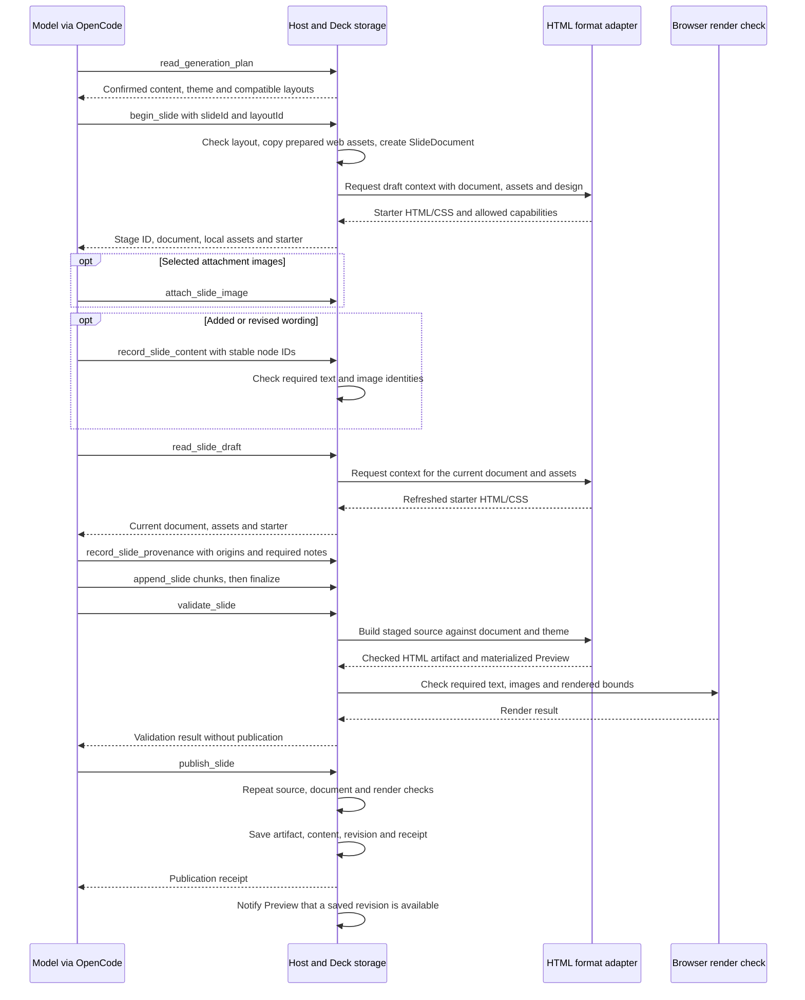

# Portable slide content and executable templates

The [portable content decision](../adr/0009-portable-slide-documents-and-format-adapters.md) separates generated content from its native artifact. The [generation reference](generation-and-publication.md) owns requests, grants, confirmation and publication. The interface layout, theme and OpenCode runtime remain the same.

## Content and format ownership

The browser-safe `@deckagent/presentation-document` package owns SlideDocument version 1, content-origin decoding, artifact descriptors, validation issues and the FormatAdapter contract. A document stores actual title, stable content nodes, layout intent, local image identities, origins and separate notes. It contains no HTML, CSS, image query or attachment path. Unknown fields, duplicate/reserved node identities and unsupported document versions fail validation. The browser and Deck domain use the same document and origin decoders.

`@deckagent/design` owns the visual snapshot and catalog. `@deckagent/html-format` owns executable skeletons, parsed HTML/CSS policy, content bindings and local image materialization. Adapters have no request grant or publication pointer. Deck storage validates scope, retains required plan content and commits the document, descriptor, native digest, revision pointer and receipt together. `nativeArtifact` reads original bytes independently of the HTML Preview API. Legacy artifacts remain readable without a fabricated document.

HTML Basic version 2 is the default for new selections. Version 1 remains available for pinned plans. Version 2 supplies the six existing layouts plus image-pair, with two images and at most two optional bullets. `begin_slide` returns a prepared document, assets, runnable source and exact capabilities. `read_slide_draft` refreshes this context after attachment copying or an explicit `record_slide_content` change. Native text must match stable `data-node-id` bindings; a missing node, changed image identity or unrecorded assertion fails. Every title, text item and caption requires an origin. Required plan text and images cannot disappear during a content change.

`validate_slide` checks finalized staging without a publication receipt or revision change. It returns stable codes, field/node locations and safe repair guidance. Publication checks the exact source and document again. Version 2 allows three validation calls, four builds per stage and four stages per planned slide/request. Exhaustion stops correction; it does not weaken checks or shrink content. A request can discard a failed stage and create a corrected one within that budget. Browser errors include the affected node and measured bounds when available.

## Per-slide template sequence

The [request-to-Preview flow](generation-and-publication.md#request-to-preview) precedes this sequence. It shows the successful path for one HTML Basic version 2 slide. The model selects a compatible layout; the Host creates the initial SlideDocument from the Outline, and the HTML adapter turns that document into a runnable starter with shared CSS.

The model keeps the starter's `data-node-id` bindings and recorded content while completing the source. The adapter supplies the wrapper and effective theme stylesheet at build time. `validate_slide` returns field or node issues; a rejected draft is corrected or discarded within the limits above before publication. Neither validation nor a model completion message marks a slide finished. Preview reads the saved revision after publication.

The generation sequence repeats for pending slides. The Host rejects `custom` layout selection while a compatible catalog layout exists. Pinned version 1 plans use the [legacy generation tool path](generation-and-publication.md#generation-tools-and-controls).

## Public-image preparation

The [reviewed-image decision](../adr/0010-reviewed-public-images.md) defines source selection and image evidence. An explicit public-image choice admits image searches independently of text research and model knowledge. The existing image selector offers Tavily with the configured research key, or Commons without a key. The Host binds that provider to the staged Brief and Outline and never changes it after failure.

Each web-image position carries an optional `intent` with `subject`, `role`, `mustInclude`, `mustAvoid` and `aspect`, plus optional `provider` and `replace`. Old blocks without an intent derive a need from their query, caption and slide text. The need identity includes the slide position, complete planned text, image role, query, provider and policy. It does not use the query as a shared asset key.

`stage_outline` returns image needs and at most five real candidates per search. The selected model calls `select_slide_image` with a need ID, candidate ID and reason, or `search_slide_images` to refine a query once. Both tools use the existing JSON-string argument contract. Selection assesses metadata only; the interface does not claim model visual verification. The Host checks the selected candidate and never falls through to a different image. Two positions on one slide cannot select the same URL or normalized bytes.

Each request has five durable image-search attempts, including failures and cancelled work. Each position permits two searches and two selection attempts. Unchanged previously reviewed needs reuse checked local bytes, allowing another review request to resolve remaining positions without repeating completed work. Image attempts are separate from the text-search budget; both Tavily operations serialize free-plan/quota checks. No paid or automatic provider fallback exists.

New selections require public domain, CC0 or CC BY evidence identifying the actual image. Commons uses file-specific API metadata. Other sites require a matching ImageObject with a recognized licence URL and an author for CC BY. For top-level Tavily images without a source-page association, the Host checks at most two returned search pages for matching image-specific evidence. Search descriptions, page-wide licences and model claims do not establish reuse permission. Unsupported or unknown evidence leaves the position unresolved; the decoder intentionally does not cover every site's licensing convention.

Public downloads accept HTTPS only, reject credentials and private/special DNS answers, pin the connection address and repeat checks at up to two redirects. Source pages are limited to 512 KiB; PNG/JPEG downloads to 8 MiB. Licence verification, download and normalization share a 20-second operation limit. Tavily search retains its 15-second/256-KiB bounds. Normalized images use the existing 256-KiB asset limit. Credentials never reach source/image hosts. Stop checks apply after asynchronous work.

The Outline details show a lazy-loaded local thumbnail, credit, selection reason and unresolved status. Thumbnails use an authenticated Host request and a revocable browser object URL. The replace action prepares an explicit revision draft, preserving existing draft text; it does not send a request. Replacement excludes earlier selected URLs and bytes. Missing essential images block confirmation, while optional omissions remain visible and appear in the closing report.

An opaque in-memory token binds prepared results to the exact Chat and staged proposal. Brief, Outline and image metadata commit together. Restoring a reviewed selection reuses its exact local bytes without searching; legacy images without selection evidence require review before a new confirmation. Generation receives fresh stage identities copied from immutable local assets. Layout retries, reload and Preview do not repeat a search. Pinned version 1 generation retains its legacy tool contract.

## Native-format proof and compatibility

`@deckagent/pptx-format` is a capability proof, not an available product generation format. It consumes the same document and local assets, producing editable text/image objects and separate presenter notes. The caller must explicitly map the CSS font stack to an installed Office font. Unsupported layouts or capacity fail instead of embedding a slide screenshot, silently replacing a font or truncating content. The proof does not establish PowerPoint rendering, arbitrary-layout fidelity or a complete multi-slide export workflow.

Deck schema 9 retains immutable prepared-image rows, migrates their key column and adds durable image-search attempts. It preserves prior manifests, bytes, confirmation receipts and visual snapshots. Host and browser consumers deploy together. Older binaries refuse schema 9; use a pre-upgrade backup for rollback. The session database remains schema 7. A second HTML template fixture exercises the adapter without changing generation orchestration. Run `pnpm.cmd test:generation-publication` after building for document validation, two-image preparation/retry, cancellation, optional omissions, native PPTX objects, legacy recovery and seven-layout publication through the real browser with a local CLI fixture. Run `pnpm.cmd test:images` for candidate selection, licence evidence, download controls and reviewed-image publication. These fixture checks do not establish real-cloud search relevance, visual agreement or manual Office rendering.
