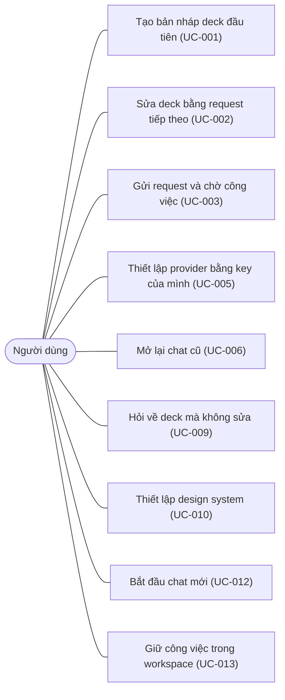

# Use Cases

Đọc file này để biết hành vi mà người dùng quan sát được từ bên ngoài DeckAgent và tìm file use case theo vùng chức năng.

## Actor

| Actor | Mục tiêu |
| --- | --- |
| Người dùng | Tạo và sửa deck từ tài liệu của mình |
| Provider | Chạy model cho DeckAgent qua tài khoản của người dùng |
| Dịch vụ bên ngoài | Public research và tạo ảnh, theo các loại dịch vụ bên ngoài (BR-016) |

## Use case map

## File

| File | Nội dung |
| --- | --- |
| [requests.md](requests.md) | Người dùng gửi request, theo dõi và dừng công việc của request, và hệ thống phản hồi |
| [deck.md](deck.md) | Người dùng tạo bản nháp deck đầu tiên, sửa deck bằng request tiếp theo và hỏi về deck mà không sửa nó |
| [providers.md](providers.md) | Người dùng thiết lập provider, key và model mà DeckAgent dùng |
| [chats.md](chats.md) | Người dùng mở lại chat cũ và bắt đầu chat mới |
| [design-systems.md](design-systems.md) | Người dùng thiết lập design system cho các deck |
| [workspaces.md](workspaces.md) | Người dùng giữ công việc với deck trong workspace gắn với thư mục của mình |

## Tiền tố ID

| Tiền tố | Nhóm | Nguồn |
| --- | --- | --- |
| `UC` | Use case | Section use case của file vùng chức năng |
| `FR` | Functional requirement | Bảng rule của file vùng chức năng |
| `BR` | Business rule. Giá trị của rule có ID dạng `BR-nnn.Vn` | Bảng rule của file vùng chức năng |
| `NFR` | Quality requirement | `quality-attributes.md` |
| `A` | Luồng thay thế và luồng ngoại lệ, đánh số riêng trong từng use case. ID dạng `UC-nnn.An` | Bảng luồng của section use case |

## Thuật ngữ

| Thuật ngữ | Nghĩa |
| --- | --- |
| Tài khoản | Danh tính của người dùng để truy cập và để giữ dữ liệu của riêng họ |
| Chat | Một mạch làm việc với hệ thống. Chat chứa một cuộc hội thoại và tối đa một deck |
| Chat hiện tại | Chat mà người dùng đang làm việc |
| Chat cũ | Một chat mà hệ thống giữ làm công việc trước đó, khác chat hiện tại, và người dùng được phép mở lại |
| Cuộc hội thoại | Vùng. Chứa các request của một chat và các phản hồi của hệ thống, theo thứ tự |
| Deck canvas | Vùng. Chứa các slide của deck của một chat |
| Giao diện | Phần của DeckAgent mà người dùng thấy và dùng. Tải lại hoặc đóng giao diện không dừng DeckAgent |
| Request | Một tin nhắn người dùng gửi, kèm tài liệu của tin nhắn, và công việc hệ thống làm cho tin nhắn đó cho tới khi công việc kết thúc |
| Request đang chạy | Request có công việc chưa kết thúc. Một chat có tối đa một request đang chạy |
| Draft | Nội dung request và các file đính kèm mà người dùng đã chuẩn bị trong một chat và chưa gửi |
| File đính kèm | File người dùng thêm vào draft. File đính kèm ở một trong ba trạng thái: đang chuẩn bị, sẵn sàng, hoặc bị từ chối kèm lý do |
| Thông báo trạng thái | Phản hồi cho biết, trong lúc một request đang chạy, hệ thống đang làm gì và đã làm bao lâu |
| Hoạt động | Một việc hệ thống đã làm hoặc đang làm cho một request, ví dụ đọc một file hoặc dựng một slide, kèm trạng thái của việc đó |
| Agent | Phần của hệ thống làm công việc của một request bằng model đã chọn, ví dụ đọc file, ghi công việc của chat và dùng dịch vụ bên ngoài |
| Phê duyệt | Câu trả lời của người dùng cho một bước của request vượt quá phạm vi agent của chat được làm mà không hỏi: cho phép một lần, hoặc từ chối |
| Model đã chọn | Model của một chat, chạy request tiếp theo của chat đó |
| Context | Những gì model đã chọn đọc cho một request. Mỗi model chỉ đọc context tới kích thước của riêng model đó |
| Tóm tắt hội thoại | Một văn bản ngắn hơn mà hệ thống viết thay cho phần hội thoại trước đó của một chat, để model đã chọn đọc. Người dùng vẫn đọc toàn bộ cuộc hội thoại |
| Provider | Một dịch vụ model chạy model cho DeckAgent qua tài khoản riêng của người dùng |
| Cấu hình provider | Một kết nối đã lưu tới một provider: provider ID, những gì provider cần (ví dụ key) và các model đã thêm |
| Provider ID | Tên cho biết cấu hình provider kết nối tới provider nào. Provider ID không bao giờ thay đổi sau khi lưu |
| Provider có sẵn | Provider mà DeckAgent biết trước, có provider ID cố định |
| Custom model API | Provider mà người dùng mô tả bằng provider ID, base URL và API protocol |
| Key | Bí mật của tài khoản riêng của người dùng mà một provider hoặc một dịch vụ bên ngoài yêu cầu |
| Danh mục model | Danh sách model mà một provider báo về. Danh mục model không tự thêm model nào |
| Model đã thêm | Model mà người dùng đã thêm vào một cấu hình provider |
| Model chọn được | Một model đã thêm của một cấu hình provider đã lưu, mà một chat được phép chọn |
| Mức suy luận | Mức độ model đã chọn suy luận cho một request, trong các mức mà model đó có |
| Tài liệu | Những gì người dùng đưa cho một deck: nội dung request, file đính kèm và các file của thư mục dự án mà một request đọc, có nêu tên hoặc không |
| Workspace | Một nhóm chat có tên. Mỗi workspace, trừ workspace mặc định, có một thư mục dự án, và hai workspace không có cùng thư mục dự án |
| Thư mục dự án | Thư mục trên máy của người dùng mà người dùng đã chọn cho một workspace. Thư mục này chứa các file của người dùng |
| Workspace đang dùng | Workspace có các chat mà hệ thống hiển thị làm chat cũ, và là workspace mà chat mới thuộc vào |
| Workspace mặc định | Workspace không có thư mục dự án, có từ lần khởi động đầu tiên. Workspace này không bao giờ bị xoá |
| Chat không thuộc nhóm | Chat có workspace đã bị xoá. Chat này không thuộc workspace nào và không có thư mục dự án |
| Phỏng vấn | Các câu hỏi hệ thống hỏi trước outline đầu tiên, về những chủ đề mà request không trả lời |
| Câu trả lời gợi ý | Câu trả lời hệ thống đưa ra để người dùng chọn thay vì tự gõ |
| Bản sửa gợi ý | Một thay đổi cho outline hiện tại mà hệ thống đưa ra để người dùng chọn thay vì tự gõ |
| Nguồn | Nơi nội dung của deck đến từ: tài liệu của người dùng, kiến thức chung của model, hoặc public research |
| Dịch vụ bên ngoài | Một dịch vụ khác provider của model đã chọn, ví dụ dịch vụ tìm kiếm hoặc dịch vụ ảnh, mà người dùng thiết lập bằng tài khoản hoặc key riêng của mình |
| Public research | Việc tìm thông tin công khai qua một dịch vụ bên ngoài |
| Brief | Những gì outline đầu tiên được soạn từ đó: các câu trả lời phỏng vấn, giả định cho mỗi câu hỏi bị bỏ qua, các nguồn, định dạng tạo deck, template và design system |
| Ghi chú người trình bày | Văn bản cho người trình bày, thuộc về một slide và không hiển thị cho khán giả |
| Outline | Kế hoạch của một deck: các slide dự kiến và nội dung dự kiến của từng slide |
| Outline hiện tại | Đề xuất outline trong phản hồi outline mới nhất của cuộc hội thoại |
| Outline đã xác nhận | Outline hiện tại sau khi người dùng xác nhận. Outline này không thay đổi |
| Deck | Các slide của một chat |
| Request tiếp theo | Một request trong chat đã có outline đã xác nhận hoặc có deck có slide |
| Định dạng tạo deck | Loại mã nguồn mà deck được dựng bằng, ví dụ HTML hoặc Markdown. Một deck có một định dạng tạo deck |
| Mã nguồn deck | Các file làm việc của deck theo định dạng tạo deck của deck. Hệ thống và người dùng thay đổi cùng các file đó |
| Design system | Một bộ quy tắc thiết kế đã lưu cho diện mạo của slide: các giá trị theme, quy tắc bằng lời để dùng các giá trị đó, và file thương hiệu như logo. Là design system có sẵn hoặc design system tự tạo. Design system không chứa layout |
| Design system có sẵn | Design system đi kèm DeckAgent. Hệ thống không bao giờ thay đổi hoặc xoá design system này |
| Design system tự tạo | Design system mà người dùng đã lưu. Người dùng được phép thay đổi và xoá design system này |
| Giá trị theme | Một giá trị có tên của design system, ví dụ màu, font hoặc khoảng cách |
| File thương hiệu | File cho biết diện mạo của một thương hiệu, ví dụ brand guide, bài thuyết trình, logo, file font hoặc gói design system của sản phẩm khác |
| Slide mẫu | Slide được làm bằng một design system đề xuất để minh hoạ design system đó. Slide mẫu không thuộc deck nào |
| Theme | Một design system viết theo thuật ngữ của một định dạng tạo deck: các giá trị theme của design system, cùng mỗi giá trị người dùng đặt thay cho một giá trị đó cho deck, ở dạng các giá trị có tên mà mã nguồn deck tham chiếu tới. Chỉ hệ thống viết theme |
| Template | Một bộ layout dựng sẵn của một định dạng tạo deck mà hệ thống dựng slide từ đó. Mỗi định dạng tạo deck có một hoặc nhiều template có sẵn, một trong số đó là template mặc định của định dạng; người dùng chọn một template trong phỏng vấn. Mỗi layout nêu các loại nội dung mà layout phục vụ và lượng nội dung layout chứa được |
| Phần được đánh dấu | Một phần của slide mà người dùng chỉ ra làm mục tiêu của một request |
| Thông báo kết thúc | Phản hồi kết thúc công việc trên slide của một request và cho biết những gì đã được làm hoặc thay đổi |
| Placeholder | Văn bản đứng thay cho một fact mà không nguồn nào cung cấp |
