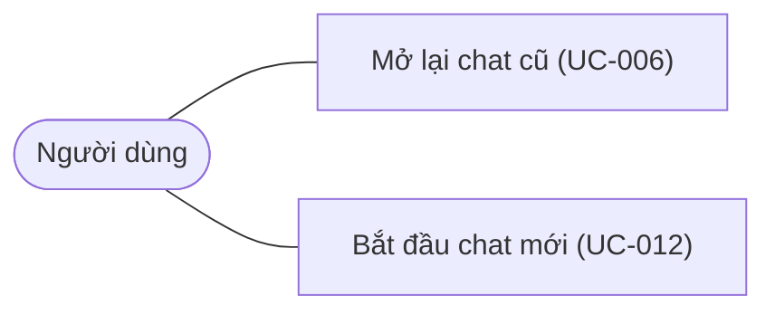
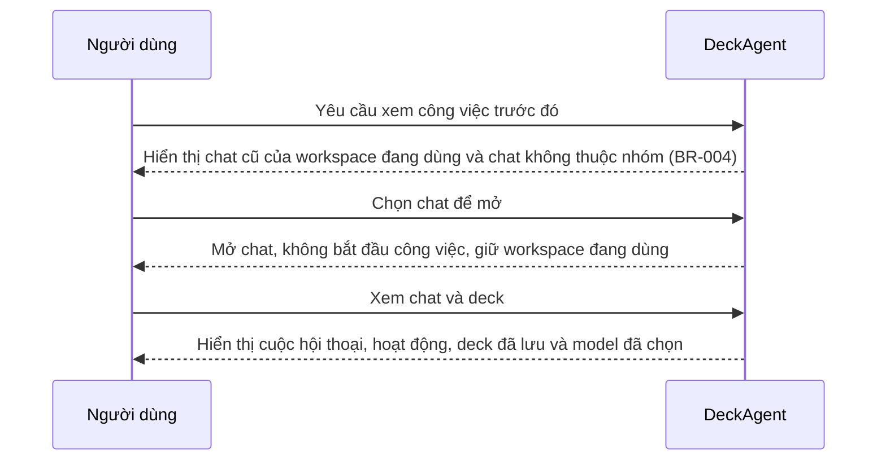
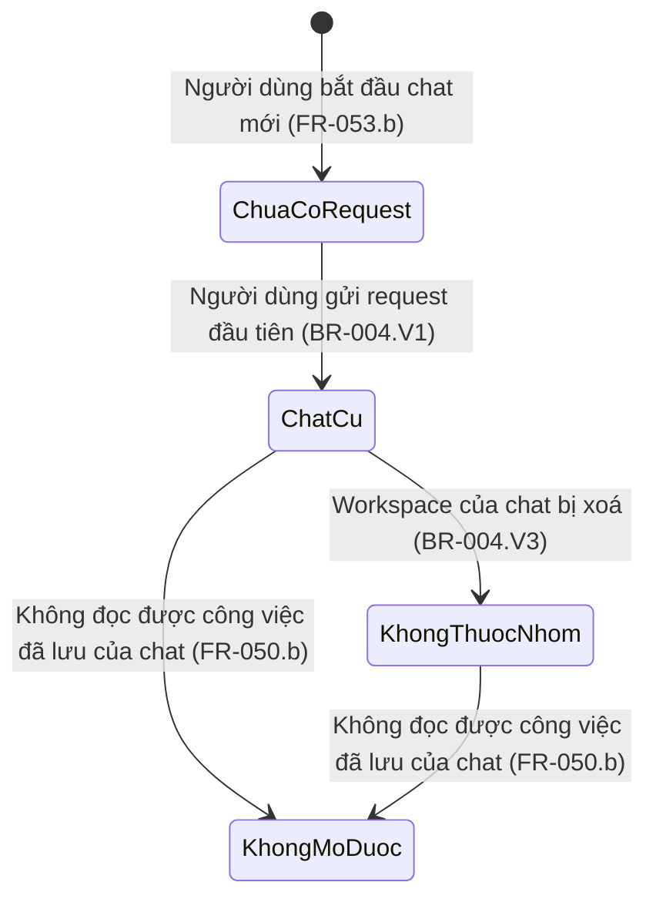
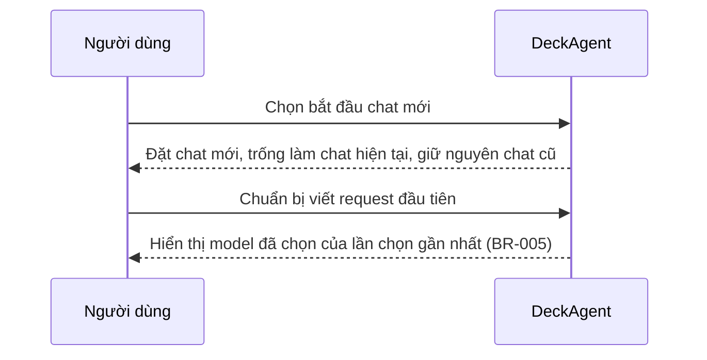

# Chat

Đọc file này để biết người dùng mở lại chat cũ và bắt đầu chat mới như thế nào.

## Tổng quan

Actor duy nhất là người dùng. File này chứa hai mục tiêu: mở lại một chat cũ để tiếp tục với deck của chat đó, và bắt đầu một chat mới cho một deck khác. Chat là đơn vị của công việc trước đó. Workspace, cách một chat trở thành chat không thuộc nhóm, và thư mục dự án không đọc được nằm trong file workspace [[1]](#ref-1). ID trong file theo [Tiền tố ID](README.md#tiền-tố-id).

Ngoài phạm vi:

- Xuất session của một chat để đọc hoặc để bàn giao (UC-016).
- Đổi tên hoặc xoá một chat (UC-018).
- Lấy deck ra làm file (UC-004).
- Tiếp tục với một deck đã xuất (UC-019).

## Mở lại chat cũ (UC-006)

Người dùng đã làm một deck trong một chat cũ, vào một ngày khác hoặc trước khi DeckAgent dừng. Họ muốn thấy lại chat đó và deck của nó, rồi sửa deck hoặc lấy deck ra làm file, mà không phải làm lại từ đầu.

**Trigger:** Người dùng yêu cầu xem công việc trước đó.

**Precondition:** DeckAgent chạy trên máy của người dùng.

**Kết quả khi thành công:** Chat đã chọn được mở, với cuộc hội thoại, các hoạt động và deck như chat đó đã giữ. Không slide nào thay đổi và không request nào được gửi.

**Kết quả khi thất bại:** Việc mở một chat không thay đổi chat nào và deck nào. Chat mà người dùng rời đi giữ draft của nó, và request đang chạy của chat đó tiếp tục chạy.

Luồng chính:

1. Người dùng yêu cầu xem công việc trước đó. Hệ thống hiển thị các chat cũ của workspace đang dùng mà người dùng được mở (BR-004), kể cả chat từ trước lần khởi động gần nhất của DeckAgent. Hệ thống hiển thị các chat không thuộc nhóm tách riêng, với mọi workspace đang dùng. Hệ thống đặt tên mỗi chat theo nội dung của chat, và cho biết lần thay đổi gần nhất của chat và chat có slide hay không. Chat hiện tại và draft của nó giữ nguyên (FR-038) [[2]](#ref-2).
2. Người dùng chọn chat để mở. Hệ thống mở chat đã chọn, không bắt đầu công việc nào và không gửi request nào. Hệ thống giữ workspace đang dùng, kể cả khi chat là chat không thuộc nhóm. Draft của chat mà người dùng rời đi ở lại với chat đó, và request đang chạy của chat đó tiếp tục chạy ở đó (FR-068) [[2]](#ref-2).
3. Người dùng xem chat và deck của chat. Hệ thống hiển thị cuộc hội thoại theo thứ tự, với các hoạt động của các request (FR-070) [[2]](#ref-2). Hệ thống hiển thị deck ở trạng thái đã lưu gần nhất (NFR-008), và hiển thị model đã chọn của chat, hoặc báo chat không có model đã chọn (FR-065) [[3]](#ref-3). Hệ thống không thay đổi slide nào và nhận request mới trong chat này.

Sau bước 3, người dùng sửa deck theo file deck [[4]](#ref-4). Việc lưu thất bại trong lúc người dùng làm việc là luồng không lưu được trạng thái của chat (UC-003.A50) [[2]](#ref-2). Việc giữ chat không giới hạn thời gian (BR-004.V2) không phải là cam kết chống mất dữ liệu mà DeckAgent không gây ra, ví dụ người dùng xoá một file hoặc ổ đĩa bị hỏng.

Vòng đời của một chat:

Một chat chưa có request đã gửi không bắt buộc hiển thị trong các chat cũ (BR-004.V1). Điều xảy ra với chat đó khi người dùng rời đi chưa được quyết: [chat chưa có request khi người dùng rời đi (OQ-012)](../open-questions.md#oq-012). Các điểm sau cũng chưa được quyết: [cách khớp từ khi tìm chat cũ (OQ-010)](../open-questions.md#oq-010), [thứ tự của các chat cũ (OQ-011)](../open-questions.md#oq-011), và [cách đặt tên chat theo nội dung (OQ-013)](../open-questions.md#oq-013).

| ID | Điều kiện | Phản hồi người dùng thấy | Nguồn | Trạng thái |
| --- | --- | --- | --- | --- |
| UC-006.A1 | Tại bước 1. Workspace đang dùng không có chat cũ nào, và không có chat không thuộc nhóm nào mà người dùng được mở (BR-004). Kết thúc | Hệ thống báo không có chat cũ nào. Chat hiện tại giữ nguyên | Product owner | Confirmed |
| UC-006.A2 | Tại bước 1. Người dùng tìm chat cũ bằng các từ mà chat chứa. Tiếp tục tại bước 1 | Hệ thống chỉ hiển thị các chat cũ có tên hoặc cuộc hội thoại chứa các từ đó, hoặc báo không chat nào khớp. Hệ thống giữ các từ | Product owner | Confirmed |
| UC-006.A3 | Tại bước 2. Hệ thống không đọc được công việc đã lưu của chat đã chọn. Quay lại bước 1 | Hệ thống báo không mở được chat, kèm lý do khi biết. Hệ thống không hiển thị chat trống thay cho chat đó và không gỡ chat nào. Chat ở lại trong các chat cũ làm chat không mở được. Chat hiện tại giữ nguyên | Product owner | Confirmed |
| UC-006.A4 | Tại bước 3. Chat đã chọn chưa có slide. Tiếp tục tại bước 3 | Hệ thống hiển thị cuộc hội thoại theo thứ tự và báo chat chưa có slide. Outline đang chờ xác nhận vẫn là outline hiện tại | Product owner | Confirmed |
| UC-006.A5 | Tại bước 3. Chat đã chọn có request đang chạy. Tiếp tục tại bước 3 | Hệ thống hiển thị chat như hiện tại, với các hoạt động và việc hệ thống đang làm, như khi người dùng quay lại một request đang chạy (UC-003.A13) [[2]](#ref-2). Chat không nhận request mới cho tới khi request đang chạy kết thúc (FR-014) [[2]](#ref-2) | Product owner | Confirmed |
| UC-006.A6 | Tại bước 3. Request cuối của chat đã chọn không xong, ví dụ DeckAgent dừng trong lúc làm. Tiếp tục tại bước 3 | Hệ thống hiển thị request là không xong, với các hoạt động và công việc đã xong (NFR-008), như luồng request không xong (UC-003.A11) [[2]](#ref-2). Hệ thống không tự chạy lại gì (FR-019) [[2]](#ref-2). Chat nhận request mới | Product owner | Confirmed |

| ID | Rule | Giá trị | Đo tại | Nguồn | Trạng thái |
| --- | --- | --- | --- | --- | --- |
| BR-004 | Rule xác định những chat nào hệ thống giữ làm chat cũ mà người dùng được mở, và hệ thống giữ chúng bao lâu | — | — | Product owner | Confirmed |
| BR-004.V1 | Hệ thống giữ làm chat cũ mọi chat mà người dùng đã gửi ít nhất một request. Chat chưa có request đã gửi không bắt buộc hiển thị | 1 request | Số request đã gửi trong chat | Product owner | Confirmed |
| BR-004.V2 | Hệ thống giữ chat cũ không giới hạn thời gian, và không xoá chat, cuộc hội thoại hay deck nào vì tuổi của nó | — | — | Product owner | Confirmed |
| BR-004.V3 | Hệ thống giữ mọi chat của một workspace đã bị xoá, làm chat không thuộc nhóm | — | — | Product owner | Confirmed |
| FR-048 | Khi người dùng yêu cầu xem công việc trước đó, hệ thống hiển thị các chat cũ của workspace đang dùng mà người dùng được mở (BR-004), kể cả chat từ trước lần khởi động gần nhất của DeckAgent | — | — | Product owner | Confirmed |
| FR-048.b | Hệ thống hiển thị các chat không thuộc nhóm tách riêng khỏi các chat cũ của workspace đang dùng, với mọi workspace đang dùng. Một chat của workspace đã bị xoá trở thành chat không thuộc nhóm (FR-073) [[1]](#ref-1) | — | — | Product owner | Confirmed |
| FR-048.c | Hệ thống đặt tên mỗi chat theo nội dung của chat, và cho biết lần thay đổi gần nhất của chat và chat có slide hay không | — | — | Product owner | Confirmed |
| FR-048.d | Khi không có chat nào để hiển thị, hệ thống báo điều đó, và chat hiện tại cùng draft của nó giữ nguyên | — | — | Product owner | Confirmed |
| FR-049 | Khi người dùng mở một chat cũ, hệ thống không bắt đầu công việc nào, không gửi request nào, không thay đổi chat nào và deck nào, và giữ workspace đang dùng, kể cả với chat không thuộc nhóm | — | — | Product owner | Confirmed |
| FR-049.b | Hệ thống hiển thị cuộc hội thoại của chat đã mở theo thứ tự, với các hoạt động của các request, deck ở trạng thái đã lưu gần nhất, và model đã chọn của chat | — | — | Product owner | Confirmed |
| FR-049.c | Khi chat đã mở chưa có slide, hệ thống báo điều đó. Một outline đang chờ xác nhận và một bản nháp đầu tiên đã kết thúc sớm giữ hành vi của rule riêng của chúng [[4]](#ref-4) | — | — | Product owner | Confirmed |
| FR-049.d | Người dùng được gửi request mới trong chat đã mở. Draft của mỗi chat ở lại với chat đó, nguyên vẹn (FR-038) [[2]](#ref-2) | — | — | Product owner | Confirmed |
| FR-050 | Khi hệ thống không đọc được công việc đã lưu của một chat đã chọn, hệ thống báo không mở được chat đó, kèm lý do khi biết, và không nêu nguyên nhân mà hệ thống không biết, ví dụ việc xoá | — | — | Product owner | Confirmed |
| FR-050.b | Hệ thống không hiển thị chat trống thay cho chat đó, không gỡ chat nào, và giữ chat đó trong các chat cũ làm chat không mở được | — | — | Product owner | Confirmed |
| FR-050.c | Mọi chat khác, và chat mà người dùng đang ở, giữ nguyên. Thư mục dự án không đọc được là một lỗi khác (FR-074) [[1]](#ref-1) | — | — | Product owner | Confirmed |
| FR-134 | Khi người dùng tìm chat cũ bằng các từ, hệ thống chỉ hiển thị các chat cũ có tên hoặc cuộc hội thoại chứa các từ đó | — | — | Product owner | Confirmed |
| FR-134.b | Khi không chat nào khớp, hệ thống báo điều đó và giữ các từ người dùng đã nhập | — | — | Product owner | Confirmed |
| FR-134.c | Việc tìm chat không thay đổi chat nào | — | — | Product owner | Confirmed |

## Bắt đầu chat mới (UC-012)

Người dùng đã làm một deck, hoặc để deck đó chưa xong, và giờ muốn làm một deck khác. Họ muốn công việc mới không mang theo cuộc hội thoại, tài liệu và deck trước đó, và muốn bắt đầu ngay với model đang dùng mà không phải thiết lập lại.

**Trigger:** Người dùng chọn bắt đầu chat mới.

**Precondition:** DeckAgent chạy trên máy của người dùng.

**Kết quả khi thành công:** Một chat mới, trống, thuộc workspace đang dùng là chat hiện tại, với một model đã chọn hoặc với thông báo là chat không có model đã chọn. Mọi chat khác giữ nguyên.

**Kết quả khi thất bại:** Mọi chat khác, deck và draft của chúng giữ nguyên, và không request nào dừng.

Luồng chính:

1. Người dùng chọn bắt đầu chat mới. Hệ thống giữ nguyên chat mà người dùng rời đi, deck và draft của chat đó, và request đang chạy của chat đó tiếp tục chạy ở đó (FR-068) [[2]](#ref-2). Hệ thống đặt một chat mới làm chat hiện tại, trong workspace đang dùng, không có cuộc hội thoại, không có deck và draft trống. Chat mới không lấy gì từ chat khác.
2. Người dùng chuẩn bị viết request đầu tiên. Hệ thống hiển thị model đã chọn của chat mới: model và mức suy luận của lần chọn model gần nhất, khi model đó vẫn là model chọn được (BR-005) [[3]](#ref-3). Hệ thống không gửi gì, không dựng deck nào, và nhận request đầu tiên.

Một chat chứa tối đa một deck, nên một deck khác bắt đầu trong một chat mới. Việc soạn deck đầu tiên trong chat mới nằm trong file deck [[4]](#ref-4). Gửi request trong chat không có model đã chọn là luồng chat không có model chọn được (UC-003.A17) [[2]](#ref-2). Việc chọn model khác cho chat nằm trong file provider [[3]](#ref-3). Một file nguồn đã xuất mà người dùng đính kèm trong chat mới là tài liệu như mọi file đính kèm khác. Hệ thống không nhập file đó làm deck để sửa. Hệ thống không xét lại các lần chọn model trước lần gần nhất. Một model đã bị gỡ rồi được thêm lại được tính khi model đó là model chọn được.

| ID | Điều kiện | Phản hồi người dùng thấy | Nguồn | Trạng thái |
| --- | --- | --- | --- | --- |
| UC-012.A1 | Tại bước 2. Người dùng chưa từng chọn model nào, hoặc model của lần chọn gần nhất không còn là model chọn được (BR-005) [[3]](#ref-3). Tiếp tục tại bước 2 | Hệ thống để chat mới không có model đã chọn và báo điều đó. Hệ thống không tự chọn model khác | Product owner | Confirmed |

| ID | Rule | Giá trị | Đo tại | Nguồn | Trạng thái |
| --- | --- | --- | --- | --- | --- |
| FR-053 | Việc bắt đầu chat mới giữ nguyên mọi chat khác, deck và draft của chúng, và không dừng request nào | — | — | Product owner | Confirmed |
| FR-053.b | Chat mới trở thành chat hiện tại trong workspace đang dùng, không có cuộc hội thoại, không có deck, có draft trống, và không lấy gì từ chat khác | — | — | Product owner | Confirmed |
| FR-053.c | Chat mới nhận model đã chọn và mức suy luận của lần chọn model gần nhất trong mọi chat, khi model đó vẫn là model chọn được (BR-005) [[3]](#ref-3). Trong trường hợp khác, chat mới không có model đã chọn | — | — | Product owner | Confirmed |
## Gap analysis

Baseline độc lập gồm bộ use case mà một subagent viết cho vùng này mà không đọc spec [[5]](#ref-5) và Microsoft HAX Guidelines for Human-AI Interaction [[6]](#ref-6). Mức áp dụng: mọi use case và mọi luồng ngoại lệ của bộ use case; 18 guideline G1–G18 của HAX. Mục nào file này đáp ứng đủ thì không có dòng trong bảng.

| ID | Gap | Baseline | Quyết định | Trạng thái |
| --- | --- | --- | --- | --- |
| GAP-01 | Chọn bắt đầu chat mới nhiều lần có thể tạo nhiều chat trống | [BL-CHAT-1 1b](../build/refactor/UCs/baseline/chats.md) | [Chat chưa có request (OQ-012)](../open-questions.md#oq-012) | Open |
| GAP-02 | Không có cách chạy lại một request lỗi hoặc đã dừng | [BL-CHAT-5](../build/refactor/UCs/baseline/chats.md) | [Chạy lại request (OQ-064)](../open-questions.md#oq-064) | Open |
| GAP-03 | Hai giao diện chọn hai model khác nhau cho một chat | [BL-CHAT-6 4a](../build/refactor/UCs/baseline/chats.md) | [Hai giao diện cùng thay đổi một đối tượng (OQ-061)](../open-questions.md#oq-061) | Open |
| GAP-04 | Người dùng không đổi tên và không xoá được chat | [BL-CHAT-8, BL-CHAT-9](../build/refactor/UCs/baseline/chats.md) | Rủi ro được chấp nhận: việc đổi tên và xoá chat là mục ngoài phạm vi trong Tổng quan, và chưa file nào mô tả mục này (UC-018) | Accepted |
| GAP-05 | Hệ thống không học sở thích của người dùng qua các chat | HAX G13 [[6]](#ref-6) | Rủi ro được chấp nhận: chat mới không lấy gì từ chat khác ngoài model đã chọn và mức suy luận (FR-053.b, FR-053.c), nên hành vi của một chat không đổi theo chat khác | Accepted |

## References

1. [Workspace](workspaces.md)
2. [Gửi request](requests.md)
3. [Provider và model](providers.md)
4. [Deck](deck.md)
5. [Baseline chats](../build/refactor/UCs/baseline/chats.md)
6. S. Amershi và cộng sự, *Guidelines for Human-AI Interaction*, CHI 2019, Microsoft HAX Toolkit. <https://www.microsoft.com/en-us/haxtoolkit/library/>
