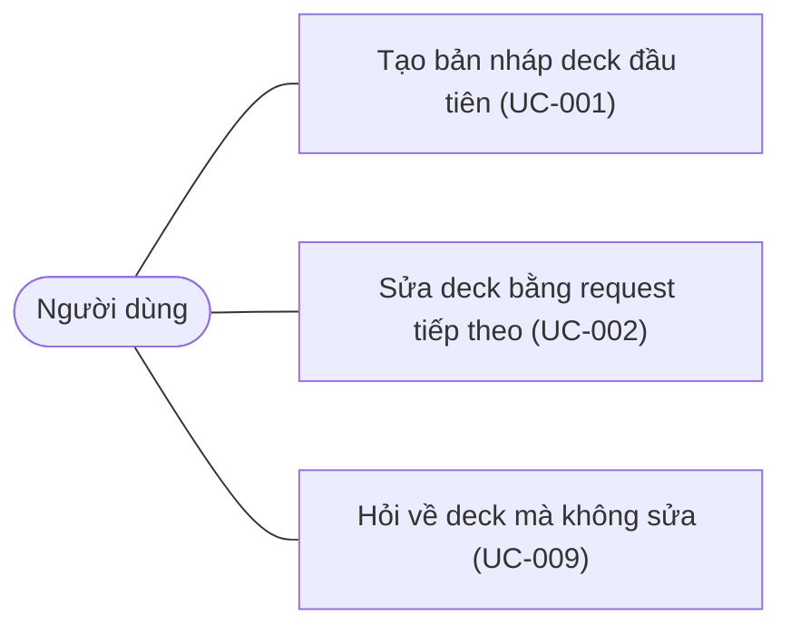
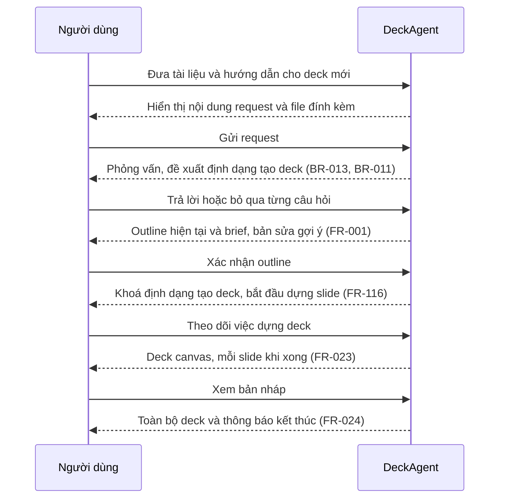
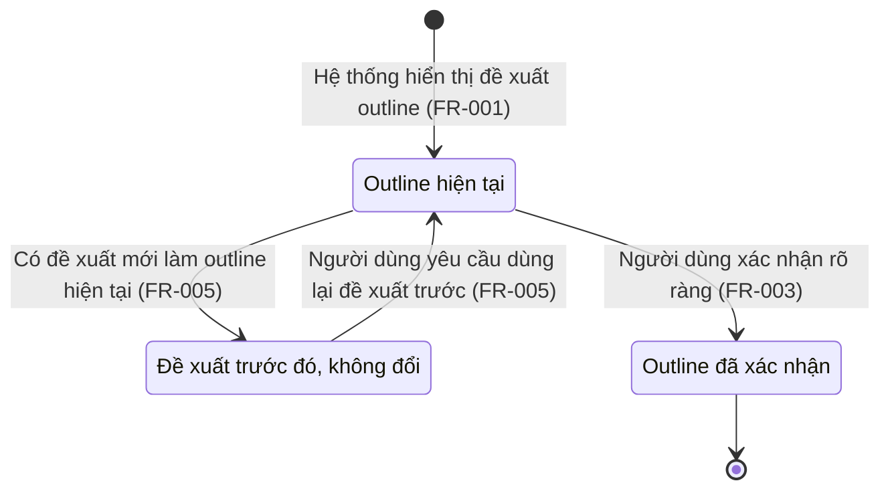
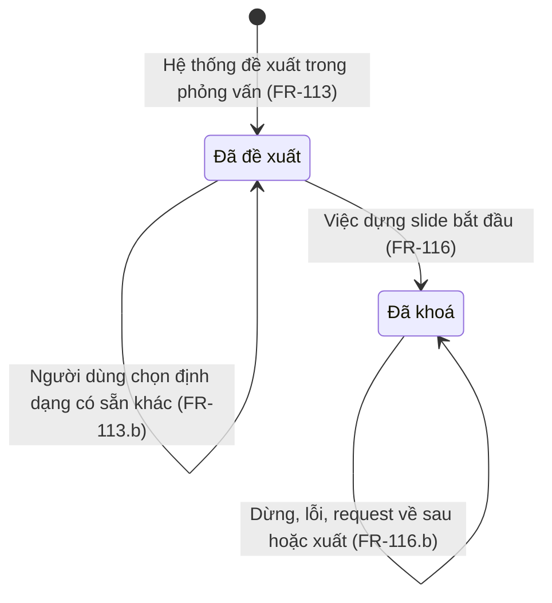
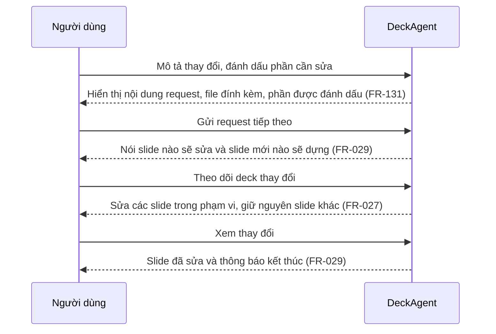
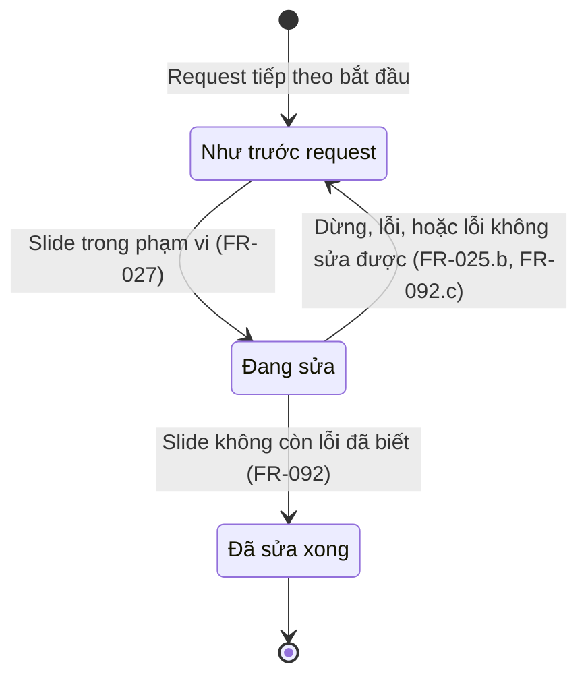
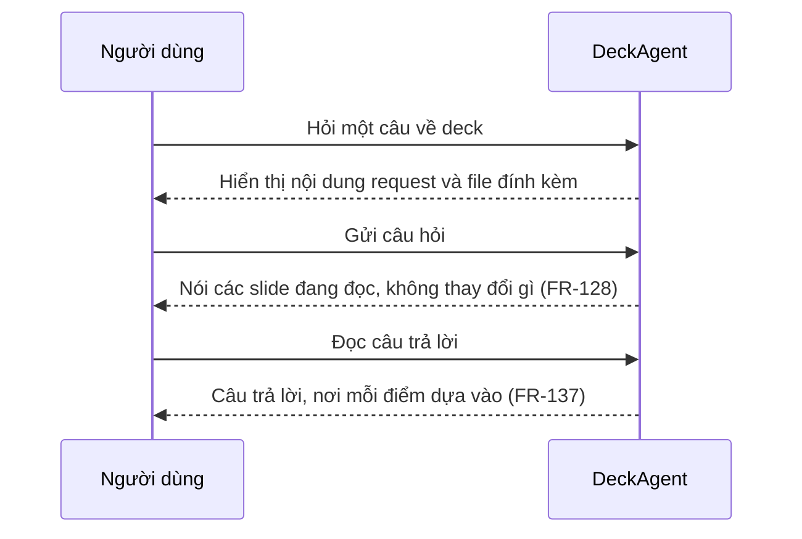

# Deck

Đọc file này để biết người dùng tạo bản nháp deck đầu tiên, sửa deck bằng request tiếp theo và hỏi về deck mà không sửa nó như thế nào.

## Tổng quan

Actor duy nhất là người dùng. File này chứa những gì riêng cho công việc với deck: phỏng vấn, outline, dựng slide, sửa slide và trả lời câu hỏi về deck. Việc gửi request, chờ công việc, dừng công việc và công việc không xong là chung cho mọi request và nằm trong file gửi request [[1]](#ref-1). ID trong file theo [Tiền tố ID](README.md#tiền-tố-id).

Ngoài phạm vi:

- Xuất deck ra file (UC-004).
- Tự sửa deck bằng tay mà không hỏi model (UC-007).
- Quay lại một trạng thái trước đó của deck (UC-008).
- Tiếp tục sửa một deck đã xuất (UC-019).
- Xuất một file tới nơi người dùng chọn (FR-085).
- Thiết lập design system. Việc này nằm trong file design system [[2]](#ref-2).

## Quy tắc dùng chung

Các rule sau áp dụng cho bản nháp đầu tiên (UC-001), request tiếp theo (UC-002) và câu hỏi về deck (UC-009).

| ID | Rule | Giá trị | Đo tại | Nguồn | Trạng thái |
| --- | --- | --- | --- | --- | --- |
| BR-014 | Rule này nêu các giấy phép sử dụng cho phép một ảnh tìm được bằng public research nằm trên slide | — | — | Product owner | Confirmed |
| BR-014.V1 | Giấy phép được nhận là danh sách đóng gồm các giấy phép cho phép mọi cách dùng và mọi thay đổi, và chỉ yêu cầu tối đa việc ghi công tác giả: public domain, CC0, CC BY | — | — | Product owner | Confirmed |
| BR-014.V2 | Mọi giấy phép khác không được nhận, kể cả CC BY-SA, CC BY-NC và CC BY-ND | — | — | Product owner | Confirmed |
| BR-015 | Rule này nêu các loại nội dung mà hệ thống chỉ viết từ tài liệu của người dùng hoặc từ public research, không bao giờ chỉ từ kiến thức chung của model | — | — | Product owner | Confirmed |
| BR-015.V1 | Các loại nội dung cần nguồn là danh sách đóng: số liệu và thống kê; ngày tháng; tên người và tên tổ chức; trích dẫn; kết quả và nhận định về công việc hoặc dự án của chính người dùng | — | — | Product owner | Confirmed |
| FR-025 | Khi công việc trên slide bị dừng hoặc lỗi, hệ thống giữ mỗi slide đã làm xong và không hiển thị slide chưa xong | — | — | Product owner | Confirmed |
| FR-025.b | Một slide mà hệ thống chưa sửa xong giữ trạng thái đã xong gần nhất của slide đó | — | — | Product owner | Confirmed |
| FR-025.c | Hệ thống nói số slide đã làm xong hoặc đã sửa, hoặc nói là không biết số đó, và nói một lần là các slide đã xong chưa được làm cho khớp với nhau | — | — | Product owner | Confirmed |
| FR-066 | Khi một slide cần ảnh, hệ thống dùng ảnh đính kèm, tạo ảnh mới, hoặc dùng ảnh tìm được bằng public research, theo câu trả lời phỏng vấn hoặc theo request (NFR-009) | — | — | Product owner | Confirmed |
| FR-066.b | Hệ thống không bao giờ đổi model đã chọn để tạo ảnh (NFR-007) | — | — | Product owner | Confirmed |
| FR-066.c | Hệ thống bỏ một ảnh mà hệ thống đã chọn thêm nhưng không lấy được, và thông báo kết thúc nói điều đó | — | — | Product owner | Confirmed |
| FR-088 | Khi người dùng đã chọn public research làm nguồn, hệ thống tìm kiếm qua dịch vụ bên ngoài cho việc tìm kiếm mà người dùng đã thiết lập (NFR-007) | — | — | Product owner | Confirmed |
| FR-088.b | Hệ thống theo giới hạn về nguồn của người dùng và nêu tên các nguồn bên ngoài đã dùng | — | — | Product owner | Confirmed |
| FR-088.c | Hệ thống không bao giờ nói một nguồn đã được kiểm tra khi nguồn đó chưa được kiểm tra | — | — | Product owner | Confirmed |
| FR-091 | Hệ thống sắp xếp mỗi slide mà hệ thống dựng hoặc sửa quanh thông điệp chính của slide. Nội dung chính của slide đọc được với khán giả và cách dùng của deck (NFR-009) | — | — | Product owner | Confirmed |
| FR-092 | Hệ thống không hoàn tất một slide mà hệ thống dựng hoặc sửa khi slide có lỗi đã biết: thiếu nội dung bắt buộc, sai fact, nội dung không đọc được (NFR-009), hoặc có màu hay font do hệ thống tự chọn mà không lấy từ theme của deck | — | — | Product owner | Confirmed |
| FR-092.b | Màu hoặc font mà người dùng chọn không bao giờ là lỗi của rule này | — | — | Product owner | Confirmed |
| FR-092.c | Hệ thống sửa lỗi trong request đang chạy. Khi không sửa được lỗi, hệ thống kết thúc request ở trạng thái không xong | — | — | Product owner | Confirmed |
| FR-093 | Người dùng được chọn một design system có sẵn hoặc một design system tự tạo cho một deck, và một deck dùng một design system. Slide dùng theme của design system đó, và việc chọn không thay đổi rule nào của design system | — | — | Product owner | Confirmed |
| FR-093.b | Khi người dùng không chọn design system nào, slide dùng design system mặc định (BR-003) | — | — | Product owner | Confirmed |
| FR-093.c | Chọn design system khác cho deck đã có slide thay đổi theme của cả deck, giữ nội dung, giữ thay đổi thiết kế của từng slide, và giữ mỗi màu hoặc font người dùng đã chọn cho một phần của slide | — | — | Product owner | Confirmed |
| FR-093.d | Khi chọn design system khác, giá trị theme của design system mới thay cho các giá trị người dùng đã đặt vào theme, hệ thống nêu tên từng giá trị bị thay, và kiểm tra lại từng slide | — | — | Product owner | Confirmed |
| FR-116 | Định dạng tạo deck của một deck bị khoá khi việc dựng slide bắt đầu, kể cả khi chưa có slide nào xong | — | — | Product owner | Confirmed |
| FR-116.b | Định dạng tạo deck giữ nguyên sau khi dừng, sau lỗi, sau request về sau hoặc sau khi xuất, và hệ thống không tự chuyển đổi gì | — | — | Product owner | Confirmed |
| FR-116.c | Hệ thống hiển thị định dạng tạo deck mà deck đang dùng | — | — | Product owner | Confirmed |
| FR-125 | Hệ thống không dùng ảnh tìm được bằng public research có giấy phép đã biết và không được nhận (BR-014) | — | — | Product owner | Confirmed |
| FR-125.b | Hệ thống đánh dấu ảnh có giấy phép chưa biết | — | — | Product owner | Confirmed |
| FR-125.c | Thông báo kết thúc nêu nguồn, tác giả và giấy phép của mỗi ảnh tìm được bằng public research | — | — | Product owner | Confirmed |
| FR-128 | Khi một tin nhắn hỏi một câu và không yêu cầu thay đổi, hệ thống trả lời và không thay đổi outline, brief hay slide nào | — | — | Product owner | Confirmed |
| FR-128.b | Khi một tin nhắn hỏi một câu và cũng yêu cầu thay đổi, hệ thống làm thay đổi đó và trả lời câu hỏi trong thông báo kết thúc, hoặc cùng outline đã sửa khi chưa có slide | — | — | Product owner | Confirmed |
| FR-128.c | Khi một tin nhắn đọc được vừa là câu hỏi vừa là yêu cầu thay đổi, hệ thống hỏi người dùng muốn nói ý nào và không thay đổi gì | — | — | Product owner | Confirmed |
| FR-129 | Trong phỏng vấn, hệ thống chỉ gợi ý public research, ảnh mới và ảnh tìm được bằng public research khi dịch vụ bên ngoài cho từng việc đó đã được thiết lập | — | — | Product owner | Confirmed |
| FR-129.b | Khi người dùng yêu cầu một việc mà dịch vụ bên ngoài của việc đó chưa được thiết lập, hệ thống nói dịch vụ bên ngoài nào còn thiếu và đề nghị tiếp tục mà không có dịch vụ đó. Hệ thống không tự thay đổi câu trả lời nào của người dùng | — | — | Product owner | Confirmed |
| FR-130 | Khi request hoặc một câu trả lời phỏng vấn yêu cầu ghi chú người trình bày, hệ thống viết ghi chú của mỗi slide cùng với slide đó | — | — | Product owner | Confirmed |
| FR-130.b | Khi một request tiếp theo yêu cầu thêm hoặc sửa ghi chú người trình bày của các slide được nêu tên, hệ thống chỉ viết ghi chú của các slide đó | — | — | Product owner | Confirmed |
| FR-130.c | Ghi chú người trình bày viết bằng ngôn ngữ của deck, chứa những gì người trình bày nói chứ không chép lại chữ trên slide, và việc viết ghi chú không thay đổi gì khán giả thấy | — | — | Product owner | Confirmed |
| FR-130.d | Thông báo kết thúc nêu các slide có ghi chú mới, hoặc nói định dạng tạo deck của deck không chứa ghi chú | — | — | Product owner | Confirmed |
| FR-138 | Khi viết trên slide một nội dung thuộc loại cần nguồn (BR-015), hệ thống giữ nguồn của nội dung đó: file và vị trí trong tài liệu của người dùng, kết quả public research, hoặc kiến thức chung của model | — | — | Product owner | Confirmed |
| FR-138.b | Khi được hỏi nội dung của deck đến từ đâu, hệ thống nêu nguồn đã giữ, hoặc nói là không biết nguồn khi không có nguồn nào được giữ | — | — | Product owner | Confirmed |
| FR-138.c | Hệ thống không bao giờ đưa một nguồn đã nêu ra làm bằng chứng là nội dung đúng | — | — | Product owner | Confirmed |

Lời văn, câu chuyển ý và ví dụ được ghi rõ là ví dụ không cần nguồn (BR-015). Chưa rõ hệ thống có đặt ảnh có giấy phép chưa biết lên slide hay không: [ảnh có giấy phép chưa biết (OQ-051)](../open-questions.md#oq-051).

## Tạo bản nháp deck đầu tiên (UC-001)

Người dùng có tài liệu cho một bài thuyết trình, ví dụ ý tưởng thô, ghi chép hoặc một văn bản, và deck còn trống. Họ muốn hệ thống làm bản nháp slide đầu tiên thay cho họ, không muốn tự dựng từng slide. Họ muốn hệ thống hiểu bài nói dành cho ai và kéo dài bao lâu trước khi lập kế hoạch.

**Trigger:** Người dùng gửi một request trong một chat chưa có deck.

**Precondition:** Chat không có outline và không có slide.

**Kết quả khi thành công:** Chat có outline đã xác nhận. Deck có các slide làm từ outline đó, theo định dạng tạo deck của deck, và định dạng này đã bị khoá. Slide dùng template đã chọn, hoặc template mặc định của định dạng tạo deck (BR-018), và dùng design system đã chọn, hoặc design system mặc định (BR-003). Deck canvas hiển thị các slide, và cuộc hội thoại hiển thị thông báo kết thúc.

**Kết quả khi thất bại:** Nội dung request và tài liệu ở lại trong cuộc hội thoại. Mỗi đề xuất outline đã hiển thị ở lại trong cuộc hội thoại. Outline đã xác nhận vẫn là outline đã xác nhận. Mỗi slide đã xong ở lại trong deck. Định dạng tạo deck đã bị khoá vẫn là định dạng của deck.

Luồng chính:

1. Người dùng đưa tài liệu và hướng dẫn cho một deck mới. Hệ thống hiển thị nội dung request và từng file đính kèm trước khi gửi.
2. Người dùng gửi request. Trong một tin nhắn, hệ thống hỏi về mỗi chủ đề phỏng vấn mà request và tài liệu không trả lời (BR-013). Hệ thống đưa câu trả lời gợi ý và một cách bỏ qua mọi câu hỏi còn lại. Hệ thống đề xuất một định dạng tạo deck có sẵn và nói lý do (BR-011). Hệ thống cho người dùng thêm các yêu cầu khác.
3. Người dùng trả lời hoặc bỏ qua từng câu hỏi. Hệ thống hiển thị đề xuất outline trong cuộc hội thoại làm outline hiện tại: tổng quan và nội dung dự kiến của mỗi slide dự kiến. Hệ thống hiển thị kèm brief: các câu trả lời, mỗi giả định, số slide dự kiến, các nguồn, định dạng tạo deck, template (BR-018) và design system (BR-003). Hệ thống đưa bản sửa gợi ý, và nói là không slide nào được dựng trước khi người dùng xác nhận.
4. Người dùng xác nhận outline. Hệ thống xác nhận outline hiện tại và brief, khoá định dạng tạo deck của deck, và bắt đầu dựng slide.
5. Người dùng theo dõi việc dựng deck. Hệ thống hiển thị deck canvas và cho biết công việc đang chạy. Hệ thống hiển thị mỗi slide khi slide đó xong (NFR-002, NFR-004).
6. Người dùng xem bản nháp. Hệ thống hiển thị toàn bộ bản nháp deck và thông báo kết thúc: mỗi slide chứa gì, các giả định, các placeholder và nội dung không đến từ tài liệu của người dùng.

Vòng đời của một đề xuất outline:

Khi dùng lại một đề xuất trước, hệ thống hiển thị nó thành một phản hồi mới, còn phản hồi cũ không đổi (FR-005).

Vòng đời của định dạng tạo deck của một deck:

Số slide theo thời lượng của bài nói, do model đánh giá chứ không theo giá trị của rule. Outline nêu số đó làm giả định, và số slide người dùng yêu cầu được giữ đúng. Chỉ có một lần xác nhận outline, với brief hiển thị bên cạnh, trước slide đầu tiên. Không có việc huỷ outline: outline chưa xác nhận giữ nguyên, và tin nhắn tiếp theo về outline là một bản sửa (UC-001.A23). Không có phong cách hình ảnh và không có lựa chọn thiết kế trước khi có slide: người dùng chọn template trong phỏng vấn (BR-018). Deck đính kèm là tài liệu. Để làm deck mới theo cấu trúc của một deck trước, người dùng đính kèm file của deck trước và nói điều đó trong request. Request sau khi việc dựng slide kết thúc sớm là request tiếp theo (UC-002.A17). Chưa rõ việc đổi định dạng tạo deck sau khi outline đã hiển thị làm gì với outline: [đổi định dạng tạo deck sau khi có outline (OQ-052)](../open-questions.md#oq-052). Chưa rõ tester kiểm tra một xác nhận hoặc một chỉ dẫn "rõ ràng" bằng cách nào: [xác nhận và chỉ dẫn rõ ràng (OQ-053)](../open-questions.md#oq-053).

| ID | Điều kiện | Phản hồi người dùng thấy | Nguồn | Trạng thái |
| --- | --- | --- | --- | --- |
| UC-001.A9 | Tại bước 3. Một file đã được nhận trong tài liệu không chứa gì dùng được. Tiếp tục tại bước 3 | Hệ thống không dùng gì từ file đó, và nêu tên file cùng lý do kèm outline | Product owner | Confirmed |
| UC-001.A10 | Tại bước 5. Người dùng dừng công việc, hoặc công việc lỗi, trước khi mọi slide xong. Kết thúc | Hệ thống giữ outline đã xác nhận và mỗi slide đã xong, nói số slide đã xong, và giữ định dạng tạo deck đã khoá | Product owner | Confirmed |
| UC-001.A23 | Tại bước 4. Người dùng yêu cầu thay đổi outline hiện tại hoặc brief, chọn một bản sửa gợi ý, yêu cầu dùng lại một đề xuất trước, hoặc gửi một tin nhắn về outline có các nghĩa khác nhau nhiều. Quay lại bước 3 | Hệ thống hỏi trước một câu hỏi tập trung khi nghĩa chưa rõ. Hệ thống hiển thị kết quả làm outline hiện tại mới cùng brief, nêu những gì đã thay đổi, và giữ nguyên mỗi đề xuất trước | Product owner | Confirmed |
| UC-001.A32 | Tại bước 3. Người dùng bỏ qua câu hỏi về chủ đề, và request cùng tài liệu không cho biết chủ đề. Ở lại bước 3 | Hệ thống không soạn outline, nói là cần chủ đề, và hỏi lại chủ đề | Product owner | Confirmed |
| UC-001.A33 | Tại bước 3. Hai phần của tài liệu không khớp nhau về một điểm mà outline cần. Tiếp tục tại bước 3 | Hệ thống nêu cả hai phần và vị trí của từng phần. Hệ thống đề nghị người dùng chọn khi điểm đó làm kế hoạch thay đổi nhiều. Nếu không, hệ thống đánh dấu điểm đó là còn mở trong outline | Product owner | Confirmed |
| UC-001.A34 | Tại bước 3. Outline cần nội dung thuộc loại cần nguồn (BR-015), và không nguồn nào cho nội dung đó. Tiếp tục tại bước 3 | Hệ thống viết placeholder thay thế, và nêu tên từng mục còn thiếu kèm outline | Product owner | Confirmed |
| UC-001.A37 | Tại bước 5. Request hoặc một câu trả lời phỏng vấn yêu cầu ghi chú người trình bày. Tiếp tục tại bước 5 | Hệ thống dựng ghi chú của mỗi slide cùng slide đó, và nêu các slide có ghi chú trong thông báo kết thúc | Product owner | Confirmed |
| UC-001.A42 | Tại bước 5. Một slide cần ảnh, theo câu trả lời phỏng vấn, request hoặc nội dung của slide. Tiếp tục tại bước 5 | Hệ thống dùng ảnh đính kèm, ảnh mới, hoặc ảnh tìm được bằng public research (BR-014). Thông báo kết thúc nêu nguồn, tác giả và giấy phép của mỗi ảnh tìm được bằng public research | Product owner | Confirmed |
| UC-001.A51 | Tại bước 3. Định dạng tạo deck mà người dùng nêu tên hoặc đã chọn không có sẵn, hoặc request nêu hai định dạng cho một deck. Quay lại bước 2 | Hệ thống nói nhu cầu nào hệ thống không đáp ứng được, hiển thị các định dạng tạo deck có sẵn, và không tự đặt định dạng khác vào chỗ đó | Product owner | Confirmed |
| UC-001.A52 | Tại bước 3. Người dùng đã chọn public research làm nguồn, và public research không cho thông tin mà outline cần. Tiếp tục tại bước 3 | Hệ thống nói thông tin nào hệ thống không lấy được. Hệ thống hỏi người dùng khi phần thiếu làm outline thay đổi nhiều. Nếu không, hệ thống tiếp tục với các nguồn khác | Product owner | Confirmed |
| UC-001.A53 | Tại bước 2. Request không có tài liệu và không nêu nguồn nào (BR-013). Tiếp tục tại bước 3 | Hệ thống hỏi dùng nguồn nào. Hệ thống chỉ dùng kiến thức chung của model sau khi người dùng xác nhận điều đó | Product owner | Confirmed |
| UC-001.A54 | Tại bước 4. Người dùng hỏi một câu về outline hiện tại và không yêu cầu thay đổi. Ở lại bước 4 | Hệ thống trả lời câu hỏi và không thay đổi outline hay brief. Hệ thống hỏi người dùng muốn nói ý nào khi tin nhắn đọc được theo cả hai nghĩa | Product owner | Confirmed |

Các định dạng tạo deck được chia theo nhóm (BR-011.V1). Nhóm không phải định dạng mà người dùng chọn, và các ví dụ của nhóm cho biết nghĩa của nhóm, không phải danh sách định dạng hệ thống dựng được. Định dạng nào có sẵn được quyết theo từng hoàn cảnh (FR-117). Nhóm native nghĩa là kết quả sửa được trong công cụ được nêu tên: một file PPTX gồm một ảnh cho mỗi slide không phải nhóm PowerPoint-native. Ràng buộc cứng, ví dụ nội dung bắt buộc phải có hoặc giới hạn số chữ, không phải chủ đề phỏng vấn; người dùng thêm chúng làm yêu cầu khác bằng lời của mình (BR-013). Mọi template đều có sẵn, và người dùng không lưu template của riêng mình (BR-018). Template HTML Basic có các layout cover, section, title-body, two-column, key-figures, image-text và image-pair. Mỗi layout nêu các loại nội dung mà layout phục vụ và lượng nội dung layout chứa được. Layout image-pair chứa hai ảnh và tối đa hai bullet không bắt buộc. Một layout mới chỉ được dùng khi không layout nào của template hợp với nội dung dự kiến, và layout mới được kiểm tra như mọi slide (FR-092).

| ID | Rule | Giá trị | Đo tại | Nguồn | Trạng thái |
| --- | --- | --- | --- | --- | --- |
| BR-003 | Rule này nêu design system mà một deck dùng khi người dùng không chọn design system nào | — | — | Product owner | Confirmed |
| BR-003.V1 | Design system mặc định là DeckAgent Neutral, một design system có sẵn. Người dùng không đặt design system khác làm mặc định | — | — | Product owner | Confirmed |
| BR-011 | Rule này nêu các nhóm định dạng tạo deck mà sản phẩm bao gồm, và định dạng tạo deck được đề xuất khi không có gì yêu cầu định dạng khác | — | — | Product owner | Confirmed |
| BR-011.V1 | Các nhóm định dạng tạo deck là danh sách đóng gồm bảy nhóm: Web-based (ví dụ HTML, Reveal.js); Markdown-based (ví dụ Marp, Slidev, Quarto); PowerPoint-native (ví dụ PPTX); Google Slides-native (ví dụ Google Slides); LaTeX-based (ví dụ Beamer); Vector hoặc scene-based (ví dụ một scene SVG hoặc tương thích Excalidraw); Design-tool-native (ví dụ Figma Slides, Penpot) | 7 nhóm | Danh sách nhóm định dạng tạo deck | Product owner | Confirmed |
| BR-011.V2 | Định dạng tạo deck mặc định là HTML | — | — | Product owner | Confirmed |
| BR-013 | Rule này nêu các chủ đề phỏng vấn trước outline đầu tiên, và các loại nguồn mà một deck lấy nội dung | — | — | Product owner | Confirmed |
| BR-013.V1 | Các chủ đề phỏng vấn là danh sách đóng: chủ đề, khán giả, thời lượng, mục đích, nguồn, ngôn ngữ, ảnh, định dạng tạo deck, template, design system | — | — | Product owner | Confirmed |
| BR-013.V2 | Các loại nguồn là danh sách đóng: tài liệu của người dùng, kiến thức chung của model, public research | — | — | Product owner | Confirmed |
| BR-018 | Rule này nêu các template có sẵn của mỗi định dạng tạo deck có sẵn, và template mà một deck dùng khi người dùng không chọn template nào | — | — | Product owner | Confirmed |
| BR-018.V1 | Định dạng HTML có template HTML Basic. Các giá trị của rule này không thêm định dạng tạo deck có sẵn nào khác | — | — | Product owner | Confirmed |
| BR-018.V2 | Định dạng HTML dùng template HTML Basic làm mặc định | — | — | Product owner | Confirmed |
| FR-001 | Với request đầu tiên của một chat, hệ thống hiển thị một đề xuất outline làm outline hiện tại trước khi dựng slide nào | — | — | Product owner | Confirmed |
| FR-001.b | Cho tới khi người dùng xác nhận outline, hệ thống không dựng slide nào, không hiển thị deck canvas, và nói điều đó | — | — | Product owner | Confirmed |
| FR-003 | Hệ thống đề nghị xác nhận một outline hiện tại không rỗng. Một xác nhận rõ ràng chỉ xác nhận outline hiện tại và brief hiển thị cùng outline đó, và bắt đầu việc dựng slide | — | — | Product owner | Confirmed |
| FR-003.b | Một tin nhắn cũng yêu cầu thay đổi không bao giờ được coi là xác nhận | — | — | Product owner | Confirmed |
| FR-003.c | Với outline rỗng, hệ thống không xác nhận gì và gợi ý yêu cầu một bản sửa | — | — | Product owner | Confirmed |
| FR-005 | Hệ thống sửa outline hiện tại, hoặc hiển thị lại một đề xuất trước, theo một chỉ dẫn rõ ràng. Hệ thống hiển thị kết quả thành một phản hồi mới, và phản hồi đó trở thành outline hiện tại | — | — | Product owner | Confirmed |
| FR-005.b | Các phản hồi outline trước giữ nguyên, và hệ thống không dựng slide nào | — | — | Product owner | Confirmed |
| FR-007 | Khi một tin nhắn về outline hiện tại có các nghĩa dẫn tới kết quả rất khác nhau, hệ thống hỏi một câu hỏi tập trung và không thay đổi outline nào cho tới khi người dùng trả lời | — | — | Product owner | Confirmed |
| FR-008 | Hệ thống soạn outline từ request, tài liệu, các câu trả lời phỏng vấn và các nguồn người dùng đã chọn, theo chủ đề, khán giả, thời lượng, mục đích và ngôn ngữ của deck | — | — | Product owner | Confirmed |
| FR-008.b | Mỗi slide dự kiến nêu luận điểm của slide và nội dung chính của slide, giữ nghĩa của tài liệu | — | — | Product owner | Confirmed |
| FR-008.c | Outline giữ đúng số slide người dùng yêu cầu, hoặc nêu số slide dự kiến, và nêu giả định đã dùng cho mỗi câu hỏi bị bỏ qua | — | — | Product owner | Confirmed |
| FR-009 | Hệ thống không dùng gì từ một file đã được nhận mà không chứa gì dùng được, và không nói đã lấy nội dung nào từ file đó | — | — | Product owner | Confirmed |
| FR-009.b | Hệ thống nêu tên file và lý do kèm outline, và soạn outline từ phần còn lại của request và tài liệu | — | — | Product owner | Confirmed |
| FR-010 | Khi outline cần nội dung thuộc loại cần nguồn (BR-015) và không nguồn nào cho nội dung đó, hệ thống viết placeholder thay vì bịa ra nội dung | — | — | Product owner | Confirmed |
| FR-010.b | Hệ thống đánh dấu từng điểm như vậy trong outline và nêu tên từng mục còn thiếu kèm outline | — | — | Product owner | Confirmed |
| FR-011 | Khi hai phần của tài liệu không khớp nhau về một điểm mà công việc cần, hệ thống nêu cả hai phần và vị trí của từng phần | — | — | Product owner | Confirmed |
| FR-011.b | Hệ thống báo người dùng trước outline khi chỗ không khớp làm nội dung dự kiến thay đổi nhiều. Nếu không, hệ thống nêu chỗ không khớp kèm outline | — | — | Product owner | Confirmed |
| FR-021 | Trước outline đầu tiên, hệ thống hỏi trong một tin nhắn phỏng vấn về mỗi chủ đề phỏng vấn mà request và tài liệu không trả lời (BR-013), bằng ngôn ngữ người dùng viết | — | — | Product owner | Confirmed |
| FR-021.b | Hệ thống đưa câu trả lời gợi ý, nhận câu trả lời của người dùng hoặc việc bỏ qua cho từng câu hỏi, cho bỏ qua mọi câu hỏi còn lại cùng một lúc, và cho người dùng thêm yêu cầu khác bằng lời của mình | — | — | Product owner | Confirmed |
| FR-021.c | Với câu hỏi bị bỏ qua, hệ thống dùng một giả định, trừ chủ đề. Khi chủ đề còn chưa biết, hệ thống không soạn outline và hỏi lại chủ đề | — | — | Product owner | Confirmed |
| FR-022 | Sau khi người dùng xác nhận outline, hệ thống dựng slide từ outline đã xác nhận, theo định dạng tạo deck của deck. Mỗi slide dự kiến cho một slide, theo thứ tự của outline, giữ nghĩa của nội dung dự kiến | — | — | Product owner | Confirmed |
| FR-022.b | Mỗi slide dùng một layout hợp với nội dung dự kiến của slide, lấy từ template đã chọn của định dạng tạo deck, hoặc từ template mặc định khi người dùng không chọn (BR-018), hoặc một layout mới khi không layout nào hợp | — | — | Product owner | Confirmed |
| FR-022.c | Slide dùng theme của design system đã chọn, hoặc của design system mặc định khi người dùng không chọn (BR-003) | — | — | Product owner | Confirmed |
| FR-023 | Trong lúc dựng slide, hệ thống hiển thị deck canvas và cho biết công việc đang chạy | — | — | Product owner | Confirmed |
| FR-023.b | Hệ thống hiển thị mỗi slide khi slide đó xong (NFR-009) và các slide còn chưa tới | — | — | Product owner | Confirmed |
| FR-023.c | Hệ thống không thay đổi slide mà người dùng đang xem | — | — | Product owner | Confirmed |
| FR-024 | Khi bản nháp đầu tiên xong, hệ thống hiển thị thông báo kết thúc. Thông báo nêu mỗi slide chứa gì, các giả định đã dùng, chữ nào là placeholder, và với mỗi slide, nội dung nào đến từ kiến thức chung của model và nội dung nào đến từ public research | — | — | Product owner | Confirmed |
| FR-024.b | Thông báo kết thúc không bao giờ nói hệ thống đã kiểm tra một số liệu hoặc một nhận định mà hệ thống không kiểm tra | — | — | Product owner | Confirmed |
| FR-037 | Khi tài liệu không khớp nhau về một điểm mà outline cần, hệ thống không quyết phần nào đúng. Người dùng được chọn một nguồn hoặc để điểm đó chưa giải quyết | — | — | Product owner | Confirmed |
| FR-037.b | Điểm chưa giải quyết ở lại với dấu còn mở trong outline, và slide của điểm đó không hiển thị số liệu đang tranh chấp như đã chốt | — | — | Product owner | Confirmed |
| FR-069 | Khi hiển thị outline, hệ thống hiển thị tổng quan các slide dự kiến và nội dung dự kiến của mỗi slide dự kiến bằng ngôn ngữ của deck, và hiển thị brief bằng ngôn ngữ người dùng viết | — | — | Product owner | Confirmed |
| FR-069.b | Việc đọc outline không thay đổi outline nào, không xác nhận gì và không gửi request nào | — | — | Product owner | Confirmed |
| FR-069.c | Outline đã xác nhận vẫn đọc được và không thay đổi | — | — | Product owner | Confirmed |
| FR-089 | Khi public research không cho thông tin mà công việc cần, hệ thống nói thông tin nào hệ thống không lấy được | — | — | Product owner | Confirmed |
| FR-089.b | Hệ thống hỏi người dùng và chờ khi phần thiếu làm kết quả thay đổi nhiều. Nếu không, hệ thống tiếp tục với các nguồn khác | — | — | Product owner | Confirmed |
| FR-089.c | Hệ thống không bao giờ đưa thông tin chưa kiểm tra ra như đã kiểm tra | — | — | Product owner | Confirmed |
| FR-090 | Public research không gửi nội dung riêng tư nào của request, cuộc hội thoại, tài liệu hay deck tới dịch vụ tìm kiếm bên ngoài. Từ khoá tìm kiếm chỉ chứa thông tin công khai (NFR-007) | — | — | Product owner | Confirmed |
| FR-113 | Trong phỏng vấn, hệ thống đề xuất một định dạng tạo deck có sẵn cho deck, dựa trên request và tài liệu, và nói lý do (BR-011). Định dạng có sẵn được nêu tên thì được đề xuất đúng như tên. Khi không có định dạng được nêu tên và không có nhu cầu đặc biệt, hệ thống đề xuất định dạng tạo deck mặc định | — | — | Product owner | Confirmed |
| FR-113.b | Người dùng nhận đề xuất hoặc chọn một định dạng có sẵn khác, và được đổi định dạng cho tới khi việc dựng slide bắt đầu | — | — | Product owner | Confirmed |
| FR-117 | Hệ thống chỉ đưa ra làm định dạng có sẵn các định dạng tạo deck mà model đã chọn cùng công cụ, quyền và tích hợp hiện tại dựng được lúc đó (BR-011) | — | — | Product owner | Confirmed |
| FR-117.b | Hệ thống nêu tên từng công cụ hoặc quyền còn thiếu và từng giới hạn quan trọng | — | — | Product owner | Confirmed |
| FR-117.c | Để một định dạng trở thành có sẵn, hệ thống không bao giờ đổi model đã chọn và không bao giờ dùng dịch vụ bên ngoài mà người dùng chưa thiết lập (NFR-007) | — | — | Product owner | Confirmed |
| FR-124 | Hệ thống chỉ soạn outline từ các nguồn người dùng đã đưa, đã chọn hoặc đã chấp nhận (BR-013) | — | — | Product owner | Confirmed |
| FR-124.b | Khi request không có tài liệu và không nêu nguồn nào, hệ thống hỏi dùng nguồn nào, và chỉ dùng kiến thức chung của model sau khi người dùng xác nhận điều đó | — | — | Product owner | Confirmed |
| FR-126 | Với mỗi đề xuất outline, hệ thống đưa các bản sửa gợi ý hợp với nội dung của outline đó | — | — | Product owner | Confirmed |
| FR-126.b | Chọn một bản sửa gợi ý là yêu cầu bản sửa đó, với kết quả giống như người dùng tự viết cùng bản sửa. Người dùng được tự viết bản sửa bằng lời của mình thay vì chọn | — | — | Product owner | Confirmed |
| FR-127 | Khi hiển thị outline đã sửa, hệ thống nêu từng slide dự kiến đã thêm, đã bỏ, đã di chuyển hoặc đã thay đổi, và từng mục của brief đã thay đổi, so với đề xuất outline mà bản sửa sửa từ đó | — | — | Product owner | Confirmed |
| FR-127.b | Danh sách thay đổi gồm cả mỗi thay đổi mà bản sửa không yêu cầu | — | — | Product owner | Confirmed |

## Sửa deck bằng request tiếp theo (UC-002)

Người dùng có một bản nháp deck và thấy một điều cần sửa: một slide, một phần của slide, diện mạo của deck, hoặc một slide còn thiếu. Hoặc bản nháp đầu tiên đã dừng trước khi xong. Người dùng muốn nói điều cần sửa bằng lời của mình, hoặc chỉ vào nó, và chỉ điều đó được sửa. Họ không muốn deck bị dựng lại, và không muốn kiểm tra các slide họ không hỏi tới.

**Trigger:** Người dùng gửi một request tiếp theo.

**Precondition:** Chat có outline đã xác nhận, có deck có ít nhất một slide, hoặc có cả hai. Chat không có request đang chạy.

**Kết quả khi thành công:** Các slide trong phạm vi hiển thị thay đổi, theo định dạng tạo deck của deck. Mọi slide khác giữ như cũ. Deck dùng một design system. Cuộc hội thoại chứa request và thông báo kết thúc.

**Kết quả khi thất bại:** Nội dung request và các phần được đánh dấu của request ở lại trong cuộc hội thoại. Mỗi slide hoặc giữ như trước request, hoặc đã được sửa xong hoàn toàn. Slide ngoài phạm vi không bao giờ thay đổi. Định dạng tạo deck của deck vẫn bị khoá.

Luồng chính:

1. Người dùng mô tả thay đổi: sửa gì, trên slide nào, trên cả deck hay trên một phần được đánh dấu. Hệ thống hiển thị nội dung request, từng file đính kèm và từng phần được đánh dấu trước khi gửi.
2. Người dùng gửi request. Hệ thống nói trong cuộc hội thoại những slide nào hệ thống sửa và những slide mới nào hệ thống dựng. Hệ thống dùng outline đã xác nhận, các slide, tài liệu đã đưa trước đó trong chat và các nguồn của brief.
3. Người dùng theo dõi deck thay đổi. Hệ thống sửa tại chỗ mỗi slide trong phạm vi trong mã nguồn deck, dựng mỗi slide mới tại vị trí request nêu hoặc ở cuối deck, giữ nguyên mọi slide khác, và không soạn outline (NFR-012).
4. Người dùng xem thay đổi. Hệ thống hiển thị các slide đã sửa trong deck canvas và thông báo kết thúc: mỗi slide đã sửa hoặc đã thêm và điều đã thay đổi trong slide đó, việc không slide nào khác thay đổi, cùng các giả định, các placeholder và nội dung không đến từ tài liệu của người dùng.

Vòng đời của một slide trong phạm vi của request tiếp theo:

Màu hoặc font người dùng yêu cầu không bao giờ bị từ chối: hệ thống hỏi dùng nó chỉ ở chỗ request nêu, hay đặt nó vào theme của deck (UC-002.A19). Design system giữ như cũ. Một request được phép yêu cầu layout khác cho một slide. Một thay đổi thiết kế không bỏ nội dung nào để vừa slide; slide không vừa thì chưa xong (FR-092). Màu hoặc font đặt vào theme của deck không thay đổi design system nào, và luôn thay cho một giá trị theme có vai trò, ví dụ màu nhấn, không bao giờ đứng cạnh các giá trị đó mà không có vai trò. Một câu hỏi của hệ thống kết thúc request của câu hỏi đó, và câu trả lời là một request tiếp theo mới [[1]](#ref-1). Một request thay đổi chủ đề, cấu trúc hoặc ngôn ngữ sửa chính deck này, không có outline. Deck thứ hai cho mục đích khác bắt đầu trong một chat mới [[3]](#ref-3), như một bản nháp đầu tiên (UC-001). Một file nén mã nguồn đính kèm request là tài liệu. Thư mục dự án giữ nguyên (FR-084) [[4]](#ref-4). Chưa rõ hệ thống làm gì khi chat có outline đã xác nhận nhưng chưa có slide nào và người dùng hỏi về deck: [câu hỏi khi deck chưa có slide (OQ-054)](../open-questions.md#oq-054).

| ID | Điều kiện | Phản hồi người dùng thấy | Nguồn | Trạng thái |
| --- | --- | --- | --- | --- |
| UC-002.A1 | Tại bước 2. Request không cho biết rõ thay đổi chạm tới những slide nào. Kết thúc | Hệ thống không sửa slide nào và hỏi những slide nào, với câu trả lời gợi ý như mọi slide, các slide được nêu tên, hoặc chỉ slide mới. Câu trả lời là một request tiếp theo mới | Product owner | Confirmed |
| UC-002.A5 | Tại bước 2. Request nêu một slide không có trong deck, hoặc nêu số slide và tiêu đề slide chỉ tới hai slide khác nhau. Kết thúc | Hệ thống không sửa slide nào, nói phần nào của request không khớp và deck có bao nhiêu slide, và không tự gửi lại gì | Product owner | Confirmed |
| UC-002.A8 | Tại bước 3. Request yêu cầu thay đổi diện mạo của slide. Tiếp tục tại bước 3 | Hệ thống thay đổi kích thước, khoảng cách, vị trí hoặc layout của những gì request nêu, lấy từ theme mỗi màu và font hệ thống tự chọn, và giữ nội dung, số slide và thứ tự. Một quy tắc bằng lời của design system mà request gạt sang bên chỉ bị gạt trên các slide được nêu tên, và được nêu trong thông báo kết thúc | Product owner | Confirmed |
| UC-002.A9 | Tại bước 3. Request yêu cầu thêm hoặc sửa ghi chú người trình bày của các slide được nêu tên. Tiếp tục tại bước 3 | Hệ thống chỉ viết ghi chú của từng slide được nêu tên, không thay đổi gì khán giả thấy, và nêu các slide có ghi chú mới trong thông báo kết thúc | Product owner | Confirmed |
| UC-002.A10 | Tại bước 2. Request nói có điều sai, có hoặc không nêu slide, và không nói cần sửa gì. Kết thúc | Hệ thống không sửa slide nào. Hệ thống đưa các hướng lấy từ deck và cuộc hội thoại làm câu trả lời gợi ý, và hỏi cần sửa gì khi không có hướng nào để đưa. Câu trả lời là một request tiếp theo mới | Product owner | Confirmed |
| UC-002.A11 | Tại bước 3. Người dùng dừng công việc, hoặc công việc lỗi, trước khi mọi slide trong phạm vi xong. Kết thúc | Hệ thống giữ mỗi slide đã sửa xong. Mỗi slide khác giữ trạng thái đã xong gần nhất. Hệ thống nói số slide đã sửa hoặc đã thêm, hoặc nói là không biết, và nói các slide đã xong chưa được làm cho khớp với nhau | Product owner | Confirmed |
| UC-002.A12 | Tại bước 3. Một slide đã sửa hoặc slide mới cần ảnh, theo request hoặc nội dung của slide. Tiếp tục tại bước 3 | Hệ thống dùng ảnh đính kèm, ảnh mới, hoặc ảnh tìm được bằng public research (BR-014), và nêu nguồn, tác giả và giấy phép của mỗi ảnh tìm được bằng public research trong thông báo kết thúc. Khi dịch vụ bên ngoài cho việc đó chưa được thiết lập, hệ thống nói dịch vụ nào còn thiếu và làm phần còn lại của thay đổi | Product owner | Confirmed |
| UC-002.A16 | Tại bước 2. Request yêu cầu đổi định dạng tạo deck của deck. Kết thúc | Hệ thống nói định dạng tạo deck của deck đã bị khoá, không sửa slide nào, và không tự chuyển đổi gì | Product owner | Confirmed |
| UC-002.A17 | Tại bước 2. Bản nháp đầu tiên đã dừng hoặc lỗi trước khi mọi slide dự kiến xong. Tiếp tục tại bước 3 | Hệ thống dùng outline đã xác nhận và các slide đã xong, kể cả khi chưa slide nào xong, và không hiển thị outline thứ hai | Product owner | Confirmed |
| UC-002.A18 | Tại bước 3. Request đi kèm một hoặc nhiều phần được đánh dấu. Tiếp tục tại bước 3 | Hệ thống lấy các phần được đánh dấu làm phạm vi của thay đổi, và không thay đổi gì khác trên các slide đó trừ khi request yêu cầu | Product owner | Confirmed |
| UC-002.A19 | Tại bước 3. Request yêu cầu một màu hoặc một font mà theme của deck không có. Tiếp tục tại bước 3 | Hệ thống làm phần còn lại của thay đổi và nói theme không có màu hoặc font đó. Hệ thống hỏi dùng nó chỉ ở chỗ request nêu, hay đặt nó vào theme của deck thay cho giá trị theme có vai trò hợp nhất với nó, nêu tên vai trò đó, với cả hai cách làm câu trả lời gợi ý. Câu hỏi kết thúc request | Product owner | Confirmed |
| UC-002.A20 | Tại bước 3. Thay đổi cần nội dung thuộc loại cần nguồn (BR-015), và không nguồn nào của brief hay của request cho nội dung đó. Tiếp tục tại bước 3 | Hệ thống viết placeholder thay thế, và nêu placeholder đó trong thông báo kết thúc | Product owner | Confirmed |
| UC-002.A21 | Tại bước 3. Request yêu cầu dùng design system khác cho deck. Tiếp tục tại bước 3 | Hệ thống thay đổi theme của cả deck, giữ nội dung, thay đổi thiết kế của từng slide và mỗi màu hoặc font người dùng đã chọn cho một phần của slide. Hệ thống nêu tên mỗi màu hoặc font người dùng đã đặt vào theme mà design system mới thay thế, và kiểm tra lại từng slide | Product owner | Confirmed |

| ID | Rule | Giá trị | Đo tại | Nguồn | Trạng thái |
| --- | --- | --- | --- | --- | --- |
| FR-027 | Hệ thống áp dụng một request tiếp theo rõ ràng ở phạm vi request nêu: các slide được nêu tên, các phần được đánh dấu, nhiều slide hoặc cả deck, kể cả khi thay đổi lớn (NFR-012) | — | — | Product owner | Confirmed |
| FR-027.b | Hệ thống sửa tại chỗ mỗi slide trong phạm vi trong mã nguồn deck, dựng mỗi slide mới tại vị trí request nêu hoặc ở cuối deck, và không hỏi phê duyệt trước | — | — | Product owner | Confirmed |
| FR-027.c | Hệ thống giữ nguyên mọi slide ngoài phạm vi, không soạn outline và không làm deck thứ hai | — | — | Product owner | Confirmed |
| FR-028 | Một request tiếp theo sau bản nháp đầu tiên đã dừng hoặc lỗi làm tiếp trên bản nháp đó. Hệ thống dùng outline đã xác nhận và các slide đã xong, kể cả khi chưa slide nào xong, và không hiển thị outline thứ hai | — | — | Product owner | Confirmed |
| FR-029 | Trong lúc sửa deck, hệ thống nói trong cuộc hội thoại những slide nào hệ thống sửa và những slide mới nào hệ thống dựng | — | — | Product owner | Confirmed |
| FR-029.b | Khi công việc xong, thông báo kết thúc nêu mỗi slide đã sửa hoặc đã thêm, điều đã thay đổi trong slide đó, và việc không slide nào ngoài phạm vi thay đổi | — | — | Product owner | Confirmed |
| FR-029.c | Chỉ với nội dung đã thay đổi, thông báo kết thúc nêu các giả định, các placeholder, nội dung từ kiến thức chung của model hoặc từ public research, và không bao giờ nói đã kiểm tra điều hệ thống không kiểm tra | — | — | Product owner | Confirmed |
| FR-031 | Khi một request tiếp theo không rõ chạm tới những slide nào hoặc cần sửa gì, hệ thống không sửa slide nào và hỏi một câu hỏi. Câu hỏi đó kết thúc request | — | — | Product owner | Confirmed |
| FR-031.b | Với phạm vi không rõ, hệ thống đưa câu trả lời gợi ý như mọi slide, các slide được nêu tên, hoặc chỉ slide mới | — | — | Product owner | Confirmed |
| FR-031.c | Với thay đổi không rõ, hệ thống đưa các hướng lấy từ deck và cuộc hội thoại, ví dụ nội dung, độ dễ đọc hoặc layout của một slide. Khi không có hướng nào để đưa, hệ thống hỏi cần sửa gì | — | — | Product owner | Confirmed |
| FR-036 | Khi một request tiếp theo nêu một slide không có trong deck, hoặc nêu số slide và tiêu đề slide chỉ tới hai slide khác nhau, hệ thống không sửa slide nào | — | — | Product owner | Confirmed |
| FR-036.b | Hệ thống nói phần nào của request không khớp với deck và deck có bao nhiêu slide, giữ request trong cuộc hội thoại, và không tự gửi lại request | — | — | Product owner | Confirmed |
| FR-107 | Khi một request tiếp theo yêu cầu thay đổi thiết kế, hệ thống thay đổi kích thước, khoảng cách, vị trí hoặc layout của những gì request nêu trên các slide trong phạm vi, dùng một layout của template, hoặc một layout mới khi không layout nào hợp | — | — | Product owner | Confirmed |
| FR-107.b | Hệ thống lấy từ theme của deck mỗi màu và font hệ thống tự chọn | — | — | Product owner | Confirmed |
| FR-107.c | Mỗi slide đã sửa giữ thông tin, số liệu và nghĩa của slide. Số slide và thứ tự giữ như cũ trừ khi request yêu cầu khác | — | — | Product owner | Confirmed |
| FR-107.d | Với màu hoặc font mà theme không có, hệ thống làm phần còn lại của thay đổi và hỏi dùng nó chỉ ở chỗ request nêu, hay đặt nó vào theme của deck thay cho giá trị theme có vai trò hợp nhất với nó, nêu tên vai trò đó, với cả hai cách làm câu trả lời gợi ý | — | — | Product owner | Confirmed |
| FR-131 | Người dùng được đánh dấu một hoặc nhiều phần của slide trong deck canvas làm mục tiêu của một request. Mỗi phần được đánh dấu đi cùng request và hiển thị cùng request trong cuộc hội thoại | — | — | Product owner | Confirmed |
| FR-131.b | Hệ thống lấy các phần được đánh dấu làm phạm vi của thay đổi, và không thay đổi gì khác trên các slide đó trừ khi request yêu cầu | — | — | Product owner | Confirmed |
| FR-132 | Một request tiếp theo dùng các nguồn của brief và tài liệu đã đưa trước đó trong chat. Request chỉ dùng nguồn khác, ví dụ public research, khi request nêu tên nguồn đó | — | — | Product owner | Confirmed |
| FR-132.b | Khi thay đổi cần nội dung thuộc loại cần nguồn (BR-015) và không nguồn nào cho nội dung đó, hệ thống viết placeholder trên slide thay vì bịa ra nội dung | — | — | Product owner | Confirmed |
| FR-136 | Khi một request yêu cầu các slide được nêu tên không theo một quy tắc bằng lời của design system của deck, ví dụ bỏ logo khỏi các slide đó, hệ thống làm theo request chỉ trên các slide đó và không hỏi phê duyệt | — | — | Product owner | Confirmed |
| FR-136.b | Thông báo kết thúc nêu mỗi quy tắc mà các slide đó không theo. Design system và theme của deck giữ như cũ | — | — | Product owner | Confirmed |

## Hỏi về deck mà không sửa (UC-009)

Người dùng có một deck và cần hiểu hoặc tin deck đó trước khi dùng: một số liệu đến từ đâu, hai slide có mâu thuẫn không, deck bỏ sót gì, hoặc một đoạn có nghĩa gì. Người dùng muốn một câu trả lời và không muốn deck bị thay đổi.

**Trigger:** Người dùng gửi một câu hỏi về deck.

**Precondition:** Deck có ít nhất một slide. Chat không có request đang chạy.

**Kết quả khi thành công:** Cuộc hội thoại chứa câu hỏi và câu trả lời. Mọi slide, outline và brief giữ như trước câu hỏi.

**Kết quả khi thất bại:** Câu hỏi ở lại trong cuộc hội thoại. Không slide, outline hay brief nào thay đổi, kể cả khi công việc bị dừng hoặc lỗi.

Luồng chính:

1. Người dùng hỏi một câu về deck. Hệ thống hiển thị nội dung request và từng file đính kèm trước khi gửi.
2. Người dùng gửi câu hỏi. Hệ thống nói trong cuộc hội thoại những slide nào hệ thống đọc, và không thay đổi slide, outline hay brief nào.
3. Người dùng đọc câu trả lời. Hệ thống trả lời trong cuộc hội thoại, nêu các slide mà câu trả lời nói tới, nói với mỗi điểm thì điểm đó dựa trên gì (deck, tài liệu của người dùng, public research hoặc kiến thức chung của model), và nói những gì hệ thống không kiểm tra.

Một tin nhắn không yêu cầu thay đổi được trả lời ở đây. Một tin nhắn cũng yêu cầu thay đổi là request tiếp theo (UC-009.A2), và một tin nhắn đọc được theo cả hai nghĩa nhận một câu hỏi (UC-009.A8). Câu hỏi về outline hiện tại trước khi có slide thuộc UC-001.A54. Một thay đổi để sửa điều mà câu trả lời tìm ra là request tiếp theo (UC-002), và request đó đọc cuộc hội thoại. Câu hỏi deck bỏ sót gì là một câu hỏi thường, theo luồng chính.

| ID | Điều kiện | Phản hồi người dùng thấy | Nguồn | Trạng thái |
| --- | --- | --- | --- | --- |
| UC-009.A1 | Tại bước 2. Câu hỏi không nói về những slide nào hay phần nào của deck, và deck cùng cuộc hội thoại không cho biết. Kết thúc | Hệ thống không thay đổi gì và hỏi phần nào, với câu trả lời gợi ý lấy từ deck. Câu trả lời là một request mới | Product owner | Confirmed |
| UC-009.A2 | Tại bước 2. Tin nhắn hỏi một câu và cũng yêu cầu thay đổi deck. Chuyển sang UC-002 | Hệ thống coi tin nhắn là request tiếp theo, và trả lời câu hỏi trong thông báo kết thúc | Product owner | Confirmed |
| UC-009.A3 | Tại bước 3. Câu hỏi hỏi một số liệu, một nhận định hoặc nội dung khác của deck đến từ đâu. Tiếp tục tại bước 3 | Hệ thống nêu nguồn đã giữ cho nội dung: file và vị trí trong tài liệu của người dùng, kết quả public research, hoặc kiến thức chung của model. Hệ thống nói là không biết nguồn khi không có nguồn nào được giữ, và nói một nguồn đã nêu không làm nội dung trở thành đúng | Product owner | Confirmed |
| UC-009.A4 | Tại bước 3. Người dùng hỏi deck có khớp với chính nó hoặc với tài liệu của người dùng không. Tiếp tục tại bước 3 | Hệ thống nêu từng cặp điểm không khớp, vị trí và nội dung của từng điểm. Hệ thống chỉ nói điểm nào đúng khi tài liệu của người dùng quyết được điều đó, và nói việc kiểm tra chỉ gồm những gì hệ thống tìm thấy | Product owner | Confirmed |
| UC-009.A6 | Tại bước 3. Deck, tài liệu của người dùng và các nguồn của brief không chứa những gì câu trả lời cần. Tiếp tục tại bước 3 | Hệ thống nói những gì còn thiếu, và đánh dấu là chưa kiểm tra mỗi nội dung thuộc loại cần nguồn (BR-015) chỉ dựa trên kiến thức chung của model. Hệ thống chỉ dùng public research khi câu hỏi yêu cầu, và nói dịch vụ bên ngoài nào còn thiếu khi dịch vụ đó chưa được thiết lập | Product owner | Confirmed |
| UC-009.A8 | Tại bước 2. Tin nhắn đọc được vừa là câu hỏi về deck vừa là yêu cầu sửa deck. Kết thúc | Hệ thống hỏi người dùng muốn nói ý nào và không thay đổi gì. Câu trả lời là một request mới | Product owner | Confirmed |

| ID | Rule | Giá trị | Đo tại | Nguồn | Trạng thái |
| --- | --- | --- | --- | --- | --- |
| FR-137 | Hệ thống trả lời câu hỏi về deck trong cuộc hội thoại, nêu các slide mà câu trả lời nói tới, và nói với mỗi điểm thì điểm đó dựa trên gì: deck, tài liệu của người dùng, public research hoặc kiến thức chung của model | — | — | Product owner | Confirmed |
| FR-137.b | Hệ thống chỉ dùng public research khi câu hỏi yêu cầu | — | — | Product owner | Confirmed |
| FR-137.c | Khi deck, tài liệu của người dùng và các nguồn của brief không chứa những gì câu trả lời cần, hệ thống nói những gì còn thiếu, đánh dấu là chưa kiểm tra mỗi nội dung thuộc loại cần nguồn (BR-015) chỉ dựa trên kiến thức chung của model, và không bao giờ nói đã kiểm tra điều hệ thống không kiểm tra | — | — | Product owner | Confirmed |
| FR-139 | Khi được hỏi deck có khớp với chính nó hoặc với tài liệu của người dùng không, hệ thống nêu từng cặp điểm không khớp, vị trí và nội dung của từng điểm | — | — | Product owner | Confirmed |
| FR-139.b | Hệ thống chỉ nói điểm nào đúng khi tài liệu của người dùng quyết được điều đó, nói việc kiểm tra chỉ gồm những gì hệ thống tìm thấy, và không sửa slide nào | — | — | Product owner | Confirmed |
| FR-140 | Khi một câu hỏi không nói về những slide nào hay phần nào của deck, và deck cùng cuộc hội thoại không cho biết, hệ thống không thay đổi gì và hỏi phần nào. Câu hỏi đó kết thúc request | — | — | Product owner | Confirmed |
| FR-140.b | Hệ thống đưa câu trả lời gợi ý lấy từ deck | — | — | Product owner | Confirmed |

## Gap analysis

Baseline độc lập cho file này đã có [[5]](#ref-5). File này chưa được đối chiếu với baseline đó.

| ID | Gap | Baseline | Quyết định | Trạng thái |
| --- | --- | --- | --- | --- |
| GAP-01 | Chưa đối chiếu với baseline độc lập | [Baseline deck](../build/refactor/UCs/baseline/deck.md) | [Đối chiếu từng vùng với baseline độc lập (OQ-060)](../open-questions.md#oq-060) | Open |

## References

1. [Gửi request](requests.md)
2. [Design system](design-systems.md)
3. [Chat](chats.md)
4. [Workspace](workspaces.md)
5. [Baseline deck](../build/refactor/UCs/baseline/deck.md)
