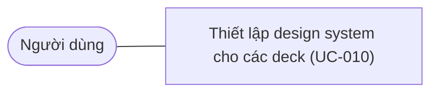
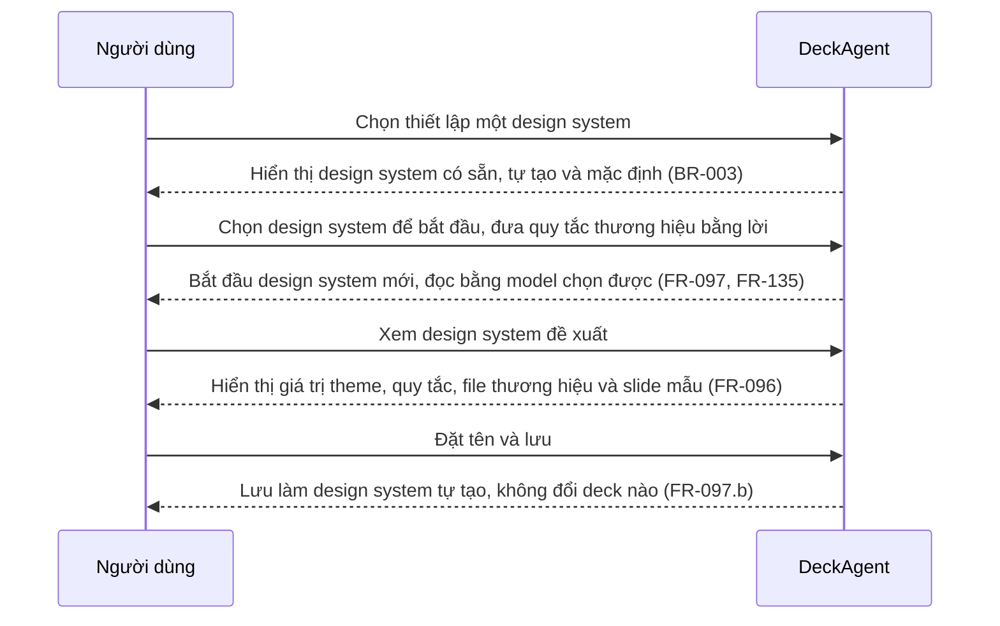
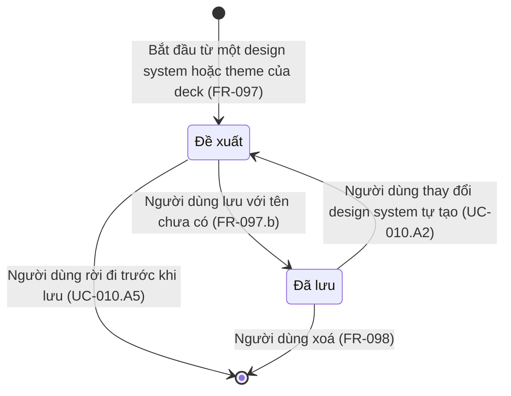

# Design system

Đọc file này để biết người dùng thiết lập design system cho các deck như thế nào.

## Tổng quan

Actor duy nhất là người dùng. File này chứa việc thiết lập design system: tạo design system tự tạo từ một design system có sẵn, từ một design system tự tạo hoặc từ theme của một deck; thay đổi và xoá design system tự tạo. Việc chọn design system cho một deck nằm trong phỏng vấn của file deck [[1]](#ref-1). File này không dựng deck nào. ID trong file theo [Tiền tố ID](README.md#tiền-tố-id).

Ngoài phạm vi:

- Chọn design system cho một deck. Việc này nằm trong phỏng vấn [[1]](#ref-1).
- Layout. Layout thuộc template mà người dùng chọn trong phỏng vấn (BR-018) [[1]](#ref-1).
- Luồng import riêng cho gói design system của sản phẩm khác. Gói đó là một file thương hiệu như mọi file thương hiệu khác.

## Thiết lập design system cho các deck (UC-010)

Người dùng làm các deck phải theo cùng một thương hiệu, ví dụ thương hiệu của công ty họ hoặc của một khách hàng, hoặc theo diện mạo họ đã thích ở một deck trước đó. Họ muốn thiết lập màu, font và quy tắc của thương hiệu đó một lần, để chọn nó cho bất kỳ deck nào và không phải mô tả lại trong request.

**Trigger:** Người dùng chọn thiết lập, thay đổi hoặc xoá một design system.

**Precondition:** DeckAgent chạy trên máy của người dùng.

**Kết quả khi thành công:** Design system tự tạo mà người dùng đã lưu nằm trong các design system mà người dùng được phép chọn cho một deck, với đủ mọi giá trị theme (BR-017). Mọi deck giữ nguyên.

**Kết quả khi thất bại:** Không deck nào thay đổi. Mọi design system giữ nguyên, trừ design system tự tạo mà người dùng đã lưu hoặc đã xoá. Draft của chat giữ nguyên.

Luồng chính:

1. Người dùng chọn thiết lập một design system. Hệ thống hiển thị các design system có sẵn, các design system tự tạo, và design system nào là design system mặc định (BR-003) [[1]](#ref-1). Hệ thống giữ draft của chat (FR-038) [[2]](#ref-2).
2. Người dùng chọn một design system để bắt đầu, và đưa quy tắc thương hiệu bằng lời. Hệ thống bắt đầu một design system mới từ design system đã chọn, hoặc từ design system mặc định khi người dùng không chọn design system nào (FR-097). Hệ thống đọc những gì người dùng đưa bằng một model chọn được (FR-135). Hệ thống giữ mỗi giá trị theme mà người dùng không thay đổi. Hệ thống không thay đổi deck nào.
3. Người dùng xem design system đề xuất. Hệ thống hiển thị mỗi giá trị theme, mỗi quy tắc bằng lời và mỗi file thương hiệu của design system đề xuất, cùng một slide mẫu làm bằng design system đó (FR-096). Hệ thống nêu mỗi quy tắc mà hệ thống không dùng được, kèm lý do. Hệ thống không thay đổi deck nào.
4. Người dùng đặt tên và lưu design system. Hệ thống lưu nó làm một design system tự tạo mà người dùng được phép chọn cho một deck (FR-097.b). Mọi design system khác và mọi deck giữ nguyên. Hệ thống giữ draft của chat.

Vòng đời của một design system tự tạo:

Mỗi design system có sẵn và mỗi design system tự tạo có một giá trị cho mỗi vai trò có tên (BR-017.V1). Mỗi giá trị theme có một vai trò; một màu hoặc font mà người dùng đặt vào theme của một deck thay cho một giá trị có vai trò. Một bài thuyết trình tham khảo là một file thương hiệu, và design system không lấy nội dung nào của bài thuyết trình đó. Design system không có Required Rule hay Preferred Rule; quy tắc bằng lời của design system bao gồm quy tắc về mật độ nội dung, tiêu đề, thứ bậc, biểu đồ và ảnh. Một design system mới luôn bắt đầu từ một design system đầy đủ, nên mọi design system có đủ mọi giá trị theme. Diện mạo của một deck trước đó là design system mà deck đó đã dùng: người dùng chọn lại design system đó cho deck mới, hoặc tạo design system mới từ theme của deck đó (UC-010.A11). Các điểm sau chưa được quyết: [model nào đọc quy tắc thương hiệu (OQ-030)](../open-questions.md#oq-030), [khi nào hai tên design system là cùng một tên (OQ-031)](../open-questions.md#oq-031), và [quy tắc về loại, số lượng và kích thước của file thương hiệu (OQ-032)](../open-questions.md#oq-032).

| ID | Điều kiện | Phản hồi người dùng thấy | Nguồn | Trạng thái |
| --- | --- | --- | --- | --- |
| UC-010.A2 | Tại bước 1. Người dùng chọn thay đổi một design system tự tạo và đưa quy tắc thương hiệu mới. Tiếp tục tại bước 3 | Hệ thống đọc quy tắc mới bằng một model chọn được, như ở bước 2. Hệ thống đề xuất design system đã thay đổi với tên cũ của nó. Mỗi deck dùng design system đó giữ theme của deck | Product owner | Confirmed |
| UC-010.A3 | Tại bước 1. Người dùng xoá một design system tự tạo. Quay lại bước 1 | Hệ thống bỏ design system đó khỏi các design system mà người dùng được phép chọn. Mỗi deck đã dùng nó giữ theme của deck và vẫn thay đổi được | Product owner | Confirmed |
| UC-010.A4 | Tại bước 2. Người dùng đưa file thương hiệu, ví dụ brand guide, bài thuyết trình, logo, file font hoặc gói design system của sản phẩm khác. Tiếp tục tại bước 3 | Hệ thống lấy các giá trị theme, quy tắc bằng lời và file thương hiệu mà hệ thống tìm thấy (BR-017). Hệ thống nêu file mà mỗi thứ đến từ đó, và mỗi file hoặc phần mà hệ thống không dùng được, kèm lý do. Hệ thống không bao giờ nói rằng đã tìm thấy mọi quy tắc | Product owner | Confirmed |
| UC-010.A5 | Tại bước 2, 3 hoặc 4. Người dùng rời việc thiết lập trước khi lưu. Kết thúc | Hệ thống không lưu design system nào và không thay đổi design system nào, theo [rule rời phần thiết lập (FR-044)](providers.md). Hệ thống hiển thị draft của chat không đổi (FR-038) [[2]](#ref-2) | Product owner | Confirmed |
| UC-010.A7 | Tại bước 3. Hai quy tắc người dùng đưa không thống nhất, ví dụ hai màu chính khác nhau. Quay lại bước 2 | Hệ thống nêu cả hai quy tắc và nơi mỗi quy tắc đến từ đó. Hệ thống không chọn quy tắc nào. Hệ thống không lưu gì. Hệ thống giữ những gì người dùng đã đưa | Product owner | Confirmed |
| UC-010.A8 | Tại bước 1. Người dùng yêu cầu thay đổi hoặc xoá một design system có sẵn. Ở lại bước đó | Hệ thống không thay đổi và không xoá gì. Với yêu cầu thay đổi: hệ thống đề nghị bắt đầu một design system mới từ design system đó. Với yêu cầu xoá: hệ thống báo rằng design system có sẵn không bao giờ bị xoá | Product owner | Confirmed |
| UC-010.A9 | Tại bước 2. Không có model chọn được nào (BR-005) [[3]](#ref-3), hoặc model không trả lời. Ở lại bước đó | Hệ thống không đề xuất gì và không lưu gì. Hệ thống giữ những gì người dùng đã đưa. Hệ thống báo lý do | Product owner | Confirmed |
| UC-010.A10 | Tại bước 4. Tên người dùng đưa là tên của một design system khác. Ở lại bước đó | Hệ thống không lưu gì. Hệ thống báo design system nào có tên đó. Hệ thống giữ design system đề xuất | Product owner | Confirmed |
| UC-010.A11 | Tại bước 2. Người dùng chọn một deck để bắt đầu, thay vì một design system. Tiếp tục tại bước 3 | Hệ thống bắt đầu một design system mới từ các giá trị theme hiện tại của deck, gồm mỗi màu và font mà người dùng đã đặt vào theme của deck (BR-017). Hệ thống không lấy văn bản, hình hay slide nào của deck. Hệ thống không thay đổi deck nào | Product owner | Confirmed |

| ID | Rule | Giá trị | Đo tại | Nguồn | Trạng thái |
| --- | --- | --- | --- | --- | --- |
| BR-017 | Mỗi design system có các giá trị theme của rule này và chỉ chứa các loại file thương hiệu của rule này | — | — | Product owner | Confirmed |
| BR-017.V1 | Giá trị theme là danh sách đóng các vai trò có tên. Màu: `color.background`, `color.surface`, `color.text`, `color.muted`, `color.accent`, `color.onAccent`, `color.border`. Họ font: `font.heading`, `font.body`. Cỡ chữ: `type.display`, `type.heading`, `type.body`, `type.caption`. Đơn vị khoảng cách: `space.unit`. Chiều cao dòng: `type.lineHeight` | — | — | Product owner | Confirmed |
| BR-017.V2 | Loại file thương hiệu mà design system chứa là danh sách đóng: logo, file font | — | — | Product owner | Confirmed |
| FR-096 | Trước khi một design system được lưu, hệ thống hiển thị mỗi giá trị theme, mỗi quy tắc bằng lời và mỗi file thương hiệu của design system đề xuất (BR-017), cùng một slide mẫu làm bằng design system đó | — | — | Product owner | Confirmed |
| FR-096.b | Hệ thống nêu mỗi quy tắc mà hệ thống không dùng được, kèm lý do | — | — | Product owner | Confirmed |
| FR-096.c | Hệ thống nêu mỗi cặp quy tắc không thống nhất, kèm nơi mỗi quy tắc đến từ đó, và không chọn quy tắc nào trong hai quy tắc đó | — | — | Product owner | Confirmed |
| FR-096.d | Việc hiển thị một design system đề xuất không thay đổi deck nào | — | — | Product owner | Confirmed |
| FR-097 | Hệ thống bắt đầu một design system mới từ một design system đã có mà người dùng chọn, từ các giá trị theme hiện tại của một deck mà người dùng chọn và không lấy nội dung nào của deck, hoặc từ design system mặc định khi người dùng không chọn gì (BR-003) [[1]](#ref-1). Hệ thống giữ mỗi giá trị theme mà người dùng không thay đổi (BR-017) | — | — | Product owner | Confirmed |
| FR-097.b | Khi lưu, hệ thống thêm một design system tự tạo mới với tên mà không design system nào khác có, hoặc giữ tên của design system tự tạo mà người dùng đã thay đổi | — | — | Product owner | Confirmed |
| FR-097.c | Việc lưu không thay đổi deck nào và không thay đổi design system nào khác | — | — | Product owner | Confirmed |
| FR-098 | Hệ thống xoá một design system tự tạo khi người dùng yêu cầu | — | — | Product owner | Confirmed |
| FR-098.b | Việc xoá một design system tự tạo không thay đổi deck nào và không thay đổi design system nào khác | — | — | Product owner | Confirmed |
| FR-099 | Khi người dùng đưa file thương hiệu, hệ thống lấy các giá trị theme, quy tắc bằng lời và file thương hiệu mà hệ thống tìm thấy trong các file đó (BR-017) | — | — | Product owner | Confirmed |
| FR-099.b | Hệ thống nêu file mà mỗi thứ đến từ đó, và mỗi file hoặc phần mà hệ thống không dùng được, kèm lý do | — | — | Product owner | Confirmed |
| FR-099.c | Hệ thống không bao giờ nói rằng đã tìm thấy mọi quy tắc trong các file | — | — | Product owner | Confirmed |
| FR-106 | Việc thay đổi hoặc xoá một design system tự tạo không thay đổi deck nào. Mỗi deck đã dùng design system đó giữ theme của deck, và được hiển thị và thay đổi như trước, kể cả khi design system đó không còn tồn tại | — | — | Product owner | Confirmed |
| FR-106.b | Một deck chỉ nhận design system đã thay đổi khi một request sau chọn design system đó cho deck | — | — | Product owner | Confirmed |
| FR-112 | Hệ thống không bao giờ thay đổi hoặc xoá một design system có sẵn | — | — | Product owner | Confirmed |
| FR-112.b | Khi người dùng yêu cầu thay đổi một design system có sẵn, hệ thống không thay đổi gì và đề nghị bắt đầu một design system mới từ design system đó | — | — | Product owner | Confirmed |
| FR-112.c | Khi người dùng yêu cầu xoá một design system có sẵn, hệ thống không xoá gì và báo rằng design system có sẵn không bao giờ bị xoá | — | — | Product owner | Confirmed |
| FR-112.d | Hệ thống không lưu design system mới nào khi người dùng không lưu | — | — | Product owner | Confirmed |
| FR-135 | Hệ thống đọc lời và file thương hiệu mà người dùng đưa cho một design system bằng một model chọn được (BR-005) [[3]](#ref-3) | — | — | Product owner | Confirmed |
| FR-135.b | Khi không có model chọn được nào hoặc model không trả lời, hệ thống không đề xuất gì, không lưu gì, giữ những gì người dùng đã đưa và báo lý do | — | — | Product owner | Confirmed |

## Gap analysis

Baseline độc lập cho file này đã có [[4]](#ref-4). File này chưa được đối chiếu với baseline đó.

| ID | Gap | Baseline | Quyết định | Trạng thái |
| --- | --- | --- | --- | --- |
| GAP-01 | Chưa đối chiếu với baseline độc lập | [Baseline design-systems](../build/refactor/UCs/baseline/design-systems.md) | [Đối chiếu từng vùng với baseline độc lập (OQ-060)](../open-questions.md#oq-060) | Open |

## References

1. [Deck](deck.md)
2. [Gửi request](requests.md)
3. [Provider và model](providers.md)
4. [Baseline design-systems](../build/refactor/UCs/baseline/design-systems.md)
