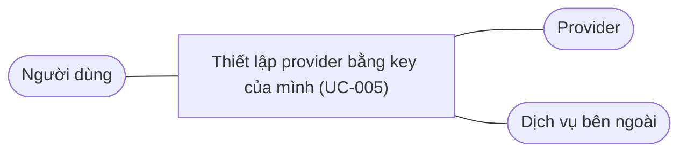
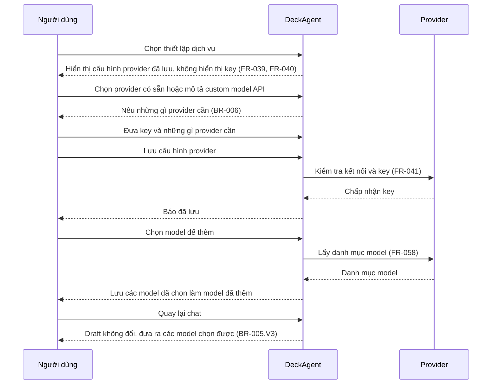
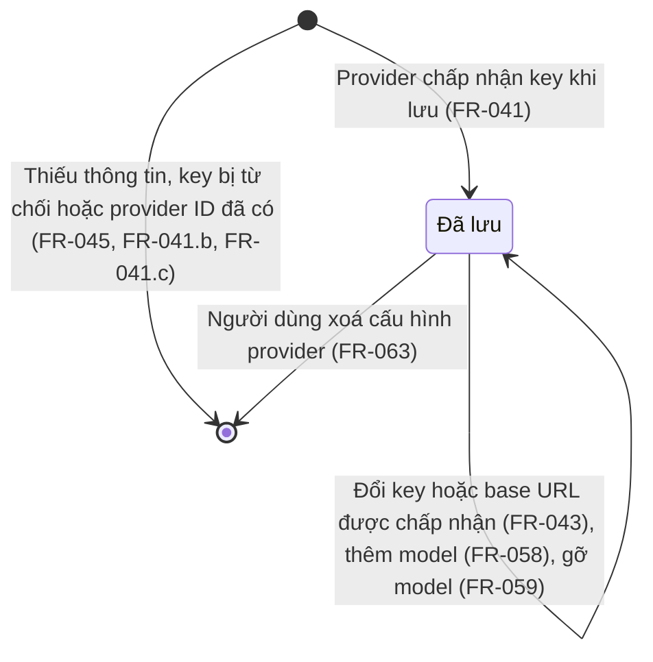

# Provider và model

Đọc file này để biết người dùng thiết lập provider, key và model mà DeckAgent dùng như thế nào.

## Tổng quan

Actor chính là người dùng. Provider và dịch vụ bên ngoài là actor phụ: hệ thống kiểm tra key với chúng, và provider báo danh mục model. File này chứa việc thiết lập cấu hình provider, model đã thêm, dịch vụ bên ngoài, và việc chọn model đã chọn cùng mức suy luận cho một chat. Việc chạy request bằng model đã chọn nằm trong file gửi request [[1]](#ref-1). ID trong file theo [Tiền tố ID](README.md#tiền-tố-id).

Ngoài phạm vi:

- Chạy model qua một chương trình coding agent đã có trên máy người dùng, bằng đăng nhập riêng của chương trình đó (UC-005-A18).
- Khôi phục các model mặc định của một cấu hình provider (FR-062).
- Người dùng tự sửa thiết lập của một model đã thêm, ví dụ kích thước context hoặc mức suy luận (FR-081).

## Thiết lập provider bằng key của mình (UC-005)

Người dùng muốn DeckAgent làm deck bằng các model và dịch vụ họ chọn, và trả tiền bằng tài khoản riêng của họ. Họ chưa có model nào sẵn sàng, muốn một provider hoặc model khác, muốn tìm kiếm web hoặc ảnh, hoặc có một key không còn dùng được. Họ muốn các dịch vụ sẵn sàng mà không mất request đang chuẩn bị.

**Trigger:** Người dùng chọn thiết lập dịch vụ, ví dụ ở lần khởi động đầu tiên, hoặc sau khi một request không tìm được model để chạy (UC-003.A17) [[1]](#ref-1).

**Precondition:** DeckAgent chạy trên máy của người dùng.

**Kết quả khi thành công:** Một cấu hình provider đã được lưu, cùng key mà provider cần và các model đã thêm. Người dùng chọn trong các model đó cho một chat. Draft của chat không đổi.

**Kết quả khi thất bại:** Những gì người dùng đã lưu vẫn được lưu, trừ những gì họ đã gỡ hoặc xoá. Một lần lưu không thành công không lưu gì. Không phần nào của một key đã lưu được hiển thị lại. Một request không xong không xoá cấu hình provider nào và không gỡ model đã thêm nào.

Luồng chính:

1. Người dùng chọn thiết lập các dịch vụ mà DeckAgent dùng. Hệ thống hiển thị từng cấu hình provider đã lưu cùng các model đã thêm và việc cấu hình đó có key đã lưu hay không, và hiển thị từng dịch vụ bên ngoài mà người dùng đã thiết lập. Hệ thống không hiển thị phần nào của key đã lưu, và giữ draft của chat.
2. Người dùng chọn một provider có sẵn, hoặc mô tả một custom model API. Hệ thống hiển thị các provider có sẵn mà chưa cấu hình provider đã lưu nào dùng (BR-005, BR-008), nêu những gì provider cần, ví dụ key (BR-006), và nói rằng mỗi request chạy qua cấu hình provider này được gửi tới provider này.
3. Người dùng đưa những gì provider cần, ví dụ key của tài khoản riêng của họ. Hệ thống nhận những gì người dùng đưa, và không bao giờ hiển thị key trong cuộc hội thoại (NFR-006).
4. Người dùng lưu cấu hình provider. Hệ thống kiểm tra kết nối và key với provider, lưu cấu hình provider cùng provider ID (BR-008), giữ nguyên mọi cấu hình provider đã lưu khác, và báo đã lưu.
5. Người dùng chọn các model để thêm vào một cấu hình provider mới hoặc đã lưu. Hệ thống lấy danh mục model của provider, cho phép người dùng thêm một model từ danh mục hoặc tự nhập model ID (BR-005), lưu mỗi model đã chọn làm model đã thêm, và không chạy model nào để làm việc đó.
6. Người dùng quay lại chat. Hệ thống hiển thị draft của chat không đổi (FR-038) [[1]](#ref-1), và đưa ra các model chọn được của mọi cấu hình provider (BR-005).

Vòng đời của một cấu hình provider:

Một model service chạy trên máy người dùng được thiết lập như một custom model API, không phải provider có sẵn. Một request đang chạy giữ model, mức suy luận và thiết lập provider đã lưu lúc request bắt đầu (FR-042) [[1]](#ref-1). Các điểm sau chưa được quyết: [những gì mỗi provider có sẵn cần cho thiết lập (OQ-020)](../open-questions.md#oq-020), [cách kiểm tra một custom model API không cần key (OQ-021)](../open-questions.md#oq-021), [mức suy luận khi người dùng đổi model đã chọn (OQ-022)](../open-questions.md#oq-022), [thiết lập dịch vụ bên ngoài thứ hai cùng loại (OQ-023)](../open-questions.md#oq-023), và [đổi hoặc gỡ dịch vụ bên ngoài trong lúc có request đang chạy (OQ-024)](../open-questions.md#oq-024).

| ID | Điều kiện | Phản hồi người dùng thấy | Nguồn | Trạng thái |
| --- | --- | --- | --- | --- |
| UC-005.A1 | Tại bước 1. Người dùng đổi key hoặc base URL của một cấu hình provider đã lưu (BR-006), rồi lưu. Quay lại bước 1 | Hệ thống thay phần đã đổi, giữ provider ID và các model đã thêm. Hệ thống kiểm tra key mới với provider trước khi lưu. Khi provider từ chối key, hệ thống không lưu gì và giữ key đã lưu. Thay đổi chỉ áp dụng cho request bắt đầu sau đó | Product owner | Confirmed |
| UC-005.A2 | Tại bước 1. Người dùng gỡ một model đã thêm khỏi một cấu hình provider. Quay lại bước 1 | Hệ thống chỉ gỡ model khỏi DeckAgent và không thay đổi gì ở provider. Chat có model đó làm model đã chọn không còn model đã chọn. Request đang chạy dùng model đó tiếp tục chạy tới khi kết thúc | Product owner | Confirmed |
| UC-005.A4 | Tại bước 1, 2, 3 hoặc 5. Người dùng rời phần thiết lập khi còn thay đổi chưa lưu. Kết thúc | Hệ thống không áp dụng thay đổi chưa lưu nào và giữ mọi thay đổi đã lưu. Hệ thống hiển thị draft của chat không đổi | Product owner | Confirmed |
| UC-005.A5 | Tại bước 4. Thiếu một thứ mà provider cần, ví dụ key (BR-006). Quay lại bước 3 | Hệ thống không lưu gì, nêu thứ còn thiếu và giữ những gì người dùng đã đưa | Product owner | Confirmed |
| UC-005.A6 | Tại bước 4. Provider từ chối key, hoặc không trả lời, khi hệ thống kiểm tra. Quay lại bước 3 | Hệ thống không lưu gì, báo provider đã từ chối key hay không trả lời, kèm lý do khi biết lý do, và giữ phần còn lại của những gì người dùng đã đưa | Product owner | Confirmed |
| UC-005.A7 | Tại bước 5. Hệ thống không lấy được danh mục model, hoặc provider không báo model nào. Tiếp tục tại bước 5 | Hệ thống báo không lấy được danh mục model, kèm lý do khi biết lý do. Người dùng vẫn tự nhập được model ID. Không model đã thêm nào thay đổi | Product owner | Confirmed |
| UC-005.A9 | Tại bước 4. Provider ID của một custom model API trùng với provider ID của một cấu hình provider đã lưu hoặc của một provider có sẵn (BR-008). Quay lại bước 3 | Hệ thống không lưu gì, nêu cấu hình provider đã lưu hoặc provider có sẵn nào có provider ID đó, và giữ những gì người dùng đã đưa | Product owner | Confirmed |
| UC-005.A11 | Tại bước 1. Người dùng xoá một cấu hình provider đã lưu. Quay lại bước 1 | Hệ thống chỉ xoá cấu hình provider và các model đã thêm của cấu hình đó khỏi DeckAgent, và không thay đổi gì ở provider. Request đang chạy dùng cấu hình đó tiếp tục chạy tới khi kết thúc. Chat có model đã chọn thuộc cấu hình đó không còn model đã chọn | Product owner | Confirmed |
| UC-005.A15 | Tại bước 1. Người dùng thiết lập, đổi hoặc gỡ một dịch vụ bên ngoài thuộc một loại mà DeckAgent dùng (BR-016), bằng key của tài khoản riêng của họ. Quay lại bước 1 | Hệ thống kiểm tra key với dịch vụ rồi lưu, như với cấu hình provider. Khi dịch vụ từ chối key, hệ thống không lưu gì và báo điều đó. Hệ thống nói rằng các request dùng loại dịch vụ này gửi tới dịch vụ này. Hệ thống không hiển thị phần nào của key | Product owner | Confirmed |
| UC-005.A16 | Tại bước 6. Người dùng chọn một model chọn được (BR-005) cho chat, và một mức suy luận mà model đó có. Kết thúc | Model đó trở thành model đã chọn của chat với mức suy luận đó. Khi hệ thống không biết mức suy luận nào của model, hệ thống không đưa ra mức nào, và request chạy ở mức mặc định của provider. Lựa chọn áp dụng từ request tiếp theo | Product owner | Confirmed |
| UC-005.A17 | Tại bước 6. Model đã chọn của chat đã bị gỡ, hoặc cấu hình provider của model đó đã bị xoá. Kết thúc | Hệ thống báo chat không có model đã chọn, và không tự chọn model khác | Product owner | Confirmed |

| ID | Rule | Giá trị | Đo tại | Nguồn | Trạng thái |
| --- | --- | --- | --- | --- | --- |
| BR-005 | Rule này quy định cấu hình provider kết nối tới những provider có sẵn nào, custom model API dùng những API protocol nào, người dùng thêm những model nào, và model đã thêm nào là model chọn được | — | — | Product owner | Confirmed |
| BR-005.V1 | Provider có sẵn là danh sách đóng: OpenAI, Anthropic, Google Gemini, DeepSeek | — | — | Product owner | Confirmed |
| BR-005.V2 | Model người dùng thêm là danh sách mở: mỗi model trong danh mục model của provider, và mỗi model ID người dùng tự nhập, kể cả model ID không có trong danh mục | — | — | Product owner | Confirmed |
| BR-005.V3 | Model chọn được là mỗi model đã thêm của mỗi cấu hình provider đã lưu | — | — | Product owner | Confirmed |
| BR-005.V4 | API protocol của custom model API là danh sách đóng: OpenAI Chat Completions, OpenAI Responses, Anthropic Messages, Google Gemini | — | — | Product owner | Confirmed |
| BR-005.V6 | Provider ID của mỗi provider có sẵn: OpenAI là `openai`, Anthropic là `anthropic`, Google Gemini là `google`, DeepSeek là `deepseek`. Các provider ID này giống nhau ở mọi bản phát hành | — | — | Product owner | Confirmed |
| BR-006 | Rule này quy định những gì người dùng đưa cho một cấu hình provider trước khi model của cấu hình đó chạy, cho mỗi provider có sẵn và cho custom model API, và những thiết lập nào của một cấu hình provider đã lưu người dùng được đổi | — | — | Product owner | Confirmed |
| BR-006.V1 | Ngoài key, những gì mỗi provider có sẵn cần, và base URL của provider đó có đổi được không, chưa được đặt: [OQ-020](../open-questions.md#oq-020) | — | — | Product owner: giá trị chưa đặt, chờ kiểm tra với từng provider | Proposed |
| BR-006.V2 | Custom model API cần danh sách mở: provider ID, base URL, API protocol, và key chỉ khi model service cần key | — | — | Product owner | Confirmed |
| BR-006.V3 | Thiết lập người dùng được đổi sau khi lưu là danh sách mở: key, base URL của custom model API, và base URL của provider có sẵn chỉ khi BR-006.V1 cho phép. Không bao giờ là provider ID | — | — | Product owner | Confirmed |
| BR-008 | Rule này quy định số cấu hình provider đã lưu có cùng một provider ID, và những provider ID mà custom model API không bao giờ nhận. Rule không đặt tổng số cấu hình provider | — | — | Product owner | Confirmed |
| BR-008.V1 | Mỗi provider ID có tối đa một cấu hình provider đã lưu. Cấu hình provider đã xoá không được tính | 1 cấu hình provider | Số cấu hình provider đã lưu có cùng provider ID | Product owner | Confirmed |
| BR-008.V3 | Provider ID dành riêng cho provider có sẵn là danh sách đóng: provider ID của mỗi provider có sẵn, kể cả khi provider đó chưa có cấu hình provider đã lưu | — | — | Product owner | Confirmed |
| BR-016 | Rule này quy định các loại dịch vụ bên ngoài mà người dùng thiết lập cho DeckAgent. Mỗi loại có tối đa một dịch vụ đã thiết lập. Public research và ảnh từ web cần một dịch vụ người dùng đã thiết lập | 1 dịch vụ | Số dịch vụ đã thiết lập của một loại dịch vụ bên ngoài | Product owner | Confirmed |
| BR-016.V1 | Loại dịch vụ bên ngoài là danh sách đóng: tìm kiếm web, dịch vụ ảnh | — | — | Product owner | Confirmed |
| FR-039 | Hệ thống hiển thị mỗi cấu hình provider đã lưu cùng các model đã thêm và việc cấu hình đó có key đã lưu hay không, và hiển thị mỗi dịch vụ bên ngoài người dùng đã thiết lập | — | — | Product owner | Confirmed |
| FR-039.b | Cho một cấu hình provider mới, hệ thống đưa ra các provider có sẵn mà chưa cấu hình provider đã lưu nào dùng (BR-005, BR-008) và custom model API, và nêu những gì provider cần (BR-006) | — | — | Product owner | Confirmed |
| FR-039.c | Hệ thống nói rằng mỗi request chạy qua một cấu hình provider được gửi tới provider của cấu hình đó | — | — | Product owner | Confirmed |
| FR-040 | Sau khi một key được lưu, hệ thống không bao giờ hiển thị lại key đó, toàn bộ hay một phần, có che hay không che, và chỉ hiển thị việc key đã được lưu hay chưa | — | — | Product owner | Confirmed |
| FR-040.b | Hệ thống không bao giờ hiển thị key trong cuộc hội thoại | — | — | Product owner | Confirmed |
| FR-041 | Hệ thống kiểm tra kết nối và key với provider, và chỉ lưu cấu hình provider khi provider chấp nhận key. Key luôn được kiểm tra trước khi lưu | — | — | Product owner | Confirmed |
| FR-041.b | Khi provider từ chối key hoặc không trả lời, hệ thống không lưu gì, báo provider đã từ chối hay không trả lời, kèm lý do khi biết, và giữ phần còn lại của những gì người dùng đã đưa. Provider không trả lời được xử lý như từ chối, nên không cấu hình provider nào được lưu khi không có kết nối | — | — | Product owner | Confirmed |
| FR-041.c | Provider ID của một cấu hình provider không bao giờ đổi sau khi lưu. Một lần lưu có provider ID mà một cấu hình provider đã lưu hoặc một provider có sẵn đã có thì không lưu gì, và hệ thống nêu cấu hình hoặc provider nào có provider ID đó (BR-008) | — | — | Product owner | Confirmed |
| FR-043 | Hệ thống cho phép người dùng thay key của một cấu hình provider đã lưu, và đổi base URL của cấu hình đó khi provider cho phép (BR-006) | — | — | Product owner | Confirmed |
| FR-043.b | Khi đổi, hệ thống giữ provider ID và các model đã thêm, và không thêm cấu hình provider thứ hai | — | — | Product owner | Confirmed |
| FR-043.c | Hệ thống kiểm tra key mới với provider trước khi lưu key đó | — | — | Product owner | Confirmed |
| FR-044 | Khi người dùng rời phần thiết lập, hệ thống không áp dụng thay đổi nào người dùng chưa lưu, và giữ mọi thay đổi người dùng đã lưu | — | — | Product owner | Confirmed |
| FR-045 | Khi thiếu một thứ mà provider cần (BR-006), ví dụ key, hệ thống không lưu gì, nêu thứ còn thiếu và giữ những gì người dùng đã đưa | — | — | Product owner | Confirmed |
| FR-055 | Hệ thống cho phép người dùng chọn model đã chọn của một chat trong các model chọn được của mọi cấu hình provider (BR-005), và một mức suy luận mà model đó có | — | — | Product owner | Confirmed |
| FR-055.b | Khi hệ thống không biết mức suy luận nào của model, hệ thống không đưa ra mức nào, và request chạy ở mức mặc định của provider | — | — | Product owner | Confirmed |
| FR-055.c | Lựa chọn model và mức suy luận áp dụng từ request tiếp theo của chat đó | — | — | Product owner | Confirmed |
| FR-058 | Hệ thống lấy danh mục model của provider, và cho phép người dùng thêm model từ danh mục hoặc tự nhập model ID (BR-005) | — | — | Product owner | Confirmed |
| FR-058.b | Hệ thống chỉ lưu các model người dùng đã chọn, không chạy model nào để làm việc đó, và không thay đổi model đã thêm nào khi lấy danh mục | — | — | Product owner | Confirmed |
| FR-058.c | Khi không lấy được danh mục model, hệ thống báo điều đó, kèm lý do khi biết, và người dùng vẫn thêm được model bằng model ID | — | — | Product owner | Confirmed |
| FR-059 | Hệ thống gỡ một model đã thêm khỏi cấu hình provider của model đó chỉ trong DeckAgent, và không thay đổi gì ở provider | — | — | Product owner | Confirmed |
| FR-059.b | Model đã gỡ không còn là model chọn được (BR-005.V3) | — | — | Product owner | Confirmed |
| FR-063 | Hệ thống xoá một cấu hình provider và các model đã thêm của cấu hình đó chỉ trong DeckAgent, và không thay đổi gì ở provider | — | — | Product owner | Confirmed |
| FR-063.b | Hệ thống giữ mọi chat và deck. Request đang chạy dùng cấu hình provider đó giữ thiết lập lúc bắt đầu cho tới khi kết thúc (FR-042), nên việc xoá không bị từ chối | — | — | Product owner | Confirmed |
| FR-065 | Khi model đã chọn của một chat bị gỡ hoặc cấu hình provider của model đó bị xoá, chat không còn model đã chọn. Hệ thống báo điều đó trong chat đó và không tự chọn model khác | — | — | Product owner | Confirmed |
| FR-133 | Hệ thống cho phép người dùng thiết lập, đổi hoặc gỡ một dịch vụ bên ngoài cho mỗi loại mà DeckAgent dùng (BR-016), bằng key của tài khoản riêng của họ | — | — | Product owner | Confirmed |
| FR-133.b | Hệ thống kiểm tra key với dịch vụ trước khi lưu, và không lưu gì khi dịch vụ từ chối key | — | — | Product owner | Confirmed |
| FR-133.c | Hệ thống nói rằng các request dùng loại dịch vụ này gửi tới dịch vụ đó | — | — | Product owner | Confirmed |

## Gap analysis

Baseline độc lập cho file này đã có [[2]](#ref-2). File này chưa được đối chiếu với baseline đó.

| ID | Gap | Baseline | Quyết định | Trạng thái |
| --- | --- | --- | --- | --- |
| GAP-01 | Chưa đối chiếu với baseline độc lập | [Baseline providers](../build/refactor/UCs/baseline/providers.md) | [Đối chiếu từng vùng với baseline độc lập (OQ-060)](../open-questions.md#oq-060) | Open |

## References

1. [Gửi request](requests.md)
2. [Baseline providers](../build/refactor/UCs/baseline/providers.md)
