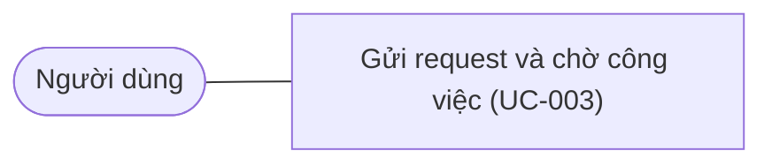
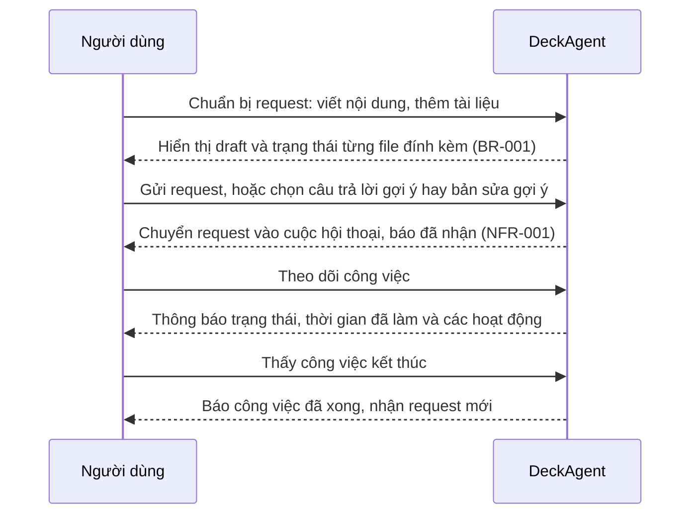
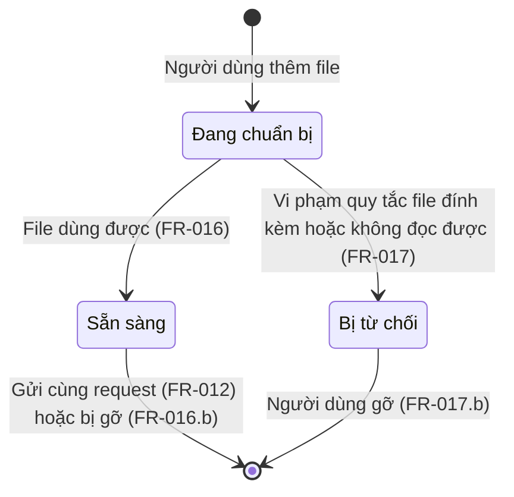
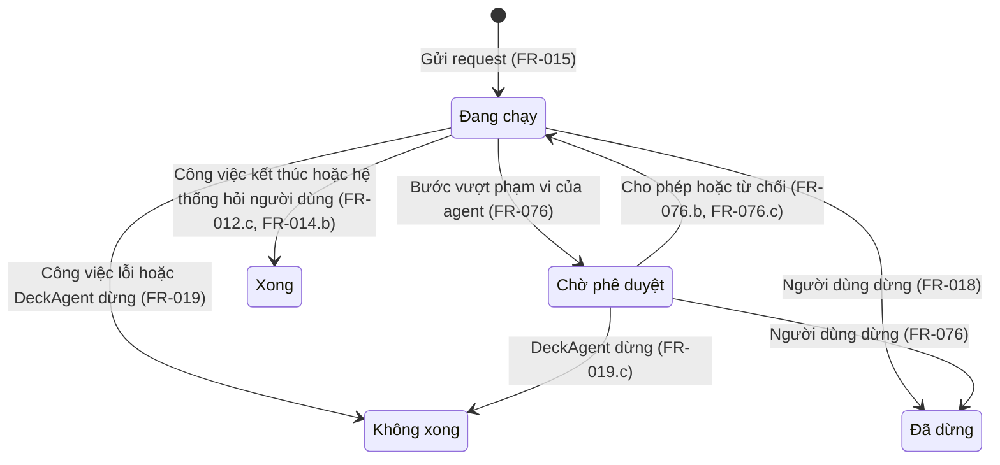

# Gửi request

Đọc file này để biết người dùng gửi request, theo dõi và dừng công việc của request như thế nào, và hệ thống phản hồi ra sao.

## Tổng quan

Actor duy nhất là người dùng. File này chứa những gì mọi request đều có chung: chuẩn bị draft, gửi request, theo dõi hoạt động, dừng công việc và nhận biết công việc đã kết thúc. Các use case khác dùng các rule của file này và chỉ thêm phần mà công việc của riêng chúng tạo ra. ID trong file theo [Tiền tố ID](README.md#tiền-tố-id).

Ngoài phạm vi:

- Hiển thị mức dùng context của một chat (FR-078).
- Nhập bằng giọng nói, chèn shortcut cho skill, connector và link tới nơi khác của sản phẩm. Hệ thống chọn skill cho một request; người dùng không cài và không chọn skill.
- Tài liệu lấy từ một dịch vụ bên ngoài đã kết nối, ví dụ cloud drive.
- Lệnh tóm tắt hội thoại do người dùng chạy. Hệ thống tự tóm tắt hội thoại khi hội thoại vượt quá context.

## Gửi request và chờ công việc (UC-003)

Người dùng muốn hệ thống làm việc cho họ, ví dụ soạn hoặc sửa một deck. Sau khi gửi, họ muốn biết hệ thống đã nhận request và đang làm gì, và muốn dừng công việc khi công việc đi sai hướng. Họ không muốn mất những gì đã đưa cho hệ thống hoặc những gì hệ thống đã làm xong.

**Trigger:** Người dùng gửi một request trong một chat.

**Precondition:** Chat không có request đang chạy.

**Kết quả khi thành công:** Request và tài liệu của request nằm trong cuộc hội thoại, cùng các hoạt động của request. Công việc của request đã kết thúc, hệ thống đã báo điều đó, và chat nhận request mới.

**Kết quả khi thất bại:** Hệ thống giữ nội dung request và tài liệu: trong cuộc hội thoại khi request đã gửi, trong draft khi request chưa gửi. Người dùng không phải nhập lại. Công việc đã xong vẫn còn, và một kết quả chưa xong không bao giờ thay thế kết quả đã xong gần nhất.

Luồng chính:

1. Người dùng chuẩn bị request: viết nội dung request và thêm tài liệu. Hệ thống hiển thị nội dung request và từng file đính kèm của draft cùng trạng thái của file: đang chuẩn bị, sẵn sàng, hoặc bị từ chối kèm lý do. Hệ thống giữ draft trong lúc người dùng ở nơi khác của sản phẩm.
2. Người dùng gửi request, hoặc chọn một câu trả lời gợi ý hay một bản sửa gợi ý. Hệ thống chuyển nội dung request và file đính kèm vào cuộc hội thoại làm tin nhắn của người dùng, báo ngay là đã nhận request và đang làm (NFR-001), rồi chạy request bằng model đã chọn của chat.
3. Người dùng theo dõi công việc. Hệ thống hiển thị thông báo trạng thái kèm thời gian đã làm, hiển thị từng hoạt động của request theo thứ tự cùng trạng thái của hoạt động, và cho phép người dùng dừng công việc.
4. Người dùng thấy công việc đã kết thúc. Hệ thống báo công việc của request đã xong, giữ request và các hoạt động trong cuộc hội thoại, và nhận request mới.

Vòng đời của một file đính kèm trong draft:

Vòng đời của một request sau khi gửi:

Không có việc chờ câu trả lời bên trong một request. Một câu hỏi của hệ thống kết thúc request của câu hỏi đó, và câu trả lời của người dùng là một request mới. Một request chờ phê duyệt của người dùng cho một bước thì vẫn là request đang chạy. Việc chọn model đã chọn, mức suy luận của model, và trường hợp model đã chọn bị gỡ, nằm trong file provider [[1]](#ref-1). Thư mục dự án của chat đến từ workspace của chat [[2]](#ref-2). Điều gì bắt đầu việc tóm tắt hội thoại chưa được quyết: [Điểm bắt đầu tóm tắt hội thoại (OQ-002)](../open-questions.md#oq-002). Các điểm sau cũng chưa được quyết: [draft khi DeckAgent dừng (OQ-004)](../open-questions.md#oq-004), [điều kiện để một gợi ý không còn áp dụng (OQ-005)](../open-questions.md#oq-005), [cách tiếp tục chat sau lỗi tóm tắt hội thoại (OQ-006)](../open-questions.md#oq-006), [phản hồi khi hai giao diện cùng gửi request (OQ-007)](../open-questions.md#oq-007), [thời hạn chờ phê duyệt (OQ-008)](../open-questions.md#oq-008), và [một file được thêm hai lần vào draft (OQ-009)](../open-questions.md#oq-009).

| ID | Điều kiện | Phản hồi người dùng thấy | Nguồn | Trạng thái |
| --- | --- | --- | --- | --- |
| UC-003.A6 | Tại bước 2. Draft không có nội dung request và không có file đính kèm, hoặc có file đính kèm đang chuẩn bị hay bị từ chối, hoặc nội dung request dài hơn độ dài tối đa của nội dung request (BR-002). Quay lại bước 1 | Hệ thống không gửi gì. Hệ thống báo nội dung quá dài khi nội dung quá dài. Hệ thống giữ draft | Product owner | Confirmed |
| UC-003.A8 | Tại bước 1. Một file vừa thêm vi phạm quy tắc file đính kèm (BR-001), hoặc được bảo vệ, bị hỏng hay không đọc được. Tiếp tục tại bước 1 | Hệ thống hiển thị ngay lý do trên file đính kèm (NFR-010), giữ phần còn lại của draft, và không gửi gì trong lúc file bị từ chối còn trong draft | Product owner | Confirmed |
| UC-003.A11 | Tại bước 3. Một bước của công việc lỗi và request không xong, ví dụ provider không truy cập được, provider từ chối key hoặc model, hoặc đã chạm giới hạn sử dụng. Hoặc DeckAgent dừng trong lúc request đang chạy. Kết thúc | Hệ thống báo công việc không xong, kèm lý do khi biết lý do. Hệ thống giữ request, các hoạt động và công việc đã xong, và không tự chạy lại gì. Sau khi DeckAgent dừng rồi khởi động lại, hệ thống hiển thị request là chưa xong | Product owner | Confirmed |
| UC-003.A13 | Tại bước 3. Trong lúc DeckAgent chạy, người dùng tải lại hoặc đóng giao diện, giao diện mất kết nối tới DeckAgent, hoặc người dùng sang chat khác. Tiếp tục tại bước 3 | Hệ thống tiếp tục làm request. Khi người dùng quay lại, hệ thống hiển thị cuộc hội thoại, các hoạt động và việc hệ thống đang làm lúc đó | Product owner | Confirmed |
| UC-003.A14 | Tại bước 3. Người dùng viết nội dung request hoặc thêm tài liệu trong lúc có request đang chạy. Tiếp tục tại bước 3 | Hệ thống giữ nội dung đó làm draft, không gửi request mới cho tới khi request đang chạy kết thúc, và không thay đổi tài liệu của request đang chạy | Product owner | Confirmed |
| UC-003.A17 | Tại bước 2. Chat không có model đã chọn nào là model chọn được (BR-005) [[1]](#ref-1). Quay lại bước 1 | Hệ thống không gửi gì và giữ draft. Hệ thống báo lý do: chưa thiết lập provider, chưa thêm model, hoặc chat không có model đã chọn. Hệ thống không tự chọn model | Product owner | Confirmed |
| UC-003.A31 | Tại bước 3. Người dùng dừng công việc của request đang chạy. Kết thúc | Hệ thống dừng công việc (NFR-011), hiển thị công việc đã bị dừng chứ không phải bị lỗi, giữ request và công việc đã xong, hiển thị mỗi hoạt động còn đang chạy là đã dừng, và không tự gửi lại gì | Product owner | Confirmed |
| UC-003.A43 | Tại bước 3. Hệ thống chỉ dùng một phần tài liệu của request, hoặc tài liệu không còn đọc được trong lúc làm. Tiếp tục tại bước 3 | Hệ thống nêu tên tài liệu và phần không dùng, khi biết. Hệ thống không đọc file khác thay thế. Hệ thống hỏi lại phần còn thiếu khi phần đó làm mất hoặc làm đổi luận điểm của một slide bất kỳ (FR-067.c) | Product owner | Confirmed |
| UC-003.A50 | Tại bước 3. Hệ thống không lưu được trạng thái của chat, ví dụ một thay đổi của deck hoặc request vừa gửi. Tiếp tục tại bước 3 | Hệ thống báo công việc chưa được lưu và thay đổi nào hệ thống không giữ được. Hệ thống giữ trạng thái đã lưu gần nhất và không tự chạy lại gì | Product owner | Confirmed |
| UC-003.A51 | Tại bước 3. Một bước của công việc vượt quá phạm vi agent của chat được làm mà không hỏi (NFR-003), ví dụ đọc một file ngoài thư mục dự án. Tiếp tục tại bước 3 | Hệ thống nêu bước đó, những gì bước đó chạm tới và lý do, rồi hỏi phê duyệt: cho phép một lần hoặc từ chối. Request vẫn đang chạy, và hệ thống không làm gì vượt qua bước đó trong lúc chờ. Khi được cho phép, hệ thống làm bước đó một lần. Khi bị từ chối, hệ thống làm phần còn lại của công việc, và thông báo kết thúc nêu những gì hệ thống không làm | Product owner | Confirmed |
| UC-003.A52 | Tại bước 3. Cuộc hội thoại của chat không còn vừa context của model đã chọn. Tiếp tục tại bước 3 | Hệ thống viết tóm tắt hội thoại thay cho phần hội thoại trước đó và tiếp tục công việc. Hệ thống báo điều đó trong cuộc hội thoại, kèm vị trí bắt đầu của tóm tắt. Người dùng vẫn đọc được toàn bộ cuộc hội thoại, và brief, outline, deck, file đính kèm vẫn còn đủ. Khi không viết được tóm tắt: như luồng công việc không xong (UC-003.A11) | Product owner | Confirmed |

| ID | Rule | Giá trị | Đo tại | Nguồn | Trạng thái |
| --- | --- | --- | --- | --- | --- |
| BR-001 | Hệ thống chỉ nhận file đính kèm theo loại, số lượng và kích thước của rule này. Số lượng chỉ tính file đính kèm mới của một request; file đính kèm đã gửi với request trước không tính lại. Kích thước tính riêng cho từng file | — | — | Product owner | Confirmed |
| BR-001.V1 | Loại file đính kèm được nhận là danh sách đóng: TXT, MD, PDF, DOCX, PNG, JPEG, PPTX và ZIP. File JPEG có đuôi `.jpg` hoặc `.jpeg` | — | — | Product owner | Confirmed |
| BR-001.V2 | Một request có tối đa số file đính kèm mới này, tính cả giá trị giới hạn | 10 file | Số file đính kèm mới trong draft của một request. File đang chuẩn bị và file bị từ chối được tính cho tới khi bị gỡ khỏi draft | Product owner | Confirmed |
| BR-001.V3 | Một file đính kèm có kích thước tối đa này, tính cả giá trị giới hạn | 20 MiB (1 MiB = 1.048.576 byte) | Kích thước của từng file đính kèm | Product owner | Confirmed |
| BR-002 | Chỉ nội dung request được tính vào độ dài của request; nội dung của file đính kèm không được tính | — | — | Product owner | Confirmed |
| BR-002.V1 | Nội dung request có độ dài tối đa này, tính cả giá trị giới hạn. Hệ thống không cắt bớt nội dung vượt giới hạn | 16.000 Unicode code point | Nội dung request trong draft. Khoảng trắng và dấu xuống dòng được tính; mỗi combining mark được tính riêng | Product owner | Confirmed |
| FR-012 | Khi người dùng gửi request, hệ thống chuyển nội dung request và file đính kèm vào cuộc hội thoại làm tin nhắn của người dùng, và báo ngay là đang làm request (NFR-001) | — | — | Product owner | Confirmed |
| FR-012.b | Trong lúc request đang chạy, thông báo trạng thái nói bằng lời thường việc hệ thống đang làm và thời gian hệ thống đã làm | — | — | Product owner | Confirmed |
| FR-012.c | Khi công việc kết thúc, hệ thống báo điều đó và nhận request mới | — | — | Product owner | Confirmed |
| FR-013 | Chọn một câu trả lời gợi ý hoặc bản sửa gợi ý gửi ngay nội dung của nó làm tin nhắn của người dùng, với kết quả giống như gõ và gửi cùng nội dung đó | — | — | Product owner | Confirmed |
| FR-013.b | Khi người dùng chọn câu trả lời gợi ý hoặc bản sửa gợi ý, draft giữ nguyên và không được gửi kèm | — | — | Product owner | Confirmed |
| FR-013.c | Hệ thống không nhận câu trả lời gợi ý hoặc bản sửa gợi ý có nội dung không còn hợp với chat, và báo là nội dung đó không còn áp dụng | — | — | Product owner | Confirmed |
| FR-014 | Trong mỗi chat, hệ thống làm một request tại một thời điểm và không nhận request mới trong chat đó cho tới khi request đang chạy kết thúc | — | — | Product owner | Confirmed |
| FR-014.b | Một câu hỏi của hệ thống kết thúc request của câu hỏi đó, và câu trả lời của người dùng là một request mới. Request chờ phê duyệt không phải câu hỏi và vẫn đang chạy | — | — | Product owner | Confirmed |
| FR-014.c | Trong lúc có request đang chạy, người dùng được chuẩn bị request tiếp theo làm draft, và tài liệu của request đang chạy giữ nguyên | — | — | Product owner | Confirmed |
| FR-015 | Hệ thống chỉ gửi request khi có nội dung request, ít nhất một file đính kèm sẵn sàng, hoặc cả hai, và không có file đính kèm nào đang chuẩn bị hay bị từ chối. Request rỗng không có thông báo lỗi | — | — | Product owner | Confirmed |
| FR-015.b | Hệ thống không gửi nội dung request dài hơn độ dài tối đa của nội dung request (BR-002.V1); hệ thống báo nội dung quá dài và giữ draft | — | — | Product owner | Confirmed |
| FR-015.c | Khi nội dung request dài hơn độ dài tối đa của nội dung request, hệ thống nêu độ dài hiện tại và độ dài tối đa (BR-002.V1) | — | — | Product owner | Confirmed |
| FR-016 | Hệ thống hiển thị mỗi file người dùng thêm làm file đính kèm của draft, kèm tên hoặc bản xem trước, loại file và trạng thái: đang chuẩn bị, sẵn sàng, hoặc bị từ chối kèm lý do | — | — | Product owner | Confirmed |
| FR-016.b | Người dùng được xem trước một file đính kèm, gỡ file đó, và thêm nội dung request vào draft | — | — | Product owner | Confirmed |
| FR-017 | Hệ thống từ chối một file vừa thêm khi file vi phạm quy tắc file đính kèm (BR-001), hoặc được bảo vệ, bị hỏng hay không đọc được, và hiển thị ngay lý do trên file đính kèm lúc file được thêm (NFR-010) | — | — | Product owner | Confirmed |
| FR-017.b | File đính kèm bị từ chối ở lại cho tới khi người dùng gỡ, và phần còn lại của draft giữ nguyên | — | — | Product owner | Confirmed |
| FR-017.c | Khi hệ thống từ chối một file vì loại file, hệ thống nêu các loại file đính kèm được nhận (BR-001.V1) | — | — | Product owner | Confirmed |
| FR-018 | Người dùng được dừng một request đang chạy. Hệ thống dừng công việc (NFR-011), hiển thị công việc đã bị dừng chứ không phải bị lỗi, và hiển thị mỗi hoạt động còn đang chạy là đã dừng | — | — | Product owner | Confirmed |
| FR-018.b | Sau khi dừng, hệ thống giữ request và công việc đã xong, không bao giờ tự gửi lại request, và request sau đó là công việc mới, không phải lần chạy tiếp | — | — | Product owner | Confirmed |
| FR-019 | Khi công việc của một request không xong, hệ thống kết thúc request và báo request không xong, kèm lý do khi biết, ví dụ provider không truy cập được, key hoặc model bị từ chối, hoặc đã chạm giới hạn sử dụng | — | — | Product owner | Confirmed |
| FR-019.b | Hệ thống giữ request, các hoạt động và công việc đã xong. Một kết quả chưa xong, kể cả outline chưa xong, không bao giờ thay thế kết quả đã xong gần nhất và không bao giờ được đưa cho người dùng xác nhận | — | — | Product owner | Confirmed |
| FR-019.c | Hệ thống không tự chạy lại công việc, giữ mọi thiết lập provider và model, và không chọn model khác. Request đang chạy lúc DeckAgent dừng được hiển thị là chưa xong khi DeckAgent khởi động lại, và hệ thống không chạy tiếp request đó | — | — | Product owner | Confirmed |
| FR-038 | Hệ thống giữ draft của mỗi chat trong lúc người dùng ở nơi khác của sản phẩm, ví dụ ở chat khác hoặc ở phần thiết lập, và hiển thị draft không đổi khi người dùng quay lại. Việc sang nơi khác không thêm gì vào draft và không gửi gì | — | — | Product owner | Confirmed |
| FR-038.b | Hệ thống giữ draft khi giao diện được tải lại hoặc được đóng rồi mở lại, và mọi giao diện đang mở hiển thị cùng một draft của một chat | — | — | Product owner | Confirmed |
| FR-038.c | Draft không được giữ sau khi DeckAgent dừng | — | — | Product owner | Confirmed |
| FR-042 | Một request chạy bằng model đã chọn của chat, mức suy luận của model đó và thiết lập provider đã lưu lúc request bắt đầu, và giữ các giá trị đó cho tới khi request kết thúc | — | — | Product owner | Confirmed |
| FR-042.b | Thay đổi model, mức suy luận hoặc thiết lập về sau chỉ áp dụng cho request bắt đầu sau thay đổi đó, và không dừng, không chạy lại, không chuyển request nào | — | — | Product owner | Confirmed |
| FR-046 | Khi chat không có model đã chọn nào là model chọn được (BR-005) [[1]](#ref-1), hệ thống không gửi request, không bắt đầu công việc, giữ draft, báo lý do (chưa thiết lập provider, chưa thêm model, hoặc chat không có model đã chọn) và không tự chọn model | — | — | Product owner | Confirmed |
| FR-067 | Khi hệ thống chỉ dùng một phần tài liệu của request, hoặc tài liệu không còn đọc được trong lúc làm, hệ thống báo điều đó và nêu tên tài liệu cùng phần không dùng, khi biết | — | — | Product owner | Confirmed |
| FR-067.b | Hệ thống không bao giờ nói đã dùng nội dung mà hệ thống không dùng, và không đọc file khác thay cho file không đọc được | — | — | Product owner | Confirmed |
| FR-067.c | Khi phần còn thiếu làm mất hoặc làm đổi luận điểm của một slide bất kỳ, hệ thống đề nghị người dùng đưa lại phần đó hoặc sửa request | — | — | Product owner | Confirmed |
| FR-068 | Trong lúc DeckAgent chạy, việc tải lại hoặc đóng giao diện, mất kết nối giữa giao diện và DeckAgent, sang chat khác, hoặc đổi workspace đang dùng không dừng request đang chạy. Provider không truy cập được thì không thuộc rule này mà là request không xong (FR-019) | — | — | Product owner | Confirmed |
| FR-068.b | Khi người dùng quay lại, hệ thống hiển thị chat như hiện tại: cuộc hội thoại, deck, các hoạt động và việc hệ thống đang làm. Hệ thống không hiển thị thông báo công việc bị gián đoạn khi công việc vẫn đang tiếp tục | — | — | Product owner | Confirmed |
| FR-070 | Cuộc hội thoại hiển thị các hoạt động của một request theo thứ tự xảy ra, mỗi hoạt động kèm việc hệ thống đã làm và trạng thái của hoạt động. Không hoạt động nào được bịa ra | — | — | Product owner | Confirmed |
| FR-070.b | Một hoạt động bị lỗi không tự nó làm request bị lỗi | — | — | Product owner | Confirmed |
| FR-070.c | Người dùng được đọc chi tiết của một hoạt động và ẩn lại, việc này không thay đổi gì trong công việc. Các hoạt động ở lại trong cuộc hội thoại sau khi request kết thúc | — | — | Product owner | Confirmed |
| FR-076 | Khi một bước của công việc vượt quá phạm vi agent của chat được làm mà không hỏi, hệ thống nêu bước đó, những gì bước chạm tới và lý do, rồi hỏi phê duyệt: cho phép một lần hoặc từ chối. Request vẫn đang chạy trong lúc chờ, thông báo trạng thái nói hệ thống đang chờ gì, người dùng được dừng request, và hệ thống không làm gì vượt qua bước đó | — | — | Product owner | Confirmed |
| FR-076.b | Bước được cho phép được làm một lần, và một bước cùng loại về sau được hỏi lại. Không phê duyệt nào kéo dài quá bước mà phê duyệt đó được cho | — | — | Product owner | Confirmed |
| FR-076.c | Bước bị từ chối không được làm và không được hỏi lại trong request đó. Hệ thống làm phần còn lại của công việc trong phạm vi được làm, và thông báo kết thúc nêu những gì hệ thống không làm vì bị từ chối | — | — | Product owner | Confirmed |
| FR-076.d | Hệ thống không báo một câu trả lời mà người dùng không đưa ra. Một câu hỏi làm rõ của hệ thống không phải phê duyệt và không cho phép gì | — | — | Product owner | Confirmed |
| FR-077 | Không cần hỏi, agent của chat đọc các file của thư mục dự án của workspace, kể cả file mà không request nào nêu tên, đọc file đính kèm của chat và công việc DeckAgent giữ cho chat, dùng các dịch vụ bên ngoài người dùng đã thiết lập, và chỉ ghi công việc của chat. Người dùng không chọn mức quyền | — | — | Product owner | Confirmed |
| FR-077.b | Mọi bước khác, ví dụ đọc ngoài thư mục dự án hoặc ghi ngoài công việc của chat, cần phê duyệt của người dùng. Chat của workspace mặc định và chat không thuộc nhóm không có thư mục dự án, nên đọc bất kỳ thư mục nào cũng cần phê duyệt | — | — | Product owner | Confirmed |
| FR-077.c | Không phê duyệt nào cho agent truy cập dữ liệu của chat khác hoặc thay đổi, di chuyển, xoá một file của người dùng, và không nội dung nào của request, file đính kèm hay file mở rộng phạm vi agent được làm | — | — | Product owner | Confirmed |
| FR-079 | Khi cuộc hội thoại của chat không còn vừa context của model đã chọn trong lúc chạy request, hệ thống viết tóm tắt hội thoại thay cho phần hội thoại trước đó, tiếp tục công việc, và báo trong cuộc hội thoại là đã làm vậy cùng vị trí bắt đầu của tóm tắt. Người dùng không có lệnh tóm tắt | — | — | Product owner | Confirmed |
| FR-079.b | Tóm tắt chỉ thay phần hội thoại mà model đọc: request sau vẫn dùng đầy đủ brief, outline đã xác nhận, deck và file đính kèm, và người dùng vẫn đọc toàn bộ cuộc hội thoại | — | — | Product owner | Confirmed |
| FR-079.c | Khi hệ thống không viết được tóm tắt, request không xong (UC-003.A11) và cuộc hội thoại giữ nguyên | — | — | Product owner | Confirmed |
| FR-087 | Khi hệ thống không lưu được trạng thái của một chat, hệ thống báo công việc chưa được lưu và thay đổi nào không giữ được: một thay đổi của deck hoặc outline, hoặc một tin nhắn của cuộc hội thoại | — | — | Product owner | Confirmed |
| FR-087.b | Hệ thống giữ trạng thái đã lưu gần nhất, hiển thị trạng thái đó khi chat được mở lại, và không bao giờ nói chat có một thay đổi mà hệ thống chưa lưu | — | — | Product owner | Confirmed |
| FR-087.c | Hệ thống không tự chạy lại gì, và không thay đổi chat khác hay file nào của người dùng | — | — | Product owner | Confirmed |

## Gap analysis

Baseline độc lập gồm bộ use case mà một subagent viết cho vùng này mà không đọc spec [[3]](#ref-3), OWASP Top 10 for LLM Applications 2025 [[4]](#ref-4), Microsoft HAX Guidelines for Human-AI Interaction [[5]](#ref-5) và OWASP ASVS 5.0.0 [[6]](#ref-6). Mức áp dụng: mọi use case và mọi luồng ngoại lệ của bộ use case; các mục LLM01, LLM02, LLM05, LLM06, LLM07, LLM09 và LLM10 của OWASP Top 10 for LLM Applications; 18 guideline G1–G18 của HAX; các mục L1 của chương V5 trong ASVS và mục 5.2.3 (L2). LLM03 được so trong file provider [[1]](#ref-1). LLM04 và LLM08 không áp dụng: DeckAgent không huấn luyện model, và không use case nào mô tả việc lưu embedding. Mục nào file này đáp ứng đủ thì không có dòng trong bảng.

| ID | Gap | Baseline | Quyết định | Trạng thái |
| --- | --- | --- | --- | --- |
| GAP-01 | Hệ thống không nêu độ dài hiện tại so với độ dài tối đa khi nội dung request quá dài | [BL-REQ-A 1b](../build/refactor/UCs/baseline/requests.md) | Báo độ dài hiện tại và độ dài tối đa (FR-015.c) | Closed |
| GAP-02 | Hệ thống không nêu các loại file được nhận khi từ chối một file vì loại file | [BL-REQ-A 1c](../build/refactor/UCs/baseline/requests.md) | Nêu các loại file được nhận (FR-017.c) | Closed |
| GAP-03 | Hệ thống không cảnh báo trước khi gửi rằng một file không có chữ, ví dụ bản scan | [BL-REQ-A 1e](../build/refactor/UCs/baseline/requests.md) | Rủi ro được chấp nhận: hệ thống báo phần tài liệu không dùng được trong lúc làm, và không bao giờ nói đã dùng nội dung mà hệ thống không dùng (FR-067) | Accepted |
| GAP-04 | Không rule nào giới hạn kích thước sau khi giải nén và số file bên trong một file nén | OWASP ASVS 5.0.0 mục 5.2.3 (L2), kiểm tra file nén trước khi giải nén [[6]](#ref-6) | [Giới hạn của file nén (OQ-066)](../open-questions.md#oq-066) | Open |
| GAP-05 | Hai giao diện cùng gửi request trong một chat | [BL-REQ-A 3a](../build/refactor/UCs/baseline/requests.md) | [Hai giao diện cùng gửi request (OQ-007)](../open-questions.md#oq-007) | Open |
| GAP-06 | Không rule nào giới hạn thời gian chờ provider trả lời | [BL-REQ-A 4a](../build/refactor/UCs/baseline/requests.md) | [Thời gian chờ provider (OQ-062)](../open-questions.md#oq-062) | Open |
| GAP-07 | Hệ thống không phân biệt các loại lỗi của provider và không nói người dùng làm gì tiếp theo | [BL-REQ-A 4b](../build/refactor/UCs/baseline/requests.md) | [Loại lỗi của provider (OQ-063)](../open-questions.md#oq-063) | Open |
| GAP-08 | Không có cách chạy lại một request lỗi, đã dừng hoặc chưa xong | [BL-REQ-C](../build/refactor/UCs/baseline/requests.md) | [Chạy lại request (OQ-064)](../open-questions.md#oq-064) | Open |
| GAP-09 | Hệ thống không báo khi một request kết thúc trong lúc người dùng ở chat khác | [BL-REQ-A 6b](../build/refactor/UCs/baseline/requests.md) | [Báo request kết thúc ở chat khác (OQ-065)](../open-questions.md#oq-065) | Open |
| GAP-10 | Không rule nào nói kết quả khi người dùng chọn gửi hoặc dừng nhiều lần liên tiếp | [BL-REQ-A 2a, BL-REQ-B 1a](../build/refactor/UCs/baseline/requests.md) | Rủi ro được chấp nhận: mỗi chat chỉ làm một request tại một thời điểm (FR-014), và lần dừng thứ hai không còn request nào để dừng | Accepted |
| GAP-11 | Agent đọc mà không hỏi mọi file của thư mục dự án, kể cả file chứa secret như `.env`, và gửi nội dung tới provider. Không rule nào loại các file đó, và hệ thống không báo người dùng điều này khi thiết lập workspace | LLM02:2025 mục Restrict Data Sources [[4]](#ref-4), HAX G1 [[5]](#ref-5) | [File chứa secret trong thư mục dự án (OQ-068)](../open-questions.md#oq-068) | Open |
| GAP-12 | Không rule nào giới hạn tài nguyên mà một request dùng, ví dụ số lần gọi model, nên một request lặp lại các bước tiêu quota của người dùng cho tới khi người dùng dừng | LLM10:2025 mục 4 [[4]](#ref-4) | [Giới hạn tài nguyên của một request (OQ-069)](../open-questions.md#oq-069) | Open |
| GAP-13 | Người dùng không đưa được phản hồi riêng cho một kết quả, ví dụ đánh giá một slide là tốt hay chưa tốt | HAX G15 [[5]](#ref-5) | Rủi ro được chấp nhận: người dùng nói điều chưa tốt bằng một request tiếp theo (UC-002) [[7]](#ref-7) | Accepted |
| GAP-14 | Người dùng không chỉnh được hành vi chung của agent, ví dụ mức quyền của agent | HAX G17 [[5]](#ref-5) | Rủi ro được chấp nhận: phạm vi agent được làm mà không hỏi là cố định (FR-077), và mỗi bước ngoài phạm vi đó cần phê duyệt của người dùng (FR-076) | Accepted |
| GAP-15 | Hệ thống không báo người dùng khi một bản phát hành thêm hoặc thay đổi khả năng, ví dụ một định dạng tạo deck mới | HAX G18 [[5]](#ref-5) | Rủi ro được chấp nhận: người dùng thấy khả năng hiện tại ở lúc chọn. Trong phỏng vấn, hệ thống chỉ đưa ra các định dạng tạo deck dựng được lúc đó và nêu công cụ hoặc quyền còn thiếu (FR-117, FR-117.b) [[7]](#ref-7), nên một thay đổi khả năng hiện ra ở lần chọn sau | Accepted |
| GAP-16 | Không rule nào nói agent làm gì với một link bên trong thư mục dự án trỏ ra ngoài thư mục dự án, ví dụ trỏ tới `.ssh`. Hệ thống chỉ đi theo link của chính thư mục đã chọn (BR-019) [[2]](#ref-2) | OWASP ASVS 5.0.0 mục 5.3.2 (L1) [[6]](#ref-6) | [Link trong thư mục dự án trỏ ra ngoài (OQ-071)](../open-questions.md#oq-071) | Open |
| GAP-17 | Không rule nào giới hạn kích thước của file mà agent đọc từ thư mục dự án. Giới hạn kích thước chỉ áp dụng cho file đính kèm (BR-001.V3) | OWASP ASVS 5.0.0 mục 5.2.1 (L1) [[6]](#ref-6), LLM10:2025 mục 1 [[4]](#ref-4) | Rủi ro được chấp nhận: khi hệ thống chỉ dùng một phần tài liệu, hệ thống nêu tên tài liệu và phần không dùng, và không nói đã dùng nội dung mà hệ thống không dùng (FR-067, FR-067.b) | Accepted |

## References

1. [Provider và model](providers.md)
2. [Workspace](workspaces.md)
3. [Baseline requests](../build/refactor/UCs/baseline/requests.md)
4. OWASP, *OWASP Top 10 for LLM Applications 2025*. <https://genai.owasp.org/llm-top-10/>
5. S. Amershi và cộng sự, *Guidelines for Human-AI Interaction*, CHI 2019, Microsoft HAX Toolkit. <https://www.microsoft.com/en-us/haxtoolkit/library/>
6. OWASP, *Application Security Verification Standard 5.0.0*. <https://github.com/OWASP/ASVS/tree/v5.0.0/5.0/en>
7. [Deck](deck.md)
