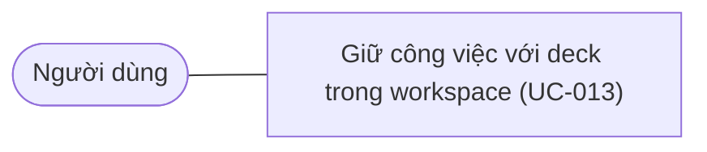
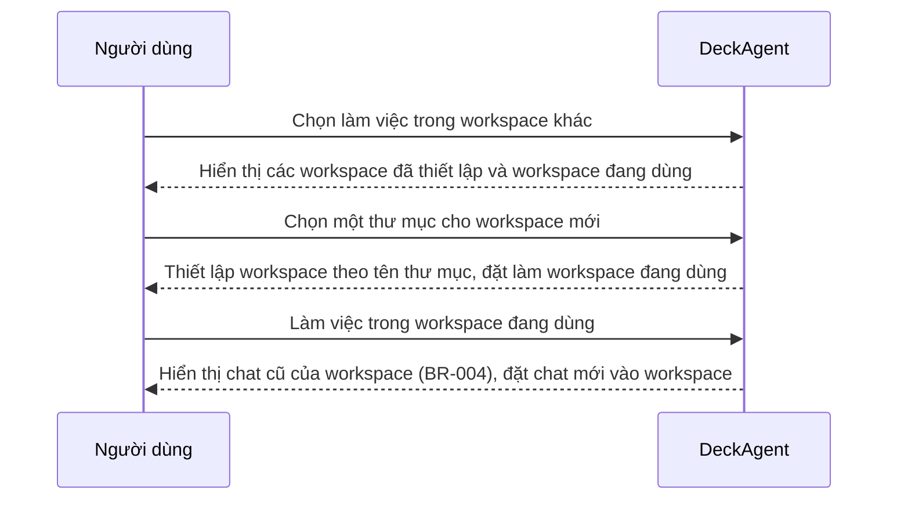
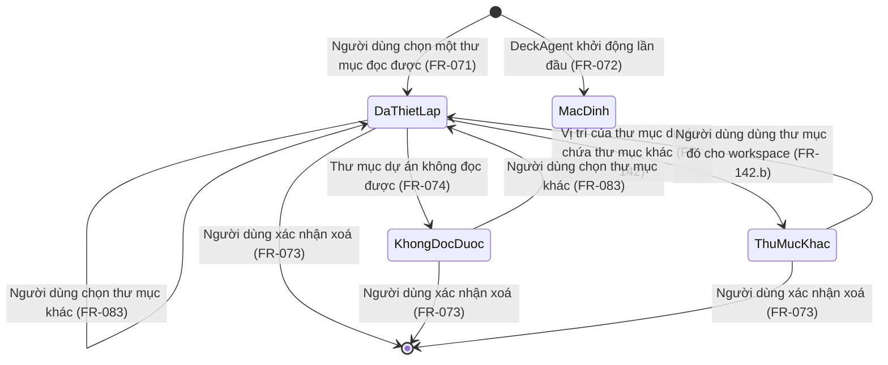

# Workspace

Đọc file này để biết người dùng giữ công việc với deck trong workspace gắn với thư mục của mình như thế nào.

## Tổng quan

Actor duy nhất là người dùng. File này chứa một mục tiêu: giữ công việc với deck trong các workspace gắn với thư mục dự án của người dùng, để công việc với một deck đọc các file của dự án đó và người dùng tìm lại các chat của dự án. Người dùng cũng bắt đầu được trước khi chọn thư mục nào. Việc mở chat cũ và bắt đầu chat mới nằm trong file chat [[1]](#ref-1). ID trong file theo [Tiền tố ID](README.md#tiền-tố-id).

Ngoài phạm vi:

- Đổi tên hoặc xoá một chat (UC-018) [[1]](#ref-1).
- Lấy deck ra làm file trong một thư mục người dùng chọn (UC-004) [[2]](#ref-2).

## Giữ công việc với deck trong workspace (UC-013)

Người dùng giữ các file của mỗi dự án trong một thư mục riêng trên máy. Họ muốn các chat của một dự án được nhóm với thư mục đó, để công việc với một deck đọc các file của dự án đó và họ tìm lại các chat của dự án. Họ cũng muốn bắt đầu trước khi chọn thư mục nào.

**Trigger:** Người dùng chọn làm việc trong một workspace khác, chọn thư mục khác cho một workspace, đổi tên một workspace hoặc xoá một workspace; hoặc DeckAgent khởi động lần đầu tiên trên máy (UC-013.A10).

**Precondition:** DeckAgent chạy trên máy của người dùng.

**Kết quả khi thành công:** Workspace đang dùng là workspace người dùng đã chọn, với các chat của workspace đó. Mọi file của người dùng trong thư mục dự án giữ nguyên.

**Kết quả khi thất bại:** Không file nào của người dùng bị thay đổi, di chuyển hoặc xoá. Không chat, cuộc hội thoại hoặc deck nào bị xoá. Không request đang chạy nào dừng.

Luồng chính:

1. Người dùng chọn làm việc trong một workspace khác. Hệ thống hiển thị tên của mỗi workspace đã thiết lập, trong đó có workspace mặc định, và cho biết workspace nào là workspace đang dùng. Chat hiện tại và draft của nó giữ nguyên (FR-038) [[3]](#ref-3).
2. Người dùng chọn một thư mục trên máy cho một workspace mới. Hệ thống thiết lập một workspace cho thư mục đó, đặt tên workspace theo tên thư mục và đặt workspace đó làm workspace đang dùng. Hệ thống không đọc file nào của thư mục, không gửi gì tới model và không thay đổi file nào của người dùng. Chat hiện tại và draft của nó giữ nguyên, và mọi request đang chạy tiếp tục chạy trong chat của nó (FR-068) [[3]](#ref-3).
3. Người dùng làm việc trong workspace đang dùng. Hệ thống hiển thị các chat của workspace đang dùng làm chat cũ (BR-004, FR-048) [[1]](#ref-1), và đặt mỗi chat mới vào workspace đang dùng. Hệ thống không tạo, không thay đổi và không xoá file nào trong thư mục dự án.

Agent của một chat đọc các file của thư mục dự án của workspace mà không hỏi, và không ghi file nào vào đó (FR-077) [[3]](#ref-3). Người dùng nêu một file của thư mục dự án trong nội dung request; không có cách tham chiếu file có tên riêng. Một file không đọc được là luồng file không đọc được (UC-003.A43) [[3]](#ref-3). Bắt đầu chat mới là UC-012, và mở một chat cũ của workspace đang dùng hoặc một chat không thuộc nhóm là UC-006 [[1]](#ref-1). Một chat không thuộc nhóm không vào workspace nào. Khi người dùng thêm lại thư mục dự án trước đây của chat đó, hệ thống thiết lập một workspace mới không có chat đó (bước 2).

Khi người dùng xoá workspace chứa chat hiện tại, chat hiện tại sau khi xoá chưa được quyết: [chat hiện tại sau khi xoá workspace của nó (OQ-040)](../open-questions.md#oq-040). Các điểm sau cũng chưa được quyết: [tên của workspace mặc định (OQ-041)](../open-questions.md#oq-041), [cách nêu workspace có thư mục khi hai workspace cùng tên (OQ-042)](../open-questions.md#oq-042), và [trạng thái của workspace khi thư mục dự án đọc được lại (OQ-043)](../open-questions.md#oq-043).

Vòng đời của một workspace:

| ID | Điều kiện | Phản hồi người dùng thấy | Nguồn | Trạng thái |
| --- | --- | --- | --- | --- |
| UC-013.A1 | Tại bước 2. Thư mục đã chọn là thư mục dự án của một workspace đã thiết lập. Tiếp tục tại bước 3 | Hệ thống đặt workspace đó làm workspace đang dùng, và không thiết lập workspace thứ hai cho thư mục đó | Product owner | Confirmed |
| UC-013.A2 | Tại bước 3. Người dùng xoá một workspace khác workspace mặc định, và không request nào trong các chat của workspace đó đang chạy. Kết thúc tại cùng bước | Hệ thống báo thư mục dự án và các chat của workspace được giữ, và yêu cầu người dùng xác nhận. Khi người dùng xác nhận: hệ thống xoá workspace, không thay đổi file nào của người dùng, và đặt các chat của workspace làm chat không thuộc nhóm với cuộc hội thoại, deck và model đã chọn của chúng (BR-004) [[1]](#ref-1). Khi workspace đó là workspace đang dùng, hệ thống đặt workspace mặc định làm workspace đang dùng. Khi người dùng huỷ: hệ thống không xoá gì | Product owner | Confirmed |
| UC-013.A3 | Tại bước 3. Thư mục dự án của một workspace không đọc được, ví dụ thư mục đã bị di chuyển hoặc quyền truy cập đã bị lấy lại. Kết thúc tại cùng bước | Hệ thống báo không đọc được các file của thư mục, và nêu tên workspace. Hệ thống nói người dùng làm gì tiếp theo, ví dụ đặt thư mục lại chỗ cũ hoặc chọn thư mục khác (UC-013.A6). Hệ thống không nêu nguyên nhân mà hệ thống không biết. Workspace vẫn được thiết lập và mọi chat của nó vẫn đọc được | Product owner | Confirmed |
| UC-013.A5 | Tại bước 3. Người dùng xoá một workspace, hoặc chọn thư mục khác cho workspace đó, trong lúc một request trong một chat của workspace đang chạy. Kết thúc tại cùng bước | Hệ thống không thay đổi workspace nào, và báo request phải kết thúc trước. Hệ thống không dừng request nào | Product owner | Confirmed |
| UC-013.A6 | Tại bước 3. Với một workspace khác workspace mặc định, người dùng chọn một thư mục khác đọc được mà không workspace nào có, và không request nào trong các chat của workspace đó đang chạy. Kết thúc tại cùng bước | Hệ thống đặt thư mục đã chọn làm thư mục dự án của workspace đó, và giữ workspace và các chat của nó. Hệ thống không đọc file nào của thư mục và không gửi gì tới model | Product owner | Confirmed |
| UC-013.A7 | Tại bước 1. Người dùng chọn một workspace đã thiết lập. Tiếp tục tại bước 3 | Hệ thống đặt workspace đó làm workspace đang dùng, không hỏi thư mục nào và không thay đổi file nào của người dùng. Chat hiện tại và draft của nó giữ nguyên, và mọi request đang chạy tiếp tục chạy trong chat của nó | Product owner | Confirmed |
| UC-013.A8 | Tại bước 3. Thư mục người dùng chọn cho một workspace là thư mục dự án của workspace khác, không đọc được, hoặc không được làm thư mục dự án (BR-019). Kết thúc tại cùng bước | Hệ thống không thay đổi workspace nào trong hai workspace. Hệ thống nêu workspace nào có thư mục đó, báo thư mục không đọc được, hoặc nêu lý do thư mục không được làm thư mục dự án | Product owner | Confirmed |
| UC-013.A9 | Tại bước 2. Người dùng không chọn thư mục nào, hoặc thư mục đã chọn không đọc được hoặc không được làm thư mục dự án (BR-019). Quay lại bước 1 | Hệ thống không thiết lập workspace nào và giữ workspace đang dùng như trước. Với thư mục không đọc được: hệ thống báo điều đó. Với thư mục không được làm thư mục dự án: hệ thống nêu lý do, và báo người dùng được chọn một thư mục bên trong thư mục đó khi có thư mục được phép | Product owner | Confirmed |
| UC-013.A10 | Tại bước 1. DeckAgent khởi động lần đầu tiên trên máy. Tiếp tục tại bước 3 | Hệ thống đặt workspace mặc định làm workspace đang dùng, và không hỏi thư mục nào | Product owner | Confirmed |
| UC-013.A11 | Tại bước 3. Người dùng đặt tên mới cho một workspace. Kết thúc tại cùng bước | Hệ thống đặt tên đó cho workspace, và giữ thư mục dự án và các chat của workspace. Hệ thống không thay đổi file nào của người dùng, và mọi request đang chạy tiếp tục chạy trong chat của nó | Product owner | Confirmed |
| UC-013.A12 | Tại bước 3. Vị trí của thư mục dự án của một workspace chứa một thư mục không phải thư mục người dùng đã chọn, ví dụ sau khi thư mục đã chọn bị di chuyển và một thư mục khác vào vị trí đó. Kết thúc tại cùng bước | Hệ thống báo vị trí đó giờ có một thư mục khác, và nêu tên workspace. Hệ thống không đọc file nào của thư mục đó. Hệ thống cho người dùng chọn dùng thư mục đó cho workspace; khi người dùng chọn, hệ thống tiếp tục như UC-013.A6. Workspace vẫn được thiết lập và mọi chat của nó vẫn đọc được | Product owner | Confirmed |
| UC-013.A13 | Tại bước 3. Tên người dùng đặt cho một workspace (UC-013.A11) là tên mà hệ thống từ chối (BR-020). Kết thúc tại cùng bước | Hệ thống giữ tên cũ của workspace, và nêu lý do từ chối tên. Hệ thống không thay đổi file nào của người dùng | Product owner | Confirmed |

| ID | Rule | Giá trị | Đo tại | Nguồn | Trạng thái |
| --- | --- | --- | --- | --- | --- |
| BR-019 | Rule xác định các thư mục mà hệ thống từ chối làm thư mục dự án, so sánh sau khi đi theo các link. Một thư mục bị một giá trị từ chối thì bị từ chối, bất kể các giá trị khác | — | — | Product owner | Confirmed |
| BR-019.V1 | Hệ thống từ chối gốc của mọi ổ đĩa | Gốc của mọi ổ đĩa, ví dụ `C:\` và `D:\` | Thư mục đã chọn, sau khi đi theo các link | Product owner | Confirmed |
| BR-019.V2 | Hệ thống từ chối các thư mục hệ thống, mọi thư mục bên trong chúng, và mọi thư mục chứa một trong số chúng. Danh sách đóng | `C:\Windows`, `C:\Program Files`, `C:\Program Files (x86)` | Thư mục đã chọn, sau khi đi theo các link | Product owner | Confirmed |
| BR-019.V3 | Hệ thống từ chối chính thư mục của người dùng. Một thư mục bên trong thư mục đó không bị giá trị này từ chối | Thư mục của người dùng, ví dụ `C:\Users\<name>` | Thư mục đã chọn, sau khi đi theo các link | Product owner | Confirmed |
| BR-019.V4 | Hệ thống từ chối các thư mục key trong thư mục của người dùng, và mọi thư mục bên trong chúng. Danh sách đóng | `.ssh`, `.aws`, `.gnupg`, `.kube`, `.docker` | Thư mục đã chọn, sau khi đi theo các link | Product owner | Confirmed |
| BR-019.V5 | Hệ thống từ chối thư mục dữ liệu riêng của DeckAgent, mọi thư mục bên trong nó, và mọi thư mục chứa nó | Thư mục dữ liệu riêng của DeckAgent. Đường dẫn chưa được quyết: [đường dẫn của thư mục dữ liệu (OQ-044)](../open-questions.md#oq-044) | Thư mục đã chọn, sau khi đi theo các link | Product owner | Confirmed |
| BR-020 | Rule xác định các tên mà hệ thống từ chối cho một workspace, so sánh sau khi chuẩn hoá tên về dạng NFC, và với tên người dùng đặt, sau khi bỏ khoảng trắng ở hai đầu (BR-020.V3) | — | — | Product owner | Confirmed |
| BR-020.V1 | Hệ thống từ chối tên không có ký tự nào sau khi bỏ khoảng trắng ở hai đầu (BR-020.V3) | 0 ký tự | Số ký tự của tên sau khi bỏ khoảng trắng ở hai đầu | Product owner | Confirmed |
| BR-020.V2 | Hệ thống từ chối tên dài hơn độ dài tối đa. Một ký tự là một Unicode code point sau khi chuẩn hoá NFC, nên "Việt" có 4 ký tự. Hệ thống chuẩn hoá tên về NFC trước khi đếm ký tự, áp dụng độ dài tối đa và lưu tên, với tên lấy từ thư mục và với tên người dùng đặt. Thư mục giữ tên riêng của nó | Tối đa 100 ký tự, tính cả 100 | Số Unicode code point của tên sau khi chuẩn hoá NFC | Product owner | Confirmed |
| BR-020.V3 | Hệ thống bỏ các ký tự khoảng trắng ở hai đầu của tên người dùng đặt. Hệ thống không bỏ ký tự nào của tên lấy từ thư mục | Tab (U+0009), line feed (U+000A), vertical tab (U+000B), form feed (U+000C), carriage return (U+000D), U+FEFF, U+2028, U+2029 và mọi ký tự thuộc nhóm Unicode Space_Separator (Zs), ví dụ dấu cách, no-break space (U+00A0) và ideographic space (U+3000) | Hai đầu của tên người dùng đặt | Product owner | Confirmed |
| FR-071 | Khi người dùng chọn một thư mục đọc được, hệ thống thiết lập một workspace cho thư mục đó và đặt workspace đó làm workspace đang dùng. Hệ thống đặt tên workspace theo tên thư mục ở dạng NFC, không bỏ khoảng trắng nào (BR-020), và cắt tên tới độ dài tối đa (BR-020.V2) khi tên thư mục dài hơn. Thư mục giữ tên và đường dẫn riêng của nó | — | — | Product owner | Confirmed |
| FR-071.b | Khi thư mục đã chọn đã là thư mục dự án của một workspace, hệ thống đặt workspace đó làm workspace đang dùng và không thiết lập workspace thứ hai cho thư mục đó. Khi thư mục đó đã bị di chuyển tới vị trí khác, workspace lấy vị trí mới làm thư mục dự án | — | — | Product owner | Confirmed |
| FR-071.c | Việc chuyển sang một workspace đã thiết lập không hỏi thư mục nào. Một thư mục không đọc được không thiết lập workspace nào | — | — | Product owner | Confirmed |
| FR-071.d | Một thư mục không được làm thư mục dự án (BR-019) không thiết lập workspace nào. Hệ thống nêu lý do, và báo người dùng được chọn một thư mục bên trong thư mục đó khi có thư mục được phép | — | — | Product owner | Confirmed |
| FR-071.e | Việc thêm hoặc chuyển workspace giữ chat hiện tại và draft của nó, không thay đổi file nào của người dùng, không đọc file nào của thư mục, không gửi gì tới model và không dừng request nào. Một chat mới vào workspace đang dùng | — | — | Product owner | Confirmed |
| FR-071.f | Một thư mục đã có workspace bị xoá thiết lập một workspace mới. Các chat của workspace đã bị xoá vẫn là chat không thuộc nhóm (FR-073.b) | — | — | Product owner | Confirmed |
| FR-072 | Từ lần khởi động đầu tiên trên máy, hệ thống có một workspace mặc định không có thư mục dự án, với tên do hệ thống đặt, và đặt workspace đó làm workspace đang dùng cho tới khi người dùng chọn workspace khác. Người dùng làm việc trong workspace mặc định mà không chọn thư mục | — | — | Product owner | Confirmed |
| FR-072.b | Ở mỗi lần khởi động sau, workspace đang dùng là workspace đang dùng lúc DeckAgent dừng, khi workspace đó vẫn được thiết lập. Trong trường hợp khác, workspace đang dùng là workspace mặc định | — | — | Product owner | Confirmed |
| FR-072.c | Hệ thống không bao giờ xoá workspace mặc định. Các chat của workspace mặc định giữ cuộc hội thoại và deck của chúng mà không cần thư mục nào | — | — | Product owner | Confirmed |
| FR-073 | Hệ thống chỉ xoá một workspace khác workspace mặc định sau khi người dùng xác nhận, và trước đó báo thư mục dự án và các chat của workspace được giữ | — | — | Product owner | Confirmed |
| FR-073.b | Việc xoá không thay đổi thư mục nào và file nào của người dùng. Mọi chat của workspace đã bị xoá trở thành chat không thuộc nhóm với cuộc hội thoại, deck và model đã chọn của nó (BR-004) [[1]](#ref-1). Workspace mặc định trở thành workspace đang dùng khi workspace đã bị xoá là workspace đang dùng | — | — | Product owner | Confirmed |
| FR-073.c | Trong lúc một request trong một chat của workspace đang chạy, hệ thống không xoá gì, báo request phải kết thúc trước, và không dừng request nào | — | — | Product owner | Confirmed |
| FR-073.d | Một chat không thuộc nhóm không có thư mục dự án, như chat của workspace mặc định, nên agent không truy cập thư mục nào khi chưa có phê duyệt (FR-077) [[3]](#ref-3). Chat không thuộc nhóm không vào workspace nào, kể cả workspace mặc định | — | — | Product owner | Confirmed |
| FR-074 | Khi thư mục dự án của một workspace không đọc được, hệ thống báo điều đó, nêu tên workspace, và nói người dùng làm gì tiếp theo, ví dụ đặt thư mục lại chỗ cũ, cấp lại quyền truy cập hoặc chọn thư mục khác | — | — | Product owner | Confirmed |
| FR-074.b | Hệ thống không nêu nguyên nhân mà hệ thống không biết, ví dụ việc xoá, và không đọc file nào của thư mục đó trong lúc thư mục không đọc được. Workspace vẫn được thiết lập, và mọi chat của nó vẫn đọc được với cuộc hội thoại và deck của chat. Một file của thư mục mà request cần trong lúc đó là FR-067 [[3]](#ref-3) | — | — | Product owner | Confirmed |
| FR-083 | Khi người dùng chọn thư mục khác cho một workspace khác workspace mặc định, hệ thống đặt thư mục đó làm thư mục dự án của workspace, giữ workspace, tên và các chat của nó, và không đọc file nào của thư mục vì việc chọn này. Hệ thống không bao giờ tự thay đổi một thư mục dự án | — | — | Product owner | Confirmed |
| FR-083.b | Khi thư mục đã chọn là thư mục dự án của workspace khác, không đọc được, hoặc không được làm thư mục dự án (BR-019), hệ thống không thay đổi workspace nào trong hai workspace, và nêu workspace nào dùng thư mục đó, báo thư mục không đọc được, hoặc nêu lý do thư mục không được làm thư mục dự án | — | — | Product owner | Confirmed |
| FR-083.c | Trong lúc một request trong một chat của workspace đang chạy, hệ thống không thay đổi thư mục dự án nào, báo request phải kết thúc trước, và không dừng request nào | — | — | Product owner | Confirmed |
| FR-083.d | Workspace mặc định không có thư mục dự án. Khi người dùng chọn một thư mục cho workspace mặc định, hệ thống từ chối, không thay đổi trạng thái nào và nêu lý do | — | — | Product owner | Confirmed |
| FR-084 | Trong lúc hệ thống làm một request, giữ công việc của một chat hoặc hiển thị một deck, hệ thống không tạo, không thay đổi, không di chuyển và không xoá file nào trong thư mục dự án, kể cả file ẩn | — | — | Product owner | Confirmed |
| FR-084.b | Một file người dùng đưa làm file đính kèm giữ nguyên như người dùng đã đưa | — | — | Product owner | Confirmed |
| FR-084.c | Một file chỉ xuất hiện trong thư mục dự án qua việc xuất mà người dùng chọn. Việc xuất nằm ngoài phạm vi (UC-004, FR-085) [[2]](#ref-2) | — | — | Product owner | Confirmed |
| FR-141 | Khi người dùng đặt tên mới cho một workspace, kể cả workspace mặc định, hệ thống đặt tên đó cho workspace | — | — | Product owner | Confirmed |
| FR-141.b | Việc đổi tên giữ thư mục dự án và các chat của workspace, không thay đổi thư mục nào và file nào của người dùng, và không dừng request nào | — | — | Product owner | Confirmed |
| FR-141.c | Hai workspace được phép có cùng tên | — | — | Product owner | Confirmed |
| FR-141.d | Hệ thống bỏ khoảng trắng ở hai đầu của tên mới (BR-020.V3), và giữ tên ở dạng NFC (BR-020) | — | — | Product owner | Confirmed |
| FR-141.e | Một tên mà hệ thống từ chối (BR-020) không thay đổi gì: workspace giữ tên cũ, và hệ thống nêu lý do từ chối tên | — | — | Product owner | Confirmed |
| FR-142 | Khi vị trí của thư mục dự án của một workspace chứa một thư mục không phải thư mục người dùng đã chọn, hệ thống báo vị trí đó giờ có một thư mục khác, nêu tên workspace, và không đọc file nào của thư mục đó | — | — | Product owner | Confirmed |
| FR-142.b | Người dùng được dùng thư mục đó cho workspace. Khi người dùng chọn, hệ thống đặt thư mục đó làm thư mục dự án với cùng điều kiện như việc chọn thư mục khác (FR-083) | — | — | Product owner | Confirmed |
| FR-142.c | Cho tới khi người dùng chọn, workspace vẫn được thiết lập, và mọi chat của nó vẫn đọc được với cuộc hội thoại và deck của chat. Khi người dùng thêm thư mục khác đó làm workspace (FR-071), hệ thống thiết lập một workspace mới cho thư mục đó, và workspace đầu tiên vẫn báo có thư mục khác | — | — | Product owner | Confirmed |
| FR-143 | Khi một thao tác thay đổi trạng thái của một workspace hoặc một chat đến từ một client mà DeckAgent không cho phép, hệ thống từ chối thao tác và không thay đổi workspace nào và chat nào | — | — | Product owner | Confirmed |
| FR-143.b | Một trang web bên ngoài DeckAgent không phải là client được cho phép | — | — | Product owner | Confirmed |

DeckAgent không có đăng nhập người dùng. Hệ thống không bảo vệ trước một process khác chạy với cùng quyền hệ điều hành như DeckAgent.

## Gap analysis

Baseline độc lập cho file này đã có [[4]](#ref-4). File này chưa được đối chiếu với baseline đó.

| ID | Gap | Baseline | Quyết định | Trạng thái |
| --- | --- | --- | --- | --- |
| GAP-01 | Chưa đối chiếu với baseline độc lập | [Baseline workspaces](../build/refactor/UCs/baseline/workspaces.md) | [Đối chiếu từng vùng với baseline độc lập (OQ-060)](../open-questions.md#oq-060) | Open |

## References

1. [Chat](chats.md)
2. [Deck](deck.md)
3. [Gửi request](requests.md)
4. [Baseline workspaces](../build/refactor/UCs/baseline/workspaces.md)
