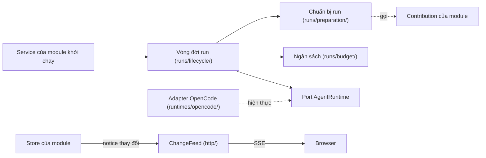
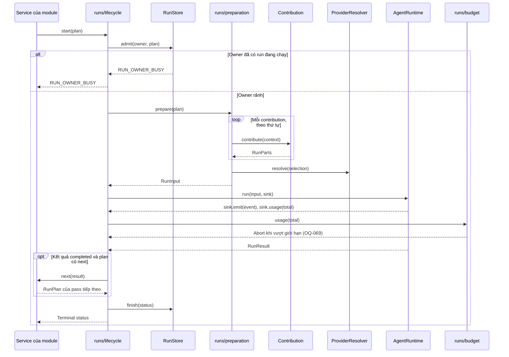
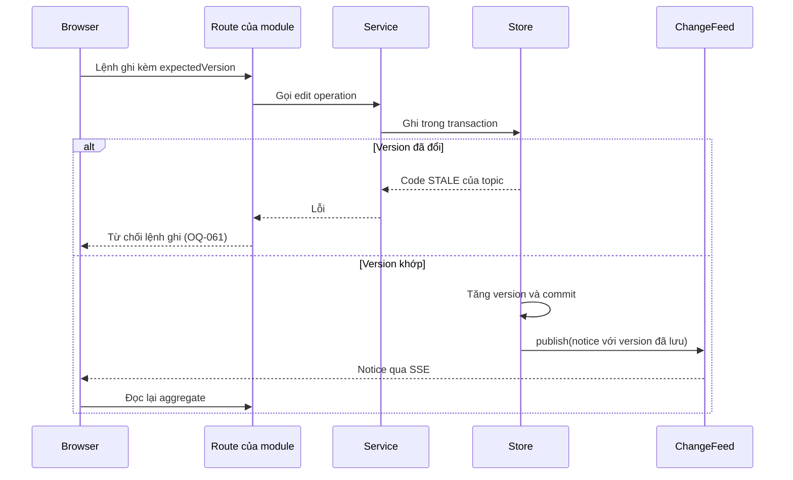

# Agent core

Đọc file này để biết lõi agent của DeckAgent gồm những contract nào (owner của run, chuẩn bị run, port AgentRuntime, change notice), các phần phối hợp thế nào trong một run, và code hiện tại khác contract đích ở đâu.

Mọi contract trong file này có trạng thái `Proposed`. Lý do và trade-off của từng contract nằm trong [Quyết định kiến trúc](30-decisions.md) [[1]](#ref-1): owner của run ở ADR-001, port AgentRuntime ở ADR-002, chuẩn bị run ở ADR-003, change notice ở ADR-004. Code hiện tại chưa dùng các contract này. Cột "Code hiện tại" trong các bảng dưới đây chỉ ra nơi code đang làm việc tương ứng.

## Drivers

| Driver | Cơ chế đáp ứng |
| --- | --- |
| Run đề xuất design system từ file thương hiệu có thể không thuộc chat nào (UC-010) [[2]](#ref-2) | Owner của run có kiểu và ID |
| Chạy model qua coding agent CLI đã có trên máy người dùng, ngoài phạm vi hiện tại (UC-005-A18) [[3]](#ref-3) | Port `AgentRuntime` mà mọi runtime implement |
| Người dùng dừng được request đang chạy (FR-018) [[4]](#ref-4) | Abort signal của run, category `stopped` |
| Hiển thị mức dùng context của một chat, ngoài phạm vi hiện tại (FR-078) [[4]](#ref-4) | Usage trong kết quả và trong lúc chạy |
| Loại lỗi provider ([OQ-063](../open-questions.md#oq-063)), thời gian chờ provider ([OQ-062](../open-questions.md#oq-062)) và giới hạn tài nguyên của một request ([OQ-069](../open-questions.md#oq-069)), chưa được quyết | Category của lỗi, đồng hồ của adapter, `runs/budget/` |
| Hai giao diện cùng thay đổi một đối tượng ([OQ-061](../open-questions.md#oq-061)) | Change notice và `expectedVersion` |
| Tự sửa deck bằng tay mà không hỏi model, ngoài phạm vi hiện tại (UC-007) [[5]](#ref-5) | Change notice và `expectedVersion` cho deck |
| Lõi agent dùng ports và adapters (TS-04), mọi đối tượng người dùng thấy có `version` và notice (TS-12), run có owner tổng quát (TS-13) [[6]](#ref-6) | Toàn bộ file này |

## Thành phần và ranh giới



| Phần | Trách nhiệm | Code hiện tại |
| --- | --- | --- |
| `runs/lifecycle/` | Admit run, rule mỗi owner một run đang chạy, giới hạn số owner đang chạy, event log, approval, stop, pass tiếp theo, terminal status | `packages/host/api/src/lifecycle/request-controller.ts` |
| `runs/preparation/` | Gọi contribution, gộp instruction, tool set và resource thành `RunInput` | Rải trong `apps/host/src/features/deck/`, `features/sources/source-tools.ts`, `features/requests/prepare-runtime.ts` và `apps/host/src/server.ts:313-323` |
| `runs/budget/` | Đọc usage và dừng run khi vượt giới hạn | Chưa có |
| `runs/ports.ts` | Các type trong [Contract](#contract) | `packages/host/api/src/lifecycle/contracts.ts`, `lifecycle/tool-contracts.ts` |
| `runtimes/opencode/` | Implement `AgentRuntime` cho OpenCode | `apps/host/src/integrations/opencode/` |
| `ChangeFeed` trong `http/` | Chuyển change notice từ store tới Browser | `DeckRuntime.notify` trong `packages/presentation/deck/src/deck-runtime.ts` và route trong `packages/host/api/src/transport/deck-routes.ts` |

`runs/` không import module, Express, SQL driver hay adapter trong `runtimes/` [[7]](#ref-7). Module dùng type trong `runs/ports.ts` và public operation của `runs/`. Composition root `server.ts` tạo adapter, store và contribution, rồi truyền chúng vào `runs/`.

## Contract

### Owner và kế hoạch run

```ts
// apps/host/src/runs/ports.ts
export type RunOwnerKind = 'chat'

export interface RunOwner {
  readonly kind: RunOwnerKind
  readonly id: string
}

export type SourceKind = 'workspace-files' | 'attachments' | 'research'

export interface RunGrants {
  readonly publicResearch: boolean
  readonly sourceKinds: readonly SourceKind[]
}

export interface RunPlan {
  readonly owner: RunOwner
  /** ID đã cấp trước, ví dụ khi xác nhận deck. Khi không có, runs/ tạo ID. */
  readonly requestId?: string
  readonly input: string
  readonly selection: ModelSelection
  readonly grants: RunGrants
  readonly stepLimit: number | 'none'
  readonly contributions: readonly RunContribution[]
  next?(result: RunResult): Promise<RunPlan | undefined>
  closingText?(status: TerminalStatus): string | undefined
}
```

`ModelSelection` và `TerminalStatus` giữ nguyên định nghĩa hiện tại trong `packages/host/contracts/src/requests.ts`. Module chats tạo `RunPlan` với `owner = { kind: 'chat', id: sessionId }`. Module deck tạo `RunPlan` cho lệnh deck và cho generation, với `sourceKinds` lấy từ nguồn của Brief.

### Contribution

```ts
export interface PreparationContext {
  readonly owner: RunOwner
  readonly requestId: string
  readonly grants: RunGrants
  readonly signal: AbortSignal
}

export interface RunContribution {
  readonly name: string
  contribute(context: PreparationContext): Promise<RunParts>
}

export interface RunParts {
  readonly instructions?: readonly string[]
  readonly tools?: ToolSet
  readonly resources?: readonly RunResource[]
}

export interface ConversationMessage {
  readonly role: 'user' | 'assistant'
  readonly content: string
  readonly unfinished?: true
  readonly attachments?: readonly { readonly attachmentId: string; readonly name: string }[]
}

export type RunResource = { readonly kind: 'conversation'; readonly messages: readonly ConversationMessage[] }
```

`ConversationMessage` có các trường mà `seedPrompt` hiện đọc (`apps/host/src/integrations/opencode/history.ts:9-39`). `runs/preparation/` gọi contribution đăng ký tại `server.ts` theo thứ tự đăng ký, rồi contribution của `RunPlan` theo thứ tự trong plan. Nó nối instruction theo thứ tự đó, gộp các tool set, và từ chối khi hai tool set có cùng tên tool.

| Contribution | Module | Phần góp | Code hiện tại |
| --- | --- | --- | --- |
| Source tool | sources | Tool set của các nguồn trong `sourceKinds`, kèm `read_research` và `research_public` theo grant | `prepareSourceTools` (`source-tools.ts:157-196`), closure `prepareTools` (`index.ts:313-323`) |
| Lịch sử hội thoại | chats | Resource `conversation` | `RuntimeSessionAccess.read`, gọi tại `runtime.ts:164` và `prepare-runtime.ts:42` |
| Lệnh deck | deck, riêng cho run | Instruction deck, staging tool, image tool | `buildDeckInstructions`, `buildTools` trong `deck-tool-session.ts:163-183` |
| Generation | deck, riêng cho run | Instruction generation, generation tool, `GenerationGrant`, `GenerationCapability` | `GenerationWorkflow.startRun` (`generation-workflow.ts:24-57`) |

### Tool

```ts
export interface ToolContext {
  readonly owner: RunOwner
  readonly requestId: string
  readonly signal: AbortSignal
  approve(step: ApprovalStep): Promise<boolean>
}

export interface ToolExecutor {
  execute(name: string, args: unknown, context: ToolContext): Promise<ToolResult>
}

export interface ToolSet {
  readonly context: string
  readonly manifest: string
  readonly schemas: readonly ToolSchema[]
  readonly executor: ToolExecutor
}

export interface RunTools {
  readonly context: string
  readonly manifest: string
  readonly schemas: readonly ToolSchema[]
  call(name: string, args: unknown): Promise<ToolResult>
}
```

`ToolSchema`, `ToolResult` và `ApprovalStep` giữ nguyên định nghĩa hiện tại trong `packages/host/api/src/lifecycle/tool-contracts.ts` và `@deckagent/session-persistence`. `ToolSet` thay cho `PreparedTools`. `RunTools` thay cho `RequestTools`: lifecycle gắn `ToolContext` vào lời gọi, nên runtime chỉ nhận capability đã gắn.

### Port AgentRuntime

```ts
export interface RunInput {
  readonly owner: RunOwner
  readonly requestId: string
  readonly provider: ProviderRunSettings
  readonly instructions: readonly string[]
  readonly tools?: RunTools
  readonly resources: readonly RunResource[]
  readonly stepLimit: number | 'none'
  readonly signal: AbortSignal
  onApprovalWait(listener: (waiting: boolean) => void): () => void
}

export type RunEvent = Exclude<RequestEventBody, { readonly kind: 'status' | 'approval' }>

export interface RunUsage {
  readonly modelCalls: number
  readonly inputTokens?: number
  readonly outputTokens?: number
}

export interface RunSink {
  emit(event: RunEvent): Promise<void>
  usage(total: RunUsage): void
}

export type RunErrorCategory =
  | 'provider-auth'
  | 'provider-rate-limit'
  | 'provider-quota'
  | 'provider-network'
  | 'provider-model'
  | 'provider-other'
  | 'context-limit'
  | 'input-unsupported'
  | 'content-blocked'
  | 'timeout'
  | 'stopped'
  | 'runtime-unavailable'
  | 'runtime-config'
  | 'runtime-protocol'
  | 'runtime-incomplete'
  | 'runtime-failed'

export interface RunError {
  readonly category: RunErrorCategory
  readonly code: string
}

export type RunResult =
  | { readonly status: 'completed'; readonly usage: RunUsage; commit?(): void }
  | { readonly status: 'failed'; readonly usage: RunUsage; readonly error: RunError }

export type RuntimeAvailability = { readonly available: true } | { readonly available: false; readonly code: string }

export interface AgentRuntime {
  readonly name: string
  availability(): Promise<RuntimeAvailability>
  run(input: RunInput, sink: RunSink): Promise<RunResult>
}

export interface ProviderResolver {
  resolve(selection: ModelSelection): Promise<ProviderRunSettings>
}
```

`RequestEventBody` giữ nguyên định nghĩa trong `packages/host/contracts/src/requests.ts`. `RunEvent` có ba loại `activity`, `text` và `notice`, như `RuntimeEvent` hiện tại. `ProviderRunSettings` giữ các trường hiện có mà `providerConfiguration` đọc (`apps/host/src/integrations/opencode/provider.ts:34-66`). Module providers implement `ProviderResolver`. `commit` chỉ chạy sau khi lifecycle đã lưu status `completed`, như hiện tại.

Port `RunStore` giữ các method của `RequestStore` hiện tại, với `owner` thay cho `sessionId`. Store khoá rule mỗi owner một run đang chạy bằng unique index trên `(owner_kind, owner_id)` với status `active` và `waiting_approval`, và trả `RUN_OWNER_BUSY` khi vi phạm.

### Change notice

```ts
// packages/contracts
export type ChangeTopic = 'deck' | 'brief' | 'outline' | 'draft' | 'chats' | 'workspaces' | 'providers' | 'preferences'

export interface ChangeNotice {
  readonly topic: ChangeTopic
  readonly key: string
  readonly version: number
}

export type PublishChange = (notice: ChangeNotice) => void

// apps/host/src/http/
export interface ChangeFeed {
  readonly publish: PublishChange
  subscribe(topic: ChangeTopic, key: string, listener: (notice: ChangeNotice) => void): () => void
}
```

Topic dùng cho cả Host có khoá `'host'`.

## Luồng của một run



Chỉ `runs/lifecycle/` ghi status. Khi pass tiếp theo có, lifecycle chuẩn bị và chạy pass đó trong cùng request. Khi lưu text kết thúc thất bại, status `completed` thành `failed` với `REQUEST_NOT_SAVED`, như hiện tại (`request-controller.ts:287-290`).

## Map từ code lỗi sang category

Code và điều kiện lấy từ chẩn đoán port AgentRuntime [[8]](#ref-8). Cột Code giữ string hiện tại, nên HTTP wire không đổi.

| Code | Điều kiện hiện tại | Category |
| --- | --- | --- |
| `PROVIDER_AUTH` | Event lỗi có status `401` hoặc `403`, hoặc tên `ProviderAuthError` | `provider-auth` |
| `PROVIDER_RATE_LIMIT` | Event lỗi có status `429` | `provider-rate-limit` |
| `PROVIDER_MODEL_UNAVAILABLE` | Event lỗi có status `404` | `provider-model` |
| `PROVIDER_HTTP` | Event lỗi có status khác từ 100 đến 599 | `provider-other` |
| `RUNTIME_FAILED` | Event lỗi không có status, không có tên khớp và không báo ảnh | `provider-other` |
| `CONTEXT_LIMIT` | Tên lỗi khớp `context` hoặc `overflow` | `context-limit` |
| `IMAGE_INPUT_UNAVAILABLE` | Message của provider cho biết model không nhận ảnh | `input-unsupported` |
| `CONTEXT_SUMMARY_FAILED` | Bước tóm tắt kết thúc với lý do `content-filter` | `content-blocked` |
| `CONTEXT_SUMMARY_FAILED` | Bước tóm tắt kết thúc với lý do `error`, tóm tắt còn mở khi kết thúc, hoặc lỗi tràn context trong lúc tóm tắt | `context-limit` |
| `REQUEST_TIMEOUT` | Đồng hồ của attempt hết giờ | `timeout` |
| `STOPPED` | Signal của run bị abort và đồng hồ chưa hết giờ | `stopped` |
| `REQUEST_NOT_SAVED` | Abort controller nội bộ của adapter đã chạy | `stopped` |
| `RUNTIME_UNAVAILABLE` | Không có executable, hoặc process không khởi động | `runtime-unavailable` |
| `RUNTIME_VERSION_UNSUPPORTED` | Version của executable không được hỗ trợ (chỉ trong `availability`) | `runtime-unavailable` |
| `PROVIDER_UNSUPPORTED` | Cấu hình không hỗ trợ provider (`UnsupportedProviderError`) | `runtime-config` |
| `RUNTIME_CONFIG_UNSAFE` | Lệnh `debug config` lỗi, hoặc cấu hình đã resolve khác cấu hình đã dựng | `runtime-config` |
| `RUNTIME_FAILED` | Process kết thúc với exit code khác 0, hoặc lỗi cấu hình khác | `runtime-failed` |
| `RUNTIME_PROTOCOL` | Một dòng output không phải event, session ID native thay đổi, hoặc output hỏng | `runtime-protocol` |
| `RUNTIME_INCOMPLETE` | Không bước nào chạy, không có lý do kết thúc, lý do kết thúc là `tool-calls`, hoặc không có session ID native | `runtime-incomplete` |

`provider-quota` và `provider-network` chưa có điều kiện nào. `NEW_RUNTIME_SESSION` và `CONVERSATION_SUMMARIZED` là notice, không phải lỗi. Code của admission, approval và lệnh ghi store (ví dụ `SESSION_BUSY`, `HOST_BUSY`, `APPROVAL_CONFLICT`, `REQUEST_NOT_SAVED` khi ghi store lỗi) là code của `runs/lifecycle/`, không có category.

## Aggregate và change notice

Bảng và trạng thái hiện tại lấy từ chẩn đoán change notice [[9]](#ref-9).

| Topic | Khoá | `version` lấy từ | Bảng hoặc state | Hiện tại | Code khi `version` cũ |
| --- | --- | --- | --- | --- | --- |
| `deck` | Chat ID | `decks.version` | `decks`, `slides`, `revisions`, `publications`, `generation_intents`, `artifact_revisions` | Notice `deck` sau commit trên `GET /api/sessions/:sessionId/changes`. Giữ `GET /api/sessions/:sessionId/deck/events` | `DECK_STALE` (mới). `DECK_CONFLICT` giữ cho revision của slide |
| `brief` | Chat ID | `brief_heads.version` | `brief_heads`, `brief_versions`, `brief_request_receipts` | Notice `brief` sau commit trên `GET /api/sessions/:sessionId/changes` | `BRIEF_STALE` |
| `outline` | Chat ID | `outline_heads.version` | `outline_heads`, `outline_proposals`, `outline_details`, `prepared_images` | Notice `outline` sau commit trên `GET /api/sessions/:sessionId/changes` | `OUTLINE_STALE` |
| `draft` | Chat ID | `revision` của draft | Draft trong bộ nhớ (`MemoryDraftStore`), `attachments` | Có notice `draft` trên `GET /api/sessions/:sessionId/changes` (phiên bản notice riêng với `revision` của draft). Browser nhận notice thay cho poll 500 ms | `DRAFT_CONFLICT` |
| `chats` | `'host'` | `change_versions` trong `sessions.sqlite` | `sessions`, `messages` | Có committed `version` và notice `chats` trên `GET /api/changes` | Không có. Lệnh ghi chat không gửi `expectedVersion` |
| `workspaces` | `'host'` | `change_versions` | `workspaces`, `registry_state` | Có committed `version` và notice `workspaces` trên `GET /api/changes` | `WORKSPACES_STALE` |
| `providers` | `'host'` | `change_versions` | `providers` | Có `version` trong `change_versions` của `web.sqlite` (schema 2), notice `providers` sau commit | `PROVIDERS_STALE` |
| `preferences` | `'host'` | `change_versions` | `preferences` | Có `version` trong `change_versions` của `web.sqlite` (schema 3), notice `preferences` sau commit cho `theme` và `research` (`lastSelection` không tăng `version`) | `PREFERENCES_STALE` |

Các bảng sau không có change notice. `requests`, `request_events` và `request_approvals` dùng event log với cursor `sequence`. `messages`, `research_sources`, `request_research`, `source_reads`, `sources`, `runtime_bindings` và `image_search_attempts` do run ghi hoặc chỉ dùng nội bộ. Browser biết các bảng này đổi qua event của request.



Khi kết nối SSE, Host gửi một notice với `version` hiện tại, như route deck hiện tại. Browser đọc lại khi `version` của notice lớn hơn `version` đang có.

## Phần ở lại trong adapter OpenCode

Các phần sau là việc riêng của OpenCode và không đi qua `runs/preparation/`. Nguồn là chẩn đoán chuẩn bị run [[10]](#ref-10).

- Cấu hình OpenCode, block provider và việc encode cấu hình (`config.ts:39-104`, `provider.ts:34-66`).
- Biến môi trường cô lập và folder của run (`config.ts:107-143`, `runtime.ts:140-153`). Folder lấy từ hash của `owner` thay cho chat ID.
- MCP bridge, tool server và permission `deckagent_<name>: allow` (`mcp-bridge.ts:57-177`, `config.ts:44-46`).
- Tham số dòng lệnh và text của stdin (`runtime.ts:232-251`).
- Việc tìm executable, kiểm version và kiểm resource (`runtime.ts:41-138`, `resources.ts:16-45`).
- Hash của resume guard và binding session native (`runtime.ts:159-199`). Binding có khoá là `owner`.
- Prompt khung khi không có tool bridge (`config.ts:13-18`).
- Đồng hồ của attempt, dừng trong lúc chờ approval (`stream-tracker.ts:36-43`).

## Rủi ro và điểm còn mở

- `Open`: transaction admit hiện ghi request, message của người dùng và liên kết attachment cùng lúc (`request-controller.ts:98-106`). Request thuộc `runs/`, còn message và attachment thuộc module chats và attachments. Cách giữ ba lần ghi này atomic chưa được quyết.
- `Open`: vị trí của code SQL hiện thực `RunStore`, vì `runs/` không import SQL driver.
- `Open`: output thật của OpenCode 1.19.5 có `tokens` trong event `step_finish` hay không. Chỉ fixture giả có trường này.
- `Open`: route SSE cho các topic khác `deck`, và format skill mà OpenCode nhận.
- `Inferred`: `sourceKinds` cho cùng tập tool với `isSourceToolAllowed` và `sourceToolNames` hiện tại. Cần test so sánh trước khi bỏ hai hàm này.

## References

1. <a id="ref-1"></a>[Quyết định kiến trúc](30-decisions.md)
2. <a id="ref-2"></a>[Design system](../UCs/design-systems.md)
3. <a id="ref-3"></a>[Provider và model](../UCs/providers.md)
4. <a id="ref-4"></a>[Gửi request](../UCs/requests.md)
5. <a id="ref-5"></a>[Deck](../UCs/deck.md)
6. <a id="ref-6"></a>[Tiêu chí của cấu trúc đích](../build/refactor/target-structure/criteria.md)
7. <a id="ref-7"></a>[Project Structure](../conventions/project-structure.md)
8. <a id="ref-8"></a>[Task 4: Diagnose the AgentRuntime port report](../build/refactor/target-structure/reports/task-04-diagnose-agent-runtime-port.md)
9. <a id="ref-9"></a>[Task 6: Diagnose the change notice and version report](../build/refactor/target-structure/reports/task-06-diagnose-change-notice.md)
10. <a id="ref-10"></a>[Task 5: Diagnose run preparation report](../build/refactor/target-structure/reports/task-05-diagnose-run-preparation.md)
