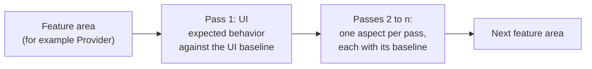
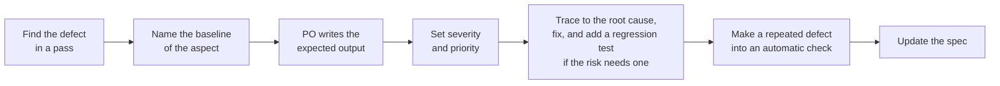

# Debugging Phase

Read this file to know how the debugging phase finds and fixes the defects that AI-generated code left in DeckAgent.

## Context

The refactors of the codebase structure, the names and the module groups are done. The Host runs on Express and the Browser runs on React [[1]](#ref-1). These refactors changed the structure, not the behavior. Much of the behavior came from code that an agent generated from the old use cases without a critical review. Thus the product has defects of many types. Examples are screens without design decisions, broken flows and risks that the code does not handle. The tests also have no statement of what they must cover.

The spec is not the source of truth for this phase. The team builds first, compares with a baseline, and updates the spec after the fix. The spec stays an output of the work, not a required input.

## Expectations

| Area | Expected result |
| --- | --- |
| UI | Each screen has one clear main task. All screens use one set of components. Interactions follow patterns that users know from similar products. The goal is not "a more attractive UI" |
| Behavior | Each risk situation has a defined and intentional behavior, also when no test covers it yet |
| Testing | The team knows what it tests, why, and when it can stop. Full coverage is not a goal |
| Process | The method can be repeated, so that the same defects do not come back after the fix |

## Principle: every finding has a baseline

A finding is a defect only when it differs from a baseline. Without a baseline, an agent invents the expected result, and the fix becomes new slop. The baseline is one of these:

- A reference product or a published heuristic for the UI.
- An external standard or checklist that fits the aspect.
- A document in the repo (use case, ADR, convention). The document is a point of comparison, not the truth.
- The expected output that the PO writes for the finding (one to three lines), when no other baseline gives an answer.

## Model: one feature area, then passes

The phase works on one feature area at a time. A feature area is a group of features with one owner module, for example Provider, Workspace or Chat. It contains all use cases of the area, with their main flows and their exception flows. For each area, the team does a sequence of passes:

The UI pass comes first, because the expected result of a screen is the easiest to define. The PO can say what the user must see at each step. That expected result then becomes the anchor for the other passes: they ask whether the layers behind the screen do what the screen promises.

A defect that shows in the UI does not always have its root cause in the UI. The trace goes from the top down: component, hook, route, service, store. The fix goes to the layer of the root cause. The check after the fix goes from the UI down again.

## Aspects

Each pass after the UI pass looks at one aspect. Each aspect has its own baseline, because no single standard finds all defect types. For example, OWASP ASVS [[2]](#ref-2) is a security checklist, and it has no item for a broken business flow or for wrong AI output.

| # | Aspect | Defects it finds | Baseline | Example in DeckAgent | Scope |
| --- | --- | --- | --- | --- | --- |
| 1 | UI and UX | Confusing screens, wrong patterns, missing components | Reference products (Claude.ai, Gamma, Perplexity), Nielsen 10 heuristics | The interview is a fixed panel with raw checkboxes and selects. The select "Loại yêu cầu Outline" makes the user classify the message | Now, pass 1 |
| 2 | Business flow | Wrong steps, missing exception flows | Main flows and exception flows in `docs/UCs/`, as a point of comparison | The user cannot skip one interview question, only all remaining questions [[3]](#ref-3). A chat gets its name from an interview chip answer [[4]](#ref-4) | Now |
| 3 | State and lifecycle | Invalid state transitions, lost state | State transition model (skill `test-technique-state-transition`) | The interview choices live in DOM nodes and can get lost when the user changes the chat (Inferred). The outline lifecycle: current, previous, accepted [[3]](#ref-3) | Now |
| 4 | Errors and recovery | Swallowed errors, messages without meaning, no way out | Exception flows of the use cases, HAX G9 to G11 | A provider error during slide generation. No way to run a failed request again ([OQ-064](../../open-questions.md#oq-064)) | Now |
| 5 | Data integrity and concurrency | Overwritten data, duplicates, data out of sync | Race condition checklist: lost update, double submit, stale tab, retry that is not idempotent | Two tabs, or two clicks on Send. The code handles part of it. The open part is what the second tab shows ([OQ-061](../../open-questions.md#oq-061)) | Later, lower priority |
| 6 | Security and privacy | Private data that leaves the machine, harmful input | STRIDE, OWASP ASVS 5.0.0 [[2]](#ref-2) (V5, V12), OWASP Top 10 for LLM Applications 2025 [[5]](#ref-5) | A Tavily query can contain text from the documents, against the rule for private content in public research [[3]](#ref-3) (Inferred). Prompt injection through an attached file | Now, for areas where data crosses a boundary |
| 7 | Quality of AI output | Invented figures, wrong sources, claims of checks that did not occur | OWASP LLM09 (misinformation) [[5]](#ref-5), HAX G2, the rules for sourced content [[3]](#ref-3) | A slide shows a figure without a source. The final message says that the system checked something it did not check | Now. This aspect is specific to an AI product, and the usual web checklists do not have it |
| 8 | Accessibility | Low contrast, no keyboard use | WCAG 2.2 AA | The colored background shapes lower the text contrast | Part of the UI pass |
| 9 | Performance | Slow or stuck screens | Thresholds with a source (none exist yet) | No rule gives the time to wait for a provider ([OQ-062](../../open-questions.md#oq-062)) | Later, because no threshold exists to compare with |

Rules for the aspects:

- An area does not go through all nine aspects. The team selects the aspects for each area. For example, Chat needs almost no security pass, but Request needs one for research and attachments.
- After the UI pass, the order is: business flow (2), state (3), errors (4), AI output (7), security (6), concurrency (5). A broken business flow makes the other aspects meaningless.
- The team tests the risks with the highest impact first (skill `test-risk-analysis`). The test technique follows from the aspect, not from a list of test types.

## Method for each finding

Two steps of this flow stop the slop from coming back:

- **An independent review.** A subagent that did not read the spec reviews the fix, as in the gap analysis of the use cases.
- **An automatic check for a repeated defect.** When a defect can occur again, it becomes a lint rule or a test that fails on the old defect (skill `correct`). Without this step, an agent can generate the same defect again.

The skill `test-defect-classification` gives the severity and priority scales.

## Order of feature areas

The order follows the dependencies between the areas, from the base up. When the base areas work, a finding in an area has its root cause in that area almost always. A deck defect is then not a hidden provider or request defect.

| Order | Feature area | Reason | Main aspects after the UI pass |
| --- | --- | --- | --- |
| 1 | Provider | No flow runs without a model. The settings screen has few risks, so it is the pilot for the method and for the first primitives (Select, form, Dialog) | 2 business flow, 4 errors (wrong key, no answer from the provider), 6 security (key, base URL) |
| 2 | Workspace | It is the context of each chat, and it touches the file system | 2 business flow, 3 state, 6 security (folder access) |
| 3 | Chat | It holds the requests and the deck: the sidebar and the chat list | 2 business flow (chat names, empty chats), 3 state |
| 4 | Request | The shared path of each message: send, wait, stop, attachments, research | 3 state, 4 errors, 6 privacy (Tavily queries, attached files), 5 concurrency (two sends) |
| 5 | Deck | The main value of the product: interview, outline, slide generation | 2 business flow, 3 state, 7 AI output |

Areas 1 to 3 have a time box. In these areas the team fixes only the findings with a high severity, and puts the other findings in a backlog. Thus the work gets to the deck sooner.

The UI components come when an area needs them. The team adds a shadcn/ui primitive to `apps/web/src/components/ui/` when a finding needs it, not before. The base areas build most of the components that the deck needs. Provider builds the forms and selects. Workspace and Chat build the sidebar. Request builds the composer.

## References

1. [Target Structure Refactor](../refactor/target-structure/README.md)
2. OWASP, *Application Security Verification Standard 5.0.0*. <https://github.com/OWASP/ASVS/tree/v5.0.0/5.0/en>
3. [Deck](../../UCs/deck.md)
4. [Chat](../../UCs/chats.md)
5. OWASP, *Top 10 for LLM Applications 2025*. <https://genai.owasp.org/llm-top-10/>
