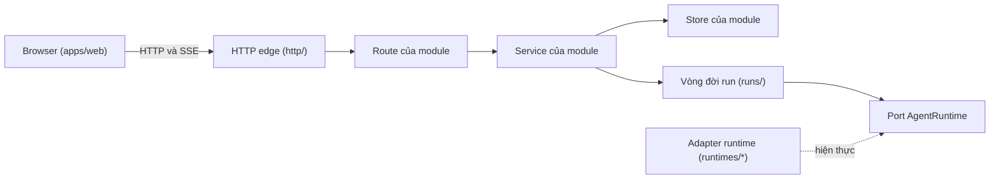

# Task 1: Update Project Structure to the target layout

Read this file to learn the steps of Task 1, which replaces Project Structure with the target layout and the move rules.

**Read first:**

- [Global Constraints](README.md#global-constraints) in `README.md`
- `docs/conventions/docs.md`
- `docs/conventions/project-structure.md` (lines 1-164)
- `docs/build/refactor/target-structure/target-layout.md`
- `docs/build/refactor/target-structure/current-gap.md` (section `## Bảng chuyển folder`)
- `.agents/skills/ste-vi/SKILL.md`
- `.agents/skills/mermaid-markdown/SKILL.md`

**Files:**

- Change: `docs/conventions/project-structure.md` (lines 1-164, replace the whole file)
- Change: `docs/build/refactor/target-structure/plan/README.md`
- Change: `docs/build/refactor/target-structure/plan/task-01-update-project-structure.md`
- Create: `docs/build/refactor/target-structure/reports/README.md`
- Create: `docs/build/refactor/target-structure/reports/task-01-update-project-structure.md`

**Interfaces:**

- Uses: these heading anchors, which other files link to: `#authority` (`docs/conventions/code.md` lines 73 and 103), `#khi-nào-tạo-folder-hoặc-package` (`docs/conventions/code.md` line 114), `#runtime` and `#packages` (reports in `docs/build/refactor/module-design/reports/`).
- Produces: `docs/conventions/project-structure.md` with the H2 headings `## Nguyên tắc`, `## Cấu trúc đích`, `## Hình dạng module`, `## Dependency rules`, `## Trong lúc chuyển`, `## Enforcement` and `## References`.

**STOP when:**

- The output of a command does not match `Expected`.
- A file is different from the description in this task. For example, `docs/conventions/project-structure.md` does not have 164 lines before Step 1.
- The task needs a decision that this task does not contain.
- The same step failed two times.
- `check:docs` reports an error in a file that this task did not change.

**Forbidden:**

- Change a file that is not in the `Files` block.
- Delete, skip or weaken a test or a check.
- Add a comment, a lint-disable directive or `@ts-expect-error`.
- Commit or push.
- Change the words of the text in Step 2. Only fix a link or an anchor that `check:docs` reports, and write each fix in the report.

- [ ] **Step 1: Check the start state**

Run: `wc -l docs/conventions/project-structure.md && grep -c "^### Authority$\|^### Khi nào tạo folder hoặc package$\|^### Runtime$\|^### \`packages/\`$" docs/conventions/project-structure.md`

Expected: PASS. The output contains `164 docs/conventions/project-structure.md` and then `4`.

- [ ] **Step 2: Replace the whole content of `docs/conventions/project-structure.md`**

Write the text below as the complete file. The file starts with the line `# Project Structure`. Do not copy the outer fence.

````markdown
# Project Structure

Đọc file này để biết cấu trúc source code đích của DeckAgent: component nào sở hữu trách nhiệm nào, code mới đặt ở đâu, component nào được phụ thuộc vào component nào, và code cũ cùng chạy với code mới thế nào trong lúc chuyển.

File này mô tả kiến trúc mà repo refactor tới, không mô tả code hiện tại. Code mới đặt theo file này và theo [Trong lúc chuyển](#trong-lúc-chuyển). Không tạo folder rỗng: chỉ tạo folder khi có code thuộc trách nhiệm của folder đó. Cách viết code nằm trong [Coding Guidelines](code.md). Cách viết test nằm trong [Testware](testware.md).

## Nguyên tắc

### Strict boundaries, flexible implementation

Mỗi application, package, module và folder có một trách nhiệm xác định. Mỗi component trả lời một câu hỏi, sở hữu một tập hành vi, state hoặc contract, và không sở hữu trách nhiệm của component khác.

Không tạo class, interface, layer, package hoặc folder chỉ để theo một template. Không tạo `shared`, `common`, `utils` hoặc `errors` chung để né dependency boundary *(review)*.

### Runtime ownership

DeckAgent là local application gồm hai application: Browser (`apps/web/`) và Local Host (`apps/host/`). HTTP/SSE trên localhost là transport nội bộ giữa hai application này. DeckAgent không phải hosted backend.

- Browser sở hữu UI, browser state và user interaction.
- Local Host sở hữu use case, vòng đời run, agent runtime và quyền truy cập local capability (filesystem, process, SQLite).
- Package sở hữu một contract hoặc một capability thuần, không có I/O.
- Composition root của application (`apps/host/src/server.ts`) nối các concrete implementation và quản lý lifecycle.

Xác định owner theo trách nhiệm trước, sau đó mới xét runtime. Code liên quan tới giao diện không tự động thuộc Browser. Code chạy trên Node.js không tự động thuộc Local Host.

### Authority

Mỗi state có đúng một authoritative owner. Component khác chỉ thay đổi state đó qua public operation của owner *(review, test)*. Người dùng ghi qua route, agent ghi qua tool, và cả hai gọi cùng một edit operation của module sở hữu state đó *(review)*.

| Owner | Quyết định | Không quyết định |
| --- | --- | --- |
| Service của module | Use case và business rule của module, thứ tự gọi operation của module khác | Private state của module khác, HTTP semantics |
| Store của module | Durable record và transaction bảo vệ invariant của module, `version` của đối tượng | Request execution, business rule ngoài invariant |
| Vòng đời run (`runs/lifecycle/`) | Trạng thái thực thi của run, cancellation, terminal status | HTTP semantics, rule riêng của owner của run |
| Agent runtime adapter (`runtimes/<name>/`) | Cách thực thi agent | Terminal status của run |
| Tool policy (`tools/policy/`) | Capability cấp cho một run | Cách thực thi tool |
| Tool executor (`tools/executors/`) | Thực thi operation trong capability đã cấp | Cấp thêm capability |
| HTTP edge (`http/`) | Chuyển đổi giao tiếp giữa Browser và Local Host | Domain policy |

### Khi nào tạo folder hoặc package

Ưu tiên đặt code vào owner hiện có.

- Tạo module trong `apps/host/src/modules/` khi một domain có state, route hoặc use case riêng.
- Tạo folder bên trong module khi một trách nhiệm nội bộ cần tách riêng và có ownership, exclusion và dependency rõ ràng.
- Tạo package khi component cần public contract và dependency boundary riêng, và không có I/O. Package mới phải có consumer cụ thể hoặc một dependency cần chặn.
- Không tạo package chỉ vì số file tăng, vì một module cần code của module khác, vì muốn có một layer theo Clean Architecture, hoặc vì muốn đặt interface vào một chỗ chung.

Khi hai component cần import lẫn nhau, xem lại ownership và chiều phụ thuộc trước khi tạo abstraction hoặc package mới.

## Cấu trúc đích

```text
apps/host/src/
  server.ts            composition root
  http/                Express app, middleware, error handler, helper SSE, channel báo thay đổi
  modules/<name>/      <name>.routes.ts, <name>.service.ts, <name>.store.ts
  runs/
    lifecycle/         run state machine, event log, approval, cancel
    preparation/       gom phần góp của các module cho một run
    budget/            giới hạn tài nguyên của một run
    ports.ts           port AgentRuntime và port ToolExecutor
  tools/
    policy/            quyết run được đọc gì
    executors/         thực thi tool trong capability đã cấp
    sources/           nguồn tài liệu: filesystem, connector
  runtimes/<name>/     adapter cho port AgentRuntime
  db/                  connection và migration
apps/host/tests/
apps/web/src/          React và Vite, chia theo feature
  api/                 HTTP/SSE client
  features/<name>/
apps/web/tests/
packages/
  contracts/
  presentation/{deck,design,document,html,pptx}/
  <group>/<package>/tests/
e2e/
scripts/
```

Cột "Không sở hữu" chỉ ghi các trách nhiệm dễ bị đặt nhầm vào component đó.

### `apps/host/`

| Path | Câu hỏi | Sở hữu | Không sở hữu |
| --- | --- | --- | --- |
| `src/server.ts` | Local Host khởi động và tắt thế nào? | Startup, shutdown, configuration, tạo service, gắn middleware, đăng ký route và phần góp vào run | Business rule, SQL |
| `src/http/` | Mọi HTTP request đi qua những bước chung nào? | Express app, bearer auth, kiểm tra origin, security header, giới hạn body, multipart, error handler, helper SSE, channel chuyển notice thay đổi tới Browser | Route của module, business rule |
| `src/modules/<name>/` | Một domain làm gì và lưu gì? | Route, use case, business rule, SQL của các bảng module sở hữu, `version` và notice thay đổi, phần góp của module vào run | Store của module khác, vòng đời run |
| `src/runs/` | Một run chạy, dừng và kết thúc thế nào? | Vòng đời run, event log, approval, cancel, chuẩn bị run, ngân sách tài nguyên, port `AgentRuntime` và port `ToolExecutor` | Module, Express, SQL driver, adapter cụ thể, rule riêng của owner của run |
| `src/tools/` | Agent truy cập tài liệu trong phạm vi được cấp thế nào? | Tool policy, tool executor, nguồn tài liệu | User approval, request admission |
| `src/runtimes/<name>/` | Một agent runtime cụ thể chạy thế nào? | Process, protocol, MCP bridge, parse event, chuyển skill sang format của runtime | Terminal status của run, permission |
| `src/db/` | Local Host mở database và migrate thế nào? | Connection, migration | SQL của module |

### `apps/web/`

| Path | Câu hỏi | Sở hữu | Không sở hữu |
| --- | --- | --- | --- |
| `src/` | Người dùng tương tác với DeckAgent thế nào? | Component và page React, UI-local state, navigation, văn bản lỗi cho người dùng | Request execution authority, filesystem, SQLite, agent process |
| `src/api/` | Browser gọi Local Host thế nào? | HTTP/SSE client, serialize request, decode response, ánh xạ lỗi HTTP/SSE sang mã lỗi typed của client | Permission policy, vòng đời run, bảng văn bản lỗi UI |
| `src/features/<name>/` | UI của một product feature gồm những gì? | Component, hook và state của feature. Feature có editor (ví dụ canvas) tách editor core thuần (model, command, undo) khỏi component React | Lệnh ghi không đi qua `src/api/` |

### `packages/`

| Path | Câu hỏi | Sở hữu | Không sở hữu |
| --- | --- | --- | --- |
| `contracts/` | Browser và Local Host trao đổi dữ liệu theo contract nào? | Zod schema, wire DTO, event envelope, protocol error payload, decode wire payload | HTTP server, store, Browser client, type chỉ Local Host dùng |
| `presentation/design/` | Design system, template và layout xác định thế nào? | Design contract, design system và template catalog, theme, layout, compatibility rule | Deck lifecycle, generation, native conversion |
| `presentation/document/` | Nội dung slide được biểu diễn và kiểm tra thế nào trước khi gắn với format? | SlideDocument, content node, provenance contract, document validation, FormatAdapter contract | Publication authority, concrete conversion |
| `presentation/html/` | Portable content thành HTML artifact an toàn thế nào? | HTML conversion, giới hạn HTML/CSS, HTML validation | Deck lifecycle, request permission, publication authority |
| `presentation/pptx/` | Portable content thành PPTX artifact thế nào? | PPTX conversion, font mapping, PPTX validation | Deck lifecycle, request permission, publication authority |
| `presentation/deck/` | Deck state và publication thay đổi hợp lệ thế nào? | Deck lifecycle, Brief và Outline state, generation state và grant, revision và publication invariant, artifact ownership | Vòng đời run, concrete HTML/PPTX adapter, workflow xuyên domain |

`Open`: `presentation/deck/` có thể giữ làm package hoặc chuyển vào `apps/host/src/modules/deck/` [[1]](#ref-1). Cho tới khi quyết, `presentation/deck/` giữ vị trí và rule hiện tại.

### Tests, scripts và docs

- Test đặt cùng component sở hữu hành vi được kiểm: `apps/host/tests/`, `apps/web/tests/`, `packages/<group>/<package>/tests/`. Test kiểm hành vi xuyên nhiều component đặt trong `e2e/`. Không bắt buộc chia `unit/`, `integration/`, `contract/`.
- `scripts/` chỉ chứa developer tooling (build, check, repository operation). Không đặt business logic hoặc runtime capability vào `scripts/`.
- Ownership của tài liệu nằm trong [Documentation Conventions](docs.md). File này không thay tài liệu về system architecture, state machine hay database schema trong `docs/architecture/`.

## Hình dạng module

Một module trong `apps/host/src/modules/<name>/` bắt đầu với ba file:

- `<name>.routes.ts` đăng ký Express route. File này parse input bằng Zod schema từ `packages/contracts`, gọi service và ghi response. File này không chứa business rule *(review)*.
- `<name>.service.ts` chứa use case và business rule. File này không import Express *(review)*.
- `<name>.store.ts` chứa SQL cho các bảng mà module sở hữu, tăng `version` sau mỗi lần ghi và phát notice thay đổi. Ngoài transaction bảo vệ một invariant, file này không chứa business rule *(review)*.

Module chỉ thêm file khác khi có một trách nhiệm riêng, ví dụ phần dựng prompt hoặc phần góp vào run. Module không có HTTP surface thì không có file routes. Module không sở hữu bảng nào thì không có file store. Không tạo folder `controllers/`, `services/` hoặc `repositories/` dùng chung cho nhiều module *(review)*.

## Dependency rules



### Runtime

| From | Được phụ thuộc | Không được phụ thuộc |
| --- | --- | --- |
| `apps/web/` | `packages/contracts` | `apps/host/`, Node-only module, `packages/presentation/` runtime |
| `http/` | Route registrar của module | Service và store của module, business rule |
| Route của module | Service của cùng module, `packages/contracts` | Store, SQL driver |
| Service của module | Store của cùng module, public operation của service module khác, public operation của `runs/` | Express, store của module khác |
| Store của module | `db/`, `packages/contracts` | Express, service |
| `runs/` | Port của `runs/`, `packages/contracts` | Module, Express, SQL driver, adapter trong `runtimes/` |
| `runtimes/<name>/` | Port trong `runs/ports.ts`, `packages/contracts` | Module, Express |
| `tools/executors/` | `tools/policy/`, `tools/sources/` | Module, tự cấp thêm capability |
| `server.ts` | Concrete implementation cần wiring | — |

### Package và module

- Workspace khác chỉ import một package qua `package.json` `exports`. Không import `src/`, `lib/` hoặc private subpath của package khác, kể cả bằng relative path. Không dùng TypeScript path alias để vào private internals *(review)*.
- Package không phụ thuộc application. Package trong `packages/presentation/` không có I/O *(review)*.
- `packages/contracts/` không phụ thuộc runtime implementation *(review)*.
- `deck/` phụ thuộc FormatAdapter contract, không phụ thuộc `html/` hay `pptx/`. Format adapter chỉ phụ thuộc contract cần thiết của `design/` và `document/` *(review)*.
- Module chỉ dùng public operation của service module khác. Dependency giữa hai module chỉ đi một chiều. Module chỉ công bố public operation khi có consumer bên ngoài module *(review)*.
- Khi nhiều module cần một operation, xác định owner của operation trước khi chia sẻ operation đó *(review)*.
- Package graph và module graph không có vòng. Khi có vòng, sửa ownership. Không tạo module `shared` hay `common` để cắt vòng *(review)*.
- Không re-export toàn bộ private module thành public API *(review)*. Quy tắc về export chỉ để test dùng nằm trong [Testware](testware.md).

`Open`: bảng ánh xạ lỗi sang HTTP status có thể nằm ở từng module hoặc ở error handler chung trong `http/` [[1]](#ref-1). Cho tới khi quyết, bảng giữ vị trí hiện tại. Lỗi thuộc component phát hiện ra nó. Cách biểu diễn và chuyển lỗi qua các boundary nằm trong [Coding Guidelines](code.md#error-handling).

## Trong lúc chuyển

Layout cũ và layout đích cùng chạy cho tới khi Target Structure Refactor [[2]](#ref-2) xong. Mỗi folder cũ sở hữu đúng trách nhiệm của folder đích trong bảng dưới.

| Folder cũ | Folder đích |
| --- | --- |
| `packages/host/api/src/index.ts`, `transport/http-io.ts`, `transport/error-response.ts`, `transport/sse.ts` | `apps/host/src/http/` |
| `packages/host/api/src/transport/*-routes.ts` | `apps/host/src/modules/<name>/<name>.routes.ts` |
| `packages/host/api/src/lifecycle/` | `apps/host/src/runs/` |
| `apps/web/src/local-transport.ts` | Error handler, xem `Open` ở [Dependency rules](#dependency-rules) |
| `apps/web/src/features/<name>/` | `apps/host/src/modules/<name>/` |
| `apps/web/src/integrations/opencode/` | `apps/host/src/runtimes/opencode/` |
| `apps/web/src/integrations/{images,research,rendering,credentials,providers}/` | Module dùng adapter đó, hoặc `apps/host/src/runtimes/` khi adapter phục vụ runtime |
| `apps/web/src/index.ts` | `apps/host/src/server.ts` |
| `packages/session/persistence/` | Store của `modules/chats/`, `modules/attachments/` và `runs/`, cùng với `apps/host/src/db/` |
| `packages/workspace/registry/` | `apps/host/src/modules/workspaces/` |
| `packages/tools/filesystem/` | `apps/host/src/tools/` |
| `packages/host/contracts/` | `packages/contracts/` |
| `apps/web/src/browser/transport/` | `apps/web/src/api/` |
| `apps/web/src/browser/**`, `apps/web/src/ui-assets.ts` | Component và page React trong `apps/web/src/` |

Rule khi đặt và chuyển code:

1. Code mới của một khu vực đã có code cũ đặt vào folder đích khi folder đích của khu vực đó đã có. Khi folder đích chưa có, code mới đặt cạnh code cũ của khu vực đó và theo trách nhiệm của folder đích. Revision chuyển khu vực đó mang cả code cũ và code mới sang folder đích *(review)*.
2. Code của một khu vực mới, không có folder cũ trong bảng trên, đặt theo trạng thái của `apps/host/` *(review)*:
   - Khi `apps/host/` chưa có: đặt vào `apps/web/src/features/<name>/` và theo trách nhiệm của `apps/host/src/modules/<name>/`.
   - Khi `apps/host/` đã có: đặt thẳng vào `apps/host/src/modules/<name>/`.
3. Chỉ một revision trong plan của Target Structure Refactor chuyển folder cũ, hoặc tạo folder đích cho một khu vực đã có code cũ *(review)*.
4. Revision chuyển code sửa mọi caller trong cùng revision. Không để lại file re-export ở path cũ *(review)*.
5. HTTP contract giữa Browser và Local Host giữ nguyên trong lúc chuyển: path, status code và JSON body chỉ đổi khi revision ghi rõ thay đổi đó *(test)*.
6. Rule của `check:boundaries` cho một path cũ còn hiệu lực cho tới khi revision chuyển path đó thêm rule theo folder kèm negative fixture *(check-boundaries)*.

Ba rule của layout cũ còn hiệu lực cho tới khi code của chúng được chuyển:

- Local Transport và Request Lifecycle cùng nằm trong `packages/host/api/` nhưng là hai trách nhiệm riêng. Request Lifecycle không import HTTP transport và không dùng HTTP status làm error contract.
- `packages/host/api/` chỉ import type-level reader port của domain package (như DeckReader, OutlineReader), không import runtime class hoặc hàm của domain package.
- `packages/host/contracts/` giữ bản sao độc lập của các wire DTO dùng chung với `session/persistence/`, `presentation/deck/` và `presentation/design/`. `packages/host/api/` giữ kiểm tra tương đương ở mức type lúc compile (`tsc -b`) trong `contract-sync.ts`.

## Enforcement

Cột "Chặn bởi" chỉ ghi công cụ đã có trong repo. Cột "Check mục tiêu" là check sẽ thêm trong đợt refactor. Khi check mục tiêu có, chuyển nó sang cột "Chặn bởi".

| Rule | Chặn bởi | Check mục tiêu |
| --- | --- | --- |
| Import package chỉ qua `exports`, không qua private subpath, relative path hoặc alias | `oxlint` (`no-restricted-imports`), `check:boundaries` (`private-package-import`, `tsconfig-private-alias`, `unresolved-internal-import`) | — |
| Browser không import Node-only module | Browser build, `oxlint` (`no-restricted-imports`), `check:boundaries` (`browser-node-import`) | — |
| Feature, Browser feature và integration không lộ private implementation; Browser transport không import Browser UI feature | `check:boundaries` (`feature-private-import`, `browser-feature-private-import`, `browser-transport-ui-import`, `integration-private-import`) | Rule theo folder cho `apps/host/src/modules/` và `apps/web/src/api/` |
| Package graph, feature graph và Browser feature graph không có vòng | `check:boundaries` (`package-cycle`, `feature-cycle`, `browser-feature-cycle`) | Module graph trong `apps/host/src/modules/` không có vòng |
| `host/contracts/` không import runtime implementation | `oxlint` (`no-restricted-imports`), `check:boundaries` (`contracts-runtime-import`) | Cùng rule cho `packages/contracts/` |
| Request Lifecycle không import transport | `oxlint` (`no-restricted-imports`), `check:boundaries` (`lifecycle-transport-import`) | `runs/` không import module, Express, SQL driver và adapter trong `runtimes/` |
| `deck/` không import concrete adapter. Format adapter chỉ import contract của `design/` và `document/` | `check:boundaries` (`deck-concrete-adapter`, `format-adapter-dependency`) | — |
| Package không import application. Domain package không import runtime implementation | `check:boundaries` (`package-app-dependency`, `domain-runtime-dependency`) | — |
| Route không import store hoặc SQL driver. Service không import Express. Module không import store của module khác | — | `oxlint` (`no-restricted-imports`) theo folder, mỗi rule có negative fixture |
| `apps/web/` chỉ import `packages/contracts/` | `check:boundaries` (`browser-node-import`) cho phần Node-only | `oxlint` (`no-restricted-imports`) cho `apps/web/` |
| Tool executor không tự cấp capability | — | `oxlint` (`no-restricted-imports`) cho `tools/executors/` |
| State authority, permission, failure invariant | Behavioral test, review | — |

Ưu tiên TypeScript, `exports` và lint trước khi viết check script riêng. Chỉ viết check script khi công cụ hiện có không kiểm được boundary. Mỗi check kiểm một ownership rule trong file này. Check không chứa bản sao của toàn bộ kiến trúc. Mỗi check phải có negative fixture hoặc test chứng minh check bắt được vi phạm. Build thành công không phải bằng chứng duy nhất cho dependency boundary.

Không sửa dependency boundary bằng alias, re-export hoặc module `shared` chỉ để check pass.

## References

1. <a id="ref-1"></a>[Layout đích](../build/refactor/target-structure/target-layout.md)
2. <a id="ref-2"></a>[Target Structure Refactor](../build/refactor/target-structure/README.md)
````

- [ ] **Step 3: Check the headings, the anchors and the mapping table**

Run: `grep -c "^### Authority$\|^### Khi nào tạo folder hoặc package$\|^### Runtime$\|^### \`packages/\`$" docs/conventions/project-structure.md && grep -c "^## Trong lúc chuyển$\|^## Hình dạng module$\|^## Cấu trúc đích$" docs/conventions/project-structure.md && grep -c "^| \`packages/host/api/src/transport/\*-routes.ts\` | \`apps/host/src/modules/<name>/<name>.routes.ts\` |$" docs/conventions/project-structure.md && grep -c "lifecycle-transport-import" docs/conventions/project-structure.md`

Expected: PASS. The output is four lines: `4`, `3`, `1` and `1`. FAIL: any other number.

- [ ] **Step 4: Run the docs check**

Run: `corepack pnpm@11.28.5 check:docs`

Expected: PASS. The output contains `0 error(s)`. FAIL: the output contains `error(s)` with a number above 0. When an error names a link or an anchor in `docs/conventions/project-structure.md`, fix only that link, run the command again, and write the fix in the report.

- [ ] **Step 5: Write the report file and stop**

1. Mark Steps 1 to 4 as `- [x]` in this file. Change the Task 1 row in `docs/build/refactor/target-structure/plan/README.md` to `Done` and link `../reports/task-01-update-project-structure.md` after the task link, in the form `([report](../reports/task-01-update-project-structure.md))`.
2. Create `docs/build/refactor/target-structure/reports/task-01-update-project-structure.md` with:
   - H1 `# Task 1: Update Project Structure report` and the purpose line `Read this file to learn the result of Task 1, which replaced Project Structure with the target layout.`
   - Files changed: the list of files.
   - Commands run, with exit codes and key output of each command.
   - The fixes from Step 4, or the line `No fixes.`
   - What the commands do not prove: `check:docs` checks links and structure only. It does not prove that the rules in the new text agree with Target Layout, and no check enforces the new target checks yet.
3. Create `docs/build/refactor/target-structure/reports/README.md` with this content:

   ```markdown
   # Target Structure Refactor Reports

   Read this file to find the execution reports of the Target Structure Refactor plan.

   | Report | Task | Summary |
   | --- | --- | --- |
   | [Task 1: Update Project Structure report](task-01-update-project-structure.md) | Task 1 | <one sentence> |
   ```

   Replace `<one sentence>` with one sentence that tells what changed.
4. Run `corepack pnpm@11.28.5 check:docs`. Expected: the output contains `0 error(s)`.
5. Mark Step 5 as `- [x]`, stop, and send the report summary.
