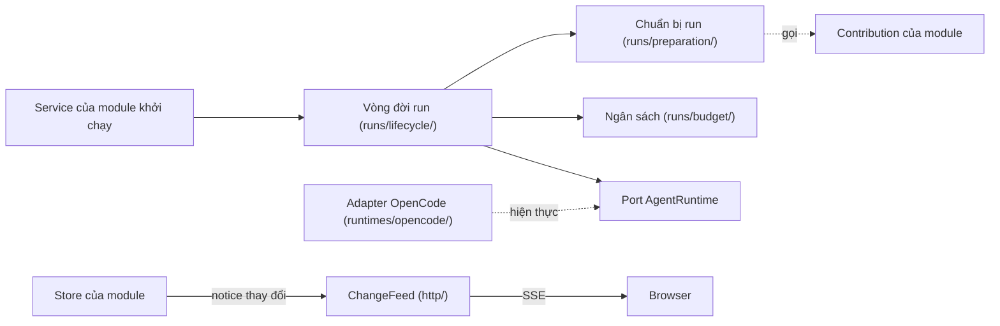
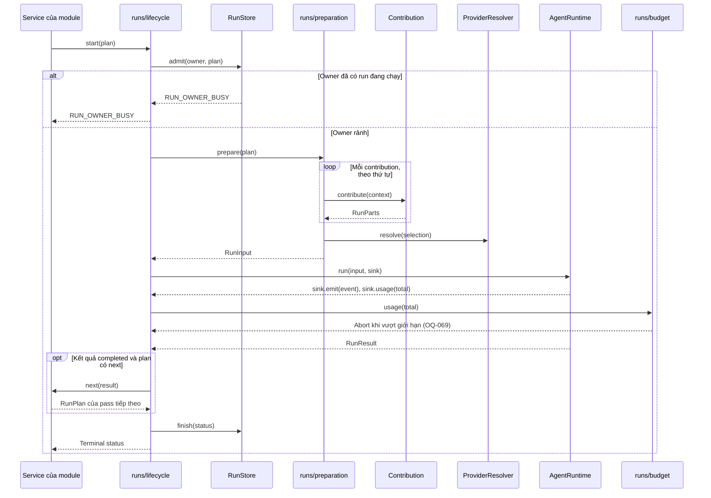
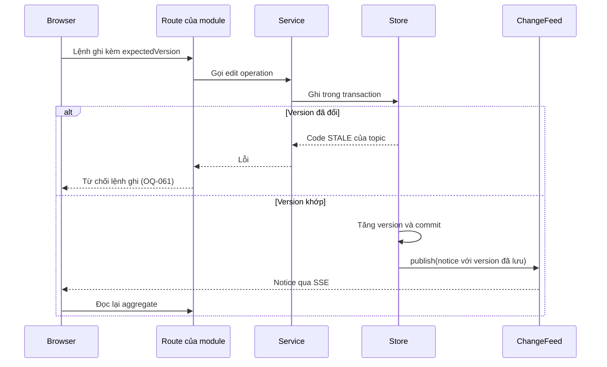

# Task 7: Write the agent core contracts

Read this file to learn the steps of Task 7, which writes the agent core ADRs, the agent core file and the architecture README.

**Read first:**

- [Global Constraints](README.md#global-constraints) in `README.md`
- `docs/conventions/docs.md`
- `docs/conventions/architecture.md`
- `docs/conventions/mermaid.md`
- `docs/architecture/README.md` (lines 1-3)

**Files:**

- Create: `docs/architecture/30-decisions.md`
- Create: `docs/architecture/10-agent-core.md`
- Change: `docs/architecture/README.md` (lines 1-3, replace the whole file)
- Change: `docs/build/refactor/target-structure/plan/README.md`
- Change: `docs/build/refactor/target-structure/plan/task-07-write-agent-core-contracts.md`
- Change: `docs/build/refactor/target-structure/reports/README.md`
- Create: `docs/build/refactor/target-structure/reports/task-07-write-agent-core-contracts.md`

**Interfaces:**

- Uses: the four approved diagnosis reports in `docs/build/refactor/target-structure/reports/`: `task-03-diagnose-run-owner.md`, `task-04-diagnose-agent-runtime-port.md`, `task-05-diagnose-run-preparation.md` and `task-06-diagnose-change-notice.md`. The texts in Steps 2 to 4 link to them.
- Produces: `docs/architecture/30-decisions.md` with the headings `## ADR-001: ...` to `## ADR-004: ...`, each with `**Status:** Proposed`. `docs/architecture/10-agent-core.md` with the heading `## Aggregate và change notice`, which `30-decisions.md` links to with the anchor `#aggregate-và-change-notice`. `docs/architecture/README.md` with the headings `## File` and `## Ma trận Driver và File`.

**STOP when:**

- The output of a command does not match `Expected`.
- A file is different from the description in this task. For example, `docs/architecture/` has a file other than `README.md` before Step 1.
- The task needs a decision that this task does not contain.
- The same step failed two times.
- `check:docs` reports an error in a file that this task did not change.

**Forbidden:**

- Change a file that is not in the `Files` block.
- Delete, skip or weaken a test or a check.
- Add a comment, a lint-disable directive or `@ts-expect-error`.
- Commit or push.
- Change the words of the texts in Steps 2 to 4. Only fix a link or an anchor that `check:docs` reports, and write each fix in the report.
- Add an ADR, a contract or an open question that the texts do not contain.

- [ ] **Step 1: Check the start state**

Run: `ls docs/architecture && wc -l docs/architecture/README.md`

Expected: PASS. The output is two lines: `README.md` and `3 docs/architecture/README.md`. FAIL: any other output.

- [ ] **Step 2: Create `docs/architecture/30-decisions.md`**

Write the text below as the complete file. The file starts with the line `# Quyết định kiến trúc`. Do not copy the outer fence.

````markdown
# Quyết định kiến trúc

Đọc file này để biết các quyết định kiến trúc của DeckAgent, phương án đã xét, trade-off và điều kiện phải xét lại từng quyết định.

## ADR-001: Run thuộc về một owner có kiểu và ID, và mỗi owner chỉ có một run đang chạy

**Status:** Proposed

### Bối cảnh

Lifecycle contract hiện tại gắn run với chat qua trường `sessionId`. Chẩn đoán run owner [[1]](#ref-1) đếm 51 chỗ dùng `sessionId` trong vòng đời request và adapter OpenCode: 19 trường của contract, 9 chỗ kiểm rule "mỗi chat chỉ có một request đang chạy", 6 chỗ dùng chat làm khoá của bản ghi, 4 chỗ là session ID native của OpenCode và 11 chỗ chỉ truyền tiếp. Không chỗ nào đọc hay ghi state của deck bằng `sessionId`.

Rule một request đang chạy cho mỗi chat được kiểm ở hai tầng. `RequestController.submit` kiểm bốn lần: tập `admitting`, map `busy`, lần chờ tối đa 5000 ms cho execution đã dừng, và `store.activeFor`. Store khoá rule bằng unique index `requests_one_active` trên `requests(session_id)` với status `active` hoặc `waiting_approval`, trong transaction `admit`. Các chat khác nhau chạy song song. Host nhận tối đa 16 chat đang chạy cùng lúc (`HOST_BUSY`, `request-controller.ts:90`).

Contract của run không được có `sessionId` và `runs/` không được import module chats (TS-13) [[2]](#ref-2). Run đề xuất design system từ file thương hiệu có thể không thuộc chat nào (UC-010) [[3]](#ref-3). `runs/` không phụ thuộc SQL driver [[4]](#ref-4).

### Phương án đã xét

| Phương án | Dễ hơn | Khó hơn |
| --- | --- | --- |
| A. `runs/` áp một rule chung: mỗi owner có tối đa một run đang chạy | Rule vẫn atomic nhờ unique index trong cùng transaction admit, như hiện tại. `runs/` không cần biết chat. Owner kind mới có rule này mà không thêm code | Một owner kind cần nhiều run song song phải đổi rule chung |
| B. Module sở hữu owner kind đăng ký một admission guard | Mỗi owner kind có rule riêng | Guard phải chạy trong transaction của store của run, nên module phải biết transaction đó. 9 chỗ kiểm hiện có phải chuyển sang hook |
| C. Giữ `sessionId` và thêm trường owner tuỳ chọn | Ít đổi code nhất | Contract vẫn gắn với chat và không đạt rule run có owner tổng quát (TS-13) |

### Quyết định

- Owner của run có kiểu `RunOwner = { kind: RunOwnerKind; id: string }`. `RunOwnerKind` là union literal trong `apps/host/src/runs/ports.ts`. Hiện chỉ có member `'chat'`. Một owner kind mới thêm một member khi module của nó có code.
- Contract của run dùng `owner` thay cho `sessionId`: kế hoạch run, input của runtime, `ToolContext` và binding session native của runtime.
- `runs/` áp rule: mỗi owner có tối đa một run ở status `active` hoặc `waiting_approval`. Các guard trong bộ nhớ dùng khoá `` `${owner.kind}:${owner.id}` ``. Store của run khoá rule bằng unique index trên `(owner_kind, owner_id)` với hai status đó.
- Các owner khác nhau chạy song song. Giới hạn số owner đang chạy cùng lúc là rule chung của `runs/` và giữ code `HOST_BUSY`.
- Khi owner đã có run đang chạy, `runs/` trả code `RUN_OWNER_BUSY`. Module gửi run cho owner kind đó map code này sang code wire của nó: module chats map sang `SESSION_BUSY`.
- Kiểm tra "request đã lưu thuộc chat khác" (`GENERATION_LINK_CONFLICT`) so sánh `owner` của request đã lưu với `owner` của kế hoạch run.
- Module workspaces hỏi `runs/` owner nào đang có run, qua danh sách chat mà module chats trả về, để giữ rule `WORKSPACE_REQUEST_ACTIVE`.
- HTTP wire contract giữ trường `sessionId` và các code lỗi hiện tại. Module chats chuyển `sessionId` thành `{ kind: 'chat', id: sessionId }`.
- `runs/ports.ts` khai báo port `RunStore`. Code SQL hiện thực port này nằm ngoài `runs/`. Vị trí cụ thể là `Open` và được quyết khi Phase 4 chuyển `packages/session/persistence/`.

### Lý do

Phương án A giữ nguyên cách khoá rule đang chạy đúng: một unique index trong cùng transaction admit. Nó cho đúng hành vi cần có: một chat chỉ có một run đang chạy, nhiều chat chạy song song. Phương án B thêm một hook mà owner kind duy nhất hiện có không cần. Phương án C không đạt rule run có owner tổng quát (TS-13).

### Rủi ro chấp nhận

- Owner kind cần nhiều run song song cho cùng một owner phải có ADR mới.
- Đổi cột `session_id` của bảng `requests` sang `owner_kind` và `owner_id` cần migration của database session.
- Transaction admit hiện ghi request, message của người dùng và liên kết attachment cùng lúc (`request-controller.ts:98-106`). Khi request thuộc `runs/` còn message thuộc module chats, cách giữ ba lần ghi này atomic là `Open`.

### Hệ quả

- Dễ hơn: thêm owner kind mới (design system) chỉ thêm một member của union, không thêm rule.
- Khó hơn: module chats map hai chiều giữa `sessionId` của wire và `owner` của run, và map `RUN_OWNER_BUSY` sang `SESSION_BUSY`.
- Xét lại khi một owner kind cần nhiều run song song, hoặc khi việc thiết lập design system (UC-010) không cần agent.

## ADR-002: Port AgentRuntime trả event, usage và lỗi có phân loại

**Status:** Proposed

### Bối cảnh

Runtime hiện tại trả `RuntimeOutcome`: `completed` với `commit` tuỳ chọn, hoặc `failed` với `errorCode` là một string tự do. Chẩn đoán port AgentRuntime [[5]](#ref-5) tìm thấy 40 code: 7 code từ event của provider, 9 code của adapter, 16 code của lifecycle, 1 notice và 7 code chưa phân loại. Outcome không có trường usage. `parseEvent` bỏ trường `tokens` của event `step_finish`. Fixture OpenCode giả có `tokens`, nhưng output thật của OpenCode 1.19.5 chưa được kiểm. Adapter có bộ đếm `modelSteps` nhưng không báo ra ngoài.

Thời gian chờ là đồng hồ của mỗi attempt trong adapter, mặc định `600_000` ms (`runtime.ts:227`). Đồng hồ dừng trong lúc chờ approval. Khi hết giờ, adapter trả `REQUEST_TIMEOUT`.

Các loại lỗi provider mà sản phẩm cần phân biệt chưa được quyết ([OQ-063](../open-questions.md#oq-063)). Code hiện tại chỉ có điều kiện cho bốn loại: key bị từ chối, giới hạn tần suất, hết thời gian chờ, và nội dung bị chặn trong bước tóm tắt. Không điều kiện nào cho hết quota hay mất mạng. Runtime thứ hai, ví dụ coding agent CLI đã có trên máy (UC-005-A18) [[6]](#ref-6), phải implement cùng port.

### Phương án đã xét

| Phương án | Dễ hơn | Khó hơn |
| --- | --- | --- |
| A. Port trả `RunError` gồm category đóng và code, cùng usage trong kết quả và trong lúc chạy | `runs/` đọc category mà không biết code của từng runtime. Runtime thứ hai dùng cùng tập category | Adapter phải map từng điều kiện sang category |
| B. Giữ `errorCode` tự do, `runs/` map code sang category | Adapter không đổi | `runs/` phải biết code của OpenCode, ngược chiều phụ thuộc |
| C. Adapter throw một error class cho mỗi category | Quen thuộc với code TypeScript | Lỗi đi qua hai đường (kết quả và exception). Usage của run lỗi bị mất |

### Quyết định

- `AgentRuntime` có `name`, `availability()` và `run(input, sink)`. `run` trả `RunResult`.
- Event của run gồm ba loại hiện có: `activity`, `text` và `notice`. Chỉ Host ghi event `status` và `approval`.
- `sink.usage(total)` nhận usage cộng dồn trong lúc chạy. `RunResult` có usage cuối. `RunUsage` có `modelCalls` (bắt buộc) và `inputTokens`, `outputTokens` (tuỳ chọn, vì output thật của OpenCode chưa được kiểm).
- Run lỗi trả `RunError = { category, code }`. `code` giữ string hiện tại, ví dụ `PROVIDER_AUTH`, để HTTP wire không đổi. `category` là một member của union `RunErrorCategory`.
- Code của lifecycle (admission, ghi store) không phải category của runtime. Text của `ToolResult` (`TOOL_NOT_ALLOWED`, `TOOL_FAILED`) thuộc port `ToolExecutor`.
- Đồng hồ thời gian chờ ở lại trong adapter, và có category `timeout`.
- `runs/budget/` đọc usage và dừng run qua abort signal khi vượt giới hạn. Hiện chưa có giá trị giới hạn, vì giới hạn tài nguyên của một request chưa được quyết ([OQ-069](../open-questions.md#oq-069)).
- Category `provider-quota` và `provider-network` có trong union nhưng chưa có điều kiện nào tạo ra. Adapter thêm điều kiện khi có bằng chứng từ provider thật.

### Lý do

Phương án A giữ chiều phụ thuộc đúng: adapter biết OpenCode, `runs/` chỉ biết port. Usage đi cùng kết quả nên run lỗi vẫn báo mức dùng. Giữ `code` hiện tại cho phép đổi port mà không đổi HTTP wire.

### Rủi ro chấp nhận

- Hai category chưa có điều kiện tạo ra. Lỗi hết quota hiện rơi vào `provider-other`.
- Token có thể luôn thiếu cho đến khi output thật của OpenCode được kiểm.

### Hệ quả

- Dễ hơn: thêm runtime thứ hai, hiển thị mức dùng context (FR-078) [[7]](#ref-7), đặt giới hạn tài nguyên.
- Khó hơn: mỗi adapter phải giữ bảng map từ điều kiện sang category.
- Xét lại khi sản phẩm quyết các loại lỗi provider ([OQ-063](../open-questions.md#oq-063)) với một loại không có trong union, hoặc khi runtime thứ hai không báo được `modelCalls`.

## ADR-003: Module góp phần chuẩn bị run qua contribution đăng ký tại composition root

**Status:** Proposed

### Bối cảnh

Chẩn đoán chuẩn bị run [[8]](#ref-8) tìm thấy 51 chỗ dựng một phần của run: 23 chỗ trong `features/deck`, 17 chỗ trong `integrations/opencode`, 4 chỗ trong `features/sources`, 4 chỗ trong lifecycle, và 1 chỗ mỗi nơi trong `features/requests`, `features/providers` và composition root. Request lifecycle chạy `prepareTools` của source tool trước. Deck workflow sau đó lấy tool từ `run.tools`, bọc lại, và lọc source tool theo nguồn của Brief (`isSourceToolAllowed`, `sourceToolNames`). Một run deck có thể có pass recovery thứ hai (`executeRecoveryRun`). Adapter không bao giờ đọc grant của generation. Code hiện tại chưa có skill.

Hai đường vào cùng kết thúc tại `RequestController.submit`: route gửi request và route xác nhận deck. Đường xác nhận đưa vào một `PreparedRequest` đã dựng sẵn.

### Phương án đã xét

| Phương án | Dễ hơn | Khó hơn |
| --- | --- | --- |
| A. Grant quyết trước. Contribution đăng ký tại `server.ts` và contribution của module khởi chạy cùng đọc grant, rồi trả phần của nó. `runs/preparation/` gộp theo thứ tự cố định | Một chỗ để thêm skill hoặc design system. Lọc source tool trở thành grant, không còn bọc tool | Module khởi chạy phải đưa nguồn của Brief vào grant trước khi chuẩn bị |
| B. Module khởi chạy tự dựng toàn bộ run, như hiện tại | Không đổi code | Skill và design system phải thêm vào từng module khởi chạy |
| C. Chuỗi middleware: mỗi contribution sửa phần của contribution trước | Linh hoạt | Kết quả phụ thuộc thứ tự, và việc lọc ẩn trong lớp bọc, giống vấn đề hiện tại |

### Quyết định

- Module khởi chạy run gửi một `RunPlan`: owner, input, model selection, grant, contribution riêng của run, và hook tuỳ chọn cho pass tiếp theo và text kết thúc.
- `RunGrants` có `publicResearch` và `sourceKinds`. Module khởi chạy quyết grant trước khi chuẩn bị. Deck đưa nguồn của Brief vào `sourceKinds`. Source contribution chỉ trả tool của các nguồn trong `sourceKinds`.
- `RunContribution` có `name` và `contribute(context)`. `contribute` trả `RunParts`: instruction, tool set và resource.
- `runs/preparation/` gọi contribution đăng ký tại `server.ts` theo thứ tự đăng ký, rồi contribution của `RunPlan` theo thứ tự trong plan. Instruction nối theo thứ tự đó. Tên tool trùng nhau làm chuẩn bị thất bại.
- Lịch sử hội thoại là resource `conversation`, do contribution của module chats góp. Adapter quyết dùng resource này khi không resume được session native.
- Grant riêng của deck (`GenerationGrant`, `GenerationCapability`) ở trong contribution của deck cho run đó. `runs/` không đọc chúng.
- Một run có thể có nhiều pass. Sau một pass `completed`, `runs/` gọi `RunPlan.next(result)`. Hook trả một `RunPlan` mới cho pass tiếp theo, hoặc `undefined` để kết thúc.
- Giới hạn số bước model là `RunPlan.stepLimit`. Giá trị mặc định 8 bước đến từ `config.ts:73`. Generation của deck dùng `'none'`, thay cho cách adapter tìm tên tool `publish_slide`.
- Model selection đổi thành provider settings qua port `ProviderResolver` do module providers hiện thực. Key không đi vào `RunPlan`.
- Ở lại trong adapter: cấu hình OpenCode, biến môi trường cô lập, MCP bridge, tham số dòng lệnh, việc tìm và kiểm executable, hash cho resume guard, và prompt khung khi không có tool bridge.
- Skill chưa có trong `RunParts`. Trường cho skill được thêm khi module skills có code. Format skill mà OpenCode nhận là `Open`.

### Lý do

Phương án A biến việc lọc tool đang ẩn trong lớp bọc thành dữ liệu kiểm được: grant. Contribution không sửa phần của nhau, nên thứ tự chỉ ảnh hưởng thứ tự instruction. Contribution riêng của run giữ grant riêng của deck trong module deck, nên `runs/` không import deck.

### Rủi ro chấp nhận

- Việc thay `isSourceToolAllowed` và `sourceToolNames` bằng `sourceKinds` cho cùng tập tool là suy luận từ code (`Inferred`). Phase 4 cần test so sánh tập tool trước và sau.
- Pass recovery đổi từ lời gọi `start` thứ hai bên trong deck sang hook `next`. Hành vi phải giữ nguyên khi Phase 4 chuyển code.

### Hệ quả

- Dễ hơn: skill do hệ thống chọn và design system áp vào generation chỉ thêm một contribution.
- Khó hơn: module khởi chạy phải tính grant trước, thay vì lọc sau.
- Xét lại khi một contribution cần đọc phần của contribution khác, hoặc khi skill cần một kiểu phần mới.

## ADR-004: Mỗi aggregate người dùng thấy có một version và phát change notice sau khi commit

**Status:** Proposed

### Bối cảnh

Chẩn đoán change notice [[9]](#ref-9) chia 29 bảng thành 8 bảng có cột `version`, 10 bảng người dùng ghi, 7 bảng người dùng đọc và 4 bảng nội bộ. Chỉ deck phát notice: `deck-changed` mang `version`. Route SSE gửi notice với `version` hiện tại khi kết nối. Browser đọc lại deck khi notice mới hơn snapshot. Transaction tăng `decks.version` cũng ghi `slides`, `revisions`, `publications`, `artifact_revisions` và `generation_intents`. Ba lời gọi `notify` truyền số `1` thay cho `version` đã lưu (`deck-authoring.ts:61`, `deck-authoring.ts:267`, `deck-generation.ts:73`). Không lệnh ghi deck nào nhận `version` mong đợi. Brief và Outline kiểm `version` của chúng (`BRIEF_STALE`, `OUTLINE_STALE`). Draft trong bộ nhớ kiểm `revision` (`DRAFT_CONFLICT`) và không phát notice. Request event dùng SSE với cursor `sequence`.

Mọi đối tượng người dùng thấy phải dùng chung một cơ chế báo thay đổi và kiểm `version` khi ghi (TS-12) [[2]](#ref-2). Người dùng thấy gì khi lệnh ghi có `version` cũ là câu hỏi sản phẩm ([OQ-061](../open-questions.md#oq-061)). Câu hỏi này không chặn quyết định, vì store từ chối lệnh ghi trong mọi câu trả lời. Canvas cho người dùng tự sửa deck (UC-007) [[10]](#ref-10) là một đường ghi thứ hai vào deck.

### Phương án đã xét

| Phương án | Dễ hơn | Khó hơn |
| --- | --- | --- |
| A. Một `version` và một topic notice cho mỗi aggregate mà người dùng thấy. Bảng con tăng `version` của aggregate cha | Khớp với pattern deck hiện tại. Một màn hình theo dõi một notice | Một thay đổi nhỏ trong bảng con làm Browser đọc lại cả aggregate |
| B. Một `version` và một notice cho mỗi bảng | Notice chi tiết | Browser phải ghép nhiều notice cho một màn hình. Nhiều bảng phải đổi schema |
| C. Notice mang toàn bộ state mới | Browser không cần đọc lại | Hai nguồn dữ liệu cho cùng state. Notice trở thành event log, ngược với thiết kế hiện tại của deck |

### Quyết định

- Change notice có kiểu `ChangeNotice = { topic: ChangeTopic; key: string; version: number }` trong `packages/contracts`. Notice là tín hiệu đọc lại, không mang state.
- Aggregate, topic và khoá là: `deck`, `brief`, `outline` và `draft` theo chat; `chats` theo workspace; `workspaces`, `providers` và `preferences` cho cả Host. Bảng thuộc mỗi aggregate nằm trong [Agent core](10-agent-core.md#aggregate-và-change-notice).
- Store tăng `version` trong cùng transaction với lệnh ghi. Store phát notice sau commit, với `version` đã lưu, không dùng hằng số.
- Aggregate có hàng gốc mang cột `version` dùng cột đó. Aggregate không có hàng gốc dùng một bảng `change_versions(topic, key, version)` trong database của module sở hữu.
- Lệnh ghi qua HTTP route gửi `expectedVersion`. Store từ chối lệnh ghi khi `version` đã đổi. Code hiện có giữ nguyên: `BRIEF_STALE`, `OUTLINE_STALE`, `DRAFT_CONFLICT`. Aggregate mới dùng code `<TOPIC>_STALE`, ví dụ `WORKSPACES_STALE`.
- Store nhận hàm `publish` qua constructor tại `server.ts`. `ChangeFeed` trong `apps/host/src/http/` chuyển notice tới Browser qua SSE. Listener nào throw thì bị xoá, như `DeckRuntime.notify` hiện tại.
- Route SSE của deck giữ nguyên path và tên event `deck-changed`. Route cho các topic khác là `Open` và được quyết khi module đầu tiên của Phase 3 cần notice.
- Request, event, approval và các bảng mà run ghi dùng event log với cursor `sequence`, không dùng change notice.

### Lý do

Phương án A tổng quát hoá pattern đã chạy đúng cho deck, và giữ một nguồn dữ liệu: Browser luôn đọc lại state từ route đọc. Phương án B tăng số notice mà không giúp màn hình nào. Phương án C tạo nguồn dữ liệu thứ hai.

### Rủi ro chấp nhận

- Màn hình đọc lại cả aggregate sau mỗi thay đổi. Chấp nhận cho đến khi có số đo cho thấy chậm.
- Lệnh ghi của agent qua tool chưa gửi `expectedVersion`. Module deck quyết cách kiểm cho tool khi canvas có code.

### Hệ quả

- Dễ hơn: thêm một đối tượng có hai giao diện cùng sửa, và test lệnh ghi có `version` cũ cho mỗi module.
- Khó hơn: mỗi store phải nhận `publish`, và mỗi route ghi phải nhận `expectedVersion`.
- Xét lại khi một màn hình cần biết phần nào của aggregate đã đổi, hoặc khi việc đọc lại cả aggregate quá chậm.

## References

1. <a id="ref-1"></a>[Task 3: Diagnose the run owner report](../build/refactor/target-structure/reports/task-03-diagnose-run-owner.md)
2. <a id="ref-2"></a>[Tiêu chí của cấu trúc đích](../build/refactor/target-structure/criteria.md)
3. <a id="ref-3"></a>[Design system](../UCs/design-systems.md)
4. <a id="ref-4"></a>[Project Structure](../conventions/project-structure.md)
5. <a id="ref-5"></a>[Task 4: Diagnose the AgentRuntime port report](../build/refactor/target-structure/reports/task-04-diagnose-agent-runtime-port.md)
6. <a id="ref-6"></a>[Provider và model](../UCs/providers.md)
7. <a id="ref-7"></a>[Gửi request](../UCs/requests.md)
8. <a id="ref-8"></a>[Task 5: Diagnose run preparation report](../build/refactor/target-structure/reports/task-05-diagnose-run-preparation.md)
9. <a id="ref-9"></a>[Task 6: Diagnose the change notice and version report](../build/refactor/target-structure/reports/task-06-diagnose-change-notice.md)
10. <a id="ref-10"></a>[Deck](../UCs/deck.md)
````

- [ ] **Step 3: Create `docs/architecture/10-agent-core.md`**

Write the text below as the complete file. The file starts with the line `# Agent core`. Do not copy the outer fence.

````markdown
# Agent core

Đọc file này để biết lõi agent của DeckAgent gồm những contract nào (owner của run, chuẩn bị run, port AgentRuntime, change notice), các phần phối hợp thế nào trong một run, và code hiện tại khác contract đích ở đâu.

Mọi contract trong file này có trạng thái `Proposed`. Lý do và trade-off của từng contract nằm trong [Quyết định kiến trúc](30-decisions.md) [[1]](#ref-1): owner của run ở ADR-001, port AgentRuntime ở ADR-002, chuẩn bị run ở ADR-003, change notice ở ADR-004. Code hiện tại chưa dùng các contract này. Cột "Code hiện tại" trong các bảng dưới đây chỉ ra nơi code đang làm việc tương ứng.

## Drivers

| Driver | Cơ chế đáp ứng |
| --- | --- |
| Run đề xuất design system từ file thương hiệu có thể không thuộc chat nào (UC-010) [[2]](#ref-2) | Owner của run có kiểu và ID |
| Chạy model qua coding agent CLI đã có trên máy người dùng, ngoài phạm vi hiện tại (UC-005-A18) [[3]](#ref-3) | Port `AgentRuntime` mà mọi runtime implement |
| Người dùng dừng được request đang chạy (FR-018) [[4]](#ref-4) | Abort signal của run, category `stopped` |
| Hiển thị mức dùng context của một chat, ngoài phạm vi hiện tại (FR-078) [[4]](#ref-4) | Usage trong kết quả và trong lúc chạy |
| Loại lỗi provider ([OQ-063](../open-questions.md#oq-063)), thời gian chờ provider ([OQ-062](../open-questions.md#oq-062)) và giới hạn tài nguyên của một request ([OQ-069](../open-questions.md#oq-069)), chưa được quyết | Category của lỗi, đồng hồ của adapter, `runs/budget/` |
| Hai giao diện cùng thay đổi một đối tượng ([OQ-061](../open-questions.md#oq-061)) | Change notice và `expectedVersion` |
| Tự sửa deck bằng tay mà không hỏi model, ngoài phạm vi hiện tại (UC-007) [[5]](#ref-5) | Change notice và `expectedVersion` cho deck |
| Lõi agent dùng ports và adapters (TS-04), mọi đối tượng người dùng thấy có `version` và notice (TS-12), run có owner tổng quát (TS-13) [[6]](#ref-6) | Toàn bộ file này |

## Thành phần và ranh giới



| Phần | Trách nhiệm | Code hiện tại |
| --- | --- | --- |
| `runs/lifecycle/` | Admit run, rule mỗi owner một run đang chạy, giới hạn số owner đang chạy, event log, approval, stop, pass tiếp theo, terminal status | `packages/host/api/src/lifecycle/request-controller.ts` |
| `runs/preparation/` | Gọi contribution, gộp instruction, tool set và resource thành `RunInput` | Rải trong `apps/web/src/features/deck/`, `features/sources/source-tools.ts`, `features/requests/prepare-runtime.ts` và `apps/web/src/index.ts:313-323` |
| `runs/budget/` | Đọc usage và dừng run khi vượt giới hạn | Chưa có |
| `runs/ports.ts` | Các type trong [Contract](#contract) | `packages/host/api/src/lifecycle/contracts.ts`, `lifecycle/tool-contracts.ts` |
| `runtimes/opencode/` | Implement `AgentRuntime` cho OpenCode | `apps/web/src/integrations/opencode/` |
| `ChangeFeed` trong `http/` | Chuyển change notice từ store tới Browser | `DeckRuntime.notify` trong `packages/presentation/deck/src/deck-runtime.ts` và route trong `packages/host/api/src/transport/deck-routes.ts` |

`runs/` không import module, Express, SQL driver hay adapter trong `runtimes/` [[7]](#ref-7). Module dùng type trong `runs/ports.ts` và public operation của `runs/`. Composition root `server.ts` tạo adapter, store và contribution, rồi truyền chúng vào `runs/`.

## Contract

### Owner và kế hoạch run

```ts
// apps/host/src/runs/ports.ts
export type RunOwnerKind = 'chat'

export interface RunOwner {
  readonly kind: RunOwnerKind
  readonly id: string
}

export type SourceKind = 'workspace-files' | 'attachments' | 'research'

export interface RunGrants {
  readonly publicResearch: boolean
  readonly sourceKinds: readonly SourceKind[]
}

export interface RunPlan {
  readonly owner: RunOwner
  /** ID đã cấp trước, ví dụ khi xác nhận deck. Khi không có, runs/ tạo ID. */
  readonly requestId?: string
  readonly input: string
  readonly selection: ModelSelection
  readonly grants: RunGrants
  readonly stepLimit: number | 'none'
  readonly contributions: readonly RunContribution[]
  next?(result: RunResult): Promise<RunPlan | undefined>
  closingText?(status: TerminalStatus): string | undefined
}
```

`ModelSelection` và `TerminalStatus` giữ nguyên định nghĩa hiện tại trong `packages/host/contracts/src/requests.ts`. Module chats tạo `RunPlan` với `owner = { kind: 'chat', id: sessionId }`. Module deck tạo `RunPlan` cho lệnh deck và cho generation, với `sourceKinds` lấy từ nguồn của Brief.

### Contribution

```ts
export interface PreparationContext {
  readonly owner: RunOwner
  readonly requestId: string
  readonly grants: RunGrants
  readonly signal: AbortSignal
}

export interface RunContribution {
  readonly name: string
  contribute(context: PreparationContext): Promise<RunParts>
}

export interface RunParts {
  readonly instructions?: readonly string[]
  readonly tools?: ToolSet
  readonly resources?: readonly RunResource[]
}

export interface ConversationMessage {
  readonly role: 'user' | 'assistant'
  readonly content: string
  readonly unfinished?: true
  readonly attachments?: readonly { readonly attachmentId: string; readonly name: string }[]
}

export type RunResource = { readonly kind: 'conversation'; readonly messages: readonly ConversationMessage[] }
```

`ConversationMessage` có các trường mà `seedPrompt` hiện đọc (`apps/web/src/integrations/opencode/history.ts:9-39`). `runs/preparation/` gọi contribution đăng ký tại `server.ts` theo thứ tự đăng ký, rồi contribution của `RunPlan` theo thứ tự trong plan. Nó nối instruction theo thứ tự đó, gộp các tool set, và từ chối khi hai tool set có cùng tên tool.

| Contribution | Module | Phần góp | Code hiện tại |
| --- | --- | --- | --- |
| Source tool | sources | Tool set của các nguồn trong `sourceKinds`, kèm `read_research` và `research_public` theo grant | `prepareSourceTools` (`source-tools.ts:157-196`), closure `prepareTools` (`index.ts:313-323`) |
| Lịch sử hội thoại | chats | Resource `conversation` | `RuntimeSessionAccess.read`, gọi tại `runtime.ts:164` và `prepare-runtime.ts:42` |
| Lệnh deck | deck, riêng cho run | Instruction deck, staging tool, image tool | `buildDeckInstructions`, `buildTools` trong `deck-tool-session.ts:163-183` |
| Generation | deck, riêng cho run | Instruction generation, generation tool, `GenerationGrant`, `GenerationCapability` | `GenerationWorkflow.startRun` (`generation-workflow.ts:24-57`) |

### Tool

```ts
export interface ToolContext {
  readonly owner: RunOwner
  readonly requestId: string
  readonly signal: AbortSignal
  approve(step: ApprovalStep): Promise<boolean>
}

export interface ToolExecutor {
  execute(name: string, args: unknown, context: ToolContext): Promise<ToolResult>
}

export interface ToolSet {
  readonly context: string
  readonly manifest: string
  readonly schemas: readonly ToolSchema[]
  readonly executor: ToolExecutor
}

export interface RunTools {
  readonly context: string
  readonly manifest: string
  readonly schemas: readonly ToolSchema[]
  call(name: string, args: unknown): Promise<ToolResult>
}
```

`ToolSchema`, `ToolResult` và `ApprovalStep` giữ nguyên định nghĩa hiện tại trong `packages/host/api/src/lifecycle/tool-contracts.ts` và `@deckagent/session-persistence`. `ToolSet` thay cho `PreparedTools`. `RunTools` thay cho `RequestTools`: lifecycle gắn `ToolContext` vào lời gọi, nên runtime chỉ nhận capability đã gắn.

### Port AgentRuntime

```ts
export interface RunInput {
  readonly owner: RunOwner
  readonly requestId: string
  readonly provider: ProviderRunSettings
  readonly instructions: readonly string[]
  readonly tools?: RunTools
  readonly resources: readonly RunResource[]
  readonly stepLimit: number | 'none'
  readonly signal: AbortSignal
  onApprovalWait(listener: (waiting: boolean) => void): () => void
}

export type RunEvent = Exclude<RequestEventBody, { readonly kind: 'status' | 'approval' }>

export interface RunUsage {
  readonly modelCalls: number
  readonly inputTokens?: number
  readonly outputTokens?: number
}

export interface RunSink {
  emit(event: RunEvent): Promise<void>
  usage(total: RunUsage): void
}

export type RunErrorCategory =
  | 'provider-auth'
  | 'provider-rate-limit'
  | 'provider-quota'
  | 'provider-network'
  | 'provider-model'
  | 'provider-other'
  | 'context-limit'
  | 'input-unsupported'
  | 'content-blocked'
  | 'timeout'
  | 'stopped'
  | 'runtime-unavailable'
  | 'runtime-config'
  | 'runtime-protocol'
  | 'runtime-incomplete'
  | 'runtime-failed'

export interface RunError {
  readonly category: RunErrorCategory
  readonly code: string
}

export type RunResult =
  | { readonly status: 'completed'; readonly usage: RunUsage; commit?(): void }
  | { readonly status: 'failed'; readonly usage: RunUsage; readonly error: RunError }

export type RuntimeAvailability = { readonly available: true } | { readonly available: false; readonly code: string }

export interface AgentRuntime {
  readonly name: string
  availability(): Promise<RuntimeAvailability>
  run(input: RunInput, sink: RunSink): Promise<RunResult>
}

export interface ProviderResolver {
  resolve(selection: ModelSelection): Promise<ProviderRunSettings>
}
```

`RequestEventBody` giữ nguyên định nghĩa trong `packages/host/contracts/src/requests.ts`. `RunEvent` có ba loại `activity`, `text` và `notice`, như `RuntimeEvent` hiện tại. `ProviderRunSettings` giữ các trường hiện có mà `providerConfiguration` đọc (`apps/web/src/integrations/opencode/provider.ts:34-66`). Module providers implement `ProviderResolver`. `commit` chỉ chạy sau khi lifecycle đã lưu status `completed`, như hiện tại.

Port `RunStore` giữ các method của `RequestStore` hiện tại, với `owner` thay cho `sessionId`. Store khoá rule mỗi owner một run đang chạy bằng unique index trên `(owner_kind, owner_id)` với status `active` và `waiting_approval`, và trả `RUN_OWNER_BUSY` khi vi phạm.

### Change notice

```ts
// packages/contracts
export type ChangeTopic = 'deck' | 'brief' | 'outline' | 'draft' | 'chats' | 'workspaces' | 'providers' | 'preferences'

export interface ChangeNotice {
  readonly topic: ChangeTopic
  readonly key: string
  readonly version: number
}

export type PublishChange = (notice: ChangeNotice) => void

// apps/host/src/http/
export interface ChangeFeed {
  readonly publish: PublishChange
  subscribe(topic: ChangeTopic, key: string, listener: (notice: ChangeNotice) => void): () => void
}
```

Topic dùng cho cả Host có khoá `'host'`.

## Luồng của một run



Chỉ `runs/lifecycle/` ghi status. Khi pass tiếp theo có, lifecycle chuẩn bị và chạy pass đó trong cùng request. Khi lưu text kết thúc thất bại, status `completed` thành `failed` với `REQUEST_NOT_SAVED`, như hiện tại (`request-controller.ts:287-290`).

## Map từ code lỗi sang category

Code và điều kiện lấy từ chẩn đoán port AgentRuntime [[8]](#ref-8). Cột Code giữ string hiện tại, nên HTTP wire không đổi.

| Code | Điều kiện hiện tại | Category |
| --- | --- | --- |
| `PROVIDER_AUTH` | Event lỗi có status `401` hoặc `403`, hoặc tên `ProviderAuthError` | `provider-auth` |
| `PROVIDER_RATE_LIMIT` | Event lỗi có status `429` | `provider-rate-limit` |
| `PROVIDER_MODEL_UNAVAILABLE` | Event lỗi có status `404` | `provider-model` |
| `PROVIDER_HTTP` | Event lỗi có status khác từ 100 đến 599 | `provider-other` |
| `RUNTIME_FAILED` | Event lỗi không có status, không có tên khớp và không báo ảnh | `provider-other` |
| `CONTEXT_LIMIT` | Tên lỗi khớp `context` hoặc `overflow` | `context-limit` |
| `IMAGE_INPUT_UNAVAILABLE` | Message của provider cho biết model không nhận ảnh | `input-unsupported` |
| `CONTEXT_SUMMARY_FAILED` | Bước tóm tắt kết thúc với lý do `content-filter` | `content-blocked` |
| `CONTEXT_SUMMARY_FAILED` | Bước tóm tắt kết thúc với lý do `error`, tóm tắt còn mở khi kết thúc, hoặc lỗi tràn context trong lúc tóm tắt | `context-limit` |
| `REQUEST_TIMEOUT` | Đồng hồ của attempt hết giờ | `timeout` |
| `STOPPED` | Signal của run bị abort và đồng hồ chưa hết giờ | `stopped` |
| `REQUEST_NOT_SAVED` | Abort controller nội bộ của adapter đã chạy | `stopped` |
| `RUNTIME_UNAVAILABLE` | Không có executable, hoặc process không khởi động | `runtime-unavailable` |
| `RUNTIME_VERSION_UNSUPPORTED` | Version của executable không được hỗ trợ (chỉ trong `availability`) | `runtime-unavailable` |
| `PROVIDER_UNSUPPORTED` | Cấu hình không hỗ trợ provider (`UnsupportedProviderError`) | `runtime-config` |
| `RUNTIME_CONFIG_UNSAFE` | Lệnh `debug config` lỗi, hoặc cấu hình đã resolve khác cấu hình đã dựng | `runtime-config` |
| `RUNTIME_FAILED` | Process kết thúc với exit code khác 0, hoặc lỗi cấu hình khác | `runtime-failed` |
| `RUNTIME_PROTOCOL` | Một dòng output không phải event, session ID native thay đổi, hoặc output hỏng | `runtime-protocol` |
| `RUNTIME_INCOMPLETE` | Không bước nào chạy, không có lý do kết thúc, lý do kết thúc là `tool-calls`, hoặc không có session ID native | `runtime-incomplete` |

`provider-quota` và `provider-network` chưa có điều kiện nào. `NEW_RUNTIME_SESSION` và `CONVERSATION_SUMMARIZED` là notice, không phải lỗi. Code của admission, approval và lệnh ghi store (ví dụ `SESSION_BUSY`, `HOST_BUSY`, `APPROVAL_CONFLICT`, `REQUEST_NOT_SAVED` khi ghi store lỗi) là code của `runs/lifecycle/`, không có category.

## Aggregate và change notice

Bảng và trạng thái hiện tại lấy từ chẩn đoán change notice [[9]](#ref-9).

| Topic | Khoá | `version` lấy từ | Bảng hoặc state | Hiện tại | Code khi `version` cũ |
| --- | --- | --- | --- | --- | --- |
| `deck` | Chat ID | `decks.version` | `decks`, `slides`, `revisions`, `publications`, `generation_intents`, `artifact_revisions` | Notice `deck-changed`. Ba lời gọi `notify` truyền số `1` | `DECK_STALE` (mới). `DECK_CONFLICT` giữ cho revision của slide |
| `brief` | Chat ID | `brief_heads.version` | `brief_heads`, `brief_versions`, `brief_request_receipts` | Không có notice | `BRIEF_STALE` |
| `outline` | Chat ID | `outline_heads.version` | `outline_heads`, `outline_proposals`, `outline_details`, `prepared_images` | Không có notice | `OUTLINE_STALE` |
| `draft` | Chat ID | `revision` của draft | Draft trong bộ nhớ (`MemoryDraftStore`), `attachments` | Không có notice. Browser kiểm lại attachment mỗi 500 ms và khi cửa sổ nhận focus | `DRAFT_CONFLICT` |
| `chats` | Workspace ID | `change_versions` | `sessions` | Không có `version` | `CHATS_STALE` |
| `workspaces` | `'host'` | `change_versions` | `workspaces`, `registry_state` | Không có `version` | `WORKSPACES_STALE` |
| `providers` | `'host'` | `change_versions` | `providers` | Không có `version` | `PROVIDERS_STALE` |
| `preferences` | `'host'` | `change_versions` | `preferences` | Không có `version`. Giá trị `research` có `revision` ngẫu nhiên | `PREFERENCES_STALE` |

Các bảng sau không có change notice. `requests`, `request_events` và `request_approvals` dùng event log với cursor `sequence`. `messages`, `research_sources`, `request_research`, `source_reads`, `sources`, `runtime_bindings` và `image_search_attempts` do run ghi hoặc chỉ dùng nội bộ. Browser biết các bảng này đổi qua event của request.



Khi kết nối SSE, Host gửi một notice với `version` hiện tại, như route deck hiện tại. Browser đọc lại khi `version` của notice lớn hơn `version` đang có.

## Phần ở lại trong adapter OpenCode

Các phần sau là việc riêng của OpenCode và không đi qua `runs/preparation/`. Nguồn là chẩn đoán chuẩn bị run [[10]](#ref-10).

- Cấu hình OpenCode, block provider và việc encode cấu hình (`config.ts:39-104`, `provider.ts:34-66`).
- Biến môi trường cô lập và folder của run (`config.ts:107-143`, `runtime.ts:140-153`). Folder lấy từ hash của `owner` thay cho chat ID.
- MCP bridge, tool server và permission `deckagent_<name>: allow` (`mcp-bridge.ts:57-177`, `config.ts:44-46`).
- Tham số dòng lệnh và text của stdin (`runtime.ts:232-251`).
- Việc tìm executable, kiểm version và kiểm resource (`runtime.ts:41-138`, `resources.ts:16-45`).
- Hash của resume guard và binding session native (`runtime.ts:159-199`). Binding có khoá là `owner`.
- Prompt khung khi không có tool bridge (`config.ts:13-18`).
- Đồng hồ của attempt, dừng trong lúc chờ approval (`stream-tracker.ts:36-43`).

## Rủi ro và điểm còn mở

- `Open`: transaction admit hiện ghi request, message của người dùng và liên kết attachment cùng lúc (`request-controller.ts:98-106`). Request thuộc `runs/`, còn message và attachment thuộc module chats và attachments. Cách giữ ba lần ghi này atomic chưa được quyết.
- `Open`: vị trí của code SQL hiện thực `RunStore`, vì `runs/` không import SQL driver.
- `Open`: output thật của OpenCode 1.19.5 có `tokens` trong event `step_finish` hay không. Chỉ fixture giả có trường này.
- `Open`: route SSE cho các topic khác `deck`, và format skill mà OpenCode nhận.
- `Inferred`: `sourceKinds` cho cùng tập tool với `isSourceToolAllowed` và `sourceToolNames` hiện tại. Cần test so sánh trước khi bỏ hai hàm này.
- Lỗi hiện tại: ba lời gọi `notify` của deck truyền số `1` (`deck-authoring.ts:61`, `deck-authoring.ts:267`, `deck-generation.ts:73`). Browser chỉ đọc lại khi notice mới hơn snapshot (`deck-model.ts:106-112`), nên một tab đang mở có thể không đọc lại sau ba lệnh ghi này (`Inferred`, chưa có test).

## References

1. <a id="ref-1"></a>[Quyết định kiến trúc](30-decisions.md)
2. <a id="ref-2"></a>[Design system](../UCs/design-systems.md)
3. <a id="ref-3"></a>[Provider và model](../UCs/providers.md)
4. <a id="ref-4"></a>[Gửi request](../UCs/requests.md)
5. <a id="ref-5"></a>[Deck](../UCs/deck.md)
6. <a id="ref-6"></a>[Tiêu chí của cấu trúc đích](../build/refactor/target-structure/criteria.md)
7. <a id="ref-7"></a>[Project Structure](../conventions/project-structure.md)
8. <a id="ref-8"></a>[Task 4: Diagnose the AgentRuntime port report](../build/refactor/target-structure/reports/task-04-diagnose-agent-runtime-port.md)
9. <a id="ref-9"></a>[Task 6: Diagnose the change notice and version report](../build/refactor/target-structure/reports/task-06-diagnose-change-notice.md)
10. <a id="ref-10"></a>[Task 5: Diagnose run preparation report](../build/refactor/target-structure/reports/task-05-diagnose-run-preparation.md)
````

- [ ] **Step 4: Replace the whole content of `docs/architecture/README.md`**

Write the text below as the complete file. The file starts with the line `# Architecture`. Do not copy the outer fence.

````markdown
# Architecture

Đọc file này để biết DeckAgent được dựng thế nào để đáp ứng use case và tìm file kiến trúc theo câu hỏi cần trả lời.

## File

| File | Câu hỏi |
| --- | --- |
| [Agent core](10-agent-core.md) | Lõi agent gồm những contract nào, các phần phối hợp thế nào trong một run, và code hiện tại khác contract đích ở đâu? |
| [Quyết định kiến trúc](30-decisions.md) | Vì sao chọn phương án kiến trúc, trade-off và điều kiện xét lại là gì? |

## Ma trận Driver và File

| Driver | File |
| --- | --- |
| [Gửi request](../UCs/requests.md) | [Agent core](10-agent-core.md) |
| [Provider và model](../UCs/providers.md) | [Agent core](10-agent-core.md) |
| [Design system](../UCs/design-systems.md) | [Agent core](10-agent-core.md) |
| [Deck](../UCs/deck.md) | [Agent core](10-agent-core.md) |
| [Chat](../UCs/chats.md) | [Agent core](10-agent-core.md) |
| [Workspace](../UCs/workspaces.md) | [Agent core](10-agent-core.md) |
| [Quality attributes](../UCs/quality-attributes.md) | Chưa có file |
````

- [ ] **Step 5: Check the headings and the contract names**

Run: `grep -c "^## ADR-00[1-4]: " docs/architecture/30-decisions.md && grep -c "^\*\*Status:\*\* Proposed$" docs/architecture/30-decisions.md && grep -c "^export interface \(RunOwner\|RunContribution\|AgentRuntime\|ChangeNotice\) {$" docs/architecture/10-agent-core.md && grep -c "sessionId:" docs/architecture/10-agent-core.md && grep -c "^## Aggregate và change notice$" docs/architecture/10-agent-core.md && grep -c "^## File$\|^## Ma trận Driver và File$" docs/architecture/README.md`

Expected: PASS. The output is six lines: `4`, `4`, `4`, `0`, `1` and `2`. FAIL: any other number. The fourth line proves that no contract type has a `sessionId` field. `grep -c` exits with code 1 when the count is `0`, so the chain stops after the fourth line. In that case, run the fifth and sixth commands alone.

- [ ] **Step 6: Run the docs check**

Run: `corepack pnpm@11.28.5 check:docs`

Expected: PASS. The output contains `0 error(s)`. FAIL: the output contains `error(s)` with a number above 0. An error can name a link or an anchor in a file of Steps 2 to 4. Then fix only that link and run the command again. Write the fix in the report.

- [ ] **Step 7: Write the report file and stop**

1. Mark Steps 1 to 6 as `- [x]` in this file. Change the Task 7 row in `docs/build/refactor/target-structure/plan/README.md` to `Done` and add `([report](../reports/task-07-write-agent-core-contracts.md))` after the task link.
2. Create `docs/build/refactor/target-structure/reports/task-07-write-agent-core-contracts.md` with:
   - H1 `# Task 7: Write the agent core contracts report` and the purpose line `Read this file to learn the result of Task 7, which wrote the four agent core ADRs and the agent core architecture file.`
   - Files changed: the list of files.
   - Commands run, with exit codes and key output of each command.
   - The fixes from Step 6, or the line `No fixes.`
   - What the commands do not prove: `check:docs` checks links and structure only. The greps check names only. They do not prove agreement with the code. They do not prove agreement with the reports. No code uses the contracts yet.
3. Add a row for Task 7 in `docs/build/refactor/target-structure/reports/README.md`, with the same columns as the Task 1 row. Run `corepack pnpm@11.28.5 check:docs`. Expected: the output contains `0 error(s)`.
4. Run `python -I .agents/skills/asd-ste100/scripts/ste-lint.py docs/build/refactor/target-structure/reports/task-07-write-agent-core-contracts.md`. Expected: the output contains `0 violations`.
5. Mark Step 7 as `- [x]`.

**STOP** and send the report summary. A person reviews the four ADRs before Task 8 starts.
