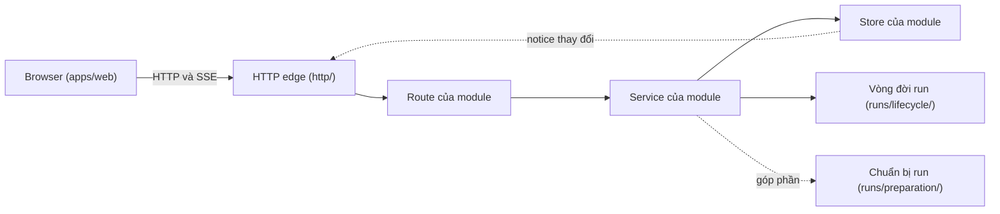
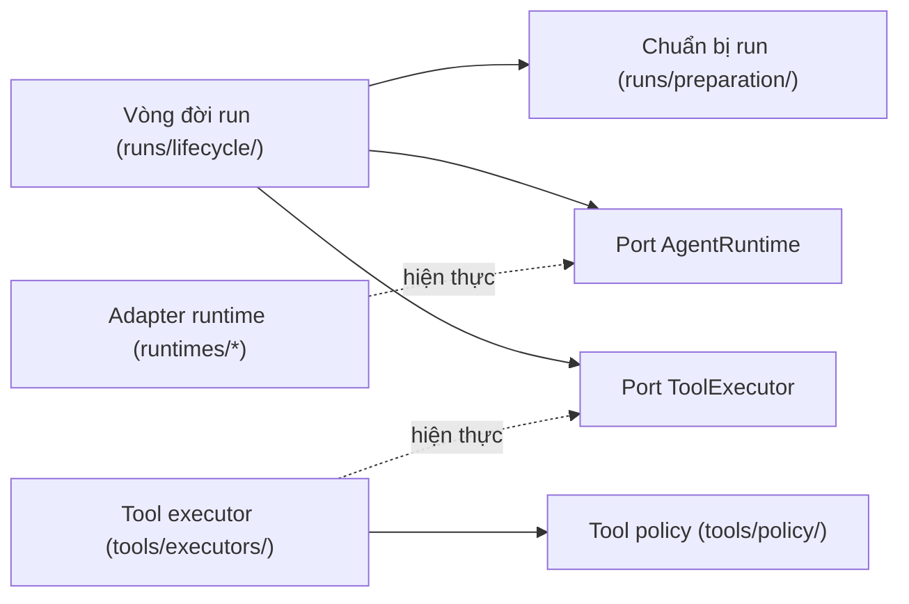

# Layout đích

Đọc file này để biết folder layout đề xuất cho DeckAgent, chiều phụ thuộc giữa các phần, hình dạng chung của một module và các rule mà feature còn thiếu đặt ra cho lõi agent.

Trạng thái: `Proposed`. Trên giấy, layout này đạt các tiêu chí trong [Tiêu chí của cấu trúc đích](criteria.md). Nó chưa được đối chiếu với toàn bộ code của vòng đời run và của deck package. Các rule ở [Rule của lõi agent](#rule-của-lõi-agent) đến từ [Áp lực từ feature còn thiếu](feature-pressure.md).

## Layout

```text
apps/host/src/
  server.ts            composition root: tạo service, gắn middleware, đăng ký route và phần góp vào run
  http/                Express app, bearer auth, kiểm tra origin, helmet, error handler, helper SSE,
                       channel báo thay đổi dùng chung
  modules/
    workspaces/        workspaces.routes.ts, workspaces.service.ts, workspaces.store.ts
    chats/
    providers/
    attachments/
    deck/              route, workflow, edit operation và deck store (SQL nằm cạnh invariant)
    design-systems/    design system tự tạo: CRUD, file thương hiệu, run đề xuất design system
    skills/            catalog skill mà hệ thống chọn cho một run
    research/
  runs/
    lifecycle/         run state machine, event log, approval, cancel, chạy lại
    preparation/       gom instruction, tool, skill và resource mà các module góp cho một run
    budget/            giới hạn tài nguyên của một run
    ports.ts           port AgentRuntime và port ToolExecutor
  tools/
    policy/            quyết run được đọc gì: phạm vi thư mục, file chứa secret, link, file nén
    executors/         thực thi tool trong phạm vi capability đã cấp
    sources/           nguồn tài liệu: filesystem, sau này là connector
  runtimes/
    opencode/          adapter cho port AgentRuntime: process, MCP bridge, parse event
    <name>/            runtime khác, ví dụ coding agent CLI có sẵn trên máy
  db/                  connection và migration
apps/web/src/          React và Vite, chia theo layer với page colocation (xem Browser Rules)
  editor/              khi có canvas: editor core thuần (model, command, undo) tách khỏi component React trong pages/deck/
packages/contracts/    Zod schema và wire DTO, thuần
packages/presentation/ design, document, html, pptx: thuần, không I/O
```

## Chiều phụ thuộc

Từ HTTP edge vào một module:



Bên trong lõi agent:



Mọi phần được phụ thuộc vào `packages/contracts` và `packages/presentation`. Hai package đó không phụ thuộc application nào. Trong phần còn lại của repository, `apps/web` chỉ import `packages/contracts`.

Module CRUD dùng layer bên trong module: route, rồi service, rồi store. `runs/` và `tools/` dùng ports và adapters. Lý do nằm trong [Các trục chịu tải](agent-load-axes.md).

## Rule của lõi agent

Các rule dưới đây là `Proposed`. Mỗi rule trả lời một ảnh hưởng trong [Áp lực từ feature còn thiếu](feature-pressure.md).

- **Run có owner tổng quát.** Một run thuộc về một owner có kiểu và ID, ví dụ một chat hoặc một design system. `runs/` không biết chat là gì. Rule "mỗi chat chỉ có một request đang chạy" là rule của module chats, được kiểm khi module chats yêu cầu tạo run. Đây là thay đổi so với lifecycle contract hiện tại, vốn bắt buộc có `sessionId`.
- **Một đường ghi cho mỗi domain state.** Người dùng ghi qua route, agent ghi qua tool, và cả hai chỉ gọi cùng một edit operation của module sở hữu state đó. Ví dụ: canvas và deck tool đều gọi edit operation của module deck.
- **Mọi đối tượng người dùng thấy dùng chung một cơ chế báo thay đổi.** Store tăng `version` sau mỗi lần ghi và phát notice có `version`. Channel trong `http/` chuyển notice tới Browser. Browser đọc lại đối tượng sau khi nhận notice. Lệnh ghi gửi kèm `version` đã đọc, và store từ chối lệnh ghi khi `version` đã cũ. Pattern này đã có cho deck: notice `deck-changed` mang `version`.
- **Port `AgentRuntime` có ba phần:** event của run, mức dùng tài nguyên (token, số lần gọi model) và lỗi có phân loại (key bị từ chối, hết quota, mất mạng, hết thời gian chờ). `runs/budget/` đọc mức dùng để dừng run khi vượt giới hạn.
- **Chuẩn bị run qua phần góp của module.** Mỗi module đăng ký phần góp của nó tại `server.ts`: instruction, tool, skill, resource. `runs/preparation/` gom các phần góp cho một run. Adapter runtime chuyển skill từ dạng chung sang format của runtime đó.
- **Policy tách khỏi executor.** `tools/executors/` chỉ thực thi sau khi `tools/policy/` cho phép. Executor không tự mở rộng phạm vi đọc.

## Hình dạng module

Một module trong `apps/host/src/modules/<name>/` bắt đầu với ba file:

- `<name>.routes.ts` đăng ký Express route. File này parse input bằng Zod schema từ `packages/contracts`, gọi service và ghi response. Nó không chứa business rule.
- `<name>.service.ts` chứa use case và business rule. File này không import Express.
- `<name>.store.ts` chứa SQL cho các bảng mà module sở hữu, tăng `version` và phát notice thay đổi. Ngoài transaction bảo vệ một invariant, file này không chứa business rule.

Module chỉ thêm file khác khi có một trách nhiệm riêng, ví dụ phần dựng prompt hoặc phần góp vào run. Module không có HTTP surface thì không có file routes. Module không sở hữu bảng nào thì không có file store.

Ví dụ với luồng tạo workspace:

```ts
// modules/workspaces/workspaces.routes.ts
router.post('/workspaces', validate(createWorkspaceSchema), async (req, res) => {
  res.status(201).json(await workspaces.create(req.body))
})

// modules/workspaces/workspaces.service.ts
create(input: CreateWorkspace) {
  checkFolderPolicy(input.folder)
  return store.insert(input)
}
```

## Chỗ đặt code mới

| Code mới | Chỗ đặt |
| --- | --- |
| Một agent runtime thứ hai, ví dụ coding agent CLI có sẵn trên máy (UC-005-A18) | `runtimes/<name>/`, implement port `AgentRuntime` |
| Skill do hệ thống chọn cho một run | Catalog trong `modules/skills/`. Phần góp skill vào run đăng ký với `runs/preparation/` |
| Canvas có editing tools (UC-007) | Editor core trong `apps/web/src/editor/`, component trong `apps/web/src/pages/deck/`. Lệnh ghi đi qua mutation hook tới edit operation của `modules/deck/` |
| Design system tự tạo (UC-010) | `modules/design-systems/`. Run đề xuất design system có owner là design system đó |
| Connector, ví dụ cloud drive | `tools/sources/<connector>/`, đi qua `tools/policy/` |
| Một format export mới | `packages/presentation/<format>/`, implement FormatAdapter contract của `presentation/document` |
| Một màn hình settings mới | Page của màn hình đó trong `apps/web/src/pages/`. Endpoint nằm trong module sở hữu setting đó |
| Một rule áp cho toàn bộ HTTP, ví dụ một header | `http/` |

## Điểm còn mở

- `Open`: deck có thể giữ làm package trong `packages/presentation/deck/` hoặc chuyển vào `modules/deck/`. Hiện tại chỉ code phía Host import `@deckagent/deck`: `apps/web/src/features/`, `apps/web/src/integrations/`, `packages/host/api/` và các test. Không module Browser nào import nó. Dữ kiện này nghiêng về phía chuyển vào `modules/deck/` (`Inferred`), nhưng trước khi chuyển phải kiểm FormatAdapter contract.
- `Open`: bảng map lỗi sang HTTP status có thể nằm ở từng module hoặc ở một error handler chung trong `http/`. Hiện tại toàn bộ bảng map nằm trong `apps/web/src/local-transport.ts`.
- `Open`: hình dạng cụ thể của owner của run, của port `AgentRuntime` và của contract phần góp vào run chưa được thiết kế.
- `Open`: khi người dùng sửa một slide mà agent đang sửa, store từ chối lệnh ghi có `version` cũ. Người dùng thấy gì sau đó, hoặc slide có bị khoá trong lúc run hay không, là quyết định sản phẩm và chưa có câu trả lời.
