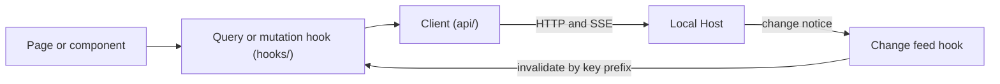

# Browser Rules

Read this file to know the layout and the conventions that Phase 5 of the Target Structure Refactor applies to `apps/web/`.

Phase 1 wrote these rules into the Project Structure [[1]](#ref-1), the Coding Guidelines [[2]](#ref-2) and the Testware [[3]](#ref-3). The conventions are the source for the executors. This file keeps the reasons and the sources. The problems that the rules fix are in [Browser Problems](problems.md). The sources of the rules are in [Reference Products](reference-products.md). The Browser rules have the same topics as the Host rules in Naming Rules [[4]](#ref-4): concepts, role files, state, errors, validation and enforcement.

## Stack

| Concern | Choice | Status |
| --- | --- | --- |
| UI | React with Vite, as a single-page application (SPA). The Host serves the build folder | Selected in AGENTS.md [[5]](#ref-5). Version is set in Phase 1 |
| Server state | TanStack Query | Selected in AGENTS.md [[5]](#ref-5) |
| Routing | React Router in declarative mode. See [Routing](#routing) | Decided |
| Styles | Tailwind CSS 4 with shadcn/ui. The tokens of `apps/web/DESIGN.md` become the theme variables of shadcn/ui. See [Styles](#styles) | Decided |
| Component tests | Vitest with jsdom and Testing Library. Pure logic can keep `node:test`. See [Tests](#tests) | Decided. Phase 1 adds Vitest for `apps/web/` to the Tech Stack of AGENTS.md [[5]](#ref-5), which lists `node:test` |
| Development mocks | MSW in `apps/web/mocks/`. Phase work adds MSW when a screen needs work without a running Host. See [Development mocks](#development-mocks) | Decided |

## Layout

```text
apps/web/
  index.html
  vite.config.ts
  components.json       shadcn/ui configuration
  src/
    main.tsx            React root, QueryClient, router
    routes.tsx          Route table
    pages/<page>/       One screen. Page-only components in pages/<page>/components/
    components/         Components that two or more pages use
      ui/               shadcn/ui primitives and the cn() class helper
    layouts/            App shell, sidebar, window frame
    hooks/              UI hooks and query hooks
    api/                Typed HTTP and SSE access to the Host
    contexts/           UI state that two or more pages read
    editor/             Editor core of the canvas, without React and DOM
    styles/             Tailwind entry CSS, theme variables, global app shell
    text.ts             User-visible text, including error text
  mocks/                MSW handlers and fixtures, development only
  tests/
```

The tree shows where code goes when it exists. Do not create an empty folder [[1]](#ref-1).

| Folder | Owns | Does not own |
| --- | --- | --- |
| `pages/<page>/` | The screen of one route, its local state and its page-only components | Fetch calls, wire decoding |
| `components/` | A component that two or more pages use | A component that one page uses. Future reuse is not a reason to move it up |
| `components/ui/` | shadcn/ui primitives without product meaning, and `cn()` | Product layout and workflow |
| `styles/` | The Tailwind entry file, the theme variables for light and dark, the global app shell | Component styles. They are utility classes in the component |
| `hooks/` | `use*` hooks: query hooks, mutation hooks, the change feed hook, the request stream hook, UI interaction hooks | JSX, direct `fetch` |
| `api/` | HTTP and SSE client, request serialization, response decoding with the contracts package, typed client error codes, query keys | React, UI text |
| `contexts/` | UI state that two or more pages read, for example the selected workspace | A copy of server data. Server data stays in the query cache |
| `editor/` | Model, commands and undo of the canvas editor | React, DOM, `fetch` |
| `text.ts` | The text table of the UI and the map from client error code to text | Logic |

There is no `utils/`, `types/` or `common/` folder. A helper goes to the owner that uses it. A type that only the UI uses goes to the file of its owner. A wire type comes from the contracts package [[1]](#ref-1).

`Proposed`: `pages/` follows the Host modules where a screen maps to one module, for example `pages/settings/` reads `providers`. A page can read more than one module.

## Routing

The current Browser has no URL routing. The URL holds only the token in the hash (`apps/web/src/browser/boot.ts`). Thus all routes are new.

- `src/routes.tsx` declares the routes with `<BrowserRouter>`, `<Routes>` and `<Route>` [[6]](#ref-6). A layout route without `path` renders the app shell, and its children render in `<Outlet/>`.
- The router does not load data. There is no `loader` and no `action`, because TanStack Query owns server state. Then only one owner loads data.
- Declarative mode is the mode for the use "as simply as possible" [[7]](#ref-7). Framework mode is not used: it needs the `app/` folder and a build step with Node, and DeckAgent has no server rendering. A change to data mode later changes only `routes.tsx`.

| Path | Screen | Note |
| --- | --- | --- |
| `/` | Start screen: workspace and chat list | |
| `/chats/:sessionId` | One chat with its conversation and its deck | A chat has at most one deck, so the deck has no path of its own. The parameter is `sessionId`, because the Coding Guidelines forbid a mix of `chatId` and `sessionId` before Phase 8 of the Naming and Grouping Refactor [[8]](#ref-8). That phase renames the parameter |
| `/settings` | Settings: providers, models, credentials, theme | |

- The token stays in the hash for the first load. `main.tsx` reads it one time and keeps it for `api/client.ts`. Thus a navigation does not lose the token. Do not use `HashRouter`, because the hash holds the token.
- The Host returns `index.html` for each path that is not an `/api/` path or an asset (SPA fallback). open-design does the same ([Reference Products](reference-products.md)).
- A path with an unknown `sessionId` shows the start screen with the text for a missing chat.

## Data flow



- A page reads server data only through a query hook. A page writes only through a mutation hook. A hook calls only `api/` (lint).
- A query key is an array that starts with the Host module name, for example `['chats']` and `['chats', sessionId, 'requests']`. `api/<module>.ts` exports a key factory `<module>Keys`. TanStack Query invalidates "every query with a key that starts with" the given prefix [[9]](#ref-9).
- The change feed hook reads `/api/changes` and invalidates the key prefix of the notice topic. It does not write data into the cache.
- A write sends the `version` that the client read. A stale error invalidates the query and shows the text for that code. The product decision about this text is in Open Questions [[10]](#ref-10).
- The request stream hook owns the SSE reader and its `AbortController`, and stops the reader on unmount. React docs: "You can fetch data with Effects, but you need to implement cleanup to avoid race conditions" [[11]](#ref-11).
- Do not store a value in state when render can compute it [[11]](#ref-11).

## Role files and names

| File | Main export | Example |
| --- | --- | --- |
| `pages/<page>/<page>-page.tsx` | `<Page>Page` | `chat-page.tsx` exports `ChatPage` |
| `<name>.tsx` in `components/` or a page | `<Name>` component | `request-row.tsx` exports `RequestRow` |
| `hooks/use-<name>.ts` | `use<Name>` | `use-chats.ts` exports `useChats` |
| `api/<module>.ts` | Client functions and `<module>Keys` | `api/chats.ts` exports `listChats` and `chatsKeys` |
| `api/client.ts` | The HTTP function with bearer token and error decoding | |

- File names use kebab case, also for components, as in the Host. Then `unicorn/filename-case` checks both applications with one setting, and the files that the shadcn/ui CLI adds have the same case [[4]](#ref-4). Decided.
- Code uses the concept names of Naming Rules [[4]](#ref-4): `Chat`, not `Session`. The field `sessionId` and the route `/api/sessions` stay until Phase 8 of the Naming and Grouping Refactor [[8]](#ref-8).
- No `enum`. Use a union, as in the Host [[4]](#ref-4).

## Styles

- A component uses Tailwind utility classes. It does not have its own CSS file.
- shadcn/ui uses CSS variables for its theme, for example `background`, `foreground` and `primary`, under `:root` and `.dark` [[12]](#ref-12). `src/styles/` maps the tokens of `apps/web/DESIGN.md` to these variables. A component uses the variables through Tailwind classes, not a color value.
- Dark mode uses the `.dark` class of shadcn/ui [[12]](#ref-12). The current theme script sets `data-theme`. Phase 2 changes the script to set the class. The choice `system` still follows `prefers-color-scheme`.
- The shadcn/ui CLI adds a primitive as source code into `components/ui/`. A change to a primitive is a change to our code, and review checks it.
- `components.json` needs aliases [[13]](#ref-13). The alias `ui` points to `components/ui`. The alias `utils` points to `components/ui/cn`, not to `lib/utils`, because the project structure has no `utils` folder [[1]](#ref-1).
- `Proposed`: the alias `@/*` maps to `src/*` of `apps/web/` only. Phase 1 checks that the alias does not trip the `check:boundaries` rule `tsconfig-private-alias`, because that rule forbids aliases into other packages.
- `apps/web/DESIGN.md` stays the design source. Phase 2 changes it from raw CSS tokens to the theme variables.

## Text and errors

- All user-visible text is in `src/text.ts`. A component does not contain a string for the user.
- `api/` converts an HTTP error or an SSE error to a typed client error with a code from the contracts package. It does not choose text.
- `text.ts` maps each client error code to text with the type `Readonly<Record<ClientErrorCode, string>>`. Then TypeScript finds a code that has no text.

## Editor core

The canvas editor of UC-007 (editing a deck on a canvas) has a core without React and DOM in `src/editor/`. The core owns the model, the commands and undo. Components in `pages/deck/` render the core state and send commands. A write of the deck goes through a mutation hook to the edit operation of `modules/deck/` [[1]](#ref-1). open-design uses the same split for chat logic in `runtime/chat/` ([Reference Products](reference-products.md#learn-from-open-design)).

## Preview security

- Deck HTML renders only in an `iframe` with an empty `sandbox` attribute and `srcDoc` with the slide CSP. The current code already does this (`deck-canvas.ts`, `deck-preview-queue.ts`).
- Code does not use `dangerouslySetInnerHTML` (oxlint rule `react/no-danger`).
- `Proposed`: one component owns the preview iframe, and keeps the iframe mounted when the mode changes, as open-design does ([Reference Products](reference-products.md#learn-from-open-design)).

## Tests

- Tests stay in `apps/web/tests/` [[3]](#ref-3).
- Pure logic (`editor/`, `api/` decoding, key factories) has tests without a renderer.
- Tests of `apps/web/` run with Vitest. A component test uses the `jsdom` environment [[14]](#ref-14) and Testing Library.
- A component test renders the component and checks what the user sees. It uses MSW in Node as an HTTP mock at the network level, not a mock of a hook. MSW works "for browser and Node.js" [[15]](#ref-15). The handlers and fixtures of a test stay in `apps/web/tests/`.
- Cross-application flows stay in `e2e/`.

## Development mocks

- `apps/web/mocks/` holds the MSW handlers, the fixtures and the browser start file for development. It is not product code.
- MSW stops only the requests that have a handler. Other requests go to the real Host.
- Only `main.tsx` starts the browser mocks, and only in development. Pages, components, hooks and `api/` do not import `mocks/`, also not by dynamic import (lint).
- The production build fails when a chunk contains a module of `mocks/` or the MSW runtime.
- A handler returns a body that the `decode*` function of the contracts package accepts. Then the mock cannot drift from the wire.

## Enforcement

| Rule | Tool | Status |
| --- | --- | --- |
| `apps/web/` imports only `@deckagent/host-contracts` (later `packages/contracts`) from the workspace, and no Node-only module | `oxlint` `no-restricted-imports` for the new folders. `check:boundaries` (`browser-node-import`) and `oxlint` for `apps/web/src/browser/` | Exists. Phase 7 extends `browser-node-import` to all of `apps/web/src/` and removes the document package from `BROWSER_ALLOWED_PACKAGES` |
| `pages/`, `components/`, `layouts/` and `contexts/` do not import `api/` | `oxlint` `no-restricted-imports` | Exists |
| `components/`, `layouts/`, `contexts/` and `hooks/` do not import `pages/`. `hooks/` does not import `components/` or `layouts/` | `oxlint` `no-restricted-imports` | Exists |
| A page does not import another page | Review | No static pattern can tell another page from a folder of the same page |
| `api/` and `editor/` do not import React, TanStack Query or UI code. `editor/` does not import `api/` | `oxlint` `no-restricted-imports` | Exists |
| Code in `src/` does not import `mocks/` or `msw`. Only `main.tsx` starts the mocks in development | `oxlint` `no-restricted-imports` for static imports. Review for dynamic imports | Exists |
| Production build has no chunk from `mocks/` or MSW | Build check | Exists |
| No `dangerouslySetInnerHTML` | `oxlint` `react/no-danger` | Exists |
| File names in kebab case | `oxlint` `unicorn/filename-case` | Exists for `apps/web/src/` and `apps/web/mocks/` |
| Text only in `text.ts` | Review | Exists |

Each new rule has a negative fixture [[1]](#ref-1).

## References

1. <a id="ref-1"></a>[Project Structure](../../../conventions/project-structure.md)
2. <a id="ref-2"></a>[Coding Guidelines](../../../conventions/code.md)
3. <a id="ref-3"></a>[Testware](../../../conventions/testware.md)
4. <a id="ref-4"></a>[Naming Rules](../naming-and-grouping/naming-rules.md)
5. <a id="ref-5"></a>[Project: DeckAgent](../../../../AGENTS.md)
6. <a id="ref-6"></a>[React Router: Declarative Routing](https://reactrouter.com/start/declarative/routing)
7. <a id="ref-7"></a>[React Router: Picking a Mode](https://reactrouter.com/start/modes)
8. <a id="ref-8"></a>[Naming and Grouping Refactor](../naming-and-grouping/README.md)
9. <a id="ref-9"></a>[TanStack Query: Query Invalidation](https://tanstack.com/query/latest/docs/framework/react/guides/query-invalidation)
10. <a id="ref-10"></a>[Open Questions](../../../open-questions.md)
11. <a id="ref-11"></a>[React: You Might Not Need an Effect](https://react.dev/learn/you-might-not-need-an-effect)
12. <a id="ref-12"></a>[shadcn/ui: Theming](https://ui.shadcn.com/docs/theming)
13. <a id="ref-13"></a>[shadcn/ui: components.json](https://ui.shadcn.com/docs/components-json)
14. <a id="ref-14"></a>[Vitest: Test Environment](https://vitest.dev/guide/environment)
15. <a id="ref-15"></a>[MSW documentation](https://mswjs.io/docs/)
