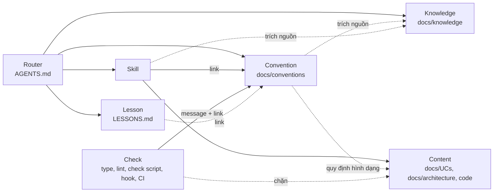
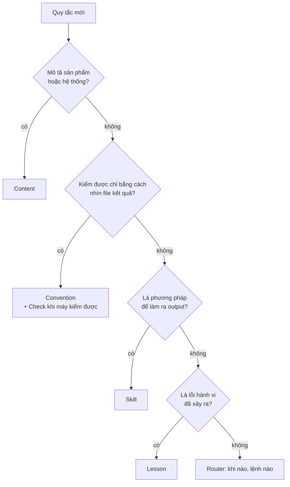

# Conventions

Đọc file này để biết repo chia quy tắc thành những tầng nào, một quy tắc mới thuộc tầng nào, và tìm file convention theo loại output.

## Các tầng

Mỗi tầng trả lời đúng một câu hỏi và nằm ở một chỗ riêng. Một quy tắc chỉ có một nơi sở hữu; tầng khác link tới nơi đó, không chép lại.

| Tầng | Câu hỏi | Ở đâu | Không chứa |
| --- | --- | --- | --- |
| Content | Sản phẩm và hệ thống là gì? | `docs/UCs/`, `docs/architecture/`, `docs/testing/`, `docs/design/`, `docs/open-questions.md` | Hướng dẫn cách viết tài liệu |
| Convention | File output (code, test, tài liệu) phải trông thế nào? | `docs/conventions/` | Các bước làm, lịch sử lỗi |
| Skill | Làm thế nào để tạo ra output đó? | `.agents/skills/` | Định dạng output; skill link tới file convention |
| Lesson | Agent đã làm sai gì trong quá trình làm việc mà nhìn file kết quả không thấy được? | [`LESSONS.md`](../../LESSONS.md) | Quy tắc kiểm được trên file kết quả |
| Knowledge | Đã học được gì về kỹ thuật, công cụ hoặc phương pháp, và nguồn nào chứng minh? | [`docs/knowledge/`](../knowledge/README.md) | Quy tắc bắt buộc; lỗi hành vi của agent |
| Check | Vi phạm bị chặn thế nào? | Type check, lint, check script, hook, CI; review cho phần máy không kiểm được | Diễn giải quy tắc; message nêu cách sửa và link tới file convention |
| Router | Khi nào đọc gì, chạy lệnh nào? | [`AGENTS.md`](../../AGENTS.md) | Nội dung quy tắc |

Link đi một chiều: Router trỏ tới mọi tầng; Skill, Check và Lesson trỏ tới Convention; Convention không trỏ tới Skill hay Lesson. Knowledge chỉ link tới nguồn của nó, không link tới nơi áp dụng nó.

## Đặt một quy tắc mới vào đâu

Ví dụ: "mỗi giá trị trong bảng rule có cột Nguồn" kiểm được trên file, nên thuộc Convention. "Kiểm `.env` trước khi khẳng định dịch vụ ngoài đã cấu hình" không thấy được trên file kết quả và là lỗi đã xảy ra, nên thuộc Lesson. "Đi qua từng bước của luồng chính để tìm luồng ngoại lệ" là phương pháp, nên thuộc Skill.

Kiến thức có nguồn nhưng chưa phải quy tắc thuộc Knowledge, ví dụ danh sách anti-pattern khi code dựa trên test có sẵn. Khi kiến thức đó sinh ra quy tắc, quy tắc đi qua sơ đồ trên và trích file kiến thức làm nguồn.

## Ưu tiên chặn bằng máy

Một quy tắc kiểm được bằng máy thì được chặn theo thứ tự: cấu trúc code và type → lint hoặc check script → test → văn bản. Khi một lỗi lặp lại hoặc có thể lặp lại, đề xuất type, lint hoặc test chặn lỗi đó trước khi thêm văn bản vào convention hay `LESSONS.md`.

- Message của lint hoặc check nêu cách sửa đúng và link tới file convention, để người sửa sửa nguyên nhân gốc thay vì vá tạm.
- Quy tắc trong file convention ghi công cụ chặn nó trong ngoặc, ví dụ *(lint)* hoặc *(review)*. Chỉ ghi tên công cụ đã có trong repo.
- Không dùng directive tắt rule, `@ts-expect-error` hoặc comment giải thích để lách quy tắc. Khi một quy tắc sai trong một ngữ cảnh cụ thể, sửa phạm vi của quy tắc trong cấu hình của check.

## Danh sách convention

| File | Output |
| --- | --- |
| [code.md](code.md) | Code production: naming, TypeScript, comment, validation, state, error handling |
| [project-structure.md](project-structure.md) | Cấu trúc source code mục tiêu: ownership, vị trí code, dependency boundaries |
| [testware.md](testware.md) | Test code |
| [docs.md](docs.md) | Mọi tài liệu trong `docs/`: cấu trúc, ngôn ngữ, trích dẫn, ID |
| [use-cases.md](use-cases.md) | Tài liệu trong `docs/UCs/` |
| [architecture.md](architecture.md) | Tài liệu trong `docs/architecture/`, ADR |
| [mermaid.md](mermaid.md) | Diagram trong mọi tài liệu |
| [knowledge.md](knowledge.md) | File kiến thức trong `docs/knowledge/` |
