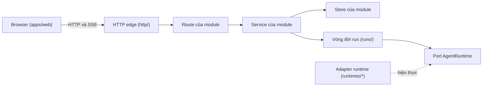

# Project Structure

Đọc file này để biết cấu trúc source code đích của DeckAgent: component nào sở hữu trách nhiệm nào, code mới đặt ở đâu, component nào được phụ thuộc vào component nào, và code cũ cùng chạy với code mới thế nào trong lúc chuyển.

File này mô tả kiến trúc mà repo refactor tới, không mô tả code hiện tại. Code mới đặt theo file này và theo [Trong lúc chuyển](#trong-lúc-chuyển). Không tạo folder rỗng: chỉ tạo folder khi có code thuộc trách nhiệm của folder đó. Cách viết code nằm trong [Coding Guidelines](code.md). Cách viết test nằm trong [Testware](testware.md).

## Nguyên tắc

### Strict boundaries, flexible implementation

Mỗi application, package, module và folder có một trách nhiệm xác định. Mỗi component trả lời một câu hỏi, sở hữu một tập hành vi, state hoặc contract, và không sở hữu trách nhiệm của component khác.

Không tạo class, interface, layer, package hoặc folder chỉ để theo một template. Không tạo `shared`, `common`, `utils` hoặc `errors` chung để né dependency boundary *(review)*.

### Runtime ownership

DeckAgent là local application gồm hai application: Browser (`apps/web/`) và Local Host (`apps/host/`). HTTP/SSE trên localhost là transport nội bộ giữa hai application này. DeckAgent không phải hosted backend.

- Browser sở hữu UI, browser state và user interaction.
- Local Host sở hữu use case, vòng đời run, agent runtime và quyền truy cập local capability (filesystem, process, SQLite).
- Package sở hữu một contract hoặc một capability thuần, không có I/O.
- Composition root của application (`apps/host/src/server.ts`) nối các concrete implementation và quản lý lifecycle.

Xác định owner theo trách nhiệm trước, sau đó mới xét runtime. Code liên quan tới giao diện không tự động thuộc Browser. Code chạy trên Node.js không tự động thuộc Local Host.

### Authority

Mỗi state có đúng một authoritative owner. Component khác chỉ thay đổi state đó qua public operation của owner *(review, test)*. Người dùng ghi qua route, agent ghi qua tool, và cả hai gọi cùng một edit operation của module sở hữu state đó *(review)*.

| Owner | Quyết định | Không quyết định |
| --- | --- | --- |
| Service của module | Use case và business rule của module, thứ tự gọi operation của module khác | Private state của module khác, HTTP semantics |
| Store của module | Durable record và transaction bảo vệ invariant của module, `version` của đối tượng | Request execution, business rule ngoài invariant |
| Vòng đời run (`runs/lifecycle/`) | Trạng thái thực thi của run, cancellation, terminal status | HTTP semantics, rule riêng của owner của run |
| Agent runtime adapter (`runtimes/<name>/`) | Cách thực thi agent | Terminal status của run |
| Tool policy (`tools/policy/`) | Capability cấp cho một run | Cách thực thi tool |
| Tool executor (`tools/executors/`) | Thực thi operation trong capability đã cấp | Cấp thêm capability |
| HTTP edge (`http/`) | Chuyển đổi giao tiếp giữa Browser và Local Host | Domain policy |

### Khi nào tạo folder hoặc package

Ưu tiên đặt code vào owner hiện có.

- Tạo module trong `apps/host/src/modules/` khi một domain có state, route hoặc use case riêng.
- Tạo folder bên trong module khi một trách nhiệm nội bộ cần tách riêng và có ownership, exclusion và dependency rõ ràng.
- Tạo package khi component cần public contract và dependency boundary riêng, và không có I/O. Package mới phải có consumer cụ thể hoặc một dependency cần chặn.
- Không tạo package chỉ vì số file tăng, vì một module cần code của module khác, vì muốn có một layer theo Clean Architecture, hoặc vì muốn đặt interface vào một chỗ chung.

Khi hai component cần import lẫn nhau, xem lại ownership và chiều phụ thuộc trước khi tạo abstraction hoặc package mới.

## Cấu trúc đích

```text
apps/host/src/
  server.ts            composition root
  cli.ts               CLI entry point gọi server.ts
  contract-sync.ts     kiểm tra tương đương kiểu lúc compile (tạm thời cho tới khi đổi packages/contracts/)
  http/                Express app, middleware, error handler, helper SSE, channel báo thay đổi
  modules/<name>/      <name>.routes.ts, <name>.service.ts, <name>.store.ts, <name>.errors.ts
  runs/
    lifecycle/         run state machine, event log, approval, cancel
    preparation/       gom phần góp của các module cho một run
    budget/            giới hạn tài nguyên của một run
    ports.ts           port AgentRuntime và port ToolExecutor
  tools/
    policy/            quyết run được đọc gì
    executors/         thực thi tool trong capability đã cấp
    sources/           nguồn tài liệu: filesystem, connector
  runtimes/<name>/     adapter cho port AgentRuntime
  db/                  connection, migration, persistence adapter cho port của runs/
  storage/             thư mục Application Storage và kho credential được OS bảo vệ
apps/host/tests/
apps/web/
  components.json      cấu hình shadcn/ui
  src/                 React và Vite, chia theo layer, component của một page đặt cạnh page đó
    main.tsx           React root, QueryClient, router
    routes.tsx         bảng route
    text.ts            văn bản hiển thị cho người dùng
    pages/<page>/      một màn hình, component riêng của page trong pages/<page>/components/
    components/        component mà từ hai page trở lên dùng
      ui/              primitive của shadcn/ui và cn()
    layouts/           app shell
    hooks/             query hook, mutation hook, hook UI
    api/               HTTP/SSE client
    contexts/          UI state mà từ hai page trở lên đọc
    editor/            editor core của canvas, không có React và DOM
    styles/            file Tailwind, theme variable
  mocks/               MSW handler và fixture, chỉ cho development
  tests/
packages/
  contracts/
  presentation/{deck,design,document,html,pptx}/
  <group>/<package>/tests/
e2e/
scripts/
```

Cột "Không sở hữu" chỉ ghi các trách nhiệm dễ bị đặt nhầm vào component đó.

### `apps/host/`

| Path | Câu hỏi | Sở hữu | Không sở hữu |
| --- | --- | --- | --- |
| `src/server.ts` | Local Host khởi động và tắt thế nào? | Startup, shutdown, configuration, tạo service, gắn middleware, đăng ký route và phần góp vào run | Business rule, SQL |
| `src/cli.ts` | Người dùng khởi chạy Local Host từ dòng lệnh thế nào? | Đọc tham số CLI, nạp file cấu hình startup, mở trình duyệt, xử lý tín hiệu tắt và gọi `server.ts` | Business rule, HTTP route, SQL |
| `src/contract-sync.ts` | Kiểu dữ liệu của Host và contracts package có khớp lúc compile không? | Kiểm tra tương đương kiểu lúc compile (`tsc -b`) giữa `@deckagent/host-contracts`, `db/` và `@deckagent/deck` (tạm thời cho tới khi chuyển `packages/contracts/`) | Runtime logic, I/O |
| `src/http/` | Mọi HTTP request đi qua những bước chung nào? | Express app, bearer auth, kiểm tra origin, security header, giới hạn body, multipart, error handler (`HttpError` và `RunFailure`), helper SSE, channel chuyển notice thay đổi tới Browser | Route của module, business rule |
| `src/modules/<name>/` | Một domain làm gì và lưu gì? | Route, use case, business rule, SQL của các bảng module sở hữu (`chats`, `workspaces`, `providers`, `research`, `attachments`, `deck`, `settings`), `version` và notice thay đổi, phần góp của module vào run | Store của module khác, vòng đời run |
| `src/runs/` | Một run chạy, dừng và kết thúc thế nào? | Vòng đời run, event log, approval, cancel, chuẩn bị run, ngân sách tài nguyên, port `AgentRuntime` và port `ToolExecutor` | Module, Express, SQL driver, adapter cụ thể, rule riêng của owner của run |
| `src/tools/` | Agent truy cập tài liệu trong phạm vi được cấp thế nào? | Tool policy, tool executor, nguồn tài liệu | User approval, request admission |
| `src/runtimes/<name>/` | Một agent runtime cụ thể chạy thế nào? | Process, protocol, MCP bridge, parse event, chuyển skill sang format của runtime | Terminal status của run, permission |
| `src/db/` | Local Host mở database, migrate và lưu run thế nào? | Connection (`ChatDatabase`, `SettingsDatabase`), migration (`*.migrations.ts`), persistence adapter cho port của `runs/` (`SqliteRunStore` và các file query của nó) | SQL của module, HTTP status |
| `src/storage/` | Local Host đặt dữ liệu ứng dụng và lưu khóa bí mật ở đâu? | Xác định và chuẩn bị thư mục Application Storage (`storage-root.ts`), kho credential được OS bảo vệ (`credential-store.ts`) | SQLite, business rule của module, HTTP |

### `apps/web/`

| Path | Câu hỏi | Sở hữu | Không sở hữu |
| --- | --- | --- | --- |
| `src/main.tsx`, `src/routes.tsx` | Browser khởi động và chọn màn hình thế nào? | React root, `QueryClient`, bảng route, đọc token từ hash một lần, bật mock khi development | Load data, business rule, request execution authority, filesystem, SQLite, agent process |
| `src/pages/<page>/` | Một màn hình gồm những gì? | Màn hình của một route, UI-local state, component chỉ page đó dùng trong `pages/<page>/components/` | Gọi `fetch`, decode wire payload |
| `src/components/` | Component nào nhiều màn hình dùng chung? | Component mà từ hai page trở lên dùng. `components/ui/` chứa primitive của shadcn/ui và `cn()` | Component chỉ một page dùng, product workflow trong `components/ui/` |
| `src/layouts/` | Khung chung của các màn hình là gì? | App shell, sidebar, window frame | Load data |
| `src/hooks/` | Màn hình đọc và ghi server data thế nào? | Query hook, mutation hook, hook đọc change feed, hook đọc request stream, hook UI | JSX, gọi `fetch` trực tiếp |
| `src/api/` | Browser gọi Local Host thế nào? | HTTP/SSE client, serialize request, decode response bằng contracts package, ánh xạ lỗi HTTP/SSE sang mã lỗi typed của client, query key | React, bảng văn bản lỗi UI, permission policy, vòng đời run |
| `src/contexts/` | UI state nào nhiều màn hình đọc? | UI state mà từ hai page trở lên đọc, ví dụ workspace đang chọn | Bản sao của server data |
| `src/editor/` | Editor của canvas giữ model và lệnh thế nào? | Model, command, undo của canvas editor | React, DOM, `fetch` |
| `src/styles/` | Theme của Browser là gì? | File Tailwind, theme variable cho light và dark, global app shell | Style của từng component |
| `src/text.ts` | Browser hiển thị chữ gì cho người dùng? | Bảng văn bản UI, bảng ánh xạ mã lỗi typed của client sang văn bản | Logic |
| `mocks/` | Development chạy không cần Host thế nào? | MSW handler, fixture và file khởi động mock trong browser | Code production, fixture của test |

Component chỉ một page dùng đặt trong `pages/<page>/components/`. Component chỉ lên `components/` khi từ hai page trở lên dùng nó. Khả năng tái sử dụng sau này không phải lý do để chuyển lên sớm *(review)*. Browser không có folder `utils/`, `types/` hay `common/`: helper đặt ở owner dùng nó, type chỉ UI dùng đặt trong file của owner, wire type lấy từ contracts package *(review)*.

Route khai báo bằng React Router ở declarative mode. Router không load data, vì TanStack Query sở hữu server state. Path gồm `/`, `/chats/:sessionId` và `/settings`. Deck đi theo chat và không có path riêng. Host trả `index.html` cho mọi path không phải `/api/` và không phải asset *(review, test)*.

Canvas editor tách editor core trong `src/editor/` khỏi component React trong `pages/deck/`. Lệnh ghi của editor đi qua một mutation hook tới edit operation của `modules/deck/` *(lint: oxlint `no-restricted-imports`)*. Quy tắc viết code của Browser nằm trong [Coding Guidelines](code.md#browser).

### `packages/`

| Path | Câu hỏi | Sở hữu | Không sở hữu |
| --- | --- | --- | --- |
| `contracts/` | Browser và Local Host trao đổi dữ liệu theo contract nào? | Zod schema, wire DTO, event envelope, protocol error payload, decode wire payload. Decoder cho mỗi payload deck mà Browser đọc, gọi decoder của `presentation/document/` | HTTP server, store, Browser client, type chỉ Local Host dùng |
| `presentation/design/` | Design system, template và layout xác định thế nào? | Design contract, design system và template catalog, theme, layout, compatibility rule | Deck lifecycle, generation, native conversion |
| `presentation/document/` | Nội dung slide được biểu diễn và kiểm tra thế nào trước khi gắn với format? | SlideDocument, content node, provenance contract, document validation, FormatAdapter contract | Publication authority, concrete conversion |
| `presentation/html/` | Portable content thành HTML artifact an toàn thế nào? | HTML conversion, giới hạn HTML/CSS, HTML validation | Deck lifecycle, request permission, publication authority |
| `presentation/pptx/` | Portable content thành PPTX artifact thế nào? | PPTX conversion, font mapping, PPTX validation | Deck lifecycle, request permission, publication authority |
| `presentation/deck/` | Deck state và publication thay đổi hợp lệ thế nào? | Deck lifecycle, Brief và Outline state, generation state và grant, revision và publication invariant, artifact ownership | Vòng đời run, concrete HTML/PPTX adapter, workflow xuyên domain |

`packages/presentation/deck/` giữ dạng package để duy trì boundary `deck-concrete-adapter` và cung cấp type cho Host lifecycle. `apps/host/src/modules/deck/` sở hữu deck routes, workflows và adapters [[1]](#ref-1).

### Tests, scripts và docs

- Test đặt cùng component sở hữu hành vi được kiểm: `apps/host/tests/`, `apps/web/tests/`, `packages/<group>/<package>/tests/`. Test kiểm hành vi xuyên nhiều component đặt trong `e2e/`. Không bắt buộc chia `unit/`, `integration/`, `contract/`.
- `scripts/` chỉ chứa developer tooling (build, check, repository operation). Không đặt business logic hoặc runtime capability vào `scripts/`.
- Ownership của tài liệu nằm trong [Documentation Conventions](docs.md). File này không thay tài liệu về system architecture, state machine hay database schema trong `docs/architecture/`.

## Hình dạng module

Một module trong `apps/host/src/modules/<name>/` bắt đầu với bốn file. Tên symbol chính của mỗi file nằm trong [File vai trò và symbol](code.md#file-vai-trò-và-symbol).

- `<name>.routes.ts` đăng ký Express route. File này parse input bằng Zod schema từ `packages/contracts`, gọi service và ghi response. File này không chứa business rule *(review)*.
- `<name>.service.ts` chứa use case và business rule. File này không import Express *(review)*.
- `<name>.store.ts` chứa SQL cho các bảng mà module sở hữu, tăng `version` sau mỗi lần ghi và phát notice thay đổi. Ngoài transaction bảo vệ một invariant, file này không chứa business rule *(review)*.
- `<name>.errors.ts` chứa error class của module và bảng status HTTP của error đó. `server.ts` đăng ký bảng này với error handler *(review)*.

Module chỉ thêm file khác khi có một trách nhiệm riêng, ví dụ phần dựng prompt, phần góp vào run (`<name>.run-contribution.ts`) hoặc schema của database (`<name>.migrations.ts`). Module không có HTTP surface thì không có file routes. Module không sở hữu bảng nào thì không có file store. Không tạo folder `controllers/`, `services/` hoặc `repositories/` dùng chung cho nhiều module *(review)*.

## Dependency rules



### Runtime

| From | Được phụ thuộc | Không được phụ thuộc |
| --- | --- | --- |
| Folder mới của `apps/web/src/` | `packages/contracts` | `apps/host/`, Node-only module, package khác của workspace, `mocks/` và `msw` (trừ `main.tsx`) |
| `apps/web/src/pages/` | `hooks/`, `components/`, `layouts/`, `contexts/`, `text.ts` | `api/` |
| `apps/web/src/{components,layouts,contexts}/` | `hooks/`, `components/`, `text.ts` | `pages/`, `api/` |
| `apps/web/src/hooks/` | `api/`, `contexts/`, TanStack Query | `pages/`, `components/`, `layouts/` |
| `apps/web/src/api/` | `packages/contracts` | React, TanStack Query, `pages/`, `components/`, `layouts/`, `hooks/`, `contexts/` |
| `apps/web/src/editor/` | `packages/contracts` | React, TanStack Query, `api/` và mọi folder UI |
| `http/` | Route registrar của module, `runs/ports.ts` (`RunFailure` trong `http/error-handler.ts`) | Service và store của module, `db/`, `storage/`, business rule |
| Route của module | Service của cùng module, `packages/contracts` | Store, SQL driver |
| Service của module | Store của cùng module, public operation của service module khác, public operation của `runs/`, `storage/` | Express, store của module khác |
| Store của module | `db/`, `packages/contracts` | Express, service |
| `storage/` | Node filesystem và OS credential API | Module, HTTP, `runs/`, runtime, tool, `db/`, Express, `node:sqlite` |
| `runs/` | Port của `runs/`, `packages/contracts` | Module, Express, SQL driver, adapter trong `runtimes/` |
| `runtimes/<name>/` | Port trong `runs/ports.ts`, `packages/contracts` | Module, Express |
| `tools/executors/` | `tools/policy/`, `tools/sources/` | Module, tự cấp thêm capability |
| `server.ts` | Concrete implementation cần wiring | — |

### Package và module

- Workspace khác chỉ import một package qua `package.json` `exports`. Không import `src/`, `lib/` hoặc private subpath của package khác, kể cả bằng relative path. Không dùng TypeScript path alias để vào private internals *(review)*.
- Package không phụ thuộc application. Package trong `packages/presentation/` không có I/O *(review)*.
- `packages/contracts/` không phụ thuộc runtime implementation *(review)*.
- `deck/` phụ thuộc FormatAdapter contract, không phụ thuộc `html/` hay `pptx/`. Format adapter chỉ phụ thuộc contract cần thiết của `design/` và `document/` *(review)*.
- Module chỉ dùng public operation của service module khác. Dependency giữa hai module chỉ đi một chiều. Module chỉ công bố public operation khi có consumer bên ngoài module *(review)*.
- Khi nhiều module cần một operation, xác định owner của operation trước khi chia sẻ operation đó *(review)*.
- Package graph và module graph không có vòng. Khi có vòng, sửa ownership. Không tạo module `shared` hay `common` để cắt vòng *(review)*.
- Không re-export toàn bộ private module thành public API *(review)*. Quy tắc về export chỉ để test dùng nằm trong [Testware](testware.md).

Bảng ánh xạ lỗi sang HTTP status chia theo owner của lỗi. Error handler chung trong `http/` ánh xạ `HttpError`, `RunFailure` của `runs/` và lỗi không có trong bảng nào (`500 HOST_ERROR`). Mỗi module sở hữu bảng ánh xạ cho error class của module đó. `server.ts` đăng ký bảng của từng module với error handler. `http/` không import error class của module. Lỗi thuộc component phát hiện ra nó. Cách biểu diễn và chuyển lỗi qua các boundary nằm trong [Coding Guidelines](code.md#error-handling).

## Trong lúc chuyển

Layout cũ và layout đích cùng chạy cho tới khi Target Structure Refactor [[2]](#ref-2) xong. Mỗi folder cũ sở hữu đúng trách nhiệm của folder đích trong bảng dưới.

| Folder cũ | Folder đích |
| --- | --- |
| `packages/host/contracts/` | `packages/contracts/` |

Rule khi đặt và chuyển code:

1. Code mới của một khu vực đã có code cũ đặt vào folder đích khi folder đích của khu vực đó đã có. Khi folder đích chưa có, code mới đặt cạnh code cũ của khu vực đó và theo trách nhiệm của folder đích. Revision chuyển khu vực đó mang cả code cũ và code mới sang folder đích *(review)*.
2. Code Host của một khu vực mới, không có folder cũ trong bảng trên, đặt thẳng vào `apps/host/src/modules/<name>/` *(review)*.
3. Chỉ một revision trong plan của Target Structure Refactor chuyển folder cũ, hoặc tạo folder đích cho một khu vực đã có code cũ *(review)*. Ngoại lệ duy nhất: revision của Phase 2 chuyển toàn bộ Node code trong `apps/web/src/` sang `apps/host/src/` và giữ tên file và tên folder (`features/`, `integrations/`). Phase 3 và Phase 4 chuyển các folder đó một lần nữa, sang folder đích trong bảng trên.
4. Revision chuyển code sửa mọi caller trong cùng revision. Không để lại file re-export ở path cũ *(review)*.
5. HTTP contract giữa Browser và Local Host giữ nguyên trong lúc chuyển: path, status code và JSON body chỉ đổi khi revision ghi rõ thay đổi đó *(test)*.
6. Rule của `check:boundaries` cho một path cũ còn hiệu lực cho tới khi revision chuyển path đó thêm rule theo folder kèm negative fixture *(check-boundaries)*.

Kiểm tra tương đương kiểu lúc compile (`tsc -b`) giữa `@deckagent/host-contracts`, `apps/host/src/db/` và `@deckagent/deck` nằm trong `apps/host/src/contract-sync.ts`.

## Enforcement

Cột "Chặn bởi" chỉ ghi công cụ đã có trong repo. Cột "Check mục tiêu" là check sẽ thêm trong đợt refactor. Khi check mục tiêu có, chuyển nó sang cột "Chặn bởi".

| Rule | Chặn bởi | Check mục tiêu |
| --- | --- | --- |
| Import package chỉ qua `exports`, không qua private subpath, relative path hoặc alias | `oxlint` (`no-restricted-imports`), `check:boundaries` (`private-package-import`, `tsconfig-private-alias`, `unresolved-internal-import`) | — |
| Browser không import Node-only module | Browser build, `oxlint` (`no-restricted-imports`), `check:boundaries` (`browser-node-import`) | — |
| Feature, integration, runtime và module không lộ private implementation | `check:boundaries` (`feature-private-import`, `integration-private-import`, `runtime-private-import`, `module-private-import`) | — |
| Package graph, feature graph và module graph trong `apps/host/src/modules/` không có vòng | `check:boundaries` (`package-cycle`, `feature-cycle`, `module-cycle`) | — |
| `host/contracts/` không import runtime implementation | `oxlint` (`no-restricted-imports`), `check:boundaries` (`contracts-runtime-import`) | Cùng rule cho `packages/contracts/` |
| `runs/` không import module, HTTP, Express, SQL driver, `db/`, tool, `@deckagent/deck` hoặc adapter trong `runtimes/` | `oxlint` (`no-restricted-imports`) cho `apps/host/src/runs/`, `check:boundaries` (`lifecycle-transport-import`) cho `apps/host/src/runs` | — |
| `deck/` không import concrete adapter. Format adapter chỉ import contract của `design/` và `document/` | `check:boundaries` (`deck-concrete-adapter`, `format-adapter-dependency`) | — |
| Package không import application. Domain package không import runtime implementation | `check:boundaries` (`package-app-dependency`, `domain-runtime-dependency`) | — |
| `db/` không import module, HTTP, `runs/{lifecycle,preparation,budget}/`, runtime, tool hoặc Express | `oxlint` (`no-restricted-imports`) cho `apps/host/src/db/` | — |
| `storage/` không import module, HTTP, `runs/`, runtime, tool, `db/`, Express hoặc `node:sqlite` | `oxlint` (`no-restricted-imports`) cho `apps/host/src/storage/` | — |
| `http/` không import feature, module, integration, runtime, `runs/` (trừ `runs/ports.ts` trong `http/error-handler.ts`), store, `db/`, `storage/`, tool, `node:sqlite` hoặc `@deckagent/deck` | `oxlint` (`no-restricted-imports`) cho `apps/host/src/http/` và `apps/host/src/http/error-handler.ts` | — |
| Adapter runtime không import module, Express, `node:sqlite`, `db/`, HTTP edge hoặc Host tools | `oxlint` (`no-restricted-imports`) cho `apps/host/src/runtimes/`, `check:boundaries` (`runtime-private-import`) | — |
| Route không import store, `*.migrations.ts`, `db/` hoặc SQL driver. Service không import Express, `db/` hoặc SQL driver. Chỉ `*.store.ts` được import `db/`. Chỉ `*.routes.ts` và `*.errors.ts` được import `http/route-helpers.ts` (vẫn chặn `http/{app,start-host,error-handler,change-feed}*`). Module không import store của module khác, tool hoặc runtime | `oxlint` (`no-restricted-imports`) cho `apps/host/src/modules/`, `*.store.ts`, `*.routes.ts`, `*.service.ts` và `*.errors.ts` | — |
| `apps/web/` chỉ import `packages/contracts/` | `check:boundaries` (`browser-node-import`) cho toàn bộ `apps/web/src/`: chặn Node-only module, mọi workspace package khác `@deckagent/host-contracts` và relative import vào application khác. `oxlint` (`no-restricted-imports`) chặn Node-only module và mọi package khác `@deckagent/host-contracts` trong các folder của `apps/web/src/` | — |
| Page, layout, context và component không gọi `api/`. Component, layout và context không import page. Hook không import page, component hay layout | `oxlint` (`no-restricted-imports`) cho `apps/web/src/{pages,components,layouts,contexts,hooks}/` | — |
| `api/` và `editor/` không import React, TanStack Query hay UI code. `editor/` không gọi `api/` | `oxlint` (`no-restricted-imports`) cho `apps/web/src/{api,editor}/` | — |
| Code production không import `mocks/` hay `msw`, trừ `src/main.tsx` | `oxlint` (`no-restricted-imports`) cho import tĩnh. Review cho import động. Vite build plugin (forbidMocksInBuild) kèm fixture âm trong tests/vite-build-mocks.test.mjs | — |
| Không dùng `dangerouslySetInnerHTML`. Tên file trong `apps/web/src/` và `apps/web/mocks/` là kebab-case | `oxlint` (`react/no-danger`, `unicorn/filename-case`) | — |
| Một page không import page khác | Review | — |
| Tool executor không tự cấp capability, không import module, HTTP, `node:fs`, `node:sqlite`, `db/` hoặc Express | `oxlint` (`no-restricted-imports`) cho `apps/host/src/tools/executors/` | — |
| State authority, permission, failure invariant | Behavioral test, review | — |

Ưu tiên TypeScript, `exports` và lint trước khi viết check script riêng. Chỉ viết check script khi công cụ hiện có không kiểm được boundary. Mỗi check kiểm một ownership rule trong file này. Check không chứa bản sao của toàn bộ kiến trúc. Mỗi check phải có negative fixture hoặc test chứng minh check bắt được vi phạm. Build thành công không phải bằng chứng duy nhất cho dependency boundary.

Không sửa dependency boundary bằng alias, re-export hoặc module `shared` chỉ để check pass.

## References

1. <a id="ref-1"></a>[Layout đích](../build/refactor/target-structure/target-layout.md)
2. <a id="ref-2"></a>[Target Structure Refactor](../build/refactor/target-structure/README.md)
