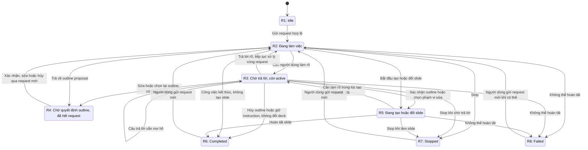
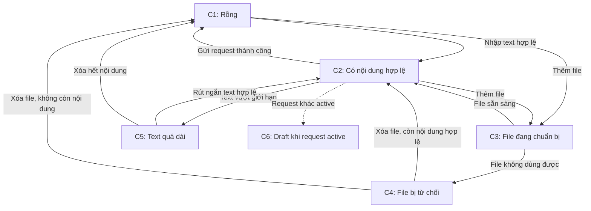
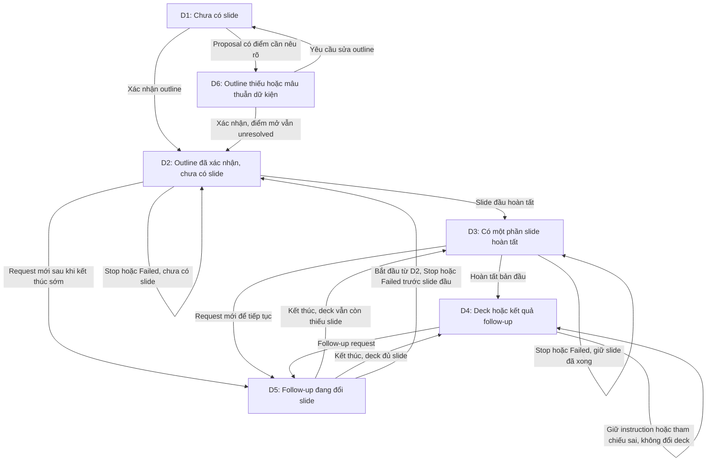
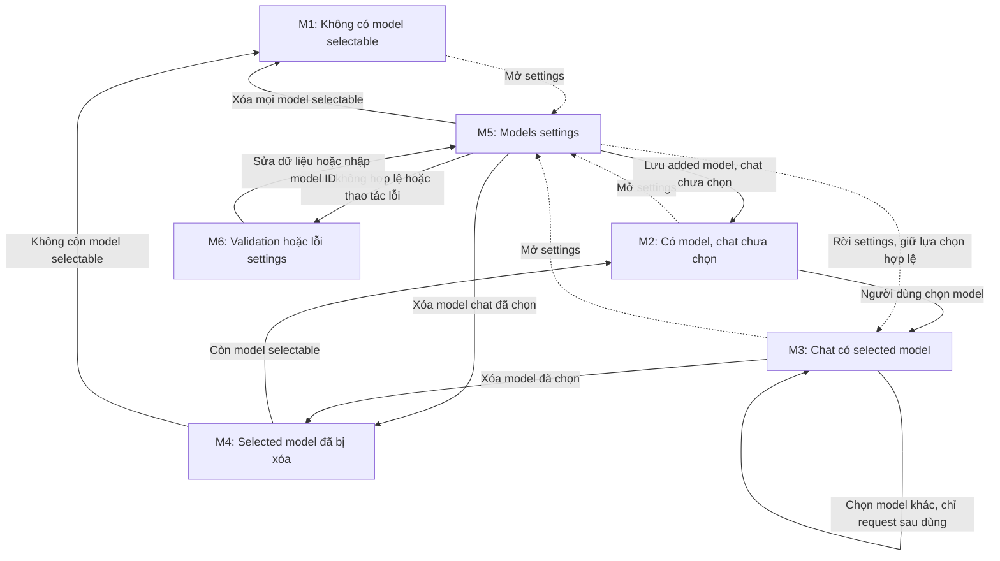
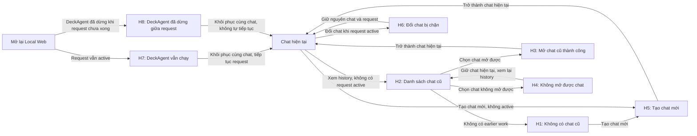

# UX-02 — State inventory V1 từ Product Spec

> Bản làm việc để thiết kế page `02 - UI States` trong file Figma `DeckAgent V1 - UX Foundation`. Đây là **inventory trạng thái và phản hồi**, chưa quyết định layout, component hay câu chữ cuối cùng. Tên/ID trạng thái bên dưới là cách tổ chức công việc UX-02, **không phải thuật ngữ hoặc state machine đã được Product Spec phê duyệt**.

## 1. Cách đọc inventory

Nguồn xác định V1 là [V1 Scope](../../spec/00-current-scope/VERSIONS.md) và trường `versions → V1 → add` của [UC-001](../../spec/03-use-cases/UC-001.md), [UC-002](../../spec/03-use-cases/UC-002.md), [UC-003](../../spec/03-use-cases/UC-003.md), [UC-005](../../spec/03-use-cases/UC-005.md), [UC-006](../../spec/03-use-cases/UC-006.md), [UC-012](../../spec/03-use-cases/UC-012.md). Các FR tương ứng nằm trong [Functional Requirements](../../spec/04-requirements/fr/). Chỉ flow được liệt kê trong `add` mới thuộc V1.

Một thời điểm có thể mang **nhiều trạng thái đồng thời**. Ví dụ, request đang chạy, deck có vài slide hoàn tất, request area giữ bản nháp kế tiếp và người dùng đang xem Models settings. Vì vậy inventory chia theo 5 vùng trách nhiệm: request/conversation, request area/attachment, outline/deck canvas, model/settings và chat/navigation. Khi làm Figma, có thể dùng một frame nền và annotation cho các biến thể thay vì vẽ một màn hình cho mỗi tổ hợp.

Trong bảng: **Điều kiện** là lúc trạng thái xuất hiện; **Cần thể hiện** là thông tin hoặc quyền hành động được spec yêu cầu; **Kết thúc/chuyển** là sự kiện làm trạng thái đổi. Phần “Vì sao” giải thích ý nghĩa thiết kế, không thêm hành vi sản phẩm.

[Bảng chuyển trạng thái V1](ux-02-v1-transition-matrix.xlsx) liệt kê từng case theo sự kiện, điều kiện, trạng thái trước/sau và phản hồi cần kiểm. Frontend và UI Testing có thể lọc theo nhóm hoặc nguồn UC/FR, rồi cập nhật hai cột tiến độ riêng. Các case của bảng này là checklist làm việc, không phải quyết định Product Spec mới.

## 2. Request và conversation

| ID / trạng thái | Điều kiện | Cần thể hiện và hành động | Kết thúc/chuyển; vì sao cần tách | Nguồn |
|---|---|---|---|---|
| **R1 — Idle / chưa có request active** | Chat mới hoặc request trước đã kết thúc. | Có thể chuẩn bị request; chỉ gửi khi nội dung, attachment và selected model hợp lệ. Chat mới có conversation rỗng và chưa có deck. | Gửi request hợp lệ → R2. Trạng thái này cho phép đổi chat/tạo chat mới; khác với R3 đang chờ trả lời. | UC-012 MF; UC-003 S1/A6; FR-015, FR-053, FR-054 |
| **R2 — Đã gửi, đang làm việc** | Request được nhận và chưa xong. | Sent request nằm trong conversation; phần đã gửi rời request area. Status message nói hệ thống đang làm gì và thời gian trôi. Có Stop; chưa cho gửi request khác hoặc đổi chat. | Hệ thống hỏi → R3; có kết quả/outline → R4/R5; người dùng Stop → R7; lỗi → R8. Đây là trạng thái chạy chung cho lần tạo đầu và follow-up. | UC-003 S2/S3/A31; FR-012–FR-014, FR-018, FR-054 |
| **R3 — Chờ câu trả lời, request vẫn active** | Hệ thống cần người dùng làm rõ để tiếp tục. | Câu hỏi và trạng thái chờ ở conversation; **không** hiện như đang chạy. Có thể trả lời bằng text hoặc suggested option và có thể Stop. Không tạo chat mới/mở chat cũ. Nếu chỉ dùng được một phần material quan trọng, nêu tên và phần chưa dùng khi biết, rồi hỏi bổ sung hoặc đổi request. | Câu trả lời rõ tiếp tục **cùng request** theo ý định đã chọn: có thể về R2, sang R5 để build, về R4 với proposal mới, hoặc kết thúc ở R6 mà không đổi deck. Còn mơ hồ → hỏi tiếp trong R3; Stop → R7. Không tạo request thứ hai. | UC-003 A38/A43; UC-001 A32/A39; UC-002 A1/A6/A10; FR-007, FR-020, FR-021, FR-030–FR-035, FR-054, FR-067 |
| **R4 — Outline proposal chờ quyết định, request tạo outline đã xong** | Lần tạo deck đầu trả về current outline. | Outline hiện trong conversation dưới dạng overview ngắn gọn các planned slide (title + mô tả ngắn), kèm nội dung chi tiết của từng slide. Người dùng có thể mở chi tiết từng slide, `Mở rộng tất cả` và `Thu gọn tất cả`; đây là thao tác xem, không đổi outline, không tạo proposal mới và không gửi request. Đề xuất trước vẫn được giữ. Có thể confirm/cancel, hoặc gửi instruction sửa outline. Nói rõ chưa có slide. | Confirm current outline → **request mới** để build slide ở R2/R5; sửa → request mới và proposal mới; cancel → kết thúc, không tự draft lại. Có thể đổi chat vì request tạo outline đã xong. | UC-001 S3/S4/A22/A23; FR-001, FR-003–FR-005, FR-008, FR-069 |
| **R4a — Current outline rỗng** | Proposal hiện tại không có nội dung. | Không offer confirm. Nếu người dùng gõ xác nhận, giải thích outline cần nội dung và gợi ý yêu cầu sửa; không báo lỗi build slide. | Yêu cầu sửa → request mới; không tự tạo outline khác. Đây là biến thể của R4, tránh vẽ nhầm như failure. | UC-001 A24; FR-005, FR-006 |
| **R5 — Đang tạo hoặc đổi slide** | Outline đã xác nhận và hệ thống build lần đầu, hoặc follow-up đang sửa deck. | Lần đầu: deck canvas cho thấy tiến độ, từng slide hoàn tất và slide còn chờ; không tự đổi slide đang xem. Confirmed outline vẫn nằm trong conversation, read-only, giữ overview và nội dung chi tiết; người dùng vẫn mở/thu gọn chi tiết để đối chiếu, thao tác này không sửa outline và không ngắt việc tạo slide. Follow-up: conversation nói đang đổi slide nào, không có outline mới; slide ngoài scope giữ nguyên. Vẫn có status message và Stop. | Hoàn tất → R6; Stop → R7; lỗi → R8. Tách hai biến thể vì dữ liệu hiển thị và cam kết giữ nguyên slide khác nhau. | UC-001 S4/S5; UC-002 S3; FR-022, FR-023, FR-027–FR-029, FR-069 |
| **R6 — Request đã kết thúc** | Công việc đã hoàn tất, hoặc một nhánh V1 kết thúc mà không đổi deck. | Không còn báo đang chạy; cho gửi request mới. Confirmed outline vẫn trong conversation, read-only, mở/thu gọn chi tiết được. Draft đầu có closing message về từng slide, giả định, placeholder, nội dung ngoài material và điều chưa kiểm tra. Follow-up thành công nêu slide đổi/thêm và phần ngoài scope không đổi. Nhánh không đổi deck phải nói rõ lý do: instruction được giữ cho slide tạo sau, hoặc tham chiếu slide không khớp. | Request mới → R2; có thể đổi chat. Không gọi nhánh không đổi deck là sửa deck thành công. | UC-003 S4; UC-001 S6; UC-002 S4/A4/A5; FR-012, FR-024, FR-029, FR-034, FR-036, FR-069 |
| **R7 — Stopped** | Người dùng Stop khi đang chạy **hoặc đang chờ câu trả lời**. | Ngừng báo đang làm việc; notice nói response bị gián đoạn, không gọi là failure. Giữ sent request. Nếu đã có slide hoàn tất, chỉ giữ kết quả hoàn tất; báo số slide đã tạo/đổi khi biết và khả năng các slide chưa nhất quán. | Tin nhắn sau là request mới, không phải tiếp tục request vừa Stop; có thể đổi chat. Cần tách khỏi R8 vì nguyên nhân và thông điệp khác nhau. | UC-003 A31; UC-001 A10; UC-002 A7; FR-018, FR-025, FR-026 |
| **R8 — Failed / request không thể hoàn tất** | Lỗi model, file, lưu kết quả hoặc bước khác khiến request dừng; gồm key/model bị từ chối và usage limit. | Nói request chưa xong, lý do nếu biết, phần đã/chưa hoàn tất; giữ request và kết quả hoàn tất. Không tự retry hay tự đổi model. Nếu lỗi key/model, chỉ đường đến Models settings; nếu usage limit, nói giới hạn tài khoản model. Không để vùng chưa có kết quả trống mà không giải thích. | Sau khi nguyên nhân cho phép, người dùng gửi request mới; có thể đổi chat. Biến thể của R8 cần ghi rõ nguyên nhân thay vì một màn hình lỗi chung không phân biệt được. | UC-003 A11/A18/A19; UC-001 A11/A18/A19; UC-002 A11; FR-019, FR-025, FR-026, FR-043, FR-047 |

### Sơ đồ chuyển trạng thái request

Sơ đồ dùng các ID R1–R8 của bảng trên. Nó thể hiện **request lifecycle**, không phải toàn bộ trạng thái UI. C, D, M và H có thể cùng tồn tại với các trạng thái R. Mũi tên ghi “request mới” chỉ hành động do người dùng khởi tạo; hệ thống không tự chạy lại request đã Stop hoặc Failed.

Trong **R2, R3 và R5**, request active nên không đổi chat; **R4** là điểm dừng sau khi outline proposal đã được trả về nên có thể đổi chat. Nếu người dùng xác nhận outline bằng câu trả lời cho câu hỏi ở UC-001 A39, câu trả lời vẫn thuộc request đang ở R3; nó **không** đi theo mũi tên “request mới” từ R4. Chọn giữ instruction của follow-up ở R3 kết thúc request mà không đổi deck. Khi hủy outline ở R4, request hủy kết thúc mà không tạo slide (R2 → R6). Việc mở lại Local Web khi DeckAgent vẫn chạy giữ trạng thái request hiện tại; mở lại sau khi chính DeckAgent dừng giữa request là trường hợp H8, không phải một nhánh tự tiếp tục trong sơ đồ. Nguồn: UC-001 S3/S4/A22/A23/A39; UC-002 A1–A4; UC-003 A13/A38; UC-006 A6; FR-007, FR-020, FR-032–FR-034, FR-054, FR-068.

**Nhánh cần kiểm riêng trong R3/R5/R6:** Với follow-up chưa rõ phạm vi, `apply all` thay mọi slide hiện có và áp dụng cho slide mới; `new slides only` chỉ tạo slide mới; `keep for later` giữ instruction cho slide tạo sau và kết thúc request, hiện không đổi slide nào. Nếu số/title của slide được nêu không khớp deck, request kết thúc ở R6 với deck nguyên vẹn, message nêu phần sai và số slide hiện có; sửa tham chiếu bằng request mới. Nếu chỉ dùng được một phần material, message nêu phần không dùng được; phần thiếu ảnh hưởng lớn → R3 hỏi lại, ảnh hưởng ít → tiếp tục request hiện tại. Nguồn: [UC-002 A2–A5](../../spec/03-use-cases/UC-002.md), [UC-003 A43](../../spec/03-use-cases/UC-003.md), [FR-032](../../spec/04-requirements/fr/FR-032.md)–[FR-036](../../spec/04-requirements/fr/FR-036.md), [FR-067](../../spec/04-requirements/fr/FR-067.md).

**Lưu ý cho R2/R3:** [UC-003 A14](../../spec/03-use-cases/UC-003.md) cho chuẩn bị request kế tiếp khi request đang active. Draft vẫn nằm trong request area; gửi không được cho đến khi request kết thúc hoặc Stop. Khi đang chờ câu trả lời, nội dung người dùng gửi là **câu trả lời của request active**, không phải request mới. [FR-014](../../spec/04-requirements/fr/FR-014.md), [FR-020](../../spec/04-requirements/fr/FR-020.md).

**Suggested options:** Option hợp lệ gửi instruction ngay nhưng giữ text/attachments chưa gửi; option cũ không còn phù hợp thì báo không áp dụng. Option trả lời câu hỏi trong R3 thuộc cùng request; confirm/cancel outline ở R4 là request mới. [UC-003 S2/A38](../../spec/03-use-cases/UC-003.md), [UC-001 S4/A22](../../spec/03-use-cases/UC-001.md), [FR-013](../../spec/04-requirements/fr/FR-013.md).

## 3. Request area và attachment

| ID / trạng thái | Điều kiện | Cần thể hiện và hành động | Kết thúc/chuyển; vì sao cần tách | Nguồn |
|---|---|---|---|---|
| **C1 — Request area rỗng** | Không có request text và attachment chưa gửi. | Không offer gửi; không báo lỗi vì rỗng. | Nhập text hoặc thêm file → C2/C3. Không được thiết kế “empty request” như failure. | UC-003 A6; FR-015 |
| **C2 — Có draft gửi được về mặt nội dung** | Có text hợp lệ, ít nhất một attachment sẵn sàng, hoặc cả hai. | Text và file chưa gửi nằm trong request area; file đơn lẻ không cần text. Quyền gửi còn phụ thuộc active request và selected model. | Gửi thành công → phần đã gửi vào conversation; draft kế tiếp, nếu có, là nội dung khác. “Có nội dung” không đồng nghĩa “gửi được ngay”. | UC-003 S1/S2/A3/A6; FR-012, FR-015, FR-016 |
| **C3 — Attachment đang chuẩn bị** | File vừa thêm và chưa hoàn thành intake. | Tên/preview, loại và trạng thái `being prepared`; không cho gửi. | Chuẩn bị xong → `ready` ở C2; không dùng được → C4. Cần phản hồi riêng vì người dùng chưa thể sửa lỗi bằng cách chỉ bấm gửi lại. | UC-003 A3; FR-015, FR-016; NFR-010 |
| **C4 — Attachment bị từ chối** | File sai loại, quá số lượng/dung lượng đã được định, protected, hỏng hoặc không đọc được. | Lý do ngay trên attachment; file vẫn ở request area cho đến khi người dùng xóa; phần request khác giữ nguyên; không cho gửi. | Xóa file bị từ chối → kiểm tra lại C1/C2. Số lượng và dung lượng là giới hạn có quy tắc nhưng **chưa có giá trị**. | UC-003 A8; FR-015, FR-017; BR-001 |
| **C5 — Text quá dài** | Request text vượt giới hạn. | Báo text quá dài; giữ text để người dùng rút ngắn; không gửi. | Rút ngắn đến mức hợp lệ → C1/C2. Chỉ text tính độ dài, nội dung file đính kèm không tính; mức tối đa còn `pending`. | UC-003 S1; FR-015; BR-002 |
| **C6 — Draft kế tiếp khi request active** | Người dùng nhập text hoặc thêm/xóa unsent attachment khi R2/R3/R5 đang active. | Giữ draft riêng trong request area; sent request và sent attachments trong conversation không đổi. | R2/R5 kết thúc hoặc Stop → có thể gửi request mới; R3 nhận câu trả lời thì phần gửi là answer cùng request. Cần annotation để không nhập nhằng draft với request đang chạy. | UC-003 A14/A38; FR-014, FR-016, FR-020 |

### Sơ đồ chuyển trạng thái request area

Mũi tên liền là thay đổi nội dung/trạng thái attachment. Mũi tên nét đứt tới C6 chỉ **trạng thái song song** khi request khác còn active; C6 không thay C1–C5. Sau mỗi lần xóa hoặc sửa, hệ thống đánh giá lại request area theo nội dung còn lại.

Ở C2, nút gửi còn phụ thuộc model selectable và việc có request active; ở C3/C4/C5 không cho gửi. Khi C6 xảy ra trong R3, nội dung được gửi để trả lời câu hỏi là answer của **cùng request** [FR-014](../../spec/04-requirements/fr/FR-014.md), [FR-020](../../spec/04-requirements/fr/FR-020.md).

[BR-001](../../spec/05-business-rules/BR-001.md) đã chốt loại file V1: TXT, MD, PDF, DOCX, PNG, JPEG và PPTX. Giới hạn số file cho **mỗi request** và dung lượng cho **từng file** còn `pending`. Chọn model khác không thay trạng thái hoặc lý do từ chối attachment [FR-017](../../spec/04-requirements/fr/FR-017.md).

## 4. Outline và deck canvas

Các trạng thái này có thể cùng tồn tại với R2/R5/R7/R8. Chúng mô tả **đã có sản phẩm gì để xem**, không quyết định request còn active hay không.

| ID / trạng thái | Điều kiện | Cần thể hiện và hành động | Kết thúc/chuyển; vì sao cần tách | Nguồn |
|---|---|---|---|---|
| **D1 — Chưa có slide** | Chat mới; đang draft outline; đang chờ xác nhận outline; hoặc mở lại chat chưa có slide. | Trước outline, chưa hiện deck canvas. Khi outline đã có, hiện proposal trong conversation nhưng chưa có slide. Khi mở chat cũ chưa có slide, nói rõ chat chưa có slide. | Outline được xác nhận → D2. Một canvas trống không giải thích sẽ gây hiểu lầm giữa “chưa tạo” và “tạo lỗi”. | UC-001 S3; UC-006 A4; UC-012 S2; FR-001, FR-051, FR-053 |
| **D2 — Outline đã xác nhận, chưa có slide hoàn tất** | User confirm current outline; hệ thống bắt đầu build. | Confirmed outline chỉ đọc; deck canvas báo work in progress và slide nào còn chờ. Không cho sửa outline/slide trực tiếp. | Slide đầu hoàn tất → D3; Stop/failure giữ outline. Request mới sau Stop/failure dùng outline này, không draft outline thứ hai. | UC-001 S4/S5/A10/A11; FR-003, FR-023, FR-025, FR-028 |
| **D3 — Có slide hoàn tất một phần** | Build chưa xong hoặc đã Stop/fail. | Chỉ hiện slide đã hoàn tất; trong lúc build, đánh dấu slide đã xong và còn chờ. Sau Stop/failure, nói số lượng hoặc phần đã hoàn tất khi biết và cảnh báo có thể chưa nhất quán. | Build xong → D4; Stop/failure giữ D3. Cần phân biệt slide chưa hoàn tất với slide trống thật. | UC-001 S5/A10/A11/A18/A19; UC-002 A7/A11; FR-023, FR-025, FR-026 |
| **D4 — Deck đầy đủ / kết quả follow-up** | Draft đầu hoặc request đổi deck hoàn tất; cũng là deck nguyên vẹn sau request kết thúc mà không đổi slide. | Hiện slide hoàn tất. Với follow-up thành công, chỉ slide trong scope được đổi; new slides only giữ slide cũ. Nếu instruction được giữ cho sau hoặc tham chiếu slide sai, deck không đổi và conversation nói rõ lý do; không có outline checkpoint mới. | Follow-up cần đổi slide → D5; nhánh không đổi deck hoặc mở lại chat → giữ D4. | UC-001 S6; UC-002 S3/S4/A3/A4/A5; FR-023, FR-027, FR-029, FR-033, FR-034, FR-036 |
| **D5 — Follow-up đang đổi slide** | Request rõ phạm vi đang chạy, hoặc người dùng chọn apply all/new slides only sau câu hỏi. | Apply all thay mọi slide hiện có và áp dụng cho slide mới; new slides only chỉ tạo slide mới. Mỗi slide cũ giữ bản hoàn tất trước request cho đến khi bản đổi **đã hoàn tất**; không hiện slide đổi dở. Slide ngoài scope không đổi. | Xong → D4; Stop/failure → D3/D4 tùy kết quả hoàn tất. Không vẽ thao tác sửa slide trực tiếp. | UC-002 S3/A2/A3/A7/A11; FR-025, FR-027, FR-029, FR-032, FR-033 |
| **D6 — Outline có dữ kiện thiếu hoặc mâu thuẫn** | Material thiếu fact của chủ đề người dùng, hai phần material mâu thuẫn hoặc file đã nhận không có gì dùng được. | Đánh dấu placeholder và fact thiếu; nêu hai nguồn mâu thuẫn và để điểm đó mở; nói tên file không dùng được và lý do. Không nhận một con số mâu thuẫn là chắc chắn. | User có thể yêu cầu sửa outline; nếu xác nhận khi điểm mâu thuẫn còn mở, slide giữ điểm đó là unresolved. Đây là nội dung của proposal, không phải lỗi kỹ thuật của UI. | UC-001 A9/A33/A34; FR-009–FR-011, FR-037 |

### Sơ đồ chuyển trạng thái outline và deck

Sơ đồ theo **sản phẩm đã hoàn tất để xem**, nên Stop/Failure không xóa outline hay slide đã hoàn tất. D6 là biến thể nội dung của outline trong D1, không phải lỗi UI; D5 là lúc follow-up đang tác động lên deck hiện có.

Các mũi tên từ D2/D3 sang D5 chỉ áp dụng **sau** khi request tạo slide trước đó đã dừng hoặc thất bại và người dùng gửi request mới; không phải hệ thống tự tiếp tục. Với follow-up trên deck đã có slide, Stop/Failure giữ trạng thái hoàn tất gần nhất của từng slide; xem R7/R8 để biết notice và hành động tiếp theo [FR-025](../../spec/04-requirements/fr/FR-025.md), [FR-028](../../spec/04-requirements/fr/FR-028.md).

V1 cho dùng ảnh từ attachment hoặc ảnh mới. Nếu loại ảnh cần dùng chưa rõ và lựa chọn ảnh thay đổi kết quả nhiều, request chuyển sang R3; ảnh mới **bắt buộc** mà không tạo được làm request thất bại; ảnh hệ thống tự chọn thêm mà không tạo được thì bỏ ảnh và nói trong closing message. Không tự đổi selected model/provider để tạo ảnh. [UC-001 A42](../../spec/03-use-cases/UC-001.md), [UC-002 A12](../../spec/03-use-cases/UC-002.md), [FR-066](../../spec/04-requirements/fr/FR-066.md). Cách tạo ảnh mới là dependency Architecture, không phải state UX-02 cần quyết định.

## 5. Model và Models settings

| ID / trạng thái | Điều kiện | Cần thể hiện và hành động | Kết thúc/chuyển; vì sao cần tách | Nguồn |
|---|---|---|---|---|
| **M1 — Không có selectable model** | Không có provider configuration đã lưu, hoặc không config nào có added model. | Khi định gửi request: không gửi, giữ draft, nói rõ trường hợp nào xảy ra và chỉ đến Models settings. | Lưu config và thêm model → có selectable model. Không gộp với M2 vì hành động giải quyết khác nhau. | UC-003 A17; FR-046; BR-005 |
| **M2 — Có selectable models, chat chưa chọn model** | Chat chưa từng chọn model hoặc chọn trước đó đã bị xóa. | Khi định gửi: không gửi, giữ draft, yêu cầu chọn model; không tự chọn hoặc tự mở settings. | Người dùng chọn model → M3. Cần phản hồi khác M1 vì đã có model để chọn. | UC-003 A40; FR-056 |
| **M3 — Chat có selected model selectable** | User chọn model cho chat; chat mới có thể thừa hưởng lựa chọn gần nhất vẫn selectable. | Cho thấy model đã chọn; danh sách lựa chọn nhóm theo display name của provider configuration. Mỗi request dùng model và settings tại lúc bắt đầu. | Chọn model khác → chỉ request bắt đầu sau đó dùng lựa chọn mới; xóa model/config → M4. | UC-003 A27; UC-012 S2; FR-042, FR-053, FR-055 |
| **M4 — Selected model đã bị xóa** | Xóa added model/config hoặc restore default models đã xác nhận làm mất selected model của chat. | Khi chat hiển thị: nói chat không có selected model, tên model đã bị xóa, yêu cầu chọn model khác **trước khi thử gửi**. Không hiển thị model bị xóa là đang chọn. | Chọn model khác → M3; thêm lại model cũ không tự khôi phục selection. Đây là trạng thái cần thông báo chủ động, không chỉ validation lúc gửi. | UC-003 A41; UC-005 A2/A11/A13; FR-059, FR-062, FR-063, FR-065 |
| **M5 — Settings đang xem/chỉnh sửa** | Người dùng mở Models settings. | Saved configs có display name, provider ID, added models và **chỉ trạng thái có/không có key**. Cho thêm/sửa/xóa config, thêm/xóa model, hỏi xác nhận trước restore defaults. Trở về chat giữ conversation, request text, attachments. | Save chỉ lưu thay đổi hợp lệ; rời settings bỏ thay đổi chưa lưu nhưng giữ thay đổi đã lưu. Không hiển thị lại bất kỳ phần nào của key đã lưu, kể cả phần bị che nhưng lấy từ key. | UC-005 MF/A1/A2/A4/A8/A13; FR-038–FR-044, FR-058–FR-063 |
| **M6 — Validation và lỗi trong settings** | Thiếu dữ liệu bắt buộc; display name rỗng/trùng; provider ID trùng/được giữ cho built-in; không lấy được model catalog; cố xóa config mà active request đang dùng. | Nêu lý do cụ thể, không lưu thay đổi không hợp lệ. Catalog lỗi vẫn cho nhập model ID thủ công. Config đang dùng không được xóa, kể cả khi request chờ answer; request không bị Stop hay chuyển model. | Sửa dữ liệu rồi lưu; hoặc chờ request kết thúc để xóa. Các lỗi này có cách giải quyết khác nhau, nên annotation phải phân biệt. | UC-005 A5/A7/A9/A10/A12; FR-045, FR-057, FR-058, FR-061, FR-064 |

### Sơ đồ chuyển trạng thái model và settings

M1–M4 mô tả khả năng chọn model của **chat hiện tại**. M5/M6 mô tả Models settings đang mở hoặc báo lỗi và có thể cùng tồn tại với M1–M4. Mũi tên nét đứt là thao tác mở/đóng settings, không tự thay selected model.

Các mũi tên từ M5 sau khi lưu phụ thuộc thay đổi thực tế; mở/rời settings đơn thuần không làm mất model đã chọn. M4 cần thông báo trước khi người dùng gửi request, và thêm lại cùng model ID không tự phục hồi lựa chọn cũ [FR-042](../../spec/04-requirements/fr/FR-042.md), [FR-065](../../spec/04-requirements/fr/FR-065.md).

Các giá trị **chưa chốt**: API protocols của custom model API, danh sách default model IDs, provider IDs built-in [BR-005](../../spec/05-business-rules/BR-005.md); yêu cầu chi tiết của từng built-in provider và quyền đổi base URL [BR-006](../../spec/05-business-rules/BR-006.md). Bốn tên built-in providers đã chốt: OpenAI, Anthropic, Google Gemini, DeepSeek. Display name phải khác rỗng và duy nhất, so sánh không phân biệt chữ hoa/thường hoặc khoảng trắng đầu/cuối [BR-008](../../spec/05-business-rules/BR-008.md). Không tự điền danh sách protocol/model ID hoặc trường bắt buộc chưa quyết định vào thiết kế.

## 6. Chat history, new chat và reload

| ID / trạng thái | Điều kiện | Cần thể hiện và hành động | Kết thúc/chuyển; vì sao cần tách | Nguồn |
|---|---|---|---|---|
| **H1 — Không có chat cũ** | Không có chat đủ điều kiện trong earlier work. | Nói không có chat cũ; giữ chat hiện tại; cho tạo chat mới khi không có active request. Chat chưa từng gửi request không bắt buộc xuất hiện trong history. | Có chat từng gửi request → H2. | UC-006 A1; FR-048; BR-004 |
| **H2 — Danh sách chat cũ** | User xem earlier work. | Mỗi chat có tên dựa trên nội dung, lúc thay đổi gần nhất, có/không có slide. Bao gồm chat từ trước lần DeckAgent đóng/mở. | Chọn chat khi không có active request → H3; không mở được → H4. | UC-006 S1/S2; FR-048, FR-049, FR-054; BR-004 |
| **H3 — Chat cũ được mở** | User chọn chat mở được. | Conversation đúng thứ tự, slide giữ như lần rời chat, selected model riêng của chat. Không tự chạy request hay đổi slide. Chat chưa có slide phải nói rõ; outline đang chờ confirm tiếp tục chờ. | Có thể soạn request mới theo điều kiện model. Unsent text của chat được phục hồi **khi DeckAgent vẫn đang chạy**; unsent attachment không quay lại. | UC-006 S2/S3/A4; FR-049, FR-051, FR-065 |
| **H4 — Không mở được chat** | Chat được chọn thiếu dữ liệu hoặc không đọc được. | Nói không mở được và lý do nếu biết; giữ chat hiện tại, không đổi chat khác. | Chọn chat khác hoặc quay lại H2. Không dùng một màn hình trống như thể chat chưa có slide. | UC-006 A3; FR-050 |
| **H5 — Tạo chat mới** | Không có active request; user muốn deck khác. | Giữ conversation/deck của chat cũ; chuyển sang chat có conversation, request area rỗng và không có deck. Chọn model gần nhất còn selectable theo quy tắc; nếu không có thì để trống. Không tự build deck. | Soạn request đầu → R1/C2. Unsent text ở chat cũ, unsent attachments bị bỏ khỏi request area; không xóa file gốc. | UC-012 MF; FR-053, FR-054 |
| **H6 — Đổi chat bị chặn** | Request đang chạy **hoặc chờ câu trả lời**. | Không cho tạo chat mới/mở chat cũ; không Stop hoặc chuyển request sang background để đổi chat. | Request hoàn tất, Stop hoặc fail → cho đổi chat. Trạng thái này có thể nằm trên R2/R3/R5. | UC-006 S1; UC-012 S1; FR-054 |
| **H7 — Reload/đóng Local Web, DeckAgent vẫn chạy** | UI được mở lại khi request trước vẫn active. | Khôi phục conversation, request, outline/slides đã làm và trạng thái hiện tại; nếu vẫn chạy thì status message hiện công việc hiện tại; nếu chờ answer thì vẫn chờ. Không báo “interrupted” sai. | Tiếp tục cùng request. Reload UI khác với Stop hoặc đóng chính DeckAgent. | UC-003 A13; UC-001 A13; FR-068 |
| **H8 — Mở lại sau khi DeckAgent đã dừng giữa request** | Request trước chưa xong và DeckAgent không còn chạy request đó. | Conversation và slide hoàn tất theo trạng thái đã lưu; nói request cuối chưa hoàn tất; không tự tiếp tục hay tự gửi lại. | User gửi request **mới** để tiếp tục. Phân biệt với H7 để tránh hiện progress giả. | UC-006 A6; FR-052; NFR-008 |

### Sơ đồ chuyển trạng thái chat và mở lại giao diện

Phần bên trái là điều hướng chat; phần bên phải phân biệt hai loại “mở lại”. `H6` là kết quả của một thao tác đổi chat bị chặn, không phải chat khác. `H7` và `H8` không gửi request và không thay chat do người dùng chọn.

Sau khi mở chat cũ hoặc tạo chat mới, text chưa gửi vẫn gắn với chat cũ trong phiên DeckAgent đang chạy, còn attachment chưa gửi bị bỏ khỏi request area. `H7` giữ request active, gồm cả lúc chờ answer; `H8` chỉ giữ trạng thái đã lưu và người dùng phải gửi request mới nếu muốn tiếp tục [FR-049](../../spec/04-requirements/fr/FR-049.md), [FR-052](../../spec/04-requirements/fr/FR-052.md), [FR-053](../../spec/04-requirements/fr/FR-053.md), [FR-068](../../spec/04-requirements/fr/FR-068.md).

V1 giữ chat/conversation/deck đã lưu **không giới hạn theo thời gian**, nhưng không hứa giữ text chưa gửi sau khi DeckAgent kết thúc [BR-004](../../spec/05-business-rules/BR-004.md), [FR-049](../../spec/04-requirements/fr/FR-049.md). Việc giữ attachment đã **gửi** trong conversation khác với attachment **chưa gửi** bị bỏ khi đổi chat.

## 7. Trạng thái và thông số không tự bổ sung

- **Không chọn trong V1:** offline khi mất kết nối (UC-003 A12, UC-001 A12), voice input, connector, skill, tìm chat bằng từ khóa, direct slide editing, export, custom design system và follow-up đổi look/presenter notes theo các alternative flow chưa chọn. Không thiết kế `Try again` như hành động có sẵn: sau Stop/failure, người dùng gửi request mới.
- **Pending:** số lượng/dung lượng attachment [BR-001](../../spec/05-business-rules/BR-001.md), độ dài text [BR-002](../../spec/05-business-rules/BR-002.md), default design system [BR-003](../../spec/05-business-rules/BR-003.md), các giá trị model/provider nêu ở mục 5. Mô tả phản hồi theo điều kiện, không tự đặt số hay danh sách.
- **Proposed/chưa có ngưỡng:** phản hồi ban đầu sau khi gửi request [NFR-001](../../spec/04-requirements/nfr/NFR-001.md) còn `proposed`, target chưa đặt; target chờ slide đầu, Stop và cập nhật deck [NFR-002](../../spec/04-requirements/nfr/NFR-002.md), [NFR-011](../../spec/04-requirements/nfr/NFR-011.md), [NFR-012](../../spec/04-requirements/nfr/NFR-012.md) cũng chưa có con số. Không viết SLA hoặc countdown hứa hẹn.
- **Cần truyền cho UI Testing:** mọi task dùng được bằng bàn phím; screen reader nhận status message, notice, câu hỏi và text slide [NFR-013](../../spec/04-requirements/nfr/NFR-013.md). Nội dung từ model/file chỉ hiển thị như nội dung [NFR-004](../../spec/04-requirements/nfr/NFR-004.md).

## 8. Đưa inventory vào Figma khi UX-01 chưa có

1. Tạo page `02 - UI States`; nhóm frame theo 5 mục trên. Trên mỗi frame đặt ID, điều kiện, thông tin, action, chuyển tiếp và UC/FR. Dùng [bộ annotation và ví dụ nội dung](ux-02-v1-figma-annotations-and-copy.md) để gắn phản hồi cạnh frame. Tránh dùng ID của inventory như tên UI hiển thị cho người dùng.
2. Dựng trước một chuỗi tối thiểu: **R1 → R2 → R3 hoặc R4 → R5 → R6**, với nhánh **R7/R8**; thêm các biến thể C/M/H quan trọng. R4 và R3 cần annotation cạnh nhau để thấy khác biệt về active request.
3. Dùng vùng trung tính `request area`, `conversation`, `deck canvas`, `Models settings` để minh họa; không chốt vị trí hoặc component trước UX-01. Khi UX-01 có bản nháp, map từng state vào wireframe và phản hồi UX-01 nếu một vùng thiếu chỗ cho thông tin bắt buộc.
4. Đối chiếu acceptance conditions của FR trên từng frame. Ghi dependency `pending` và Architecture ngay trên Figma để UX-03 tổng hợp. Link Jira trực tiếp tới page `02 - UI States` sau khi page có nội dung bàn giao.
