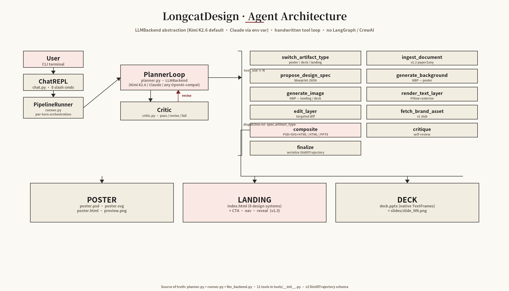
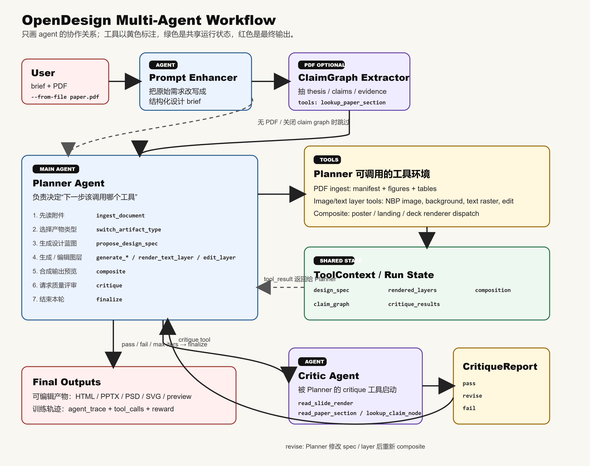
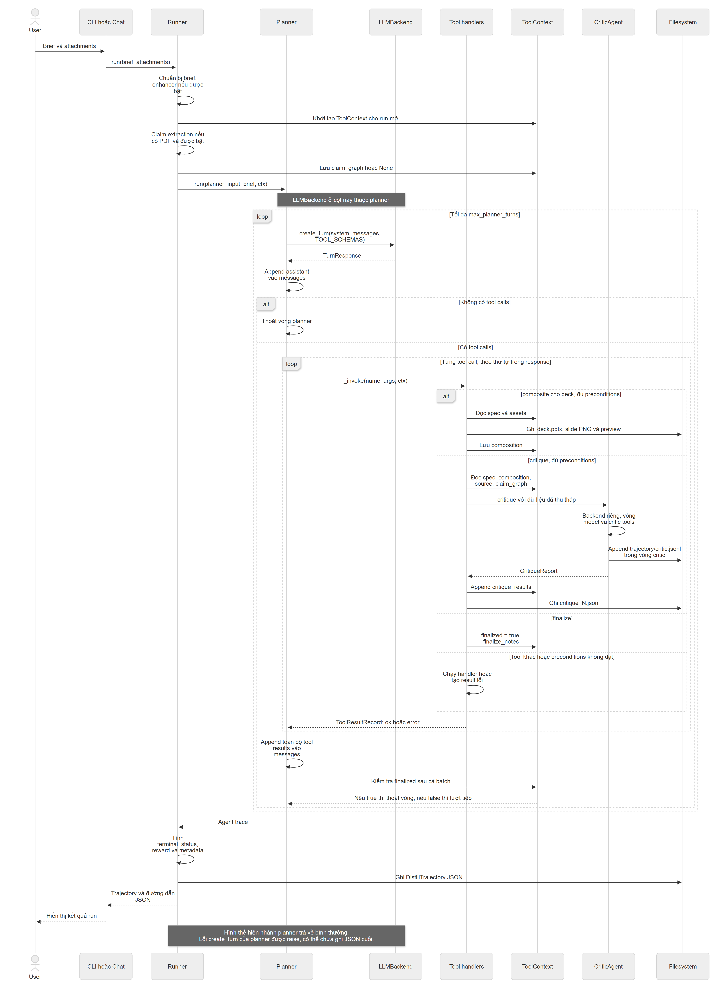
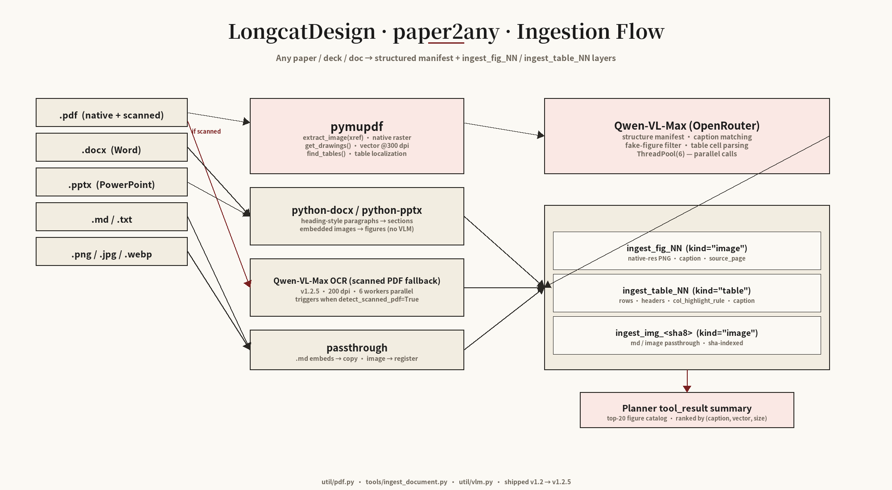
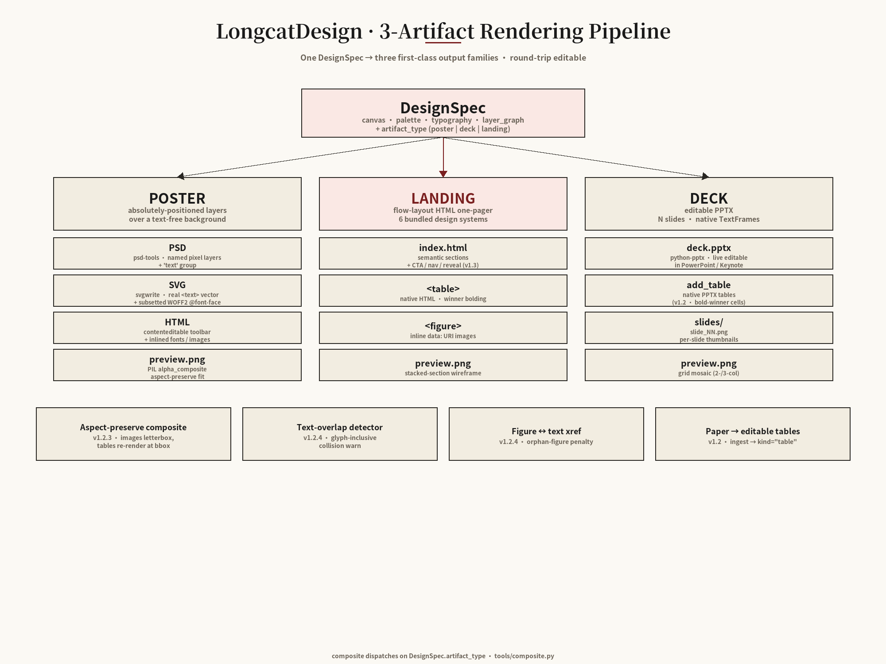

# OpenDesign — Báo cáo nghiên cứu kiến trúc Slide Deck Agent

**Ngày nghiên cứu:** 17-10-2026.

**Phạm vi:** tạo, kiểm tra, sửa và xuất slide deck; không triển khai lại OpenDesign và không xác lập kiến trúc cho DeckAgent.

**Plan gốc:** [Kế hoạch nghiên cứu OpenDesign](research-plan.md).

**Repository:** [EthanGuo2022/OpenDesign](https://github.com/EthanGuo2022/OpenDesign).

**Phiên bản chuẩn:** [`7dee599ca39a7c164351e7d637c2b5a24ca23842`](https://github.com/EthanGuo2022/OpenDesign/commit/7dee599ca39a7c164351e7d637c2b5a24ca23842), commit ngày 29-04-2026, thông điệp `docs(readme): add navigation bar`.

## 0. Kết quả chính và cách đọc

OpenDesign tạo slide deck bằng một vòng lặp model–tool. Planner đề xuất thiết kế và chọn công cụ; renderer dựng PPTX; critic trả nhận xét để planner quyết định sửa hoặc kết thúc.

**Những điểm chính để review**

- **Kiến trúc:** ứng dụng Python chạy từ CLI/chat, có context dùng chung trong mỗi run.
- **Biểu diễn thiết kế:** mô hình trung gian có cấu trúc giữ cây slide và các phần tử con; Rendering Pipeline tạo text và bảng native trong PPTX.
- **Đánh giá:** critic xem ảnh preview do Pillow dựng. Các ảnh này chưa phản ánh đầy đủ cách PowerPoint hiển thị file cuối.
- **Chỉnh sửa:** sửa native text của deck cần cập nhật spec. Thay đổi riêng rendered text layer chưa đủ để đổi nội dung trong PPTX.
- **Kiểm chứng:** nghiên cứu đã chạy 20 checks không gọi API model, với 15 checks qua và 5 checks lỗi quyền symlink trên Windows. Năm probe bổ sung làm rõ các giới hạn của implementation.

**Bố cục báo cáo**

| Phần | Nội dung review |
| --- | --- |
| Phase 1 | Thành phần, sơ đồ, luồng xử lý và nơi lưu state |
| Phase 2 | Vai trò, dữ liệu, cơ chế và giới hạn của từng component |
| Phase 3 | Lý do lựa chọn kiến trúc, phương án thay thế và trade-offs |
| Phụ lục | Môi trường, mã tái lập, cách đối chiếu tài liệu và source |

Trong mỗi mục phân tích, phần giải thích được trình bày trước; bảng **Implementation Evidence** đặt ở cuối mục. Kết quả test, trace và probe được tập trung tại mục 2.8.

**Phạm vi của kết luận**

- **Hành vi từ code:** mô tả implementation tại commit chuẩn được ghi ở đầu báo cáo.
- **Lý do do tác giả công bố:** lấy từ decision records hoặc ghi chú upstream; được nêu rõ khi sử dụng.
- **Nhận định nghiên cứu:** đánh giá hoặc đề xuất rút ra từ source và kết quả kiểm chứng; chưa phải quyết định kiến trúc của DeckAgent.

Nghiên cứu được thực hiện lần lượt theo ba phase của plan. Tên component trong báo cáo thể hiện trách nhiệm phân tích; không mặc định mỗi component là một service riêng.

<details>
<summary>Implementation Evidence — Kết luận tổng quan</summary>

| Hành vi hoặc cơ chế được đối chiếu | Source tại snapshot nghiên cứu |
| --- | --- |
| Vòng đời do runner quản lý | [`open_design/runner.py`](https://github.com/EthanGuo2022/OpenDesign/blob/7dee599ca39a7c164351e7d637c2b5a24ca23842/open_design/runner.py#L33-L164) |
| Vòng lặp điều phối tool | [`open_design/planner.py`](https://github.com/EthanGuo2022/OpenDesign/blob/7dee599ca39a7c164351e7d637c2b5a24ca23842/open_design/planner.py#L32-L175) |
| Các bước dựng deck và output | [`open_design/tools/composite.py`](https://github.com/EthanGuo2022/OpenDesign/blob/7dee599ca39a7c164351e7d637c2b5a24ca23842/open_design/tools/composite.py#L992-L1223) |
| Cách gọi critic và lưu report | [`open_design/tools/critique_tool.py`](https://github.com/EthanGuo2022/OpenDesign/blob/7dee599ca39a7c164351e7d637c2b5a24ca23842/open_design/tools/critique_tool.py#L29-L91) |
| Merge diff và render lại text layer | [`open_design/tools/edit_layer.py`](https://github.com/EthanGuo2022/OpenDesign/blob/7dee599ca39a7c164351e7d637c2b5a24ca23842/open_design/tools/edit_layer.py#L23-L101) |
| Cây slide được dùng để viết PPTX | [`open_design/tools/pptx_renderer.py`](https://github.com/EthanGuo2022/OpenDesign/blob/7dee599ca39a7c164351e7d637c2b5a24ca23842/open_design/tools/pptx_renderer.py#L98-L117) |
| Cách Pillow dựng preview slide | [`open_design/tools/pptx_renderer.py`](https://github.com/EthanGuo2022/OpenDesign/blob/7dee599ca39a7c164351e7d637c2b5a24ca23842/open_design/tools/pptx_renderer.py#L1112-L1144) |
| Các focused checks trong smoke suite upstream | [`open_design/smoke.py`](https://github.com/EthanGuo2022/OpenDesign/blob/7dee599ca39a7c164351e7d637c2b5a24ca23842/open_design/smoke.py#L5097-L5170) |

</details>

**Góc nhìn và cách đọc:** Báo cáo theo Software Architecture và trình tự **Concept → Mechanism → Implementation Evidence**. Phase 1 xác lập trách nhiệm, Control Flow, Data Flow, State Management và end-to-end workflow. Phase 2 giải thích cơ chế/thuật toán/biểu diễn dữ liệu trước khi đối chiếu source. Phase 3 phân tích architectural rationale, trade-offs và alternatives. Các giới hạn cấu hình, API signatures và hồ sơ implementation được giữ trong **Technical Details**; bảng **Implementation Evidence** cuối mỗi mục xác định source cho các hành vi đã mô tả. Các đề xuất hoặc câu hỏi thực nghiệm không được trình bày như hành vi đã triển khai.

## 1. Phase 1 — Kiến trúc tổng quan

### 1.1. Kiến trúc điều phối dựa trên model và công cụ

OpenDesign tổ chức việc tạo presentation như một **Orchestration** giữa năng lực ra quyết định của model và các thành phần thực thi. Runtime quản lý một lần xử lý từ yêu cầu tới kết quả; Planner quyết định hành động tiếp theo; tools thực hiện hành động; Rendering Pipeline tạo sản phẩm; Critic cung cấp phản hồi chất lượng.

Các thành phần trao đổi qua một mô hình thiết kế có cấu trúc và state của lần xử lý. **Feedback Loop** đưa nhận xét về Planner để hình thành bản sửa và vòng dựng tiếp theo. Trong kiến trúc được khảo sát, Critic chạy đồng bộ với luồng điều phối: Planner chờ đánh giá rồi mới quyết định tiếp. Những vai trò này là ranh giới trách nhiệm trong ứng dụng, không mặc định là các service triển khai độc lập.

<details>
<summary>Technical Details — Hồ sơ triển khai và edge cases</summary>

OpenDesign tổ chức việc tạo deck quanh một run do `PipelineRunner` quản lý.

- **Điểm vào:** CLI hoặc chat nhận brief và attachment.
- **Điều phối:** runner tạo context, chuẩn bị dữ liệu và khởi động `PlannerLoop`.
- **Ra quyết định:** planner gọi LLM nhiều lượt để chọn tool dựa trên kết quả trước đó.
- **Thực thi:** tool handlers đọc/ghi state dùng chung và ghi artifact xuống filesystem.
- **Dựng deck:** compositor và PPTX renderer chuyển cây slide trong spec thành PPTX cùng ảnh preview.
- **Đánh giá và sửa:** critic trả report; planner quyết định thay đổi spec, composite lại hoặc kết thúc.

Critic có backend, vòng lặp và trajectory riêng. Wrapper `critique` gọi critic đồng bộ trong luồng planner; ở nhánh đã khảo sát, planner chờ critic trả kết quả rồi mới tiếp tục.

</details>

**Implementation Evidence**

| Hành vi hoặc cơ chế được đối chiếu | Source tại snapshot nghiên cứu |
| --- | --- |
| Vòng đời do runner quản lý | [`open_design/runner.py`](https://github.com/EthanGuo2022/OpenDesign/blob/7dee599ca39a7c164351e7d637c2b5a24ca23842/open_design/runner.py#L33-L164) |
| Vòng lặp điều phối tool | [`open_design/planner.py`](https://github.com/EthanGuo2022/OpenDesign/blob/7dee599ca39a7c164351e7d637c2b5a24ca23842/open_design/planner.py#L32-L175) |
| Các bước dựng deck và output | [`open_design/tools/composite.py`](https://github.com/EthanGuo2022/OpenDesign/blob/7dee599ca39a7c164351e7d637c2b5a24ca23842/open_design/tools/composite.py#L992-L1223) |
| Cách gọi critic và lưu report | [`open_design/tools/critique_tool.py`](https://github.com/EthanGuo2022/OpenDesign/blob/7dee599ca39a7c164351e7d637c2b5a24ca23842/open_design/tools/critique_tool.py#L29-L91) |

### 1.2. Ranh giới trách nhiệm và tương tác

Một yêu cầu đi qua ba nhóm trách nhiệm: **tiếp nhận và điều phối**, **biến đổi dữ liệu thành sản phẩm**, **đánh giá và phản hồi**. Việc phân chia này giúp xác định ai sở hữu trạng thái và ai được phép thay đổi nội dung.

| Vai trò kiến trúc | Trách nhiệm | Đầu vào → đầu ra và quan hệ |
| --- | --- | --- |
| Giao diện CLI/chat | Nhận yêu cầu, tài liệu và lịch sử trao đổi | Yêu cầu có ngữ cảnh → Runtime |
| Agent Runtime | Quản lý vòng đời, workspace và kết quả của mỗi run | Yêu cầu → khởi động Planner → ghi kết quả cuối |
| Chuẩn bị yêu cầu và luận điểm | Làm rõ brief; trích quan hệ luận điểm/evidence khi áp dụng | Brief/PDF → brief mở rộng và dữ liệu hỗ trợ đánh giá |
| Planner | Lựa chọn hành động theo mục tiêu và kết quả đã có | Context và tool results → yêu cầu thực thi công cụ |
| Tool Execution | Thực hiện hành động và báo kết quả | Lệnh có cấu trúc → cập nhật run state, artifacts hoặc lỗi |
| Design Representation | Giữ mô tả thống nhất về nội dung, bố cục, tài nguyên | Đề xuất của Planner → blueprint cho Rendering Pipeline |
| Rendering Pipeline | Chuyển blueprint và assets thành presentation | Thiết kế → PPTX, preview, metadata và cảnh báo |
| Critic | Đánh giá sản phẩm và đối chiếu tài liệu | Preview/thiết kế/source → report để Planner cân nhắc sửa |
| Persistence | Giữ artifacts, versions, reports và trajectory | Dữ liệu runtime → lịch sử phục vụ review/truy vết |

Planner quyết định **cần làm gì**; tools và renderer quyết định **thực hiện thao tác đó như thế nào**. Critic đưa nhận xét, còn quyền áp dụng thay đổi thuộc Planner và đường thực thi công cụ.

<details>
<summary>Technical Details — Hồ sơ triển khai và edge cases</summary>

| Thành phần | Trách nhiệm và dữ liệu sở hữu | Nối với thành phần khác |
| --- | --- | --- |
| CLI/chat | Nhận brief, attachment, template; quản lý lịch sử phiên và tham chiếu output | Gọi `PipelineRunner.run`; chat bổ sung prior spec vào brief |
| `PipelineRunner` | Sở hữu run ID, đường dẫn, `ToolContext`, tổng hợp trajectory và metadata cuối run | Gọi enhancer, claim extractor, planner |
| Prompt Enhancer | Chuẩn hóa brief trước khi planner chạy; có đường bỏ qua/fallback | Trả `enhanced_brief` cho runner |
| Claim Graph Extractor | Với PDF: lấy luận điểm, cơ chế, evidence và implication; validator kiểm tra graph | Runner lưu graph vào context; critic nhận graph khi đánh giá |
| `PlannerLoop` | Sở hữu messages trong run, vòng gọi LLM, trace và thống kê token planner | Cấp tool schema cho backend, dispatch handler, trả tool result vào messages |
| Tool registry và handlers | Công bố schema, ánh xạ tên tool sang hàm, kiểm tra precondition theo tool | Đọc/ghi `ToolContext.state`; trả `ToolResultRecord` |
| `DesignSpec` / `LayerNode` | Mô tả nội dung, canvas, style, cây slide/layer và provenance | Planner đề xuất qua JSON; tool validate; compositor/renderer tiêu thụ |
| `composite` và PPTX renderer | Hydrate ảnh/bảng, kiểm tra nội dung/layout, tạo PPTX và PNG, version output | Cập nhật composition trong context, trả hash và warning cho planner |
| `CriticAgent` | Đọc preview, tra source paper/claim graph; trả verdict, score, issues | Tool `critique` gọi agent, ghi report và trả kết quả cho planner |
| Filesystem và trajectory | Lưu layer versions, composite iterations, report critic, training trace, session | Product artifact và dữ liệu huấn luyện có cấu trúc lưu riêng |

</details>

**Implementation Evidence**

| Hành vi hoặc cơ chế được đối chiếu | Source tại snapshot nghiên cứu |
| --- | --- |
| Các trường state dùng chung | [`open_design/tools/_contract.py`](https://github.com/EthanGuo2022/OpenDesign/blob/7dee599ca39a7c164351e7d637c2b5a24ca23842/open_design/tools/_contract.py#L30-L72) |
| Các kiểu dữ liệu thiết kế | [`open_design/schema.py`](https://github.com/EthanGuo2022/OpenDesign/blob/7dee599ca39a7c164351e7d637c2b5a24ca23842/open_design/schema.py#L204-L469) |
| Context giữa các lượt chat | [`open_design/chat.py`](https://github.com/EthanGuo2022/OpenDesign/blob/7dee599ca39a7c164351e7d637c2b5a24ca23842/open_design/chat.py#L129-L266) |
| Vòng đời do runner quản lý | [`open_design/runner.py`](https://github.com/EthanGuo2022/OpenDesign/blob/7dee599ca39a7c164351e7d637c2b5a24ca23842/open_design/runner.py#L33-L164) |
| Cách gọi critic và lưu report | [`open_design/tools/critique_tool.py`](https://github.com/EthanGuo2022/OpenDesign/blob/7dee599ca39a7c164351e7d637c2b5a24ca23842/open_design/tools/critique_tool.py#L29-L91) |
| Danh sách schema và handler của tools | [`open_design/tools/__init__.py`](https://github.com/EthanGuo2022/OpenDesign/blob/7dee599ca39a7c164351e7d637c2b5a24ca23842/open_design/tools/__init__.py) |

### 1.3. Sơ đồ kiến trúc và ý nghĩa các kết nối

Sơ đồ gốc biểu diễn Control Flow và khả năng thực thi. Đọc từ trái sang phải: yêu cầu được tiếp nhận, runtime điều phối, planner chọn hành động; feedback từ critic quay lại planner. Các nhóm sản phẩm phía dưới là những nhánh output thay thế.



| Đường đi | Ý nghĩa kiến trúc |
| --- | --- |
| Người dùng → giao diện → Runtime | Tiếp nhận và bàn giao yêu cầu; Runtime bắt đầu một lần xử lý có workspace/state riêng |
| Runtime → Planner | Chuyển quyền quyết định hành động sau bước chuẩn bị |
| Planner → nhóm tools | Tool Invocation: chọn một khả năng để thực thi. Nhãn lặp trên ảnh cho biết có thể gọi tools nhiều lần; các ô không phải chuỗi bắt buộc |
| Planner → Critic | Yêu cầu đánh giá sản phẩm đã dựng, qua khả năng critique |
| Mũi tên đỏ Critic → Planner | Feedback Loop: trả issues/verdict để cân nhắc sửa; Critic không trực tiếp chỉnh presentation |
| Công cụ dựng sản phẩm → POSTER / LANDING / DECK | Rendering Pipeline phân nhánh theo loại sản phẩm; với deck, tạo PPTX và preview, không chạy qua cả ba loại output |

Ba vùng của hình tương ứng với **đầu vào/điều phối**, **quyết định/đánh giá** và **thực thi/output**. Đường trả kết quả từ tools và kho state được giản lược trên ảnh: kết quả trở lại hội thoại để Planner ra quyết định tiếp, còn dữ liệu thiết kế/tài nguyên được giữ trong run state. Các nhãn tool cụ thể được giải thích ở Phase 2 sau khi cơ chế Tool Invocation đã được xác lập.

<details>
<summary>Technical Details — Hồ sơ triển khai và edge cases</summary>

**Diagram có sẵn trong repository OpenDesign**

Repository đã có các hình dưới đây tại commit nghiên cứu. Báo cáo ưu tiên dùng nguyên bản những hình này; phần tiếng Việt bên dưới giải thích cách đọc và đối chiếu với implementation.

| Hình upstream | Nội dung | Bản trong báo cáo |
| --- | --- | --- |
| `assets/diagrams/agent_architecture.png` | Điểm vào, planner, critic, danh mục tools và output | [Mở PNG kiến trúc gốc](diagrams/upstream/agent_architecture.png) |
| `assets/diagrams/rendering_pipeline.png` | Từ DesignSpec tới poster, landing hoặc deck | [Mở PNG rendering gốc](diagrams/upstream/rendering_pipeline.png) |
| `assets/diagrams/paper2any_flow.png` | Đọc tài liệu, trích figure/table và trả catalog cho planner | [Mở PNG ingestion gốc](diagrams/upstream/paper2any_flow.png) |
| `docs/opendesign-pdf-flow.svg` | Enhancer, claim extractor, planner, shared state và critic | [Mở PNG chuyển từ SVG gốc](diagrams/upstream/opendesign-pdf-flow.png), [SVG nguyên bản](diagrams/upstream/opendesign-pdf-flow.svg) |

Ba PNG được sao chép nguyên byte và chèn trực tiếp vào báo cáo: ảnh kiến trúc ở mục này, ảnh ingestion ở mục 2.3, ảnh rendering ở mục 2.5. Chúng lần lượt trả lời **ai điều phối → tài liệu trở thành tài nguyên như thế nào → tài nguyên được dựng thành sản phẩm như thế nào**. Hình SVG chỉ được chuyển định dạng sang PNG để hiển thị, không đổi nội dung hoặc vẽ lại. Source và [MIT License của upstream](diagrams/upstream/LICENSE) được giữ cùng các ảnh.

**Hình kiến trúc gốc**

Ảnh gốc vẫn mang tiêu đề `LongcatDesign · Agent Architecture`. Báo cáo giữ nguyên chữ và nhãn của hình; các khác biệt với code được ghi riêng ở cuối mục này.

**Đọc ba vùng của hình**

- **Cột trái — tiếp nhận yêu cầu:** `User`, `ChatREPL`, `PipelineRunner`. Đây là đường đưa yêu cầu của người dùng vào một run.
- **Vùng giữa — quyết định và đánh giá:** `PlannerLoop` chọn việc tiếp theo; `Critic` nhận xét kết quả đã dựng để planner cân nhắc sửa.
- **Vùng phải và hàng dưới — khả năng thực thi và sản phẩm:** các ô bên phải là danh mục tools mà planner có thể gọi. Hàng `POSTER / LANDING / DECK` là các nhóm output mà compositor hỗ trợ.

Trong hình này, phần lớn mũi tên đều màu đen; hình chưa dùng một quy ước nét riêng cho mọi loại quan hệ. Cần đọc đường đi theo ý nghĩa trong bảng dưới, thay vì hiểu tất cả mũi tên là cùng một kiểu gọi hàm.

**Vai trò của từng khối**

| Khối trên ảnh | Làm gì và kết nối với phần nào? |
| --- | --- |
| `User` | Cung cấp yêu cầu và file nguồn qua CLI/chat |
| `ChatREPL` | Tiếp nhận hội thoại, chuẩn bị context của lượt chat rồi gọi runner. CLI chạy một lần cũng có thể gọi runner mà không qua REPL |
| `PipelineRunner` | Tạo run directory và `ToolContext`, chuẩn bị brief, chạy các bước tiền xử lý được bật rồi gọi planner. Khi planner trả về, runner ghi trajectory |
| `PlannerLoop / LLMBackend` | Gửi brief và messages cho model, nhận tool calls, dispatch handler và đưa kết quả trở lại hội thoại. `LLMBackend` là lớp giao tiếp provider, không phải agent thứ ba quyết định thay planner |
| `Critic` | Được tool `critique` gọi để đánh giá spec và output; có backend/vòng lặp riêng. Trả report cho planner, không tự chỉnh file PPTX |
| `switch_artifact_type` | Chọn loại sản phẩm trong state; `propose_design_spec` dùng lựa chọn này khi spec không khai báo loại |
| `ingest_document` | Đọc file nguồn, tạo manifest/catalog và đăng ký tài nguyên. Planner tham chiếu ID tài nguyên trong spec; đường đi chi tiết nằm ở hình ingestion, mục 2.3 |
| `propose_design_spec` | Kiểm tra và lưu blueprint gồm nội dung, layout, slide/layer. Gọi lại để thay spec khi cần sửa |
| `generate_background` | Sinh ảnh nền và lưu vào registry; thường dùng cho poster |
| `generate_image` | Sinh ảnh minh họa, lưu asset/version để layer hoặc slide tham chiếu |
| `render_text_layer` | Rasterize text thành PNG cho luồng layer; text native trong PPTX được dựng trực tiếp từ spec bởi renderer |
| `edit_layer` | Sửa layer theo phần thay đổi được yêu cầu và cập nhật tài nguyên. Không phải chỉnh sửa trực tiếp mọi shape trong PPTX |
| `fetch_brand_asset` | Điểm lấy brand asset dự kiến; tại snapshot này là stub trả `not_found` |
| `composite` | Đọc spec và assets, chọn renderer theo `artifact_type`, ghi output rồi lưu composition. Đây là điểm nối ảnh kiến trúc với ảnh rendering ở mục 2.5 |
| `critique` | Wrapper lấy composition/source trong context, gọi `CriticAgent`, lưu report rồi trả tool result cho planner |
| `finalize` | Đặt `finalized = true` và notes trong context. Planner kiểm tra cờ sau batch tools; runner mới là nơi ghi trajectory |
| `POSTER / LANDING / DECK` | Ba nhóm sản phẩm thay thế theo loại đã chọn: poster nhiều định dạng, landing HTML, hoặc deck PPTX kèm PNG preview |

**Ý nghĩa từng đường đi trong hình kiến trúc**

| Đường đi nhìn thấy trên hình | Loại quan hệ | Ý nghĩa khi thực thi |
| --- | --- | --- |
| `User → ChatREPL` | Tiếp nhận input | Người dùng nhập brief, chẳng hạn yêu cầu tạo một deck từ paper |
| `ChatREPL → PipelineRunner` | Gọi điều phối | Với một lượt tạo, chat gọi runner để tạo run directory và context rồi khởi động xử lý |
| `PipelineRunner → PlannerLoop` | Chuyển điều khiển | Sau các bước chuẩn bị, runner giao brief và context cho planner |
| `PlannerLoop → ngoặc gom tools`, nhãn `tool_use × N` | Lựa chọn hành động | Model phát tool calls; dispatcher gọi handler theo tên. `N` cho biết có thể gọi tools nhiều lần trong run |
| `PlannerLoop ↓ Critic` | Yêu cầu đánh giá | Planner chọn tool `critique`; wrapper truyền spec, preview và source cho `CriticAgent`. Hình rút gọn bước trung gian này |
| Mũi tên đỏ `Critic ↑ PlannerLoop`, nhãn `revise` | Phản hồi để sửa | Critic trả issues; planner dùng chúng để quyết định sửa spec/layer rồi composite lại. Critic không tự sửa slide |
| `composite → đường ngang phía dưới → POSTER / LANDING / DECK` | Phân nhánh output | Compositor đọc `spec.artifact_type` để chọn renderer. Với nghiên cứu này, nhánh cần theo là `DECK → deck.pptx + slide PNGs` |

**Ba đường dễ đọc nhầm**

- **Các ô tool không nối thành chuỗi bắt buộc.** Không đọc `switch_artifact_type → ingest_document → ...` theo thứ tự các ô đặt trên ảnh. Chúng là danh mục hành động; thứ tự thực tế đến từ tool calls và workflow prompt.
- **Đường ngang dưới tools xuất phát từ `composite`.** Nó thể hiện chọn loại output, không có nghĩa phải chạy lần lượt qua poster, landing rồi mới tới deck. Một lần composite chọn nhánh theo artifact type hiện tại.
- **Kết quả tool quay về planner dù hình không vẽ hết đường trả.** Handler trả `ToolResultRecord`; planner đưa result vào messages để model chọn bước tiếp theo. Shared state và persistence cũng được lược khỏi PNG tổng quan, không có nghĩa hệ thống không có chúng.

**Ví dụ đọc vòng tạo và sửa một deck**

Đây là ví dụ minh họa đường đi, không phải trace của một run model thật:

1. Người dùng yêu cầu: “Tạo deck 8 slides từ PDF này”. Chat gọi runner.
2. Runner chuẩn bị brief/context và khởi động planner.
3. Planner gọi ingest, chọn `deck` và gửi spec chứa các slide cùng figure/table references.
4. Planner gọi `composite`. Nhánh `DECK` tạo PPTX và ảnh từng slide.
5. Planner gọi `critique`. Giả sử critic nhận xét tiêu đề của một slide quá nhỏ.
6. Report quay về planner theo vòng phản hồi. Planner cập nhật text size trong spec rồi gọi `composite` lần nữa.
7. Khi quyết định kết thúc, planner gọi `finalize`. Tool đặt cờ dừng; runner ghi trajectory sau khi vòng planner trả về.

Như vậy, vòng `revise` là **dựng output → nhận nhận xét → planner quyết định sửa → dựng lại**. Nó không phải luồng mà critic trực tiếp thay nội dung trong file PPTX.

**Workflow gốc có enhancer và shared state**

SVG dưới đây có sẵn trong repo và mô tả chi tiết hơn PNG tổng quan. Phần chữ tiếng Trung được giải thích bằng bảng tiếng Việt ngay bên dưới.

<details>
<summary>Mở hình workflow nhiều agent nguyên bản của OpenDesign</summary>



</details>

Màu trong SVG phân nhóm trách nhiệm: xanh dương cho enhancer/planner; tím cho claim extractor/critic; vàng cho tool environment và report; xanh lá cho shared state; đỏ nhạt cho input/output. Màu xanh lá biểu thị nơi giữ dữ liệu trong run, không phải một agent tự hoạt động.

| Đường đi trong SVG workflow | Cách đọc bằng tiếng Việt |
| --- | --- |
| `User → Prompt Enhancer` | Chuẩn bị một brief có cấu trúc từ yêu cầu gốc |
| `Prompt Enhancer → ClaimGraph Extractor → Planner` | Các bước chuẩn bị diễn ra trước planner khi có PDF và extraction được bật. Đường này biểu thị trình tự khái quát; cần đọc giới hạn truyền graph bên dưới |
| Nét đứt `Enhancer → Planner` | Bỏ qua claim extraction khi không có PDF hoặc tính năng bị tắt; extractor lỗi cũng có thể hạ cấp về không có graph |
| `Planner → Tools` | Planner chọn công cụ; handler thực thi ingest, tạo/sửa tài nguyên hoặc composite |
| `Tools → ToolContext / Run State` | Handler đọc/ghi dữ liệu như spec, rendered layers và composition |
| Nét đứt từ vùng state quay về `Planner`, nhãn `tool_result` | Handler trả một result cần thiết cho lượt quyết định tiếp theo; không tự gửi toàn bộ Python state cho model |
| `Planner → Critic Agent → CritiqueReport` | Tool `critique` gọi critic; critic xem dữ liệu được cấp và trả report có score, verdict, issues |
| Đường cong `CritiqueReport → Planner` | Planner nhận phản hồi. Khi sửa, planner cập nhật spec/layer rồi gọi composite lại |
| `Planner → Final Outputs` | Khái quát kết thúc run. Product files đã được compositor tạo; finalize đặt cờ và runner tổng hợp trajectory |

**Những chi tiết trên hình cần đối chiếu với code**

| Nhãn hoặc đường trên hình gốc | Implementation tại commit nghiên cứu |
| --- | --- |
| PNG ghi `11 tools`, chưa có `export_video` | Registry code có 12 tools, bao gồm nhánh video tùy chọn |
| PNG ghi `Critic / critic.py` | Critic hiện nằm trong `agents/critic_agent.py`, được gọi qua `tools/critique_tool.py` |
| Ô `finalize` ghi `serialize DistillTrajectory` | Handler finalize chỉ đặt cờ; `PipelineRunner` thực hiện serialization sau vòng planner |
| SVG vẽ đường `ClaimGraph Extractor → Planner` | Runner lưu graph vào context, nhưng chưa đưa graph rõ ràng vào request planner. Đã có probe tại mục 2.8; không suy từ mũi tên này rằng model planner chắc chắn đã nhận graph |
| SVG ghi `pass / fail / max iters → finalize` | Là workflow dự kiến. Planner vẫn có thể dừng vì hết lượt, không có tool call hoặc lỗi API; không phải mọi đường dừng đều gọi finalize |

Hình upstream giúp hiểu cấu trúc và chủ đích thiết kế. Với các chi tiết khác nhau giữa hình và source, báo cáo dùng hành vi code đã đối chiếu để mô tả implementation.

</details>

**Implementation Evidence**

| Hành vi hoặc cơ chế được đối chiếu | Source tại snapshot nghiên cứu |
| --- | --- |
| Ba PNG có sẵn trong repository | [Thư mục diagram upstream tại commit chuẩn](https://github.com/EthanGuo2022/OpenDesign/tree/7dee599ca39a7c164351e7d637c2b5a24ca23842/assets/diagrams) |
| SVG workflow có sẵn trong repository | [`docs/opendesign-pdf-flow.svg`](https://github.com/EthanGuo2022/OpenDesign/blob/7dee599ca39a7c164351e7d637c2b5a24ca23842/docs/opendesign-pdf-flow.svg) |
| Cách tác giả bố trí ba vùng và lược bỏ persistence trong PNG | [`scripts/make_diagrams.py`](https://github.com/EthanGuo2022/OpenDesign/blob/7dee599ca39a7c164351e7d637c2b5a24ca23842/scripts/make_diagrams.py#L176-L306) |
| Dispatch handler và đưa tool results về messages | [`open_design/planner.py`](https://github.com/EthanGuo2022/OpenDesign/blob/7dee599ca39a7c164351e7d637c2b5a24ca23842/open_design/planner.py#L119-L175) |
| Wrapper truyền preview/source/graph cho critic | [`open_design/tools/critique_tool.py`](https://github.com/EthanGuo2022/OpenDesign/blob/7dee599ca39a7c164351e7d637c2b5a24ca23842/open_design/tools/critique_tool.py#L29-L85) |
| Chọn renderer theo artifact type | [`open_design/tools/composite.py`](https://github.com/EthanGuo2022/OpenDesign/blob/7dee599ca39a7c164351e7d637c2b5a24ca23842/open_design/tools/composite.py#L769-L790) |
| Cờ finalize và serialization của runner | [`finalize.py`](https://github.com/EthanGuo2022/OpenDesign/blob/7dee599ca39a7c164351e7d637c2b5a24ca23842/open_design/tools/finalize.py#L16-L20), [`runner.py`](https://github.com/EthanGuo2022/OpenDesign/blob/7dee599ca39a7c164351e7d637c2b5a24ca23842/open_design/runner.py#L156-L164) |

### 1.4. End-to-end Workflow và Feedback Loop

Workflow tạo deck bắt đầu từ yêu cầu có ngữ cảnh, đi qua biểu diễn thiết kế rồi tới artifact. Vòng sửa nối kết quả đánh giá trở lại quyết định thiết kế, thay vì để bộ đánh giá tự sửa file.

1. **Chuẩn bị yêu cầu:** nhận brief, attachments và template; tạo workspace; bổ sung thông tin nguồn và chạy các bước làm rõ/trích luận điểm nếu áp dụng.
2. **Chuẩn bị nội dung và thiết kế:** đọc tài liệu thành thông tin/tài nguyên có thể tham chiếu; Planner đề xuất blueprint gồm slides, nội dung và bố cục.
3. **Dựng presentation:** giải các tham chiếu tài nguyên, kiểm tra dữ liệu, tạo PPTX và ảnh preview; lưu phiên bản để có thể đối chiếu.
4. **Đánh giá và sửa:** nếu Planner yêu cầu đánh giá, Critic đối chiếu bản dựng với mục tiêu/source. Planner có thể cập nhật blueprint hoặc tài nguyên rồi dựng lại.
5. **Kết thúc và lưu lịch sử:** Runtime tổng hợp trạng thái thực thi, kết quả đánh giá và trajectory khi đường điều phối trả về bình thường.

Đây là workflow được hướng dẫn, không phải bảo đảm mọi run đi đủ từng bước. Handlers chỉ cưỡng chế những preconditions đã lập trình; việc kết thúc không bắt buộc phải có đánh giá đạt chất lượng. PPTX được tạo ở bước rendering; xuất file trong phạm vi này không bao gồm triển khai lên hosting.

<details>
<summary>Technical Details — Hồ sơ triển khai và edge cases</summary>

1. **Nhận yêu cầu.** CLI/chat nhận brief và attachment. Với yêu cầu sửa trong chat, hệ thống bổ sung spec gần nhất vào brief.
2. **Chuẩn bị run.** Runner tạo ID và thư mục output, thêm thông tin attachment/template rồi chạy enhancer nếu được bật.
3. **Chuẩn bị dữ liệu paper.** Runner tạo context mới; nếu có PDF và tính năng được bật, claim extractor tạo graph rồi validator kiểm tra graph.
4. **Khởi động planner.** Planner nhận brief, system prompt và danh sách tool schemas.
5. **Khai báo thiết kế.** Theo workflow trong prompt, model ingest tài liệu khi cần, chọn artifact type `deck` và đề xuất `DesignSpec`. Tool validate spec bằng Pydantic.
6. **Chuẩn bị hình ảnh.** Model có thể dùng tài nguyên đã ingest hoặc gọi tool sinh hình. Text và table của deck có thể được khai báo trực tiếp trong cây slide.
7. **Dựng output.** `composite` chuẩn hóa và kiểm tra dữ liệu, sau đó tạo PPTX, PNG từng slide và grid preview.
8. **Đánh giá khi được yêu cầu.** Nếu planner gọi `critique`, critic xem preview và đối chiếu source để trả score, verdict và issues.
9. **Sửa và dựng lại.** Planner dùng nhận xét để cập nhật spec hoặc layer, rồi composite lại trong giới hạn số lượt.
10. **Kết thúc.** `finalize` đặt cờ dừng; runner tổng hợp và ghi trajectory, metadata, terminal status và reward.

**Điểm cần phân biệt**

- Thứ tự trên là workflow được prompt hướng dẫn. Tool handlers chỉ cưỡng chế các precondition đã được lập trình.
- Critique là bước được khuyến nghị; `finalize` không bắt buộc phải có critic pass.
- PPTX được tạo ở bước composite. Finalize báo kết thúc run; việc đưa file lên hosting không nằm trong nhánh này.

</details>

**Implementation Evidence**

| Hành vi hoặc cơ chế được đối chiếu | Source tại snapshot nghiên cứu |
| --- | --- |
| Thứ tự tool được prompt hướng dẫn | [`prompts/planner.md`](https://github.com/EthanGuo2022/OpenDesign/blob/7dee599ca39a7c164351e7d637c2b5a24ca23842/prompts/planner.md#L13-L40) |
| Kiểm tra và lưu spec | [`open_design/tools/propose_design_spec.py`](https://github.com/EthanGuo2022/OpenDesign/blob/7dee599ca39a7c164351e7d637c2b5a24ca23842/open_design/tools/propose_design_spec.py#L24-L59) |
| Xuất PPTX và preview | [`open_design/tools/composite.py`](https://github.com/EthanGuo2022/OpenDesign/blob/7dee599ca39a7c164351e7d637c2b5a24ca23842/open_design/tools/composite.py#L992-L1223) |
| Đặt cờ kết thúc run | [`open_design/tools/finalize.py`](https://github.com/EthanGuo2022/OpenDesign/blob/7dee599ca39a7c164351e7d637c2b5a24ca23842/open_design/tools/finalize.py#L16-L20) |
| Vòng đời do runner quản lý | [`open_design/runner.py`](https://github.com/EthanGuo2022/OpenDesign/blob/7dee599ca39a7c164351e7d637c2b5a24ca23842/open_design/runner.py#L33-L164) |
| Cách gọi critic và lưu report | [`open_design/tools/critique_tool.py`](https://github.com/EthanGuo2022/OpenDesign/blob/7dee599ca39a7c164351e7d637c2b5a24ca23842/open_design/tools/critique_tool.py#L29-L91) |

### 1.5. Sequence Diagram: điều khiển theo thời gian

Sequence diagram làm rõ **ai chờ ai, khi nào dữ liệu trở lại vòng quyết định và khi nào run kết thúc**. Thời gian đi từ trên xuống; cột là các bên tham gia; mũi tên liền là lời gọi/cập nhật, nét đứt là kết quả trả về.



**Chuẩn bị:** giao diện bàn giao yêu cầu cho Runtime; Runtime chuẩn bị brief và run state rồi khởi động Planner. **Vòng điều phối:** Planner gọi model, nhận một batch hành động, thực thi từng tool call theo thứ tự rồi đưa kết quả vào hội thoại để quyết định tiếp. Hai vòng lặp thể hiện lượt model và các hành động trong một response.

**Các nhánh lựa chọn** biểu diễn rendering, critique, kết thúc hoặc tool khác; không có nghĩa mọi lượt luôn dựng rồi đánh giá rồi kết thúc. Trong nhánh đánh giá, Critic có vòng model–tool riêng và lịch sử riêng. Trong nhánh kết thúc, tín hiệu dừng được kiểm tra sau cả batch, nên hành động đứng sau nó trong cùng response vẫn có thể được dispatch.

**Hoàn tất và lỗi:** Runtime ghi trajectory khi Planner trả về bình thường, kể cả trường hợp chưa có sản phẩm đạt chất lượng. Lỗi handler có thể trở thành feedback cho model; lỗi gọi model của Planner có thể thoát khỏi đường hoàn tất và để thiếu trajectory cuối. Sơ đồ được dựng từ source tại snapshot nghiên cứu, không phải trace của một run model thật; các tên triển khai trên cột được đối chiếu trong Implementation Evidence.

<details>
<summary>Technical Details — Hồ sơ triển khai và edge cases</summary>

Trong các file Markdown/Mermaid/PlantUML và bốn hình kiến trúc/workflow upstream đã kiểm tra tại commit chuẩn, chưa tìm thấy sequence diagram tương ứng. Hình dưới là sơ đồ tuần tự do báo cáo dựng từ code để bổ sung thứ tự gọi; không phải ảnh nguyên bản của tác giả OpenDesign.

Sơ đồ đã được đối chiếu lại với source tại commit `7dee599ca39a7c164351e7d637c2b5a24ca23842`. Nó mô tả nhánh `PipelineRunner.run` **khi planner trả về bình thường**, bao gồm cả trường hợp hết lượt hoặc dừng khi chưa có output. Đây là mô tả tĩnh từ code, không phải trace của một lần gọi model thật.

[Nguồn Mermaid của sơ đồ tuần tự](diagrams/end-to-end-sequence.mmd)

**Điểm cần đọc cùng sơ đồ**

- Các cột là những bên tham gia; thời gian đi từ trên xuống dưới.
- Mũi tên liền chỉ thao tác gửi/gọi hoặc cập nhật context được ghi trên nhãn; mũi tên nét đứt biểu diễn kết quả trả về.
- Khung `loop` ngoài là vòng planner; khung `loop` trong là từng tool call của một response. `alt/else` là các nhánh lựa chọn, không phải các bước bắt buộc chạy nối tiếp.
- Các nhánh composite và critique minh họa khi đủ preconditions. Tool khác có thể đọc/ghi context tùy handler; lỗi tool được trả bằng `ToolResultRecord.status = error` để model biết ở lượt sau.
- Tool calls trong một response chạy tuần tự theo thứ tự model trả. Không giả định mọi run đều có chuỗi cố định `composite → critique → finalize`. Cờ `finalized` được kiểm tra sau cả batch, nên các tool đứng sau finalize trong cùng response vẫn được dispatch.
- Cột `LLMBackend` thuộc planner. Bước self-call của critic rút gọn vòng riêng gồm backend, đọc slide/source và nhận verdict; critic không dùng chung messages hay ngân sách lượt với planner. Critic tự ghi `critic.jsonl`; wrapper ghi `critique_N.json` sau khi nhận report.
- `Append tool results` chỉ cập nhật messages trong bộ nhớ. Request model tiếp theo xảy ra ở `create_turn` của lượt planner kế tiếp.
- Khi không có tool call, cờ finalized đã bật, hoặc đạt `max_planner_turns`, planner trả trace cho runner. Runner tính outcome rồi ghi JSON; việc này chưa đảm bảo đã tạo được deck hay critic pass.
- Lỗi API trong `create_turn` của planner được ném ra ngoài. Nhánh lỗi này không đi tiếp tới bước runner ghi JSON cuối trên hình. Các bước kiểm tra/sanitize/render bên trong composite được trình bày riêng ở mục 2.5.

</details>

**Implementation Evidence**

| Hành vi hoặc cơ chế được đối chiếu | Source tại snapshot nghiên cứu |
| --- | --- |
| Chuẩn bị brief, tạo context, claim extraction và gọi planner | [`PipelineRunner.run`, dòng 38–100](https://github.com/EthanGuo2022/OpenDesign/blob/7dee599ca39a7c164351e7d637c2b5a24ca23842/open_design/runner.py#L38-L100) |
| `create_turn`, nhánh không có tool, dispatch tuần tự, append result và kiểm tra finalized | [`PlannerLoop.run`, dòng 61–154](https://github.com/EthanGuo2022/OpenDesign/blob/7dee599ca39a7c164351e7d637c2b5a24ca23842/open_design/planner.py#L61-L154) |
| Handler không tồn tại hoặc ném exception được chuyển thành result lỗi | [`PlannerLoop._invoke`, dòng 156–177](https://github.com/EthanGuo2022/OpenDesign/blob/7dee599ca39a7c164351e7d637c2b5a24ca23842/open_design/planner.py#L156-L177) |
| Nhánh deck ghi PPTX/PNG, lưu composition và trả paths/warnings | [`_composite_deck`, dòng 992–1223](https://github.com/EthanGuo2022/OpenDesign/blob/7dee599ca39a7c164351e7d637c2b5a24ca23842/open_design/tools/composite.py#L992-L1223) |
| Thu thập input critic, gọi agent, cập nhật state và ghi report JSON | [`critique`, dòng 28–85](https://github.com/EthanGuo2022/OpenDesign/blob/7dee599ca39a7c164351e7d637c2b5a24ca23842/open_design/tools/critique_tool.py#L28-L85) |
| Backend riêng, vòng model/tools, ghi JSONL và tạo failsafe report nếu cần | [`CriticAgent`, dòng 235–418](https://github.com/EthanGuo2022/OpenDesign/blob/7dee599ca39a7c164351e7d637c2b5a24ca23842/open_design/agents/critic_agent.py#L235-L418) |
| Finalize chỉ đặt cờ và notes | [`finalize`, dòng 16–20](https://github.com/EthanGuo2022/OpenDesign/blob/7dee599ca39a7c164351e7d637c2b5a24ca23842/open_design/tools/finalize.py#L16-L20) |
| Tính outcome, dựng DistillTrajectory, ghi JSON và trả tuple | [`PipelineRunner.run`, dòng 102–164](https://github.com/EthanGuo2022/OpenDesign/blob/7dee599ca39a7c164351e7d637c2b5a24ca23842/open_design/runner.py#L102-L164) |

### 1.6. Control Flow, Data Flow và State Management

**Control Flow** phân phối quyền thực hiện công việc: Runtime khởi động, Planner chọn hành động, Tool Execution thực thi, Feedback Loop đưa kết quả về điểm quyết định. **Data Flow** mang brief, blueprint, assets, artifacts và review report qua các ranh giới này.

State Management phân biệt hội thoại quyết định, dữ liệu thiết kế đang làm việc, phiên người dùng và dữ liệu đã ghi bền vững. Phân biệt này quan trọng vì một thay đổi trong hội thoại hoặc kho tài nguyên chưa tự thay đổi blueprint và file xuất.

| Lớp state | Phạm vi và trách nhiệm |
| --- | --- |
| Hội thoại quyết định | Sống trong một run; giữ các lượt model, hành động và kết quả |
| Working design state | Chứa blueprint, assets, composition, tiến độ đánh giá và phiên bản |
| Chat session | Kéo dài qua nhiều run; cung cấp lịch sử và thiết kế trước cho yêu cầu sửa |
| Artifacts và reports | Lưu theo run/iteration trên disk để review và truy vết |

Mỗi lượt tạo trong chat mở working context mới và đưa thiết kế gần nhất vào brief. Đây là cách chuyển ngữ cảnh nội dung, chưa phải phục hồi toàn bộ asset hay trạng thái thực thi. Versioned artifacts giữ lịch sử sản phẩm; chúng chưa tạo thành durable execution checkpoint để tự tiếp tục mọi run sau lỗi.

<details>
<summary>Technical Details — Hồ sơ triển khai và edge cases</summary>

**Luồng điều khiển**

1. Runner khởi động planner.
2. Model chọn tool.
3. Dispatcher gọi handler.
4. Handler trả kết quả để model quyết định bước tiếp theo.

**Luồng dữ liệu**

Brief → JSON tool arguments → `DesignSpec` đã validate → tài nguyên đã hydrate → PPTX/PNG → report critic → dữ liệu sửa tiếp theo.

**Các lớp state**

| Lớp state | Dữ liệu chính | Cách quản lý |
| --- | --- | --- |
| Hội thoại trong run | Messages model–tool và agent trace | `PlannerLoop` giữ trong bộ nhớ |
| Thiết kế trong run | Artifact type, spec, rendered layers, composition | `ToolContext.state` là mutable dictionary dùng chung cho tools |
| Tiến độ trong run | Critique results, finalized flag, layer versions, composite iteration | Tool handlers cập nhật khi thực thi |
| Phiên chat | Messages và tham chiếu các trajectory trước | Session được lưu; prior spec được đọc từ tool arguments trong trace cũ |
| Artifact trên disk | Layer versions, composite iterations, critic reports, training trace | Mỗi run có thư mục riêng; `final/` trỏ output mới nhất bằng relative symlink |

Các trường context ban đầu gồm `artifact_type`, `design_spec`, `rendered_layers`, `composition`, `critique_results`, `finalized`, `layer_versions` và `composite_iter`. Runner/tools bổ sung ingest, claim graph và warnings.

**Giới hạn cần review**

- Mỗi lượt tạo trong chat khởi động một runner và context mới. Context hội thoại giúp model hiểu yêu cầu sửa, nhưng chưa đồng nghĩa đã phục hồi mọi rendered layer của run trước.
- Spec dự định, state đã render và artifact thực tế là các lớp dữ liệu khác nhau; thay đổi một lớp chưa chắc tự cập nhật các lớp còn lại.
- File trung gian được giữ trên disk, nhưng context trong bộ nhớ chưa phải durable execution checkpoint.
- Trajectory tổng nằm trong `out/trajectories/`; report và trace critic nằm trong run directory.

</details>

**Implementation Evidence**

| Hành vi hoặc cơ chế được đối chiếu | Source tại snapshot nghiên cứu |
| --- | --- |
| State trong một run | [`open_design/tools/_contract.py`](https://github.com/EthanGuo2022/OpenDesign/blob/7dee599ca39a7c164351e7d637c2b5a24ca23842/open_design/tools/_contract.py#L30-L72) |
| Run mới và cách đọc spec của lượt trước | [`open_design/chat.py`](https://github.com/EthanGuo2022/OpenDesign/blob/7dee599ca39a7c164351e7d637c2b5a24ca23842/open_design/chat.py#L129-L266) |
| Thư mục iteration và final links | [`open_design/tools/composite.py`](https://github.com/EthanGuo2022/OpenDesign/blob/7dee599ca39a7c164351e7d637c2b5a24ca23842/open_design/tools/composite.py#L33-L107) |
| Tổng hợp và ghi trajectory cuối | [`open_design/runner.py`](https://github.com/EthanGuo2022/OpenDesign/blob/7dee599ca39a7c164351e7d637c2b5a24ca23842/open_design/runner.py#L103-L164) |
| Vòng lặp điều phối tool | [`open_design/planner.py`](https://github.com/EthanGuo2022/OpenDesign/blob/7dee599ca39a7c164351e7d637c2b5a24ca23842/open_design/planner.py#L32-L175) |

## 2. Phase 2 — Component và cơ chế triển khai

### 2.1. Execution Lifecycle và Orchestration

Agent Runtime sở hữu vòng đời của một lần xử lý: nhận yêu cầu, chuẩn bị môi trường, bàn giao cho Planner và tổng hợp kết quả. Đầu ra kiến trúc gồm artifact do đường thực thi tạo và hồ sơ run phục vụ truy vết; thành công xuất file và chất lượng thiết kế là hai trạng thái cần phân biệt.

Orchestration thực hiện các bước chuẩn bị có điều kiện trước vòng quyết định. Khi Planner trả về, Runtime đọc working state và kết quả đánh giá để lập outcome. Runtime không tự thay Planner thực hiện bước bị bỏ qua; thiếu thiết kế hay composition có thể chỉ tạo cảnh báo.

Lượt điều phối/đánh giá có cap để tránh chạy vô hạn, nhưng chưa hình thành tổng budget cứng cho thời gian và chi phí. Lỗi tool được trả về vòng quyết định; lỗi model của Planner có thể chặn đường ghi lịch sử cuối. Outcome ưu tiên đánh giá gần nhất và chưa gắn chặt với đúng phiên bản sản phẩm mới nhất: vì vậy một run đã dừng, có file hoặc có verdict tốt chưa tạo thành cùng một bảo đảm.

<details>
<summary>Technical Details — Hồ sơ triển khai và edge cases</summary>

**Vai trò**

- `PipelineRunner` sở hữu run ID, đường dẫn output và `ToolContext`.
- Runner gọi các bước chuẩn bị, chạy planner rồi tổng hợp trajectory cuối.
- Planner sở hữu messages và trace trong run; chat quản lý phiên bên ngoài nhiều run.

**Đầu vào và đầu ra**

| Đầu vào | Đầu ra |
| --- | --- |
| `brief`, `attachments`, `template`, `skip_enhancer`, `no_claim_graph` | `(DistillTrajectory, trajectory_path)`; product artifacts được tools ghi trong run directory |

**Vòng đời thực thi**

1. Tạo ID và thư mục run.
2. Thêm thông tin template/attachment vào brief.
3. Chạy enhancer và khởi tạo context.
4. Chạy claim extraction nếu áp dụng.
5. Đọc planner prompt và gọi `PlannerLoop.run`.
6. Đọc state cuối, tính outcome và metadata, rồi ghi trajectory.

**Điều kiện dừng và cấu hình mặc định**

| Điều khiển | Hành vi |
| --- | --- |
| Response không có tool call | Planner dừng vòng lặp |
| `max_planner_turns` | Tối đa 30 lượt planner |
| Cờ `finalized` | Được kiểm tra sau khi xử lý cả batch tool calls |
| `max_critique_iters` | Tối đa 2 lần gọi critic trong run |
| Budget của mỗi critic | Tối đa 10 lượt; 4 ảnh/lượt; cạnh ảnh giới hạn 1.024 px |

**Giới hạn**

- Runner cảnh báo nếu thiếu spec/composition; không tự chạy bù bước mà model đã bỏ qua.
- Các giới hạn lượt chưa tạo thành một ngân sách cứng cho tổng thời gian, mọi API call hoặc chi phí.
- Exception từ tool handler được đổi thành tool result lỗi để model có thể phản ứng. Exception từ API planner được log rồi ném ra ngoài.
- Runner chưa luôn ghi trajectory khi lỗi xảy ra; chat bắt lỗi và lưu ở session. Artifact trung gian có thể còn dù trace cuối chưa được tạo.
- Terminal status ưu tiên verdict critic gần nhất. Vì vậy `pass` có thể xuất hiện khi chưa finalize; nếu đủ spec/composition và finalize nhưng không có critic, reward có thể là `None`.
- Hàm tính outcome chưa gắn report critic với hash của composite mới nhất. Mục 2.8 ghi probe cho hành vi outcome.

</details>

**Implementation Evidence**

| Hành vi hoặc cơ chế được đối chiếu | Source tại snapshot nghiên cứu |
| --- | --- |
| Vòng đời runner | [`open_design/runner.py`](https://github.com/EthanGuo2022/OpenDesign/blob/7dee599ca39a7c164351e7d637c2b5a24ca23842/open_design/runner.py#L33-L164) |
| Dữ liệu của phiên chat | [`open_design/session.py`](https://github.com/EthanGuo2022/OpenDesign/blob/7dee599ca39a7c164351e7d637c2b5a24ca23842/open_design/session.py#L30-L100) |
| Các nhánh dừng planner | [`open_design/planner.py`](https://github.com/EthanGuo2022/OpenDesign/blob/7dee599ca39a7c164351e7d637c2b5a24ca23842/open_design/planner.py#L84-L160) |
| Giới hạn lượt và ảnh mặc định | [`open_design/config.py`](https://github.com/EthanGuo2022/OpenDesign/blob/7dee599ca39a7c164351e7d637c2b5a24ca23842/open_design/config.py#L215-L255) |
| Xử lý lỗi tool và lỗi API planner | [`open_design/planner.py`](https://github.com/EthanGuo2022/OpenDesign/blob/7dee599ca39a7c164351e7d637c2b5a24ca23842/open_design/planner.py#L86-L175) |
| Lưu session khi run lỗi | [`open_design/chat.py`](https://github.com/EthanGuo2022/OpenDesign/blob/7dee599ca39a7c164351e7d637c2b5a24ca23842/open_design/chat.py#L157-L176) |
| Cách tính terminal status và reward | [`open_design/runner.py`](https://github.com/EthanGuo2022/OpenDesign/blob/7dee599ca39a7c164351e7d637c2b5a24ca23842/open_design/runner.py#L304-L334) |

### 2.2. Planning Strategy và vòng quyết định

Planner chuyển mục tiêu thiết kế thành chuỗi hành động dựa trên thông tin hiện có. Đầu vào là brief, chỉ dẫn, lịch sử tương tác và các khả năng công cụ; đầu ra là quyết định hành động. Việc thay đổi sản phẩm được giao cho Tool Execution.

Cơ chế là **model-driven iterative planning**: gọi model → nhận hành động có cấu trúc → thực thi → đưa kết quả vào hội thoại → quyết định tiếp. Hội thoại tích lũy trong run, chưa có bước tự tóm tắt/cắt lịch sử; chưa tìm thấy thuật toán search hoặc tối ưu layout toàn cục độc lập trong vòng này.

Trước đó, bước làm rõ yêu cầu có thể mở rộng brief và hạ cấp về nội dung gốc khi không áp dụng/thất bại. Với PDF, trích luận điểm tạo quan hệ giữa thesis, mechanisms và evidence; kiểm tra quote/tham chiếu giúp loại một số graph không hợp lệ. Dữ liệu này hiện được giữ trong context và chuyển cho Critic nhưng chưa đưa rõ vào request Planner. Hướng dẫn thứ tự hành động giữa các lớp prompt cũng chưa thống nhất hoàn toàn.

Backend abstraction tách chiến lược điều phối khỏi giao thức model/provider. Đây là khả năng đổi cấu hình theo vai trò, chưa phải bằng chứng các model có hành vi hoặc chất lượng tương đương. Mapping triển khai, cấu hình và điều kiện fallback được tách trong Technical Details.

<details>
<summary>Technical Details — Hồ sơ triển khai và edge cases</summary>

**Vai trò**

Planner chọn tool dựa trên brief và kết quả các bước trước. Implementation dùng vòng lặp model–tool có trạng thái hội thoại; trong `PlannerLoop` đã đọc, chưa có thuật toán search hoặc tối ưu layout toàn cục riêng.

**Đầu vào và đầu ra**

- **Đầu vào model:** system prompt, brief, messages tích lũy và `TOOL_SCHEMAS`.
- **Response từ backend:** `TurnResponse` chứa text, thinking blocks nếu có, tool calls, stop reason, usage và native payload để round-trip.
- **Đầu ra planner:** danh sách `AgentTraceStep`. Các thay đổi thiết kế được tool handlers ghi vào context.

**Cách hoạt động**

1. Gửi context hiện tại và tool schemas tới backend.
2. Nhận các tool calls từ model.
3. Chạy lần lượt từng tool call trong response.
4. Đưa tool results trở lại messages rồi lặp tiếp.

Messages được tích lũy trong run; loop chưa có bước tự tóm tắt hoặc cắt lịch sử. Thinking blocks được lưu khi backend cung cấp, nhưng chưa phải bằng chứng rằng kế hoạch model đề xuất đã đúng.

**Hai bước chuẩn bị trước planner**

| Bước | Cơ chế | Đường hạ cấp |
| --- | --- | --- |
| Prompt Enhancer | Gọi model một lượt không có tools; ghép brief mở rộng với nguyên văn brief gốc | Khi bị tắt, API lỗi hoặc output ngắn hơn 400 ký tự, có thể dùng raw brief |
| Claim Graph Extractor | Lấy PDF đầu tiên; trích text; tạo thesis, tensions, mechanisms, evidence, implications; validator kiểm tra quote và một số ID references | Thiếu PDF, text quá ngắn, API lỗi hoặc graph invalid có thể trả `None` |

Các quan hệ claim graph gồm `resolves`, `supports`, `derives_from`. Validator kiểm tra evidence quote là substring sau chuẩn hóa khoảng trắng và kiểm tra một số tham chiếu tới ID tồn tại. Nghiên cứu này chưa có A/B test xác nhận lợi ích của enhancer trên mọi deck.

**Lựa chọn provider/model**

- `make_backend` ưu tiên provider được cấu hình cho role, sau đó suy từ prefix model.
- Hai implementation chính là `AnthropicBackend` và `OpenAICompatBackend`; chúng xử lý khác biệt về messages, reasoning và tool results.
- Tại commit chuẩn, hằng default planner/enhancer là Kimi K2.6, critic là Qwen-VL-Max. Model thực tế còn phụ thuộc environment và fallback.
- Những tên model này mô tả snapshot source; nghiên cứu chưa kiểm tra endpoint thật hiện còn phục vụ hay chưa.

**Hai điểm cần review**

- **Thứ tự tool trong prompt chưa thống nhất:** `_user_prompt` bảo bắt đầu bằng `propose_design_spec`; system prompt lại yêu cầu chọn artifact type trước và ingest trước nếu có attachment.
- **Claim graph chưa được truyền rõ vào request planner:** runner lưu graph vào Python context, nhưng brief gửi planner chưa được bổ sung graph; planner không đọc graph để tạo messages và ingest result cũng không trả graph. Wrapper critic có nhận graph. Probe tại mục 2.8 kiểm tra riêng đường truyền này.

</details>

**Implementation Evidence**

| Hành vi hoặc cơ chế được đối chiếu | Source tại snapshot nghiên cứu |
| --- | --- |
| Dữ liệu chuẩn hóa giữa backend và planner | [`open_design/llm_backend.py`](https://github.com/EthanGuo2022/OpenDesign/blob/7dee599ca39a7c164351e7d637c2b5a24ca23842/open_design/llm_backend.py#L30-L106) |
| Vòng lặp model–tool | [`open_design/planner.py`](https://github.com/EthanGuo2022/OpenDesign/blob/7dee599ca39a7c164351e7d637c2b5a24ca23842/open_design/planner.py#L61-L160) |
| Yêu cầu tool đầu tiên trong user prompt | [`open_design/planner.py`](https://github.com/EthanGuo2022/OpenDesign/blob/7dee599ca39a7c164351e7d637c2b5a24ca23842/open_design/planner.py#L188-L193) |
| Thứ tự tool trong system prompt | [`prompts/planner.md`](https://github.com/EthanGuo2022/OpenDesign/blob/7dee599ca39a7c164351e7d637c2b5a24ca23842/prompts/planner.md#L3-L40) |
| Chọn backend theo cấu hình và model | [`open_design/llm_backend.py`](https://github.com/EthanGuo2022/OpenDesign/blob/7dee599ca39a7c164351e7d637c2b5a24ca23842/open_design/llm_backend.py#L519-L549) |
| Model mặc định theo vai trò | [`open_design/config.py`](https://github.com/EthanGuo2022/OpenDesign/blob/7dee599ca39a7c164351e7d637c2b5a24ca23842/open_design/config.py#L52-L101) |
| Gọi enhancer và các nhánh fallback | [`open_design/agents/prompt_enhancer.py`](https://github.com/EthanGuo2022/OpenDesign/blob/7dee599ca39a7c164351e7d637c2b5a24ca23842/open_design/agents/prompt_enhancer.py#L83-L185) |
| Gọi claim extractor từ runner | [`open_design/runner.py`](https://github.com/EthanGuo2022/OpenDesign/blob/7dee599ca39a7c164351e7d637c2b5a24ca23842/open_design/runner.py#L203-L301) |
| Kiểm tra quote và tham chiếu ID trong graph | [`open_design/util/claim_graph_validator.py`](https://github.com/EthanGuo2022/OpenDesign/blob/7dee599ca39a7c164351e7d637c2b5a24ca23842/open_design/util/claim_graph_validator.py#L27-L93) |
| Đặt graph vào context trước khi gọi planner | [`open_design/runner.py`](https://github.com/EthanGuo2022/OpenDesign/blob/7dee599ca39a7c164351e7d637c2b5a24ca23842/open_design/runner.py#L73-L94) |
| Dữ liệu thực sự đưa vào request planner | [`open_design/planner.py`](https://github.com/EthanGuo2022/OpenDesign/blob/7dee599ca39a7c164351e7d637c2b5a24ca23842/open_design/planner.py#L61-L93) |
| Các trường trả về từ ingest tool | [`open_design/tools/ingest_document.py`](https://github.com/EthanGuo2022/OpenDesign/blob/7dee599ca39a7c164351e7d637c2b5a24ca23842/open_design/tools/ingest_document.py#L461-L468) |
| Truyền graph và source cho critic | [`open_design/tools/critique_tool.py`](https://github.com/EthanGuo2022/OpenDesign/blob/7dee599ca39a7c164351e7d637c2b5a24ca23842/open_design/tools/critique_tool.py#L58-L76) |

### 2.3. Tool Invocation và Document Ingestion

Tool Execution là ranh giới biến quyết định của model thành thao tác có thể quan sát. Planner được cấp mô tả khả năng/input; registry ánh xạ khả năng sang handler; kết quả thành công/lỗi quay lại đúng yêu cầu gọi. Mỗi handler chịu trách nhiệm về preconditions và cập nhật state của thao tác mình thực hiện.

Tool Invocation tra cứu handler theo tên, gọi với dữ liệu có cấu trúc rồi đóng gói kết quả. Tên không tồn tại tạo validation error; exception handler được chuyển thành result lỗi để Planner có thể chọn bước tiếp theo. Chưa có lớp JSON Schema validation chung cho mọi handler; thiết kế có validation kiểu riêng, các công cụ khác kiểm tra theo cơ chế của mình.

Document Ingestion nằm ở đầu Data Flow: biến file thành text, cấu trúc nội dung và assets có danh tính. Các nhánh parser khác nhau hội tụ về run state; catalog trả cho Planner giúp chọn tài nguyên để tham chiếu trong blueprint. Nó chưa tự quyết định vị trí tài nguyên trên từng slide.



Đọc sơ đồ từ trái sang phải rồi xuống ô summary. Cột trái là loại tài liệu, giữa là chiến lược đọc, bên phải là tài nguyên dùng lại. Các mũi tên là nhánh dữ liệu thay thế, không buộc một file đi qua tất cả bộ xử lý.

| Khối và đường đi | Cơ chế và dữ liệu truyền qua |
| --- | --- |
| PDF → đọc cấu trúc → model thị giác | Trích text, raster/vector và vùng bảng; tạo manifest, ghép caption/lọc figure giả, đọc table cells bằng các tác vụ riêng |
| PDF scan → OCR | Khôi phục text từ ảnh trang để tạo manifest; nhánh này bỏ qua figure/table candidates, nên không bảo đảm có đủ assets tái sử dụng |
| DOCX/PPTX → parser local | Đọc paragraphs/headings hoặc slide sections cùng ảnh nhúng; không đi qua nhánh VLM PDF |
| Markdown/text và ảnh đơn → passthrough | Đọc text, đăng ký ảnh local hoặc copy ảnh đầu vào; reference HTTP/data URI trong Markdown được bỏ qua |
| Kho tài nguyên → summary → Planner | Giữ ảnh, dữ liệu bảng, caption và nguồn theo ID; trả catalog để Planner tham chiếu, renderer tra cứu khi dựng |

Manifest/raw text và registry ảnh/bảng là các phần state khác nhau. Đường OCR/VLM hội tụ trong hình là mô tả giản lược, không bảo đảm cùng bộ output cho mọi format. Catalog figure được giới hạn để quản lý context trong khi kho vẫn giữ phần chưa hiển thị; giới hạn này không áp cho bảng. Các loại ID, mức giới hạn và nhãn model trên hình nằm trong Technical Details.

<details>
<summary>Technical Details — Hồ sơ triển khai và edge cases</summary>

**Vai trò và contract**

- `TOOL_SCHEMAS` mô tả input JSON cho model.
- `TOOL_HANDLERS` ánh xạ tên tool sang hàm Python; registry có 12 tool names tại commit chuẩn.
- Đây là registry tĩnh trong ứng dụng, chưa phải plugin discovery hoặc remote MCP tool server.
- Mọi handler trả `ToolResultRecord` với `status`, `error_message`, `error_category`, `payload`.

**Nhóm công cụ**

| Nhóm tool | Input chính → output/state | Giới hạn cần hiểu |
| --- | --- | --- |
| `ingest_document` | File paths → manifest, figure/table catalog; tài nguyên vào `rendered_layers` | Hỗ trợ nhiều format; PDF/VLM có thể cần API, không chỉ parse local |
| `switch_artifact_type` | Type → state type | Không tự tạo slide hay output |
| `propose_design_spec` | Full JSON → validated spec trong context | Gọi lại thay toàn bộ spec; không tự merge phần không gửi |
| `generate_background`, `generate_image` | Prompt, kích thước → PNG version và hash | Prompt ép không có text; đây không phải OCR chứng nhận ảnh hoàn toàn sạch chữ |
| `render_text_layer`, `edit_layer` | Text/style/bbox hoặc subset diff → PNG và rendered state | Khác với native text trong cây slide dùng để viết PPTX |
| `composite` | State hiện tại → PPTX/preview/hash/warnings | Deck render lại tập slide; tool success không có nghĩa critic pass |
| `critique` | Composition, spec và source → `CritiqueReport` | Có giới hạn lần gọi, budget ảnh và failsafe |
| `finalize` | Notes → cờ `finalized` | Không kiểm tra score, blockers hoặc bắt buộc critique |
| `fetch_brand_asset` | Asset ID → lỗi `not_found` | Là stub ở snapshot này |
| `export_video` | Composition và thông số video → pipeline video riêng | Chỉ là nhánh tùy chọn; không phải bước xuất PPTX thông thường |

**Cách gọi và xử lý lỗi**

1. `_invoke` tìm handler theo tên tool.
2. Tên không tồn tại trả lỗi validation kèm danh sách tool có sẵn.
3. Handler tự kiểm tra arguments và preconditions; exception được dispatcher chuyển thành lỗi API.
4. Result được đưa về model theo `tool_use_id`.

Dispatcher chưa chạy JSON Schema validation chung trước mọi handler. Riêng `propose_design_spec` dùng Pydantic; các handler khác kiểm tra input theo implementation của chúng.

**Hình ingestion gốc: từ file nguồn đến tài nguyên cho planner**

Đọc ảnh từ **trái sang phải**, sau đó đi xuống ô `Planner tool_result summary`. Cột trái là các loại input; cột giữa là parser tương ứng; khung phải là registry tài nguyên dùng chung. Mũi tên biểu thị dữ liệu đi vào parser hoặc được đăng ký, không có nghĩa mọi file đi qua mọi khối.

**Các khối đọc tài liệu và đường nối**

| Khối hoặc nhánh trên ảnh | Input → xử lý → nơi nhận kết quả |
| --- | --- |
| `.pdf → pymupdf` | PDF có text/vector → đọc text, lấy raster gốc, gom vector thành ảnh và định vị bảng. Các figure/table candidates cùng text được dùng cho các bước VLM |
| `pymupdf → Qwen-VL-Max (OpenRouter)` | VLM tạo manifest cấu trúc từ text và ảnh trang đầu; các lời gọi khác ghép caption cho figure, loại ảnh giả và đọc ô bảng. Đây là một nhóm tác vụ, không phải một request duy nhất cho toàn bộ PDF |
| Mũi tên đỏ `.pdf → Qwen-VL-Max OCR` | Khi `detect_scanned_pdf` nhận diện PDF scan, render từng trang ở 200 dpi rồi OCR. Text OCR quay vào bước tạo manifest. Code bỏ qua figure/table candidates ở nhánh scan, nên không đảm bảo có `ingest_fig_NN` hoặc `ingest_table_NN` |
| `.docx / .pptx → python-docx / python-pptx` | Word: đọc paragraphs/headings và ảnh nhúng. PowerPoint: đọc từng slide thành section, lấy text và picture shapes. Tạo manifest/ảnh bằng parser local, không qua khối VLM PDF |
| `.md / .txt → passthrough` | Đọc text nguyên văn; tìm image references theo cú pháp Markdown, giải đường dẫn local rồi copy/register ảnh. Reference HTTP/data URI được bỏ qua; không tự tải ảnh từ mạng |
| `.png / .jpg / .webp → passthrough` | Copy file ảnh, đọc kích thước và hash, đăng ký trực tiếp. Nhánh này không tự suy ra nội dung paper hay tạo bảng |

`Qwen-VL-Max` và `6 workers` là nhãn cấu hình trên ảnh gốc. Implementation chọn model qua settings và có cấu hình parallelism; không nên suy rằng mọi deployment đều gọi đúng model hoặc luôn chạy sáu request đồng thời.

**Các khối tài nguyên và kết quả trả về**

| Khối bên phải | Dữ liệu giữ lại | Kết nối với planner/rendering |
| --- | --- | --- |
| Khung registry bao ngoài | Tương ứng chủ yếu với `ctx.state["rendered_layers"]`. Manifest và raw text được giữ riêng trong `ctx.state["ingested"]` | Đây là dữ liệu trong run; không phải một agent hoặc cơ sở dữ liệu ngoài |
| `ingest_fig_NN`, `kind="image"` | Đường dẫn ảnh, kích thước, caption, nguồn/trang; PDF có thể có thêm sub-panel IDs. Ảnh từ DOCX/PPTX cũng dùng nhóm ID này | Planner đặt cùng `layer_id` trong image node; compositor lấy đường dẫn ảnh từ registry |
| `ingest_table_NN`, `kind="table"` | `headers`, `rows`, caption và quy tắc highlight; có cả tài nguyên PNG phục vụ hiển thị | Table node dùng dữ liệu cấu trúc để renderer tạo bảng native, không chỉ chèn ảnh chụp bảng |
| `ingest_img_<sha8>`, `kind="image"` | Ảnh đi qua nhánh Markdown/ảnh đơn; ID dựa trên tám ký tự đầu của SHA-256 | Được tham chiếu và hydrate tương tự figure |
| `Planner tool_result summary` | JSON gồm thông tin file, figure catalog và table catalog | Dispatcher đưa result vào messages. Figure catalog hiển thị tối đa 20 ảnh **cho mỗi file**, xếp theo caption, vector, kích thước và trang; registry vẫn giữ các ảnh còn lại. Giới hạn này không áp cho số bảng |

**Cách nối hình này với hai hình còn lại**

1. Ở ảnh kiến trúc, planner chọn tool `ingest_document`; handler chọn nhánh đọc file trong ảnh này.
2. Handler lưu tài nguyên và trả catalog. Planner dùng ID trong catalog để viết `DesignSpec` qua `propose_design_spec`; ingest chưa tự quyết định đặt hình ở slide nào.
3. Khi planner gọi `composite`, renderer đọc spec và hydrate assets theo ID. Đây là đầu vào của ảnh rendering ở mục 2.5.

**Giới hạn khi đọc ảnh gốc:** các đường từ OCR và VLM hội tụ vào cùng khung bên phải là mô tả tổng quát. Trong code, manifest/raw text và layer registry là hai phần state khác nhau; riêng PDF scan có thể chỉ cung cấp manifest/text, không có figure/table để tái sử dụng. Text cũng không nhất thiết được gửi nguyên văn đầy đủ cho planner chỉ vì nó đã nằm trong state.

**Sinh ảnh**

- Image tool thêm suffix yêu cầu không sinh chữ, ghi `.vN.png`, cập nhật version và hash trong state. Suffix này là hướng dẫn model; chưa có OCR xác nhận ảnh hoàn toàn sạch chữ.
- `FallbackImageBackend` thử model dự phòng khi lỗi thuộc `provider_unavailable`. Các loại lỗi khác không tự đi qua cùng cơ chế fallback, và fallback vẫn có thể thất bại.

</details>

**Implementation Evidence**

| Hành vi hoặc cơ chế được đối chiếu | Source tại snapshot nghiên cứu |
| --- | --- |
| Danh sách schema và handler của tools | [`open_design/tools/__init__.py`](https://github.com/EthanGuo2022/OpenDesign/blob/7dee599ca39a7c164351e7d637c2b5a24ca23842/open_design/tools/__init__.py) |
| Dispatch handler và tạo tool result lỗi | [`open_design/planner.py`](https://github.com/EthanGuo2022/OpenDesign/blob/7dee599ca39a7c164351e7d637c2b5a24ca23842/open_design/planner.py#L119-L175) |
| Cấu trúc ToolResultRecord | [`open_design/schema.py`](https://github.com/EthanGuo2022/OpenDesign/blob/7dee599ca39a7c164351e7d637c2b5a24ca23842/open_design/schema.py#L621-L645) |
| Chọn parser theo định dạng tài liệu | [`open_design/tools/ingest_document.py`](https://github.com/EthanGuo2022/OpenDesign/blob/7dee599ca39a7c164351e7d637c2b5a24ca23842/open_design/tools/ingest_document.py#L329-L378) |
| Ảnh ingestion nguyên bản của upstream | [`assets/diagrams/paper2any_flow.png`](https://github.com/EthanGuo2022/OpenDesign/blob/7dee599ca39a7c164351e7d637c2b5a24ca23842/assets/diagrams/paper2any_flow.png) |
| Catalog file/figure/table, xếp hạng và giới hạn 20 figure cho mỗi file | [`ingest_document`, dòng 379–468](https://github.com/EthanGuo2022/OpenDesign/blob/7dee599ca39a7c164351e7d637c2b5a24ca23842/open_design/tools/ingest_document.py#L379-L468) |
| PDF native/scan, OCR và phần dữ liệu không trích ở nhánh scan | [`_ingest_pdf` và `_ocr_scanned_pdf`, dòng 473–651](https://github.com/EthanGuo2022/OpenDesign/blob/7dee599ca39a7c164351e7d637c2b5a24ca23842/open_design/tools/ingest_document.py#L473-L651) |
| Ghi figure và bảng vào registry | [`_register_candidates`, dòng 946–1028](https://github.com/EthanGuo2022/OpenDesign/blob/7dee599ca39a7c164351e7d637c2b5a24ca23842/open_design/tools/ingest_document.py#L946-L1028), [`_register_tables`, dòng 1163–1271](https://github.com/EthanGuo2022/OpenDesign/blob/7dee599ca39a7c164351e7d637c2b5a24ca23842/open_design/tools/ingest_document.py#L1163-L1271) |
| Markdown, Word, PowerPoint và ảnh passthrough | [`Các parser local và đăng ký ảnh`, dòng 1275–1684](https://github.com/EthanGuo2022/OpenDesign/blob/7dee599ca39a7c164351e7d637c2b5a24ca23842/open_design/tools/ingest_document.py#L1275-L1684) |
| Ghi ảnh, version và hash | [`open_design/tools/generate_image.py`](https://github.com/EthanGuo2022/OpenDesign/blob/7dee599ca39a7c164351e7d637c2b5a24ca23842/open_design/tools/generate_image.py#L33-L107) |
| Điều kiện gọi image model dự phòng | [`open_design/image_backend.py`](https://github.com/EthanGuo2022/OpenDesign/blob/7dee599ca39a7c164351e7d637c2b5a24ca23842/open_design/image_backend.py#L485-L570) |

### 2.4. Shared Design Model và Layer Graph

Design Representation là mô hình trung gian giữa quyết định của Planner và Rendering Pipeline. Nó giữ **nội dung định trình bày, tổ chức slide, phong cách và tham chiếu tài nguyên**, giúp renderer tiêu thụ dữ liệu có cấu trúc thay vì suy lại thiết kế từ văn bản tự do.

Một presentation gồm các slide roots có children cho text, ảnh, bảng và chú thích. Thứ tự roots xác định thứ tự slides; z-order điều khiển các phần tử ở nhánh tương ứng. Danh tính và tham chiếu chéo nối callout với hình, nối slide với luận điểm và nối hình/bảng với assets đã ingest. Đây là cấu trúc biểu diễn và tra cứu, chưa phải constraint solver tự lan truyền mọi thay đổi hình học.

Validation tại ranh giới tiếp nhận thiết kế kiểm tra kiểu, trường và một số điều kiện hình học cơ bản. Mô hình hiện vẫn có nhiều trường tùy chọn, nên hợp lệ về cấu trúc chưa chứng minh đủ nội dung, tài nguyên tồn tại, ID duy nhất hoặc layout đúng. Các bước chuẩn hóa/xuất còn có thể copy hay thay đổi node. Schema và mapping triển khai được đặt sau phần cơ chế này.

<details>
<summary>Technical Details — Hồ sơ triển khai và edge cases</summary>

**Vai trò**

`DesignSpec` là blueprint mà planner gửi qua tool boundary. `DesignSpec.model_validate` chuyển JSON thành object có kiểu để compositor và renderer sử dụng.

**Cấu trúc dữ liệu**

| Lớp dữ liệu | Trường đáng chú ý | Vai trò |
| --- | --- | --- |
| `DesignSpec` | `brief`, `artifact_type`, `canvas`, `palette`, `typography`, `mood`, `layer_graph`, `deck_design_system` | Blueprint chung cho artifact |
| Slide node | `kind="slide"`, `layer_id`, `children`, `speaker_notes`, `section_number`, `role`, `archetype`, `covers` | Nội dung và danh tính một slide |
| Text child | `text`, `font_family`, `font_size_px`, `bbox`, `align`, `effects.fill`, `template_slot` | Text native của deck; màu trong `TextEffect` |
| Image/background child | `src_path`, `layer_id`, `bbox`, `aspect_ratio` | Tham chiếu raster đã sinh hoặc trích xuất |
| Table child | `rows`, `headers`, `caption`, `col_highlight_rule` | Dữ liệu có cấu trúc cho native table |
| Callout child | `anchor_layer_id`, `callout_region`, `callout_style`, `callout_text`, `arrow` | Chú thích tương đối với image/table |
| Provenance/coverage | `evidence_quote`, `evidence_source`, `covers` | Quote cho body có số; ID luận điểm slide tuyên bố bao phủ |

**Cách biểu diễn slides**

- `layer_graph` là danh sách root nodes; node `kind="slide"` chứa cây `children`.
- Tham chiếu chéo được biểu diễn bằng ID, chẳng hạn callout anchor và `covers`.
- Renderer duyệt slide roots theo thứ tự danh sách; children được sắp theo `z_index` ở các nhánh tương ứng.
- Các hàm dựng deck đã khảo sát chưa có constraint solver tự lan truyền mọi thay đổi qua graph.
- Compositor/renderer có thể copy hoặc thay đổi một số node trong quá trình chuẩn hóa và xuất file.

**Validation hiện có**

| Dữ liệu | Kiểm tra đã có | Giới hạn |
| --- | --- | --- |
| `SafeZone` | x/y không âm, w/h dương | Chưa đủ chứng minh bố cục phù hợp |
| `DesignSpec.canvas` | Có key `w_px`, `h_px` | Vẫn là `dict[str, Any]` |
| `LayerNode` | Kiểu và các trường đã khai báo | Nhiều optional fields; chưa cưỡng chế đầy đủ trường theo từng kind bằng discriminated union |

JSON qua validation chưa chứng minh slide đầy đủ nội dung, tài nguyên tồn tại, ID duy nhất hoặc bố cục đúng.

**Ví dụ để đọc representation**

Đây là spec minh họa, không phải output LLM của một run thật.

```json
{
  "brief": "A short research talk",
  "artifact_type": "deck",
  "canvas": {"w_px": 1920, "h_px": 1080},
  "layer_graph": [{
    "layer_id": "slide_intro", "name": "Introduction", "kind": "slide", "z_index": 0,
    "speaker_notes": "Introduce the main research question.",
    "children": [{
      "layer_id": "intro_title", "name": "title", "kind": "text", "z_index": 1,
      "text": "Research question", "font_family": "Inter", "font_size_px": 72,
      "bbox": {"x": 96, "y": 120, "w": 1728, "h": 120},
      "effects": {"fill": "#172033"}
    }]
  }]
}
```

</details>

**Implementation Evidence**

| Hành vi hoặc cơ chế được đối chiếu | Source tại snapshot nghiên cứu |
| --- | --- |
| Validate spec tại tool boundary | [`open_design/tools/propose_design_spec.py`](https://github.com/EthanGuo2022/OpenDesign/blob/7dee599ca39a7c164351e7d637c2b5a24ca23842/open_design/tools/propose_design_spec.py#L24-L59) |
| Trường dữ liệu của slide và phần tử con | [`open_design/schema.py`](https://github.com/EthanGuo2022/OpenDesign/blob/7dee599ca39a7c164351e7d637c2b5a24ca23842/open_design/schema.py#L198-L343) |
| Blueprint chung của thiết kế | [`open_design/schema.py`](https://github.com/EthanGuo2022/OpenDesign/blob/7dee599ca39a7c164351e7d637c2b5a24ca23842/open_design/schema.py#L451-L469) |
| Validation tọa độ và cấu trúc node | [`open_design/schema.py`](https://github.com/EthanGuo2022/OpenDesign/blob/7dee599ca39a7c164351e7d637c2b5a24ca23842/open_design/schema.py#L175-L343) |
| Các key canvas bắt buộc | [`open_design/schema.py`](https://github.com/EthanGuo2022/OpenDesign/blob/7dee599ca39a7c164351e7d637c2b5a24ca23842/open_design/schema.py#L465-L469) |
| Chọn nhánh có hoặc không có template | [`open_design/tools/pptx_renderer.py`](https://github.com/EthanGuo2022/OpenDesign/blob/7dee599ca39a7c164351e7d637c2b5a24ca23842/open_design/tools/pptx_renderer.py#L85-L117) |
| Bổ sung image/table từ rendered registry | [`open_design/tools/composite.py`](https://github.com/EthanGuo2022/OpenDesign/blob/7dee599ca39a7c164351e7d637c2b5a24ca23842/open_design/tools/composite.py#L1265-L1315) |

### 2.5. Rendering Pipeline và tính tương đương của preview

Rendering Pipeline chịu trách nhiệm chuyển blueprint và assets thành sản phẩm chỉnh sửa được. Đầu vào là mô hình thiết kế cùng kho tài nguyên; đầu ra là presentation, preview và thông tin phiên bản/cảnh báo để vòng điều phối tiếp tục. Lựa chọn loại sản phẩm quyết định nhánh dựng.



Khối trên cùng là shared design model. Ba đường xuống chọn một trong ba họ sản phẩm; màu đỏ trên nhánh landing là nhấn mạnh trong ảnh gốc, không phải lỗi. Các ô dưới mỗi cột mô tả biểu diễn hoặc thành phần của output, không nhất thiết là chuỗi chuyển đổi nối tiếp.

| Nhánh | Vai trò các khối và đường kết nối |
| --- | --- |
| Poster | Layer đặt theo tọa độ/z-order → PSD pixel layers, SVG vector text/ảnh, HTML chỉnh text và preview ghép phẳng. Các định dạng cùng dựa trên dữ liệu thiết kế |
| Landing | Cây sections → trang HTML; table/figure nằm trong trang, không phải hai file riêng. Preview là wireframe được dựng riêng |
| Deck | Cây slide → PPTX với text/table native; thao tác tạo bảng ghi vào presentation. PNG từng slide được dựng từ blueprint, rồi ghép grid, không được chụp từ PowerPoint |

Bốn khối hỗ trợ phía dưới gồm giữ tỉ lệ ảnh khi fit vùng, phát hiện chồng chữ, kiểm tra figure–text references trong nhánh poster và chuyển bảng paper thành dữ liệu editable. Chúng bổ sung bảo vệ/khả năng dựng, không tạo thành bốn bước hậu xử lý bắt buộc hoặc bảo đảm ngữ nghĩa đúng trên mọi nhánh.

Đường deck giải tham chiếu assets, chuẩn hóa dữ liệu, audit provenance/callouts/placeholders, kiểm tra layout rồi ghi PPTX và preview; composition/version cùng warnings quay về run state và Planner. Bố cục ưu tiên template theo vai trò/slot khi có; nếu không thì chọn archetype được hỗ trợ hoặc tọa độ trực tiếp. Chưa có tối ưu layout chung theo một hàm mục tiêu.

Text và bảng native giữ khả năng chỉnh sửa; figure raster vẫn là ảnh. Font, chuyển đổi tọa độ và giới hạn bảng có thể ảnh hưởng sản phẩm cuối. Quan trọng hơn, preview dùng engine riêng, có thể thiếu hình dạng/chú thích hoặc khác font/wrap so với PowerPoint. Vì Critic đánh giá qua preview, độ tương đương rendering là một ranh giới chất lượng cần kiểm tra, không chỉ là chi tiết hiển thị.

<details>
<summary>Technical Details — Hồ sơ triển khai và edge cases</summary>

**Hình rendering gốc: từ blueprint đến sản phẩm**

Đọc từ `DesignSpec` ở trên xuống **một trong ba cột** theo `artifact_type`. Ba mũi tên là ba lựa chọn renderer của `composite`, không phải yêu cầu tạo cả ba sản phẩm trong một lần gọi. Mũi tên đỏ làm nổi bật nhánh LANDING trên ảnh gốc; nó không biểu thị lỗi hay thứ tự ưu tiên của DeckAgent.

**Khối đầu vào và ba nhánh sản phẩm**

| Khối trên ảnh | Ý nghĩa và cách nối với khối khác |
| --- | --- |
| `DesignSpec` | Blueprint đã được validate: `canvas` quy định kích thước, `palette`/`typography` mô tả phong cách, `layer_graph` chứa nội dung/cấu trúc, `artifact_type` chọn nhánh. Spec chứa references; compositor còn cần assets trong context từ ingest hoặc image tools |
| `POSTER` | Layer đặt theo tọa độ tuyệt đối và z-order trên canvas. Compositor dùng spec cùng các layer đã render để tạo các định dạng poster bên dưới |
| `LANDING` | Cây sections trở thành trang HTML theo flow layout, có lựa chọn design system. Nội dung đi theo cấu trúc trang thay vì bị dán hết lên một ảnh nền |
| `DECK` | Các root `kind="slide"` trở thành slides trong PPTX; child nodes mô tả text, image, table và callout. Đây là nhánh chính của nghiên cứu slide deck |

**Cách đọc các ô bên dưới mỗi cột**

| Cột | Từng ô phía dưới có nghĩa gì? | Các ô liên hệ với nhau thế nào? |
| --- | --- | --- |
| POSTER | `PSD`: các pixel layers có tên; `SVG`: vector text và ảnh; `HTML`: bản HTML có phần chỉnh text; `preview.png`: bản ghép phẳng bằng Pillow | Là những biểu diễn của cùng bộ layer; không phải convert lần lượt `PSD → SVG → HTML → PNG`. Text trong PSD có thể là pixel layer; không suy từ nhãn editable rằng mọi định dạng đều có native text |
| LANDING | `index.html`: file trang; `<table>`: bảng HTML; `<figure>`: phần ảnh; `preview.png`: wireframe của sections | `<table>` và `<figure>` là thành phần **bên trong HTML**, không phải hai file xuất riêng. Preview được dựng riêng, không phải screenshot của trang đã chạy trong browser |
| DECK | `deck.pptx`: file native; `add_table`: thao tác tạo bảng native; `slides/`: PNG preview của từng slide; `preview.png`: ảnh grid tổng hợp | `add_table` ghi bảng **vào PPTX**, không phải bước đọc lại PPTX để tạo bảng. PPTX và slide PNG được dựng từ cùng spec bằng hai đường render; PNG không phải ảnh chụp từ PowerPoint. Grid được ghép từ các slide PNG |

**Bốn khối dưới cùng**

Chúng mô tả khả năng hỗ trợ/kiểm tra quanh quá trình dựng, không nối thành bốn công đoạn bắt buộc sau export.

| Khối hỗ trợ | Ý nghĩa và nơi tác động |
| --- | --- |
| `Aspect-preserve composite` | Fit ảnh giữ tỉ lệ trong bbox; phần trống có thể được letterbox. Bảng có dữ liệu cấu trúc có thể được render lại theo bbox thay vì kéo giãn ảnh bảng |
| `Text-overlap detector` | Phát hiện va chạm chữ và trả warnings. Ở nhánh deck có kiểm tra riêng trước khi ghi PPTX; warning là tín hiệu cho planner sửa, không đảm bảo tự sửa hết hoặc chặn export |
| `Figure ↔ text xref` | Kiểm tra liên hệ figure/text trong nhánh poster; giúp báo figure thiếu tham chiếu. Không suy rằng mọi nhánh đều có cùng detector hoặc bảo đảm nội dung và hình khớp ngữ nghĩa |
| `Paper → editable tables` | Nối ngược về hình ingestion: bảng PDF được parse thành `rows/headers`, lưu dưới `kind="table"`, rồi renderer dựng thành HTML/PPTX table. Bảng không parse được không tự trở thành bảng editable |

**Đường đi riêng của một deck:** planner lưu spec slide → `composite` chọn `DECK` → hydrate assets từ registry → renderer ghi `deck.pptx` và Pillow dựng PNG từng slide → ghép PNG thành grid preview → lưu composition và trả paths/warnings cho planner. Nếu planner gọi `critique`, wrapper lấy các PNG này đưa cho critic; preview khác engine PowerPoint nên đánh giá có giới hạn.

**Đầu vào và kết quả của nhánh deck**

- **Đầu vào:** spec và registry tài nguyên đã render.
- **Output:** `composites/iter_NN/deck.pptx`, `slides/slide_00.png` trở đi và grid `preview.png`.
- **State:** lưu `CompositionArtifacts` vào context.
- **Tool result:** trả iteration, slide/image count, hashes, relative paths và warnings.

**Các bước dựng deck**

1. Lấy slide roots và áp section-number policy.
2. Hydrate image/table theo layer ID và tạo iteration directory.
3. Audit provenance; phát hiện orphan callouts; sanitize spec.
4. Chạy overlap, title/body alignment và closing checks.
5. Viết PPTX; scrub placeholder trong OOXML.
6. Dựng PNG từng slide và grid preview; tạo manifest/context.
7. Cập nhật final symlinks và trả tool result.

Một số bước thay đổi dữ liệu xuất, một số chỉ trả warning. Warning chưa đồng nghĩa export bị chặn.

**Ba nhánh layout**

| Điều kiện | Cách dựng | Giới hạn |
| --- | --- | --- |
| Có `deck_design_system` | Mở template PPTX; clone theo `slide.role`; điền shape theo `template_slot` | Nhánh này bỏ qua archetype; thiếu template gây `FileNotFoundError` |
| Không có template, có archetype renderer | Gọi hàm layout Python theo `slide.archetype` | Có bốn renderer: `cover_editorial`, `evidence_snapshot`, `takeaway_list`, `thanks_qa` |
| Archetype chưa có renderer hoặc fallback | Dựng trực tiếp theo bbox | Sáu archetype là placeholder; `evidence_snapshot` không có big-number child cũng về default |

Bố cục đến từ lựa chọn của model, template/slot, archetype viết tay và bbox. Trong các nhánh đã đọc, chưa có thuật toán tìm layout tối ưu theo một hàm mục tiêu chung.

**Ảnh và bảng**

- Hydration lấy `src_path` và dữ liệu còn thiếu từ `rendered_layers[layer_id]` cho image/background/table.
- Ảnh được đưa vào PPTX bằng picture shapes.
- Bảng dùng `add_table`, nên cell là native và còn sửa được.
- Độ rộng cột dựa trên độ dài chuỗi; font body chọn 18/14/11 pt theo số hàng.
- Bảng trên 8 cột bị giữ lại 6 cột đầu; renderer thêm marker vào caption trong object. Cách này làm mất dữ liệu và chưa tự chọn các cột quan trọng nhất.

**Typography**

- Text dùng textbox, paragraph và run của `python-pptx`; bật word wrap.
- Cỡ font đổi từ px sang pt theo hệ số 0,75; font family được gán theo tên.
- Tọa độ đổi sang EMU và clamp về slide bounds.
- Gán tên font chưa chứng minh font được nhúng vào file hoặc có trên máy người nhận.

**Giới hạn của ảnh preview**

- `render_slide_preview_png` dùng Pillow và giới hạn chiều rộng ở 960 px.
- Hàm duyệt image/background/table và text; không chụp output của toàn bộ template/archetype renderer native.
- Logic font/wrap khác với PowerPoint; callout hoặc shape trang trí native có thể không xuất hiện trong ảnh tương ứng.
- Critic vì vậy có thể bỏ sót lỗi hiển thị thật trong PPTX. Kiểm tra preview chưa thay được kiểm tra file bằng PowerPoint hoặc một engine tương đương.

</details>

**Implementation Evidence**

| Hành vi hoặc cơ chế được đối chiếu | Source tại snapshot nghiên cứu |
| --- | --- |
| Ảnh rendering nguyên bản của upstream | [`assets/diagrams/rendering_pipeline.png`](https://github.com/EthanGuo2022/OpenDesign/blob/7dee599ca39a7c164351e7d637c2b5a24ca23842/assets/diagrams/rendering_pipeline.png) |
| DesignSpec và trường chọn loại sản phẩm | [`open_design/schema.py`, dòng 451–469](https://github.com/EthanGuo2022/OpenDesign/blob/7dee599ca39a7c164351e7d637c2b5a24ca23842/open_design/schema.py#L451-L469) |
| Chọn renderer theo artifact type; poster ghi nhiều định dạng từ cùng layer | [`composite`, dòng 769–879](https://github.com/EthanGuo2022/OpenDesign/blob/7dee599ca39a7c164351e7d637c2b5a24ca23842/open_design/tools/composite.py#L769-L879) |
| Landing ghi HTML và preview riêng | [`_composite_landing`, dòng 882–988](https://github.com/EthanGuo2022/OpenDesign/blob/7dee599ca39a7c164351e7d637c2b5a24ca23842/open_design/tools/composite.py#L882-L988) |
| Chuỗi xử lý và output của deck composite | [`open_design/tools/composite.py`](https://github.com/EthanGuo2022/OpenDesign/blob/7dee599ca39a7c164351e7d637c2b5a24ca23842/open_design/tools/composite.py#L992-L1223) |
| Chọn nhánh có hoặc không có template | [`open_design/tools/pptx_renderer.py`](https://github.com/EthanGuo2022/OpenDesign/blob/7dee599ca39a7c164351e7d637c2b5a24ca23842/open_design/tools/pptx_renderer.py#L85-L117) |
| Clone template và điền nội dung theo role/slot | [`open_design/tools/pptx_renderer.py`](https://github.com/EthanGuo2022/OpenDesign/blob/7dee599ca39a7c164351e7d637c2b5a24ca23842/open_design/tools/pptx_renderer.py#L207-L279) |
| Chọn archetype renderer và fallback | [`open_design/tools/pptx_renderer.py`](https://github.com/EthanGuo2022/OpenDesign/blob/7dee599ca39a7c164351e7d637c2b5a24ca23842/open_design/tools/pptx_renderer.py#L663-L713) |
| Archetype đã triển khai và placeholder | [`open_design/tools/archetypes/__init__.py`](https://github.com/EthanGuo2022/OpenDesign/blob/7dee599ca39a7c164351e7d637c2b5a24ca23842/open_design/tools/archetypes/__init__.py#L33-L67) |
| Bổ sung image/table từ rendered registry | [`open_design/tools/composite.py`](https://github.com/EthanGuo2022/OpenDesign/blob/7dee599ca39a7c164351e7d637c2b5a24ca23842/open_design/tools/composite.py#L1265-L1315) |
| Tạo bảng native và xử lý bảng rộng | [`open_design/tools/pptx_renderer.py`](https://github.com/EthanGuo2022/OpenDesign/blob/7dee599ca39a7c164351e7d637c2b5a24ca23842/open_design/tools/pptx_renderer.py#L924-L1031) |
| Textbox, font, màu và paragraph trong PPTX | [`open_design/tools/pptx_renderer.py`](https://github.com/EthanGuo2022/OpenDesign/blob/7dee599ca39a7c164351e7d637c2b5a24ca23842/open_design/tools/pptx_renderer.py#L1062-L1097) |
| Đổi tọa độ pixel sang EMU | [`open_design/tools/pptx_renderer.py`](https://github.com/EthanGuo2022/OpenDesign/blob/7dee599ca39a7c164351e7d637c2b5a24ca23842/open_design/tools/pptx_renderer.py#L716-L734) |
| Cách Pillow dựng preview slide | [`open_design/tools/pptx_renderer.py`](https://github.com/EthanGuo2022/OpenDesign/blob/7dee599ca39a7c164351e7d637c2b5a24ca23842/open_design/tools/pptx_renderer.py#L1112-L1144) |
| Đặt native callout sau các anchor | [`open_design/tools/pptx_renderer.py`](https://github.com/EthanGuo2022/OpenDesign/blob/7dee599ca39a7c164351e7d637c2b5a24ca23842/open_design/tools/pptx_renderer.py#L405-L574) |

### 2.6. Visual Evaluation và Feedback Loop

Critic đánh giá artifact so với mục tiêu thiết kế và nguồn nội dung, rồi trả report cho Planner cân nhắc sửa. Nó không sở hữu quyền thay đổi slide. Đầu vào gồm mô hình thiết kế, preview và nguồn tra cứu; đầu ra gồm điểm, verdict và issues.

Cơ chế là vòng đánh giá riêng với truy xuất theo nhu cầu: xem slide, tìm đoạn paper, tra luận điểm, rồi trả verdict có cấu trúc. Budget ảnh/lượt giới hạn lượng dữ liệu đưa vào model; phần vượt có thể bị hoãn sang lượt khác. Hiện chưa bắt buộc đọc đủ mọi slide trước khi kết luận.

Rubric bao phủ provenance, visual hierarchy, typography, layout, narrative, factual correctness và claim coverage. Đây là hướng dẫn đánh giá cho model, chưa phải các thước đo độc lập đã hiệu chuẩn. Validation kiểm tra hình dạng report và miền điểm, nhưng chưa cưỡng chế đầy đủ quan hệ giữa score, verdict và lỗi nghiêm trọng. Do đó một report hợp lệ chưa tạo thành quality gate đáng tin cậy.

Local guards bổ sung kiểm tra cấu trúc/nội dung trước hoặc trong rendering. Kiểm tra quote có trong source chưa đủ xác nhận mọi số/claim. Lỗi gọi model hay hết budget có thể tạo failsafe report điểm thấp; cần phân biệt lỗi đánh giá với chất lượng thật của deck, nhất là khi dùng report làm reward huấn luyện. Các ngưỡng và mapping tool đánh giá nằm trong Technical Details.

<details>
<summary>Technical Details — Hồ sơ triển khai và edge cases</summary>

**Vai trò và dữ liệu**

- Wrapper kiểm tra spec, composition, preview và giới hạn số lần critique.
- Critic nhận spec, layer manifest, danh sách PNG, paper raw text và claim graph.
- Critic trả `CritiqueReport`; wrapper ghi `critique_N.json`, thêm report vào `critique_results` và trả payload cho planner.

**Công cụ bên trong critic**

| Tool | Mục đích |
| --- | --- |
| `read_slide_render` | Lấy ảnh slide để xem |
| `read_paper_section` | Tra excerpt theo query; paper không được đưa nguyên văn toàn bộ vào context đầu |
| `lookup_claim_node` | Đọc một node trong claim graph |
| `report_verdict` | Trả report có cấu trúc và kết thúc đánh giá |

Ảnh được gửi dưới dạng image content block ở lượt sau; tool result chỉ trả ack nhỏ. Với mặc định 4 ảnh/lượt, call vượt budget nhận `deferred`; model phải gọi lại ở lượt khác.

**Tiêu chí trong prompt deck**

- Provenance của số liệu và trích dẫn.
- Visual hierarchy và tính phù hợp của archetype.
- Typography và khả năng đọc.
- Layout và overlap.
- Narrative flow giữa slides.
- Factual correctness so với paper.
- Claim coverage so với graph.

Đây là rubric hướng dẫn model. Source chưa có bảy hàm đo độc lập, công thức weighted score hoặc kết quả hiệu chuẩn với chuyên gia.

**Quy tắc verdict: prompt và enforcement**

| Nội dung | Prompt yêu cầu | Code cưỡng chế |
| --- | --- | --- |
| `pass` | Score ≥ 0,75 và không còn blocker | Schema kiểm tra enum và score trong [0,1]; chưa đối chiếu đồng thời score, verdict và blocker |
| `revise` | Chỉ dùng trước vòng cuối | Chưa có validator bảo đảm toàn bộ policy này |
| `fail` | Score < 0,5 hoặc vòng cuối còn blocker | Model cung cấp verdict; khi lỗi thực thi có report fail-safe riêng |

**Kiểm tra local bổ sung**

- Compositor chạy provenance, overlap, orphan-callout, sanitizer, title/body alignment và closing checks.
- Provenance chọn một số body text layers, phát hiện numeric tokens rồi kiểm tra quote tồn tại trong source sau chuẩn hóa whitespace.
- Strict mode thay numeric tokens không xác minh được bằng `[?]`.
- Regex integer thực tế có nhánh từ 3 chữ số; một số comment/prompt mô tả từ 4 chữ số.

**Giới hạn**

- Quote tồn tại trong source chưa chứng minh mọi số/claim trong body được quote hỗ trợ. Mục 2.8 có phản ví dụ cụ thể.
- Code chưa bắt critic đọc đủ mọi slide hoặc evidence trước khi trả verdict.
- API lỗi hoặc hết budget mà chưa có verdict tạo report score 0, `fail`, kèm blocker dạng layout. Đó là lỗi đánh giá, chưa phải điểm chất lượng thật của deck.
- Nếu dùng report làm reward huấn luyện, cần phân biệt lỗi thực thi với lỗi thiết kế.

</details>

**Implementation Evidence**

| Hành vi hoặc cơ chế được đối chiếu | Source tại snapshot nghiên cứu |
| --- | --- |
| Preconditions và dữ liệu truyền cho critic | [`open_design/tools/critique_tool.py`](https://github.com/EthanGuo2022/OpenDesign/blob/7dee599ca39a7c164351e7d637c2b5a24ca23842/open_design/tools/critique_tool.py#L29-L91) |
| Bốn tool bên trong critic | [`open_design/agents/critic_agent.py`](https://github.com/EthanGuo2022/OpenDesign/blob/7dee599ca39a7c164351e7d637c2b5a24ca23842/open_design/agents/critic_agent.py#L93-L224) |
| Trả ack, image block và deferred | [`open_design/agents/critic_agent.py`](https://github.com/EthanGuo2022/OpenDesign/blob/7dee599ca39a7c164351e7d637c2b5a24ca23842/open_design/agents/critic_agent.py#L439-L473) |
| Spec, manifest và catalog trong context critic | [`open_design/agents/critic_agent.py`](https://github.com/EthanGuo2022/OpenDesign/blob/7dee599ca39a7c164351e7d637c2b5a24ca23842/open_design/agents/critic_agent.py#L597-L654) |
| Rubric đánh giá deck | [`prompts/critic_vision_deck.md`](https://github.com/EthanGuo2022/OpenDesign/blob/7dee599ca39a7c164351e7d637c2b5a24ca23842/prompts/critic_vision_deck.md#L12-L54) |
| Các trường và validation của CritiqueReport | [`open_design/schema.py`](https://github.com/EthanGuo2022/OpenDesign/blob/7dee599ca39a7c164351e7d637c2b5a24ca23842/open_design/schema.py#L577-L601) |
| Cách chấp nhận report_verdict | [`open_design/agents/critic_agent.py`](https://github.com/EthanGuo2022/OpenDesign/blob/7dee599ca39a7c164351e7d637c2b5a24ca23842/open_design/agents/critic_agent.py#L511-L527) |
| Loại số và body slots được audit | [`open_design/util/provenance.py`](https://github.com/EthanGuo2022/OpenDesign/blob/7dee599ca39a7c164351e7d637c2b5a24ca23842/open_design/util/provenance.py#L28-L81) |
| Kiểm tra quote và thay số bằng marker | [`open_design/util/provenance.py`](https://github.com/EthanGuo2022/OpenDesign/blob/7dee599ca39a7c164351e7d637c2b5a24ca23842/open_design/util/provenance.py#L164-L284) |
| Vòng lặp critic và xử lý lỗi | [`open_design/agents/critic_agent.py`](https://github.com/EthanGuo2022/OpenDesign/blob/7dee599ca39a7c164351e7d637c2b5a24ca23842/open_design/agents/critic_agent.py#L301-L418) |
| Report tổng hợp khi critic chưa có verdict | [`open_design/agents/critic_agent.py`](https://github.com/EthanGuo2022/OpenDesign/blob/7dee599ca39a7c164351e7d637c2b5a24ca23842/open_design/agents/critic_agent.py#L657-L670) |

### 2.7. Revision, Change Propagation và phạm vi bảo toàn

Revision biến yêu cầu chỉnh sửa hoặc feedback thành thay đổi có thể dựng lại, đồng thời cần giữ phần ngoài phạm vi yêu cầu. Trong OpenDesign, Planner vẫn điều phối lựa chọn thao tác; chưa có một engine áp issues thành typed patch độc lập.

Chỉnh rendered text layer là cập nhật record và tái tạo ảnh layer trong run: phần không gửi được giữ lại ở mức merge được hỗ trợ. Nhưng text native trong presentation được đọc từ blueprint, nên sửa riêng rendered record chưa lan sang mô hình thiết kế hoặc PPTX. Muốn thay text trong deck cần sửa blueprint rồi dựng lại. Merge một cấp cũng không bảo đảm giữ mọi subobject lồng sâu.

Giữa các lượt chat, context mới nhận nội dung thiết kế trước nhưng chưa tự phục hồi mọi asset. Versioning giữ các bản trước để đối chiếu; nó chưa là cơ chế kiểm tra bản sửa chỉ đổi đúng vùng yêu cầu. Prompt nhắc giữ danh tính/phong cách, nhưng chưa có diff validator ngăn thay đổi ngoài phạm vi hoặc incremental rendering theo dependency graph.

<details>
<summary>Technical Details — Hồ sơ triển khai và edge cases</summary>

**Vai trò và dữ liệu**

- **Đầu vào:** yêu cầu sửa của người dùng hoặc issues trong `CritiqueReport`.
- **Điều phối:** planner chọn tool để sửa; chưa có `RevisionEngine` riêng áp issue list như một typed patch.
- **Đầu ra:** spec/state mới và composite iteration mới.

**Sửa rendered text trong một run**

1. `edit_layer` lấy text layer hiện có từ `rendered_layers`.
2. Copy record hiện tại và merge diff.
3. Merge bbox/effects một cấp; các trường khác được thay bằng giá trị mới.
4. Gọi `render_text_layer` để ghi PNG version mới và cập nhật record.

Handler giữ các trường không được gửi trong diff và không render lại layer khác. Tuy nhiên, shadow/stroke subobjects có thể bị thay toàn bộ; spec không được tự đồng bộ.

**Sửa native text của deck**

- PPTX renderer lấy text từ `DesignSpec.layer_graph`.
- Deck hydration chỉ bổ sung image/background/table từ rendered registry.
- Vì vậy, text deck phải được cập nhật trong cây spec. Workflow phù hợp với source hiện tại là gửi lại `propose_design_spec`, rồi composite.
- Probe tại mục 2.8 kiểm tra trường hợp rendered record đã đổi nhưng native PPTX vẫn giữ text cũ.

**Sửa giữa các lượt chat**

- Mỗi lượt tạo dùng context mới; chat đưa prior spec vào brief bằng cách đọc trace cũ.
- `edit_layer` không load layer từ run trước.
- Giữ cùng layer ID chưa tự bảo đảm tái sử dụng mọi ảnh/PNG cũ.
- Tác giả ghi rõ phạm vi chính của `edit_layer` là revise trong một run; lựa chọn này giữ isolation theo trajectory.

**Lan truyền thay đổi và bảo toàn**

| Cơ chế hiện có | Điều được bảo toàn | Điều chưa được bảo đảm |
| --- | --- | --- |
| Gửi lại spec và composite | Dựng lại deck theo blueprint mới; áp section policy, notes theo slide node và callout anchors | Chưa có incremental render/cache theo dependency graph |
| `.vN.png` và `iter_NN` | Giữ artifact cũ để đối chiếu hoặc huấn luyện | Chưa bảo đảm bản mới chỉ thay vùng người dùng yêu cầu |
| Prompt yêu cầu giữ ID/palette/nội dung | Hướng model giữ thiết kế trước | Chưa có diff validator chặn thay đổi ngoài phạm vi |

</details>

**Implementation Evidence**

| Hành vi hoặc cơ chế được đối chiếu | Source tại snapshot nghiên cứu |
| --- | --- |
| Merge diff và render lại text layer | [`open_design/tools/edit_layer.py`](https://github.com/EthanGuo2022/OpenDesign/blob/7dee599ca39a7c164351e7d637c2b5a24ca23842/open_design/tools/edit_layer.py#L23-L101) |
| Cây slide được dùng để viết PPTX | [`open_design/tools/pptx_renderer.py`](https://github.com/EthanGuo2022/OpenDesign/blob/7dee599ca39a7c164351e7d637c2b5a24ca23842/open_design/tools/pptx_renderer.py#L98-L117) |
| Những loại node được hydrate từ registry | [`open_design/tools/composite.py`](https://github.com/EthanGuo2022/OpenDesign/blob/7dee599ca39a7c164351e7d637c2b5a24ca23842/open_design/tools/composite.py#L1272-L1315) |
| Context mới và prior spec trong chat | [`open_design/chat.py`](https://github.com/EthanGuo2022/OpenDesign/blob/7dee599ca39a7c164351e7d637c2b5a24ca23842/open_design/chat.py#L129-L266) |
| Lý do giới hạn edit_layer trong một run | [`docs/DECISIONS.md`](https://github.com/EthanGuo2022/OpenDesign/blob/7dee599ca39a7c164351e7d637c2b5a24ca23842/docs/DECISIONS.md#L464-L499) |
| Bộ đếm version và composite iteration | [`open_design/tools/_contract.py`](https://github.com/EthanGuo2022/OpenDesign/blob/7dee599ca39a7c164351e7d637c2b5a24ca23842/open_design/tools/_contract.py#L47-L72) |
| Ghi từng version PNG của text | [`open_design/tools/render_text_layer.py`](https://github.com/EthanGuo2022/OpenDesign/blob/7dee599ca39a7c164351e7d637c2b5a24ca23842/open_design/tools/render_text_layer.py#L139-L175) |
| Lưu output theo iteration và cập nhật final links | [`open_design/tools/composite.py`](https://github.com/EthanGuo2022/OpenDesign/blob/7dee599ca39a7c164351e7d637c2b5a24ca23842/open_design/tools/composite.py#L33-L107) |

### 2.8. Phạm vi kiểm chứng và các edge cases

Kiểm chứng kiến trúc cần tách ba mức: cơ chế quan sát được trong source, hành vi tại ranh giới được kiểm tra bằng fixture/mock, và chất lượng sản phẩm do model thật tạo. Nghiên cứu hiện xác nhận hai mức đầu trong phạm vi đã chạy, chưa có benchmark end-to-end bằng model thật.

Đã chạy 20 focused checks không gọi model API: 15 qua và 5 dừng vì quyền symlink trên Windows. Assertions sau điểm lỗi chưa thực hiện; PPTX trung gian mở lại được chỉ xác nhận một phần cấu trúc, không biến check lỗi thành pass hay bảo đảm layout. Năm probes dưới đây dùng backend giả và dữ liệu tổng hợp.

| Ranh giới được kiểm tra | Hành vi quan sát và hệ quả kiến trúc |
| --- | --- |
| Working state → quyết định của Planner | Graph có trong state nhưng marker không tới request; lưu dữ liệu chưa đồng nghĩa thành phần ra quyết định nhận được |
| Report → quality gate | Điểm 0,1 có blocker nhưng verdict pass vẫn được chấp nhận; thiếu ràng buộc nhất quán |
| Source quote → factual grounding | Quote/source 42.0, body 999.9% chưa bị báo failure; quote tồn tại chưa bảo đảm số đúng |
| Layer edit → presentation | Rendered text đổi, blueprint/PPTX vẫn giữ text cũ; Change Propagation chưa tự đồng bộ các lớp |
| Đánh giá → trạng thái kết thúc | Critic pass 0,9 vẫn tạo outcome pass dù chưa finalize; execution completion và quality approval chưa đồng nhất |

Một edge case khác: log báo dựng deck xong được ghi trước thao tác final link có thể lỗi. Cần đọc toàn bộ kết quả thực thi thay vì dùng một log làm bảo đảm hoàn tất. Chưa kiểm chứng độ đẹp, tỷ lệ cải thiện sau revise, thời gian, tổng cost, video và endpoint hiện hành; các số này không được suy từ mock tests.

<details>
<summary>Technical Details — Hồ sơ triển khai và edge cases</summary>

**Môi trường và phạm vi**

| Thuộc tính | Giá trị |
| --- | --- |
| Ngày chạy | 17-10-2026 |
| Hệ điều hành / Python | Windows / 3.13.5 |
| Package chính | Pydantic 2.14.1; python-pptx 1.0.2; Pillow 13.0.0 |
| Cách cài | Venv tạm, pip editable từ `pyproject.toml`; không khóa theo `uv.lock` |
| Model/ảnh API | Không gọi; dùng mock backend khi cần kiểm tra logic model–tool |
| Phạm vi test | 20 focused checks upstream và 5 probe ranh giới; chưa chạy toàn bộ smoke suite |

Kết quả dưới đây thuộc môi trường này. Nếu dùng lockfile hoặc dependency khác, cần ghi nhận lại môi trường trước khi so sánh.

**Kết quả 20 checks**

- **15 checks qua:** registry, edit-layer semantics, section policy, mock critic, archetype fallback/determinism, claim validation/coverage và một số local detectors.
- **5 checks lỗi:** đều dừng khi tạo final symlink trên Windows với `WinError 1314`.
- Những assertion nằm sau vị trí lỗi chưa được thực hiện. Số `52/52` trong README upstream không được dùng thay kết quả lần chạy này.

<details>
<summary>Chi tiết tên hàm và kết quả của 20 checks</summary>

| Kết quả | Hàm kiểm tra | Điều đã quan sát |
| --- | --- | --- |
| Qua | `check_tool_registry` | Schema/handler names khớp registry |
| Qua | `check_edit_layer_no_api` | Merge text/bbox, giữ trường không sửa, các lỗi input được kiểm tra |
| Qua | `check_section_renumber_policy` | Policy chuẩn hóa section numbering |
| Qua | `check_critic_subagent_trajectory`, `check_critic_subagent_max_turns` | Mock critic ghi trace và hết budget tạo fail-safe |
| Qua | `check_critic_planner_consumption` | Report pass/revise/fail đi qua payload; không chứng minh model thật chọn đúng nhánh |
| Qua | `check_critic_subagent_png_throughput` | Một vision message có 4 ảnh, 11 ack deferred; tool result không nhét base64 |
| Qua | `check_archetype_fallback_default`, `check_archetype_determinism` | Fallback và cùng input cho slide XML giống nhau trong fixture |
| Qua | `check_claim_graph_validator_rejects_fabricated_quote` | Quote bịa và tham chiếu sai bị chặn |
| Qua | `check_planner_covers_population` | Round-trip spec dựng bằng tay giữ covers; test không chạy planner thật |
| Qua | `check_critic_claim_coverage_issue`, `check_no_claim_graph_pipeline_degrades` | Mock critic trả coverage issue; các nhánh skip graph hoạt động |
| Qua | `check_export_sanitizer`, `check_slide_alignment_validator` | Fixtures placeholder/alignment cho warning đúng dự kiến |
| Lỗi | `check_deck_mode`, `check_deck_design_system_template` | Dừng khi tạo `final/deck.pptx` symlink: `WinError 1314` |
| Lỗi | `check_versioning_no_api` | Layer v1/v2 đã có, dừng khi tạo final symlink cho poster |
| Lỗi | `check_provenance_validator`, `check_stable_id_notes_after_reorder` | Các bước trước export chạy; dừng tại final symlink, chưa hoàn tất assertion sau đó |

</details>

**Evidence về lỗi symlink**

Trace dưới đây cho thấy PPTX đã được ghi trước khi bước tạo final symlink thất bại:

```text
artifact.switch: poster -> deck
spec.proposed: deck, canvas=1920x1080, n_layers=3
composite.closing_stub_warning: slide_03, thin_content
composite.deck.done: slides=3, images=1
_refresh_final_links: OSError [WinError 1314]
```

- `composite.deck.done` được log trước `_refresh_final_links`; đọc riêng dòng log này sẽ dễ hiểu nhầm tool đã hoàn tất.
- Năm lỗi được giữ nguyên trong kết quả; không sửa code, mock symlink hoặc bỏ assertion để chuyển thành pass.

**Artifact mở lại được sau lỗi**

| Fixture | Slide count | Text shapes | Native tables |
| --- | ---: | ---: | ---: |
| `smoke_deck` | 3 | 4 | 0 |
| `smoke_deck_template` | 3 | 20 | 0 |
| `smoke_provenance` | 2 | 15 | 1 |
| `smoke_section_notes` | 4 | 4 | 0 |

- Các file trên mở lại được bằng `python-pptx`; fixture provenance có một native table.
- Việc parse được file xác nhận một phần cấu trúc output. Nó chưa thay thế các assertion chưa chạy hết hoặc kiểm tra font/layout trong PowerPoint.

**Năm probe ranh giới dữ liệu**

| Nội dung kiểm tra | Thao tác | Kết quả quan sát |
| --- | --- | --- |
| Graph có đi vào request planner? | Đặt marker trong claim graph, ghi lại request của mock backend | Marker không có trong request |
| Verdict có tuân score/blocker? | Gửi score 0,1, verdict `pass`, kèm blocker | Handler vẫn chấp nhận report |
| Quote thật có chặn số sai? | Source/quote ghi 42.0; body ghi 999.9% | Validator không báo failure cho body được audit |
| `edit_layer` có đổi native deck? | Đổi `Before edit` thành `After edit` trong rendered layer rồi viết PPTX | Rendered record đổi; spec và PPTX vẫn là `Before edit` |
| Outcome có bắt buộc finalize? | Có critic pass 0,9, nhưng `finalized=False` | Hàm outcome trả `('pass', 0.9)` |

<details>
<summary>Output nguyên văn của năm probe</summary>

```text
CLAIM_GRAPH_IN_PLANNER_REQUEST False
CONTRADICTORY_VERDICT_ACCEPTED True
UNRELATED_TRUE_QUOTE_ACCEPTED True audited 1
EDIT_LAYER_STATE After edit SPEC_TEXT Before edit PPTX_TEXT Before edit
OUTCOME_WITHOUT_FINALIZE ('pass', 0.9)
```

</details>

Các probe dùng dữ liệu tổng hợp và backend giả. Chúng xác nhận hành vi ở từng ranh giới; chưa phải run LLM sinh deck end-to-end. Mã tái lập được giữ trong phụ lục của cùng report.

**Những nội dung chưa được kiểm chứng**

- Độ đẹp và factual accuracy của deck do model thật tạo trên tập brief/paper.
- Tỷ lệ hội tụ và mức cải thiện sau từng lần revise.
- Thời gian và tổng chi phí end-to-end.
- Độ tương đương giữa Pillow preview với PowerPoint/LibreOffice.
- Hành vi xuất video và tình trạng endpoint/provider thật.

</details>

**Implementation Evidence**

| Hành vi hoặc cơ chế được đối chiếu | Source tại snapshot nghiên cứu |
| --- | --- |
| Các focused checks trong smoke suite upstream | [`open_design/smoke.py`](https://github.com/EthanGuo2022/OpenDesign/blob/7dee599ca39a7c164351e7d637c2b5a24ca23842/open_design/smoke.py#L5097-L5170) |
| Cách tính terminal status và reward | [`open_design/runner.py`](https://github.com/EthanGuo2022/OpenDesign/blob/7dee599ca39a7c164351e7d637c2b5a24ca23842/open_design/runner.py#L304-L334) |
| Vòng lặp model–tool | [`open_design/planner.py`](https://github.com/EthanGuo2022/OpenDesign/blob/7dee599ca39a7c164351e7d637c2b5a24ca23842/open_design/planner.py#L61-L160) |
| Gọi claim extractor từ runner | [`open_design/runner.py`](https://github.com/EthanGuo2022/OpenDesign/blob/7dee599ca39a7c164351e7d637c2b5a24ca23842/open_design/runner.py#L203-L301) |
| Bốn tool bên trong critic | [`open_design/agents/critic_agent.py`](https://github.com/EthanGuo2022/OpenDesign/blob/7dee599ca39a7c164351e7d637c2b5a24ca23842/open_design/agents/critic_agent.py#L93-L224) |
| Trả ack, image block và deferred | [`open_design/agents/critic_agent.py`](https://github.com/EthanGuo2022/OpenDesign/blob/7dee599ca39a7c164351e7d637c2b5a24ca23842/open_design/agents/critic_agent.py#L439-L473) |
| Spec, manifest và catalog trong context critic | [`open_design/agents/critic_agent.py`](https://github.com/EthanGuo2022/OpenDesign/blob/7dee599ca39a7c164351e7d637c2b5a24ca23842/open_design/agents/critic_agent.py#L597-L654) |
| Cách chấp nhận report_verdict | [`open_design/agents/critic_agent.py`](https://github.com/EthanGuo2022/OpenDesign/blob/7dee599ca39a7c164351e7d637c2b5a24ca23842/open_design/agents/critic_agent.py#L511-L527) |
| Vòng lặp critic và xử lý lỗi | [`open_design/agents/critic_agent.py`](https://github.com/EthanGuo2022/OpenDesign/blob/7dee599ca39a7c164351e7d637c2b5a24ca23842/open_design/agents/critic_agent.py#L301-L418) |
| Report tổng hợp khi critic chưa có verdict | [`open_design/agents/critic_agent.py`](https://github.com/EthanGuo2022/OpenDesign/blob/7dee599ca39a7c164351e7d637c2b5a24ca23842/open_design/agents/critic_agent.py#L657-L670) |
| Loại số và body slots được audit | [`open_design/util/provenance.py`](https://github.com/EthanGuo2022/OpenDesign/blob/7dee599ca39a7c164351e7d637c2b5a24ca23842/open_design/util/provenance.py#L28-L81) |
| Kiểm tra quote và thay số bằng marker | [`open_design/util/provenance.py`](https://github.com/EthanGuo2022/OpenDesign/blob/7dee599ca39a7c164351e7d637c2b5a24ca23842/open_design/util/provenance.py#L164-L284) |
| Merge diff và render lại text layer | [`open_design/tools/edit_layer.py`](https://github.com/EthanGuo2022/OpenDesign/blob/7dee599ca39a7c164351e7d637c2b5a24ca23842/open_design/tools/edit_layer.py#L23-L101) |
| Cây slide được dùng để viết PPTX | [`open_design/tools/pptx_renderer.py`](https://github.com/EthanGuo2022/OpenDesign/blob/7dee599ca39a7c164351e7d637c2b5a24ca23842/open_design/tools/pptx_renderer.py#L98-L117) |
| Chuỗi xử lý và output của deck composite | [`open_design/tools/composite.py`](https://github.com/EthanGuo2022/OpenDesign/blob/7dee599ca39a7c164351e7d637c2b5a24ca23842/open_design/tools/composite.py#L992-L1223) |
| Probe outcome được đối chiếu với nhánh tổng hợp trạng thái/reward | [open_design/runner.py](https://github.com/EthanGuo2022/OpenDesign/blob/7dee599ca39a7c164351e7d637c2b5a24ca23842/open_design/runner.py#L304-L334) |

## 3. Phase 3 — Quyết định kiến trúc và trade-offs

### 3.1. Orchestration tự quản và khả năng truy vết

**Concept — Bối cảnh và mục tiêu kiến trúc**

Cần ghi chính xác model decisions, tool IDs, reasoning và usage cho sản phẩm thiết kế lẫn dữ liệu huấn luyện.

**Mechanism — Phương án được lựa chọn**

Dùng `PlannerLoop` tự quản messages và từng cặp tool call/result; model access hiện đi qua `LLMBackend`.

**Lý do lựa chọn**

Tác giả muốn kiểm soát trace và replay. Ở giai đoạn đầu, retry/streaming do framework cung cấp chưa nằm trên critical path.

**Lợi ích**

- Luồng gọi tool và thay đổi state dễ audit.
- Trace có thể bám sát contract dữ liệu huấn luyện.

**Hạn chế**

- Phải tự làm resume, cancel, budget và xử lý lỗi xuyên suốt.
- Nhánh API error hiện có thể kết thúc trước khi runner ghi trajectory cuối.

**Phương án thay thế**

Framework có durable graph/checkpoint phù hợp khi cần resume bền vững, nhưng phải tích hợp lại trace/data contract.

**Đánh giá từ bằng chứng**

Source ủng hộ khả năng audit. Nghiên cứu chưa đo để kết luận loop tự viết nhanh hoặc rẻ hơn framework; rationale cũ về gọi Anthropic SDK trực tiếp đã được mở rộng bằng backend abstraction.

**Implementation Evidence**

| Hành vi hoặc cơ chế được đối chiếu | Source tại snapshot nghiên cứu |
| --- | --- |
| Lý do tác giả tự viết tool loop | [`docs/DECISIONS.md`](https://github.com/EthanGuo2022/OpenDesign/blob/7dee599ca39a7c164351e7d637c2b5a24ca23842/docs/DECISIONS.md#L623-L633) |
| Tool loop qua backend abstraction hiện tại | [`open_design/planner.py`](https://github.com/EthanGuo2022/OpenDesign/blob/7dee599ca39a7c164351e7d637c2b5a24ca23842/open_design/planner.py#L32-L175) |
| Xử lý lỗi tool và lỗi API planner | [`open_design/planner.py`](https://github.com/EthanGuo2022/OpenDesign/blob/7dee599ca39a7c164351e7d637c2b5a24ca23842/open_design/planner.py#L86-L175) |

### 3.2. Shared Design Model và validation boundary

Khi nhiều thành phần cần hiểu cùng một thiết kế, dùng chung mô hình trung gian giảm nhu cầu dịch và đồng bộ các biểu diễn song song. Tác giả chọn đặt thiết kế tại một ranh giới công cụ có validation, tái sử dụng cấu trúc phần tử và quan hệ sẵn có cho nhiều loại sản phẩm. Nhờ đó Planner và renderer trao đổi bằng blueprint xác định, thay vì phụ thuộc việc diễn giải văn bản tự do.

Đánh đổi là mô hình dùng chung phải chứa nhiều trường chỉ phù hợp một số loại phần tử, nên kiểm tra cấu trúc chưa đủ kiểm tra ngữ nghĩa từng loại. Schema phân loại chặt hơn giúp siết ràng buộc nhưng tăng migration/test; mô hình riêng cho deck làm trách nhiệm rõ hơn nhưng cần lớp chuyển đổi. Checks xác nhận validation/round-trip trong fixture, chưa xác nhận mọi ràng buộc nội dung hoặc liên kết đều được cưỡng chế.

<details>
<summary>Technical Details — Hồ sơ triển khai và edge cases</summary>

**Bối cảnh**

Model cần mô tả nhiều loại artifact bằng dữ liệu mà tools và renderer hiểu được.

**Lựa chọn hiện tại**

Gửi `DesignSpec` qua tool call, validate bằng Pydantic và thêm `kind="slide"` vào cây `LayerNode` dùng chung.

**Lý do lựa chọn**

Tác giả muốn tái sử dụng bbox, children, z-index và hydration; tool boundary giúp validation/trace rõ hơn parse JSON từ prose.

**Lợi ích**

- Giảm model và plumbing song song cần đồng bộ.
- Cùng representation có thể được nhiều renderer tiêu thụ.

**Hạn chế**

- Nhiều optional fields làm yếu invariants theo từng kind.
- Spec qua validation chưa đồng nghĩa design đúng về nội dung và bố cục.

**Phương án thay thế**

Discriminated union giúp kiểm tra từng kind chặt hơn nhưng tăng migration/test. Deck model riêng tách rõ slide semantics nhưng cần adapters.

**Đánh giá từ bằng chứng**

Source và checks xác nhận structural validation/round-trip. Chưa có bằng chứng schema hiện tại cưỡng chế đầy đủ semantic invariants.

</details>

**Implementation Evidence**

| Hành vi hoặc cơ chế được đối chiếu | Source tại snapshot nghiên cứu |
| --- | --- |
| Lý do dùng chung cây LayerNode cho deck | [`docs/DECISIONS.md`](https://github.com/EthanGuo2022/OpenDesign/blob/7dee599ca39a7c164351e7d637c2b5a24ca23842/docs/DECISIONS.md#L392-L405) |
| Lý do gửi spec bằng tool call | [`docs/DECISIONS.md`](https://github.com/EthanGuo2022/OpenDesign/blob/7dee599ca39a7c164351e7d637c2b5a24ca23842/docs/DECISIONS.md#L635-L645) |
| Trường dữ liệu của slide và phần tử con | [`open_design/schema.py`](https://github.com/EthanGuo2022/OpenDesign/blob/7dee599ca39a7c164351e7d637c2b5a24ca23842/open_design/schema.py#L198-L343) |
| Validation cấu trúc và shared design schema | [open_design/schema.py](https://github.com/EthanGuo2022/OpenDesign/blob/7dee599ca39a7c164351e7d637c2b5a24ca23842/open_design/schema.py#L204-L469) |

### 3.3. Editable Native Rendering cho presentation

**Concept — Bối cảnh và mục tiêu kiến trúc**

Người dùng cần sửa nội dung và dữ liệu sau khi export.

**Mechanism — Phương án được lựa chọn**

Dùng native text/table shapes trong PowerPoint; illustration vẫn là raster picture.

**Lý do lựa chọn**

Tác giả ghi nhận bảng crop từ paper khó đọc và khó chỉnh; structured table cho phép render native ở nhiều format.

**Lợi ích**

- Text runs và table cells còn sửa được.
- Có thể kiểm tra một phần cấu trúc bằng cách mở lại PPTX.

**Hạn chế**

- Phải quản lý mapping font, textbox, image/table placement và OOXML compatibility.
- Native text/table chưa làm cho mọi chart hoặc figure trong ảnh trở thành vector.

**Phương án thay thế**

Raster-only deck đơn giản và giữ hình ảnh ổn định hơn nhưng khó sửa text/bảng. HTML-to-slide tận dụng CSS nhưng cần giải quyết tương đương khi sang PPTX.

**Đánh giá từ bằng chứng**

Artifact local mở lại được với text shapes và native table. Chưa có benchmark để kết luận hướng nào luôn tạo slide đẹp hơn.

**Implementation Evidence**

| Hành vi hoặc cơ chế được đối chiếu | Source tại snapshot nghiên cứu |
| --- | --- |
| Lý do dùng bảng có cấu trúc thay vì ảnh crop | [`docs/DECISIONS.md`](https://github.com/EthanGuo2022/OpenDesign/blob/7dee599ca39a7c164351e7d637c2b5a24ca23842/docs/DECISIONS.md#L191-L205) |
| Cách tạo native table và text objects | [`open_design/tools/pptx_renderer.py`](https://github.com/EthanGuo2022/OpenDesign/blob/7dee599ca39a7c164351e7d637c2b5a24ca23842/open_design/tools/pptx_renderer.py#L924-L1097) |

### 3.4. Template, archetype và tự do bố cục

Bối cảnh thiết kế là model có thể tự chọn bố cục thiếu nhất quán hoặc quá dày. Cơ chế hiện có kết hợp khuôn mẫu, mẫu bố cục chuyên biệt và vị trí tự do khi không có mẫu phù hợp. Nhận định nghiên cứu: giới hạn một phần không gian lựa chọn có thể giữ phong cách và tái sử dụng quy tắc layout; chưa phải lợi ích đã được benchmark hoặc rationale tác giả xác nhận cho mọi nhánh.

Chỉ dùng template tăng tính nhất quán nhưng giảm biểu đạt; tọa độ tự do tăng linh hoạt nhưng dễ phát sinh lỗi hình học; constraint solver cần mô hình ràng buộc và công tích hợp. Implementation hiện chỉ hỗ trợ một phần các archetype, và preview có thể khác bản native. Fixtures xác nhận chọn nhánh/fallback và tính lặp lại với cùng input; chưa đo cải thiện chất lượng, latency hoặc chi phí model.

<details>
<summary>Technical Details — Hồ sơ triển khai và edge cases</summary>

**Bối cảnh**

Model có thể tạo bố cục thiếu nhất quán hoặc quá dày khi tự quyết mọi geometry.

**Lựa chọn hiện tại**

Cung cấp template theo role/slot và các hàm archetype Python; giữ bbox fallback.

**Lý do lựa chọn**

Nhận định từ implementation: giảm bậc tự do có thể giúp chọn layout và giữ phong cách ổn định hơn. Đây là suy luận nghiên cứu, chưa phải rationale tác giả xác nhận cho mọi nhánh.

**Lợi ích**

- Tái sử dụng quy tắc layout.
- Local fixtures cho thấy fallback hoạt động và cùng input cho slide XML giống nhau.

**Hạn chế**

- Mới bốn archetype có renderer riêng; template path bỏ qua archetype.
- Pillow preview chưa chạy cùng renderer native.

**Phương án thay thế**

BBox tự do tăng độ linh hoạt nhưng tăng lỗi geometry. Template-only tăng tính nhất quán nhưng hạn chế biểu đạt. Constraint solver cần mô hình constraints và thêm chi phí kỹ thuật.

**Đánh giá từ bằng chứng**

Bằng chứng hiện có xác nhận cơ chế dispatch/determinism trong fixture, chưa xác nhận mức cải thiện chất lượng hoặc chi phí trên benchmark.

</details>

**Implementation Evidence**

| Hành vi hoặc cơ chế được đối chiếu | Source tại snapshot nghiên cứu |
| --- | --- |
| Nhánh template và layout fallback | [`open_design/tools/pptx_renderer.py`](https://github.com/EthanGuo2022/OpenDesign/blob/7dee599ca39a7c164351e7d637c2b5a24ca23842/open_design/tools/pptx_renderer.py#L85-L117) |
| Các archetype có renderer riêng | [`open_design/tools/archetypes/__init__.py`](https://github.com/EthanGuo2022/OpenDesign/blob/7dee599ca39a7c164351e7d637c2b5a24ca23842/open_design/tools/archetypes/__init__.py#L33-L67) |

### 3.5. Tách Critic khỏi vòng quyết định thiết kế

**Concept — Bối cảnh và mục tiêu kiến trúc**

Cần đánh giá slide và đối chiếu paper mà không nhồi mọi ảnh/tài liệu vào mỗi lượt planner.

**Mechanism — Phương án được lựa chọn**

Critic có backend, turn budget, công cụ đọc dữ liệu theo nhu cầu và trajectory riêng; planner gọi đồng bộ qua wrapper.

**Lý do lựa chọn**

Tác giả ghi rõ critic cũ hạn chế vision cho deck/landing và cần cơ chế điều phối riêng.

**Lợi ích**

- Tách context, prompt và trace đánh giá.
- Budget ảnh và fail-safe giúp giới hạn một phần vòng đánh giá.

**Hạn chế**

- Tăng model calls và thời gian chờ; score/verdict policy chưa được code cưỡng chế đầy đủ.
- Ảnh đánh giá là approximation; chưa bắt đọc đủ mọi slide.
- Fail-safe có thể mã hóa lỗi môi trường thành quality score.

**Phương án thay thế**

Chỉ dùng local checks giảm model cost nhưng bỏ sót narrative/semantic issues. Critic inline ít orchestration hơn nhưng làm context planner lớn hơn. Human review tăng chi phí và thời gian.

**Đánh giá từ bằng chứng**

Mock checks xác nhận image cap và fail-safe. Prompt critic fail khi score < 0,5, trong khi planner cho phép cứu một lần khi fail với score ≥ 0,25 rồi bỏ critique lần hai; bản sửa cuối có thể chưa được chấm lại.

**Implementation Evidence**

| Hành vi hoặc cơ chế được đối chiếu | Source tại snapshot nghiên cứu |
| --- | --- |
| Lý do tác giả tách critic thành agent riêng | [`open_design/tools/critique_tool.py`](https://github.com/EthanGuo2022/OpenDesign/blob/7dee599ca39a7c164351e7d637c2b5a24ca23842/open_design/tools/critique_tool.py#L1-L16) |
| Ngưỡng verdict trong critic prompt | [`prompts/critic_vision_deck.md`](https://github.com/EthanGuo2022/OpenDesign/blob/7dee599ca39a7c164351e7d637c2b5a24ca23842/prompts/critic_vision_deck.md#L34-L38) |
| Policy cứu deck và giới hạn revise của planner | [`prompts/planner.md`](https://github.com/EthanGuo2022/OpenDesign/blob/7dee599ca39a7c164351e7d637c2b5a24ca23842/prompts/planner.md#L25-L40) |
| Bốn tool bên trong critic | [`open_design/agents/critic_agent.py`](https://github.com/EthanGuo2022/OpenDesign/blob/7dee599ca39a7c164351e7d637c2b5a24ca23842/open_design/agents/critic_agent.py#L93-L224) |
| Trả ack, image block và deferred | [`open_design/agents/critic_agent.py`](https://github.com/EthanGuo2022/OpenDesign/blob/7dee599ca39a7c164351e7d637c2b5a24ca23842/open_design/agents/critic_agent.py#L439-L473) |
| Spec, manifest và catalog trong context critic | [`open_design/agents/critic_agent.py`](https://github.com/EthanGuo2022/OpenDesign/blob/7dee599ca39a7c164351e7d637c2b5a24ca23842/open_design/agents/critic_agent.py#L597-L654) |
| Cách chấp nhận report_verdict | [`open_design/agents/critic_agent.py`](https://github.com/EthanGuo2022/OpenDesign/blob/7dee599ca39a7c164351e7d637c2b5a24ca23842/open_design/agents/critic_agent.py#L511-L527) |
| Vòng lặp critic và xử lý lỗi | [`open_design/agents/critic_agent.py`](https://github.com/EthanGuo2022/OpenDesign/blob/7dee599ca39a7c164351e7d637c2b5a24ca23842/open_design/agents/critic_agent.py#L301-L418) |
| Report tổng hợp khi critic chưa có verdict | [`open_design/agents/critic_agent.py`](https://github.com/EthanGuo2022/OpenDesign/blob/7dee599ca39a7c164351e7d637c2b5a24ca23842/open_design/agents/critic_agent.py#L657-L670) |

### 3.6. Local Guards bên cạnh hướng dẫn model

**Concept — Bối cảnh và mục tiêu kiến trúc**

Model có thể sinh số liệu không có trong paper hoặc để placeholder trong output.

**Mechanism — Phương án được lựa chọn**

Dùng provenance validator, strict mutation và các detector/sanitizer local trong compositor.

**Lý do lựa chọn**

Source provenance ghi nhận dogfood của tác giả có số liệu bịa; prompt-only chưa đủ để chặn lỗi.

**Lợi ích**

- Phản hồi cụ thể, có thể tái lập.
- Rule local không cần thêm model round-trip trực tiếp.

**Hạn chế**

- Regex/substring chỉ kiểm tra phạm vi hẹp; có thể bỏ sót hoặc cảnh báo sai.
- Thay số bằng `[?]` giữ dấu vết nhưng vẫn để lại deck chưa sẵn sàng trình bày.

**Phương án thay thế**

Hard reject export ngăn xuất số chưa xác minh nhưng có thể không trả được artifact. Source-span grounding và đối chiếu số/đơn vị mạnh hơn nhưng tăng công tích hợp.

**Đánh giá từ bằng chứng**

Probe quote thật nhưng số sai phản bác bảo đảm grounding đầy đủ. Ghi nhận dogfood upstream chưa được tái lập trên tập paper lớn trong nghiên cứu này.

**Implementation Evidence**

| Hành vi hoặc cơ chế được đối chiếu | Source tại snapshot nghiên cứu |
| --- | --- |
| Các lỗi số liệu khiến tác giả thêm validator | [`open_design/util/provenance.py`](https://github.com/EthanGuo2022/OpenDesign/blob/7dee599ca39a7c164351e7d637c2b5a24ca23842/open_design/util/provenance.py#L1-L18) |
| Loại số và body slots được audit | [`open_design/util/provenance.py`](https://github.com/EthanGuo2022/OpenDesign/blob/7dee599ca39a7c164351e7d637c2b5a24ca23842/open_design/util/provenance.py#L28-L81) |
| Kiểm tra quote và thay số bằng marker | [`open_design/util/provenance.py`](https://github.com/EthanGuo2022/OpenDesign/blob/7dee599ca39a7c164351e7d637c2b5a24ca23842/open_design/util/provenance.py#L164-L284) |

### 3.7. Run Isolation và chuyển ngữ cảnh giữa các lượt chat

**Concept — Bối cảnh và mục tiêu kiến trúc**

Cần giữ trajectory độc lập, đồng thời hiểu yêu cầu ngắn như tăng cỡ tiêu đề.

**Mechanism — Phương án được lựa chọn**

Mỗi run có context mới; chat đưa spec gần nhất vào brief.

**Lý do lựa chọn**

Tác giả ghi nhận metadata-only context khiến planner quay về ví dụ few-shot sai chủ đề, nên đổi sang full-spec injection.

**Lợi ích**

- Isolation giữa runs rõ ràng.
- Model có baseline nội dung cụ thể khi sửa.

**Hạn chế**

- Tăng input tokens; có thể phải dựng hoặc sinh lại tài nguyên.
- Chưa có persistent patch path cho sửa nhỏ và chưa phục hồi mọi asset chỉ bằng prior spec.

**Phương án thay thế**

Persistent document/session model giữ asset IDs và giảm tái dựng, nhưng cần thiết kế ownership, revision concurrency, undo và checkpoint.

**Đánh giá từ bằng chứng**

Source khớp lựa chọn isolation/injection. Không suy từ context hội thoại ra các bảo đảm của persistent editor.

**Implementation Evidence**

| Hành vi hoặc cơ chế được đối chiếu | Source tại snapshot nghiên cứu |
| --- | --- |
| Lý do tạo context mới cho mỗi run | [`docs/DECISIONS.md`](https://github.com/EthanGuo2022/OpenDesign/blob/7dee599ca39a7c164351e7d637c2b5a24ca23842/docs/DECISIONS.md#L487-L499) |
| Lý do đổi từ metadata sang prior spec đầy đủ | [`docs/DECISIONS.md`](https://github.com/EthanGuo2022/OpenDesign/blob/7dee599ca39a7c164351e7d637c2b5a24ca23842/docs/DECISIONS.md#L501-L517) |
| Context mới và prior spec trong chat | [`open_design/chat.py`](https://github.com/EthanGuo2022/OpenDesign/blob/7dee599ca39a7c164351e7d637c2b5a24ca23842/open_design/chat.py#L129-L266) |
| Merge diff và render lại text layer | [`open_design/tools/edit_layer.py`](https://github.com/EthanGuo2022/OpenDesign/blob/7dee599ca39a7c164351e7d637c2b5a24ca23842/open_design/tools/edit_layer.py#L23-L101) |

### 3.8. Tách trajectory, versioned artifacts và persistence

Quyết định của agent và sản phẩm thiết kế phục vụ hai mục đích lưu trữ khác nhau: trajectory hỗ trợ truy vết/huấn luyện, artifact hỗ trợ sử dụng và đối chiếu bản sửa. Tác giả tách hai đường dữ liệu, giảm thông tin lặp hoặc gợi ý có thể tạo shortcut learning trong trace, đồng thời giữ phiên bản trung gian và dấu vết nội dung cho so sánh hoặc preference pairs.

Đổi lại là thêm storage, chính sách retention và trách nhiệm duy trì liên kết giữa trace với artifact. Trace chưa tự phục hồi toàn bộ thực thi; thu gọn schema chưa đồng nghĩa loại mọi đường dẫn/diagnostic khỏi dữ liệu. Cơ chế trỏ tới output mới nhất còn phụ thuộc quyền symlink Windows và chưa cập nhật nguyên tử cả tập file. Stable copies portable hơn nhưng tốn IO; manifest pointer tránh phụ thuộc symlink nhưng yêu cầu consumer hiểu manifest. Đây là đánh đổi persistence, chưa phải bảo đảm bản sửa mới có chất lượng tốt hơn.

<details>
<summary>Technical Details — Hồ sơ triển khai và edge cases</summary>

**Bối cảnh**

Trace phục vụ model learning, còn artifact phục vụ sản phẩm và so sánh trước–sau.

**Lựa chọn hiện tại**

Dùng `DistillTrajectory` v2; bỏ một số top-level product fields/hints; lưu artifact theo versions và trả hash/relative path.

**Lý do lựa chọn**

Tác giả muốn giảm dữ liệu lặp, hạn chế shortcut learning từ `next_actions` và giữ intermediate previews cho training pairs.

**Lợi ích**

- Hash/version giúp đối chiếu các lần sửa.
- Artifact cũ vẫn còn để kiểm tra hoặc tạo preference pairs.

**Hạn chế**

- Cần giữ file và quản lý retention/storage; trace chưa tự khôi phục model/API response.
- Paths/diagnostic text vẫn có thể xuất hiện trong brief, arguments, error messages hoặc payload.
- Final symlink cần quyền phù hợp trên Windows; unlink rồi tạo lại chưa là transaction nguyên tử cho toàn bộ output set.

**Phương án thay thế**

Stable copies tránh phụ thuộc symlink nhưng tăng IO. Manifest pointer portable hơn nhưng yêu cầu consumer hiểu manifest.

**Đánh giá từ bằng chứng**

Source xác nhận schema v2 và versioned writes. Lỗi Windows ở mục 2.8 là bằng chứng thực thi cho giới hạn symlink; mục tiêu lean payload chưa phải sanitizer toàn bộ fields.

</details>

**Implementation Evidence**

| Hành vi hoặc cơ chế được đối chiếu | Source tại snapshot nghiên cứu |
| --- | --- |
| Mục tiêu của trajectory schema v2 | [`docs/DECISIONS.md`](https://github.com/EthanGuo2022/OpenDesign/blob/7dee599ca39a7c164351e7d637c2b5a24ca23842/docs/DECISIONS.md#L339-L365) |
| Lý do giữ intermediate artifacts và hash chain | [`docs/DECISIONS.md`](https://github.com/EthanGuo2022/OpenDesign/blob/7dee599ca39a7c164351e7d637c2b5a24ca23842/docs/DECISIONS.md#L264-L291) |
| Các trường thực tế của trajectory v2 | [`open_design/schema.py`](https://github.com/EthanGuo2022/OpenDesign/blob/7dee599ca39a7c164351e7d637c2b5a24ca23842/open_design/schema.py#L648-L734) |
| Thư mục iteration và final links | [`open_design/tools/composite.py`](https://github.com/EthanGuo2022/OpenDesign/blob/7dee599ca39a7c164351e7d637c2b5a24ca23842/open_design/tools/composite.py#L33-L107) |

### 3.9. Provider Abstraction theo vai trò

**Concept — Bối cảnh và mục tiêu kiến trúc**

Planner, critic, enhancer và image generation cần năng lực khác nhau; model/endpoint có thể thay đổi.

**Mechanism — Phương án được lựa chọn**

Dùng backend abstraction nhỏ để đổi model/provider theo settings.

**Lý do lựa chọn**

Tác giả chọn tránh nhân đôi planner và tránh thêm framework lớn chỉ để xử lý khác biệt giao thức.

**Lợi ích**

- Giảm coupling giữa orchestration và provider.
- Có thể chọn model riêng cho từng role và image fallback theo loại lỗi.

**Hạn chế**

- Tăng compatibility matrix cho reasoning, tool calls, vision, retry và usage.
- Cùng giao thức chưa đồng nghĩa cùng chất lượng, latency hoặc khả năng tuân thủ workflow.

**Phương án thay thế**

Một provider giảm test matrix nhưng tăng phụ thuộc. Gateway/framework chung giảm adapter code nhưng vẫn cần kiểm chứng semantics.

**Đánh giá từ bằng chứng**

Smoke mock xác nhận protocol nội bộ ở fixture; chưa xác nhận endpoint thật hoặc mức tiết kiệm khi giữ cùng chất lượng.

**Implementation Evidence**

| Hành vi hoặc cơ chế được đối chiếu | Source tại snapshot nghiên cứu |
| --- | --- |
| Lý do thêm multi-provider abstraction | [`docs/DECISIONS.md`](https://github.com/EthanGuo2022/OpenDesign/blob/7dee599ca39a7c164351e7d637c2b5a24ca23842/docs/DECISIONS.md#L295-L335) |
| Dữ liệu chuẩn hóa giữa backend và planner | [`open_design/llm_backend.py`](https://github.com/EthanGuo2022/OpenDesign/blob/7dee599ca39a7c164351e7d637c2b5a24ca23842/open_design/llm_backend.py#L30-L106) |
| Điều kiện gọi image model dự phòng | [`open_design/image_backend.py`](https://github.com/EthanGuo2022/OpenDesign/blob/7dee599ca39a7c164351e7d637c2b5a24ca23842/open_design/image_backend.py#L485-L570) |

### 3.10. Ma trận tác động kiến trúc

Hai bảng sau là đánh giá định tính dựa trên implementation. Chưa có benchmark để gán mức tăng/giảm latency hoặc chi phí cụ thể.

**Chất lượng, độ tin cậy và bảo trì**

| Lựa chọn | Chất lượng thiết kế | Độ tin cậy | Khả năng bảo trì |
| --- | --- | --- | --- |
| Handwritten model–tool loop | Linh hoạt theo brief, chất lượng phụ thuộc model | Có precondition từng tool, thiếu durable resume | Dễ audit luồng nhỏ; tự gánh nhiều orchestration edge cases |
| Typed shared IR | Dễ render nhất quán từ dữ liệu chung | Validation hình dạng tốt hơn prose; invariants theo kind còn lỏng | Giảm duplication, tăng optional-field coupling |
| Template/archetype | Có cấu trúc rõ, giới hạn độ tự do thiết kế | Fallback có kiểm tra; preview/native có thể lệch | Rules tái sử dụng, nhiều nhánh cần parity tests |
| Native PPTX text/table | Nội dung sửa được, layout phụ thuộc font/engine | File parse được chưa đảm bảo hiển thị đúng | Cần quản lý OOXML và rendering compatibility |
| Critic riêng và revise | Có thể phát hiện narrative/layout/factual issues | Fail-safe giúp dừng; score gate chưa cưỡng chế | Tách prompt/trace, tăng protocol giữa agents |
| Provenance/detectors local | Chặn một số lỗi rõ; có thể để lại `[?]` | Deterministic nhưng chưa kiểm chứng đầy đủ claim | Rule rõ, cần fixtures và quản lý false positives |
| Fresh context + prior full spec | Giữ baseline nội dung tốt hơn metadata-only | Isolation rõ; không phục hồi mọi asset | Run độc lập, cross-turn editing phức tạp hơn |
| Versioned artifact + final symlink | Dễ so sánh bản cũ/mới, không bảo đảm bản mới tốt hơn | Có intermediate files; Windows quyền symlink là failure point | Dễ truy vết, cần retention/portable pointer |
| Multi-provider | Chọn model phù hợp từng role; phải đánh giá lại | Có image fallback theo loại lỗi; vẫn phụ thuộc endpoint | Adapter cô lập provider, tăng compatibility matrix |

**Độ trễ và chi phí model**

| Lựa chọn | Độ trễ | Chi phí model |
| --- | --- | --- |
| Handwritten model–tool loop | Tuần tự theo lượt; không có số đo so framework | Trace rõ; không tự có total-budget enforcement |
| Typed shared IR | Validation local; chưa thấy là bottleneck | JSON spec có chi phí context và lần sửa lại full spec |
| Template/archetype | Render local; không đủ dữ liệu kết luận giảm tổng thời gian | Có thể bớt model giải geometry; lợi ích chưa đo |
| Native PPTX text/table | Ghi file local; native-engine preview sẽ thêm bước | Không tự thêm model call; bảng qua ingest có thể dùng VLM |
| Critic riêng và revise | Thêm một vòng model có nhiều lượt | Tăng call/context/vision usage; cap giới hạn một phần |
| Provenance/detectors local | Không cần model round-trip cho rule local | Không thêm model call trực tiếp; warning có thể dẫn tới revise |
| Fresh context + prior full spec | Có thể phải dựng lại cho sửa nhỏ | Tăng input/context và regeneration tiềm tàng |
| Versioned artifact + final symlink | Thêm IO/hash; chưa có timing | Không thêm model call; tăng storage thay vì model cost |
| Multi-provider | Khác nhau theo model/route; chưa đo | Có quyền lựa chọn, không chứng minh model rẻ hơn đạt cùng chất lượng |

Chi phí tăng ở đây chỉ ra khả năng thêm request/context tính phí; chưa phải mức tiền đã được đo.

**Implementation Evidence**

| Hành vi hoặc cơ chế được đối chiếu | Source tại snapshot nghiên cứu |
| --- | --- |
| Vòng lặp điều phối tool | [`open_design/planner.py`](https://github.com/EthanGuo2022/OpenDesign/blob/7dee599ca39a7c164351e7d637c2b5a24ca23842/open_design/planner.py#L32-L175) |
| Trường dữ liệu của slide và phần tử con | [`open_design/schema.py`](https://github.com/EthanGuo2022/OpenDesign/blob/7dee599ca39a7c164351e7d637c2b5a24ca23842/open_design/schema.py#L198-L343) |
| Cách tạo native table và text objects | [`open_design/tools/pptx_renderer.py`](https://github.com/EthanGuo2022/OpenDesign/blob/7dee599ca39a7c164351e7d637c2b5a24ca23842/open_design/tools/pptx_renderer.py#L924-L1097) |
| Nhánh template và layout fallback | [`open_design/tools/pptx_renderer.py`](https://github.com/EthanGuo2022/OpenDesign/blob/7dee599ca39a7c164351e7d637c2b5a24ca23842/open_design/tools/pptx_renderer.py#L85-L117) |
| Bốn tool bên trong critic | [`open_design/agents/critic_agent.py`](https://github.com/EthanGuo2022/OpenDesign/blob/7dee599ca39a7c164351e7d637c2b5a24ca23842/open_design/agents/critic_agent.py#L93-L224) |
| Trả ack, image block và deferred | [`open_design/agents/critic_agent.py`](https://github.com/EthanGuo2022/OpenDesign/blob/7dee599ca39a7c164351e7d637c2b5a24ca23842/open_design/agents/critic_agent.py#L439-L473) |
| Spec, manifest và catalog trong context critic | [`open_design/agents/critic_agent.py`](https://github.com/EthanGuo2022/OpenDesign/blob/7dee599ca39a7c164351e7d637c2b5a24ca23842/open_design/agents/critic_agent.py#L597-L654) |
| Cách chấp nhận report_verdict | [`open_design/agents/critic_agent.py`](https://github.com/EthanGuo2022/OpenDesign/blob/7dee599ca39a7c164351e7d637c2b5a24ca23842/open_design/agents/critic_agent.py#L511-L527) |
| Vòng lặp critic và xử lý lỗi | [`open_design/agents/critic_agent.py`](https://github.com/EthanGuo2022/OpenDesign/blob/7dee599ca39a7c164351e7d637c2b5a24ca23842/open_design/agents/critic_agent.py#L301-L418) |
| Report tổng hợp khi critic chưa có verdict | [`open_design/agents/critic_agent.py`](https://github.com/EthanGuo2022/OpenDesign/blob/7dee599ca39a7c164351e7d637c2b5a24ca23842/open_design/agents/critic_agent.py#L657-L670) |
| Loại số và body slots được audit | [`open_design/util/provenance.py`](https://github.com/EthanGuo2022/OpenDesign/blob/7dee599ca39a7c164351e7d637c2b5a24ca23842/open_design/util/provenance.py#L28-L81) |
| Kiểm tra quote và thay số bằng marker | [`open_design/util/provenance.py`](https://github.com/EthanGuo2022/OpenDesign/blob/7dee599ca39a7c164351e7d637c2b5a24ca23842/open_design/util/provenance.py#L164-L284) |
| Context mới và prior spec trong chat | [`open_design/chat.py`](https://github.com/EthanGuo2022/OpenDesign/blob/7dee599ca39a7c164351e7d637c2b5a24ca23842/open_design/chat.py#L129-L266) |
| Thư mục iteration và final links | [`open_design/tools/composite.py`](https://github.com/EthanGuo2022/OpenDesign/blob/7dee599ca39a7c164351e7d637c2b5a24ca23842/open_design/tools/composite.py#L33-L107) |
| Dữ liệu chuẩn hóa giữa backend và planner | [`open_design/llm_backend.py`](https://github.com/EthanGuo2022/OpenDesign/blob/7dee599ca39a7c164351e7d637c2b5a24ca23842/open_design/llm_backend.py#L30-L106) |

### 3.11. Đánh giá lợi ích trong giới hạn kiểm chứng

**Chất lượng thiết kế**

- Source và tests xác nhận có native text/table, layout rules và visual feedback.
- Chưa có đánh giá bằng PowerPoint render hoặc human benchmark để kết luận output luôn đẹp, đúng layout hay tốt hơn một kiến trúc khác.
- Score critic phản ánh đánh giá của model; probe cho thấy code chưa cưỡng chế đầy đủ quality gate.

**Chi phí sử dụng model**

- `_estimate_cost` dùng token planner, token enhancer và các constants cho image/critique.
- Công thức chưa tổng hợp đầy đủ mọi image call, từng lượt critic, claim extractor, ingest, composer hoặc rate của từng provider.
- `estimated_cost_usd` là heuristic của implementation. Chưa thể dùng nó như hóa đơn hoặc benchmark so sánh kiến trúc; constants cũng chưa phải bảng giá hiện hành được xác minh.

**Số liệu do upstream ghi nhận**

| Ghi nhận | Cách diễn giải |
| --- | --- |
| Một deck Claude đạt critic 0,88; 33 steps; estimated cost $9,45 | Là dogfood cũ của tác giả, chưa tái lập trong nghiên cứu này |
| Một số lượt Kimi trước đó dừng ở max_turns | Cho thấy đổi model có thể đổi hành vi; chưa đủ để xếp hạng model |

Các lượt này khác thời điểm/prompt và chưa phải so sánh lặp trên benchmark khóa chặt. Chúng cung cấp bối cảnh thiết kế, chưa chứng minh một model hoặc kiến trúc đạt cùng chất lượng với chi phí thấp hơn.

**Kết luận được phép từ evidence hiện có**

- Pydantic hỗ trợ structural validation; semantic invariants còn giới hạn.
- Claim graph tồn tại trong context và được critic nhận; đường truyền graph vào request planner còn khoảng trống.
- Evidence quote kiểm tra được sự tồn tại; chưa đủ xác minh toàn bộ claim.
- Versioning giữ lịch sử artifact; chưa bảo đảm bản sửa chỉ thay phần được yêu cầu.
- Log `composite.deck.done` cần được đọc cùng tool result và lỗi sau đó.

Chi tiết thực nghiệm cho các nhận định này được tập trung ở mục 2.8.

**Implementation Evidence**

| Hành vi hoặc cơ chế được đối chiếu | Source tại snapshot nghiên cứu |
| --- | --- |
| Dữ liệu usage được runner dùng để tính chi phí | [`open_design/runner.py`](https://github.com/EthanGuo2022/OpenDesign/blob/7dee599ca39a7c164351e7d637c2b5a24ca23842/open_design/runner.py#L111-L151) |
| Công thức estimated_cost_usd | [`open_design/runner.py`](https://github.com/EthanGuo2022/OpenDesign/blob/7dee599ca39a7c164351e7d637c2b5a24ca23842/open_design/runner.py#L337-L352) |
| Số liệu dogfood và điều kiện chạy do tác giả ghi nhận | [`docs/DECISIONS.md`](https://github.com/EthanGuo2022/OpenDesign/blob/7dee599ca39a7c164351e7d637c2b5a24ca23842/docs/DECISIONS.md#L9-L46) |
| Loại số và body slots được audit | [`open_design/util/provenance.py`](https://github.com/EthanGuo2022/OpenDesign/blob/7dee599ca39a7c164351e7d637c2b5a24ca23842/open_design/util/provenance.py#L28-L81) |
| Kiểm tra quote và thay số bằng marker | [`open_design/util/provenance.py`](https://github.com/EthanGuo2022/OpenDesign/blob/7dee599ca39a7c164351e7d637c2b5a24ca23842/open_design/util/provenance.py#L164-L284) |
| Bốn tool bên trong critic | [`open_design/agents/critic_agent.py`](https://github.com/EthanGuo2022/OpenDesign/blob/7dee599ca39a7c164351e7d637c2b5a24ca23842/open_design/agents/critic_agent.py#L93-L224) |
| Trả ack, image block và deferred | [`open_design/agents/critic_agent.py`](https://github.com/EthanGuo2022/OpenDesign/blob/7dee599ca39a7c164351e7d637c2b5a24ca23842/open_design/agents/critic_agent.py#L439-L473) |
| Spec, manifest và catalog trong context critic | [`open_design/agents/critic_agent.py`](https://github.com/EthanGuo2022/OpenDesign/blob/7dee599ca39a7c164351e7d637c2b5a24ca23842/open_design/agents/critic_agent.py#L597-L654) |
| Cách chấp nhận report_verdict | [`open_design/agents/critic_agent.py`](https://github.com/EthanGuo2022/OpenDesign/blob/7dee599ca39a7c164351e7d637c2b5a24ca23842/open_design/agents/critic_agent.py#L511-L527) |
| Vòng lặp critic và xử lý lỗi | [`open_design/agents/critic_agent.py`](https://github.com/EthanGuo2022/OpenDesign/blob/7dee599ca39a7c164351e7d637c2b5a24ca23842/open_design/agents/critic_agent.py#L301-L418) |
| Report tổng hợp khi critic chưa có verdict | [`open_design/agents/critic_agent.py`](https://github.com/EthanGuo2022/OpenDesign/blob/7dee599ca39a7c164351e7d637c2b5a24ca23842/open_design/agents/critic_agent.py#L657-L670) |
| Merge diff và render lại text layer | [`open_design/tools/edit_layer.py`](https://github.com/EthanGuo2022/OpenDesign/blob/7dee599ca39a7c164351e7d637c2b5a24ca23842/open_design/tools/edit_layer.py#L23-L101) |
| Cách tính terminal status và reward | [`open_design/runner.py`](https://github.com/EthanGuo2022/OpenDesign/blob/7dee599ca39a7c164351e7d637c2b5a24ca23842/open_design/runner.py#L304-L334) |

### 3.12. Đề xuất cải tiến theo ưu tiên

Các đề xuất dưới đây chưa được triển khai trong task nghiên cứu và chưa phải quyết định kiến trúc của DeckAgent.

**P0 — Độ đúng của dữ liệu và đánh giá**

| Đề xuất và component bị ảnh hưởng | Đánh đổi và cách xác nhận |
| --- | --- |
| Truyền claim graph rõ ràng vào planner context hoặc qua tool truy vấn graph; runner/planner | Tăng context hoặc tool calls. Integration test phải kiểm tra request thực sự nhận thesis/IDs; fixture tự dựng covers không đủ |
| Chuẩn hóa verdict bằng code; phân biệt execution failure, artifact exported, reviewed và approved; critic/runner/finalize | Bớt linh hoạt nhưng tránh pass mâu thuẫn. Test score thấp + blocker không thể được approved; report gắn hash iteration đã xem |
| Ground claim bằng source spans và đối chiếu số/đơn vị với evidence; ingest/schema/provenance | Tăng dữ liệu và logic. Phản ví dụ 42.0 vs 999.9 phải bị chặn; semantic entailment vẫn cần cơ chế bổ sung |
| Thêm preview từ chính PPTX bằng engine phù hợp trước quality review; renderer/critic | Thêm dependency và thời gian export. So sánh golden slides cho template, archetype, callout, font và bảng; team cần chọn engine/chi phí vận hành |

**P1 — Độ bền của workflow và khả năng sửa**

| Đề xuất và component bị ảnh hưởng | Đánh đổi và cách xác nhận |
| --- | --- |
| Sửa deck bằng patch trên spec có validation; một nguồn text chuẩn; revision/planner/schema | Cần contract patch và migration. Assert spec/native PPTX cùng nhận text mới; object ngoài vùng sửa giữ nội dung/position như trước |
| Có portable final pointer hoặc copy fallback; chỉ log success sau khi commit output thành công; composite/output consumers | Copy tốn IO hoặc consumer phải đọc manifest. Test Windows không có quyền symlink; kiểm tra lỗi không để state/artifact status mâu thuẫn |
| Ghi incremental trace/checkpoint và kết thúc lỗi rõ ràng; runner/planner | Thêm IO và state model. Kill/API failure tại mỗi ranh giới vẫn để lại trace có terminal reason, không tuyên bố resume nếu chưa hỗ trợ |
| Tổng hợp usage/cost theo actor và từng model/image request; backend/runner/metadata | Thêm telemetry schema. Đối soát với provider usage; tách reported, estimated và unknown thay vì một con số giả chính xác |

**P2 — Schema và đánh giá dài hạn**

| Đề xuất và component bị ảnh hưởng | Đánh đổi và cách xác nhận |
| --- | --- |
| Củng cố schema theo kind và uniqueness/anchor/slot invariants; schema/tools | Có thể phá backward compatibility. Bổ sung negative fixtures cho slide thiếu nội dung, trùng ID, anchor mất, slot sai |
| Đo ablation enhancer/graph/critic/template trên tập brief-paper cố định | Tốn lượt model và đánh giá người. Giữ cùng model/config, nhiều lần chạy; không dùng critic cùng model làm thước đo duy nhất |
| Retention policy cho artifact versions và lập manifest dataset có source/model/config hashes | Tốn metadata/maintenance nhưng giúp provenance và tái lập; không xóa history cần cho nghiên cứu đang hoạt động |

**Implementation Evidence**

| Hành vi hoặc cơ chế được đối chiếu | Source tại snapshot nghiên cứu |
| --- | --- |
| Loại số và body slots được audit | [`open_design/util/provenance.py`](https://github.com/EthanGuo2022/OpenDesign/blob/7dee599ca39a7c164351e7d637c2b5a24ca23842/open_design/util/provenance.py#L28-L81) |
| Kiểm tra quote và thay số bằng marker | [`open_design/util/provenance.py`](https://github.com/EthanGuo2022/OpenDesign/blob/7dee599ca39a7c164351e7d637c2b5a24ca23842/open_design/util/provenance.py#L164-L284) |
| Bốn tool bên trong critic | [`open_design/agents/critic_agent.py`](https://github.com/EthanGuo2022/OpenDesign/blob/7dee599ca39a7c164351e7d637c2b5a24ca23842/open_design/agents/critic_agent.py#L93-L224) |
| Trả ack, image block và deferred | [`open_design/agents/critic_agent.py`](https://github.com/EthanGuo2022/OpenDesign/blob/7dee599ca39a7c164351e7d637c2b5a24ca23842/open_design/agents/critic_agent.py#L439-L473) |
| Spec, manifest và catalog trong context critic | [`open_design/agents/critic_agent.py`](https://github.com/EthanGuo2022/OpenDesign/blob/7dee599ca39a7c164351e7d637c2b5a24ca23842/open_design/agents/critic_agent.py#L597-L654) |
| Cách chấp nhận report_verdict | [`open_design/agents/critic_agent.py`](https://github.com/EthanGuo2022/OpenDesign/blob/7dee599ca39a7c164351e7d637c2b5a24ca23842/open_design/agents/critic_agent.py#L511-L527) |
| Vòng lặp critic và xử lý lỗi | [`open_design/agents/critic_agent.py`](https://github.com/EthanGuo2022/OpenDesign/blob/7dee599ca39a7c164351e7d637c2b5a24ca23842/open_design/agents/critic_agent.py#L301-L418) |
| Report tổng hợp khi critic chưa có verdict | [`open_design/agents/critic_agent.py`](https://github.com/EthanGuo2022/OpenDesign/blob/7dee599ca39a7c164351e7d637c2b5a24ca23842/open_design/agents/critic_agent.py#L657-L670) |
| Merge diff và render lại text layer | [`open_design/tools/edit_layer.py`](https://github.com/EthanGuo2022/OpenDesign/blob/7dee599ca39a7c164351e7d637c2b5a24ca23842/open_design/tools/edit_layer.py#L23-L101) |
| Dữ liệu usage được runner dùng để tính chi phí | [`open_design/runner.py`](https://github.com/EthanGuo2022/OpenDesign/blob/7dee599ca39a7c164351e7d637c2b5a24ca23842/open_design/runner.py#L111-L151) |

### 3.13. Các câu hỏi cần thực nghiệm tiếp

Các câu hỏi sau chuyển những khoảng trống đã nhận diện thành hướng đánh giá kiến trúc. Chúng xác định điều cần đo trước khi lựa chọn hoặc mở rộng giải pháp, không phải lợi ích đã được xác nhận.

1. Critic có phát hiện lỗi **trong native PPTX** tốt hơn khi dùng engine render thật thay vì Pillow không? Đo precision/recall trên tập lỗi font, overflow, callout và template.
2. Revision tăng điểm chuyên gia và factual correctness bao nhiêu so với bản đầu? Theo dõi mỗi iteration, giữ cả trường hợp regression, không chỉ bản pass.
3. Enhancer và claim graph có cải thiện story coverage đủ để bù token/latency? Ablation riêng từng bước, trước hết sửa đường truyền graph.
4. Template/archetype nào phù hợp nội dung nào? Đo quá tải chữ, giữ evidence, đa dạng layout và mức công sửa thủ công.
5. Khi đổi provider/model, cùng một request có giữ tỷ lệ thành công và chi phí trong ngân sách không? Đo toàn bộ actor/image calls và phân bố nhiều run, không chỉ trung bình một run thành công.

**Implementation Evidence**

| Hành vi hoặc cơ chế được đối chiếu | Source tại snapshot nghiên cứu |
| --- | --- |
| Chọn nhánh có hoặc không có template | [`open_design/tools/pptx_renderer.py`](https://github.com/EthanGuo2022/OpenDesign/blob/7dee599ca39a7c164351e7d637c2b5a24ca23842/open_design/tools/pptx_renderer.py#L85-L117) |
| Bốn tool bên trong critic | [`open_design/agents/critic_agent.py`](https://github.com/EthanGuo2022/OpenDesign/blob/7dee599ca39a7c164351e7d637c2b5a24ca23842/open_design/agents/critic_agent.py#L93-L224) |
| Trả ack, image block và deferred | [`open_design/agents/critic_agent.py`](https://github.com/EthanGuo2022/OpenDesign/blob/7dee599ca39a7c164351e7d637c2b5a24ca23842/open_design/agents/critic_agent.py#L439-L473) |
| Spec, manifest và catalog trong context critic | [`open_design/agents/critic_agent.py`](https://github.com/EthanGuo2022/OpenDesign/blob/7dee599ca39a7c164351e7d637c2b5a24ca23842/open_design/agents/critic_agent.py#L597-L654) |
| Cách chấp nhận report_verdict | [`open_design/agents/critic_agent.py`](https://github.com/EthanGuo2022/OpenDesign/blob/7dee599ca39a7c164351e7d637c2b5a24ca23842/open_design/agents/critic_agent.py#L511-L527) |
| Vòng lặp critic và xử lý lỗi | [`open_design/agents/critic_agent.py`](https://github.com/EthanGuo2022/OpenDesign/blob/7dee599ca39a7c164351e7d637c2b5a24ca23842/open_design/agents/critic_agent.py#L301-L418) |
| Report tổng hợp khi critic chưa có verdict | [`open_design/agents/critic_agent.py`](https://github.com/EthanGuo2022/OpenDesign/blob/7dee599ca39a7c164351e7d637c2b5a24ca23842/open_design/agents/critic_agent.py#L657-L670) |
| Dữ liệu usage được runner dùng để tính chi phí | [`open_design/runner.py`](https://github.com/EthanGuo2022/OpenDesign/blob/7dee599ca39a7c164351e7d637c2b5a24ca23842/open_design/runner.py#L111-L151) |

## 4. Đối chiếu kết quả với research plan

| Phase | Deliverable | Vị trí trong báo cáo | Trạng thái và giới hạn |
| --- | --- | --- | --- |
| 1 | Architecture overview và component map | 1.1–1.2 | Hoàn thành bằng source snapshot |
| 1 | Workflow và control/data/state flow | 1.4, 1.6 | Hoàn thành; phân biệt prompt policy và enforcement |
| 1 | Architecture diagram và sequence diagram | 1.3, 1.5; hình chi tiết ở 2.3, 2.5 | Chèn đủ ba PNG gốc, giải thích từng khối và kết nối; sequence bổ sung được đối chiếu từng nhóm lời gọi với source |
| 2 | Runtime, Planner, Tools | 2.1–2.3 | Có I/O, lifecycle, orchestration, errors và source |
| 2 | Representation, Rendering, Critic, Revision | 2.4–2.7 | Có schema/cơ chế và các giới hạn kiểm chứng |
| 2 | Execution traces khi có thể | 2.8 và phụ lục | Có no-API checks và probes; chưa có run model thật |
| 3 | Decisions, rationale, alternatives | 3.1–3.9 | Phân biệt rationale upstream và suy luận |
| 3 | Trade-off matrix và evidence evaluation | 3.10–3.11 | Định tính có bằng chứng; không giả định benchmark |
| 3 | Improvement recommendations | 3.12–3.13 | Đề xuất theo ưu tiên, cần team đánh giá trước áp dụng |

## 5. Phụ lục tái lập và đối chiếu nguồn

### 5.1. Checkout và môi trường kiểm chứng

Thực hiện ngoài checkout DeckAgent, trong một thư mục nghiên cứu riêng. Các lệnh dưới đây không gọi API model; chạy CLI `open-design run` thật sẽ là thí nghiệm khác cần credential và ghi nhận chi phí riêng.

```powershell
git clone https://github.com/EthanGuo2022/OpenDesign.git OpenDesign-research
Set-Location OpenDesign-research
git checkout --detach 7dee599ca39a7c164351e7d637c2b5a24ca23842
git rev-parse HEAD
python -m venv .venv
.\.venv\Scripts\python.exe -m pip install -e .
$env:PYTHONUTF8 = '1'
```

Để so sánh với kết quả trong báo cáo, dùng Python 3.13.5 và lưu danh sách dependency thực tế. Ba package chính ở lần nghiên cứu này là `pydantic==2.14.1`, `python-pptx==1.0.2`, `Pillow==13.0.0`. Lệnh cài editable trên không khóa toàn bộ dependency; nếu dùng `uv sync --frozen` theo lockfile upstream thì phải ghi nhận đó là một môi trường khác. Git trên Windows có thể yêu cầu xác nhận ownership thư mục; nghiên cứu chỉ dùng exception `safe.directory` cho lệnh trên đường dẫn clone cụ thể, không sửa cấu hình global.

### 5.2. Tái chạy 20 focused checks

Lưu code sau thành `research_checks.py` trong checkout nghiên cứu rồi chạy bằng Python của venv. Script thu thập mọi lỗi, in kết quả, và trả exit code khác 0 nếu có check thất bại. Lần nghiên cứu gốc dùng cùng danh sách hàm qua `python -c`, thu được 15 pass/5 lỗi như mục 2.8.

```python
from open_design import smoke

checks = [
    "check_tool_registry", "check_deck_mode",
    "check_deck_design_system_template", "check_edit_layer_no_api",
    "check_versioning_no_api", "check_provenance_validator",
    "check_section_renumber_policy", "check_stable_id_notes_after_reorder",
    "check_critic_subagent_trajectory", "check_critic_subagent_max_turns",
    "check_critic_planner_consumption", "check_critic_subagent_png_throughput",
    "check_archetype_fallback_default", "check_archetype_determinism",
    "check_claim_graph_validator_rejects_fabricated_quote",
    "check_planner_covers_population", "check_critic_claim_coverage_issue",
    "check_no_claim_graph_pipeline_degrades", "check_export_sanitizer",
    "check_slide_alignment_validator",
]
failures = []
for name in checks:
    try:
        getattr(smoke, name)()
    except (Exception, SystemExit) as error:
        failures.append((name, type(error).__name__, str(error)))
print("RESULT", len(checks) - len(failures), "passed", len(failures), "failed")
for failure in failures:
    print(failure)
raise SystemExit(1 if failures else 0)
```

### 5.3. Tái lập năm probe ranh giới

Lưu code sau thành `research_probes.py` trong checkout nghiên cứu, chạy bằng Python venv từ thư mục đó. Backend mock chỉ trả `end_turn`, không gọi API; ảnh chữ/PPTX được render thật bằng implementation. Chuỗi expected output ở mục 2.8 là kết quả của cùng năm thao tác này.

```python
import json
from pathlib import Path
from unittest.mock import patch
from pptx import Presentation
from open_design.config import Settings
from open_design.schema import DesignSpec, LayerNode, CritiqueReport
from open_design.tools._contract import ToolContext
from open_design.planner import PlannerLoop
from open_design.llm_backend import TurnResponse, ToolCall
from open_design.agents.critic_agent import CriticAgent
from open_design.util.provenance import validate_provenance
from open_design.runner import _derive_episode_outcome
from open_design.tools.render_text_layer import render_text_layer
from open_design.tools.edit_layer import edit_layer
from open_design.tools.pptx_renderer import write_pptx

out = Path("out/research-probes")
out.mkdir(parents=True, exist_ok=True)
settings = Settings(
    anthropic_api_key="", anthropic_base_url=None, gemini_api_key="",
    planner_model="research-mock", critic_model="research-mock",
    out_dir=out, planner_thinking_budget=0,
)
ctx = ToolContext(settings=settings, run_dir=out, layers_dir=out, run_id="probes")

class Backend:
    name = "mock"
    model = "mock"
    def create_turn(self, **kwargs):
        self.seen = json.dumps(kwargs, default=str)
        return TurnResponse(stop_reason="end_turn")
    def append_assistant(self, *args):
        pass

backend = Backend()
ctx.state["claim_graph"] = {"thesis": "CLAIM_SENTINEL_8AD6"}
with patch("open_design.planner.make_backend", return_value=backend):
    PlannerLoop(settings, "research system prompt").run("Create a deck.", ctx)
print("CLAIM_GRAPH_IN_PLANNER_REQUEST", "CLAIM_SENTINEL_8AD6" in backend.seen)

critic = object.__new__(CriticAgent)
call = ToolCall(id="r1", name="report_verdict", input={
    "score": 0.1, "verdict": "pass",
    "issues": [{"severity": "blocker", "category": "layout", "description": "Unresolved blocker"}],
})
_, is_error, report, _ = critic._dispatch_tool(
    call, slide_index={}, paper_raw_text=None, claim_graph=None, iteration=2,
)
print("CONTRADICTORY_VERDICT_ACCEPTED", not is_error and report.verdict == "pass")

child = LayerNode(
    layer_id="body", name="body", kind="text", z_index=1, template_slot="body",
    text="Our accuracy is 999.9%.", evidence_quote="Measured accuracy is 42.0 percent.",
    font_family="NotoSansSC-Bold", font_size_px=40,
    bbox={"x": 50, "y": 100, "w": 900, "h": 150},
)
slide = LayerNode(layer_id="s1", name="slide", kind="slide", z_index=0, children=[child])
spec = DesignSpec(brief="probe", artifact_type="deck",
                  canvas={"w_px": 1920, "h_px": 1080}, layer_graph=[slide])
ctx.state["ingested"] = [{"raw_text": "Measured accuracy is 42.0 percent.", "file": "synthetic.txt"}]
provenance = validate_provenance(spec, ctx)
print("UNRELATED_TRUE_QUOTE_ACCEPTED", not provenance.has_failures(),
      "audited", provenance.n_text_layers_audited)

child.text = "Before edit"
ctx.state["design_spec"] = spec
result = render_text_layer({
    "layer_id": "body", "name": "body", "text": "Before edit",
    "font_family": "NotoSansSC-Bold", "font_size_px": 40, "fill": "#000000",
    "bbox": {"x": 50, "y": 100, "w": 900, "h": 150},
}, ctx=ctx)
assert result.status == "ok"
result = edit_layer({"layer_id": "body", "diff": {"text": "After edit"}}, ctx=ctx)
assert result.status == "ok"
write_pptx(spec, out / "edit-probe.pptx", ctx)
actual = "\n".join(shape.text for shape in Presentation(str(out / "edit-probe.pptx")).slides[0].shapes
                   if shape.has_text_frame)
print("EDIT_LAYER_STATE", ctx.state["rendered_layers"]["body"]["text"],
      "SPEC_TEXT", child.text, "PPTX_TEXT", actual)
ctx.state["critique_results"] = [CritiqueReport(score=0.9, verdict="pass")]
print("OUTCOME_WITHOUT_FINALIZE", _derive_episode_outcome(
    ctx, finalized=False, spec_present=True, composition_present=True,
))
```

### 5.4. Cách xử lý tài liệu upstream khác implementation

| Nguồn/mô tả | Đối chiếu tại commit chuẩn | Cách dùng trong báo cáo |
| --- | --- | --- |
| Decision 20-04 nói deck critic text-only | `critique_tool.py` và `CriticAgent` mới dùng vision PNG cho deck | Dùng decision để hiểu lịch sử shared representation; dùng code mới để mô tả critic |
| Registry description của finalize còn nói serialize cả spec/composition | Tool chỉ đặt cờ; runner tạo `DistillTrajectory` v2 | Không dùng tool description cũ làm schema authoritative |
| Các ghi chú model defaults ở những thời điểm khác nhau | Constants/settings hiện tại chọn theo role và credentials | Ghi snapshot source; không suy từ một đoạn README/decision cũ |
| Comment nói graph được planner tham chiếu | Handoff hiện tại chỉ đặt Python state; probe request không thấy graph | Đánh dấu khoảng trống tích hợp, không coi là feature hoàn chỉnh |
| Design rationale nói lean payload không paths/hints | Arguments, brief và payload cụ thể còn có đường dẫn/diagnostic | Chỉ khẳng định field top-level nào bị bỏ và code thực sự trả gì |

Decision records là bằng chứng về ý định và lịch sử; source và probe xác nhận implementation snapshot. Không chuyển rationale lịch sử thành quy tắc kiến trúc đã được DeckAgent phê duyệt.

### 5.5. Kiểm tra tài liệu và giới hạn trình bày

Báo cáo gồm hồ sơ Markdown và bản HTML phục vụ review theo cùng ba phase; HTML đặt source references trong Implementation Evidence, tách khỏi phần giải thích kiến trúc. Diagram dùng cho phần kiến trúc được lấy từ chính OpenDesign tại commit chuẩn, lưu trong `diagrams/upstream/`:

- `agent_architecture.png`: 2.200 × 1.260 px, sao chép nguyên byte.
- `rendering_pipeline.png`: 2.000 × 1.500 px, sao chép nguyên byte.
- `paper2any_flow.png`: 2.000 × 1.100 px, sao chép nguyên byte.
- `opendesign-pdf-flow.svg`: giữ nguyên source; bản PNG 3.800 × 3.000 px được chuyển bằng Chrome headless ở tỷ lệ 2×.
- `LICENSE`: nguyên bản giấy phép MIT của upstream.

Các file sao chép được đối chiếu SHA-256 với Git blobs tại commit chuẩn; ba PNG được kiểm tra lại bằng so sánh byte với checkout đúng commit. Nội dung chữ, nhãn cũ và cả hạn chế bố cục của hình upstream được giữ nguyên. Phần giải thích tiếng Việt về từng khối, đường nối và các khác biệt với code nằm ở mục 1.3, 2.3 và 2.5.

Sequence diagram trong `diagrams/end-to-end-sequence.mmd` là phần báo cáo dựng từ code vì chưa tìm được hình tuần tự tương ứng trong phạm vi upstream đã kiểm tra. Bản PNG 3.950 × 5.498 px được render bằng Mermaid CLI 12.0.0 và Chrome headless sau khi đối chiếu lại runner, planner, composite, critique wrapper, critic và finalize tại commit chuẩn. Bảng nguồn ở mục 1.5 ghi rõ code ứng với từng nhóm tương tác; hình không phải evidence của một run model thật. Bản overview tự vẽ ban đầu đã được loại bỏ; báo cáo dùng ảnh kiến trúc gốc của upstream.

Đã xem trực quan các ảnh upstream và PNG chuyển từ SVG, kiểm tra khả năng mở ảnh, liên kết cục bộ, source references và nguồn gốc file. Hình SVG gốc có một số nhãn dày/chồng nhau; bản PNG giữ nguyên hạn chế đó. Khi cần đọc chi tiết, mở ảnh gốc để phóng to. Công cụ chuyển/render ở thư mục tạm, không thêm dependency vào DeckAgent.

### 5.6. Phương pháp khảo sát source

- Cố định OpenDesign ở commit chuẩn được ghi đầu báo cáo; mọi source links đều ghim cùng commit.
- Clone source vào thư mục tạm; không đưa bản sao upstream vào DeckAgent.
- Dùng `codebase-memory` Tier 2 để tìm cấu trúc, sau đó đọc source trực tiếp cho các kết luận quan trọng.
- Index có 1.626 nodes, 5.480 edges; không ghi nhận parse partial/unusable. Coverage báo `metadata_changed` trên các paths sử dụng, nên graph chỉ là công cụ định hướng; kết luận dựa trên source đọc trực tiếp.
- Ở lần đối chiếu lại diagram, checkout tạm cũ đã được dọn nên coverage báo `missing`. Đã clone lại, kiểm tra HEAD trùng commit chuẩn và đọc trực tiếp source liên quan; không dùng graph cache để khẳng định chi tiết thực thi.
- Font, PPTX template và một số tài nguyên nhị phân không được graph phân tích.
- Dùng code và probe để mô tả implementation; dùng decision records để giải thích ý định/lịch sử. Khi hai nguồn khác nhau, giữ rõ phạm vi của từng nguồn.
