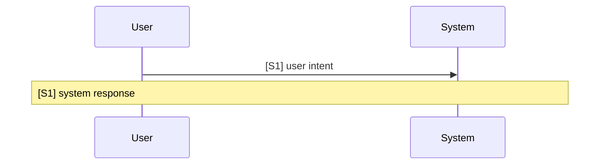

<!-- A use case models product behavior for one user goal reached in a single sitting (UCG-01).
     Write per docs/spec/_STYLE.md. Write intent and response, not interface (rule 11, UCG-09).
     The interaction diagram holds the text of each step; the Steps table maps each step to its FRs (UCG-03). -->

## Interaction diagram

<!-- The source of each step's text. Per step S1, S2, ... in order: one U->>S line, then one Note over U,S line, each starting with the step ID.
     U->>S: the user's intent ("Pick a story"), not an action on a control.
     Note over U,S: what the system does that the user observes; no "if", no settings, no interface. Cite values with [BR-xxx]/[NFR-xxx]; not written yet: [BR-?: topic].
     No ";" (it breaks the diagram) and no "**" (Mermaid shows it as is). Keep the init line unchanged (MG-05). -->

## Steps

<!-- One row per step of the diagram: same IDs, same order.
     FR: the functional requirement ID for the system response, or FR-? when there is no FR yet. A response can have several FRs. Leave blank when the step needs no FR of its own.
     Evidence: a tag from _STYLE.md, only when the step claims something about the product. Leave blank if not. -->

| Step | FR | Evidence |
|---|---|---|
| S1 | FR-? |  |

## Alternative flows

<!-- One block per alternative. Stable IDs, never renumbered (UCG-06).
     At: the step the alternative starts from, e.g. "S3". Ends: one of:
       Back to Sx / Continue at Sx / Same step / End / To UC-xxx / To UC-? (topic)
     When: a condition the system can detect, or a user intent (UCG-04).
     Fixed fields in order: At, Ends, When, System, FR. -->

### A1 · alternative name

- **At:** S?
- **Ends:** Back to S?
- **When:**
- **System:**
- **FR:** FR-?

## Situation and goal

<!-- Who wants what, and why now, in the user's words. No feature or solution (UCG-02). -->

## Trigger and precondition

<!-- Trigger: what starts the case. Precondition: what is already true. Both observable, no settings, no interface. -->

- **Trigger:**
- **Precondition:**

## Outcome and minimal guarantee

<!-- Outcome: what is true after success, verifiable by observation. Minimal guarantee: what stays true after any branch fails (UCG-05). -->

- **Outcome:**
- **Minimal guarantee:**

## Product evidence

<!-- Coverage level only: observed | none | unverified. Raw observations live in docs/research/ (UCG-08).
     Differences described in prose, not rule values. Add one block per reference product. -->

### product name

- **Coverage:** unverified
- **Differences:**

## Open questions

<!-- Each question has "?". Omit this section if empty. -->

## Notes

<!-- Why this case does not duplicate another; a design choice as one line that states its result, or `pending` while it is open. Omit if empty. -->
