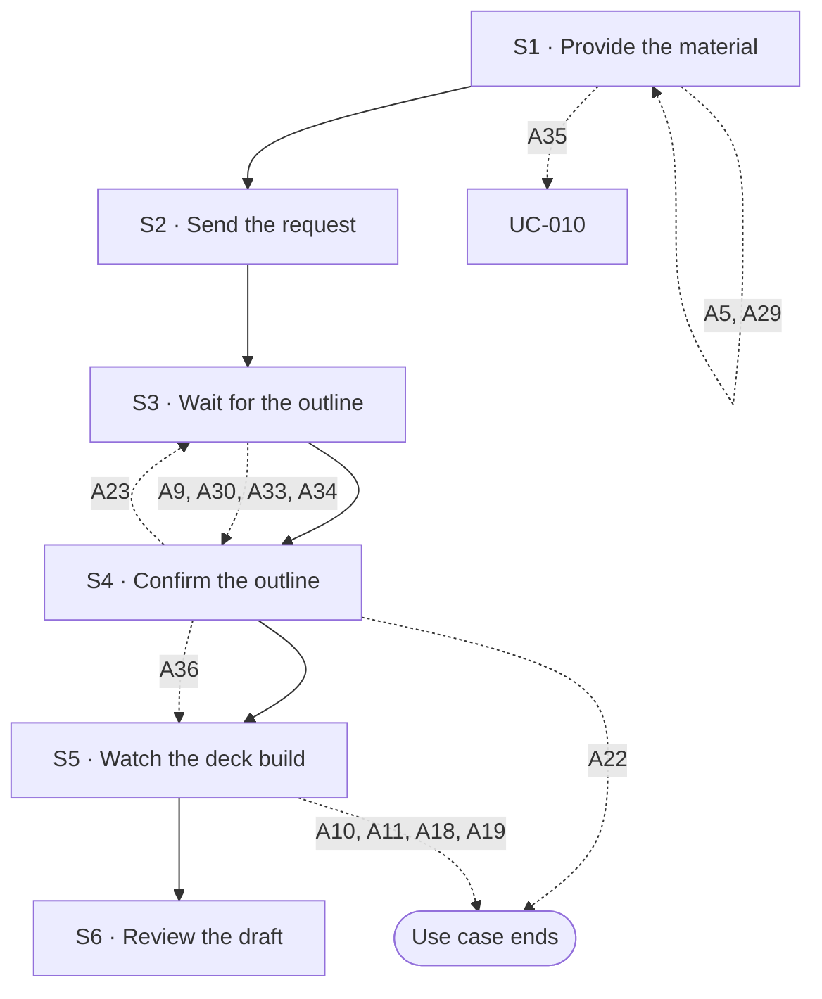

## Flow at a glance

<!-- BEGIN generated: use-case-flowchart -->

*Solid arrows are the main flow. Dotted arrows are alternative flows, labelled with their IDs.*
*Not drawn (the flow stays at the same step): A12, A13, A14, A24, A32, A37 and A39.*
<!-- END generated: use-case-flowchart -->

## Situation and goal

- The user has material for a presentation, such as rough ideas, notes, a document or photos. The deck is empty.
- The user wants a first draft of the slides made for them. They do not want to build the deck slide by slide.

## Trigger and preconditions

- **Trigger:** The user starts a request in the request area of a chat that has no deck yet.
- **Preconditions:** The chat has no deck and no slides yet.
- **Evidence:** [observed: claude-report (a new request starts with an empty presentation)] [observed: napkin-report (a separate step for creating a presentation)]

## Main flow

- The main flow takes the user's input without saying how the user entered it. UC-003 S1 takes the request text. Each other way to enter input is an alternative flow of UC-003 (A2 to A4, and A25).
- S1 to S3 call UC-003. The request is prepared and sent there, and the system works there. This use case adds what is specific to the first draft.
- The request ends at S3, when the outline is shown and the system waits for the user to confirm it.
- Confirming the outline (S4) sends a new request. S4 to S6 call UC-003 S2 to S4 for it. This use case adds what is specific to the first draft.
- A confirmation given as the answer to a question (A39) stays in the request that asked. It starts no second request.
- In a flow that starts at S4 or S5, "as UC-003 … says" and "as in UC-003 …" reuse wording only. They do not call UC-003.
- The user reviews the outline and changes it through the conversation (Note 29). A clear typed instruction and a suggested option have the same result.
- The deck uses the default design system. Choosing another one is A5.
- The outline is a checkpoint. The system builds no slide until the user confirms the outline.
- One chat holds one outline. The checkpoint applies to this first draft only.
- Each outline proposal is a response in the conversation. One of them is the **current outline** (Note 30).

### S1 · Provide the material

- **User:** Provides the material and instructions for the deck in the request area.
- **System:**
  - Shows what the user provided in the request area, as UC-003 S1 says.
- **Reqs:** none
- **Updated at:** 10-10-2026

### S2 · Send the request

- **User:** Sends the request.
- **System:**
  - Sends the request as UC-003 S2 says.
- **Reqs:** none
- **Updated at:** 10-10-2026

### S3 · Wait for the outline

- **User:** Waits for the outline.
- **System:**
  - Shows the status message as UC-003 S3 says.
  - Shows the proposed **outline** in the conversation, as its response. It is the current outline.
  - Offers to confirm or cancel the outline as suggested options.
  - Lets the user ask for changes to the outline in a new request. The user does not edit the outline directly.
  - Says that the system builds no slide until the user confirms.
  - Does not show the deck canvas yet.
  - Ends the request as UC-003 S4 says, once the outline is shown.
- **Reqs:** FR-001, FR-003, FR-004, FR-005, FR-008
- **Evidence:** [observed: napkin-report (outline: proposes an outline and waits for approval)] [assumed: confirm and cancel offered as suggested options]
- **Updated at:** 12-10-2026

### S4 · Confirm the outline

- **User:** Reviews the current outline and confirms it.
- **System:**
  - Sends the confirmation as a new request, as UC-003 S2 says. An answer to a question in A39 stays in that request.
  - Confirms the current outline. Never confirms an earlier proposal in its place.
  - Shows that the outline is confirmed. The **confirmed outline** is read-only.
  - Shows that it is preparing the slides from the confirmed outline.
- **Reqs:** FR-003
- **Updated at:** 12-10-2026

### S5 · Watch the deck build

- **User:** Waits and watches the deck canvas.
- **System:**
  - Shows the **deck canvas**. The deck canvas shows that work is in progress.
  - Shows each slide as soon as it is done. The system builds each slide from the confirmed outline, in the default design system [BR-003] [NFR-002].
  - Shows in the deck canvas which slides are done and which are still to come.
  - Does not change which slide the user is looking at.
  - Shows the **status message** as UC-003 S3 says.
  - Does not offer adding slides by hand meanwhile.
- **Reqs:** FR-022, FR-023
- **Evidence:** [observed: claude-report (waiting display; how slides arrive: the view stays on the first slide)] [observed: napkin-report (layout step and the editor: the view moves to each new slide by itself, not adopted)]
- **Updated at:** 12-10-2026

### S6 · Review the draft

- **User:** Reviews the draft.
- **System:**
  - Shows the full draft deck in the deck canvas.
  - Shows that its work is done and lets the user send a new request, as UC-003 S4 says.
  - Shows a closing message that says the draft is ready.
  - The message tells what was made per slide, which assumptions were used, and which text is placeholder.
  - The message also tells which content did not come from the user's material [BR-?: disclosure of content not from the user's material] and what the system did not check.
  - For each figure taken from the user's material, the message names the part it comes from [BR-?: how a source is named].
  - The message says that naming a source does not mean the system checked the claim.
- **Reqs:** FR-023, FR-024
- **Evidence:** [observed: claude-report (closing message: what was made, assumptions, placeholders, what was not checked)] [observed: napkin-report (closing message: one question and buttons, no summary)] [observed: claude-report (a closing message said that a citation came from memory and not from a lookup)] [assumed: naming the source of each figure]
- **Updated at:** 12-10-2026

## Alternative flows

### A5 · Choose a custom design system

- **At:** S1
- **End:** Returns to S1
- **When:** The user chooses a custom design system before sending.
- **System:**
  - Shows the available design systems [BR-?: which design systems are offered].
  - Shows the chosen design system.
  - Builds the slides in S5 with the chosen design system instead of the default.
- **Reqs:** FR-?
- **Evidence:** [observed: the product offers the choice of design system in two places before sending] [assumed: behavior after the choice]
- **Updated at:** 08-10-2026

### A29 · Give an earlier deck as the pattern

- **At:** S1
- **End:** Returns to S1
- **When:** The user gives a deck file as the pattern for the new deck.
- **System:**
  - Shows the file in the request area as an **attachment**.
  - Shows that the attachment is the pattern.
  - Shows its state, lets the user remove it, and rejects it, as in UC-003 A3, A8 and A20.
  - Accepts one pattern for each request [BR-?: number of patterns].
  - Keeps the request text and the other attachments as they were.
- **Reqs:** FR-?
- **Evidence:** [assumed]
- **Updated at:** 09-10-2026

### A35 · Set up a new design system

- **At:** S1
- **End:** Goes to UC-010
- **When:** The user chooses to set up a new design system while preparing the request.
- **System:**
  - Opens the design system setup.
  - Keeps the conversation, the request text and the attachments as they were.
  - Adds nothing to the request text.
- **Reqs:** FR-?
- **Evidence:** [assumed]
- **Updated at:** 10-10-2026

### A9 · File with nothing usable

- **At:** S3
- **End:** Continues at S4
- **When:** A file was accepted, but nothing in it can be used. For example, the file has no readable content.
- **System:**
  - Uses nothing from the file. Does not say that it read content from it.
  - Names the file and the reason in the message with the outline.
  - Drafts the outline from the rest of the request and the other material.
  - Topic still unknown: asks for the topic before it drafts the outline, as in A32.
- **Reqs:** FR-008, FR-009, FR-021
- **Evidence:** [observed: claude-report (near-black picture is read and reported in the chat)] [assumed: the "nothing usable" case]
- **Updated at:** 12-10-2026

### A30 · Draft the outline from a pattern

- **At:** S3
- **End:** Continues at S4
- **When:** The request has a pattern. The request also has new material in its text or its attachments.
- **System:**
  - Drafts the outline from the sections of the pattern, in the order of the pattern.
  - Takes from the pattern only its structure [BR-?: what the system takes from a pattern].
  - Writes each section from the new material.
  - Adds a section when the new material needs one that the pattern does not have.
  - Drops a section when it does not fit the new material.
  - Says in the message with the outline that it followed the pattern. Names each section it added or dropped.
  - No new material: asks for the topic before it drafts the outline, as in A32.
- **Reqs:** FR-?
- **Evidence:** [inferred: napkin-report (a deck file sent as material gave an outline with the same number of slides, in the same order as the source deck)] [assumed: a pattern given as a pattern, apart from new material]
- **Updated at:** 11-10-2026

### A32 · Ask before drafting the outline

- **At:** S3
- **End:** Same step
- **When:** The request and the material leave the topic unknown. Or they leave open something that would change the outline a lot [BR-?: when the system asks before the outline]. Examples are the audience, the purpose or the length.
- **System:**
  - Asks its questions in the conversation before it drafts the outline. It asks nothing that the request or the material already answers.
  - Offers answers to choose from for each question. Lets the user give their own answer.
  - Lets the user skip a question.
  - Keeps the request open while it waits, as UC-003 A38 says. The answers are part of the same request.
  - Drafts the outline from the request, the material and the answers.
  - Skipped question: says in the message with the outline what it assumed instead.
- **Reqs:** FR-008, FR-020, FR-021
- **Evidence:** [observed: claude-report (a vague one-line request got questions with answers to choose from before any slide)] [observed: napkin-report (a picture with no text got questions on topic, audience, purpose and length before the outline; a full request got none)] [observed: claude-report (an own answer and a skip were offered; neither was tried)] [assumed: what the system does after a skip]
- **Updated at:** 12-10-2026

### A33 · Material does not agree with itself

- **At:** S3
- **End:** Continues at S4
- **When:** Two parts of the user's material do not agree. An example is a figure in the text that differs from the same figure in a table.
- **System:**
  - Says in the message with the outline which parts do not agree, and where each one is.
  - Does not say which part is right.
  - Marks the point in the outline as open, so the user decides at S4.
- **Reqs:** FR-011, FR-037
- **Evidence:** [observed: claude-report (a closing message said that percentages in the text did not match a table, and that it used the table values)] [assumed: marking the point in the outline; not adopted: choosing one part without the user]
- **Updated at:** 12-10-2026

### A34 · Material lacks a needed fact

- **At:** S3
- **End:** Continues at S4
- **When:** The deck needs a fact about the user's own subject, such as their organization, project or results. Nothing the user gave provides it. An example is a figure for a results section.
- **System:**
  - Writes a placeholder instead of a figure the material does not give [BR-?: content and figures added without a source].
  - Names each missing fact in the message with the outline.
  - Marks each such point in the outline as a placeholder.
- **Reqs:** FR-010
- **Evidence:** [observed: claude-report (a vague request gave a deck in which every name, figure and claim was a bracketed placeholder)] [assumed: naming each missing fact]
- **Updated at:** 12-10-2026

### A12 · Connection lost

- **At:** S4, S5
- **End:** Same step
- **When:** The user's device loses its connection.
- **System:**
  - Shows a **notice** that the user is offline. Keeps everything it has shown.
  - Does not claim that the status message is updating live.
  - At S4: does not accept confirming. Keeps the outline.
  - Connection returns: removes the notice and shows the current progress.
  - Cannot continue: says so. At S5, keeps the confirmed outline and the finished slides. Lets the user send a new request, as in A10.
- **Reqs:** FR-?
- **Evidence:** [observed: claude-report (connection lost during the wait: offline notice, the run continues)] [observed: napkin-report (not recorded)]
- **Updated at:** 12-10-2026

### A13 · Reload or come back

- **At:** S4, S5
- **End:** Same step
- **When:** The user reloads the product, or leaves and comes back.
- **System:**
  - Restores the conversation, the request, the outline and the slides made so far.
  - At S5: the status message shows what the system is doing now.
  - At S4: the outline still waits for the user's confirmation.
  - Shows no "interrupted" notice while the system is still working.
- **Reqs:** FR-?
- **Evidence:** [observed: claude-report (reload during the wait: the run continues, but a brief "interrupted" notice shows, not adopted)] [observed: napkin-report (not recorded)]
- **Updated at:** 08-10-2026

### A22 · Cancel the outline

- **At:** S4
- **End:** Ends
- **When:** The user cancels the outline instead of confirming it.
- **System:**
  - Sends the cancellation as a new request, as UC-003 S2 says. An answer to a question in A39 stays in that request.
  - Keeps every outline proposal in the conversation.
  - Shows a notice that the user cancelled.
  - Builds no slide. Drafts no new outline by itself.
  - Ends the request as UC-003 S4 says.
- **Reqs:** FR-004, FR-012
- **Updated at:** 12-10-2026

### A23 · Send a new instruction for the outline

- **At:** S4
- **End:** Returns to S3
- **When:** The user sends an instruction to change the current outline, or to use an earlier proposal again. Examples are a request to add a point, or to go back to the first proposal.
- **System:**
  - Sends the instruction as a new request, as UC-003 S2 says. An answer to a question in A39 stays in that request.
  - Revises the current outline to follow the instruction.
  - Keeps each part of the current outline that the instruction does not ask to change.
  - Earlier proposal asked for: presents that proposal again. It is not an exact restore (Note 30).
  - Shows the result as a new response in the conversation. It becomes the current outline.
  - Keeps each earlier proposal in the conversation as it was.
  - Builds no slide.
- **Reqs:** FR-001, FR-005, FR-012
- **Evidence:** [observed: napkin-report (outline: the product offers ready-made revision requests that send their own text)] [assumed: typing a free instruction as a revision; not tried]
- **Updated at:** 12-10-2026

### A24 · Empty outline

- **At:** S4
- **End:** Same step
- **When:** The current outline is empty.
- **System:**
  - Does not offer confirming.
  - Typed confirmation: confirms nothing and builds no slide.
  - Typed confirmation: says briefly that the outline needs content before the slides are built.
  - Typed confirmation: suggests asking for a revision of the outline.
  - Shows no error message. Does not say that building the slides failed.
  - Drafts no new outline by itself.
  - Lets the user ask for changes to the outline, as in A23.
- **Reqs:** FR-005, FR-006
- **Updated at:** 12-10-2026

### A36 · Choose a look before the slides are built

- **At:** S4
- **End:** Continues at S5
- **When:** The user wants to choose among looks for this deck before any slide is built.
- **System:**
  - Offers a few looks for this deck, each with a sample [BR-?: how many looks are offered].
  - Makes each look with the chosen design system, or with the default one.
  - Lets the user ask for other looks, or keep the default look.
  - Builds the slides in S5 with the look the user chose.
  - Builds one deck. A look the user did not choose makes no slides.
- **Reqs:** FR-?
- **Evidence:** [observed: napkin-report (after the outline was accepted, the product offered six styles for the deck, more on request, and other colours for each; picking one continued the work)] [assumed: a look made with the chosen design system; keeping the default look]
- **Updated at:** 10-10-2026

### A39 · Ask what the user means for the outline

- **At:** S4
- **End:** Same step
- **When:** A message about the current outline is unclear. It does not say whether to confirm, cancel or revise, or which earlier proposal to use. The possible meanings lead to results that differ a lot.
- **System:**
  - Sends the message as a new request, as UC-003 S2 says.
  - Confirms, cancels and revises nothing while the intent stays unclear.
  - Asks one focused question in the conversation, with likely answers as suggested options.
  - Waits for the answer within the same request, as UC-003 A38 says.
  - Answer is to confirm: goes on as S4 says, within this request.
  - Answer is to cancel: goes on as A22 says, within this request.
  - Answer is to revise or to use an earlier proposal: goes on as A23 says, within this request.
- **Reqs:** FR-007, FR-012, FR-020
- **Evidence:** [assumed]
- **Updated at:** 12-10-2026

### A10 · Stop while building slides

- **At:** S5
- **End:** Ends
- **When:** The user stops the system while it builds the slides.
- **System:**
  - Stops building the slides.
  - Gives the response to a stop, as in UC-003 A31.
  - The **notice** gives the number of slides finished.
  - Keeps the confirmed outline in the conversation.
  - Keeps each finished slide in the deck canvas. Shows no slide it did not finish.
  - Lets the user send a new request. It is a follow-up request (UC-002 Note 16). It uses the confirmed outline and the finished slides.
- **Reqs:** FR-018, FR-025, FR-026, FR-028
- **Evidence:** [observed: claude-report (stop during the wait, before any slide exists: a notice that offers to edit the request or try again, and an empty deck canvas)] [observed: napkin-report (offers no way to stop it)]
- **Updated at:** 12-10-2026

### A11 · Model call fails

- **At:** S5
- **End:** Ends
- **When:** The model call fails or returns something the system cannot use.
- **System:**
  - Says that building the slides failed. Says how many slides were finished.
  - Keeps the confirmed outline and each finished slide. Shows no slide it did not finish.
  - Does not start building the slides again by itself.
  - Lets the user send a new request, as in A10.
  - Never leaves a frame empty without an explanation.
- **Reqs:** FR-019, FR-025, FR-026, FR-028
- **Updated at:** 12-10-2026

### A14 · Type while the system works

- **At:** S5
- **End:** Same step
- **When:** The user types in the request area while the system is working.
- **System:**
  - Keeps the text as a draft and does not allow sending, as in UC-003 A14.
- **Reqs:** FR-014
- **Evidence:** [observed: claude-report (second message during the wait: accepted at once and added to the same deck, not adopted)]
- **Updated at:** 12-10-2026

### A18 · Model access refused

- **At:** S5
- **End:** Ends
- **When:** The provider of the chosen model refuses access because the key is invalid, expired or revoked.
- **System:**
  - Stops and says that access to the model was refused, as in UC-003 A18.
  - Keeps the confirmed outline and the finished slides.
  - Lets the user send a new request once the key is fixed, as in A10.
  - Points to where the key is fixed, as in UC-003 A18.
- **Reqs:** FR-019, FR-025, FR-028, FR-043
- **Updated at:** 12-10-2026

### A19 · Usage limit reached

- **At:** S5
- **End:** Ends
- **When:** The provider's usage or rate limit is reached.
- **System:**
  - Stops and says that the limit of the model account was reached, as in UC-003 A19.
  - Says how many slides were finished.
  - Keeps the confirmed outline and the finished slides.
  - Lets the user send a new request, as in A10.
- **Reqs:** FR-019, FR-025, FR-026, FR-028
- **Updated at:** 12-10-2026

A5 is documented here. Whether it ships is not decided yet. Its research stays in this file.

### A37 · Ask for presenter notes

- **At:** S5
- **End:** Same step
- **When:** The request asks for presenter notes, the words the user says while showing the slides.
- **System:**
  - Builds presenter notes for each slide while it builds that slide.
  - Shows the notes of a slide with that slide. The notes are not part of what the audience sees.
  - Says in the closing message which slides have notes.
- **Reqs:** FR-?
- **Evidence:** [inferred: claude-report (a closing message said that each slide has speaker notes; nobody opened them)] [assumed: notes only when the request asks for them]
- **Updated at:** 10-10-2026

## Postconditions and minimal guarantee

Proposals, to be confirmed against recordings.

- **Postconditions:**
  - The chat holds the confirmed outline.
  - The deck has slides made from that outline.
  - The slides use the default design system, or the chosen one when A5 was used.
  - The deck canvas shows the slides.
- **Minimal guarantee:** Whatever branch fails or is interrupted:
  - The request text and attached material are kept. They stay in the conversation if the user sent them, and in the request area if not.
  - Each outline proposal already shown stays in the conversation.
  - Each finished slide stays in the deck.
  - The user does not have to enter anything again.
- **Evidence:** [assumed]

## Product evidence

### Claude Slide Design

- **Coverage:** observed
- **Research card:** [claude-deck-generation-behavior](../../research/use-cases/claude-slides-design/claude-deck-generation-behavior.md)
- **Difference:**
  - Builds slides straight from the request. It has no outline step.
  - Asks the user only when the request is vague.
  - Shows its progress in the deck canvas and in a status message. The user can stop it.
  - Ends with a message that tells what it did and what it did not check.
- **Updated at:** 08-10-2026

### Napkin AI

- **Coverage:** observed
- **Research card:** [napkin-ai-deck-generation-behavior](../../research/use-cases/napkin-ai/napkin-ai-deck-generation-behavior.md)
- **Difference:**
  - Starts from a separate step for creating a presentation.
  - Proposes an outline and waits for approval before building. Then asks for a style and a layout per slide.
  - The team saw no voice input and no way to stop the system.
  - The team did not observe editing the outline text directly.
  - A deck file sent with no text was read as source material. The outline followed the structure of the source deck.
- **Updated at:** 09-10-2026

## Open questions

1. A32: which missing information changes the outline enough for the system to ask [BR-?: when the system asks before the outline]? There is no fixed number of questions (Note 25). Owner to decide.
2. A33: does the system mark the point as open, ask first (A32), or use one part and say which? Owner to decide.
3. S6: how is a source named, for example a file or a passage in it? Owner to decide.
4. A36: does every first draft offer looks, or only when the user asks? Owner to decide.
5. A36: can the user choose a layout for each slide, or only one look for the deck? Owner to decide.
6. A36: can the user keep a look as a design system (UC-010)? Owner to decide.
7. A37: does every first draft get presenter notes, or only when the request asks for them? Owner to decide.
8. A37: can the user change presenter notes by hand (UC-007)? Owner to decide.
9. A9, S6: the system can read a file only in part. What does it say about the part it could not read? Owner to decide.
10. A22: the user cancels the outline, then sends a new request. One chat holds one outline (Note 5). Does the system draft a new outline in the same chat? Owner to decide.
11. A32: the user skips the question about the topic, and the topic stays unknown. What does the system do then? Owner to decide.
12. A33: the user confirms the outline while a disputed point is still open. What does the slide show for that point? Owner to decide.

## Notes

1. Design choice for an ADR proposal: the default design system is fixed (hardcoded). What the default is, and how a later custom design system replaces it, is open.
2. Moved to UC-003 (Note 1).
3. Moved to UC-003 (Note 2).
4. Accessibility (keyboard operation, announcements to assistive technology, zoom) is not written into steps. A global NFR in `../04-requirements/nfr/` applies to every part of the interface, so this use case does not cite it.
5. Design decision (owner, 2026-10-08): the outline checkpoint applies to the first draft only. A follow-up request shows no outline and changes the deck canvas directly (UC-002). Design choice for an ADR proposal: within the first draft, the outline is a mandatory checkpoint, and one chat holds one outline. It stands between the request and any change to the canvas. A request that fails or is cancelled then costs the user only the outline. The outline is part of this use case, not a separate one.
6. Moved to UC-003 (Note 8). The same promise applies to A12 and A13 here.
7. Moved to UC-003 (Note 3).
8. Moved to UC-003 (Note 4).
9. Moved to UC-003 (Note 5).
10. Design decision (owner, 2026-10-08): A10 keeps the slides already made when the user stops the system. The team did not record this in Claude Slide Design, and DeckAgent does not copy it.
11. Moved to UC-003 (Note 6).
12. Retired (owner, 2026-10-08): the model is not locked for a run. The user can choose a model for any request (UC-003 Note 7).
13. Moved to UC-003 (Note 7).
14. The ways to enter a request and the run failures at S3 moved to UC-003 with the same flow IDs. These IDs are retired here: A1, A2, A3, A4, A6, A8, A15, A16, A17, A20, A25, A26, A27 and A28. A11, A12, A13, A14, A18 and A19 stay here for the steps after the outline is confirmed.
15. Design decision (owner, 2026-10-09): an earlier deck can be the pattern for a new deck (A29, A30). The pattern is a strong reference for the structure of the outline, not a fixed form. The system adds or drops a section when the new material needs it. The pattern sets no content and no look, so the slides use the default design system or the one chosen in A5. A pattern whose file has nothing usable is an attachment with nothing usable (A9).
16. A deck made in an earlier chat is not covered as a pattern. UC-006 lets the user find and open an earlier chat. It does not give the deck of that chat as a pattern. Whether a pattern can come from an earlier chat is open.
17. Retired (owner, 2026-10-10): A21 (stop while drafting the outline). UC-003 A31 gives the same response at S3, through `includes`. It also said then that trying again sends the same request again. Since 2026-10-11, A31 no longer offers to try again (UC-003 Note 17). A21 added no response about the outline, because no outline is shown before the stop. The ID is never reused.
18. A7 and A32 both explore a request with no topic. A7 shows a sample outline. A32 asks first. Both stay as explored flows (Open questions). Replaced in part by Note 25 (owner, 2026-10-11): a request with no topic gets a question. A7 is retired (Note 28).
19. Asking before the outline (A32) is part of drafting the outline, so it belongs here and not to UC-003. Whether the answer is a new request through UC-003 was open. Settled (owner, 2026-10-11): the answer is part of the same request (UC-003 Note 22).
20. Missing material (A34) and material that does not agree with itself (A33) are separate flows. A34 has nothing to use. A33 has two things that cannot both be used. A32 can also ask about either one (Open questions).
21. S6 names sources and says what was not checked. It does not check a claim. Naming a source is not a check that the claim is true.
22. A design system (A5, UC-010) is a set of rules the user can use for many decks. A look (A36) is how this one deck is shown. A look can use a design system. Choosing a look saves no design system.
23. A35 goes to UC-010, because the user leaves the first draft to set up a design system. Choosing a design system that is set up (A5) does not go there.
24. Presenter notes belong to the slides they go with. They are not a goal of their own, so they are a flow here (A37) and in UC-002 (A9). UC-004 A2 decides whether they go in the file. How notes are kept is not part of this use case.
25. Design decision (owner, 2026-10-11): before the outline, the system asks only the questions it needs (minimum necessary clarification). This settles the earlier open question on a request with no topic. The system asks first (A32) and shows no sample outline (A7).
   - It uses the request and the material first.
   - Topic still unknown: it asks for the topic before the outline. Other missing information would change the outline a lot: it asks about it.
   - It asks no fixed number of questions. It asks nothing only to explore a topic it knows enough about.
   - Enough information: it drafts the outline. It shows the assumptions left, so the user can check and correct them.
   - Considered: ask first for every incomplete request; draft first with assumptions and placeholders. Neither is selected.
   - Why: no needless questions, and no outline built on large assumptions with nothing to back them.
   - A32, A9 and A30 follow this note since 2026-10-11. A7 is retired (Note 28). This note selects no flow.
26. Stop and failure in the first draft: UC-003 Notes 17 to 20 hold the owner decisions of 2026-10-11. They agree with Note 10 here. A10, A11, A12, A18 and A19 follow them. Until 2026-10-11, these flows offered to try again from the confirmed outline. Trying again is now a future candidate (UC-003 Note 18). A new request after a stop or a failure is a follow-up request (UC-002 Note 16). It shows no second outline. The first draft does not count as finished.
27. Files as material: UC-003 Note 21 holds the owner decision of 2026-10-11. A file the system can read only in part is open (Open questions).
28. Retired (owner, 2026-10-11): A7 (request has no topic). A7 showed a sample outline with placeholder headings. It said that no topic was given, and let the user edit the outline at S4. Its evidence came from two products. In Claude Slide Design, a near-black picture got a placeholder deck without questions. A vague one-line request got two questions first there. In Napkin AI, a picture without text got questions before the outline. Note 25 has the system ask for the topic instead (A32). The ID is never reused.
29. Design decision (owner, 2026-10-12): the user changes the outline through the conversation (chat-based outline editing).
   - The user reads the outline, asks for changes, confirms it or cancels it. The user does not edit its titles or points directly.
   - A clear typed instruction can confirm, cancel or revise the outline. A suggested option sends the same instruction, with the same result (UC-003 Note 23).
   - A positive message is not always a confirmation. "Looks good, but add a slide on costs" asks for a change (A23).
   - An unclear message gets a question first, as Note 25 says (Note 32).
   - Confirming (S4) and cancelling (A22) each send a new request. The request that drafted the outline has already ended.
   - A revision changes only what the instruction asks for. A request gives no permission to change content outside its scope.
   - Considered: editing the outline text directly. Not selected for V1.
   - Why: the system revises the outline from the user's intent. The user does not have to fit related changes together by hand.
   - Direct editing of slides is a future capability (UC-007). The deck canvas stays the place to review slides.
   - S3, S4, S5, A12, A22, A23 and A24 follow this note since 2026-10-12. Until then, S3 let the user edit the outline text. This note selects no flow.
30. Design decision (owner, 2026-10-12): each outline proposal is a response in the conversation (outline conversation model).
   - The system shows each proposal as its own response. There is no separate place to view or edit the outline.
   - A revision shows a new response (A23). Earlier proposals stay in the conversation as they were.
   - The current outline is the proposal in the latest outline response. A revision starts from it, and a confirmation confirms it.
   - The slides are built from the confirmed outline. An earlier proposal never becomes current by itself.
   - The user can ask for an earlier proposal again (A23). The system presents it again as a new response.
   - That is a revision through the conversation, not an undo or a deck history (UC-008). It promises no exact copy.
   - An unclear reference to an earlier proposal gets a question first (Note 32).
   - Note 5 still holds: one chat holds one outline. Its proposals can show as several responses. Cancelling (A22) removes none of them.
   - Considered: one outline that each revision changes in place. Not selected.
   - Why: the user can compare proposals and ask for an earlier one again.
   - How the system keeps proposals is not part of this use case. It is a matter for an ADR.
   - S3, S4, A22, A23, A24 and the minimal guarantee follow this note since 2026-10-12. Until then, A23 updated the same outline in place.
31. Design decision (owner, 2026-10-12): a confirmation of an empty outline gets guidance, not an error (A24).
   - The system confirms nothing and builds no slide.
   - To a typed confirmation, it says briefly that the outline needs content before the slides are built. It suggests asking for a revision.
   - This is a check on the request, not a failure of the work. The system does not say that building the slides failed.
   - "Shows no error message" means no error. It does not mean that the system stays silent.
   - It drafts no new outline by itself and adds no confirmation step.
   - What counts as an empty outline is not decided here.
   - Why: the user can fix an empty outline by asking for a revision. It is a check, not an error of the work.
   - This settles the earlier open question on the reply to a typed confirmation of an empty outline. A24 follows this note since 2026-10-12. This note selects no flow.
32. Design decision (owner, 2026-10-12): an unclear message about the outline gets a question first.
   - A message about the current outline can leave unclear whether the user wants to confirm, revise or do something else. "OK?" is an example.
   - The system never takes an unclear message as a confirmation.
   - It asks one focused question when the possible meanings lead to results that differ a lot. It does not ask when the context makes the intent clear.
   - It changes no outline and builds no slide before the user answers.
   - The user answers in the conversation or by a suggested option. The answer is part of the same request (UC-003 A38 and Note 22).
   - "Looks good, but add a slide on costs" revises the outline (A23). "Confirm this outline and create the slides" confirms it (S4).
   - These examples show intent. They are not fixed words.
   - This follows minimum necessary clarification (Note 25). An unclear reference to an earlier proposal (Note 30) gets a question in the same way.
   - A39 asks this question since 2026-10-12 (Note 33). UC-003 A38 covers the wait and the answer.
   - Why: not recorded. This note selects no flow.
33. Design decision (owner, 2026-10-12): a separate flow, A39, asks about an unclear message during the outline review.
   - A32 stays the question before the first outline. A39 asks while the user reviews an outline.
   - A39 covers an unclear confirmation, an unclear revision and an unclear reference to an earlier proposal.
   - The answer goes on as S4, A22 or A23 says, within the same request. It starts no second request.
   - A reply that does not settle the question gets another question when it still matters (UC-003 A38 and Note 24).
   - Considered: widening A32 to S4. Not selected. The two have different triggers and go on in different ways.
   - Why: each flow keeps one trigger, and each answer leads to a flow that already exists.
   - `versions` selects A39 for V1. This settles the earlier open question on which flow asks. This note selects no flow.
34. Design decision (owner, 2026-10-12): the system can use general knowledge when it drafts the outline (knowledge use).
   - It can add relevant general knowledge that helps the user's goal. It need not cite each such statement in V1. This needs no web search.
   - It never presents uncertain information as a checked fact.
   - It keeps the meaning of the user's material. It can say a fact in other words or in an equal form, such as "one in four" for 25%.
   - It never adds a fact and says that it comes from the material.
   - It never invents a missing fact about the user's own subject, such as their organization, project or results. A34 applies to such facts.
   - It can make a reasonable inference that does not change the result a lot. It never presents an inference as a fact from the material.
   - An uncertainty that changes the result a lot gets a question first (Note 25).
   - The user asks to use only their material: the system adds no outside factual claim. An attached file alone does not ask for that.
   - Two parts of the material disagree: the system never uses one as settled without telling the user (A33). Open question 2 stays open.
   - Considered: not recorded.
   - Why: general knowledge helps make a useful deck. An invented fact about the user's own subject cannot be trusted.
   - S3, A32, A33 and A34 follow this note since 2026-10-12. It sets no value for the rule on content and figures added without a source. This note selects no flow.
