Updated at: 28-10-2026

<!-- A use case models the ideal product (UCG-01 in 03-use-cases/_CRITERIA.md). Every flow it holds is a
     behavior selected for the ideal product; this use case records no rejected options. A version file
     under docs/versions/ names the flows it takes; the use case holds no versions field (UCG-09).
     Write in plain English: docs/spec/_STYLE.md (UCG-11).
     Write intent and response, never interface (UCG-13, _STYLE rule 10). Open questions live in the
     design backlog of the ideal spec, outside docs/spec/. -->

## Goal

The user has material for a presentation, such as rough ideas, notes, a document or photos. The deck is empty. The user wants a first draft of the slides made for them. They do not want to build the deck slide by slide.

## Preconditions

- **Trigger:** The user starts a request in the request area of a chat that has no deck yet.
- **Preconditions:** The chat has no deck and no slides yet.

## Interactions

How to read the interactions:

- S1 to S3 run the main flow of UC-003 (`includes` UC-003). The request is prepared and sent there, and the system works there. This use case adds what is specific to the first draft. Each other way to enter input is a flow of UC-003 (A2 to A4, and A25).
- The request ends at S3, when the outline is shown and the system waits for the user to confirm it.
- Confirming the outline (S4) sends a new request. S4 to S6 run UC-003 S2 to S4 for it. This use case adds what is specific to the first draft.
- The request that confirms the outline then waits for the user to confirm the **generation format**, as UC-003 A38 says. The answer joins that request. It starts no second request.
- Two confirmations stand before any slide: the outline, then the generation format. Choosing a format, which also shows its details, confirms nothing (A50).
- No flow starts S5 before both confirmations. A flow that changes the design before S5 (A36, A43, A45, A46) returns to the confirmation still missing.
- The generation format is locked when S5 starts. It never changes for this deck (Note 41).
- A confirmation given as the answer to a question (A39) stays in the request that asked. It starts no second request.
- In a flow that starts at S4 or S5, "as UC-003 … says" reuses wording only. It does not call UC-003.
- The user reviews the outline and changes it through the conversation (Note 29). A clear typed instruction and a suggested option have the same result.
- The deck uses the default design system when the user chose none [BR-003]. Choosing another one is A5.
- A visual style the user chooses guides the presentation design of the slides (A43). When the user chooses none, the system chooses a suitable design. Setting up a custom visual style is A44 (UC-017).
- A design system and a visual style are separate definitions. One is never saved inside the other (Note 22).
- A5 is designed into the product. Which version takes it is a scope decision, not a product-design status.
- A choice to make a presentation or a new deck comes here. The user gives the material, the system asks what is missing before it drafts (A32), and the user confirms the outline and then the generation format before any slide exists (S4, Note 5). It adds no other approval step.

### Main Flow (MF)

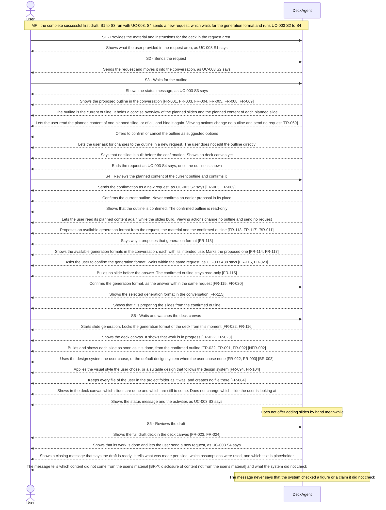

### Alternative Flows

#### A5 · Choose a design system

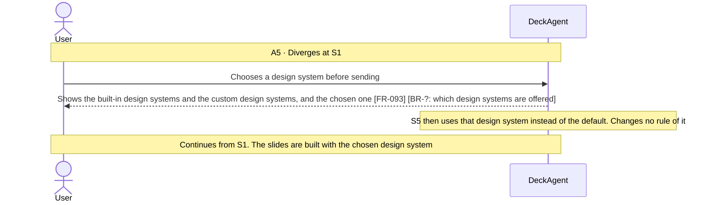

#### A9 · File with nothing usable

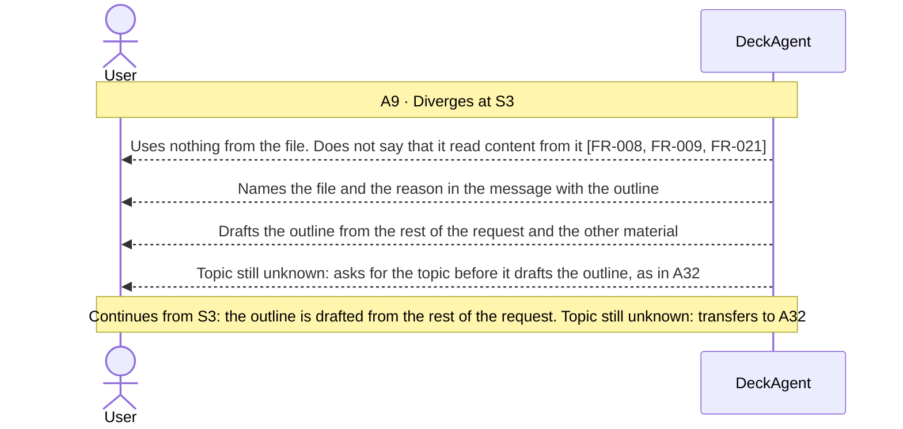

#### A10 · Stop while building slides

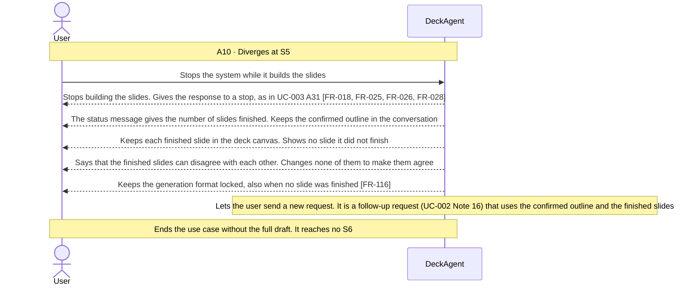

#### A11 · Model call fails

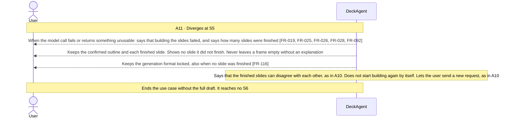

#### A12 · Connection lost

```mermaid
sequenceDiagram
    actor User
    participant DeckAgent
    Note over User,DeckAgent: A12 · Diverges at S4 and S5
    DeckAgent-->>User: When the user's device loses its connection: shows a notice that the user is offline. Keeps everything it has shown [FR-?]
    note over DeckAgent: Does not claim that the status message updates live. At S4, does not accept confirming and keeps the outline. Connection returns: removes the notice and shows the current progress. Cannot continue: says so. at S5 keeps the confirmed outline and the finished slides and lets the user send a new request, as in A10
    Note over User,DeckAgent: At S4: stays at S4, confirming is not accepted. At S5: cannot continue ends the work, as in A10; connection returns continues from S5
```

#### A13 · Reload or come back

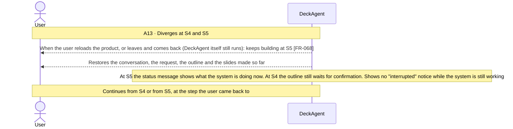

#### A14 · Type while the system works

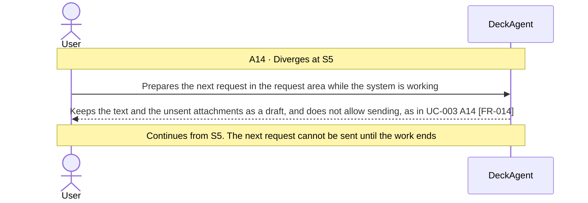

#### A18 · Model access refused

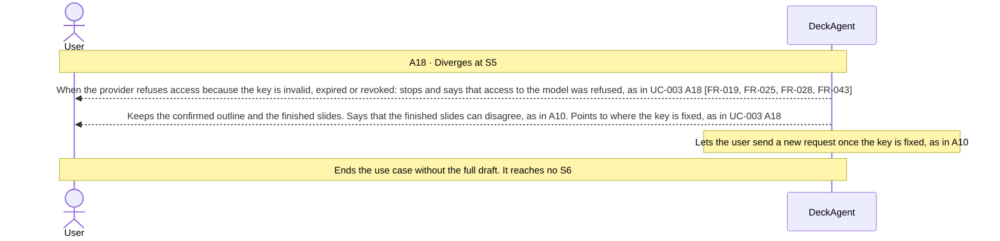

#### A19 · Usage limit reached

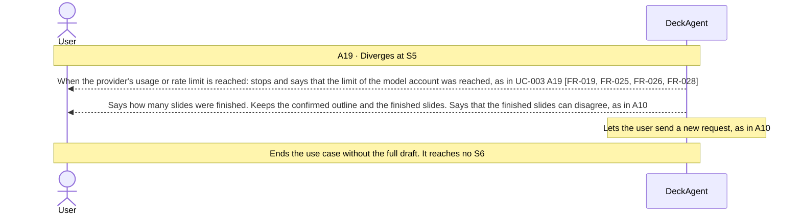

#### A22 · Cancel the outline

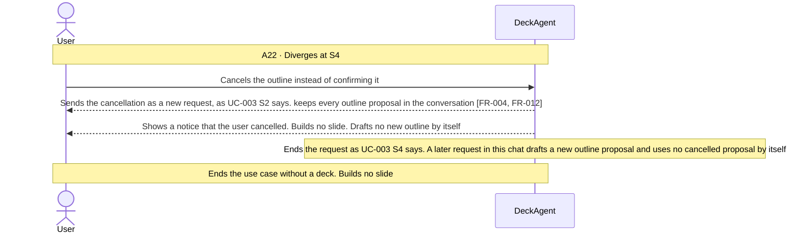

#### A23 · Send a new instruction for the outline

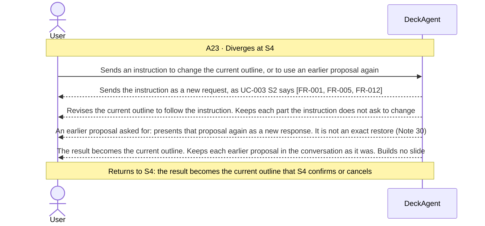

#### A24 · Empty outline

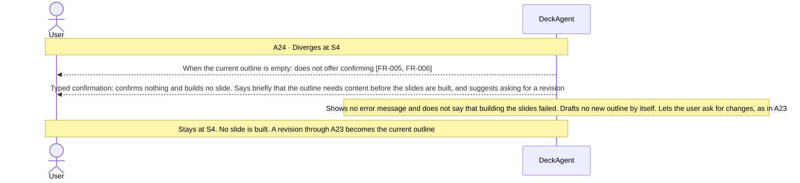

#### A29 · Give an earlier deck as the pattern

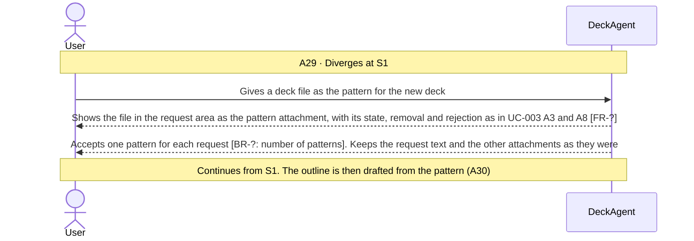

#### A30 · Draft the outline from a pattern

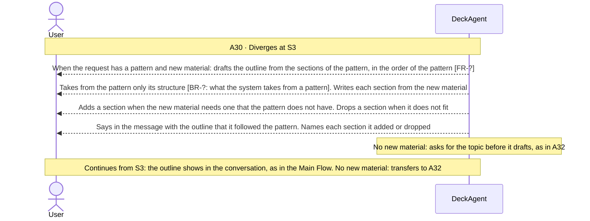

#### A32 · Ask before drafting the outline

```mermaid
sequenceDiagram
    actor User
    participant DeckAgent
    Note over User,DeckAgent: A32 · Diverges at S3
    opt A32 · The topic is unknown or an open choice would change the outline a lot
        DeckAgent-->>User: Asks only for the missing decision before it drafts the outline [FR-020, FR-021]
        DeckAgent-->>User: Offers relevant answers to choose from and accepts the user's own answer or a skip [FR-021]
        alt A32 · The user answers
            User->>DeckAgent: Answers the question, within the same request [FR-020]
            DeckAgent-->>User: Drafts the outline from the request, permitted sources and answers [FR-008]
        else A32 · The user skips the question about the topic
            DeckAgent-->>User: Drafts no outline. Says that it needs the topic, and asks for it again [FR-021]
        else A32 · The user skips a question about an open choice
            DeckAgent-->>User: Drafts the outline, and says in the message which answer it assumed [FR-008, FR-021]
        end
    end
    note over DeckAgent: A question about a material disagreement belongs to A33. A skip there chooses no figure: the point stays open in the outline (FR-037)
    Note over User,DeckAgent: Continues from S3: the outline is drafted from the answer, the assumption or the material. A skipped topic question keeps the request waiting
```

#### A33 · Material does not agree with itself

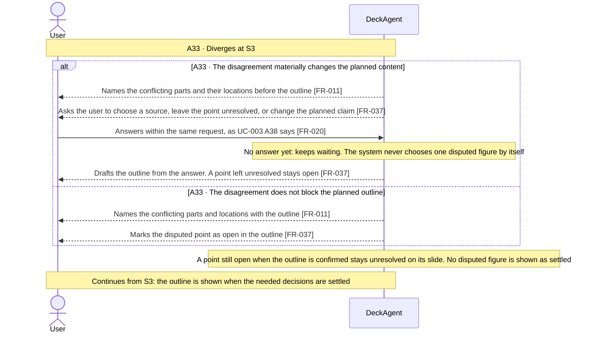

#### A34 · Material lacks a needed fact

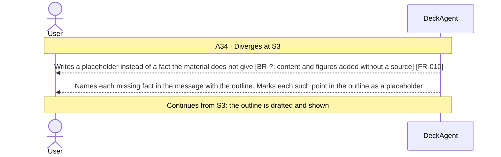

#### A35 · Set up a new design system

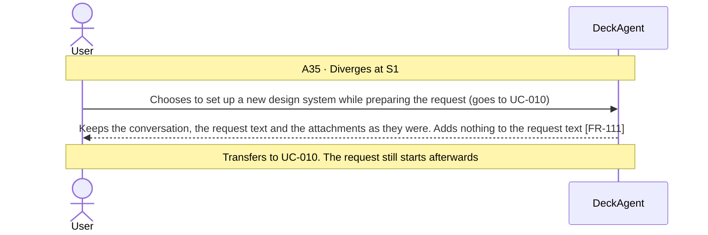

#### A36 · Review design options before building slides

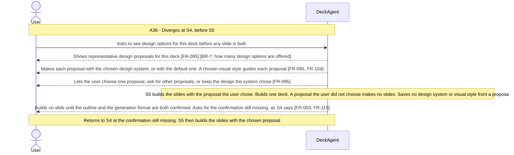

#### A37 · Ask for presenter notes

```mermaid
sequenceDiagram
    actor User
    participant DeckAgent
    Note over User,DeckAgent: A37 · Diverges at S5
    DeckAgent-->>User: When the request asks for presenter notes: builds them for each slide while it builds that slide [FR-?]
    DeckAgent-->>User: Shows the notes of a slide with that slide. The notes are not part of what the audience sees
    DeckAgent-->>User: Says in the closing message which slides have notes
    Note over User,DeckAgent: Continues from S5. The closing message comes at S6
```

#### A39 · Ask what the user means for the outline

```mermaid
sequenceDiagram
    actor User
    participant DeckAgent
    Note over User,DeckAgent: A39 · Diverges at S4
    DeckAgent-->>User: When a message about the current outline is unclear, and the meanings differ a lot: sends it as a new request, as UC-003 S2 says [FR-007, FR-012, FR-020]
    DeckAgent-->>User: Confirms, cancels and revises nothing while the intent stays unclear. Asks one focused question in the conversation, with likely answers as suggested options
    loop Waits within the same request, as UC-003 A38 says
        User->>DeckAgent: Answers the question
    end
    note over DeckAgent: Answer is to confirm: goes on as S4 says, and then asks for the generation format. To cancel: as A22 says. To revise or use an earlier proposal: as A23 says. All within this request
    DeckAgent-->>User: Answer is to confirm: asks the user to confirm the generation format within this request. Builds no slide before that answer [FR-115, FR-020]
    Note over User,DeckAgent: Stays at S4. Within this request, the answer goes on as S4, A22 or A23 says. A confirmation still reaches the generation format confirmation of S4
```

#### A42 · Use images on the slides

```mermaid
sequenceDiagram
    actor User
    participant DeckAgent
    Note over User,DeckAgent: A42 · Diverges at S5
    DeckAgent-->>User: When a slide needs an image, from the request or from its content: uses an image from an attachment of the chat, or a new image [FR-066, FR-024]
    DeckAgent-->>User: Follows the request when it says which image or which kind of image to use. Kind not said, and the choice changes the result a lot: asks with suggested options
    note over DeckAgent: Does not change the selected model and does not move the work to another provider to make an image. A new image the request asks for, or cannot do without, cannot be made: ends the work as A11 says. A new image it chose to add cannot be made: leaves that image out
    DeckAgent-->>User: Names each new image in the closing message as content not from the material [BR-?: disclosure of content not from the user's material]. Also names each planned image it did not make
    Note over User,DeckAgent: Continues from S5. An image that cannot be made ends the work, as A11 says
```

#### A43 · Choose a visual style

```mermaid
sequenceDiagram
    actor User
    participant DeckAgent
    Note over User,DeckAgent: A43 · Diverges at S4, before S5
    User->>DeckAgent: Chooses a visual style for this deck
    DeckAgent-->>User: Shows the built-in and custom visual styles the user can choose [FR-094]
    DeckAgent-->>User: Shows the chosen visual style [FR-094]
    note over DeckAgent: S5 applies its rules during slide generation. The saved visual style does not change. Uses it with the chosen design system, or with the default one [FR-104]
    DeckAgent-->>User: Builds no slide until the outline and the generation format are both confirmed. Asks for the confirmation still missing, as S4 says [FR-003, FR-115]
    Note over User,DeckAgent: Returns to S4 at the confirmation still missing. S5 then builds the slides with the chosen visual style
```

#### A44 · Set up a Custom Visual Style

```mermaid
sequenceDiagram
    actor User
    participant DeckAgent
    Note over User,DeckAgent: A44 · Diverges at S1
    User->>DeckAgent: Chooses to set up a custom visual style while preparing the request (goes to UC-017)
    DeckAgent-->>User: Keeps the conversation, the request text and the attachments as they were. Adds nothing to the request text [FR-111]
    Note over User,DeckAgent: Transfers to UC-017. The request still starts afterwards
```

#### A45 · Design rules conflict

```mermaid
sequenceDiagram
    actor User
    participant DeckAgent
    Note over User,DeckAgent: A45 · Diverges at S4, before slide generation
    DeckAgent-->>User: When a required rule of the design system and a rule of the visual style conflict: names both rules [FR-105]
    DeckAgent-->>User: Asks the user to resolve the conflict [FR-105]
    alt A45 · The user chooses a compatible design
        User->>DeckAgent: Chooses a compatible design
        DeckAgent-->>User: Applies the design the user chose [FR-105]
        Note over User,DeckAgent: Returns to S4 at the confirmation still missing, or continues to S5 when both are given. The slides are built with those rules
    else A45 · The user authorizes a scoped exception
        User->>DeckAgent: Authorizes a scoped exception
        DeckAgent-->>User: Names the exception and its effect [FR-105]
        DeckAgent-->>User: Applies it only in the authorized scope. Asks for no further approval [FR-105]
        Note over User,DeckAgent: Returns to S4 at the confirmation still missing, or continues to S5 when both are given. The slides are built with the exception within its scope
    else A45 · The conflict stays unresolved
        DeckAgent-->>User: Builds no conflicting slide [FR-105]
        note over DeckAgent: Keeps both saved definitions unchanged
        Note over User,DeckAgent: Does not continue to S5
    end
    note over DeckAgent: The "further approval" is about the design rule only. The confirmation of the outline and of the generation format still stands before S5 [FR-003, FR-115]
```

#### A46 · Explicit design rule exception

```mermaid
sequenceDiagram
    actor User
    participant DeckAgent
    Note over User,DeckAgent: A46 · Diverges at S4
    User->>DeckAgent: Asks clearly for an exception to a required rule of the design system
    DeckAgent-->>User: Names the rule and the scope of the exception [FR-105]
    DeckAgent-->>User: Applies the exception within that scope. Asks for no further approval [FR-105]
    DeckAgent-->>User: Keeps the saved design system and visual style as they were [FR-105]
    DeckAgent-->>User: Builds no slide until the outline and the generation format are both confirmed. Asks for the confirmation still missing, as S4 says [FR-003, FR-115]
    Note over User,DeckAgent: Returns to S4 at the confirmation still missing. S5 then builds the slides with the exception within its scope
```

#### A47 · Default generation format

```mermaid
sequenceDiagram
    actor User
    participant DeckAgent
    Note over User,DeckAgent: A47 · Diverges at S4, after the outline is confirmed
    opt A47 · The request names no format and has no special format need
        DeckAgent-->>User: Proposes the default generation format [FR-113] [BR-011]
        DeckAgent-->>User: Shows the other available generation formats as alternatives. Shows the full details of none of them [FR-113]
    end
    Note over User,DeckAgent: Returns to S4: waits for the confirmation of the generation format [FR-115]
```

#### A48 · Requirement-based generation format

```mermaid
sequenceDiagram
    actor User
    participant DeckAgent
    Note over User,DeckAgent: A48 · Diverges at S4, after the outline is confirmed
    opt A48 · The request or the confirmed outline needs a kind of format
        DeckAgent-->>User: Proposes an available generation format that meets the need [FR-113] [BR-011]
        DeckAgent-->>User: Says which need the proposal meets, such as slides the user edits as Markdown [FR-113]
        DeckAgent-->>User: Shows the other available generation formats as alternatives [FR-113]
        note over DeckAgent: Asks no extra question only because several formats meet the need
    end
    Note over User,DeckAgent: Returns to S4: waits for the confirmation of the generation format [FR-115]
```

#### A49 · Explicit generation format

```mermaid
sequenceDiagram
    actor User
    participant DeckAgent
    Note over User,DeckAgent: A49 · Diverges at S4, after the outline is confirmed
    opt A49 · The request names an available generation format
        DeckAgent-->>User: Proposes the named generation format. Says that it follows the request [FR-113] [BR-011]
        DeckAgent-->>User: Still asks the user to confirm the generation format [FR-115]
    end
    Note over User,DeckAgent: Returns to S4: waits for the confirmation of the generation format [FR-115]
```

#### A50 · Review or change the generation format choice

```mermaid
sequenceDiagram
    actor User
    participant DeckAgent
    Note over User,DeckAgent: A50 · Diverges at S4, while the system waits for the generation format
    User->>DeckAgent: Chooses one generation format
    DeckAgent-->>User: Makes it the selected generation format, and shows its advantages and its important limitations. It is not confirmed yet [FR-114]
    User->>DeckAgent: Chooses another generation format
    DeckAgent-->>User: Makes that one the selected generation format and shows its details. Hides the details of the format chosen before [FR-114]
    User->>DeckAgent: Chooses the selected generation format again
    DeckAgent-->>User: Hides its details. Keeps it as the selected generation format [FR-114]
    note over DeckAgent: These actions send no request and answer nothing. They change no outline and build no slide. The request keeps waiting [FR-114, FR-115]
    Note over User,DeckAgent: Returns to S4: the confirmation of the generation format is a separate answer that ends the wait [FR-115]
```

#### A51 · Requested generation format unavailable or incompatible

```mermaid
sequenceDiagram
    actor User
    participant DeckAgent
    Note over User,DeckAgent: A51 · Diverges at S4, before S5
    alt A51 · The named or chosen format is not available, stops being available before S5, or does not fit the request
        DeckAgent-->>User: Says which need or capability it cannot meet [FR-113, FR-115, FR-117]
        DeckAgent-->>User: Shows the available generation formats as alternatives. Puts no other format in its place by itself [FR-113, FR-117]
        DeckAgent-->>User: Asks the user to choose and confirm a generation format. Builds no slide meanwhile [FR-115]
    else A51 · The request names two generation formats for one deck
        DeckAgent-->>User: Says that one deck uses one generation format [FR-113]
        DeckAgent-->>User: Asks which one to use. Makes no second deck and converts nothing [FR-113, FR-115]
    end
    Note over User,DeckAgent: Returns to S4: waits for a new confirmed generation format. No slide is built in this flow
```

## Behavior constraints

- The outline is a checkpoint. The system builds no slide until the user confirms the outline (Note 5).
- The generation format is a second checkpoint. The system builds no slide until the user also confirms the generation format, within the request that confirmed the outline [FR-115].
- No alternative flow starts slide generation before both confirmations. A design option, a visual style or a design rule decision made before S5 does not replace either of them [FR-003, FR-115].
- Stopping the request while it waits for the generation format ends it, as UC-003 A31 says. The confirmed outline stays. No slide is built. A later request returns to the confirmation of the generation format [FR-115].
- The generation format is locked when slide generation starts. It stays locked when the work stops or fails, also with no finished slide [FR-116].
- One chat holds at most one confirmed outline (Note 39). The checkpoint applies to this first draft only.
- Each outline proposal is a response in the conversation. One of them is the **current outline** (Note 30).
- An outline proposal that the system did not finish is not the current outline (Note 39). No flow recovers an unfinished outline.

- **Postconditions:**
  - The chat holds the confirmed outline.
  - The user confirmed the generation format after the outline. The deck uses it, and it is locked [FR-116].
  - The deck has slides made from that outline.
  - The slides use the chosen design system, or the default one when the user chose none [BR-003].
  - The slides follow the chosen visual style when the user chose one [FR-094].
  - The deck canvas shows the slides.
- **Minimal guarantee:** Whatever branch fails or is interrupted:
  - The request text and attached material are kept. They stay in the conversation if the user sent them, and in the request area if not.
  - Each outline proposal already shown stays in the conversation.
  - Each finished slide stays in the deck.
  - A confirmed outline stays confirmed, also when the generation format was never confirmed.
  - A generation format locked at the start of slide generation stays the format of the deck.
  - The user does not have to enter anything again.

## Notes

1. Design choice for an ADR proposal: the default design system is fixed (hardcoded). What the default is, and how a later custom design system replaces it, is open.
2. Moved to UC-003 (Note 1).
3. Moved to UC-003 (Note 2).
4. Accessibility (keyboard operation, announcements to assistive technology, zoom) is not written into steps. NFR-013 covers keyboard use and screen readers in every part of the interface, so this use case does not cite it.
5. the outline checkpoint applies to the first draft only. A follow-up request shows no outline and changes the deck canvas directly (UC-002). Design choice for an ADR proposal: within the first draft, the outline is a mandatory checkpoint, and one chat holds one outline. It stands between the request and any change to the canvas. A request that fails or is cancelled then costs the user only the outline. The outline is part of this use case, not a separate one.
6. Moved to UC-003 (Note 8). The same promise applies to A12 and A13 here.
7. Moved to UC-003 (Note 3).
8. Moved to UC-003 (Note 4).
9. Moved to UC-003 (Note 5).
10. A10 keeps the slides already made when the user stops the system. The team did not record this in Claude Slide Design, and DeckAgent does not copy it.
11. Covered by UC-003 Note 6.
12. A run locks no model. The user can choose a model for any request (UC-003 Note 7).
13. Covered by UC-003 Note 7.
14. The ways to enter a request and the run failures at S3 are UC-003 flows with the same IDs. In this use case these IDs are retired: A1, A2, A3, A4, A6, A8, A15, A16, A17, A20, A25, A26, A27 and A28. A11, A12, A13, A14, A18 and A19 are flows of this use case, for the steps after the outline is confirmed.
15. an earlier deck can be the pattern for a new deck (A29, A30). The pattern is a strong reference for the structure of the outline, not a fixed form. The system adds or drops a section when the new material needs it. The pattern sets no content and no design instructions, so the slides use the design system chosen in A5 or the default one, and the visual style chosen in A43 when the user chose one. A pattern whose file has nothing usable is an attachment with nothing usable (A9).
16. A deck made in an earlier chat is not covered as a pattern. UC-006 lets the user find and open an earlier chat. It does not give the deck of that chat as a pattern. Whether a pattern can come from an earlier chat is a question in the design backlog of the ideal spec.
17. A21 (stop while drafting the outline) is retired; the use-case criteria list it. UC-003 A31 gives the same response at S3, through `includes`. A31 offers no try-again action (UC-003 Note 17). A21 added no response about the outline, because no outline is shown before the stop.
18. A7 and A32 both explored a request with no topic. A32 asks first, and it is the selected flow: a request with no topic gets a question (Note 25). A7 is retired (Note 28).
19. Asking about content or source choice before the outline (A32) is part of drafting the outline, so it belongs here and not to UC-003. The answer is part of the same request (UC-003 Note 22).
20. Missing material (A34) and material that does not agree with itself (A33) are separate flows. A34 has nothing to use. A33 has two things that cannot both be used. A32 asks about either one as well.
21. S6 names sources and says what was not checked. It does not check a claim. Naming a source is not a check that the claim is true. S6 need not name the source of each figure (Note 39).
22. **design system** (A5, UC-010) and **visual style** (A43, UC-017) are separate reusable definitions.
   - A design system holds brand identity rules and design constraints, such as brand colours, fonts, logos and spacing. It can have Required Rules and Preferred Rules.
   - A visual style holds presentation design rules, such as layout preferences, visual density, heading treatment, hierarchy and chart presentation.
   - A visual style is independent of a design system. The same visual style can be used with several design systems, and a design system holds no visual style.
   - Choosing a design option before the slides are built (A36) saves no design system and no visual style. It changes this deck only.
   - When rules conflict, the system names the conflict and the user resolves it (A45). An explicit exception the user asks for applies within its scope (A46).
23. A35 goes to UC-010, because the user leaves the first draft to set up a design system. A44 goes to UC-017 to set up a custom visual style. Choosing a definition that is set up (A5, A43) does not go there.
24. Presenter notes belong to the slides they go with. They are not a goal of their own, so they are a flow here (A37) and in UC-002 (A9). A source export keeps the notes that are part of the native source. A static export holds no separate notes (UC-004). How notes are kept is not part of this use case.
25. before the outline, the system asks only the questions it needs (minimum necessary clarification). A request with no topic gets a question: the system asks first (A32) and shows no sample outline.
   - It uses the request and the material first.
   - Topic still unknown: it asks for the topic before the outline. Other missing information would change the outline a lot: it asks about it.
   - It asks no fixed number of questions. It asks nothing only to explore a topic it knows enough about.
   - Enough information: it drafts the outline. It shows the assumptions left, so the user can check and correct them.
26. Stop and failure in the first draft: UC-003 Notes 17 to 20 hold the rules. They agree with Note 10 here. A10, A11, A12, A18 and A19 follow them. These flows offer no try-again action; a later try-again action is kept in the design backlog of the ideal spec (UC-003 Note 18). A new request after a stop or a failure is a follow-up request (UC-002 Note 16). It shows no second outline. The first draft does not count as finished.
27. Files as material: UC-003 Note 21 holds the rule. A file the system can read only in part is UC-003 Note 32.
28. A7 (request has no topic) is retired; the use-case criteria list it. It showed a sample outline with placeholder headings. A request with no topic now gets a question: the system asks for the topic (A32, Note 25).
29. the user changes the outline through the conversation (chat-based outline editing).
   - The user reads the outline, asks for changes, confirms it or cancels it. The user does not edit its titles or points directly.
   - A clear typed instruction can confirm, cancel or revise the outline. A suggested option sends the same instruction, with the same result (UC-003 Note 23).
   - A positive message is not always a confirmation. "Looks good, but add a slide on costs" asks for a change (A23).
   - An unclear message gets a question first, as Note 25 says (Note 32).
   - Confirming (S4) and cancelling (A22) each send a new request. The request that drafted the outline has already ended.
   - A revision changes only what the instruction asks for. A request gives no permission to change content outside its scope.
   - Direct editing of slides is a future capability (UC-007). The deck canvas stays the place to review slides.
30. each outline proposal is a response in the conversation (outline conversation model).
   - The system shows each proposal as its own response. There is no separate place to view or edit the outline.
   - A revision shows a new response (A23). Earlier proposals stay in the conversation as they were.
   - The current outline is the proposal in the latest outline response. A revision starts from it, and a confirmation confirms it.
   - The slides are built from the confirmed outline. An earlier proposal never becomes current by itself.
   - The user can ask for an earlier proposal again (A23). The system presents it again as a new response.
   - That is a revision through the conversation, not an undo or a deck history (UC-008). It promises no exact copy.
   - An unclear reference to an earlier proposal gets a question first (Note 32).
   - Note 5 still holds: one chat holds one outline. Its proposals can show as several responses. Cancelling (A22) removes none of them.
   - How the system keeps proposals is not part of this use case. It is a matter for an ADR.
31. a confirmation of an empty outline gets guidance, not an error (A24).
   - The system confirms nothing and builds no slide.
   - To a typed confirmation, it says briefly that the outline needs content before the slides are built. It suggests asking for a revision.
   - This is a check on the request, not a failure of the work. The system does not say that building the slides failed.
   - "Shows no error message" means no error. It does not mean that the system stays silent.
   - It drafts no new outline by itself and adds no confirmation step.
   - What counts as an empty outline is not decided here.
32. an unclear message about the outline gets a question first.
   - A message about the current outline can leave unclear whether the user wants to confirm, revise or do something else. "OK?" is an example.
   - The system never takes an unclear message as a confirmation.
   - It asks one focused question when the possible meanings lead to results that differ a lot. It does not ask when the context makes the intent clear.
   - It changes no outline and builds no slide before the user answers.
   - The user answers in the conversation or by a suggested option. The answer is part of the same request (UC-003 A38 and Note 22).
   - "Looks good, but add a slide on costs" revises the outline (A23). "Confirm this outline and create the slides" confirms it (S4).
   - These examples show intent. They are not fixed words.
   - This follows minimum necessary clarification (Note 25). An unclear reference to an earlier proposal (Note 30) gets a question in the same way.
   - A39 asks this question (Note 33). UC-003 A38 covers the wait and the answer.
33. a separate flow, A39, asks about an unclear message during the outline review.
   - A32 stays the question before the first outline. A39 asks while the user reviews an outline.
   - A39 covers an unclear confirmation, an unclear revision and an unclear reference to an earlier proposal.
   - The answer goes on as S4, A22 or A23 says, within the same request. It starts no second request.
   - A reply that does not settle the question gets another question when it still matters (UC-003 A38 and Note 24).
   - A39 is the flow that asks.
34. the system can use general knowledge when it drafts the outline (knowledge use).
   - It can add relevant general knowledge that helps the user's goal. It need not cite each such statement. This needs no web search.
   - It never presents uncertain information as a checked fact.
   - It keeps the meaning of the user's material. It can say a fact in other words or in an equal form, such as "one in four" for 25%.
   - It never adds a fact and says that it comes from the material.
   - It never invents a missing fact about the user's own subject, such as their organization, project or results. A34 applies to such facts.
   - It can make a reasonable inference that does not change the result a lot. It never presents an inference as a fact from the material.
   - An uncertainty that changes the result a lot gets a question first (Note 25).
   - The user asks to use only their material: the system adds no outside factual claim. An attached file alone does not ask for that.
   - Two parts of the material disagree: the system never uses one as settled without telling the user (A33). Note 39 covers it.
35. images on slides (A42, and UC-002 A12).
   - The agent can use images from the attachments the user gave.
   - The agent can make new images for slides.
   - Not decided: how new images are made, by which model or provider, and whether every model can make them. These wait for architecture research, and the design backlog of the ideal spec lists them.
   - The system adds no image service, no image search and no images from the internet. It never changes the selected model and never moves the work to another provider to make an image.
   - A missing capability follows the rules for work that cannot finish (A11, UC-003 A11). Note 38 refines this for a new image the agent chose to add.
   - Using images from attachments approves no file type. The accepted types stay in BR-001.
   - Note 38 says when the system asks about images.
36. the language of the deck.
   - The system writes the outline and the slides in the language the user asks for.
   - When the language is unclear, the rules for clarification apply (Note 25).
   - Vietnamese and English are checked first. This is not a list of languages DeckAgent commits to.
37. reloading or closing the interface (A13). The decision is UC-003 Note 30.
38. choosing a kind of image, and a new image that cannot be made (A42, UC-002 A12).
   - A clear request for attached images, or for new images, is followed. The system asks no question about it.
   - The request does not say, and the choice changes the result a lot: the system asks with suggested options (UC-003 A38). Otherwise it chooses within the request.
   - The system asks no question by default before it builds slides.
   - A new image that the user asked for, or that the result cannot do without, cannot be made: the work cannot finish (A11, UC-003 A11). Finished slides stay. Nothing else takes the place of the image.
   - A new image that the agent chose to add cannot be made: the agent leaves it out and finishes the rest, when the result still meets the request. The closing message says that the image was not made. The system never claims an image it did not make.
   - "Cannot be made" means that no valid way to make the image is available for the request, or that making it fails. A selected model with no image output does not by itself mean that.
   - Reading images, making images and placing an existing image are separate capabilities. How each one works is a matter for architecture research (UC-003 Note 34).
39. the outline, the closing message and an unfinished outline.
   - Before the outline, the topic must be known. The purpose, the audience, the detail, the number of slides and the emphasis count when they are relevant (A32).
   - Missing information gets a question only when it changes the result a lot. The system uses the clarification rules of Note 25 and suggested options.
   - No fixed form, no number of required items and no interface layout is set. An internal checklist is an idea for later design work, not a requirement.
   - Topic still unknown after the user skipped the question: the system makes up no topic and drafts no outline. It asks for the topic again (A32).
   - Two parts of the material disagree: the system says so, chooses neither and keeps the point open (A33). Confirmed with the point open: the slide shows it as unresolved. No figure is made up, and no part is chosen silently.
   - A number of slides that the user asks for is exact. By default, each planned slide gives one slide, in the order of the confirmed outline, with its planned title. An explicit instruction of the user can ask otherwise. The system adds no slide and changes the structure by itself in no other way (S5).
   - A cancelled outline stays in the conversation and is never treated as confirmed. A new request in the chat gets a new outline proposal. The system uses no cancelled proposal by itself (A22).
   - A chat can hold several outline proposals, cancelled ones included. It holds at most one current outline, at most one confirmed outline and one deck. Note 5 holds in this sense. This adds no chat with several decks.
   - The closing message need not name where each figure comes from (S6). The system does not check each figure against other sources. The user checks the figures before using the presentation.
   - The rules against made-up facts, unsupported claims and false claims of checking stay. So does the disclosure of assumptions, placeholders and content not from the material.
   - Tests of the product check that figures keep the meaning of the material.
   - A suggested option that no longer applies runs no outdated action. The system keeps the current state and tells the user (UC-003 S2).
   - An outline proposal that the system did not finish is not the current outline. The system never presents it as a proposal to confirm, and says that the request did not finish. No flow recovers an unfinished outline.
   - A request that ended before any outline was finished: a later request in the chat gets a new outline proposal. The system does not resume the earlier request, and uses no unfinished outline (UC-006 A4).
   - With no language named, the system uses the language of the request text, where it is clear. The language of an attachment does not override a clear request. A language that stays unclear gets the clarification of Note 25.
40. the outline is a detailed content plan, and opening or closing its detail is a viewing action.
   - Each planned slide says what the slide is about and what it argues. It gives the key content, arguments or facts planned for it.
   - A planned slide also holds important figures, placeholders and unresolved points, where they matter.
   - The detail fits the purpose of the slide. No number of points is set.
   - The outline is a content plan, not the final slide. It does not need every final sentence.
   - It holds enough detail for the user to review the plan. The user can find content that is missing, incorrect or poorly organized before the slides are built.
   - The system shows the outline as a concise overview of the planned slides. The user can read the detail of one planned slide or of all planned slides, and hide it again.
   - These are viewing actions: they change no outline, confirm nothing and send no request. The confirmed outline keeps the same detail and stays read-only.
41. the generation format of the deck.
   - The system resolves the generation format after the outline is confirmed. It uses the request, the material and the confirmed outline (A47 to A49).
   - A format the user named earlier is respected when it is available and fits. It does not replace the confirmation of the generation format.
   - The system offers only generation formats it can build now [FR-117] [BR-011]. Availability depends on the selected model together with the tools, permissions and integrations the system has now. A model choice alone does not make a format available, and a model that cannot write a format by itself does not make it unavailable.
   - Choosing a format selects it and shows its details. Choosing the selected format again hides its details and keeps it selected (A50). The confirmation is a separate answer.
   - The format is locked when slide generation starts, not when the outline or the format is confirmed. It never changes for this deck [FR-116].
   - Another format needs a new deck. The user can export the source of this deck (UC-004), start a new chat and attach the archive as material [FR-123] [BR-001]. That is a new outline and a new deck. It is not an import, a conversion or a copy of this deck.
