Updated at: 26-10-2026

<!-- A use case models the ideal product (UCG-01 in 03-use-cases/_CRITERIA.md). Every flow it holds is a
     behavior selected for the ideal product; this use case records no rejected options. A version file
     under docs/versions/ names the flows it takes; the use case holds no versions field (UCG-09).
     Write in plain English: docs/spec/_STYLE.md (UCG-11).
     Write intent and response, never interface (UCG-13, _STYLE rule 10). Open questions live in the
     design backlog of the ideal spec, outside docs/spec/. -->

## Goal

The user sees something to change in a deck with slides: one slide, the tone of the whole deck, or a missing slide. Or a first draft stopped or failed early, and the user wants to go on from its confirmed outline. The user wants the system to make the change from a request in their own words, without rebuilding the deck; everything they did not ask to change stays as it is.

## Preconditions

- **Trigger:** The user sends a request in a chat that has a confirmed outline or a deck with slides.
- **Preconditions:** The chat has a confirmed outline, a deck with at least one slide, or both. The chat has no active request: no request the system works on or waits an answer in. A request in another chat does not block this one (FR-014).

## Interactions

How to read the interactions:

- S1 to S3 run the main flow of UC-003 (`includes` UC-003). The request is prepared and sent there, and the system works there. Writing the request text is UC-003 S1. Every other way to enter the request is a flow of UC-003. Choosing a model is not a way to enter the request. It sets which model runs the request (UC-003 Note 7).
- S4 ends the request, as UC-003 S4 says. S4 also shows what this request changed.
- The system changes only the slides in the scope the request states (Note 13). It leaves every other slide as it was. It asks for no approval first.
- A request can change the content of the slides, their presentation design, or both. A request that changes only the design is A8. It keeps the information and the meaning of each slide it changes (Note 11).
- A clear request can change the deck a lot, even its topic, purpose or structure (Note 19). The system changes this deck. It makes no second deck and drafts no new outline. The system shows no outline for a follow-up request (Note 2).
- A request whose scope is unclear goes to A1 to A4. A request that does not say what to change goes to A10 or A6.
- The request can come after a first draft that stopped or failed (UC-001 A10, A11, Note 16). The deck then has fewer slides than the confirmed outline, or none. The first draft does not count as finished.

### Main Flow (MF)

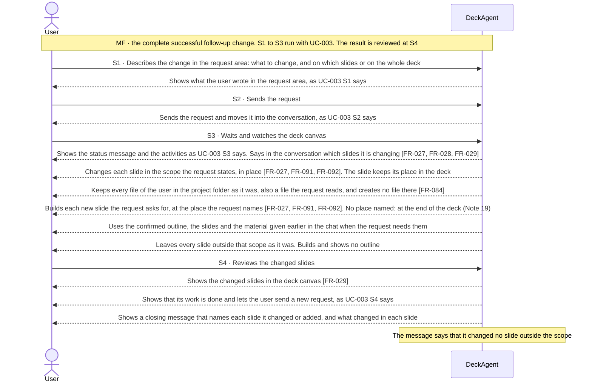

### Alternative Flows

#### A1 · Scope of the change is unclear

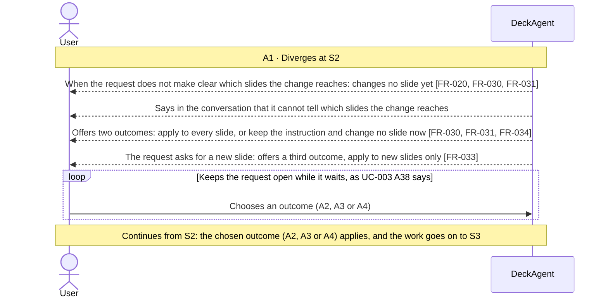

#### A2 · Apply the change to every slide

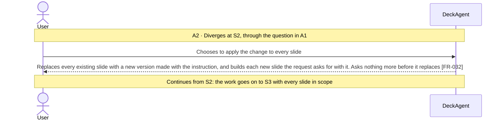

#### A3 · Apply the change to new slides only

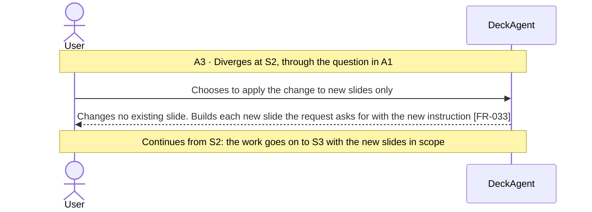

#### A4 · Keep the instruction for later

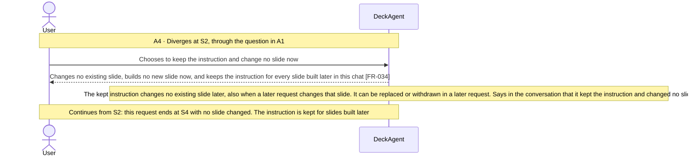

#### A5 · Request names a slide the system cannot match

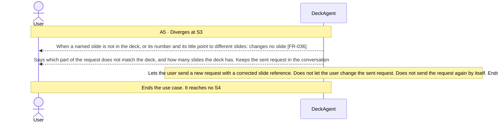

#### A6 · Ask what to change

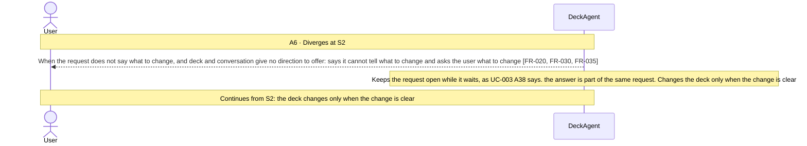

#### A7 · Stop while changing slides

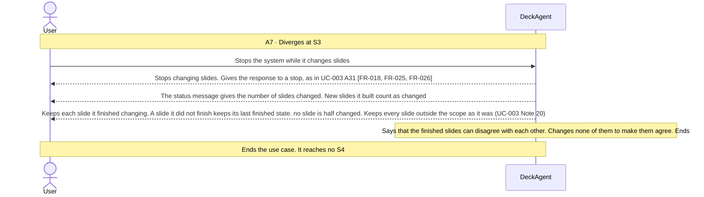

#### A8 · Change the deck's design

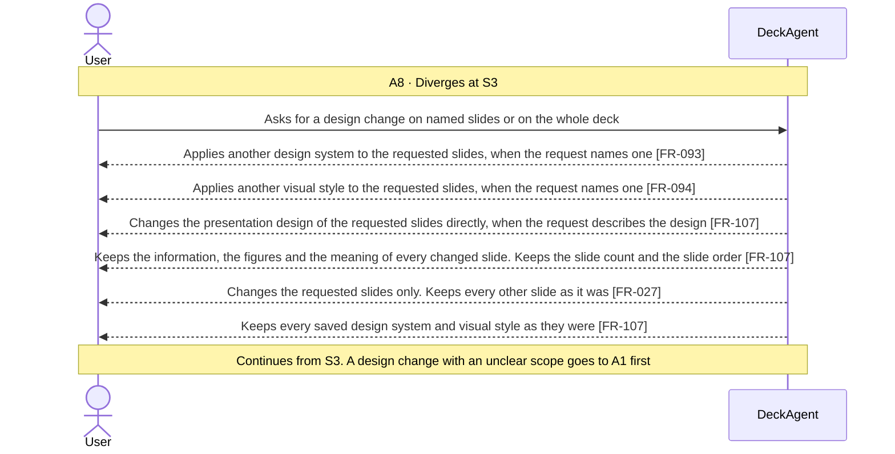

#### A9 · Change presenter notes

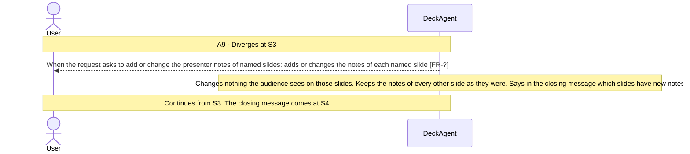

#### A10 · Offer directions for unclear feedback

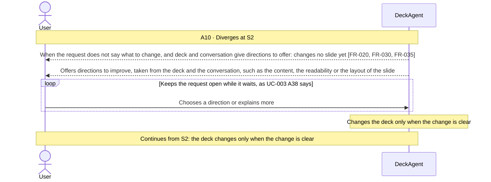

#### A11 · Work fails while changing slides

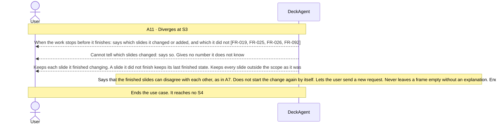

#### A12 · Use images on the changed slides

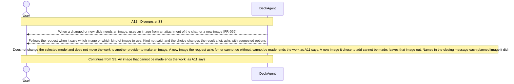

#### A13 · Requested design cannot preserve content

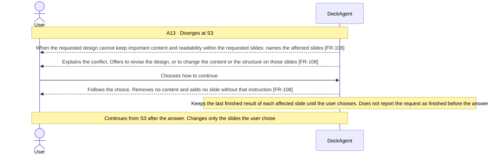

#### A14 · Unresolved design rule conflict

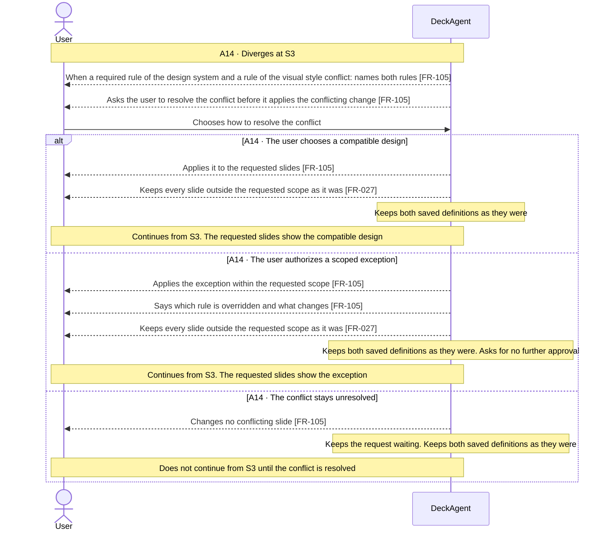

#### A15 · Explicit scoped design exception

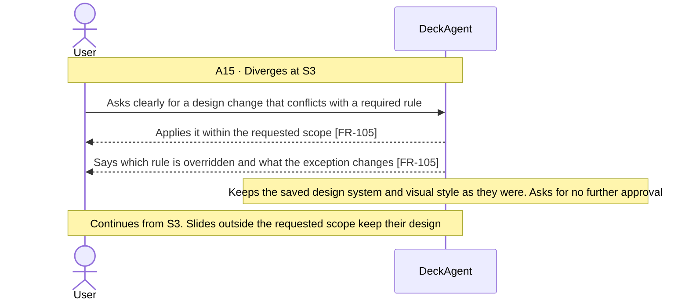

## Behavior constraints

- Content outside the requested change stays as it was, also when the change leaves the deck inconsistent (Notes 1, 4 and 13).
- A follow-up request never shows an outline (Note 2). The outline checkpoint applies to the first draft only.
- A request for another deck from this one, for another use, is UC-011. This use case changes the deck in place and makes no second deck (Note 12).

- **Postconditions:**
  - Main flow: the slides in the scope the request states show the change. Every other slide is as it was.
  - A7 and A11: each finished slide shows the change. Every other slide is as it was before the request.
  - A2: every slide is a new version made with the instruction.
  - A3: only new slides were added. Existing slides are as they were.
  - A4: no slide changed. The instruction is kept for later slides.
  - A13: each affected slide keeps its last finished result until the user chooses. No content is removed and no slide is added without the user's instruction.
  - The conversation holds the request and the closing message.
- **Minimal guarantee:** Whatever branch fails or is interrupted:
  - The request text is kept in the conversation.
  - Each slide is either as it was before the request or fully changed.
  - The user does not have to enter the request again.

## Notes

1. a request that names the slides it changes is applied in place. Every other slide stays as it was.
2. a follow-up request never shows an outline. The outline checkpoint applies to the first draft only. The internal data structure is a backend concern, not part of this use case.
3. a request that would change slides it does not name gets outcomes before any slide changes (A1 to A4). A request that asks for no new slide is not offered "new slides only". A clear request that reaches slides it does not name gets no outcomes first (Note 13).
4. the system protects every slide the request does not name. It does so even when the change leaves the deck inconsistent, for example a repeated number.
5. the user can choose another model for a follow-up request, as for any request (UC-003 A27): among the selectable models of every provider configuration. The selected model belongs to the chat (UC-003 Note 25).
6. One use case, not two. Both paths share the goal, the trigger, the preconditions and the result. The user does not choose the path. The system chooses it from the request. The whole-deck path adds one decision, so it is an alternative flow. A clear whole-deck request is in the main flow. Only an unclear scope adds the decision (A1, Note 13).
7. Changes the user makes by hand, without asking the system, are a different goal. They are UC-007. Note 1 covers the main flow. There, a change by hand on a slide the request does not name stays.
8. A request uses the material the user gave earlier in the chat as context for its changes and new slides. An example is a file attached to an earlier request. The material changes no slide by itself.
9. A request is not all-or-nothing for the whole deck. An unfinished change never replaces the last finished state of a slide (UC-003 Note 20).
10. A failure or a stop at S3 also runs the flow of UC-003 for it: A11, A18, A19 or A31. This use case adds only what is specific to the deck. A7 does so for a stop, and A11 does so for a failure.
11. A request that changes the presentation design of slides it does not name goes to A1, like any such change. Only a design change with an unclear scope goes to A1 (Note 13). A8 adds what is specific to a change of design. Content and design can change in one request. A8 then applies to the design only.
    - A design change can apply another design system, apply another visual style, or change the design directly (A8).
    - It changes no saved design system and no saved visual style.
    - It keeps the information, the figures and the meaning of each changed slide. A design that cannot fit the content gets the choices of A13.
    - A conflict between a required rule and the chosen visual style gets the choices of A14. An explicit exception applies within its scope (A15).
12. A request for another deck from this one, for another use, is UC-011. This use case changes the deck in place and makes no second deck.
13. a follow-up request changes what the user asks, at the scope the user states.
   - It can change one slide, several slides or the whole deck.
   - Clear change and clear scope: the system applies it without asking for approval first.
   - Unclear change or unclear scope: the system asks before it changes any slide.
   - Content outside the requested scope stays as it was (Notes 1 and 4).
14. feedback that does not say what to change. Two levels are kept apart (A10, A6).
   - Guided clarification (A10): the system uses the deck and the chat to offer directions to improve. Example: "Slide 3 doesn't look right" gets content, readability or layout.
   - The user chooses a direction or explains more. Only then does the deck change.
   - Basic clarification (A6): the system asks what to change. It does so when it has no grounded direction to offer.
   - A10 and A6 cover feedback with or without a slide named.
15. Stop, failure and undo of a follow-up request: UC-003 Notes 17 to 20 hold the rules. A7 and A11 follow them. A finished request is not undone. The user who dislikes its result sends a new request here (UC-008 Note 5).
16. a new request after a first draft that stopped or failed is a follow-up request here (UC-001 A10, A11).
   - It uses the confirmed outline and the finished slides as context.
   - This holds also when no slide was finished.
   - The request shows no second outline.
   - The first draft does not count as finished.
17. Clarifying questions (A1, A6, A10): the answer is part of the same request. The request stays open while the system waits (UC-003 Note 22).
18. whole-deck refinement, not full deck regeneration.
   - A follow-up request can change one slide, several slides or every slide (Note 13).
   - The product has no separate workflow for full deck regeneration, which would change the topic, purpose or structure of the deck completely in this chat.
   - Whether such a request gets a question, and what the system offers then, are questions in the design backlog of the ideal spec. A1 to A4 settle an unclear scope, not a new topic.
   - It adds no outline checkpoint (Note 2), no second deck in the chat (Note 12) and no undo of a request (UC-008 Note 5).
19. large changes, new slides, kept instructions and partial decks.
   - A clear follow-up request can change the deck a lot. The system changes this deck. It makes no second deck and drafts no new outline.
   - When it is truly unclear whether the user wants to replace the deck or refine it, the system asks first (A1, A6, A10).
   - Content outside the requested change stays as it was (Note 13). Note 18 still holds: the product has no separate workflow to make the deck again.
   - A new slide with no place named goes at the end of the deck (S3).
   - An instruction kept for later slides applies to slides built later (A4). It changes no existing slide by itself, also when a later request changes that slide. A later request can replace or withdraw it. The user can also ask for the same change on existing slides.
   - After a stop or a failure, the system keeps the finished slides (UC-003 Note 20). The deck can then disagree with itself.
   - The system says so, and does not claim that it checked the slides. It does not change a finished slide to make the deck agree (A7, A11).
   - The number of slides finished or changed includes new slides. A system that does not know the number says so and gives none.
