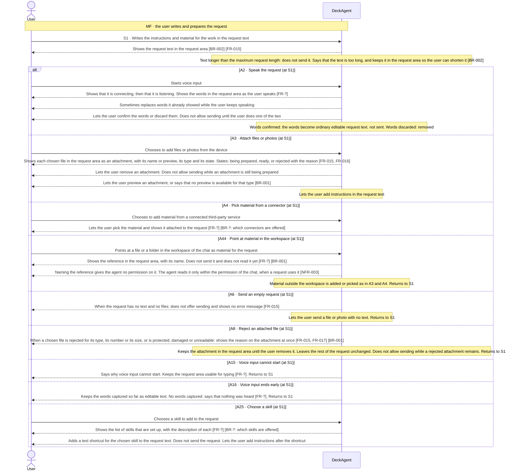
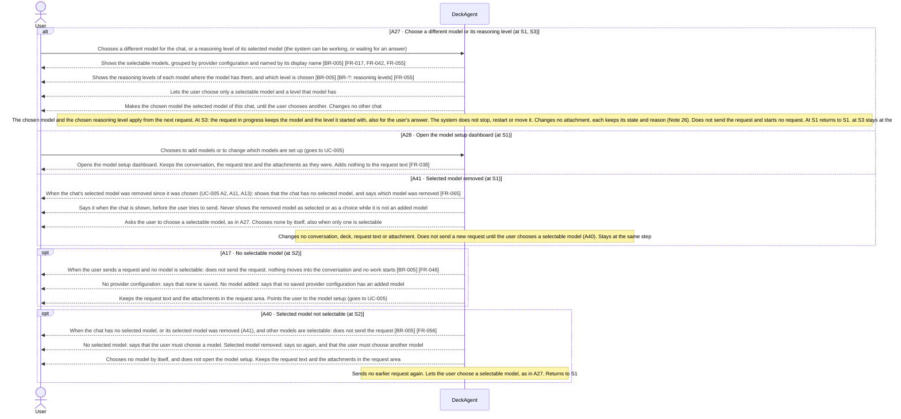
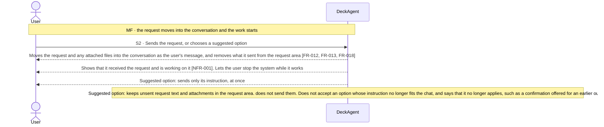
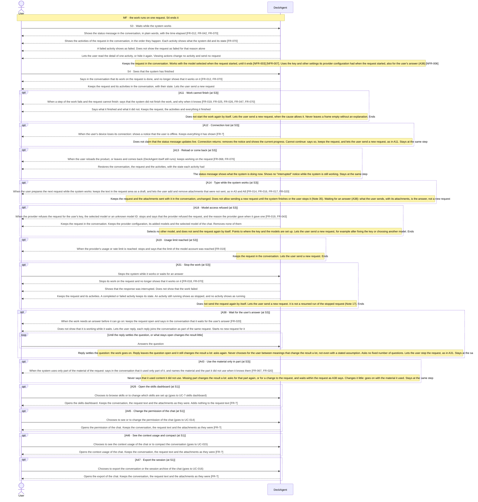

Updated at: 25-10-2026

<!-- A use case models the ideal product. Active interactions describe the product-level
     exchanges DeckAgent is designed to perform; their IDs (MF, Sx, Ax) stay stable and are
     cited by other files (UCG-03, UCG-10). A Closed flow would be listed briefly; this use
     case records none. A version file under docs/versions/ names the flows it takes; the
     use case holds no versions field (UCG-09). Write in plain English: docs/spec/_STYLE.md (UCG-11).
     Write intent and response, never interface (UCG-13, _STYLE rule 11). -->

## Goal

The user wants the system to do work for them. The user gives the system what it needs, such as text, files and a choice of model, sends the request, and waits while the system works. The interactions are the same whatever the system is asked to do; what the system produces is not part of this use case. Every use case that includes this one describes it.

## Preconditions

- **Trigger:** The user starts a request in the request area, or chooses a suggested option.
- **Preconditions:** The system is not working on another request.
- **Evidence:** [assumed]

## Active interactions

Every flow below is Active in the ideal product; this use case records no Closed flow. Nothing here says which version takes a flow.

How to read the interactions:

- The main flow takes the request text the user writes (S1). Each other way to enter input is a flow (A2 to A4, and A25). Voice, files, connectors and skill shortcuts are different ways to complete S1 (Note 1).
- Each request runs with the selected model of its chat and its reasoning level (Note 25). Choosing them is a separate behavior (A27).
- The main flow sends a request in a chat whose selected model is selectable. A request without one is not sent (A17, A40, Note 27).
- The agent of the chat works within the permission of the chat (UC-014) [NFR-003]. Pointing at material in the workspace is A44.
- Seeing the context usage and compacting the conversation is UC-015. Exporting the conversation and the session archive is UC-016.
- A suggested option is another way to send an instruction (Note 23). It follows the same path as the same instruction typed.
- The system works on one request at a time. A request ends when the system finishes its work on it (S4).
- A4 is designed into the product. Which version takes it is a scope decision, not a product-design status.

### Entering the request (S1)

- **MF S1:** [observed: claude-report (the start invites the user to type or paste ideas)] [observed: napkin-report (the start offers a place to type a request)]
- **A2:** [observed: claude-report (voice dictation)] [observed: napkin-report (offers no voice input)] [inferred: claude-report (voice input replaces the send action with confirm and discard, so sending is not offered meanwhile)] [assumed: discarding the words was not tried in the recording]
- **A3:** [observed: claude-report (the product offers adding files or photos among other additions)] [observed: napkin-report (adding goes straight to choosing files on the device)] [observed: claude-report (attached files show in the request area and in the conversation, with a preview)] [observed: napkin-report (document attached: the file shows an uploading state, then a preparing state)]
- **A4:** [observed: the product lists third-party services, such as a cloud drive and a workspace tool, with an on or off setting for each service, an entry to add material from each, and an entry to change the connected services] [assumed: the product showed these entries, not the result of picking material]
- **A6:** [observed: claude-report (empty request: sending is not available, reported by the user; a file alone can be sent)] [observed: napkin-report (sending looks unavailable while the request is empty)]
- **A8:** [observed: claude-report (file over the size limit: the reason shows on the file and in a notice)] [observed: napkin-report (a protected deck file was rejected when attached, with a general message and a way to remove it; the image does not show whether sending is blocked)] [assumed: a damaged file]
- **A15:** [assumed]
- **A16:** [assumed]
- **A25:** [observed: claude-report (the skills list shows skill names with a description for each, and no on or off setting)] [observed: owner report (choosing a skill adds a text shortcut to the request text); not recorded] [assumed: where the shortcut goes when the request text already has words]
- **A44:** [assumed]

### Choosing a model for the chat (S1 to S3)

- **A27:** [observed: owner report (the user chooses among the models that are set up; the chat then uses the chosen model); not recorded] [assumed: choosing a model does not send the request and keeps the request area as it was] [observed: owner report (a model chosen while the system works applies to the next request only and does not interrupt the work in progress); not recorded]
- **A28:** [observed: owner report (the option to add or change models opens the model setup dashboard; the request text and files stay); not recorded]
- **A41:** [assumed]

### Sending the request (S2)

- **MF S2:** [observed: claude-report (on send, the product offers a way to stop it)] [observed: napkin-report (on send, the product offers no way to stop it)] [observed: napkin-report (outline: the product offers ready-made revision requests that send their own text)]

### While the system works, and its end (S3 and S4)

- **MF S3:** [observed: claude-report (the progress line says what the product is doing and shows the time elapsed)] [observed: napkin-report (the status line names the phase and shows the time elapsed)]
- **MF S4:** [observed: claude-report (when the work finished, a final message appeared and sending was offered again)]
- **A12:** [observed: claude-report (connection lost during the wait: offline notice, the run continues)] [observed: napkin-report (not recorded)]
- **A13:** [observed: claude-report (reload during the wait: the run continues, but a brief "interrupted" notice shows, not adopted)] [observed: napkin-report (not recorded)]
- **A14:** [observed: claude-report (second message during the wait: accepted at once and added to the same deck, not adopted)]
- **A26:** [observed: claude-report (the skills list offers one entry to browse skills and one to change them; each opens a place for setting up skills while the chat stays open)] [assumed: the request area keeps its text and files while the dashboard is open]
- **A31:** [observed: claude-report (stop during the wait: the progress stopped, a notice said the response was interrupted and offered to edit the request or try again, and sending was offered again)] [observed: napkin-report (offers no way to stop it)] [assumed: the same holds for every use case that includes this one]
- **A38:** [assumed: what the user sees while the system waits]
- **A43:** [observed: claude-report (a closing message listed what a chart picture did not show, so two parts of the reading were left out)] [assumed: the rest]
- **A45:** [assumed]
- **A46:** [assumed]
- **A47:** [assumed]

## Behavior constraints

- The system works on one request at a time in each chat, also while it waits for the user's answer (A38, Note 22). Three ways of sending stay apart: an answer goes to the request that waits (A38); after a stop or a failure the user sends a new request (A31, A11); while the work runs, no new request can be sent (A14).
- A stop or a failure keeps finished work, and an unfinished change never replaces the last finished state of its result (Notes 19 and 20).

Proposals, to be confirmed against recordings.

- **Postconditions:**
  - The request and its attachments are in the conversation.
  - The system has finished its work on the request.
- **Minimal guarantee:** Whatever branch fails or is interrupted:
  - The request text and attached material are kept. They stay in the conversation if the user sent them, and in the request area if not.
  - The user does not have to enter anything again.
- **Evidence:** [assumed]

## Product evidence

### Claude Slide Design

- **Coverage:** observed
- **Research card:** [claude-deck-generation-behavior](../../research/use-cases/claude-slides-design/claude-deck-generation-behavior.md)
- **Difference:**
  - Offers voice input, files and photos, connectors, skills and a choice of model.
  - Offers a way to stop the system and shows its progress while it works.
  - Kept working after a reload or a lost connection.
- **Updated at:** 08-10-2026

### Napkin AI

- **Coverage:** observed
- **Research card:** [napkin-ai-deck-generation-behavior](../../research/use-cases/napkin-ai/napkin-ai-deck-generation-behavior.md)
- **Difference:**
  - Offers adding files from the device. The team saw no voice input and no choice of model.
  - The team saw no way to stop the system.
  - The team did not record a reload or a lost connection.
  - A protected deck file was rejected when it was attached. The message was general and did not say why.
- **Updated at:** 09-10-2026

## Decisions needed

Resolved — the owner decisions are recorded in Notes. Each entry below keeps its old number and names its note:

1. Settled (owner, 2026-10-13): finished slides that can disagree after a stop or a failure (Note 35).
2. Settled (owner, 2026-10-13): the user can add and remove unsent attachments for the next request while the system works (A14, Note 35).
3. Settled (owner, 2026-10-13): request text over the maximum length is not sent and stays for the user to correct (S1, Note 35).

## Notes

1. Input type does not create a new use case. Text, voice, files, connectors and skill shortcuts are different ways to complete S1. The goal and the result are the same.
2. Files come from the device (A3). Third-party sources (A4) are a separate way to complete S1.
3. Claude also offers a voice conversation that is separate from voice input. The user reported this, and the team did not record it. It is not a way to complete S1. It may become its own use case.
4. Skills are an input helper. Choosing a skill only adds a text shortcut to the request text (A25). After that, the shortcut is ordinary request text, as in S1. Plugins and Research are out of scope for this use case.
5. Design decision (owner, 2026-10-08): A8 blocks sending while a rejected attachment remains. The team did not test this in Claude Slide Design, and DeckAgent does not copy it.
6. A17 and A28 go to UC-005, where the user sets up models. A26 goes to a use case that is not written yet. The topic in brackets after `UC-?` names it.
7. Design decision (owner, 2026-10-08): the user can choose a model when preparing any request in the chat, including a follow-up request. The user can also choose it while the system works. Sending is not offered then (A14), so the choice only sets the model for the next request. Choosing a model adds no input. It sets which model runs the request, so A27 and A28 are not ways to complete S1. Replaced in part by Note 25 (owner, 2026-10-12): A27 checks no attachment again, and A20 is retired. Replaced in part by Note 26 (owner, 2026-10-12). Replaced in part by UC-005 Notes 9 and 10 (owner, 2026-10-12), and by Note 25: the selected model belongs to the chat, and the user chooses among the selectable models of every provider configuration.
8. Design choice for an ADR proposal: A12 and A13 promise that the user comes back to the same state after losing the connection or reloading. This constrains how the work runs and where its state is kept.
9. Accessibility (keyboard operation, announcements to assistive technology, zoom) is not written into steps. NFR-013 covers keyboard use and screen readers in every part of the interface, so this use case does not cite it.
10. A stop is offered at S2. A31 holds the response to a stop that is the same for any work. What the work produced before the stop depends on the work. The use case that includes this one says it. Until 2026-10-11, A31 also offered to try again, and the use case that includes this one said what ran again. Since then, A31 offers a new request (Note 17). Whether a stop takes effect at once is open.
11. The flows A2 to A4, A6, A8, A15 to A17 and A25 to A28 keep the IDs they had before this use case was split out. So do A11 to A14, A18 and A19. A20 kept its ID too, until it was retired (Note 26). UC-001 has flows with the same IDs for its steps after the request ends. Those are separate flows that share the situation, not the flow. IDs are never renumbered. A31 is new here. It takes a number that neither this use case nor UC-001 has used. So do A40 and A43.
12. Design decision (owner, 2026-10-09): a file is rejected as early as possible. A file that is protected, damaged or unreadable is rejected when it is attached (A8). It is not rejected when the request is sent.
13. Retired (owner, 2026-10-09): A1 (type or paste text). Writing the request text is the main flow (S1), so it is no longer a branch. Its response and evidence moved to S1. The ID is never reused.
14. Design decision (owner, 2026-10-09): S4 is the normal end of a request. It says only that the work is done. The use case that includes this one says what the work produced. Another use case can reuse a response here, for example "as UC-003 S4 says". Such a reference reuses the wording only. It does not call this use case and takes no flow.
15. To move (owner, 2026-10-10): three responses of A11 describe what the work produced, not the request. They are "Says what it finished and what it did not", "Keeps … everything it finished" and "Never leaves a frame empty". They belong to the use cases that include this one. They stay here until those use cases describe them. They set no rule for partial output across DeckAgent. Since 2026-10-11, UC-001 A11 and UC-002 A11 describe them for their work. UC-011 does not yet, so the responses stay here. Replaced in part by Note 20 (owner, 2026-10-11): a stop or a failure keeps finished slides only.
16. A11 covers a provider that cannot be reached. A12 still covers a device that loses its connection. On a local install, these can be the same event. Which flow applies is open (Note 8).
17. Design decision (owner, 2026-10-11): after a stop, the user carries on through the conversation (conversation continuation).
   - The system keeps the conversation and the work it finished, as Note 20 says.
   - The user can send a new request in the same chat. It uses the current deck as context.
   - The new request is not a resumed run of the stopped request. The system never sends the stopped request again by itself.
   - Example: the user stops after three of five slides, then asks to complete the remaining slides. That is a new request.
   - Considered: a continue action the system offers, a separate try-again action, editing the request, and resuming the stopped run. Each is a future candidate (Note 18).
   - Why: it keeps the behavior small. The user can still carry on the work through the conversation.
   - A31, UC-001 A10 and UC-002 A7 follow this note since 2026-10-11. Before, A31 offered to edit the request and to try again, as an owner report described for the first draft. UC-001 A10 offered to try again. Notes 17 to 22 take no flow. A version file takes a flow; a note never does.
18. Preferred, not selected (owner, 2026-10-11): a later model for three actions after a stop or a failure. It uses four terms.
   - R is the original request. R' is a revised request.
   - D0 is the deck before R started. D1 is the deck R left when it stopped.
   - Try again runs R from D0.
   - Continue runs the remaining work of R from D1. It does not repeat finished changes.
   - Edit the request runs R' from D0.
   - Why: the owner wants the same starting rule for the three actions, not three unrelated features.
   - This is a direction, not a selected behavior. It names no checkpoint, event log or runtime. How deck and work states are kept is an ADR matter (Note 8). Resuming the stopped run itself (true resume) is a separate future candidate. It is a property of how work runs. UC-002 open questions 1 to 3 stay open. This model is their preferred answer.
19. Design decision (owner, 2026-10-11): when a request fails, the system reports the failure and keeps finished work (E1).
   - It keeps the conversation and the work it finished, as Note 20 says.
   - It does not start the request again by itself.
   - The user can send a new request in the same chat, when the cause of the failure allows it.
   - The system offers no separate try-again action after a failure.
   - Considered: a try-again action the user starts (E2), recovery by the system (E3), and an automatic try again. E3 and an automatic try again are not selected. A try-again action is a future candidate, with the meaning in Note 18.
   - Why: no repeated work or model cost that the user did not expect, and finished results stay. A new request after a failure works as after a stop (Note 17).
   - A11, A12, A18 and A19 follow this note since 2026-10-11. So do UC-001 A11, A12, A18 and A19, and UC-002 A11. Before, these flows offered to try again.
20. Design decision (owner, 2026-10-11): a stop or a failure keeps finished slides only.
   - The system keeps each slide it finished.
   - An unfinished change never replaces the last finished state of that slide.
   - Slides outside the requested change stay as they were. The conversation stays.
   - Considered: keep every partial change; take back the whole request. Neither is selected.
   - Why: a half-changed slide can be inconsistent or unusable. The user keeps finished work and never sees an unfinished change as a result.
   - Known limit: finished slides can still disagree with each other. This is open (Open questions). The request is not made all-or-nothing. Note 35 settles what the system says (owner, 2026-10-13).
   - This confirms the slide part of UC-002 Note 9. It replaces in part Note 15 here: a rule now holds for slides.
21. Design decision (owner, 2026-10-11): the user can attach files, in a limited set of formats.
   - The system uses the material it can read.
   - It never says that it read content it could not read.
   - Considered: request text only. Not selected.
   - Why: the user can make a deck from source documents, not only from pasted text.
   - Which formats, numbers and sizes are accepted is open [BR-001]. The formats and how the limits count were settled on 2026-10-13 (Note 35).
   - What the system says about a file it can read only in part was open. Note 32 settles it (owner, 2026-10-13).
22. Design decision (owner, 2026-10-11): the answer to a question the system asks is part of the same request (A38).
   - The request stays open while the system waits.
   - The answer starts no new request.
   - Considered: the answer as a new request. Not selected.
   - Why: not recorded.
   - Three ways of sending stay apart. An answer goes to the request that waits (A38). After a stop or a failure, the user sends a new request (A31, A11). While the work runs, a new request cannot be sent (A14).
23. Design decision (owner, 2026-10-12, extended the same day): suggested options.
   - A suggested option is a shortcut for an instruction. The system offers options when the user has a decision to make. It does not offer them after every reply.
   - Choosing an option sends its instruction at once (S2). The user does not send it again. The instruction shows in the conversation as the user's message.
   - The instruction has the same result as the same instruction typed. It follows the three ways of sending in Note 22.
   - The user can always type their own instruction instead.
   - Unsent request text and unsent attachments stay in the request area. They are not sent with the option, and they are not discarded.
   - The user can send or remove them later. Files sent with earlier requests are not affected. This settles the earlier open question on attachments.
   - An option can be chosen only while its instruction still fits the chat. How the system checks this is not part of this use case.
   - Stop, a new chat, earlier chats and model setup are actions of the product. They are not instructions to the system.
   - Why: not recorded.
   - This note adds no flow. UC-001 Note 29 applies it to the outline.
24. Design decision (owner, 2026-10-12, clarified the same day): a reply that leaves a question open stays in its request (A38).
   - The system checks whether the reply settles the question.
   - Settled: the work goes on. Enough information already: the system asks nothing more.
   - Not settled, and it still changes the result a lot: the system asks again. A later question need not be narrower.
   - Meanings that lead to very different results: the system never chooses between them for the user. A stated assumption does not make such a choice allowed.
   - A detail that does not change the result a lot: the system goes on, as the including use case says. It states an assumption where that use case asks for it.
   - A question the user skips (UC-001 A32) is the user's choice. It is not a choice the system makes.
   - There is no fixed number of questions. The request stays active, and the user can stop it at any time (A31).
   - The use case that includes this one says what it asks. This use case keeps the request open and takes the replies.
   - Why: not recorded.
   - This settles the earlier open question on a reply that does not answer. A14 and Note 22 agree with it. A38 follows this note since 2026-10-12. This note takes no flow.
25. Design decision (owner, 2026-10-12, clarified the same day): the selected model belongs to each chat.
   - The model the user chooses in a chat becomes its selected model. Later requests in that chat use it, until the user chooses another.
   - Choosing a model in one chat changes no other chat. Reopening a chat keeps its selected model (UC-006).
   - A new chat starts with the most recently selected model that is still selectable (UC-012). An earlier selection counts when a later one is no longer selectable. After that, the chat keeps its own selected model.
   - The user can choose a model while a request is active, also one that waits for an answer. That request keeps the model it started with.
   - The new choice applies to the next request. Choosing does not stop, restart or move a request, and starts no request.
   - A selected model can stop being selectable. Examples: the user removes it, or changes the provider of its provider configuration (UC-005 A1, A2). The system never replaces it by itself. The user chooses a selectable model before a new request starts (A40).
   - A40 differs from no selectable model at all (A17). A provider failure, a reached limit or a refused key stay as A11, A18 and A19 say.
   - Replaces in part Note 7 and UC-005 Note 8. Clarified the same day for several provider configurations (UC-005 Note 10). Why: not recorded. A27 and A40 follow this note since 2026-10-12. This note takes no flow. Replaced in part by Note 28 (owner, the same day): a change of provider is no longer allowed.
   - Since 2026-10-25: the chat also holds a reasoning level of its selected model (A27). A request keeps the level it started with, as it keeps the model, and the new level applies from the next request (UC-005).
26. Design decision (owner, 2026-10-12): DeckAgent decides which attachments it accepts.
   - The attachment rule says which files the system accepts [BR-001]. The user never changes the model to make an attachment acceptable.
   - The system rejects a file it does not accept when the file is added (A8, Note 12). So it does for a protected, damaged or unreadable file.
   - Choosing another model changes the state of no attachment (A27).
   - The system prepares the content of accepted attachments for the work. It never says that it read content it could not use (Note 21).
   - This does not promise that every model understands every kind of content.
   - Retired: A20 (attach a file the model cannot read). It rejected a file of a type that the selected model could not read. The ID is never reused.
   - Replaces in part Note 7. This settles the earlier open question on a rejected attachment after a change of model. Why: not recorded. A27 follows this note since 2026-10-12. This note takes no flow.
27. Design decision (owner, 2026-10-12): a request with no model to run it, and a provider that refuses a request.
   - A request is checked before it is sent. Without a selectable selected model, nothing moves into the conversation. The request text and the attachments stay in the request area.
   - No model is selectable at all (A17). No provider configuration is saved, no model is added, or no added model is selectable. The system says which, and points to the model setup.
   - Other models are selectable, but the chat has no selectable selected model (A40). The system asks the user to choose one.
   - A provider that refuses a request for its key, its access or its model ends that request (A18). This is a failed request, not a missing model.
   - After a refusal, the system keeps the provider configuration, its added models and the selected model of the chat. It selects no other model and does not try again.
   - A model catalog the system cannot get is not a failed request (UC-005 A7).
   - Why: not recorded. A17, A18 and A40 follow this note since 2026-10-12. This note takes no flow. Replaced in part by Note 28 (owner, the same day). No added model selectable is no longer a case of its own.
28. Design decision (owner, 2026-10-12): model provider management (UC-005 Note 11). Replaces in part Notes 25 and 27.
   - A provider configuration keeps its provider ID. A change of provider is no longer allowed, so it ends no selection.
   - Each added model of a saved provider configuration is selectable [BR-005]. So A17 tells two cases apart: no provider configuration, and no added model.
   - A selected model stops being selectable when the user removes it (UC-005 A2). So does one whose provider configuration the user deleted (UC-005 A11). A40 then applies.
   - A new provider configuration with the same provider ID makes no earlier selection valid again.
   - The user cannot delete a provider configuration that an active request uses (UC-005 A12). The request keeps its model until it ends (S3).
   - A changed key or base URL keeps the selected model. A refusal after it is still a failed request (A18).
   - Why: not recorded. A17 and A40 follow this note since 2026-10-12. This note takes no flow.
29. Design decision (owner, 2026-10-12): settings of an active request, and a removed selected model.
   - A request uses the key, the base URL and the other settings its provider configuration had when it started (S3).
   - It keeps them until it ends, also for the user's answer (A38). Settings saved later apply to requests that start after.
   - A change of settings stops, restarts, moves and sends again no request.
   - A selected model can be removed in three ways (UC-005 A2, A11, A13). The user removes it, deletes its provider configuration, or confirms a restore of default models.
   - The chat then has no selected model. The system says so when the chat is shown, not only when the user sends (A41).
   - The system chooses no other model, also when only one is selectable. The user chooses before a new request starts (A40).
   - A model added again does not become the selected model of a chat again. Nor does a model of a provider configuration added again.
   - A provider that refuses a model ends the request (A18). It removes no added model and no selected model.
   - Replaces in part Notes 25, 27 and 28. Why: not recorded. S3, A40 and A41 follow this note since 2026-10-12. This note takes no flow.
30. Design decision (owner, 2026-10-13): reloading or closing the interface while DeckAgent runs (A13).
   - While the DeckAgent program runs, reloading or closing its Local Web interface does not stop the active request.
   - When the user opens the interface again, the system shows the current state of the request and of the chat.
   - When the program itself ends, a running request does not go on after it opens again (UC-006 A6 and Note 8).
   - A12 stays as A12 says. This settles the part of Note 8 on reloading. Why: not recorded.
31. Design decision (owner, 2026-10-13): the status message (S3).
   - The status message shows the current state and part of the work.
   - It need not change when nothing new happens. The time elapsed still shows.
   - The system shows no progress that did not happen.
   - This settles the topic of the earlier marker on how often the status changes. No quality requirement sets a rate of change. Why: not recorded.
32. Design decision (owner, 2026-10-13): material used only in part (A43).
   - The system never says that it used all the material when it used only part.
   - It tells the user the real limit.
   - When needed, it asks the user to change the request or to give the content again.
   - This holds for a file read in part, and for a conversation and material that are more than the work takes at once. No size is promised.
   - This settles UC-001 open question 9 and the open part of Note 21. Why: not recorded.
33. Design decision (owner, 2026-10-13): instructions in attachments.
   - An attachment can hold instructions on the content or on how to build the slides. The agent can use them within the request.
   - Such instructions give the agent no access of its own. They never get around the limits on data and security [NFR-003].
   - Why: not recorded. This note takes no flow.
34. Architecture research items (owner, 2026-10-13). These are open for architecture research. No product decision is needed now.
   - Several open views of the interface, several windows and several running copies of DeckAgent. The rules on one active request and on changing chats still hold.
   - A work loop with no bound, and a request whose provider sends nothing. Stopping the request is not enough as the only answer.
   - Use of the model, of money and of the computer by one request.
   - Images (UC-001 Notes 35 and 38):
     - How the system makes a new image.
     - Whether making images belongs to the selected model, to a tool of the agent or to another part.
     - How the system knows that a valid way to make an image is available for a request.
     - What the system does with a model that cannot take images as input.
     - How images reach the agent within the limits on agent access and on user content egress [NFR-003] [NFR-007].
     - How the real image capabilities of each provider and model are checked.
   - How a saved key is protected from other programs on the computer.
35. Design decisions (owner, 2026-10-13): partial decks, request text, attachments and the next request.
   - After a stop or a failure, the finished slides can disagree with each other. The system says so, without claiming that it checked. It does not change a finished slide to make them agree. The use cases that include this one show it (UC-001 A10, UC-002 A7).
   - Request text longer than the maximum length is not sent. The system says so and keeps the text for the user to correct (S1) [BR-002].
   - Only the request text counts toward that length. The content of attachments does not. The unit and the maximum wait for technical evidence.
   - The accepted file types are set [BR-001]. Accepting a deck file adds no export, no import as editable slides and no direct editing.
   - The number of new attachments counts for each request, and the size for each file. Attachments sent with earlier requests do not count again. The values wait for prototype measurements.
   - While the system works, the user can prepare the next request: text, and attachments not yet sent (A14). The next request still cannot be sent until the active request ends.
   - Attachments sent with a request stay with it. Preparing the next request changes no input of the active request.
   - While the system waits for an answer (A38), what the user sends, with its attachments, is that answer. This adds no second active request.
   - This settles open questions 1 to 3. S1, S2 and A14 follow this note since 2026-10-13. Why: not recorded. This note takes no flow.
