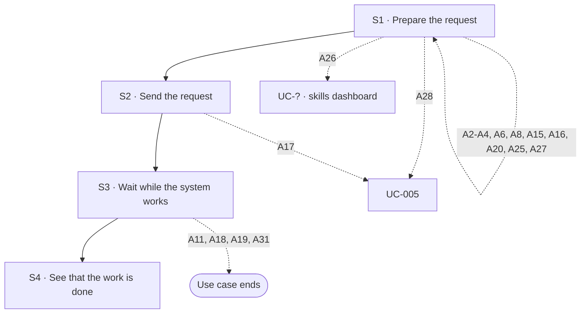

## Flow at a glance

<!-- BEGIN generated: use-case-flowchart -->

*Solid arrows are the main flow. Dotted arrows are alternative flows, labelled with their IDs.*
*Not drawn (the flow stays at the same step): A12, A13, A14, A27 and A38.*
<!-- END generated: use-case-flowchart -->

## Situation and goal

- The user wants the system to do work for them. The user gives the system what it needs, such as text, files and a choice of model.
- The user sends the request and waits while the system works.
- The steps are the same whatever the system is asked to do.

## Trigger and preconditions

- **Trigger:** The user starts a request in the request area, or chooses a suggested option.
- **Preconditions:** The system is not working on another request.
- **Evidence:** [assumed]

## Main flow

- The main flow takes the request text the user writes (S1). Each other way to enter input is an alternative flow (A2 to A4, and A25).
- The user can choose the model for any request in the chat, also while the system works on an earlier one (A27).
- A suggested option is another way to send an instruction (Note 23). It follows the same steps as the same instruction typed.
- The system works on one request at a time.
- A request ends when the system finishes its work on it (S4).
- What the system produces is not part of this use case. Every use case that includes this one describes it.

### S1 · Prepare the request

- **User:** Writes the instructions and material for the work in the request text.
- **System:**
  - Shows the request text in the request area [BR-?: maximum request length].
- **Reqs:** FR-?
- **Evidence:** [observed: claude-report (the start invites the user to type or paste ideas)] [observed: napkin-report (the start offers a place to type a request)]
- **Updated at:** 09-10-2026

### S2 · Send the request

- **User:** Sends the request, or chooses a suggested option.
- **System:**
  - Moves the request and any attached files into the **conversation** as the user's message.
  - Removes what it sent from the request area.
  - Shows that it received the request and is working on it [NFR-?: feedback after sending].
  - Lets the user stop the system while it works.
  - Suggested option: sends only its instruction, at once.
  - Suggested option: keeps unsent request text and attachments in the request area. Does not send them.
  - Does not accept an option whose instruction no longer fits the chat. An example is a confirmation offered for an earlier outline.
- **Reqs:** FR-?
- **Evidence:** [observed: claude-report (on send, the product offers a way to stop it)] [observed: napkin-report (on send, the product offers no way to stop it)] [observed: napkin-report (outline: the product offers ready-made revision requests that send their own text)]
- **Updated at:** 12-10-2026

### S3 · Wait while the system works

- **User:** Waits.
- **System:**
  - Says in the conversation, in plain words, what the system is doing. The **status message** shows the time elapsed [NFR-?: how often the status changes].
  - Keeps the request in the conversation.
- **Reqs:** FR-?
- **Evidence:** [observed: claude-report (the progress line says what the product is doing and shows the time elapsed)] [observed: napkin-report (the status line names the phase and shows the time elapsed)]
- **Updated at:** 08-10-2026

### S4 · See that the work is done

- **User:** Sees that the system has finished.
- **System:**
  - Says in the conversation that its work on the request is done.
  - No longer shows that it is working on the request.
  - Keeps the request in the conversation.
  - Lets the user send a new request.
- **Reqs:** FR-?
- **Evidence:** [observed: claude-report (when the work finished, a final message appeared and sending was offered again)]
- **Updated at:** 09-10-2026

## Alternative flows

### A2 · Speak the request

- **At:** S1
- **End:** Returns to S1
- **When:** The user starts voice input.
- **System:**
  - Shows that it is connecting, then that it is listening.
  - Shows the words in the request area as the user speaks.
  - Sometimes replaces words it already showed while the user keeps speaking.
  - Lets the user confirm the words or discard them.
  - Does not allow sending until the user does one of the two.
  - Words confirmed: turns the words into ordinary editable request text. Does not send them.
  - Words discarded: removes the words just spoken.
- **Reqs:** FR-?
- **Evidence:** [observed: claude-report (voice dictation)] [observed: napkin-report (offers no voice input)] [inferred: claude-report (voice input replaces the send action with confirm and discard, so sending is not offered meanwhile)] [assumed: discarding the words was not tried in the recording]
- **Updated at:** 08-10-2026

### A3 · Attach files or photos

- **At:** S1
- **End:** Returns to S1
- **When:** The user chooses to add files or photos from the device.
- **System:**
  - Shows each chosen file in the request area as an **attachment**.
  - Each attachment shows its name or a preview, its type and its state. The state is being prepared, ready, or rejected with the reason.
  - Lets the user remove an attachment.
  - Does not allow sending while an attachment is still being prepared.
  - Lets the user preview an attachment, or says that no preview is available for that type [BR-?: accepted file types, number and size of attachments].
  - Lets the user add instructions in the request text.
- **Reqs:** FR-?
- **Evidence:** [observed: claude-report (the product offers adding files or photos among other additions)] [observed: napkin-report (adding goes straight to choosing files on the device)] [observed: claude-report (attached files show in the request area and in the conversation, with a preview)] [observed: napkin-report (document attached: the file shows an uploading state, then a preparing state)]
- **Updated at:** 08-10-2026

### A4 · Pick material from a connector

- **At:** S1
- **End:** Returns to S1
- **When:** The user chooses to add material from a connected third-party service.
- **System:**
  - Lets the user pick material from a connected third-party service.
  - Shows the picked material attached to the request [BR-?: which connectors are offered].
- **Reqs:** FR-?
- **Evidence:** [observed: the product lists third-party services, such as a cloud drive and a workspace tool, with an on or off setting for each service, an entry to add material from each, and an entry to change the connected services] [assumed: the product showed these entries, not the result of picking material]
- **Updated at:** 08-10-2026

### A6 · Send an empty request

- **At:** S1
- **End:** Returns to S1
- **When:** The request has no text and no files.
- **System:**
  - Does not offer sending. Shows no error message.
  - Lets the user send a file or photo with no text [BR-?: what makes a request sendable].
- **Reqs:** FR-?
- **Evidence:** [observed: claude-report (empty request: sending is not available, reported by the user; a file alone can be sent)] [observed: napkin-report (sending looks unavailable while the request is empty)]
- **Updated at:** 08-10-2026

### A8 · Reject an attached file

- **At:** S1
- **End:** Returns to S1
- **When:** A chosen file is rejected for its type, the number of files or its size. Or the file is protected, damaged or cannot be read at all.
- **System:**
  - Shows the reason on the attachment at once.
  - Keeps the attachment in the request area until the user removes it.
  - Leaves the rest of the request unchanged.
  - Does not allow sending while a rejected attachment remains [BR-?: accepted file types, number and size of attachments].
- **Reqs:** FR-?
- **Evidence:** [observed: claude-report (file over the size limit: the reason shows on the file and in a notice)] [observed: napkin-report (a protected deck file was rejected when attached, with a general message and a way to remove it; the image does not show whether sending is blocked)] [assumed: a damaged file]
- **Updated at:** 09-10-2026

### A15 · Voice input cannot start

- **At:** S1
- **End:** Returns to S1
- **When:** Voice input cannot start: permission was refused, there is no device, or the device cannot do it.
- **System:**
  - Says why voice input cannot start.
  - Keeps the request area usable for typing.
- **Reqs:** FR-?
- **Evidence:** [assumed]
- **Updated at:** 08-10-2026

### A16 · Voice input ends early

- **At:** S1
- **End:** Returns to S1
- **When:** Voice input ends without usable words, or is cut off.
- **System:**
  - Keeps the words captured so far as editable text.
  - No words captured: says that nothing was heard.
- **Reqs:** FR-?
- **Evidence:** [assumed]
- **Updated at:** 08-10-2026

### A20 · Attach a file the model cannot read

- **At:** S1
- **End:** Returns to S1
- **When:** A chosen file is of a type the selected model cannot read.
- **System:**
  - Shows the reason on the attachment, as in A8.
  - Lets the user remove the file or use a model that can read it.
- **Reqs:** FR-?
- **Updated at:** 08-10-2026

### A25 · Choose a skill

- **At:** S1
- **End:** Returns to S1
- **When:** The user chooses a skill to add to the request.
- **System:**
  - Shows the list of skills that are set up [BR-?: which skills are offered].
  - Lets the user read the description of each skill.
  - Adds a text shortcut for the chosen skill, such as `/decision-table`, to the request text.
  - Does not send the request.
  - Lets the user add instructions after the shortcut.
- **Reqs:** FR-?
- **Evidence:** [observed: claude-report (the skills list shows skill names with a description for each, and no on or off setting)] [observed: owner report (choosing a skill adds a text shortcut to the request text); not recorded] [assumed: where the shortcut goes when the request text already has words]
- **Updated at:** 08-10-2026

### A26 · Open the skills dashboard

- **At:** S1
- **End:** Goes to UC-? (skills dashboard)
- **When:** The user chooses to browse skills or to change which skills are set up.
- **System:**
  - Opens the skills dashboard.
  - Keeps the conversation, the request text and the attachments as they were.
  - Adds nothing to the request text.
- **Reqs:** FR-?
- **Evidence:** [observed: claude-report (the skills list offers one entry to browse skills and one to change them; each opens a place for setting up skills while the chat stays open)] [assumed: the request area keeps its text and files while the dashboard is open]
- **Updated at:** 08-10-2026

### A27 · Choose a different model

- **At:** S1, S3
- **End:** S1: Returns to S1 · S3: Same step
- **When:** The user chooses a different model for the chat. The system can be working on an earlier request.
- **System:**
  - Shows the list of models that are set up [BR-?: which models are offered].
  - Shows which model is chosen.
  - Uses the chosen model for the next request in this chat. At S3: the work in progress keeps the model it started with.
  - Re-evaluates every attachment against the capabilities of the newly chosen model.
  - Makes a rejected attachment ready when the new model can read it.
  - Rejects a ready attachment when the new model cannot read it. Shows the reason on the attachment, as in A20.
  - Does not send the request. Keeps the request text and removes no attachment.
- **Reqs:** FR-?
- **Evidence:** [observed: owner report (the user chooses among the models that are set up; the chat then uses the chosen model); not recorded] [assumed: choosing a model does not send the request and keeps the request area as it was] [observed: owner report (a model chosen while the system works applies to the next request only and does not interrupt the work in progress); not recorded]
- **Updated at:** 08-10-2026

### A28 · Open the model setup dashboard

- **At:** S1
- **End:** Goes to UC-005
- **When:** The user chooses to add models or to change which models are set up.
- **System:**
  - Opens the model setup dashboard.
  - Keeps the conversation, the request text and the attachments as they were.
  - Adds nothing to the request text.
- **Reqs:** FR-?
- **Evidence:** [observed: owner report (the option to add or change models opens the model setup dashboard; the request text and files stay); not recorded]
- **Updated at:** 10-10-2026

### A17 · No model available

- **At:** S2
- **End:** Goes to UC-005
- **When:** The user has no model available to run the request.
- **System:**
  - Does not start the work.
  - Says that a model is needed.
  - Keeps the request and files in the request area.
  - Points the user to where models are set up.
- **Reqs:** FR-?
- **Updated at:** 10-10-2026

### A11 · Work cannot finish

- **At:** S3
- **End:** Ends
- **When:** A step of the work fails, and the system cannot finish the request. The model provider returns an error or cannot be reached. Or the model returns something the system cannot use. Or another step fails, such as reading an attached file or saving a result. A refused key (A18), a reached limit (A19) and a stop (A31) are separate flows.
- **System:**
  - Says that the system did not finish the work.
  - Says why, when the system knows the reason.
  - Says what it finished and what it did not.
  - Keeps the request in the conversation, and everything it finished.
  - Does not start the work again by itself.
  - Lets the user send a new request, when the cause of the failure allows it.
  - Never leaves a frame empty without an explanation.
- **Reqs:** FR-?
- **Updated at:** 11-10-2026

### A12 · Connection lost

- **At:** S3
- **End:** Same step
- **When:** The user's device loses its connection.
- **System:**
  - Shows a **notice** that the user is offline. Keeps everything it has shown.
  - Does not claim that the status message is updating live.
  - Connection returns: removes the notice and shows the current progress.
  - Cannot continue: says so. Keeps the request in the conversation. Lets the user send a new request, as in A11.
- **Reqs:** FR-?
- **Evidence:** [observed: claude-report (connection lost during the wait: offline notice, the run continues)] [observed: napkin-report (not recorded)]
- **Updated at:** 11-10-2026

### A13 · Reload or come back

- **At:** S3
- **End:** Same step
- **When:** The user reloads the product, or leaves and comes back.
- **System:**
  - Restores the conversation and the request.
  - The status message shows what the system is doing now.
  - Shows no "interrupted" notice while the system is still working.
- **Reqs:** FR-?
- **Evidence:** [observed: claude-report (reload during the wait: the run continues, but a brief "interrupted" notice shows, not adopted)] [observed: napkin-report (not recorded)]
- **Updated at:** 08-10-2026

### A14 · Type while the system works

- **At:** S3
- **End:** Same step
- **When:** The user types in the request area while the system is working.
- **System:**
  - Keeps the text in the request area as a draft.
  - Does not allow sending a new request until the system finishes or the user stops it.
  - Waiting for an answer (A38): what the user sends is the answer, not a new request.
- **Reqs:** FR-?
- **Evidence:** [observed: claude-report (second message during the wait: accepted at once and added to the same deck, not adopted)]
- **Updated at:** 11-10-2026

### A18 · Model access refused

- **At:** S3
- **End:** Ends
- **When:** The provider of the chosen model refuses access with the user's key. For example, the key is invalid, expired or revoked.
- **System:**
  - Stops and says that access to the model was refused.
  - Keeps the request in the conversation. Lets the user send a new request once the key is fixed.
  - Points to where the key is fixed.
- **Reqs:** FR-?
- **Updated at:** 11-10-2026

### A19 · Usage limit reached

- **At:** S3
- **End:** Ends
- **When:** The provider's usage or rate limit is reached.
- **System:**
  - Stops and says that the limit of the model account was reached.
  - Keeps the request in the conversation. Lets the user send a new request.
- **Reqs:** FR-?
- **Updated at:** 11-10-2026

### A31 · Stop the work

- **At:** S3
- **End:** Ends
- **When:** The user stops the system while it works or waits for an answer.
- **System:**
  - Stops its work on the request.
  - No longer shows that it is working on the request.
  - Keeps the request in the conversation.
  - Shows a **notice** that the response was interrupted.
  - Does not send the request again by itself.
  - Lets the user send a new request. The new request is not a resumed run of the stopped request.
- **Reqs:** FR-?
- **Evidence:** [observed: claude-report (stop during the wait: the progress stopped, a notice said the response was interrupted and offered to edit the request or try again, and sending was offered again)] [observed: napkin-report (offers no way to stop it)] [assumed: the same holds for every use case that includes this one]
- **Updated at:** 11-10-2026

### A38 · Wait for the user's answer

- **At:** S3
- **End:** Same step
- **When:** The work needs an answer from the user before it can go on. The use case that includes this one asks the question, for example UC-001 A32, UC-001 A39 or UC-002 A10.
- **System:**
  - Keeps the request open. Says in the conversation that it waits for the user's answer.
  - Does not show that it is working while it waits.
  - Lets the user reply. Puts each reply in the conversation as part of the same request. Starts no new request for it.
  - Reply settles the question, or what stays open does not change the result a lot: goes on with the work.
  - Reply leaves the question open, and it still changes the result a lot: asks again.
  - Never chooses for the user between meanings that change the result a lot, not even with a stated assumption. Asks no fixed number of questions.
  - Lets the user stop the request, as in A31.
- **Reqs:** FR-?
- **Evidence:** [assumed: what the user sees while the system waits]
- **Updated at:** 12-10-2026

A4 is documented here. Whether it ships is not decided yet. Its research stays in this file.

## Postconditions and minimal guarantee

Proposals, to be confirmed against recordings.

- **Postconditions:**
  - The request and its attachments are in the conversation.
  - The system has finished its work on the request.
- **Minimal guarantee:** Whatever branch fails or is interrupted:
  - The request text and attached material are kept. They stay in the conversation if the user sent them, and in the request area if not.
  - The user does not have to enter anything again.
- **Evidence:** [assumed]

## Product evidence

### Claude Slide Design

- **Coverage:** observed
- **Research card:** [claude-deck-generation-behavior](../../research/use-cases/claude-slides-design/claude-deck-generation-behavior.md)
- **Difference:**
  - Offers voice input, files and photos, connectors, skills and a choice of model.
  - Offers a way to stop the system and shows its progress while it works.
  - Kept working after a reload or a lost connection.
- **Updated at:** 08-10-2026

### Napkin AI

- **Coverage:** observed
- **Research card:** [napkin-ai-deck-generation-behavior](../../research/use-cases/napkin-ai/napkin-ai-deck-generation-behavior.md)
- **Difference:**
  - Offers adding files from the device. The team saw no voice input and no choice of model.
  - The team saw no way to stop the system.
  - The team did not record a reload or a lost connection.
  - A protected deck file was rejected when it was attached. The message was general and did not say why.
- **Updated at:** 09-10-2026

## Open questions

1. A31, A11: a stop or a failure keeps finished slides only (Note 20). Finished slides can then disagree with each other, for example on a number or a message. What does the system do or say about it? Owner to decide.

## Notes

1. Input type does not create a new use case. Text, voice, files, connectors and skill shortcuts are different ways to complete S1. The goal and the result are the same.
2. Files come from the device (A3). Third-party sources (A4) are a separate way to complete S1.
3. Claude also offers a voice conversation that is separate from voice input. The user reported this, and the team did not record it. It is not a way to complete S1. It may become its own use case.
4. Skills are an input helper. Choosing a skill only adds a text shortcut to the request text (A25). After that, the shortcut is ordinary request text, as in S1. Plugins and Research are out of scope for this use case.
5. Design decision (owner, 2026-10-08): A8 blocks sending while a rejected attachment remains. The team did not test this in Claude Slide Design, and DeckAgent does not copy it.
6. A17 and A28 go to UC-005, where the user sets up models. A26 goes to a use case that is not written yet. The topic in brackets after `UC-?` names it.
7. Design decision (owner, 2026-10-08): the user can choose a model when preparing any request in the chat, including a follow-up request. The user can also choose it while the system works. Sending is not offered then (A14), so the choice only sets the model for the next request. Choosing a model adds no input. It sets which model runs the request, so A27 and A28 are not ways to complete S1. A27 re-evaluates every attachment against the newly chosen model, so A20 can also apply after a file was accepted.
8. Design choice for an ADR proposal: A12 and A13 promise that the user comes back to the same state after losing the connection or reloading. This constrains how the work runs and where its state is kept.
9. Accessibility (keyboard operation, announcements to assistive technology, zoom) is not written into steps. A global NFR in `../04-requirements/nfr/` applies to every part of the interface, so this use case does not cite it.
10. A stop is offered at S2. A31 holds the response to a stop that is the same for any work. What the work produced before the stop depends on the work. The use case that includes this one says it. Until 2026-10-11, A31 also offered to try again, and the use case that includes this one said what ran again. Since then, A31 offers a new request (Note 17). Whether a stop takes effect at once is open.
11. The flows A2 to A4, A6, A8, A15 to A17, A20 and A25 to A28 keep the IDs they had before this use case was split out. So do A11 to A14, A18 and A19. UC-001 has flows with the same IDs for its steps after the request ends. Those are separate flows that share the situation, not the flow. IDs are never renumbered. A31 is new here. It takes a number that neither this use case nor UC-001 has used.
12. Design decision (owner, 2026-10-09): a file is rejected as early as possible. A file that is protected, damaged or unreadable is rejected when it is attached (A8). It is not rejected when the request is sent.
13. Retired (owner, 2026-10-09): A1 (type or paste text). Writing the request text is the main flow (S1), so it is no longer a branch. Its response and evidence moved to S1. The ID is never reused.
14. Design decision (owner, 2026-10-09): S4 is the normal end of a request. It says only that the work is done. The use case that includes this one says what the work produced. Another use case can reuse a response here, for example "as UC-003 S4 says". Such a reference reuses the wording only. It does not call this use case, and it selects no flow here.
15. To move (owner, 2026-10-10): three responses of A11 describe what the work produced, not the request. They are "Says what it finished and what it did not", "Keeps … everything it finished" and "Never leaves a frame empty". They belong to the use cases that include this one. They stay here until those use cases describe them. They set no rule for partial output across DeckAgent. Since 2026-10-11, UC-001 A11 and UC-002 A11 describe them for their work. UC-011 does not yet, so the responses stay here. Replaced in part by Note 20 (owner, 2026-10-11): a stop or a failure keeps finished slides only.
16. A11 covers a provider that cannot be reached. A12 still covers a device that loses its connection. On a local install, these can be the same event. Which flow applies is open (Note 8).
17. Design decision (owner, 2026-10-11): after a stop, the user carries on through the conversation (conversation continuation).
   - The system keeps the conversation and the work it finished, as Note 20 says.
   - The user can send a new request in the same chat. It uses the current deck as context.
   - The new request is not a resumed run of the stopped request. The system never sends the stopped request again by itself.
   - Example: the user stops after three of five slides, then asks to complete the remaining slides. That is a new request.
   - Considered: a continue action the system offers, a separate try-again action, editing the request, and resuming the stopped run. Each is a future candidate (Note 18).
   - Why: it keeps the behavior small. The user can still carry on the work through the conversation.
   - A31, UC-001 A10 and UC-002 A7 follow this note since 2026-10-11. Before, A31 offered to edit the request and to try again, as an owner report described for the first draft. UC-001 A10 offered to try again. Notes 17 to 22 select no flow. Only `versions` selects flows.
18. Preferred, not selected (owner, 2026-10-11): a later model for three actions after a stop or a failure. It uses four terms.
   - R is the original request. R' is a revised request.
   - D0 is the deck before R started. D1 is the deck R left when it stopped.
   - Try again runs R from D0.
   - Continue runs the remaining work of R from D1. It does not repeat finished changes.
   - Edit the request runs R' from D0.
   - Why: the owner wants the same starting rule for the three actions, not three unrelated features.
   - This is a direction, not a selected behavior. It names no checkpoint, event log or runtime. How deck and work states are kept is an ADR matter (Note 8). Resuming the stopped run itself (true resume) is a separate future candidate. It is a property of how work runs. UC-002 open questions 1 to 3 stay open. This model is their preferred answer.
19. Design decision (owner, 2026-10-11): when a request fails, the system reports the failure and keeps finished work (E1).
   - It keeps the conversation and the work it finished, as Note 20 says.
   - It does not start the request again by itself.
   - The user can send a new request in the same chat, when the cause of the failure allows it.
   - The system offers no separate try-again action after a failure.
   - Considered: a try-again action the user starts (E2), recovery by the system (E3), and an automatic try again. E3 and an automatic try again are not selected. A try-again action is a future candidate, with the meaning in Note 18.
   - Why: no repeated work or model cost that the user did not expect, and finished results stay. A new request after a failure works as after a stop (Note 17).
   - A11, A12, A18 and A19 follow this note since 2026-10-11. So do UC-001 A11, A12, A18 and A19, and UC-002 A11. Before, these flows offered to try again.
20. Design decision (owner, 2026-10-11): a stop or a failure keeps finished slides only.
   - The system keeps each slide it finished.
   - An unfinished change never replaces the last finished state of that slide.
   - Slides outside the requested change stay as they were. The conversation stays.
   - Considered: keep every partial change; take back the whole request. Neither is selected.
   - Why: a half-changed slide can be inconsistent or unusable. The user keeps finished work and never sees an unfinished change as a result.
   - Known limit: finished slides can still disagree with each other. This is open (Open questions). The request is not made all-or-nothing.
   - This confirms the slide part of UC-002 Note 9. It replaces in part Note 15 here: a rule now holds for slides.
21. Design decision (owner, 2026-10-11): the user can attach files, in a limited set of formats.
   - The system uses the material it can read.
   - It never says that it read content it could not read.
   - Considered: request text only. Not selected.
   - Why: the user can make a deck from source documents, not only from pasted text.
   - Which formats, numbers and sizes are accepted is open [BR-?: accepted file types, number and size of attachments].
   - What the system says about a file it can read only in part is open (UC-001 open questions).
22. Design decision (owner, 2026-10-11): the answer to a question the system asks is part of the same request (A38).
   - The request stays open while the system waits.
   - The answer starts no new request.
   - Considered: the answer as a new request. Not selected.
   - Why: not recorded.
   - Three ways of sending stay apart. An answer goes to the request that waits (A38). After a stop or a failure, the user sends a new request (A31, A11). While the work runs, a new request cannot be sent (A14).
23. Design decision (owner, 2026-10-12, extended the same day): suggested options.
   - A suggested option is a shortcut for an instruction. The system offers options when the user has a decision to make. It does not offer them after every reply.
   - Choosing an option sends its instruction at once (S2). The user does not send it again. The instruction shows in the conversation as the user's message.
   - The instruction has the same result as the same instruction typed. It follows the three ways of sending in Note 22.
   - The user can always type their own instruction instead.
   - Unsent request text and unsent attachments stay in the request area. They are not sent with the option, and they are not discarded.
   - The user can send or remove them later. Files sent with earlier requests are not affected. This settles the earlier open question on attachments.
   - An option can be chosen only while its instruction still fits the chat. How the system checks this is not part of this use case.
   - Stop, a new chat, earlier chats and model setup are actions of the product. They are not instructions to the system.
   - Why: not recorded.
   - This note adds no flow and selects no flow. UC-001 Note 29 applies it to the outline.
24. Design decision (owner, 2026-10-12, clarified the same day): a reply that leaves a question open stays in its request (A38).
   - The system checks whether the reply settles the question.
   - Settled: the work goes on. Enough information already: the system asks nothing more.
   - Not settled, and it still changes the result a lot: the system asks again. A later question need not be narrower.
   - Meanings that lead to very different results: the system never chooses between them for the user. A stated assumption does not make such a choice allowed.
   - A detail that does not change the result a lot: the system goes on, as the including use case says. It states an assumption where that use case asks for it.
   - A question the user skips (UC-001 A32) is the user's choice. It is not a choice the system makes.
   - There is no fixed number of questions. The request stays active, and the user can stop it at any time (A31).
   - The use case that includes this one says what it asks. This use case keeps the request open and takes the replies.
   - Why: not recorded.
   - This settles the earlier open question on a reply that does not answer. A14 and Note 22 agree with it. A38 follows this note since 2026-10-12. This note selects no flow.
