Updated at: 28-10-2026

<!-- A use case models the ideal product (UCG-01 in 03-use-cases/_CRITERIA.md). Every flow it holds is a
     behavior selected for the ideal product; this use case records no rejected options. A version file
     under docs/versions/ names the flows it takes; the use case holds no versions field (UCG-09).
     Write in plain English: docs/spec/_STYLE.md (UCG-11).
     Write intent and response, never interface (UCG-13, _STYLE rule 10). Open questions live in the
     design backlog of the ideal spec, outside docs/spec/. -->

## Goal

The user has a deck they want outside DeckAgent. They want its native source to keep working on it in their own tools, or fixed pages or images to keep, send, print or present. The deck in the chat stays as it is.

## Preconditions

- **Trigger:** The user chooses to get the deck as a file.
- **Preconditions:** The chat has a deck with at least one finished slide. No request is active in the chat.

## Interactions

How to read the interactions:

- The user chooses a **source export** or a **static export** [BR-012]. A source export gives the current native source of the deck as one archive. A static export gives the finished slides as PDF, PNG or JPEG.
- The export changes the form in which the user gets the deck. It never changes the deck, its generation format or the content of a slide.
- The export uses the current stable deck state: every finished slide, in its last finished version. It can be a partial deck after a stop or a failure (A9, A11).
- The user chooses where the file goes. A file appears only because the user chose to export it there, and an existing file is never replaced [FR-085].
- The file holds what the chosen output kind promises, and no material that only served the system to make the slides [FR-085].
- Presenting is done in the user's own tools, from the file.
- Exporting the conversation and the session archive of the chat is UC-016. That export and this one are different abilities, and neither replaces the other.

### Main Flow (MF)

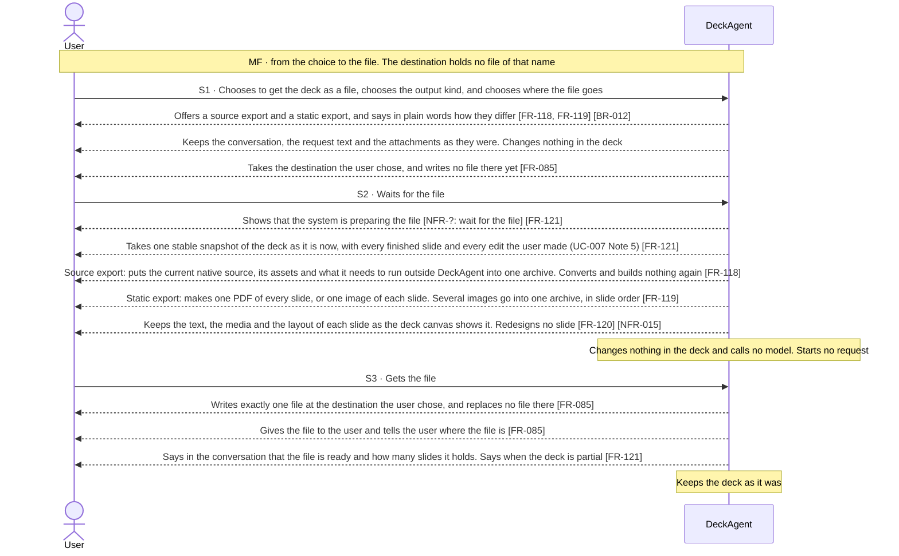

### Alternative Flows

#### A1 · A request is active in the chat

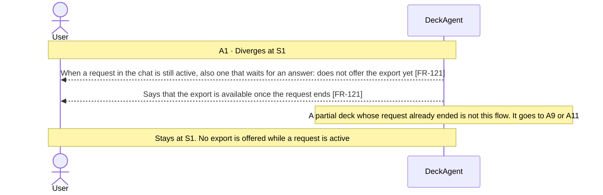

#### A3 · Export fails

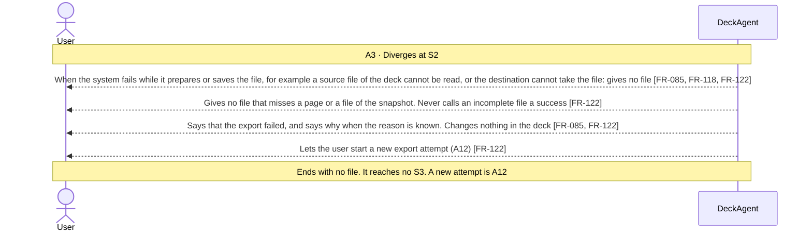

#### A5 · Reload or come back

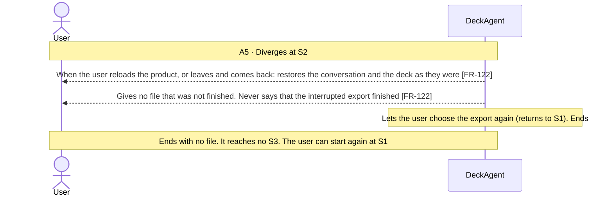

#### A6 · Some content cannot be kept

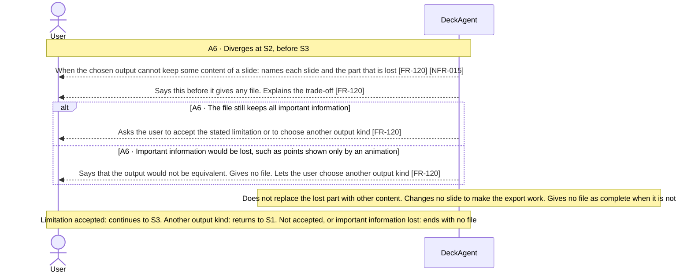

#### A7 · The destination already holds a file of that name

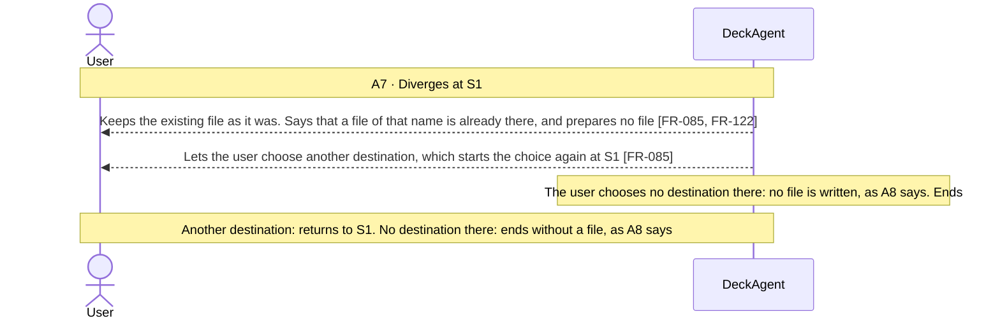

#### A8 · The user chooses no destination

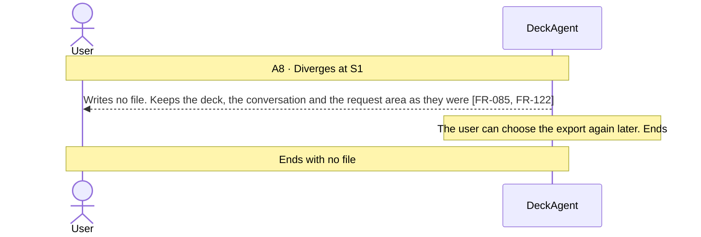

#### A9 · Export a partial first draft

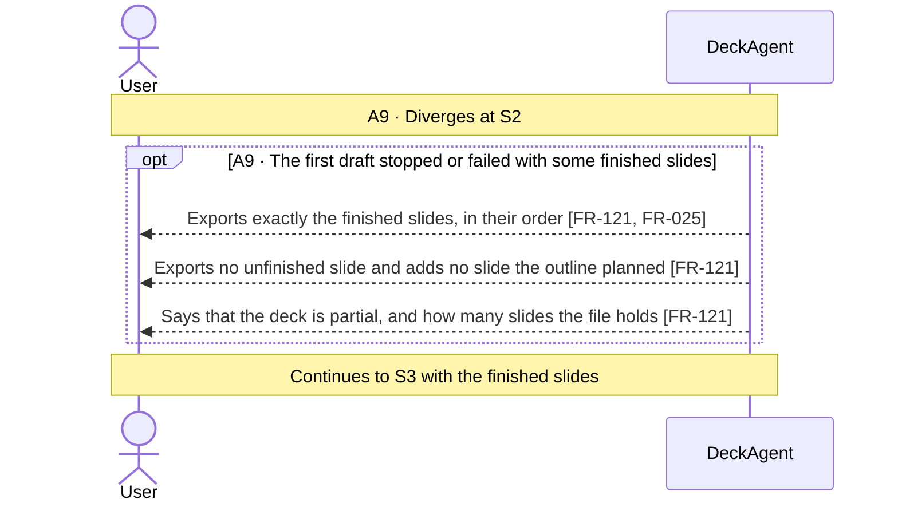

#### A10 · No finished slide

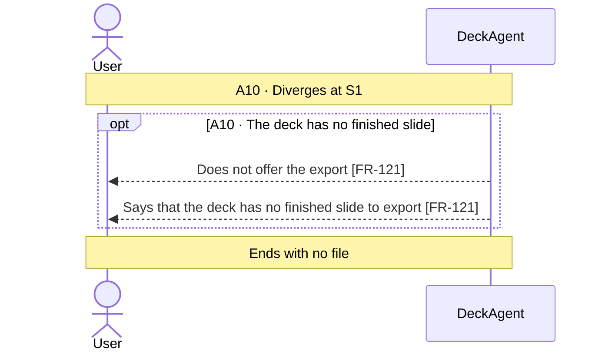

#### A11 · Export a partially edited deck

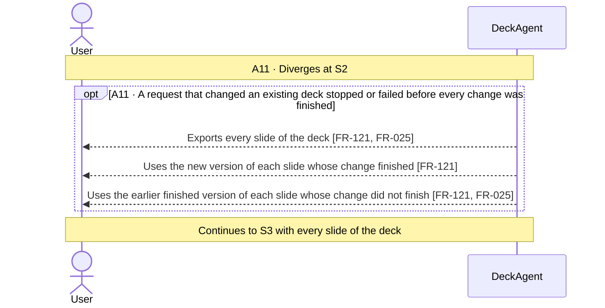

#### A12 · Retry after a failed export

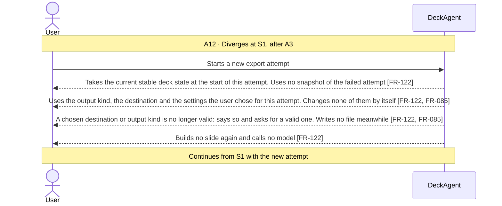

## Behavior constraints

- The deck in the chat is never changed by an export. Its generation format stays the same. Whatever fails or is interrupted, the user can choose the export again.
- The export is available only when no request is active in the chat and the deck has at least one finished slide [FR-121].
- The export writes exactly one file at the destination the user chose. It replaces no existing file, and it leaves the project folder without a new file unless the user chose the folder as the destination (Note 8) [FR-085].
- The export calls no model, starts no request, and stops or resumes no request [FR-122].
- A source export keeps the presenter notes that are part of the native source. A static export holds no separate notes (Note 7).

- **Postconditions:**
  - The user has one file of the output kind they chose, at the destination they chose.
  - The file holds every finished slide of the deck, in its last finished version, as the deck was when the export started.
  - A partial deck exported with success says that it is partial. An incomplete export fails and gives no file.
  - A source export holds the native source, its assets and what it needs to run outside DeckAgent. It holds no unrelated material of the chat and no saved credential [FR-118].
  - No file that was already at that destination was replaced.
  - The conversation says how many slides the file holds, and any limitation the user accepted. No accepted limitation loses important information.
- **Minimal guarantee:** Whatever branch fails or is interrupted:
  - The deck in the chat is exactly as it was before the export.
  - No incomplete file is given as a finished file.
  - The user can choose the export again.

## Notes

1. the user gets the deck as a source export or a static export [BR-012]. The product does not import an existing deck file as a deck it can change, and does not edit such a file. It does allow a basic edit of a deck it made, on the deck canvas. That edit is UC-007. The source export lets the user go further in their own tools. A deck file can be an attachment of a request, whoever made it [BR-001]. The system reads it as material for the request. It is not imported as slides the user can change, and the file itself is not changed.
2. The export changes the form in which the user gets the deck, never its content. A change to the content is a request to the system or an edit on the deck canvas. An example is a request to make the deck denser for reading. The export includes every such change. The export never converts the deck to another generation format.
3. the product has no way to present the deck. The user presents from the file, in their own tools.
4. The user prints the PDF of a static export. Whether slides print well without colour is a property of the slides and not of the export [NFR-?: readable without colour].
5. The export uses no model and offers no way to stop it. The export is short.
6. the product has no shared viewing of a deck. The user sends the file. The file leaves the product at S3, so the product cannot control who reads it.
7. presenter notes are optional data of a slide, made or changed only on request (UC-001 A37, UC-002 A9). A source export keeps them when they are part of the native source. It makes no new notes. A static export gives slide visuals only, with no separate notes.
8. The export writes a file on the user's computer and needs no network. The user chooses where the file goes; the project folder of a workspace is one destination among others, and a workspace being set up chooses no destination (A7, A8, FR-085). The IDs A2 and A4 are retired. IDs are never renumbered.
9. A deck that is complete enough to export needs no project folder. The export uses the deck the chat holds, so a folder that cannot be read takes nothing out of it. A part of the deck that cannot be read fails the export instead of giving a file that claims more than it holds (A3, FR-085).
10. Another generation format needs a new deck. The user can export the source archive, start a new chat and attach the archive as material [FR-123] [BR-001]. That starts a new outline and a new deck. It is not an import, a restored history or a converted copy.
