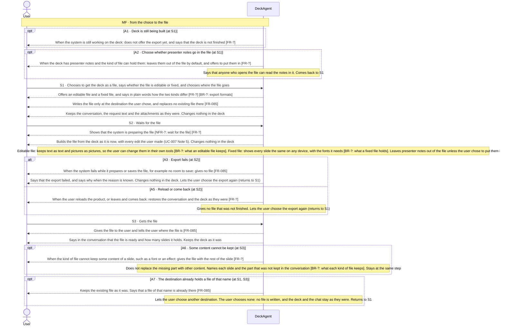

Updated at: 26-10-2026

<!-- A use case models the ideal product (UCG-01 in 03-use-cases/_CRITERIA.md). Every flow it holds is a
     behavior selected for the ideal product; this use case records no rejected options. A version file
     under docs/versions/ names the flows it takes; the use case holds no versions field (UCG-09).
     Write in plain English: docs/spec/_STYLE.md (UCG-11).
     Write intent and response, never interface (UCG-13, _STYLE rule 10). Open questions live in the
     design backlog of the ideal spec, outside docs/spec/. -->

## Goal

The user has a deck they are happy with and wants it as a file they can keep, send, print or present, or a file that looks the same on any device, or a file to change in their own tools. The deck in the chat stays as it is.

## Preconditions

- **Trigger:** The user chooses to get the deck as a file.
- **Preconditions:** The chat has a deck with at least one slide.

## Interactions

How to read the interactions:

- The user gets the deck as an editable file or as a fixed file. The export changes the form of the deck. It never changes the content of a slide.
- The user chooses where the file goes. A file appears only because the user chose to export it there, and an existing file is never replaced [FR-085].
- The file holds the presentation the user chose, and no material that only served the system to make the slides [FR-085].
- Presenting is done in the user's own tools, from the file.
- Exporting the conversation and the session archive of the chat is UC-016. That export and this one are different abilities, and neither replaces the other.

### Choosing the file and getting it (S1 to S3)

## Behavior constraints

- The deck in the chat is never changed by an export; whatever fails or is interrupted, the user can choose the export again.
- The export writes one file at the destination the user chose. It replaces no existing file, and it leaves the project folder without a new file unless the user chose the folder as the destination (Note 8) [FR-085].
- Presenter notes stay out of the file by default (Note 7). Notes come from a first draft (UC-001 A37) or a change request (UC-002 A9).

- **Postconditions:**
  - The user has a file of the kind they chose, at the destination they chose.
  - The file holds every slide of the deck, as the deck was when the export started.
  - The file holds no presenter notes unless the user chose to put them in.
  - No file that was already at that destination was replaced.
  - The conversation says how many slides the file holds and what was not kept.
- **Minimal guarantee:** Whatever branch fails or is interrupted:
  - The deck in the chat is exactly as it was before the export.
  - The user can choose the export again.

## Notes

1. the user gets the deck as an editable file or as a fixed file. The product does not import an existing deck file as a deck it can change, and does not edit such a file. It does allow a basic edit of a deck it made, on the deck canvas. That edit is UC-007. The editable file lets the user go further in their own tools. The file types are a business rule [BR-?: export formats]. A deck file can be an attachment of a request, whoever made it [BR-001]. The system reads it as material for the request. It is not imported as slides the user can change, and the file itself is not changed.
2. The export changes the form of the deck, never its content. A change to the content is a request to the system or an edit on the deck canvas. An example is a request to make the deck denser for reading. The export includes every such change.
3. the product has no way to present the deck. The user presents from the file, in their own tools.
4. The user prints the fixed file. Whether slides print well without colour is a property of the slides and not of the export [NFR-?: readable without colour].
5. This draft assumes the export uses no model and offers no way to stop it. The export is short.
6. the product has no shared viewing of a deck. The user sends the file. The file leaves the product at S3, so the product cannot control who reads it.
7. presenter notes stay out of the file by default (A2). The user can choose to put them in. The kinds of file that can hold notes are a business rule. Notes come from a first draft (UC-001 A37) or a change request (UC-002 A9).
8. The export writes a file on the user's computer and needs no network. The user chooses where the file goes; the project folder of a workspace is one destination among others, and a workspace being set up chooses no destination (A7, FR-085). The ID A4 is retired. IDs are never renumbered.
9. A deck that is complete enough to export needs no project folder. The export uses the deck the chat holds, so a folder that cannot be read takes nothing out of it. A part of the deck that cannot be read fails the export instead of giving a file that claims more than it holds (A3, FR-085).
