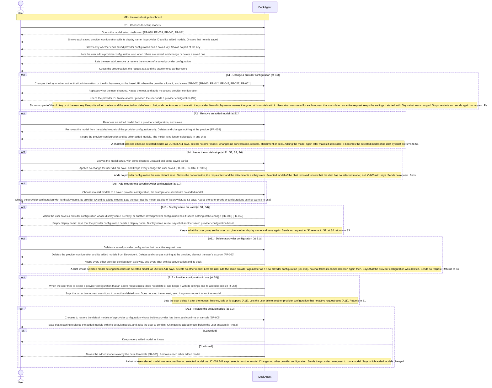
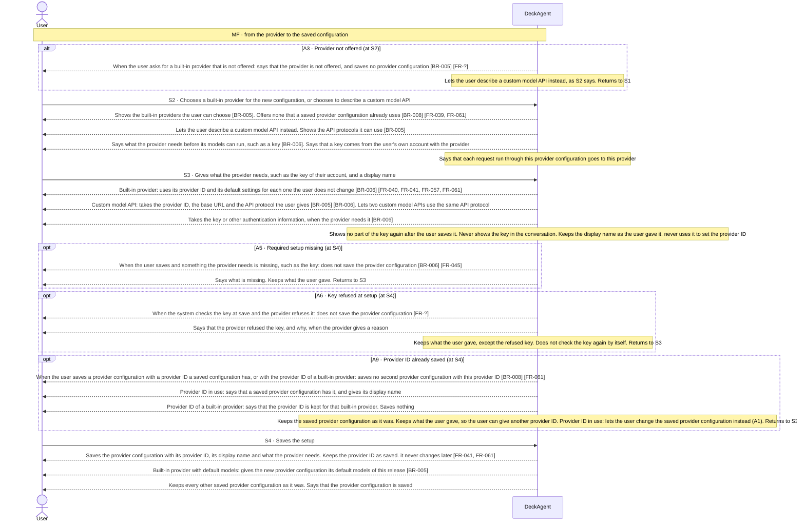
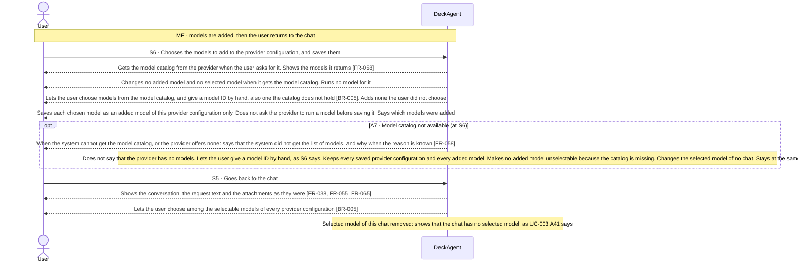

Updated at: 25-10-2026

<!-- A use case models the ideal product. Active interactions describe the product-level
     exchanges DeckAgent is designed to perform; their IDs (MF, Sx, Ax) stay stable and are
     cited by other files (UCG-03, UCG-10). A Closed flow would be listed briefly; this use
     case records none. A version file under docs/versions/ names the flows it takes; the
     use case holds no versions field (UCG-09). Write in plain English: docs/spec/_STYLE.md (UCG-11).
     Write intent and response, never interface (UCG-13, _STYLE rule 11). -->

## Goal

The user wants DeckAgent to make decks with models they choose. They have accounts with one or more model providers and a key for each, or a model service of their own. They have no model ready yet, or want more models or another provider, or a key they gave no longer works. They want the models ready without losing the request they were preparing.

## Preconditions

- **Trigger:** The user chooses to set up models. Examples: from the request area (UC-003 A28), or at the first start. Also after a request found no selectable model (UC-003 A17).
- **Preconditions:** DeckAgent runs on the user's computer. A request can be active in a chat while the model setup is open (A12).
- **Evidence:** [observed: owner report (the option to add or change models opens the model setup dashboard); not recorded] [assumed: the first start as a trigger]

## Active interactions

Every flow below is Active in the ideal product; this use case records no Closed flow. Nothing here says which version takes a flow.

How to read the interactions:

- The main flow saves a new provider configuration and adds models to it. The user can save several provider configurations, one at a time (Notes 10 and 11).
- A provider configuration connects to a built-in provider or to a custom model API (S2, S3). Each provider ID has at most one saved provider configuration [BR-008]. The provider ID of a saved provider configuration never changes; to use another provider, the user adds a provider configuration.
- The user then chooses among the selectable models for a chat (UC-003 A27). Choosing a model for a chat is not part of this use case.
- The key belongs to the user's own account with the provider (Vision P-1). How and where the system keeps the key is not part of this use case.
- Step IDs keep their numbers, also since S6 moved before S5 on 12-10-2026.

### Opening the model setup (S1)

- **MF S1:** [observed: owner report (the option to add or change models opens the model setup dashboard; the request text and files stay); not recorded] [assumed: what the dashboard shows]
- **A1:** [assumed]
- **A2:** [assumed]
- **A4:** [assumed]
- **A8:** [assumed]
- **A10:** [assumed]
- **A11:** [assumed]
- **A12:** [assumed]
- **A13:** [assumed]

### Saving a new provider configuration (S2 to S4)

- **MF S2:** [assumed]
- **MF S3:** [assumed]
- **MF S4:** [assumed]
- **A3:** [assumed]
- **A5:** [assumed]
- **A6:** [assumed]
- **A9:** [assumed]

### Adding models and going back to the chat (S6 and S5)

- **MF S6:** [assumed]
- **MF S5:** [observed: owner report (the user chooses among the models that are set up; the chat then uses the chosen model); not recorded]
- **A7:** [assumed]

## Behavior constraints

- A failed request to the provider removes no provider configuration and no added model (UC-003 A18, Note 6). Getting the model catalog changes no added model (S6, A7).
- The key is never shown in the conversation, and no part of a saved key is shown again after it is saved (S1, S3, A1, Note 14).
- A provider configuration that an active request uses is never deleted (A12). A failed save (A5, A6, A9, A10) saves nothing.
- This use case changes the saved provider configurations and their added models. Choosing a model for a chat or a request is UC-003 A27 (Note 1).

Proposals, to be confirmed against recordings.

- **Postconditions:**
  - Main flow: a provider configuration is saved with its provider ID, its display name and its added models. The user can choose among them for a chat. Saving shows neither that the provider accepts the key nor that it runs a model.
  - A1: later requests through the provider configuration use what the user changed. Its provider ID and its added models stay.
  - A2: the model is no longer among the selectable models. Nothing changed at the provider.
  - A8: the provider configuration has the models the user added.
  - A11: the provider configuration and its added models are no longer in DeckAgent. Every chat and deck is as it was.
  - A13: confirmed, the added models are exactly the default models. Cancelled, the added models are as they were.
  - The conversation, the request text and the attachments are as they were.
- **Minimal guarantee:** Whatever branch fails or is left:
  - What the user saved stays as saved. Exceptions are a model the user removed (A2) and a provider configuration the user deleted (A11).
  - No provider ID changes. A provider configuration that an active request uses is never deleted (A12).
  - A failed request to the provider removes no provider configuration and no added model (UC-003 A18).
  - Getting the model catalog changes no added model (S6, A7).
  - The key is never shown in the conversation.
  - The conversation, the request text and the attachments are as they were.
- **Evidence:** [assumed]

## Product evidence

### Claude Slide Design

- **Coverage:** unverified
- **Research card:** [claude-deck-generation-behavior](../../research/use-cases/claude-slides-design/claude-deck-generation-behavior.md)
- **Difference:**
  - The user reports that the product offers a choice of model. The team did not record it.
  - Its settings list an entry for API keys. The team did not open it.
  - The product runs on its own model account. The team saw no step where the user gives a key.
- **Updated at:** 10-10-2026

### Napkin AI

- **Coverage:** not offered
- **Research card:** [napkin-ai-deck-generation-behavior](../../research/use-cases/napkin-ai/napkin-ai-deck-generation-behavior.md)
- **Difference:**
  - The team saw no model name and no choice of model.
- **Updated at:** 10-10-2026

## Decisions needed

Resolved — the owner decisions are recorded in Notes. Each entry below keeps its old number and names its note:

2. Settled (owner, 2026-10-13): the product promises no model that runs on the user's computer. Such a model service can work as a custom model API (Note 14).
5. Settled (owner, 2026-10-13): with no model, the system guides the user to the model setup. Opening it by itself is not required (Note 14).
6. Settled (owner, 2026-10-13): a new provider configuration of a built-in provider starts with its default models, where they exist (S4, Note 14).
7. Settled (owner, 2026-10-13): a name of whitespace only is empty. Capital letters and outer whitespace do not make two names different (A10, Note 14) [BR-008].
8. Settled (owner, 2026-10-13): no. The provider IDs of built-in providers stay reserved (A9, Note 14) [BR-008].

Unresolved — owner to decide:

1. A6: does the system check a key when the user saves it, or only when a request runs (UC-003 A18)?
3. S2, S3: what does each built-in provider need besides a key? Which of its default settings can the user change [BR-006]? Its base URL can change only where the provider allows it (Note 13). Each answer waits for checks with the provider.
4. S2, S3: which API protocols can a custom model API use [BR-005]? The answer waits for technical research. Which built-in providers are offered was settled on 2026-10-12 (Note 13).
9. S3: how does the system know that a custom model API needs a key? Can the user change its API protocol after saving [BR-006]?

## Notes

1. This use case changes the saved provider configurations and their added models. Choosing a model for a chat or a request is UC-003 A27. One use case, not two: adding, changing, removing, restoring and deleting share the goal of ready models.
2. A refused key or a refused model ends the request (UC-003 A18). A18 does not go to this use case. The user can also choose another selectable model instead (UC-003 A27). The user can change the provider configuration here (A1), then send a new request.
3. UC-003 A17 and A28 go to this use case. A17 brings a request that found no selectable model. A28 brings a user who chose to set up models.
4. How and where the system keeps the key is an ADR matter. The proposed boundary B-3 in the vision is related.
5. A provider usage limit is a property of the user's provider account (Vision P-1). This use case shows no limit and no price.
6. When a model fails, the system does not move to another model by itself. It ends the request and keeps the selected model (UC-003 A11, A18, Note 27; FR-019). This use case does not change that behavior. Until 2026-10-12, this note said it was not decided.
7. Design decision (owner, 2026-10-11): the user sets up a model with their own key inside DeckAgent. No developer prepares the model for them. Considered: a model set up outside the user's own steps, not selected. Why: the user brings their own key (Vision P-1). The owner wants users to finish the setup without a developer's help. Which providers and models are offered stays open (open question 4). This note takes no flow.
8. Design decision (owner, 2026-10-11, revised the same day): minimum model setup. Replaced in part by Note 9 (owner, 2026-10-12), which replaced one provider configuration with several. One model no longer runs every request.
   - Earlier direction: one model set up at a time, which the user could replace.
   - Revised decision: the product needs only one working model, set up with the user's own key. That model runs every request of the journey: generate, preview and refine.
   - Why: the core outcomes come before a wider management of models.
   - Future candidates, with no version assigned: several saved models, switching between them, replacing a model, and a model per request.
   - The behavioral model stays open to several models and providers (Vision P-1). Since 2026-10-12, S4, S6 and S5 say three things. Provider configurations are saved, models are added to them, and selectable models can be chosen. This note takes no flow.
9. Design decision (owner, 2026-10-12): one provider configuration, with all its available models. Replaces in part Note 8. Replaced in part by Note 10 (owner, the same day), which allows several provider configurations, with models the user adds.
   - A provider configuration is one saved connection to a model provider. It holds a display name, the user's key and what the system needs to reach the provider.
   - The display name is the user's own text. It never says which provider the provider configuration connects to. The system does not rename it.
   - Example: the display name is "DeepSeek". The provider configuration connects to Gemini with a Gemini key. The name stays "DeepSeek".
   - The available models of a provider configuration come from the provider it connects to. They never come from its display name.
   - The user chooses the selected model among the available models. One model is selected at a time. It belongs to the provider configuration that gives access to it.
   - The models the user can choose from are grouped by provider configuration. Each group is named by the display name of its provider configuration.
   - One provider configuration at a time meant one group for the user. A later decision allows several, and so several groups. The grouping stays the same.
   - One provider configuration was one slot, not a fixed provider. The limit was the value of a business rule, retired on 12-10-2026 (Note 10).
   - The user can replace the key and change the display name. A saved key replaces the earlier key. It adds no second provider configuration.
   - Leaving the model setup without saving applies no unsaved change. It does not undo a change already saved. Replacing the key does not send a failed request again.
   - Future candidates, with no version assigned: a second provider configuration, and several with their own keys. Also choosing among them and removing one.
   - Open then: how the provider is set, and which models count as available models. Note 10 settles both. How a selected model works is UC-003 Note 25 (owner, 2026-10-12).
   - Why: the owner wants to test different providers through one provider configuration. This note takes no flow.
10. Design decision (owner, 2026-10-12): several provider configurations, and models the user adds. Replaces in part Notes 8 and 9. Replaced in part by Note 11 (owner, the same day). A provider configuration keeps its provider ID, so its provider never changes.
   - The user can save several provider configurations. Two can connect to the same provider with different keys. No number of them is set.
   - The user can change the provider, the key and the display name of a saved provider configuration (A1). A change of provider keeps the display name.
   - The model catalog and the added models are different. The user chooses which models to add, from the model catalog or by model ID (S6).
   - A model ID is saved without a check with the provider. A provider that refuses it at a request ends that request (UC-003 A18). The added model and the provider configuration stay.
   - A missing model catalog leaves adding by model ID possible (A7). It is not a failed request, and it makes no added model unselectable.
   - A change of provider keeps the models added for the earlier provider, but they are not selectable. The system gives no model ID to another provider by itself.
   - The user can remove an added model (A2). Removing it changes nothing at the provider. A chat that selected it chooses again (UC-003 A40).
   - The model setup is the Models part of the settings.
   - Considered: one provider configuration (Note 9), and every model a key can use as an available model. Neither is kept.
   - Open then: a change back to an earlier provider, and a change of address. Also removing a whole provider configuration, and display names. Note 11 settles them.
   - Why: not recorded. A1, A2, A7 and A8 follow this note since 2026-10-12. A version file takes a flow; a note never does.
11. Design decision (owner, 2026-10-12): model provider management. Replaces in part Note 10.
   - A provider configuration is a saved connection to a model service, not only a key. It connects to a built-in provider or to a custom model API.
   - A custom model API has a provider ID, a base URL, an API protocol and, when needed, a key [BR-006]. Two can use the same API protocol.
   - Each provider ID has at most one saved provider configuration [BR-008]. A built-in provider can be added again after its provider configuration is deleted.
   - The provider ID never changes after saving. The user can change the key, the base URL and the display name (A1). To use another provider, the user adds a provider configuration.
   - The display name is not empty, and no other saved provider configuration has it (A10). It never sets the provider ID.
   - Getting the model catalog adds no model and changes no selection (S6). When it fails, adding a model ID by hand stays possible (A7).
   - Restoring the default models needs the user's confirmation first (A13). Cancelling changes nothing.
   - Deleting a provider configuration removes it and its added models from DeckAgent only (A11). Chats and decks stay. No chat gets another model by itself.
   - The user cannot delete a provider configuration that an active request uses, also one that waits for an answer (A12). The request is not stopped for it.
   - Superseded: a change of provider, models kept from an earlier provider, and two provider configurations for one provider (Note 10). The requirement for a change of provider is retired.
   - The model setup holds built-in providers, custom model APIs, the model catalog and the saved provider configurations. The organization came from a reference product. It fixes no interface design (UCG-13).
   - Why: not recorded. A1, A2 and A7 to A13 follow this note since 2026-10-12. A version file takes a flow; a note never does.
12. Design decision (owner, 2026-10-12): adding a provider, active requests, restoring default models and removed models. Adds to Note 11.
   - S2 offers only built-in providers that no saved provider configuration uses. A saved one stays open to change (A1).
   - The provider ID is still checked when the user saves (A9). This holds also for a custom model API.
   - A request keeps the settings it started with until it ends, also for the user's answer. A saved change applies to later requests (A1).
   - A confirmed restore makes the added models exactly the default models. Other added models are removed (A13).
   - A chat whose selected model was removed has no selected model. The system says so when the user comes back to the chat (UC-003 A41).
   - A model or a provider configuration added again becomes the selected model of no chat by itself (A2, A11).
   - This settles three open questions: active requests, a restore, and a model added again. Why: not recorded. S2, S5, A1, A2, A4, A9, A11 and A13 follow this note since 2026-10-12.
13. Design decision (owner, 2026-10-12): built-in providers, base URLs and default models. Adds to Notes 11 and 12.
   - The built-in providers are set [BR-005]. Their provider IDs are not set yet.
   - Custom model APIs stay, so that the user can connect other model services. Their API protocols wait for technical research (open question 4).
   - The base URL of a saved provider configuration can change where its provider allows it [BR-006]. No built-in provider is assumed to allow it.
   - The base URL of a custom model API can still change (A1).
   - DeckAgent sets the default models of each built-in provider that has them, with each release [BR-005]. The model catalog does not set them.
   - Not decided: their model IDs, and whether a new provider configuration starts with them (open question 6). Note 14 settles the second (owner, 2026-10-13).
   - This settles part of open questions 3 and 4. Why: not recorded. A1 follows this note since 2026-10-12. A version file takes a flow; a note never does.
14. Design decisions (owner, 2026-10-13): first setup, default models, provider IDs, display names, keys and local models.
   - With no selectable model, the system guides the user to the model setup (UC-003 A17). It need not open the model setup by itself.
   - A new provider configuration of a built-in provider starts with the default models DeckAgent sets for that release, where it has them (S4) [BR-005]. Their model IDs are still open.
   - The default models of a built-in provider can change between releases. A release never replaces, removes or changes a model the user added. Restoring the default models stays as A13 says.
   - The provider IDs of built-in providers are stable. They stay reserved, also before their provider configuration is saved. A custom model API cannot take one (A9) [BR-008].
   - A display name of whitespace only is empty. Two display names that differ only in capital letters, or in whitespace at the start or the end, are the same (A10). The system keeps the name as the user gave it.
   - After a key is saved, the system never shows any part of it again: not the whole key, and no prefix, suffix or masked part taken from it. It shows only whether a key is saved, and lets the user replace it (S1, S3, A1).
   - The product promises no model that runs on the user's computer. The four built-in providers come first [BR-005]. A compatible model service on the user's computer can work as a custom model API. It is not a feature of its own.
   - Open for technical research, with no product decision now: the API protocols of a custom model API (open question 4), and what each built-in provider needs and allows (open question 3). Also whether the user can change the API protocol of a saved custom model API (open question 9).
   - Also open for evidence: the provider ID strings, and the lists of default models. How a saved key is protected is an architecture item (UC-003 Note 34).
   - This settles open questions 2, 5, 6, 7 and 8. S1, S3, S4, A1 and A9 follow this note since 2026-10-13. Why: not recorded. This note takes no flow.
