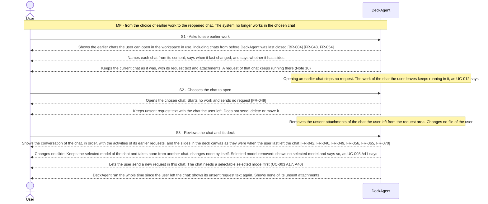
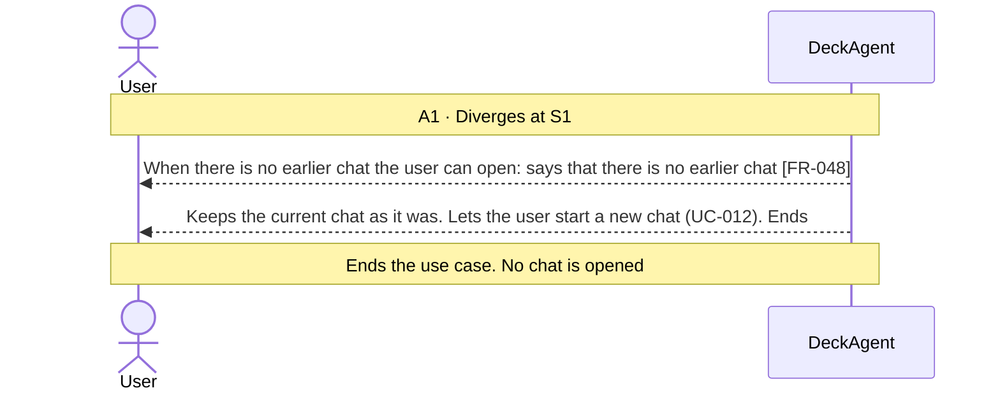
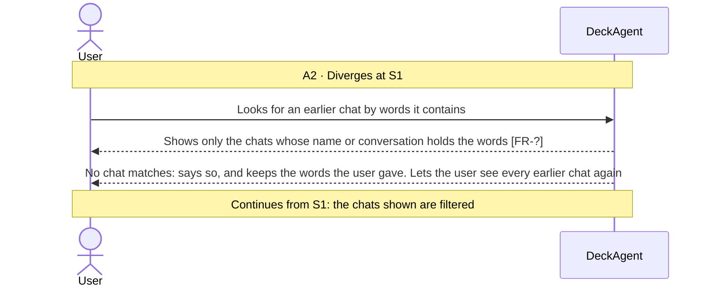
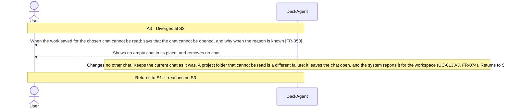
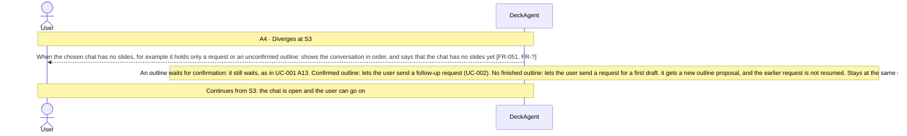
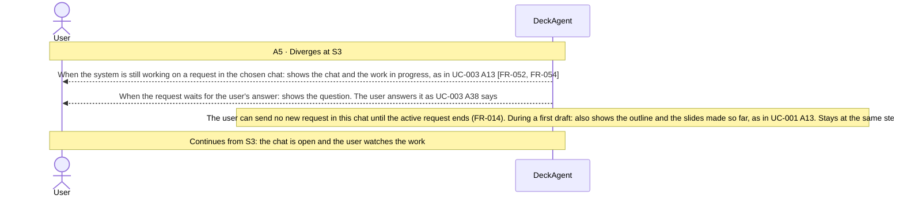
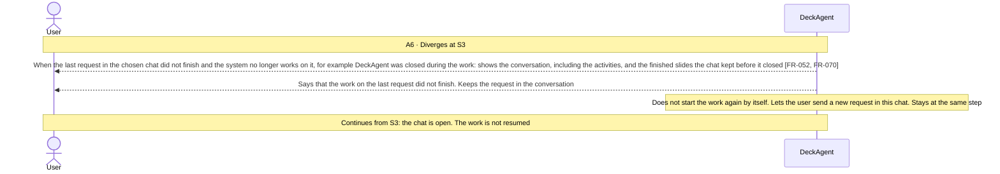
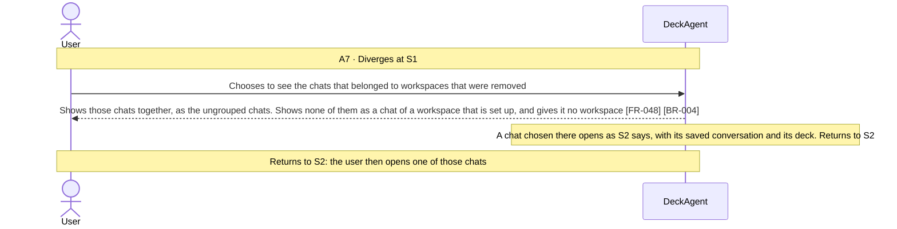
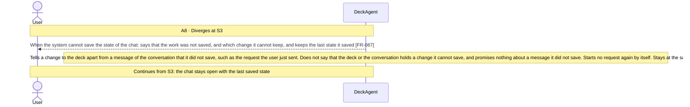

Updated at: 26-10-2026

<!-- A use case models the ideal product (UCG-01 in 03-use-cases/_CRITERIA.md). Every flow it holds is a
     behavior selected for the ideal product; this use case records no rejected options. A version file
     under docs/versions/ names the flows it takes; the use case holds no versions field (UCG-09).
     Write in plain English: docs/spec/_STYLE.md (UCG-11).
     Write intent and response, never interface (UCG-13, _STYLE rule 10). Open questions live in the
     design backlog of the ideal spec, outside docs/spec/. -->

## Goal

The user worked on a deck in an earlier chat, on another day or before closing DeckAgent. They want to see that chat and its deck again, and then change the deck or get it as a file, without starting over. The chat belongs to one of their workspaces (UC-013).

## Preconditions

- **Trigger:** The user chooses to see earlier work.
- **Preconditions:** DeckAgent runs on the user's computer. The user can open an earlier chat while a request runs in the chat they leave. That request keeps running there (Note 10).

## Interactions

How to read the interactions:

- The main flow opens an earlier chat in which the system is no longer working. A chat is the unit of earlier work, as in the other use cases. It holds the conversation and the slides.
- Coming back to work still in progress is UC-003 A13 and UC-001 A13. A5 reuses that response; it does not promise that the work goes on (Note 1).
- After S3 the user can change the deck (UC-002) or get it as a file (UC-004). This use case ends at S3.
- Earlier chats and their decks stay available after DeckAgent is closed and opened again (Note 6).
- How the system keeps a chat is not part of this use case.

### Main Flow (MF)

### Alternative Flows

#### A1 · No earlier work

#### A2 · Look for a chat by its words

#### A3 · Chat cannot be opened

#### A4 · Chat has no slides yet

#### A5 · Work still running in the chat

#### A6 · Work ended before it finished

#### A7 · Find a chat whose workspace was removed

#### A8 · The work of the chat cannot be saved

## Behavior constraints

- Opening an earlier chat changes no chat and no deck; the chat the user was in stays as it was.
- Opening an earlier chat never stops a request. A request that runs in the chat the user left keeps running there (Note 10). A chat holds at most one request the system works on or waits an answer in.
- Work that was running when DeckAgent closed is not resumed (A6, Note 8); the user sends a new request to go on.
- The chats of the workspace in use are what the user sees as earlier work. The chats that belonged to removed workspaces are found together as the ungrouped chats, and none of them belongs to the workspace in use (A7) [FR-048] [BR-004].

- **Postconditions:**
  - The chosen chat is open. Its conversation and its slides are as the chat kept them.
  - No slide changed and no request was sent.
- **Minimal guarantee:** Whatever branch fails:
  - Opening a chat changes no chat and no deck.
  - The chat the user was in stays as it was.

## Notes

1. Two behaviors differ. This use case opens earlier work in which the system is no longer working. Coming back to work still in progress is UC-003 A13 and UC-001 A13. A5 reuses that response. It does not promise that the work goes on.
2. Design choice for an ADR proposal: S3 needs the system to keep each chat and its slides. How it keeps them (files, a database, when it saves) is an ADR matter. The proposed boundary B-3 in the vision is related.
3. Reopening only to look, to change the deck or to get a file is the same goal. The user chooses what comes next after S3, so these are not alternative flows.
4. Giving the deck of an earlier chat as a pattern (UC-001 Note 16) is not part of this use case.
5. Renaming or deleting an earlier chat is not covered. It may become its own flow or use case.
6. earlier chats and their decks stay available after DeckAgent is closed and opened again.
   - The user can see earlier chats, open one, and carry on through new requests.
   - Work that was running when DeckAgent closed is not resumed (A6).
7. Changed on 2026-10-11 so that no flow here offers to try again or to edit the request (UC-003 Notes 17 and 19). Closing DeckAgent is not a stop (Note 8).
   - A6 offered to edit the request and to try again. It now lets the user send a new request.
   - S3 offered to get the deck as a file. That offer now stays with UC-004, which comes next (Main flow).
   - Trying again remains a future candidate (UC-003 Note 18).
8. Work that was running when DeckAgent closed is not resumed (A6). When DeckAgent is opened again, the chat shows the conversation, the activities and the finished slides it kept. The user sends a new request to go on. Closing DeckAgent is not a stop (UC-003 A31). How chats are kept is an ADR matter (Note 2).
9. One deck per chat, unsent text and saved history:
   - A chat holds one deck. A new deck starts in a new chat (UC-012).
   - Unsent request text stays with its own chat. Changing chats does not send, delete or move it (S2). While DeckAgent runs, reopening the chat shows that text again (S3). Keeping it after DeckAgent ends is not promised. NFR-008 does not cover it.
   - Unsent attachments leave the request area when the user changes chats. Reopening the chat does not bring them back. The user adds them again before sending.
   - Attachments sent with a request stay with that request.
   - While a request is active in one chat, the user can change to another chat (Note 10, FR-054). A chat still holds at most one request that the system works on or waits an answer in.
   - A chat with no sent request need not appear among earlier chats [BR-004]. Saved chats, their conversations and their decks are kept with no time limit [BR-004].
   - No way to delete a chat or a deck is added (Note 5). Nothing promises to keep data that the user removes on purpose, or that a lost disk takes.
10. The user can open an earlier chat while a request runs in a chat (FR-054). A request that runs in the chat the user left keeps running in that chat, also one that waits for the user's answer (A5). The system stops, pauses and moves no request.
11. A project folder that cannot be read and work of a chat that cannot be read are two failures with two responses.
    - The project folder of a workspace that cannot be read takes away the files of the user, not the chats. The chats of that workspace still open, and the system reports the folder for the workspace (UC-013 A3, FR-074).
    - The work DeckAgent saved for a chat that cannot be read is reported for that chat: the system says that it cannot open the chat, shows no empty chat in its place, and removes no chat (A3, FR-050). It claims no cause it does not know, and it does not say that the chat was deleted.
    - A save that fails while the user works is reported at A8: the change was not saved, and the last saved state stays (FR-087).
12. The chats of a workspace are what the user sees as earlier work. The chats that belonged to removed workspaces are found together as the ungrouped chats, and none of them belongs to a workspace that is set up (A7, UC-013 A2) [FR-048] [BR-004].
