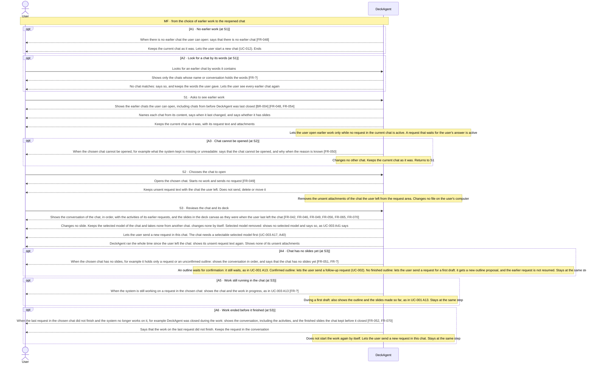

Updated at: 25-10-2026

<!-- A use case models the ideal product. Active interactions describe the product-level
     exchanges DeckAgent is designed to perform; their IDs (MF, Sx, Ax) stay stable and are
     cited by other files (UCG-03, UCG-10). A Closed flow would be listed briefly; this use
     case records none. A version file under docs/versions/ names the flows it takes; the
     use case holds no versions field (UCG-09). Write in plain English: docs/spec/_STYLE.md (UCG-11).
     Write intent and response, never interface (UCG-13, _STYLE rule 11). -->

## Goal

The user worked on a deck in an earlier chat, on another day or before closing DeckAgent. They want to see that chat and its deck again, and then change the deck or get it as a file, without starting over.

## Preconditions

- **Trigger:** The user chooses to see earlier work.
- **Preconditions:** DeckAgent runs on the user's computer. No request in the current chat is active, including one that waits for the user's answer (Note 8).
- **Evidence:** [assumed]

## Active interactions

Every flow below is Active in the ideal product; this use case records no Closed flow. Nothing here says which version takes a flow.

How to read the interactions:

- The main flow opens an earlier chat in which the system is no longer working. A chat is the unit of earlier work, as in the other use cases. It holds the conversation and the slides.
- Coming back to work still in progress is UC-003 A13 and UC-001 A13. A5 reuses that response; it does not promise that the work goes on (Note 1).
- After S3 the user can change the deck (UC-002) or get it as a file (UC-004). This use case ends at S3.
- Earlier chats and their decks stay available after DeckAgent is closed and opened again (Note 6).
- How the system keeps a chat is not part of this use case.

### Finding and opening an earlier chat (S1 to S3)

- **MF S1:** [observed: claude-report (the product names each chat by itself from its content)] [assumed: the rest]
- **MF S3:** [inferred: napkin-report (a chat with a deck made earlier still showed its closing message, and the deck was in the editor)] [observed: claude-report (after a reload, the chat came back from history with its messages)] [assumed: opening a chat chosen from earlier work]
- **A1:** [assumed]
- **A2:** [assumed]
- **A3:** [assumed]
- **A4:** [assumed]
- **A5:** [observed: claude-report (after a reload, the run went on and the chat showed what the product was doing)] [assumed: the same holds for a chat chosen from earlier work]
- **A6:** [observed: claude-report (after a reload, the chat came back with a notice that the response was interrupted; it offered to edit the request or try again)] [assumed: the case where the work truly ended]

## Behavior constraints

- Opening an earlier chat changes no chat and no deck; the chat the user was in stays as it was.
- A chat is never opened while a request is active in the current chat (Note 8). Work that was running when DeckAgent closed is not resumed (A6, Note 8); the user sends a new request to go on.

Proposals, to be confirmed against recordings.

- **Postconditions:**
  - The chosen chat is open. Its conversation and its slides are as the chat kept them.
  - No slide changed and no request was sent.
- **Minimal guarantee:** Whatever branch fails:
  - Opening a chat changes no chat and no deck.
  - The chat the user was in stays as it was.
- **Evidence:** [assumed]

## Product evidence

### Claude Slide Design

- **Coverage:** unverified
- **Research card:** [claude-deck-generation-behavior](../../research/use-cases/claude-slides-design/claude-deck-generation-behavior.md)
- **Difference:**
  - The product names each chat by itself from its content.
  - After a reload, the chat came back from history with its messages.
  - The team did not record opening an earlier chat from earlier work.
- **Updated at:** 10-10-2026

### Napkin AI

- **Coverage:** unverified
- **Research card:** [napkin-ai-deck-generation-behavior](../../research/use-cases/napkin-ai/napkin-ai-deck-generation-behavior.md)
- **Difference:**
  - Images show a chat with a deck made earlier, its closing message and the deck in the editor.
  - How the user came back to that chat was not recorded.
- **Updated at:** 10-10-2026

## Decisions needed

Resolved — the owner decisions are recorded in Notes. Each entry below keeps its old number and names its note:

1. Settled (owner, 2026-10-13): a chat holds one deck. A new deck starts in a new chat (Note 9).
3. Settled (owner, 2026-10-13): unsent request text comes back with its chat while DeckAgent runs. Unsent attachments do not (S2, S3, Note 9).
5. Settled (owner, 2026-10-13): reloading or closing the interface does not stop the work while DeckAgent runs (UC-003 Note 30). Work that was running when DeckAgent itself closed is not resumed (A6, Note 8). The user cannot open another chat while a request is active (A5 stays a flow, Note 8).

Unresolved — owner to decide:

2. S1: which earlier work can the user open? Only chats, or also an exported file?
4. Later try-again action (UC-003 Note 18): after the work ended early, which deck does it start from, and what runs again?

## Notes

1. Two behaviors differ. This use case opens earlier work in which the system is no longer working. Coming back to work still in progress is UC-003 A13 and UC-001 A13. A5 reuses that response. It does not promise that the work goes on.
2. Design choice for an ADR proposal: S3 needs the system to keep each chat and its slides. How it keeps them (files, a database, when it saves) is an ADR matter. The proposed boundary B-3 in the vision is related.
3. Reopening only to look, to change the deck or to get a file is the same goal. The user chooses what comes next after S3, so these are not alternative flows.
4. Giving the deck of an earlier chat as a pattern (UC-001 Note 16) is not part of this use case.
5. Renaming or deleting an earlier chat is not covered. It may become its own flow or use case.
6. Design decision (owner, 2026-10-11): earlier chats and their decks stay available after DeckAgent is closed and opened again.
   - The user can see earlier chats, open one, and carry on through new requests.
   - Work that was running when DeckAgent closed is not resumed (A6).
   - Why: not recorded. Starting a new chat is UC-012. How chats are kept is an ADR matter (Note 2). This note takes no flow.
7. Changed on 2026-10-11 so that no flow here offers to try again or to edit the request (UC-003 Notes 17 and 19). Closing DeckAgent is not a stop (Note 8).
   - A6 offered to edit the request and to try again. It now lets the user send a new request.
   - S3 offered to get the deck as a file. That offer now stays with UC-004, which comes next (Main flow).
   - Trying again remains a future candidate (UC-003 Note 18).
8. Design decision (owner, 2026-10-11): changing chats and closing DeckAgent during a request.
   - The user cannot open an earlier chat while a request in the current chat is active. A request that waits for the user's answer is active (UC-003 A38). The same rule holds for a new chat (UC-012 Note 4).
   - After the request finished, stopped or failed, the user can open an earlier chat. The system never stops a request to change chats.
   - DeckAgent closed during a request: when opened again, the chat shows the finished slides it kept (A6). The work is not resumed, and nothing promises more slides. The user sends a new request to go on.
   - Closing DeckAgent is not a stop (UC-003 A31). This note defines nothing about what runs after DeckAgent closes.
   - Why: not recorded. This settles the earlier open question on opening earlier work during a request.
   - Future candidate, with no version assigned: opening another chat while a request goes on in the background. A5 belongs to that case. This note takes no flow.
9. Design decisions (owner, 2026-10-13): one deck per chat, unsent text and saved history.
   - A chat holds one deck. A new deck starts in a new chat (UC-012). The product has no chat with several decks.
   - Unsent request text stays with its own chat. Changing chats does not send, delete or move it (S2).
   - While DeckAgent runs, reopening the chat shows that text again (S3). Keeping it after DeckAgent ends is not promised. NFR-008 does not cover it.
   - Unsent attachments leave the request area when the user changes chats. Reopening the chat does not bring them back. The user adds them again before sending (option B).
   - Changing chats deletes no file on the user's computer. Attachments sent with a request stay with that request.
   - A request is never active while the user changes chats (Note 8). So changing chats never changes an active request. Preparing the next request during an active request stays as UC-003 A14 says.
   - A chat with no sent request need not appear among earlier chats [BR-004].
   - Saved chats, their conversations and their decks are kept with no time limit [BR-004]. Earlier messages stay part of their chat.
   - The interface can load old history in parts. No way to do it is set.
   - No way to delete a chat or a deck is added (Note 5). Nothing promises to keep data that the user removes on purpose, or that a lost disk takes.
   - This settles open questions 1 and 3. S2 and S3 follow this note since 2026-10-13. Why: not recorded. This note takes no flow.
