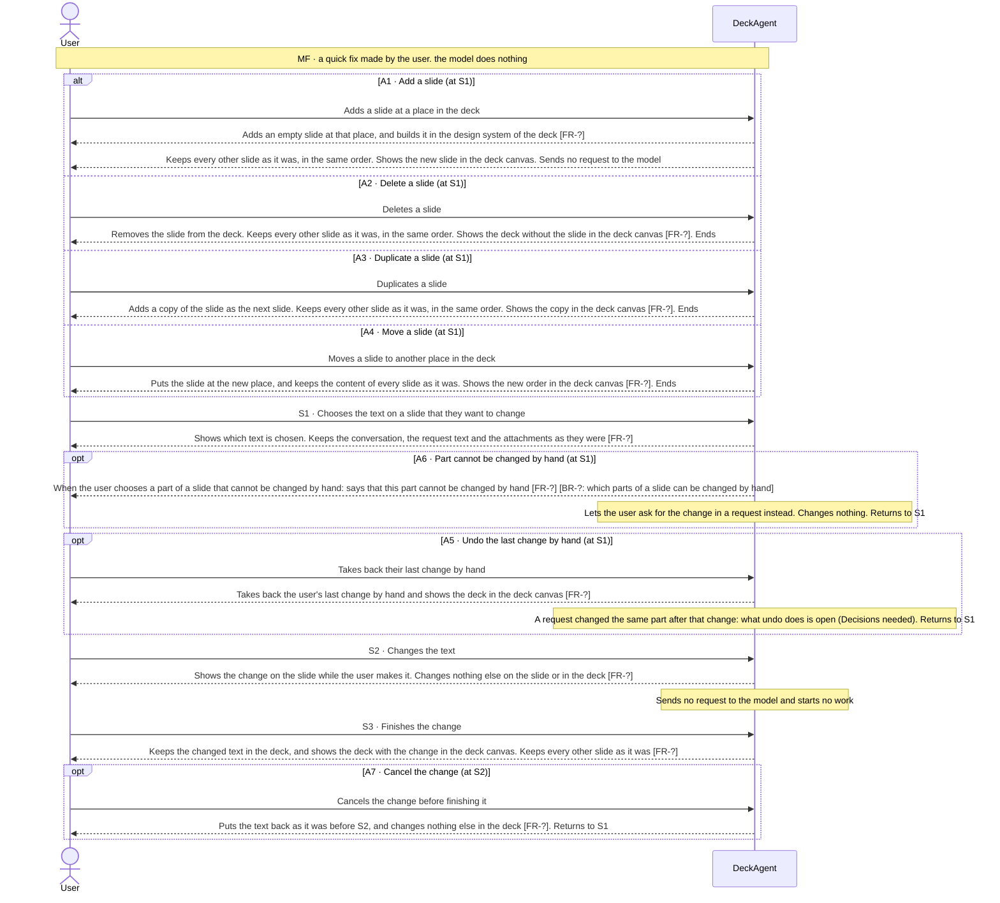

Updated at: 25-10-2026

<!-- A use case models the ideal product (UCG-01 in 03-use-cases/_CRITERIA.md). Every flow it holds is a
     behavior selected for the ideal product; this use case records no rejected options. A version file
     under docs/versions/ names the flows it takes; the use case holds no versions field (UCG-09).
     Write in plain English: docs/spec/_STYLE.md (UCG-11).
     Write intent and response, never interface (UCG-13, _STYLE rule 10). Open questions live in the
     design backlog of the ideal spec, outside docs/spec/. -->

## Goal

The user has a deck the system made and sees a small thing to fix, such as a wrong word or a slide in the wrong place. Fixing it by hand is quicker than describing it in a request. The user wants only that change, without waiting for the model or risking other slides.

## Preconditions

- **Trigger:** The user chooses a part of the deck to change in the deck canvas.
- **Preconditions:** The chat has a deck with at least one slide. The system is not working on a request in this chat.

## Interactions

How to read the interactions:

- The main flow changes the text of one slide. Every change here is made by the user. The system sends no request to the model and starts no work.
- The other kinds of change are flows: add, delete, duplicate and move a slide (A1 to A4).
- This use case does not include UC-003. Which kinds of change are offered is open (Decisions needed).

### Changing the deck by hand (S1 to S3)

## Behavior constraints

- No flow here sends a request to the model or starts work; the model does nothing in this use case (Note 3).
- Export builds the file from the deck as it is now, with every change by hand (UC-004 S2, Note 5).

- **Postconditions:**
  - Main flow: the slide shows the user's new text. Every other slide is as it was.
  - A1 to A4: the deck shows the added, removed, copied or moved slide. Every other slide keeps its content.
  - No request was sent and the model did no work.
  - The conversation, the request text and the attachments are as they were.
- **Minimal guarantee:** Whatever branch fails or is cancelled:
  - Every slide the user did not change is as it was.
  - The system sends no request to the model.

## Notes

1. the product allows a basic edit of a deck it made, on the deck canvas. That edit is this use case. The product does not edit an existing deck file, whoever made it. Until 2026-10-13, this note said "other people's deck files" (UC-004 Note 1).
2. One use case, not two: a change of text and a change of slide order share the goal of a quick fix by the user. Each other kind of change is an alternative flow.
3. This use case is not UC-002. Here the user makes the change and the model does nothing. In UC-002 the user asks and the system makes the change. This use case does not include UC-003.
4. What happens to a change by hand when a later request changes the same slide is open. UC-002 holds that question.
5. Export builds the file from the deck as it is now, with every change by hand (UC-004 S2).
