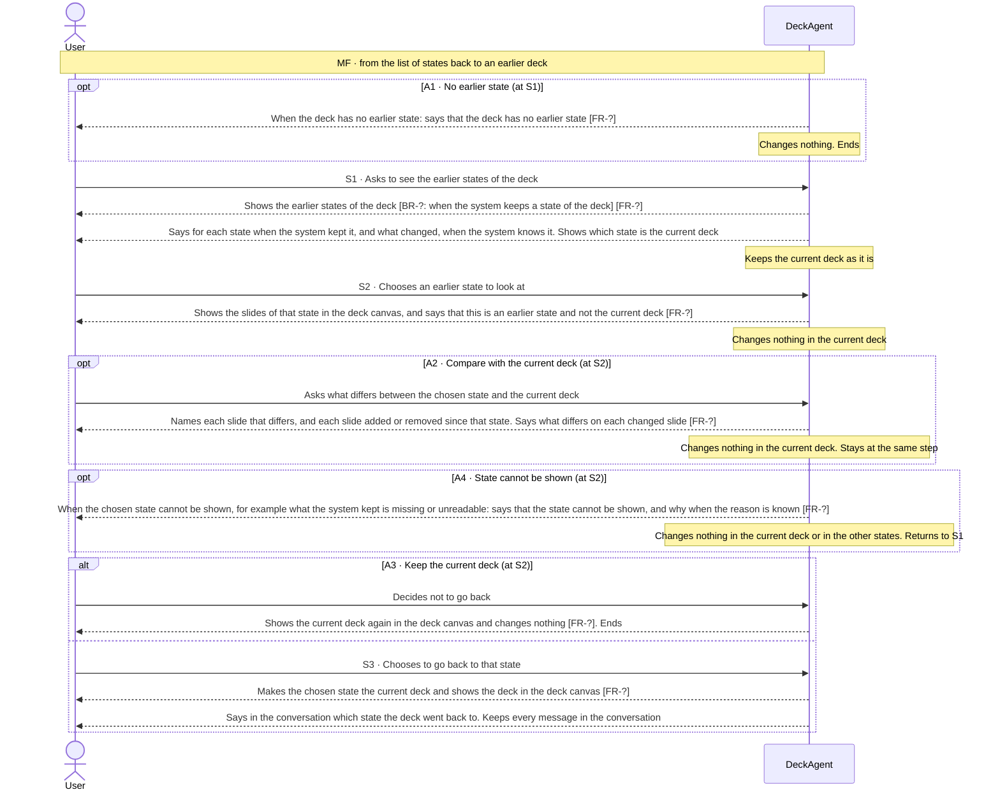

Updated at: 25-10-2026

<!-- A use case models the ideal product (UCG-01 in 03-use-cases/_CRITERIA.md). Every flow it holds is a
     behavior selected for the ideal product; this use case records no rejected options. A version file
     under docs/versions/ names the flows it takes; the use case holds no versions field (UCG-09).
     Write in plain English: docs/spec/_STYLE.md (UCG-11).
     Write intent and response, never interface (UCG-13, _STYLE rule 10). Open questions live in the
     design backlog of the ideal spec, outside docs/spec/. -->

## Goal

The user changed the deck, by a request or by hand, and likes the result less than before. They want to see how the deck was earlier and what changed since then, and they want that earlier deck back, without rebuilding it and without starting a new chat.

## Preconditions

- **Trigger:** The user asks to see the earlier states of the deck.
- **Preconditions:** The chat has a deck. The system is not working on a request in this chat.

## Interactions

How to read the interactions:

- A state is the deck as it was at one moment. Every state belongs to the same deck in the same chat. A state is not a variant (UC-011); a variant is another deck beside this one.
- The main flow looks at one earlier state and makes it the current deck. When the system keeps a state is open (Decisions needed). How it keeps a state is not part of this use case.
- A finished request is not undone; only the earlier states of the deck are (Note 5).

### Looking at earlier states and going back (S1 to S3)

## Behavior constraints

- Looking at a state changes nothing in the current deck. A branch that fails or is left changes nothing in the current deck or in the other states.
- This use case makes no second deck (Note 1); a separate deck for another use is UC-011.

- **Postconditions:**
  - Main flow: the current deck is the chosen earlier state.
  - A2 and A3: the current deck is as it was.
  - The conversation keeps every message.
- **Minimal guarantee:** Whatever branch fails or is left:
  - Looking at a state changes nothing in the current deck.
  - A branch that fails or is left changes nothing in the current deck or in the other states.

## Notes

1. A state and a variant are not the same. A state is the same deck at an earlier moment. A variant is another deck that exists beside it. This use case makes no second deck.
2. This use case is not UC-006. UC-006 opens an earlier chat. This use case stays in the current chat and changes which state is its deck.
3. Undo in UC-007 (A5) takes back the last change by hand. This use case chooses among earlier states. Whether the two are one behavior is open (UC-007 open questions).
4. Design choice for an ADR proposal: this use case needs the system to keep earlier states of a deck. How it keeps them (checkpoints, copies, a database or files) is an ADR matter.
5. a finished request is not undone.
   - Earlier decision: after a request finished, the user could bring back the deck as it was before it (undo of the last request, R1). The owner approved it once. A separate use case was drafted for it and removed before it was committed.
   - Revised decision: a finished request makes its result the current deck. The product has no undo or rollback of a request. The user who dislikes the result sends a follow-up request (UC-002). That request uses the current deck as context.
   - This use case keeps its deck history flows. Neither decision takes them.
   - Undo in UC-007 A5 takes back a change by hand (Note 3). The later try-again, continue and edit-the-request actions concern a request that did not finish (UC-003 Note 18). Both differ from undo of a request.
