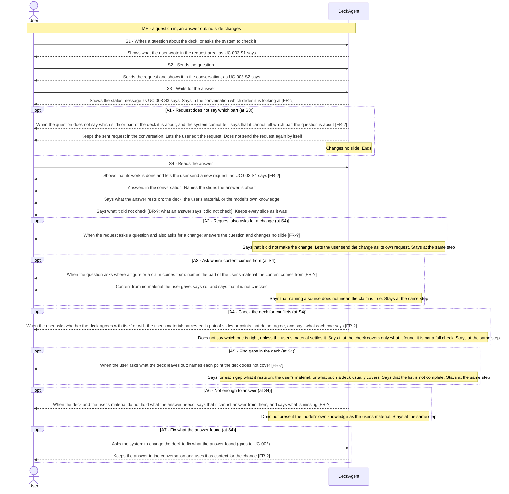

Updated at: 25-10-2026

<!-- A use case models the ideal product. Active interactions describe the product-level
     exchanges DeckAgent is designed to perform; their IDs (MF, Sx, Ax) stay stable and are
     cited by other files (UCG-03, UCG-10). A Closed flow would be listed briefly; this use
     case records none. A version file under docs/versions/ names the flows it takes; the
     use case holds no versions field (UCG-09). Write in plain English: docs/spec/_STYLE.md (UCG-11).
     Write intent and response, never interface (UCG-13, _STYLE rule 11). -->

## Goal

The user has a deck and needs to understand it or trust it before they use it: where a figure comes from, whether two slides disagree, what the deck leaves out, or what a passage means. The user wants an answer and does not want the deck changed.

## Preconditions

- **Trigger:** The user sends a question about the deck in a chat whose deck has slides.
- **Preconditions:** The deck has at least one slide. The system is not working on another request.
- **Evidence:** [assumed]

## Active interactions

Every flow below is Active in the ideal product; this use case records no Closed flow. Nothing here says which version takes a flow.

How to read the interactions:

- S1 to S3 run the main flow of UC-003 (`includes` UC-003). The question is prepared and sent there, and the system works there. S4 ends the request, as UC-003 S4 says, and gives the answer.
- The answer rests on the deck and on the material the user gave in this chat. It is not a full check of the facts (Note 3).
- The system changes no slide in any flow of this use case.

### Asking the question and reading the answer (S1 to S4)

- **MF S3:** [assumed]
- **MF S4:** [observed: claude-report (a closing message said what was checked, what was not, and that a citation came from memory)] [assumed: the same for an answer about the deck]
- **A1:** [assumed]
- **A3:** [observed: claude-report (a closing message said that a citation came from memory and not from a lookup)] [assumed: the answer to a question]
- **A4:** [observed: claude-report (a closing message said that percentages in the text did not match a table)] [assumed: a check of the deck on request]
- **A2, A5, A6, A7:** [assumed]

## Behavior constraints

- No slide changes in any flow, including a failure or a stop at S3 (UC-003 A11, A18, A19, A31; Note 4).
- This use case is not UC-002: here the system answers and changes no slide; in UC-002 the system changes the deck (Note 1). It is not UC-001: UC-001 tells the sources and assumptions once, in the closing message of the first draft (Note 2).
- Naming a source, finding a conflict and checking a fact are three different things. This use case names sources and finds conflicts; it does not promise that a claim is true (Note 3).

Proposals, to be confirmed against recordings.

- **Postconditions:**
  - The conversation holds the question and the answer.
  - Every slide is as it was before the question.
- **Minimal guarantee:** Whatever branch fails or is interrupted:
  - No slide changes.
  - The question is kept in the conversation.
- **Evidence:** [assumed]

## Product evidence

### Claude Slide Design

- **Coverage:** unverified
- **Research card:** [claude-deck-generation-behavior](../../research/use-cases/claude-slides-design/claude-deck-generation-behavior.md)
- **Difference:**
  - After a draft, closing messages said what was checked and what was not. One said that a citation came from memory.
  - The team did not record a question about a finished deck.
- **Updated at:** 10-10-2026

### Napkin AI

- **Coverage:** unverified
- **Research card:** [napkin-ai-deck-generation-behavior](../../research/use-cases/napkin-ai/napkin-ai-deck-generation-behavior.md)
- **Difference:**
  - An image shows the editor offering to inspect and update the visuals of a deck. It suggests questions such as which visual is in view.
  - The team did not try it.
- **Updated at:** 10-10-2026

## Decisions needed

1. S1: how does the system tell a question from a request to change the deck (UC-002)? Owner to decide.
2. A2: when a request asks a question and a change, does the system do both, or answer only? Owner to decide.
3. S4: can the answer use sources outside the deck and the user's material, such as the web? Owner to decide.
4. S1: is a question about something other than this deck part of this use case? Examples are practice for questions from an audience, learning a topic, or a general question. Owner to decide.
5. A5: what does the system compare the deck with to find gaps? Owner to decide.

## Notes

1. This use case is not UC-002. Here the system answers and changes no slide. In UC-002 the system changes the deck. Both send a request through UC-003, so they share a trigger. They do not share a result.
2. This use case is not UC-001. UC-001 tells the sources and assumptions once, in the closing message of the first draft (S6). Here the user asks at any time after.
3. Naming a source, finding a conflict and checking a fact are three different things. This use case names sources and finds conflicts. It does not promise that a claim is true.
4. A failure or a stop at S3 runs the flow of UC-003 for it: A11, A18, A19 or A31. No slide changes in any of them.
5. One use case, not one per kind of question. The kinds share the trigger, the steps and the result. A3 to A5 add only what differs in the answer.
